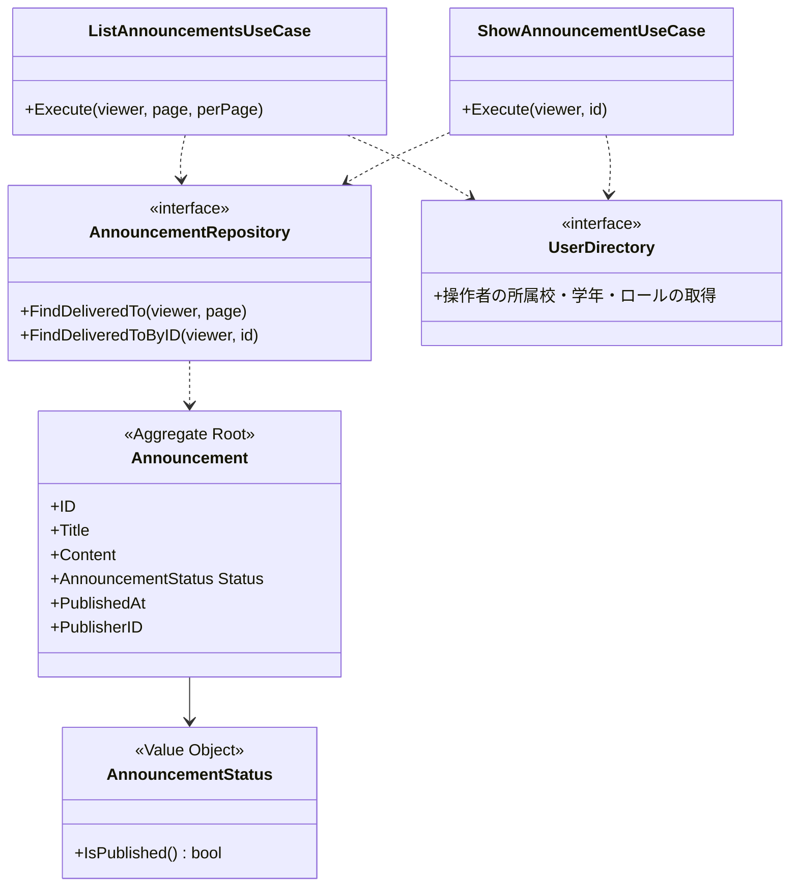
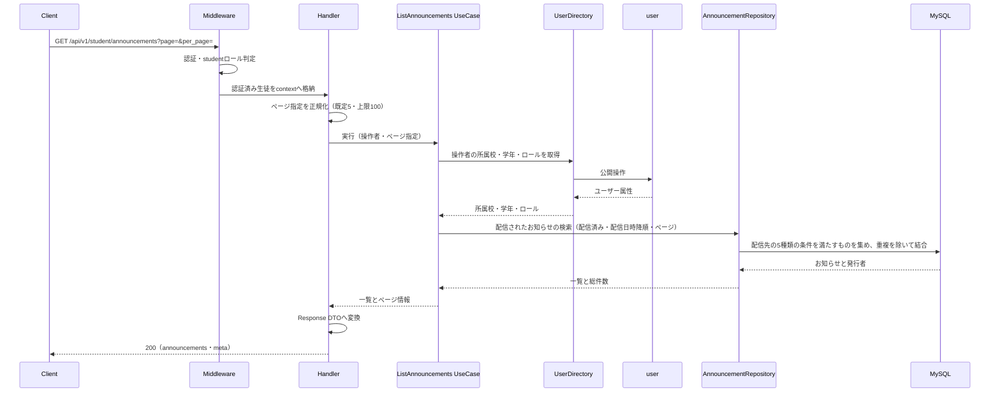
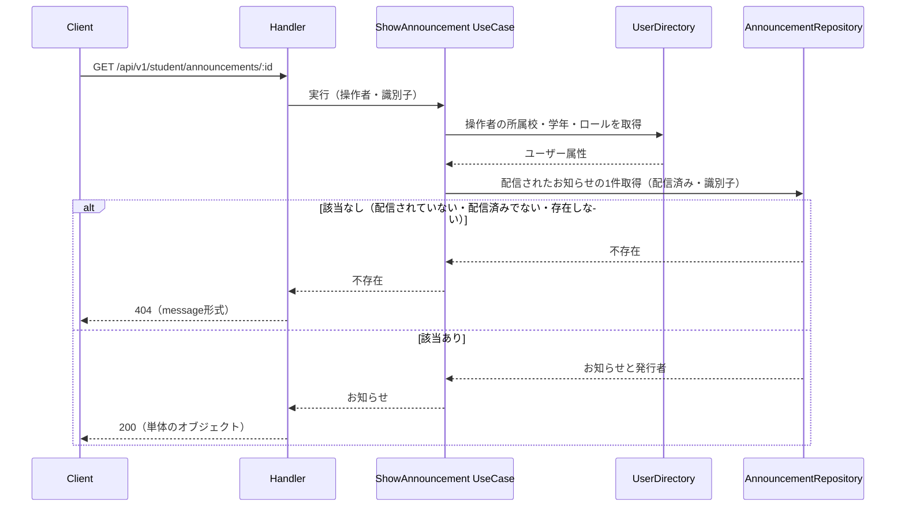

# お知らせ機能 Go移行・設計仕様書

---

# 1. 機能概要

## 機能概要

生徒が、自分に配信されたお知らせを一覧・詳細で読めるようにする機能である（①「1. 機能概要」）。

提供する操作は2つで、いずれも参照のみである（①「2. 機能一覧」）。

- お知らせ一覧取得（配信日時の新しい順。1ページあたりの既定は5件）
- お知らせ詳細取得

**生徒がお知らせを作成・更新・削除することはできない。** お知らせは教員（教師お知らせ機能）・管理者（管理者お知らせ管理機能）・システム（承認・却下等の通知）が作成する。

「自分に配信されたか」の判定は、お知らせに紐づく配信先の指定（5種類）と、生徒の所属（学校・学年・権限）・識別子を突き合わせて行う。配信済みのお知らせのみを対象とする。

## 利用者

`student` ロールのユーザー（生徒）のみ（①「8. 権限制御」）。

## 業務上の目的

学校・教員からの連絡が生徒に届く経路を提供すること。自分に向けられたお知らせだけが見えるようにし、他の学年・他校向けの連絡が混ざらないようにすること。

---

# 2. 設計方針

- **参照専用に徹する**: 本機能は書き込みを一切行わない。お知らせの作成・更新・状態遷移は、同じContextを共有する他の2機能が担う。
- **Contextを共有する他機能の定義に従う**: `announcement` Contextはお知らせ機能・教師お知らせ機能・管理者お知らせ管理機能の3文書が共有する。**Domain層の定義（Aggregate・Entity・Value Object・状態遷移・Domain Service・Repository）は教師お知らせ機能②に集約されている。** 本書では繰り返さず、同書を参照する。
- **配信範囲の突き合わせを検索条件として表す**: 「自分に配信されたか」を全件読み込んで判定しない。件数が増えたときに成立しないためである（教師お知らせ機能②「11. Repository設計」）。
- **API互換性を維持する**: URL・HTTPメソッド・レスポンス項目名・HTTPステータスをRails現行から変えない。フロントエンドを変更しない方針のため、Rails現行の振る舞いに不合理な点があっても本移行では踏襲し、Rails側の修正課題として別に管理する（「19. API仕様」の「Railsとの差分」）。
- **Contextの構成に合わせる**: 本機能自体はTransaction Scriptで足りる業務だが、Contextの構成はDomain Modelに合わせる（規約「4. Bounded Context構成」の「1つのContextに複数の設計パターンが混在する場合」）。参照処理もusecase層を経由する。

---

# 3. Bounded Context

## Context名

- `announcement`

## Contextを共有する機能

本Contextは3つの機能文書が共有する。一覧・責務・持たない責務・他Contextとの依存関係は**教師お知らせ機能②「3. Bounded Context」に集約する。** 本書では本機能に関わる点のみを示す。

|機能|本書との関係|
|-|-|
|お知らせ機能（本書）|配信されたお知らせの参照のみ|
|教師お知らせ機能|**Domain層の定義の正本。** お知らせの作成・更新を担う|
|管理者お知らせ管理機能|お知らせの作成・更新・削除・配信、予約配信の自動切替を担う|

## 本機能の責務

- 操作者に配信された配信済みのお知らせの提供（一覧・詳細）

## 本機能が持たない責務

|持たない責務|担う機能・Context|
|-|-|
|お知らせの作成・更新・削除・配信|教師お知らせ機能・管理者お知らせ管理機能|
|配信先の指定とその検証|同|
|状態遷移|同|
|予約配信の自動切替|管理者お知らせ管理機能②「18. Domain Event」|
|ユーザーの所属（学校・学年）・ロールの定義|`user`（ユーザー基盤機能②「3. Bounded Context」）|

## 他Contextとの依存関係

|依存先Context|参照する内容|根拠|
|-|-|-|
|`user`|認証済み生徒の識別と、所属校・学年・ロール|①「5. API / 処理詳細」`#index`の配信先の突き合わせ|

本機能から他Contextへの参照依存はこの1つのみである。配信先の突き合わせに必要な学年・権限・高校の情報は、操作者の属性として`user`から受け取る。**配信先に指定された学年・ユーザーの情報を参照する必要はない。** 突き合わせは配信先に保存されている識別子と操作者の識別子を比べるだけで済む。

## 依存する理由

配信範囲は、お知らせの配信先の指定と操作者の所属（学校・学年・ロール）を突き合わせて決まる。本Contextは配信先を所有するが、操作者がどの学校・学年・ロールに属するかを定義していない。そのため`user`への参照依存が生じる。

---

# 4. 設計パターン

## 採用パターン

Transaction Script（**ただしContextの構成はDomain Modelに従う**）

## 判断根拠

本機能は2つの参照操作のみで構成され、状態管理・状態遷移・業務ルールを持たない。

- **業務ルール**: 「配信されたお知らせのうち配信済みのものを、配信日時の降順で返す」のみ。配信範囲の突き合わせは検索条件であり、本機能が判定するものではない
- **状態管理**: 本機能は状態を変更しない（①「7. 状態管理」）。参照する状態は「配信済みかどうか」の絞り込みに使うだけである
- **整合性**: 書き込みがないため、保証すべき整合性の単位が存在しない
- **将来拡張**: 既読管理などが加わる場合は書き込みが生じるため、そのときにパターンを見直す
- **テスト容易性**: 入力（操作者の所属・ページ指定）に対する出力を検証するだけでよい

**ただしContextディレクトリの構成はDomain Modelに合わせる。** 規約「4. Bounded Context構成」の「1つのContextに複数の設計パターンが混在する場合」が「Contextディレクトリの構成はそのContextで採用されている最も複雑なパターンに合わせる。単純なパターンを採用した機能も、そのContextの構造に従う」と定めており、`announcement`を例として挙げている。

したがって本機能の参照処理も次の形になる。

|項目|本機能単独ならTransaction Script|Contextの構成に従う形|
|-|-|-|
|業務操作の置き場所|`application/`直下の関数|**`application/usecase/`のUseCase struct**|
|データアクセス|`infrastructure/`の関数|**`domain/repository/`のRepository Interfaceと`infrastructure/gormrepo/`の実装**|
|Entity|作らない|**`announcement` Contextの`Announcement` Entityを使う**（教師お知らせ機能②「6. Entity設計」）|

1つのContextディレクトリ内にパターンの異なる構造を併存させないためである（規約同節）。同じ`announcements`テーブルに対する永続化の経路が2つになると、業務ルールの置き場所が決まらなくなる。

## 採用しなかったパターン

### Domain Model（本機能単独の判断として）

本機能にEntityへ振る舞いを持たせる余地がない。状態遷移も業務ルールの判定も行わない。ただし**Contextの構成としてはDomain Modelに従う**ため、Entityとusecase層は使う。これは本機能の業務が複雑だからではなく、Contextを共有する他機能に合わせるためである。

### Active Record

本機能に作成・更新処理が含まれない。永続化操作をstructに持たせる対象がない。またContextの構成がDomain Modelであるため、Active Recordの構造（直下の`model.go`・`store.go`）を併存させられない。

### Event Sourcing

履歴の再構築・監査要件が存在しない。

---

# 5. Aggregate設計

**教師お知らせ機能②「5. Aggregate設計」に集約する。** `Announcement`をAggregate Rootとし、配信先（`AnnouncementTarget`）を含む境界である。

本機能はこのAggregateを**読み取り専用で参照する。** 不変条件を保証する責務は持たない。

参照時に配信先を必要とするかを整理する。

|操作|配信先を読み込むか|理由|
|-|-|-|
|一覧取得|**読み込まない**|レスポンスに配信先を含めない（①「5. API / 処理詳細」`#index`）。配信範囲の突き合わせは検索条件として行い、取得した結果に配信先を含める必要がない|
|詳細取得|読み込まない|同|

Aggregateを取得するが配信先を読み込まない形になる。Aggregate Rootの一部だけを読む参照であり、書き込みを伴わないため不変条件の保証に影響しない。

---

# 6. Entity設計

**教師お知らせ機能②「6. Entity設計」に集約する。** `Announcement`・`AnnouncementTarget`の定義は同書のとおりである。

本機能が参照する属性は次のとおりである。

|属性|用途|
|-|-|
|識別子|レスポンス、詳細取得の条件|
|件名・本文|レスポンス|
|配信日時|レスポンス、並び順|
|状態|配信済みのみを返す絞り込み|
|発行者の識別子|発行者の氏名・氏名カナの取得|

本機能が参照しない属性: 予約日時、システム生成かどうか、配信先。いずれもレスポンスに含めず、絞り込みにも使わない（①「5. API / 処理詳細」`#index`）。

**システム生成かどうかで絞り込まない。** 承認・却下等の通知も、配信先が一致すれば対象に含まれる（同）。教師お知らせ機能の`authored`タブが除外するのとは扱いが異なる。

---

# 7. Value Object設計

**教師お知らせ機能②「7. Value Object設計」に集約する。** `AnnouncementStatus`・`ScheduledAt`・`DeliveryTargetType`の定義は同書のとおりである。

本機能が使うのは`AnnouncementStatus`のみである。配信済みかどうかの判定に用いる。`ScheduledAt`・`DeliveryTargetType`は参照しない。

本機能に固有のValue Objectは設けない。

- ページ指定（既定5件・上限100）は全APIで共通の規則であり、本機能固有の型を作らない（規約「15. API規約（レスポンス形式・ページネーション・URL・クエリパラメータ）」のページネーション）。**ただし既定値のみ本機能で5件とする**（①「5. API / 処理詳細」`#index`）
- 操作者の所属（学校・学年・権限）は`user`から受け取る値であり、本Contextで規則を持たない

---

# 8. Domain Service

**教師お知らせ機能②「8. Domain Service」に集約する。** 同書が定める`TargetDeliverabilityPolicy`は配信先の指定可否の判定であり、**本機能では使わない。** 本機能は配信先を指定しないためである。

本機能に固有のDomain Serviceも設けない。

「自分に配信されたか」の判定をDomain Serviceにしない理由は、教師お知らせ機能②「24. 採用しなかった設計」の「『自分に配信されたか』の判定をDomain Serviceにする」に記載のとおりである。一覧を返すには絞り込んだ上でページネーションする必要があり、全件を読み込んで判定する形では成立しない。

---

# 9. クラス図

**教師お知らせ機能②「9. クラス図」に集約する。** Entity・Value Object・Domain Service・Repositoryの関係は同書のとおりである。

本機能が使う範囲を示す。

本機能は`AnnouncementTarget`・`DeliveryTargetType`・`ScheduledAt`・`TargetDeliverabilityPolicy`を使わない。配信先は検索条件として扱われ、Entityとして読み込まない（「5. Aggregate設計」）。

Goのstruct定義・インターフェースのシグネチャは③Go実装仕様書で扱う。

---

# 10. 状態遷移図

**教師お知らせ機能②「10. 状態遷移図」に集約する。**

本機能は状態を変更しない。本機能から見える状態は**配信済みのみ**である。下書き・予約のお知らせは検索条件で除外される（①「5. API / 処理詳細」`#index`）。

予約状態のお知らせが配信済みに切り替わると、本機能の一覧に新たなお知らせが現れる。この切り替えは本機能の外で行われる（管理者お知らせ管理機能②「18. Domain Event」）。本機能はその契機を持たない。

---

# 11. Repository設計

**教師お知らせ機能②「11. Repository設計」に集約する。** `AnnouncementRepository`の定義は同書のとおりである。

本機能が使う検索は2つである。

|検索|条件|用途|
|-|-|-|
|配信されたお知らせの検索|操作者の所属（学校・学年・ロール）と識別子を配信先と突き合わせる。状態が配信済み。配信日時の降順（同値は識別子の降順）。ページネーション|一覧取得|
|配信されたお知らせの1件取得|同じ突き合わせに加えて識別子|詳細取得|

1件取得を一覧の検索と別に持つのは、該当しない場合に「不存在」として扱う必要があるためである。一覧の検索で1件に絞る形にすると、0件と不存在を呼び出し側が区別することになる。

配信範囲の突き合わせの詳細（5種類の条件、重複の除去、識別子の集合を条件に入れない方針、発行者の在籍状態で絞り込まないこと）は教師お知らせ機能②「11. Repository設計」の「配信されたお知らせの検索について」に記載する。

## 他Contextの参照手段

|参照手段|相手Context|取得する内容|用途|
|-|-|-|-|
|ユーザー属性の参照|`user`|操作者の所属校・学年・ロール|配信範囲の突き合わせ（①「5. API / 処理詳細」`#index`）|

本Contextの`dependency.go`にインターフェースとして宣言し、実装は相手Contextの公開操作へ委譲するアダプタに閉じ込める（規約「4. Bounded Context構成」・「5. Context間連携ルール」）。

発行者の氏名・氏名カナは`announcements.publisher_id`から`users`を結合して取得する。これは**Repositoryの検索の中で行う**（「21. DB操作仕様」）。`user`の参照手段を1件ずつ呼ぶとお知らせごとの問い合わせになるためである。

## 本機能が他Contextへ公開する参照手段

なし。本機能を参照する他Contextは存在しない。Contextとしての公開操作は教師お知らせ機能②「11. Repository設計」に記載する。

---

# 12. UseCase設計

## ListAnnouncements

- 目的: 操作者に配信された配信済みのお知らせを、配信日時の新しい順にページ単位で取得する
- 入力: 操作者の識別子・所属校・学年・ロール、ページ番号、1ページあたりの件数
- 出力: お知らせの一覧（識別子・件名・本文・配信日時・発行者）とページ情報
- トランザクション範囲: 読み取りのみのため不要（「14. Transaction設計」）
- 呼び出すRepository: `AnnouncementRepository`（配信されたお知らせの検索）
- 判断根拠: 配信範囲の突き合わせを検索条件として渡すだけであり、分岐を持たない

**1ページあたりの既定値は5件である。** 他のAPIの既定値（20件）と異なる（①「5. API / 処理詳細」`#index`）。上限は全APIで共通の100件。

該当するお知らせがない場合は空の一覧とページ情報を返す。エラーにしない。

## ShowAnnouncement

- 目的: 操作者に配信された配信済みのお知らせ1件を取得する
- 入力: 操作者の識別子・所属校・学年・ロール、お知らせの識別子
- 出力: お知らせ（識別子・件名・本文・配信日時・発行者）
- トランザクション範囲: 不要
- 呼び出すRepository: `AnnouncementRepository`（配信されたお知らせの1件取得）
- 判断根拠: 一覧と同じ絞り込みで1件を取得する。該当しない場合は不存在として扱う

**自分に配信されていないお知らせ、配信済みでないお知らせ、存在しないお知らせをいずれも不存在として扱う。** 存在するが見る権限がないことを区別しない（①「5. API / 処理詳細」`#show`）。

操作者の所属を入力に含めるのは、配信範囲の突き合わせに必要であるためである。Handlerが`context.Context`から取り出して渡す（「16. Authorization設計」）。

---

# 13. シーケンス図・処理フロー図

## シーケンス図

### ListAnnouncements

### ShowAnnouncement

## 処理フロー図

省略する。

理由: 2つのUseCaseはいずれも分岐を持たない。一覧は検索結果をそのまま返し、詳細は該当するかどうかの1分岐のみである（上図に示した）。配信範囲の突き合わせには分岐があるが、これはRepositoryの検索条件として表現されるものであり、処理の分岐ではない。突き合わせの条件は①「5. API / 処理詳細」`#index`の表に整理している。

---

# 14. Transaction設計

- **Transaction開始位置**: なし
- **Transaction終了位置**: なし

## 理由

本機能は参照のみで、1件のデータも作成・更新・削除しない（①「5. API / 処理詳細」Database変更）。書き込みがないため、原子性を保証する対象が存在しない。規約「11. Transaction実装パターン（TransactionManager）」の仕組みは使わない。

操作者の属性の取得と、お知らせの検索を順に行うため、呼び出しの間に操作者の所属が変わると、変更前の所属で絞り込まれる可能性がある。これを防ぐために読み取り専用トランザクションで束ねることはしない。Rails現行も同様に個別のクエリを順に発行しており、同じ性質を持つ。また所属の変更は管理者・教員の操作によるものであり、生徒が一覧を開いている最中に起きる可能性は低い。

---

# 15. Validation設計

## Presentation

- 型チェック: `id` が整数として解釈できること。`page`・`per_page` が整数として解釈できること
- 必須チェック: パスパラメータ（`id`）が存在すること。クエリパラメータに必須のものはない
- フォーマットチェック: なし

ページ指定の正規化（0以下・数値以外を既定値とする、上限を超える値を上限に丸める）はPresentation層で行う。**既定値のみ本機能で5件とする**（①「5. API / 処理詳細」`#index`）。

## Domain

本機能に業務ルールによる検証は存在しない。

- 業務ルール: 検証対象なし。配信範囲の突き合わせは検索条件であり、検証ではない
- 状態チェック: なし。状態を変更しない
- 整合性チェック: なし。書き込みがない

Domain層の検証（件名・本文・状態・予約日時・配信先）は、お知らせを作成・更新する機能が行う（教師お知らせ機能②「15. Validation設計」）。本機能は既に保存されたお知らせを読むだけである。

## バリデーション仕様

|フィールド|検証層|ルール|エラーメッセージ方針|
|-|-|-|-|
|`id`（パスパラメータ）|Presentation|整数として解釈できること|「お知らせの指定が不正です」|
|`page`|Presentation|整数として解釈できること。0以下・数値以外は未指定として扱う|エラーにしない。既定値を使う|
|`per_page`|Presentation|整数として解釈できること。0以下・数値以外は**既定値5**、上限（100）を超える値は上限に丸める|エラーにしない|

`page`・`per_page`の不正値をエラーにせず既定値で処理するのは、Rails現行がそうしているためである（①「5. API / 処理詳細」`#index`）。

お知らせの実在確認は検証ではなく、参照の結果として扱う。該当する行が取得できなければ不存在として`404`を返す（「12. UseCase設計」）。

---

# 16. Authorization設計

|層|判定内容|理由|
|-|-|-|
|Middleware|認証（ログイン済みであること）と`student`ロールであることを判定する|規約「7. 横断的関心事の置き場所」のとおり、ロールレベルの粗い制御はMiddlewareに置く。認可はCasbin RBACで行う（Gin規約「4. 認可（Casbin RBAC）」）|
|Handler|操作者の識別子をcontextから取り出し、UseCaseへ渡す。リクエストから受け取らない|他人として振る舞えないようにするため|
|UseCase|配信範囲の判定を**Repositoryの検索条件として**行う|該当しないものを取得できない形にすることで、「取得してから権限を判定する」経路を作らない|
|Domain|判定しない|本機能に業務ルールの判定がない|

## 判断理由

**配信先の突き合わせがそのまま閲覧制限になっている**（①「8. 権限制御」）。自分に配信されていないお知らせは一覧に現れず、詳細も`404`となる。

これを検索条件として表すのは、Rails現行の振る舞いに合わせるためである。取得してから配信先を突き合わせる形にすると、`403`を返す経路を作ることになり挙動が変わる。また一覧ではページネーションの前に絞り込む必要がある。

操作者の識別子をリクエストから受け取らないことで、他の生徒に配信されたお知らせを指定して読む経路をなくす。

発行者の氏名・氏名カナは返すが、メールアドレス等の他の情報は返さない（①「8. 権限制御」）。`user`から受け取る属性のうち、レスポンスに出すものを限定する。

---

# 17. Error設計

## Domain Error

責務: なし。本機能に業務ルール違反を表すエラーが存在しない。

Domain層のエラー（配信先の指定が不正、状態遷移が許されない等）は、お知らせを作成・更新する機能で発生する（教師お知らせ機能②「17. Error設計」）。

## Application Error

責務: 指定されたお知らせが取得できないことを表す。

詳細取得で、識別子に該当するお知らせが「操作者に配信された配信済みのもの」の範囲に見つからない場合に発生する。`404`として返す。

## Infrastructure Error

責務: DBアクセスの失敗、`user`の参照手段の呼び出しの失敗を表す。

本機能では個別に判別せず、そのまま呼び出し元へ返して`500`として扱う。参照先の失敗を本機能で意味づけし直す余地がないためである。

## 判断理由

本機能は書き込みを持たず、業務ルールによる失敗が存在しない。そのため意味を持つエラーは「お知らせが取得できない」の1つに絞られる。

**該当する行が0件であることをエラーにしない。** 一覧では空の配列を返すのが正常な応答である（①「5. API / 処理詳細」`#index`）。詳細では1件が取得できないことが不存在を意味するため、こちらはエラーとして扱う。

`user`の参照手段の失敗を吸収しない。操作者の所属が取得できなければ配信範囲を絞り込めず、誤ったお知らせを返す可能性があるためである。ダッシュボード機能③が当日の解答件数の失敗を`0`として吸収しているのとは扱いが異なる。あちらはRails現行が吸収しているためであり、本機能には該当しない。

## エラー仕様

|業務シナリオ|エラー種別|発生層|想定するHTTPステータス|
|-|-|-|-|
|`id`が整数として解釈できない|Validation|Presentation|422|
|指定されたお知らせが取得できない（配信されていない・配信済みでない・存在しない）|NotFound|Application|404|
|DBアクセスの失敗|Internal|Infrastructure|500|
|`user`の参照手段の呼び出しの失敗|Internal|Infrastructure|500|
|未認証|Unauthorized|Middleware|401|
|`student`ロール以外|Forbidden|Middleware|403|
|該当する行が0件（一覧）|エラーにしない|-|200（空の配列）|

`404`の本文は`{"message": "Announcementが見つかりません"}`とする。規約「15. API規約（レスポンス形式・ページネーション・URL・クエリパラメータ）」はエラー本文を`{"errors": [...]}`と定めているが、Rails現行の`404`は`message`キーであり、フロントエンドを変更しない方針のため維持する。モデル名が英語表記になる点も維持する（①「5. API / 処理詳細」`#show`）。

---

# 18. Domain Event

不要である。

理由: 本機能は参照のみで、他の処理へ波及させるべき状態変化が発生しない。お知らせを読むことに副作用がない（既読の記録を行わない）。

Contextとしての判断は教師お知らせ機能②「18. Domain Event」に記載する。予約配信の自動切替の設計は管理者お知らせ管理機能②「18. Domain Event」に記載する。

---

# 19. API仕様

## エンドポイント一覧

|エンドポイント|HTTP Method|概要|
|-|-|-|
|`/api/v1/student/announcements`|GET|お知らせ一覧を取得|
|`/api/v1/student/announcements/:id`|GET|お知らせ詳細を取得|

## 各エンドポイントの仕様

### `GET /api/v1/student/announcements`

- Request: クエリパラメータ `page`（任意）・`per_page`（任意。**既定5**・上限100）
- Response: `{"announcements": [...], "meta": {...}}`。各要素は`id`・`title`・`content`・`published_at`・`publisher`（`id`・`name`・`name_kana`）。`meta`は`current_page`・`total_pages`・`total_count`・`per_page`
- Status Code: 正常系 `200`。異常系 `401`・`403`・`500`
- Error Response方針: `{"errors": [...]}`

**一覧でも本文（`content`）を返す。** 管理者向けのお知らせ一覧が本文を返さないのとは異なる（管理者お知らせ管理機能①「5. API / 処理詳細」`#index`）。

### `GET /api/v1/student/announcements/:id`

- Request: パスパラメータ `id`
- Response: 最上位が単体のJSONオブジェクト。項目は一覧の各要素と同じ。`announcements`のようなキーで包まない
- Status Code: 正常系 `200`。異常系 `404`・`422`・`401`・`403`・`500`
- Error Response方針: `404`は`{"message": "..."}`、それ以外は`{"errors": [...]}`

## Railsとの差分

フロントエンドを変更しない方針のため、URL・HTTPメソッド・レスポンス項目名・HTTPステータスは変更しない。**差分はない。**

### 変更しないもの（Rails現行の振る舞いを踏襲する点）

|項目|Rails現行の振る舞い|
|-|-|
|1ページあたりの既定値|**5件**。他のAPIの既定値（20件）と異なる（①「5. API / 処理詳細」`#index`）|
|一覧で本文を返す|件数が多い場合に転送量が大きくなるが、一覧の各要素に本文が含まれる（同）|
|`404`の本文のモデル名が英語表記|`{"message": "Announcementが見つかりません"}`。`activerecord.models`に`announcement`の訳がない（同`#show`）|
|システム生成のお知らせを区別しない|承認・却下等の通知も配信先が一致すれば一覧に現れる（同`#index`）|
|発行者の在籍状態で絞り込まない|論理削除済みのユーザーが発行したお知らせも返る（①「6. データモデル」）|
|一覧と詳細で最上位の構造が異なる|一覧は`announcements`キーと`meta`、詳細は単体のオブジェクト（①「5. API / 処理詳細」）|

---

# 20. DB設計方針

- **現行DBを利用するか**: 利用する
- **Schema変更有無**: なし
- **変更理由**: 該当なし

本機能が参照するテーブルは`announcements`・`announcement_targets`・`users`である。`announcements`・`announcement_targets`は`announcement` Contextが所有し、`users`は`user`が所有する（①「6. データモデル」）。

本機能からの要求でSchemaを変更する必要はない。Contextとしての判断は教師お知らせ機能②「20. DB設計方針」に記載する。

本機能に固有の検討として、配信範囲の突き合わせ用のインデックスを挙げる。Rails現行は配信先の種類ごとに条件を分けて既存のインデックス（種類と各識別子の組み合わせ）を効かせる形を採っている（①「10. Rails実装対応表」）。追加の必要性は実測で判断すべきであり、本移行の範囲としない。

既読管理のためのテーブルも設けない。Rails現行に該当する仕組みがなく、本移行の範囲としない。

---

# 21. DB操作仕様

|検索|対象テーブル|操作種別|主な検索条件|結合|ページネーション/ソート|
|-|-|-|-|-|-|
|配信されたお知らせの検索|`announcements`, `announcement_targets`, `users`|参照|配信先の5種類それぞれの条件を満たすものを集め、重複を除いて結合。`status`が配信済み|発行者（`users`）を一括取得|`published_at`降順・`id`降順、ページネーションあり|
|配信されたお知らせの1件取得|同|参照|同じ突き合わせに加えて`announcements.id`|同|不要|

- 論理削除の列を持たないため、`deleted_at`による絞り込みは行わない
- **発行者の在籍状態で絞り込まない。** 論理削除済みの発行者のお知らせも返る（①「6. データモデル」）
- 配信先（`announcement_targets`）は突き合わせの条件としてのみ使い、取得しない。レスポンスに含めないためである
- 発行者は結合で一括取得する。お知らせごとに問い合わせるN+1を避ける
- 操作者の所属（学校・学年・ロール）は**条件の値として**受け取る。`users`を操作者側で結合しない。ユーザーの所属の定義を本Contextが抱えないためである（教師お知らせ機能②「21. DB操作仕様」）

配信範囲の突き合わせの具体的な形（5種類の条件を集めて重複を除いてから結合する）は、教師お知らせ機能②「11. Repository設計」の「配信されたお知らせの検索について」に記載する。

具体的なSQL・GORMのクエリコードは③Go実装仕様書（`規約/Gorm規約.md`）で扱う。

---

# 22. テスト戦略

## Domain Test

本機能が使うのは`AnnouncementStatus`の配信済み判定のみである。Value Object・Entityのテストは教師お知らせ機能②「22. テスト戦略」に記載する。本機能に固有のDomain Testはない。

## UseCase Test

目的: Repositoryと`user`の参照手段を差し替え、手順を検証する。

重点を置く観点:

- `ListAnnouncements`: 操作者の所属を取得して検索へ渡すこと、ページ指定がそのまま渡ること、0件のとき空の一覧とページ情報を返すこと（エラーにしないこと）
- `ShowAnnouncement`: 該当しないとき不存在を返すこと
- 両UseCase: `user`の参照手段が失敗したときエラーを返すこと（吸収しないこと）
- 両UseCase: 操作者の識別子を入力から受け取り、自分で決めないこと

## Repository Test

目的: 配信範囲の突き合わせを実際のDBに対して検証する。**本機能のテストの中心をここに置く。**

重点を置く観点は教師お知らせ機能②「22. テスト戦略」の`Repository Test`に記載する。本機能の観点として次を加える。

- 1件取得で、配信されていないお知らせを指定したとき該当なしになること
- 1件取得で、下書き・予約のお知らせを指定したとき該当なしになること
- 並び順が配信日時の降順、同値のとき識別子の降順になること
- ページネーションでページをまたいだときに重複・欠落がないこと
- 配信先を取得しないこと（レスポンスに含めないため）

## Handler Test

目的: HTTPの入出力とPresentation層の検証を確認する。

重点を置く観点:

- **`per_page`の既定値が5になること**（未指定・0以下のとき）
- `per_page`が101以上のとき100に丸められること
- `id`が整数でないとき`422`になること
- 一覧が`announcements`キーと`meta`を持つこと
- 詳細が最上位に単体のオブジェクトを返すこと（キーで包まないこと）
- 一覧の各要素に`content`が含まれること
- 一覧の各要素に`status`・`scheduled_at`・`announcement_targets`が含まれないこと
- 0件のとき`[]`で返ること（`null`にしないこと）
- 不存在のとき`404`と`{"message": "Announcementが見つかりません"}`が返ること
- 操作者をcontextから取り出し、リクエストから受け取らないこと

## Integration Test

目的: 認証・認可を含めたエンドポイントの振る舞いと、`user`の参照手段を実装込みで通した結果を確認する。

重点を置く観点:

- 未認証で`401`、`student`以外のロール（教員・管理者）で`403`
- **5種類の配信先それぞれで、配信される生徒には見え、配信されない生徒には見えないこと**
- 他校向けのお知らせが見えないこと
- 他学年向けのお知らせが見えないこと
- 下書き・予約のお知らせが見えないこと
- 予約のお知らせが自動切替で配信済みになると見えるようになること（管理者お知らせ管理機能②「18. Domain Event」）
- 教員が作成したお知らせ・管理者が作成したお知らせ・システム生成のお知らせがいずれも対象になること
- 論理削除済みの発行者のお知らせも見えること

**配信範囲の正しさがこの機能の中心である。** 誤って他の生徒向けのお知らせが見えることは情報の漏えいにあたるため、5種類すべてについてIntegration Testで確認する。

---

# 23. Railsとの責務対応

|Rails|Go|設計方針|
|-|-|-|
|`Api::V1::Student::AnnouncementsController`|Handler|HTTP責務のみ担当。ページ指定の正規化と操作者の取り出しに限る|
|`DEFAULT_PER_PAGE = 5`（Controllerの定数）|Presentation層のページ指定の既定値|本機能固有の値として保持する。全APIで共通の上限（100）は規約に従う|
|`Announcement.for_user(user)`（Modelのメソッド）|`AnnouncementRepository`の検索条件|配信範囲の突き合わせをRepositoryの検索として表す。Entityのメソッドにしない|
|`Announcement`（Model）|`Announcement` Entity + GORMモデル|EntityとGORMモデルを分ける（規約「2. レイヤー責務と依存方向（Domain Model / Event Sourcing）」）。定義は教師お知らせ機能②に集約する|
|`AnnouncementTarget`（Model）|検索条件としてのみ使う|本機能はEntityとして読み込まない（「5. Aggregate設計」）|
|`announcement_scope`（Controllerの private メソッド）|UseCaseとRepositoryの組み合わせ|「配信された」「配信済み」「発行者を一括取得」という3つの条件を、Repositoryの検索の責務として表す|
|`AnnouncementSerializer` / `AnnouncementPublisherSerializer`|Response DTO|Entityをそのまま返さず、Response DTOへ変換する（規約「6. データフロー」）。項目名はRails現行と同一にする|

Rails現行は配信範囲の突き合わせをModelのクラスメソッドに置いている。Go設計ではRepositoryの検索条件として表す。Entityに持たせると、Domain層が永続化の都合（派生テーブルとして結合するか、識別子の集合を条件に入れるか）を知ることになるためである。

**Controllerに`DEFAULT_PER_PAGE = 5`が定義されている点は、本機能固有の仕様として引き継ぐ。** 全APIで共通の既定値（20）を上書きしているため、Go設計でも本機能のPresentation層に既定値を持たせる。

---

# 24. 採用しなかった設計

## 本機能をTransaction Scriptの構造で実装する

- 採用しなかった案: 本機能の参照処理を`application/`直下の関数と`infrastructure/`の検索関数で実装し、Entityを使わない
- 採用しなかった理由: 規約「4. Bounded Context構成」の「1つのContextに複数の設計パターンが混在する場合」が、Contextディレクトリの構成を最も複雑なパターンに合わせることと、パターンの異なる構造を併存させないことを定めている。`announcement` Contextは教師お知らせ機能・管理者お知らせ管理機能がDomain Modelを採用するため、本機能もその構造に従う。併存させると同じ`announcements`テーブルに対する永続化の経路が2つになり、業務ルールの置き場所が決まらなくなる
- 将来的に採用する可能性: ない。Contextを分けない限り、構成は共有される

## 配信範囲の突き合わせを本機能のRepositoryに固有の検索として持つ

- 採用しなかった案: 本機能専用のRepository Interfaceを設け、配信されたお知らせの検索だけを持たせる
- 採用しなかった理由: 同じ検索を教師お知らせ機能も使う（①「5. API / 処理詳細」`#index`のタブ未指定時）。Repositoryを機能ごとに分けると同じ検索が2つになり、突き合わせの規則が分かれる
- 将来的に採用する可能性: 低い

## 既読管理を加える

- 採用しなかった案: 生徒がお知らせを読んだことを記録し、未読の件数を返す
- 採用しなかった理由: Rails現行に該当する仕組みがない。追加するとテーブルと書き込みが増え、本機能が参照専用でなくなる
- 将来的に採用する可能性: ある。要件として挙がった場合は、本機能の設計パターンの見直し（参照専用でなくなる）が必要になる

## 一覧で本文を返さない

- 採用しなかった案: 一覧では件名までとし、本文は詳細でのみ返す
- 採用しなかった理由: Rails現行が一覧でも本文を返している（①「5. API / 処理詳細」`#index`）。フロントエンドが一覧で本文を表示している可能性があり、変更するとフロントエンドの修正が必要になる
- 将来的に採用する可能性: ある。転送量が問題になった場合に検討できる

## `per_page`の既定値を全APIで共通の20に揃える

- 採用しなかった案: 本機能の既定値を20にする
- 採用しなかった理由: Rails現行が5である（①「5. API / 処理詳細」`#index`）。フロントエンドが既定値を前提に表示件数を決めている可能性があり、変更すると1ページの件数が変わる
- 将来的に採用する可能性: ある。フロントエンドを変更できる段階で揃える価値はある

---

# 25. 設計判断サマリー

|項目|採用|判断理由|
|-|-|-|
|Bounded Context|`announcement`|3機能が同じお知らせと配信先を扱うため分けない（規約「4. Bounded Context構成」）|
|Contextの構成|Domain Model（本機能単独の判断ではない）|採用されている最も複雑なパターンに合わせる（同）。参照処理もusecase層を経由する|
|設計パターン（本機能の業務）|Transaction Script相当|状態も書き込みも業務ルールも持たない。ただし構成はDomain Modelに従う|
|Domain層の定義|**教師お知らせ機能②に集約**|同書が配信先の5種類と学年制限という最も複雑な業務ルールを扱うため|
|Aggregate|参照のみ|不変条件を保証する責務を持たない。配信先をEntityとして読み込まない|
|Value Object|`AnnouncementStatus`のみ使う|配信済みかどうかの判定に用いる。他は使わない|
|Domain Service|使わない|配信先を指定しないため`TargetDeliverabilityPolicy`の対象外|
|配信範囲の突き合わせ|Repositoryの検索条件|全件を読み込んで判定すると件数が増えたときに成立しないため|
|Transaction境界|なし|参照のみで書き込みがない|
|Domain Event|未採用|参照のみで、波及させる状態変化がない。既読の記録も行わない|
|閲覧制限|配信先の突き合わせがそのまま制限になる|Rails現行の振る舞い。`403`ではなく`404`を返す|
|`per_page`の既定値|**5件**（本機能固有）|Rails現行がControllerで上書きしている。フロントエンドの表示件数が変わらないようにする|
|`404`の本文|`{"message": "..."}`を維持|Rails現行の形。フロントエンドを変更しない方針|
|`user`の参照手段の失敗|吸収しない（500）|操作者の所属が取得できないと配信範囲を絞り込めず、誤ったお知らせを返す可能性があるため|
|API互換性|URL・項目名・ステータスを維持。差分なし|フロントエンドを変更しない方針|
|Schema変更|なし|現行の振る舞いを維持する範囲では変更が不要|
