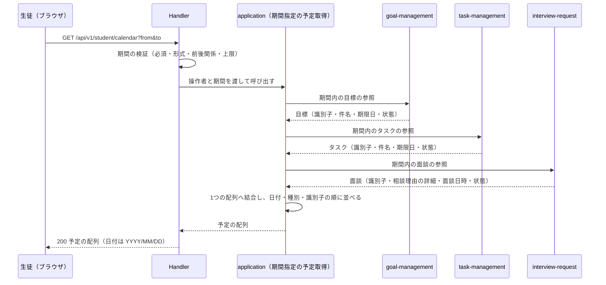

# カレンダー機能 Go移行・設計仕様書

---

# 1. 機能概要

生徒が、自分の学習予定と面談予定を1つのカレンダー上でまとめて確認できるようにする機能である（①「1. 機能概要」）。

- 機能概要: 指定した期間に含まれる目標・タスク・面談を、1回の取得で日付順に並べた1つの配列として返す
- 利用者: 生徒
- 業務上の目的: 目標・タスク・面談という別々に管理されている情報を、日付という観点で1つの時系列にまとめて提供すること

予定の作成・変更・削除は扱わない。参照のみを提供する。教員向けのカレンダー表示は本機能を使わず、教師面談機能の面談一覧に期間を指定して取得する（①「1. 機能概要」）。

---

# 2. 設計方針

- **責務分離**: 目標・タスク・面談のデータは所有するContextが管理し、本Contextは「期間で横断して1つの時系列にまとめる」ことだけを担う。各予定の業務ルール（期限の意味・状態遷移・取り消しの扱い）は所有Context側に残す
- **API互換性**: Rails現行のエンドポイント・クエリパラメータ・レスポンス（envelopeなしのJSON配列、`YYYY/MM/DD`形式の日付）を維持する。フロントエンドの修正を不要にするためである（規約「15. API規約（レスポンス形式・ページネーション・URL・クエリパラメータ）」）
- **保守性**: 予定の種別が増えた場合に、所有Contextの参照手段を1つ増やして結合する箇所を足すだけで済む形にする
- **テスト容易性**: 入力（操作者・期間）に対する出力（3種類の参照結果の結合と並び替え）を検証するだけでよい構造にする
- **拡張性**: 日付の扱い（暦日とタイムゾーンの突き合わせ）を所有Context側に閉じ込め、本Contextは暦日だけを受け渡す

---

# 3. Bounded Context

## Context名

- `calendar`

生徒向けカレンダーを担うContextである。参照専用Contextとして立てる。

## Contextの責務

- 指定された期間に含まれる予定を、所有Contextの公開参照手段から取得すること
- 3種類の予定を1つの時系列へ結合し、日付・種別・識別子の順に並べること
- 予定の種別（`goal` / `task` / `interview_request`）という、本機能の表示上の区分を定めること

## 持たない責務

- 目標・タスク・面談の作成・更新・状態遷移（`goal-management`・`task-management`・`interview-request`の責務）
- 期限日・面談日時の意味の決定、取り消し済み・論理削除済みの扱いの決定（いずれも所有Contextの責務）
- 並び順・結合以外の業務ルール

## 他Contextとの依存関係

本Contextから他Contextへの参照依存のみである。状態変更を伴う依存も、他Contextから本Contextへの依存も存在しない。

|依存先|必要とする参照|根拠|
|-|-|-|
|`goal-management` Context（②は`目標管理機能_Go移行・設計仕様書.md`）|期限日が指定期間内にある、操作者の目標（識別子・件名・期限日・状態）|①「5. API / 処理詳細」`#show`|
|`task-management` Context（②は`タスク管理機能_Go移行・設計仕様書.md`）|期限日が指定期間内にある、操作者のタスク（識別子・件名・期限日・状態）|同|
|`interview-request` Context（②は`面談機能_Go移行・設計仕様書.md`）|面談日時が指定期間内にあり、取り消し済みでない、操作者が当事者の面談（識別子・相談理由の詳細・面談日時・状態）|同|
|`user` Context（②は`ユーザー基盤機能_Go移行・設計仕様書.md`）|認証済み生徒の識別|同「8. 権限制御」|

## 本Contextが必要とする公開操作

**3つの所有Contextに、期間指定の公開参照手段が必要になる。** いずれも現時点では同②に定義がない。

|必要な操作|所有Context|内容|
|-|-|-|
|期間内の目標の参照|`goal-management`|期限日が期間内にある操作者の目標を返す。論理削除済みを除外する|
|期間内のタスクの参照|`task-management`|期限日が期間内にある操作者のタスクを返す。論理削除済みを除外する|
|期間内の面談の参照|`interview-request`|面談日時が期間内にあり取り消し済みでない、操作者が当事者の面談を返す。面談日時が未設定のものは含まれない|

分析機能が所有Contextへ参照手段を要求したのと同じ構図である（分析機能②「3. Bounded Context」）。面談については、同Contextが教師面談機能の一覧で同じ期間検索を既に持っており（面談機能②「11. Repository設計」・教師面談機能②「11. Repository設計」）、公開参照手段はその検索条件を当事者指定で呼び出せる形になる。面談機能②「3. Bounded Context」は本機能からの参照要求を記録している。

## 依存する理由

カレンダーはデータそのものを所有・管理せず、他Contextが管理するデータを読み取り専用で集約して表示する性質の機能である。規約「4. Bounded Context構成」の「Context分割基準」は、同一データに対する参照専用の切り口を別Contextとして切り出してよいとし、その場合「業務ルール（作成・更新・状態遷移）は元のContextに残し、参照専用Contextは持たない」と定めている。本Contextはこの方針に従う。

ダッシュボード機能（`dashboard`）・分析機能（`learning-analytics`）と同じ位置づけである。ダッシュボードに本機能を含めない理由は「24. 採用しなかった設計」に記載する。

---

# 4. 設計パターン

## 採用パターン

Transaction Script

## 判断根拠

本機能は「3つの参照手段を呼び、結果を1つの配列へ結合して並べ替える」だけで構成されており、状態管理・状態遷移が存在しない。

- 業務ルール: 「日付・種別・識別子の順に並べる」という並び順の規則と、「取り消し済みの面談を除く」「論理削除済みの目標・タスクを除く」という除外条件のみである。除外条件はいずれも所有Contextの参照手段に渡す条件であり、本Contextが判定するものではない
- 状態管理: 本機能側で状態を変更しない（読み取り専用）。返す状態は参照結果をそのまま載せたものである（①「7. 状態管理」）
- 整合性: 書き込みがないため、保証すべき整合性の単位が存在しない
- 将来拡張: 予定の種別が増える場合も、参照手段を1つ増やして結合対象に加えるだけでよい
- テスト容易性: 入力（操作者・期間）に対する出力（結合結果の並び）を検証するだけでよい

Entityに振る舞いを持たせる余地がなく、永続化の責務もないため、手続きを関数として置くTransaction Scriptが最も素直である（規約「3. 設計パターンごとの構造適用方針」のTransaction Scriptの対象条件）。

## 採用しなかったパターン

### Active Record

作成・更新処理が含まれず、本Contextが所有するテーブルも存在しない。モデルに保存・更新責務を持たせる意味がない。

### Domain Model

目標・タスク・面談の状態遷移と業務ルールは所有Contextの責務であり、本機能では読み取り専用で参照するのみである。カレンダー固有のEntityに振る舞いを持たせる必要がない。

### Event Sourcing

履歴の再構築・監査要件が存在しない。

---

# 5. Aggregate設計

不要である。

理由: 本Contextが所有するデータがなく、書き込みも行わないため、整合性を保証すべき単位が存在しない。3種類の予定を1つの配列へまとめた結果は、複数の取得元から集めた表示用の値であり、1つの整合性単位として扱う対象ではない（ダッシュボード機能②「5. Aggregate設計」と同じ扱い）。

---

# 6. Entity設計

本Contextが管理するEntityは存在しない。

参照する目標・タスク・面談のEntityは、それぞれ`goal-management`・`task-management`・`interview-request`が定義する（目標管理機能②「6. Entity設計」・タスク管理機能②「6. Entity設計」・面談機能②「6. Entity設計」）。本Contextはそれらの属性のうち、表示に必要なものだけを参照結果として受け取る。

本機能が定める概念は次の1つである。

## 予定（出力の要素）

- 役割: 種別・識別子・日付・表示名・状態の5項目を持つ、カレンダー上の1つの点を表す
- ライフサイクル: 取得処理の中で組み立てられ、レスポンスとして返されたら破棄される。永続化しない
- 状態変化: なし
- 保持する責務: なし。3種類の参照結果を同じ形に揃えるための器である
- 判断根拠: 目標・タスク・面談は異なる属性を持つが、カレンダー上では同じ形で扱う必要がある（①「5. API / 処理詳細」Response）。Entityとして振る舞いを持たせるのではなく、出力のための構造として扱う

種別ごとに日付として扱う項目が異なる（目標・タスクは期限日、面談は面談日時の日付部分）。この対応は本Contextが定める（①「1. 機能概要」）。

---

# 7. Value Object設計

不要である。

理由: 規約「3. 設計パターンごとの構造適用方針」のTransaction Scriptは「入力検証が必要な場合もValue Object等の型は作らず、関数内のガード節で行う」と定めている。本機能で値の妥当性を判定する対象は取得期間（開始日・終了日）だけであり、その検証はPresentation層が担う（「15. Validation設計」）。

期間を型として持たせるかどうかは実装上の判断であり、③Go実装仕様書で扱う。

---

# 8. Domain Service

不要である。

理由: 複数Entityをまたぐ業務ルールの判定が存在しない。本機能の規則は並び順と結合のみであり、いずれも業務操作の手続きの一部として関数内で完結する。

---

# 9. クラス図

省略する。

理由: Transaction Scriptを採用し、本Contextが管理するEntityを持たないため、可視化すべきEntity関係が存在しない（「6. Entity設計」）。参照する目標・タスク・面談の構造は各所有Contextの②に属する。

---

# 10. 状態遷移図

省略する。

理由: 本Contextは状態を持たず、状態を変更しない（①「7. 状態管理」）。返す状態は参照結果をそのまま載せたものであり、遷移条件は所有Contextの②に属する。

---

# 11. Repository設計

**本機能はTransaction Script採用のため、Repository Interfaceをdomain層に定義しない。** 以下は参照責務の設計意図である。

**本Contextはテーブルへ直接アクセスしない。** 所有するテーブルがなく、必要なデータはすべて他Contextが公開する参照手段から受け取る（規約「5. Context間連携ルール」）。したがって本Contextに「データアクセス関数」は置かず、相手Contextの公開操作を呼ぶ参照手段のみを持つ。

## 期間内の目標の参照（`goal-management`の公開操作）

- 管理対象: 操作者の目標（本Contextからは参照のみ）
- 責務: 期限日が指定期間内にある目標を、識別子・件名・期限日・状態とともに返すこと
- 渡す条件: 操作者の識別子、期間の開始日・終了日（いずれも暦日）
- 保持しない責務: 論理削除済みの扱いの決定（所有Contextが既定で除外する。①「5. API / 処理詳細」業務ルール）、並び順の決定（本Contextが結合後に並べ替えるため、所有Context側の並び順に依存しない）
- 判断根拠: 期限日の意味と論理削除の扱いを決めているのは`goal-management`である。本Contextが`goals`を直接読むと、同じ判断が2か所に分かれる

## 期間内のタスクの参照（`task-management`の公開操作）

- 管理対象: 操作者のタスク（参照のみ）
- 責務: 期限日が指定期間内にあるタスクを、識別子・件名・期限日・状態とともに返すこと
- 渡す条件: 操作者の識別子、期間の開始日・終了日
- 保持しない責務: 目標管理と同じ
- 判断根拠: 同上

## 期間内の面談の参照（`interview-request`の公開操作）

- 管理対象: 操作者が当事者である面談（参照のみ）
- 責務: 面談日時が指定期間内にあり、取り消し済みでない面談を、識別子・相談理由の詳細・面談日時・状態とともに返すこと
- 渡す条件: 操作者の識別子、期間の開始日・終了日
- 保持しない責務: 当事者の判定（所有Contextが行う）、取り消し済みの除外条件の決定、面談日時が未設定の面談の扱い（期間の条件を満たさないため結果に含まれない。①「5. API / 処理詳細」業務ルール）
- 判断根拠: 面談日時は日時であり、暦日との突き合わせには時刻とタイムゾーンの解釈が必要になる。この解釈を所有Context側に閉じ込め、本Contextは暦日だけを渡す。分析機能②が`study-log`・`question-answering`に対して同じ扱いをしている（分析機能②「11. Repository設計」）

## 操作者の識別（`user`の公開操作）

- 責務: 認証済み操作者の識別子を得ること。認証Middlewareが確定した値を用いる
- 保持しない責務: 権限判定（「16. Authorization設計」）

---

# 12. UseCase設計

**本機能はTransaction Script採用のため、UseCase structを設けない。** 以下は業務操作の整理である。

## 期間指定の予定取得

- 目的: 指定された期間に含まれる操作者の目標・タスク・面談を、1つの時系列にまとめて返す
- 入力: 操作者（生徒の識別子）、期間の開始日・終了日（いずれも暦日。必須）
- 出力: 予定の配列（各要素は種別・識別子・日付・表示名・状態）
- トランザクション範囲: 読み取りのみ。トランザクションを使用しない（「14. Transaction設計」）
- 呼び出す参照手段: 期間内の目標の参照、期間内のタスクの参照、期間内の面談の参照
- 処理の順序:
  1. 期間内の目標を取得し、種別`goal`・件名を表示名・期限日を日付として予定へ変換する
  2. 期間内のタスクを取得し、種別`task`・件名を表示名・期限日を日付として予定へ変換する
  3. 期間内の面談を取得し、種別`interview_request`・相談理由の詳細を表示名・面談日時の日付部分を日付として予定へ変換する
  4. 3つの結果を1つの配列へ結合する
  5. 日付の昇順、同じ日付では種別の名前の昇順（`goal` → `interview_request` → `task`）、同じ種別では識別子の昇順に並べる
  6. 日付を`YYYY/MM/DD`形式に整形して返す
- 判断根拠: 3つの参照を呼んで結合するだけの手続きであり、分岐も状態確認も持たない。並び順の規則は①「5. API / 処理詳細」処理内容のとおりである
- 該当する予定が1件もない場合は空の配列を返す。エラーにはしない（①「5. API / 処理詳細」業務ルール）

3つの参照は互いに独立しており、呼び出し順序が結果に影響しない。並行して呼ぶかどうかは実装上の判断であり、③Go実装仕様書で扱う。

---

# 13. シーケンス図・処理フロー図

## シーケンス図

## 処理フロー図

省略する。

理由: 業務ルールによる条件分岐がない。期間の検証に失敗した場合に422を返す以外の分岐を持たず、状態遷移も伴わない。

---

# 14. Transaction設計

- Transaction開始位置: なし
- Transaction終了位置: なし
- 理由: 本機能は読み取りのみであり、書き込みが存在しないため保証すべき整合性の単位がない

3つの参照を順に呼ぶため、呼び出しの間に目標・タスク・面談の登録や変更が起きると、わずかにずれた時点のデータが混ざる可能性がある。これを防ぐために読み取り専用トランザクションで束ねることはしない。理由は次のとおりである。

- カレンダーの表示は、ある瞬間の完全な一貫性を要求しない
- 3つの参照は別Contextの公開操作であり、1つのトランザクションに束ねるには本Contextが相手のトランザクション境界へ介入する必要がある。これは規約「5. Context間連携ルール」に反する
- 管理者高校学年参照機能②「14. Transaction設計」が、高校の取得と人数の集計を順に呼ぶ場合について同じ判断をしている

---

# 15. Validation設計

## Presentation

- 型チェック: `from`・`to`が文字列であること
- 必須チェック: `from`・`to`がいずれも指定されていること
- フォーマットチェック: `from`・`to`が`YYYY-MM-DD`形式の実在する日付であること
- 期間チェック: `from`が`to`以前であること、期間が92日以内であること（両端を含めて92日まで）

## Domain

なし。本機能に業務ルールの検証・状態チェック・整合性チェックは存在しない（「8. Domain Service」）。

## バリデーション仕様

|フィールド|検証層|ルール|エラーメッセージ方針|
|-|-|-|-|
|`from`|Presentation|必須|`errors`（項目名を示して入力を促す）|
|`to`|Presentation|必須|同|
|`from`|Presentation|`YYYY-MM-DD`形式の実在する日付|`errors`（正しい日付の入力を促す）|
|`to`|Presentation|同|同|
|`from`と`to`の前後関係|Presentation|`from`が`to`以前|`errors`（`from`以降の日付の指定を促す）|
|期間の長さ|Presentation|92日以内|`errors`（取得期間の上限を示す）|

メッセージの文言はRails現行を維持する（①「5. API / 処理詳細」Errorケース）。教師面談機能の面談一覧が同じ規則・同じ文言を持つ（教師面談機能②「15. Validation設計」）。検証の規則を2か所に複製することになるが、両機能のPresentation層が同じ規約（規約「15. API規約（レスポンス形式・ページネーション・URL・クエリパラメータ）」のクエリパラメータ）に従う形とし、共通部品化は行わない。本機能の期間と面談一覧の期間は、上限の値が同じであるだけで業務上の意味が異なるためである（**推測**。Rails現行は`CalendarPeriodForm`を共用しているが、共用の意図は確認できない。①「確認できない事項」）。

---

# 16. Authorization設計

|判定箇所|判定内容|
|-|-|
|Middleware|認証済みであること、`student`ロールであること|
|Handler|判定しない|
|UseCase（application層の関数）|判定しない。操作者の識別子を絞り込み条件として使う|
|Domain|判定しない（domain層を持たない）|

判断理由: 本機能の権限制御は「生徒であること」と「自分の予定だけを見られること」の2つである（①「8. 権限制御」）。前者はロールの判定であり、生徒向けAPI共通のMiddlewareで行う。後者は認可の判定ではなく絞り込み条件であり、操作者の識別子を所有Contextの参照手段へ渡すことで満たされる。所有Context側が他人のデータを返さないため、本Contextで追加の判定を行わない。

---

# 17. Error設計

## Domain Error

なし。業務ルール違反が存在しない。

## Application Error

なし。参照対象が見つからないことは正常系（空の配列）として扱う（①「5. API / 処理詳細」業務ルール）。

## Infrastructure Error

- 責務: 所有Contextの参照手段の呼び出しが失敗したことを表現する
- 判断理由: 本Contextは参照結果を集約するだけであり、失敗の原因（DB接続・相手Contextの内部エラー）を区別して扱う意味がない。いずれも500として扱う

## エラー仕様

|業務シナリオ|エラー種別|発生層|想定するHTTPステータス|
|-|-|-|-|
|`from`・`to`の未指定・形式不正・前後関係の不正・期間の上限超過|Validation|Presentation|422|
|未認証|Unauthorized|Presentation（Middleware）|401|
|`student`ロール以外|Forbidden|Presentation（Middleware）|403|
|所有Contextの参照手段の呼び出しが失敗|Infrastructure|Infrastructure|500|

3つの参照のいずれかが失敗した場合は、部分的な結果を返さずエラーとする。カレンダー上で一部の種別だけが欠けた状態は、利用者が欠けていること自体を判別できないためである（**推測**。Rails現行は例外がそのまま500になるため挙動は同じだが、意図は確認できない）。

---

# 18. Domain Event

不要である。

理由: 本機能は読み取りのみであり、他の処理へ波及させる状態変化が発生しない。

---

# 19. API仕様

## エンドポイント一覧

|エンドポイント|HTTP Method|概要|
|-|-|-|
|`/api/v1/student/calendar`|GET|指定期間の目標・タスク・面談をまとめて取得|

1つしか存在しないリソースのため単数形とする（規約「15. API規約（レスポンス形式・ページネーション・URL・クエリパラメータ）」のURL）。

## 各エンドポイントの仕様

### GET /api/v1/student/calendar

- Request: `from`（必須。`YYYY-MM-DD`）、`to`（必須。`YYYY-MM-DD`）
- Response: 予定の配列。各要素は`type`（`goal` / `task` / `interview_request`）・`id`・`date`（`YYYY/MM/DD`）・`title`・`status`。envelopeで包まない
- Status Code: 200 / 422（期間の指定が不正）/ 401 / 403 / 500
- Error Response方針: `{"errors": [メッセージ, ...]}`。複数のメッセージが同時に含まれうる（規約「15. API規約（レスポンス形式・ページネーション・URL・クエリパラメータ）」のエラーレスポンス）

ページネーションを持たない一覧であるため、JSON配列をそのまま返す形は同規約の成功レスポンスの定めに沿う。

## Railsとの差分

なし。エンドポイント・クエリパラメータ・レスポンスの形・日付の形式（`YYYY/MM/DD`）・並び順・エラーの文言をいずれもRails現行のまま維持する。

`date`の形式が他のAPIで使われる`YYYY-MM-DD`と異なる点も、フロントエンドが`YYYY/MM/DD`を前提に表示しているため維持する（①「5. API / 処理詳細」Response）。

---

# 20. DB設計方針

## 現行DBを利用するか

- 既存Rails DBを継続利用する

## Schema変更有無

- 変更なし

## 変更理由

- 本Contextは所有するテーブルを持たず、`goals`・`tasks`・`interview_requests`を所有Contextの公開参照手段を通じて参照するだけである
- 期間での絞り込みに必要な列（`goals.due_date`・`tasks.due_date`・`interview_requests.scheduled_at`）はいずれも既存の列である

## 変更を提案しない理由

- 本機能の要件は既存列の参照で満たせる。カレンダー専用の集約テーブル・索引を設ける必要性は、現行仕様書から確認できない

索引の追加が必要かどうかは、所有Context側の判断に属する。期間での絞り込みは本機能だけでなく、教師面談機能の面談一覧・ダッシュボードの期限が近い目標でも行われている。

---

# 21. DB操作仕様

**本Contextはテーブルへ直接アクセスしない。**

|参照手段|対象テーブル|操作種別|主な絞り込み条件|結合|ページネーション・ソート|
|-|-|-|-|-|-|
|期間内の目標の参照|`goals`（`goal-management`が所有）|参照|操作者、期限日が期間内、論理削除済みを除外|不要|なし。並び替えは本Contextが結合後に行う|
|期間内のタスクの参照|`tasks`（`task-management`が所有）|参照|操作者、期限日が期間内、論理削除済みを除外|不要|同|
|期間内の面談の参照|`interview_requests`（`interview-request`が所有）|参照|当事者、面談日時が期間内、取り消し済みを除外|不要|同|

いずれのクエリも所有Context側で発行される。表は本Contextが渡す条件を整理したものである。

---

# 22. テスト戦略

|区分|目的|
|-|-|
|Domain Test|対象外。domain層を持たない|
|UseCase Test|3種類の参照結果が1つの配列へ結合され、日付・種別・識別子の順に並ぶことを検証する。該当が0件のとき空の配列を返すこと、いずれかの参照が失敗したときエラーを返すことを含む|
|Repository Test|対象外。本Contextがクエリを発行しない。期間の絞り込み・除外条件のテストは所有Contextに属する|
|Handler Test|期間の検証（未指定・形式不正・前後関係・上限超過）で422を返すこと、正常系で200と配列を返すこと、未認証・生徒以外で401・403になることを検証する|
|Integration Test|目標・タスク・面談を実際に登録した状態でエンドポイントを呼び、期間の境界（開始日・終了日を含む）、取り消し済みの面談が返らないこと、面談日時が未設定の面談が返らないこと、他の生徒の予定が混ざらないことを検証する|

---

# 23. Railsとの責務対応

|Rails|Go|設計方針|
|-|-|-|
|`Api::V1::Student::CalendarsController`|Handler|HTTP責務のみを担当する。期間の検証はHandlerで行い、業務操作には検証済みの値を渡す|
|`CalendarPeriodForm`（`DateRangeValidatable`）|Request DTO + Presentation Validation|入力検証を分離する。教師面談機能と同じ規則を各機能のPresentation層が持つ（「15. Validation設計」）|
|`Student::CalendarService`|application層の関数1つ|3つの参照を呼んで結合する手続きとして実装する。UseCase structを設けない（「4. 設計パターン」）|
|`GoalsQuery` / `TasksQuery` / `InterviewRequestsQuery`の`within_period`|所有Contextの公開参照手段|Rails現行は本機能から各テーブルへ直接クエリを発行しているが、Goでは所有Contextの公開操作を呼ぶ（規約「5. Context間連携ルール」）|
|`@user.goals` / `@user.tasks`による絞り込み|操作者の識別子を参照手段へ渡す|関連をたどる形ではなく、絞り込み条件として渡す|
|日付の整形（`strftime('%Y/%m/%d')`）|Response DTOでの整形|表示形式はHTTPの関心としてPresentation層に置く|
|Serializerなし（ハッシュの配列を返却）|Response DTO|レスポンスの構造を型として明示する|

---

# 24. 採用しなかった設計

## ダッシュボード機能（`dashboard`）に含める

- 採用しなかった理由: ダッシュボードは「ホーム画面向けに期限が近い目標を最大5件返す」機能であり、期間を指定して予定を網羅的に返す本機能とは入力も出力も異なる（ダッシュボード機能①「1. 機能概要」）。同じContextにまとめると、2つの異なる用途の参照手段が1つのContextに混在する
- 将来的に採用する可能性: 低い。ただし生徒向けの参照専用Contextが増えすぎた場合は、参照専用Contextの統合を検討する余地がある

## `interview-request`に含める

- 採用しなかった理由: 本機能は目標・タスクも扱うため、面談を所有するContextに置くと、`goal-management`・`task-management`への依存を面談のContextが持つことになる。参照専用の切り口を所有Contextから切り出す方針（「3. Bounded Context」）に反する
- 将来的に採用する可能性: なし

## フロントエンドが3つのAPIを個別に呼ぶ

- 採用しなかった理由: Rails現行が1つのエンドポイントで返しており、変更するとフロントエンドの修正が必要になる（「2. 設計方針」のAPI互換性）。並び替えの規則をフロントエンドへ移すことにもなる
- 将来的に採用する可能性: なし

## 3つの参照結果を本Contextでキャッシュする

- 採用しなかった理由: ①に該当する要件がなく、Rails現行にもキャッシュがない。カレンダーは表示のたびに最新の予定を見せる想定である
- 将来的に採用する可能性: 参照回数が問題になった場合に検討する

---

# 25. 設計判断サマリー

|項目|採用|判断理由|
|-|-|-|
|設計パターン|Transaction Script|3つの参照を呼んで結合するだけで、状態管理・業務ルールが存在しないため|
|Bounded Context|`calendar`（参照専用）|目標・タスク・面談を所有せず、日付という観点で横断して参照するだけであるため|
|Aggregate|未採用|所有するデータがなく、整合性を保証すべき単位が存在しないため|
|Entity|未定義|参照する3種類のEntityは所有Contextが定義する。本Contextは出力の要素のみを定める|
|Value Object|未採用|Transaction Scriptでは型を作らずガード節で検証する方針であるため|
|Domain Service|未採用|複数Entityをまたぐ業務ルールの判定が存在しないため|
|Transaction境界|なし|読み取りのみであり、書き込みが存在しないため|
|Domain Event|未採用|他の処理へ波及させる状態変化が発生しないため|
|データ取得|所有Contextの公開参照手段|期限日・面談日時の意味と除外条件を所有Context側に残すため|
|日時と暦日の突き合わせ|所有Context側に閉じ込める|面談日時の時刻・タイムゾーンの解釈を本Contextに持ち込まないため（分析機能②と同じ扱い）|
|並び順|日付 → 種別名 → 識別子|Rails現行の並びを維持するため|
|API互換|維持（envelopeなしの配列・`YYYY/MM/DD`）|フロントエンドの修正を不要にするため|

---

# 設計差分管理

Rails現行仕様からGo設計で変更する点は次の1つである。

## データの取得経路

- Rails現行仕様: 本機能のServiceが`goals`・`tasks`・`interview_requests`へ直接クエリを発行する（`GoalsQuery` / `TasksQuery` / `InterviewRequestsQuery`）
- Go設計での変更内容: 所有Contextが公開する参照手段を呼ぶ
- 変更理由: 規約「5. Context間連携ルール」が、他Contextのデータを利用する場合は相手Contextが公開する参照手段を呼ぶと定めている。期限日・面談日時の意味、論理削除済み・取り消し済みの扱いを決めているのは所有Contextであり、本Contextが直接解釈すると同じ判断が2か所に分かれる
- 影響範囲: `goal-management`・`task-management`・`interview-request`の3つの②へ公開参照手段の追加が必要になる（「3. Bounded Context」の「本Contextが必要とする公開操作」）。APIの外部仕様は変わらない

外部仕様（URL・クエリパラメータ・レスポンス構造・日付の形式・並び順・ステータスコード・エラーの文言）はいずれも維持するため、フロントエンドの修正は発生しない。
