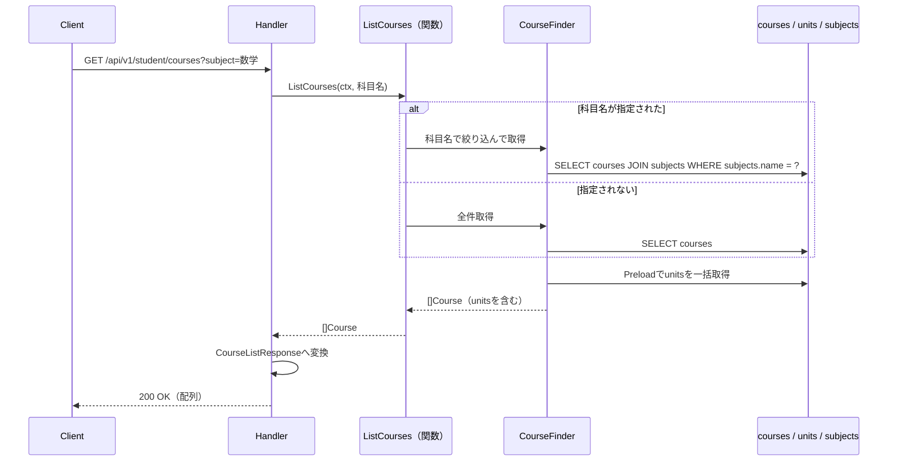
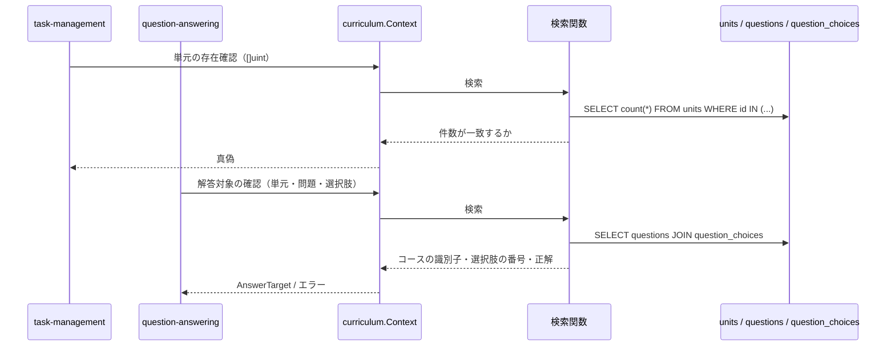

# コース参照機能 Go移行・設計仕様書

---

# 1. 機能概要

## 機能概要

学習コースとそれに紐づく単元の一覧を取得する参照機能である。科目名による絞り込みに対応し、コースに含まれる単元情報をあわせて返す（①「5. API / 処理詳細」`#index`）。

本機能が属する`curriculum` Contextは、**他の多くの機能からコース・単元・問題の参照を受ける**。同Contextが公開する参照手段は「11. Repository設計」に集約して記載する。

## 利用者

- 生徒ユーザー（`student`ロール）
- 操作者による絞り込みは行わない。コースは全生徒に共通のマスタデータであり、どの生徒も同じ一覧を取得する（①「8. 権限制御」）

## 業務上の目的

- 生徒が学習可能なコースとその構成単元を把握できるようにする
- 科目別にコースを絞り込んで表示できるようにする

---

# 2. 設計方針

本機能はマスタデータの参照のみで完結するため、過度な抽象化を避け、読み取り専用の構造とする。

- 責務分離: 検索条件の組み立てとレスポンス整形を分離する
- **所有の明確化**: `courses`・`units`・`questions`は本Contextが所有する。他Contextからの参照はすべて本Contextが公開する操作を通す（規約「5. Context間連携ルール」）
- 保守性: コース・単元の属性追加に対して変更範囲を限定する
- テスト容易性: 絞り込み条件ごとの取得結果を検証できるようにする
- API互換性: 既存フロントエンドとの整合を保つため、エンドポイント・レスポンス構造・ステータスコードを維持する
- 拡張性: 将来的な属性の追加や科目マスタの拡張に備え、検索責務を1箇所に閉じ込める

---

# 3. Bounded Context

## Context名

- `curriculum`

## Contextを共有する機能

本Contextは**2つの機能文書が共有する**。

|機能|担当するエンドポイント|
|-|-|
|コース参照機能（本書）|GET /api/v1/student/courses|
|単元参照機能|GET /api/v1/student/tasks/:task_id/units/:id|

両機能はいずれもCourse・Unitというマスタデータの参照であり、Contextの責務を分割する理由がない。単元はコースに属するため、両者を別Contextにすると同じテーブルを2つのContextが所有することになる（規約「4. Bounded Context構成」の「常に一体で扱われるデータ（例：Course/Unit）は無理に分割しない」）。

**他Contextへ公開する参照手段の定義は本書に集約する。** 単元参照機能②では繰り返さない。

## Contextの責務

- コース・単元・問題のマスタデータの保持と参照提供
- 科目による絞り込み
- **他Contextからの参照要求に答えること**（「11. Repository設計」）

## 持たない責務

- コース・単元・問題の登録・更新・削除（管理者コース・単元参照機能、管理者問題インポート機能の責務）
- タスクと単元の紐づき（`task-management`の責務）
- 解答履歴・解答の正誤（`question-answering`の責務）

## 他Contextとの依存関係

本Contextから他Contextへの依存はない。マスタデータの参照のみで完結する。

本Contextから他Contextへ公開する参照手段:

|呼び出し元Context|用途|
|-|-|
|`task-management`|タスクに紐づける単元の存在確認と、レスポンスに含める単元情報の取得（タスク管理機能②「11. Repository設計」）|
|`draft-task`|同（タスク下書き機能②「11. Repository設計」）|
|`question-answering`|単元に属する問題の一覧、解答対象（問題・選択肢）の確認、タスクに紐づく単元の問題数の集計（問題解答機能②「11. Repository設計」）|

科目（`subjects`）は本Context内で扱う。コースの絞り込みにのみ用いるマスタであり、独立したContextとして切り出す業務上の意味がない（**②からの補足**。Rails現行も`subjects`を参照する機能が本機能のみである）。

## 依存する理由

本機能は操作者による絞り込みを持たず、マスタデータの参照のみで完結するため、他Contextへの依存は発生しない。

逆に本Contextは参照される側である。公開する操作は5つであり、いずれも読み取りのみである。状態を変える操作を公開しない。

---

# 4. 設計パターン

## 採用パターン

Transaction Script

## 判断根拠

本機能は一覧取得（科目による絞り込みを含む）のみで構成される参照機能であり、状態管理・業務ルールのいずれも現行仕様に存在しない。CourseとUnitは単純なマスタデータであり、更新や状態遷移を伴わない。

- 業務ルール: 「`subject`が指定されればその科目のコースのみ返す」という条件分岐のみ
- 状態管理: 存在しない
- 整合性: 書き込みがないため、保証すべき整合性の単位が存在しない
- 将来拡張: 将来的に属性や絞り込み条件が増えても、検索条件の追加で対応できる
- テスト容易性: 入力条件（`subject`の有無）に対する出力を検証するだけでよい

他Contextへ公開する5つの参照手段も、いずれも検索条件を組み立てて結果を返すだけである。Entityに振る舞いを持たせる余地がない。

## 採用しなかったパターン

### Active Record

コース・単元に対する作成・更新処理が本機能に存在しないため、モデルに保存・更新責務を持たせる意味がない。

**ただし同じ`curriculum` Contextを、管理者向けのコース・単元の登録・更新機能が共有する可能性がある。** 現時点では管理者コース・単元参照機能も参照のみであるが（残り機能の一覧）、将来登録・更新が加わった場合は、規約「4. Bounded Context構成」の「1つのContextに複数の設計パターンが混在する場合」に従い、Context全体の構成を見直す必要がある（「25. 設計判断サマリー」）。

### Domain Model

コース・単元は状態も振る舞いも持たないマスタ参照データであり、Entityに業務ルールを集約するメリットがない。

### Event Sourcing

履歴管理・監査要件が現行仕様に存在しない。

---

# 5. Aggregate設計

不要と判断する。

理由: 更新を伴わない参照専用データであり、整合性を保証すべき書き込み境界が存在しない。CourseとUnitは1対多の参照関係として扱う。

---

# 6. Entity設計

本機能では独自のEntityを定義しない。Transaction Script採用であり、業務ルールを持つEntityが存在しないためである。

参照して返すデータは、読み取り専用の型として扱う。

## Course（参照用）

- 役割: 学習コースのマスタ情報
- 項目: 識別子・科目の識別子・レベル番号・レベル名・説明・論理削除日時・作成日時・更新日時
- ライフサイクル・状態変化: 本機能では扱わない（参照専用）
- 判断根拠: `as_json`でテーブルの全カラムを返すため、**全カラムを保持する型として扱う**（①「5. API / 処理詳細」`#index`）

## Unit（参照用）

- 役割: コースに含まれる単元のマスタ情報
- 項目: 識別子・コースの識別子・単元名・論理削除日時・作成日時・更新日時
- 判断根拠: 同じく`as_json`で全カラムを返すため

## Question / QuestionChoice / QuestionHint（参照用）

- 役割: 単元に属する問題と、その選択肢・ヒント
- 用途: 本機能のエンドポイントでは返さない。`question-answering`へ公開する参照手段が返す（「11. Repository設計」）
- 判断根拠: 問題は単元に属するマスタデータであり、本Contextが所有する

## Subject（参照用）

- 役割: 科目。コースの絞り込みに用いる
- 用途: 絞り込み条件（科目名）としてのみ使う。レスポンスには含まれない（①「5. API / 処理詳細」`#index`）

---

# 7. Value Object設計

不要と判断する。

理由: レベル番号・レベル名・説明・単元名などの属性は単純な値であり、独自の比較ロジックや業務ルールを持たない。科目による絞り込みも科目名の完全一致であり、Value Object化による利点がない。

**日付・日時を独自の型にしない。** `as_json`が整形を行わずそのまま返しており、表示形式のルールを持たない（①「5. API / 処理詳細」`#index`）。目標管理機能・タスク管理機能の`DueDate`が`YYYY/MM/DD`形式の表示ルールを持つのとは異なる。

将来的に科目が階層構造を持つようになった場合は、Value Object化を再検討する余地がある。

---

# 8. Domain Service

不要と判断する。

理由: 複数Entityを横断する業務ルールの判定が存在しない。科目による絞り込みは検索条件であり、業務ルールではない。

他Contextへ公開する参照手段のうち、`FindQuestionForAnswer`（解答対象の確認）は「問題が単元に属するか」「選択肢が問題のものか」を判定するが、これも検索条件として表現できる。該当するレコードが取得できるかどうかで判定する（「11. Repository設計」）。

---

# 9. クラス図

参照のみの機能であり、Entityもstructの階層も持たないため、クラス図としての図示は省略する。

本Contextが持つのは、マスタデータを読む関数群と、それが返す読み取り専用の型のみである。関係は「13. シーケンス図・処理フロー図」のシーケンス図で示す。

Goのstruct定義（参照用の型のフィールド）は③Go実装仕様書で扱う。

---

# 10. 状態遷移図

省略する。

理由: 本Contextが扱うデータに状態が存在しない。コース・単元・問題はいずれもマスタデータであり、状態を表すカラムを持たない（①「7. 状態管理」）。論理削除日時を持つが、本機能に削除操作は存在せず、かつ**検索で除外もしない**（下記）。

---

# 11. Repository設計

**実装上の位置づけ**: 本機能はTransaction Script採用のため、Repository Interfaceをdomain層に定義しない。以下は永続化・検索責務の設計意図であり、実装時はinfrastructure層の関数として実装する（規約「3. 設計パターンごとの構造適用方針」）。

本Contextが所有するテーブルは`courses`・`units`・`questions`・`question_choices`・`question_hints`・`subjects`である。

## 本機能のエンドポイントが使う検索

### CourseFinder

- 管理対象: Course・Unit
- 責務:
  - コースの一覧取得。単元を同時に読み込む
  - 科目名による絞り込み
- 保持する検索機能:
  - 科目名での絞り込み（`subjects.name`の完全一致）
  - 単元の一括取得（N+1を避ける）
- **論理削除の扱い: 除外しない。** `Course`・`Unit`はいずれも`active`という絞り込みを持つが`default_scope`を持たず、この機能では`active`を使っていない（①「5. API / 処理詳細」`#index`）
- 保持しない責務: 業務ルール判定、認可判定
- 判断根拠: 検索条件の組み立てに特化させるため

ページネーション・ソートは行わない。コースの全件を返し、並び順も指定しない（①「5. API / 処理詳細」`#index`）。

## 他Contextへ公開する参照手段

**本Contextが公開する操作はここに集約して定める。** 単元参照機能②では繰り返さない。

呼び出し元が必要とする形は、各機能の③が`dependency.go`で定めている（コーディング規約「7. インターフェース」の「利用側でインターフェースを定義する」）。本Contextはそれらに対応する操作を公開する。

|公開する操作|呼び出し元|内容|
|-|-|-|
|単元の存在確認|`task-management`・`draft-task`|指定された単元の識別子がすべて存在するかを返す（タスク管理機能③・タスク下書き機能③の`UnitDirectory.ExistsAll`）|
|単元情報の取得|`task-management`・`draft-task`|指定された単元の情報（単元名・所属コースの識別子・レベル番号・レベル名）を返す（同`UnitDirectory.FindUnitsByIDs`）|
|単元の問題一覧の取得|`question-answering`|単元に属する問題の一覧を、選択肢・ヒント・正解とあわせて返す（問題解答機能③の`QuestionDirectory.FindUnitQuestions`）|
|解答対象の確認|`question-answering`|指定の問題がその単元に属し、指定の選択肢がその問題のものであることを確認し、コースの識別子・選択肢の番号・問題の正解を返す（同`QuestionDirectory.FindQuestionForAnswer`）|
|問題数の集計|`question-answering`|指定された単元群に属する問題の件数を返す（同`UnitQuestionCountDirectory.CountQuestions`）|

### 公開操作における論理削除の扱い

**いずれの操作も除外しない。** Rails現行がいずれも除外していないためである。

|公開操作|論理削除の扱い|理由|
|-|-|-|
|単元の存在確認|除外しない|Rails現行の`Unit.where(id: unit_ids).count`が除外していない（タスク管理機能①「5. API / 処理詳細」`#create`）|
|単元情報の取得|除外しない|同じ単元を返すため、存在確認と扱いを揃える|
|単元の問題一覧の取得|**問題の論理削除を除外しない**|Rails現行の`unit.questions`が除外していない（問題解答機能①「5. API / 処理詳細」`#index`）|
|解答対象の確認|除外しない|Rails現行の`@unit.questions.find_by(id:)`が除外していない（同`#create`）|
|問題数の集計|**除外しない**|Rails現行の`TaskAnswerStatsQuery#question_counts`が`Question.where(unit_id: ...)`で数えており、問題の論理削除を除外していない（問題解答機能①「6. データモデル」）|

**②からの補足**: 問題数の集計について、Rails現行の`question_counts`は`Question.where(unit_id: task_unit_ids_scope).group(:unit_id).count`であり、**問題の論理削除を除外していない**。一方、解答済み件数（`answer_counts`）は`on_active_questions`で除外している。**分母が除外せず分子が除外するため、基準が食い違っている。**

この食い違いにより、論理削除された問題に解答済みのタスクでは「解答済み件数 < 対象の問題数」となり、完了にならない。論理削除された問題のために永久に完了できないタスクが生じうる。

分母も除外する方が自然だが、**提出の判定結果が変わるためAPI外部仕様の変更にあたる**。フロントエンドを変更しない方針により、本設計ではRails現行のまま除外しない。Rails側で直すべき点として`tmp/残タスク.md`の「Rails側で修正を検討する点」に記録する（「25. 設計判断サマリー」）。

### 呼び出し元ごとの型の扱い

公開する操作は、呼び出し元Contextの型を受け取らず、本Contextの型で返す。呼び出し元のアダプタが自身の型へ変換する（規約「5. Context間連携ルール」）。

識別子の集合を受け取る操作（存在確認・単元情報の取得・問題数の集計）は、`[]uint`で受け取る。呼び出し元が持つ集合型（`UnitIDSet`）をそのまま受け取らない。相手Contextの型を本Contextに持ち込まないためである。

---

# 12. UseCase設計

**実装上の位置づけ**: 本機能はTransaction Script採用のため、UseCase層（struct）を設けない。以下は業務操作の設計意図であり、実装時はapplication層の関数として実装する。

## ListCourses

- 目的: コースと単元の一覧を取得する
- 入力: 科目名（任意）
- 出力: コースの一覧（各コースに単元の一覧を含む）
- トランザクション範囲: 読み取りのみのため不要
- 呼び出す先: CourseFinder
- 処理:
  1. 科目名が指定されていなければ、コースの全件を単元とあわせて取得する
  2. 指定されていれば、科目名で絞り込んで取得する
  3. 取得結果を返す
- 判断根拠: 条件分岐が1つだけの参照であり、業務ルールを組み合わせる必要がないため

操作者の識別子を入力に含めない。操作者による絞り込みを行わないためである（①「8. 権限制御」）。

コースが0件の場合、空の一覧を返す。エラーにしない。科目名に存在しない値が指定された場合も空になる（①「5. API / 処理詳細」`#index`）。

## 他Contextへ公開する操作

「11. Repository設計」の5つである。いずれも検索を呼ぶだけであり、UseCaseとしての手続きを持たない。application層の関数を設けず、infrastructure層の関数を`context.go`が公開する形とする（**②からの補足**。詳細は③で定める）。

---

# 13. シーケンス図・処理フロー図

## シーケンス図（ListCourses）

Transaction Script採用のためUseCase層のstructはなく、application層の関数が検索を呼ぶ（「4. 設計パターン」）。

## シーケンス図（他Contextへの公開操作）

## 処理フロー図

省略する。

理由: `ListCourses`の分岐は科目名が指定されたかどうかの1つだけであり、シーケンス図で十分に表現できる。公開操作はいずれも検索を呼ぶだけで分岐を持たない。

---

# 14. Transaction設計

## Transaction開始位置

- なし

## Transaction終了位置

- なし

## 理由

状態を変更する処理が存在しないため、トランザクションによる整合性保証は不要である。本Contextが公開する操作もすべて読み取りである。

**他Contextが開始したトランザクションに参加する場合がある。** `question-answering`の提出の判定が問題数の集計を呼ぶが、同機能③は集計をトランザクションの外で行う（同③「11. Transaction実装方針」）。したがって現時点で参加する経路はない。

ただし本Contextの検索関数は`context.Context`を受け取り、接続の取得を`gormtx.DBFromContext`に委ねる。将来トランザクションの内側から呼ばれた場合も同じ接続を使う（規約「11. Transaction実装パターン（TransactionManager）」）。

---

# 15. Validation設計

## Presentation

- 型チェック: クエリパラメータ`subject`は文字列として受け取る
- 必須チェック: なし。`subject`は任意である
- フォーマットチェック: なし

パスパラメータ・リクエストボディを持たない（①「5. API / 処理詳細」`#index`）。

## Domain

- 業務ルール: なし
- 状態チェック: なし
- 整合性チェック: なし

## 責務分離

本機能は入力検証をほとんど必要としない。`subject`の有無で検索条件が変わるだけである。

## バリデーション仕様

|フィールド|検証層|ルール|Rails現行の扱い|
|-|-|-|-|
|`subject`|Presentation|任意。空文字は未指定として扱う|Rails現行は`params[:subject].present?`で判定しており、空文字・空白のみの場合は未指定として扱う（①「5. API / 処理詳細」`#index`）|

存在しない科目名を指定してもエラーにしない。空の一覧を返す（同）。

---

# 16. Authorization設計

## Middleware

- 認証済みユーザーを特定し、ユーザー情報を`context.Context`に保持する
- 役割が`student`であることを確認する
- CSRF: 本機能はGETのみであり、CSRF検証の対象外である（Gin規約「5. CSRF対策」の「適用範囲」）

## Handler

- 業務権限判定は持たせない

## Application

- 操作者の識別子を検索条件に渡さない。**操作者による絞り込みを行わない**

## Domain

- 権限判定を行わない

## 判断理由

コースは全生徒に共通のマスタデータであり、どの生徒も同じ一覧を取得する（①「8. 権限制御」）。認証と役割の確認のみで十分である。

①の復元時の記述は「権限制御: なし」としていたが、`Api::V1::Student::BaseController`の認可により`student`ロード限定である。認証・認可がないわけではない。

## 他Contextへ公開する操作の認可

公開する5つの操作は、HTTPを経由せず他Contextから直接呼ばれる。**認可を行わない。**

いずれもマスタデータの参照であり、操作者によって結果が変わらない。呼び出し元Contextが自身の認可を済ませている前提である（タスク管理機能③・問題解答機能③の各「13. Authorization実装方針」）。

単元の存在確認・問題の一覧は、操作者の識別子を受け取らない。受け取っても使う先がないためである。

---

# 17. Error設計

## Domain Error

本機能では業務ルール違反が発生しないため、使用しない。

## Application Error

- 責務: 検索の失敗を表現する
- 判断理由: 取得できなければ一覧を組み立てられないため

本機能のエンドポイントに、対象が見つからないことを表すエラーはない。コースが0件でも空の一覧を返す。

公開する操作のうち`FindQuestionForAnswer`（解答対象の確認）のみ、該当が見つからないことをエラーとして返す。呼び出し元の`question-answering`が422へ変換する（問題解答機能③「14. Error実装方針」）。**本Contextはステータスを決めない。**

## Infrastructure Error

- 責務: DB接続失敗を表現する
- 判断理由: 技術的な障害をドメインに漏らさず切り分けるため

## エラー仕様

|業務シナリオ|エラー種別|発生層|想定するHTTPステータス|
|-|-|-|-|
|コースが0件|エラーとしない|—|—（空配列を返し200で応答する）|
|存在しない科目名を指定|エラーとしない|—|同|
|検索に失敗した|Internal|Infrastructure → Application（変換）|500|
|未認証|Unauthorized|Middleware|401|
|`student`ロールでない|Forbidden|Middleware|403|

固有の404・422は存在しない。対象が一意に定まるパラメータを持たず、入力検証の対象もないためである。

## エラーレスポンスの本文

|条件|HTTPステータス|本文|
|-|-|-|
|認可エラー|403|`{"errors": ["この操作を行う権限がありません"]}`|
|内部エラー|500|`{"errors": [...]}`|

いずれも規約「15. API規約（レスポンス形式・ページネーション・URL・クエリパラメータ）」の「エラーレスポンス」と同じ形式である。本機能には404を返す経路がないため、他機能にある`message`キーの本文は現れない。

---

# 18. Domain Event

不要と判断する。

理由: 参照のみの機能であり、表示に伴って他処理へ通知すべき副作用が現行仕様に存在しない（①「9. 非同期処理」）。

---

# 19. API仕様

## エンドポイント一覧

|エンドポイント|HTTP Method|概要|
|-|-|-|
|/api/v1/student/courses|GET|コースと単元の一覧を取得|

Rails現行仕様と同じURL・HTTP Methodを維持する。

## 各エンドポイントの仕様

### GET /api/v1/student/courses

- Request: クエリパラメータ`subject`（任意・文字列）。科目名の完全一致で絞り込む
- Response: 最上位は**配列**。各要素はコースの**全カラム**と、`units`（単元の全カラムの配列）
  - コース: 識別子・科目の識別子・レベル番号・レベル名・説明・**論理削除日時・作成日時・更新日時**
  - 単元: 識別子・コースの識別子・単元名・**論理削除日時・作成日時・更新日時**
- **シリアライザを使わず`as_json`で返しているため、テーブルの全カラムがそのまま出る**（①「5. API / 処理詳細」`#index`）。日付・日時の整形も行わない
- 科目の情報はレスポンスに含まれない
- ページ情報（`meta`）を返さない。ページングを行わない
- 論理削除済みのコース・単元も含まれる（①「5. API / 処理詳細」`#index`）
- Status Code: 正常系200。異常系は未認証401、`student`ロール不一致403

## エラーレスポンス

形式は「17. Error設計」の「エラーレスポンスの本文」のとおり。

## Railsとの差分

URL・HTTP Method・リクエスト形式・レスポンス構造・ステータスコードはRails現行から変更しない。`as_json`による全カラムの出力、論理削除済みを含めること、ページングを行わないことも維持する。

**API外部仕様の変更はない。** 本機能のエンドポイントも、本Contextが公開する参照手段も、Rails現行と同じ結果を返す。

問題数の集計における論理削除の扱いがRails現行で分子と食い違っている点（「11. Repository設計」の補足）も、そのまま維持する。分母も除外する修正は提出の判定結果が変わるため、Rails側で直すべき点として記録する。

内部の責務には次の差分がある。

- Rails仕様: Controllerが`CoursesQuery`を直接呼び、`as_json`でレスポンスを組み立てている。他機能（タスク管理・タスク下書き・問題解答）はそれぞれが`units`・`questions`・`question_choices`を直接引いている（①「10. Rails実装対応表」、各機能①）
- Go設計での変更: 本Contextがコース・単元・問題を所有し、他機能からの参照はすべて本Contextが公開する操作を通す
- 変更理由: 他Contextが所有するデータへの直接アクセスは規約「5. Context間連携ルール」が禁じているため
- 影響範囲: 本機能の1エンドポイントの外部仕様に変更はない。`task-management`・`draft-task`・`question-answering`の③が、本Contextの公開操作を呼ぶ形になる

JSONスキーマの厳密な型定義・Goの構造体は③Go実装仕様書で扱う。

---

# 20. DB設計方針

## 現行DBを利用するか

- 既存Rails DBを継続利用する

## Schema変更有無

- 変更なし

## 変更理由

- 現行の`courses`・`units`・`questions`・`question_choices`・`question_hints`・`subjects`で本Contextの要件を満たしている

## 変更を提案しない理由

- 参照のみであり、構造的な問題が①から確認できない
- 論理削除の扱いが用途によって異なる点は、スキーマではなくクエリの条件で表現する

---

# 21. DB操作仕様

本Contextが所有するテーブルは以下である。

|操作|対象テーブル|操作種別|主な検索条件|結合|ページネーション/ソート|
|-|-|-|-|-|-|
|CourseFinder（一覧）|courses|参照|なし（全件）／`subjects.name`|`units`を一括取得。科目で絞る場合は`subjects`と結合|不要（全件・順序の指定なし）|
|単元の存在確認|units|参照|`id IN (...)`|なし|不要|
|単元情報の取得|units|参照|`id IN (...)`|`courses`と結合（レベル番号・レベル名を返すため）|不要|
|単元の問題一覧の取得|questions|参照|`unit_id`|`question_choices`・`question_hints`を一括取得|不要|
|解答対象の確認|questions|参照|`unit_id`・`id`|`question_choices`と結合（選択肢の帰属確認と番号の取得）、`units`と結合（コースの識別子の取得）|不要|
|問題数の集計|questions|参照|`unit_id IN (...)`|なし|不要|

**いずれの操作も`deleted_at`を条件に含めない。** Rails現行がいずれも除外していないためである（「11. Repository設計」の「公開操作における論理削除の扱い」）。

`tasks`・`task_units`・`question_histories`へは本Contextからクエリを発行しない。いずれも他Contextが所有する。

問題数の集計が受け取るのは単元の識別子の集合である。「タスクに紐づく単元」を知るのは`task-management`の責務であり、本Contextは`task_units`を読まない（問題解答機能②「11. Repository設計」）。

具体的なSQL・GORMのクエリコードは③Go実装仕様書（Gorm規約）で扱う。

---

# 22. テスト戦略

Transaction Script採用のため、規約「3. 設計パターンごとの構造適用方針」の読み替えルールに従う。業務ルールを持つEntityを持たないため、Domain Testに相当するものがない。

## Domain Test

- 対象外。本Contextに業務ルールを持つEntity・Value Objectが存在しない

## UseCase Test（Transaction Script採用時は関数のテスト）

- 目的: `ListCourses`が科目名の有無で検索を切り替えることを検証する
- 含めるもの: 科目名が未指定のとき全件を取得すること、指定されたとき絞り込むこと、空文字を未指定として扱うこと、0件のとき空の一覧を返すこと

## Repository Test

- 目的: 検索の正確性を検証する
- 含めるもの: 単元の一括取得でN+1が起きないこと、**論理削除済みのコース・単元が含まれること**、科目名の完全一致で絞られること
- 公開操作: 単元の存在確認が件数の一致で判定すること、単元情報の取得がコースのレベル番号・レベル名を含むこと、問題の一覧が選択肢・ヒント・正解を含むこと、解答対象の確認が帰属しない組み合わせでエラーを返すこと、**問題数の集計が論理削除された問題も数えること**（Rails現行の挙動）

## Handler Test

- 目的: レスポンス形状とHTTPステータスの変換を検証する
- 含めるもの: 最上位が配列であること、コース・単元の全カラムが出ること（`deleted_at`・`created_at`・`updated_at`を含む）、`meta`を返さないこと、科目の情報を含まないこと

## Integration Test

- 目的: エンドポイント経由でコースと単元が取得できることを確認する
- 含めるもの: 認可（未認証・`student`以外の拒否）、科目名での絞り込み、存在しない科目名で空配列になること、論理削除済みのコースが含まれること
- 公開操作: `task-management`・`question-answering`から呼ばれて正しい結果を返すこと

---

# 23. Railsとの責務対応

| Rails | Go | 設計方針 |
|---|---|---|
| Controller（`CoursesController`） | Handler | HTTP入力の受け取りとレスポンス整形に限定する |
| Controller内の`as_json` | Response DTO | 全カラムを出す形を維持しつつ、整形の責務をPresentation層に置く |
| Query（`CoursesQuery`） | infrastructure層の検索関数 | 検索条件の組み立てを1箇所に閉じ込める |
| Model（`Course`・`Unit`・`Subject`） | 参照用の型 | 業務ルールを持たないため、読み取り専用の型として扱う |
| 他機能が`units`・`questions`を直接引いている箇所 | 本Contextが公開する参照手段 | マスタデータの所有を本Contextに集約する（「11. Repository設計」） |
| `TaskAnswerStatsQuery#question_counts` | 本Contextの問題数の集計 | 「タスクに紐づく単元」は`task-management`から受け取り、本Contextは問題を数えるだけとする |
| `UnitSerializer` | 単元参照機能のResponse DTO | 同機能②を参照（本Contextを共有する） |

---

# 24. 採用しなかった設計

## Active Record

- 採用しなかった理由: 作成・更新処理が本機能に存在しないため、モデルに保存・更新責務を持たせる意味がない
- 将来的に採用する可能性: 管理者向けのコース・単元の登録・更新機能が同じContextを共有する場合は、規約「4. Bounded Context構成」の「1つのContextに複数の設計パターンが混在する場合」に従いContext全体の構成を見直す

## Domain Model

- 採用しなかった理由: コース・単元は状態も振る舞いも持たないマスタ参照データであり、Entityに業務ルールを集約するメリットがない
- 将来的に採用する可能性: 低い

## Event Sourcing

- 採用しなかった理由: 履歴管理・監査要件が存在しない
- 将来的に採用する可能性: 低い

## 科目を別Contextとして切り出す案

- 採用しなかった理由: 科目はコースの絞り込みにのみ用いるマスタであり、独立したContextとして切り出す業務上の意味がない。Rails現行も`subjects`を参照する機能が本機能のみである
- 将来的に採用する可能性: 科目が階層構造を持ち、科目自体の管理機能が加わった場合は再検討する

## 問題を`question-answering`の所有とする案

- 採用しなかった理由: 問題は単元に属するマスタデータであり、登録は管理者問題インポート機能が行う。`question-answering`は解答履歴の所有者であり、問題そのものの所有者ではない
- 代わりに本Contextが問題を所有し、`question-answering`へ参照手段として公開する

---

# 25. 設計判断サマリー

| 項目 | 採用 | 判断理由 |
|---|---|---|
| 設計パターン | Transaction Script | 参照のみで状態管理・業務ルールがなく、Entityに振る舞いを持たせる余地がないため |
| Context | `curriculum`（コース参照・単元参照の2機能で共有） | 単元はコースに属し、常に一体で扱われるため（規約「4. Bounded Context構成」） |
| Aggregate | 不要 | 書き込みがなく、保証すべき整合性の単位が存在しないため |
| Entity | 定義しない | 業務ルールを持たず、読み取り専用の型として扱うため |
| Value Object | 不要 | 属性が単純な値であり、`as_json`が整形も行わないため |
| Transaction境界 | なし | 状態を変更する処理が存在しないため |
| Domain Event | 未採用 | 表示に伴う副作用が存在しないため |
| 公開する参照手段 | 5つ（単元の存在確認・単元情報・問題一覧・解答対象の確認・問題数の集計） | マスタデータの所有を本Contextに集約するため（規約「5. Context間連携ルール」） |
| 公開操作の認可 | 行わない | マスタデータの参照であり操作者によって結果が変わらない。呼び出し元が認可を済ませている前提 |
| 論理削除の扱い | いずれの操作も除外しない | Rails現行がいずれも除外していないため。分母と分子の基準の食い違いもそのまま維持する |

## 本書で決めていない事項

|事項|決めていない理由|決める場所|
|-|-|-|
|問題数の集計で問題の論理削除を除外する修正をいつ行うか|Rails現行は分母を除外せず分子を除外しており、基準が食い違っている。論理削除された問題のために永久に完了できないタスクが生じうる。提出の判定結果が変わるためフロントエンドの確認が必要である（「11. Repository設計」の補足）|フロントエンドの修正方針を決める時点。`tmp/残タスク.md`の「Rails側で修正を検討する点」に記録済み|
|管理者向けのコース・単元の登録・更新機能が同じContextを共有するか|管理者コース・単元参照機能は現時点では参照のみである。登録・更新が加わった場合、Context全体の設計パターンを見直す必要がある（規約「4. Bounded Context構成」）|管理者コース・単元参照機能の②|
|公開操作をinfrastructure層の関数として`context.go`が直接公開するか、application層の関数を挟むか|いずれも検索を呼ぶだけで手続きを持たない。層を挟む利点が薄い|③Go実装仕様書|

---

# 設計差分管理

## Rails現行仕様

- Controllerが`CoursesQuery`を直接呼び、`as_json(include: :units)`でレスポンスを組み立てている
- シリアライザを使わないため、テーブルの全カラムがそのまま出る
- 論理削除済みのコース・単元を除外していない
- 他機能（タスク管理・タスク下書き・問題解答）がそれぞれ`units`・`questions`・`question_choices`を直接引いている
- `TaskAnswerStatsQuery#question_counts`が問題数を数えるが、問題の論理削除を除外していない（解答済み件数の集計は除外している）

## Go設計での変更内容

- 本Contextがコース・単元・問題を所有し、他機能からの参照はすべて本Contextが公開する操作を通す
- 検索条件の組み立てをinfrastructure層の関数に閉じ込め、レスポンス整形をPresentation層に置く
- 論理削除の扱いを操作ごとに明示する

## 変更理由

- 他Contextが所有するデータへの直接アクセスは規約「5. Context間連携ルール」が禁じているため

## 影響範囲

- 本機能の1エンドポイントの外部仕様に変更はない
- `task-management`・`draft-task`・`question-answering`の③が、本Contextの公開操作を呼ぶ形になる
- 既存DBスキーマは維持するため、データ移行やマイグレーションの追加は不要
