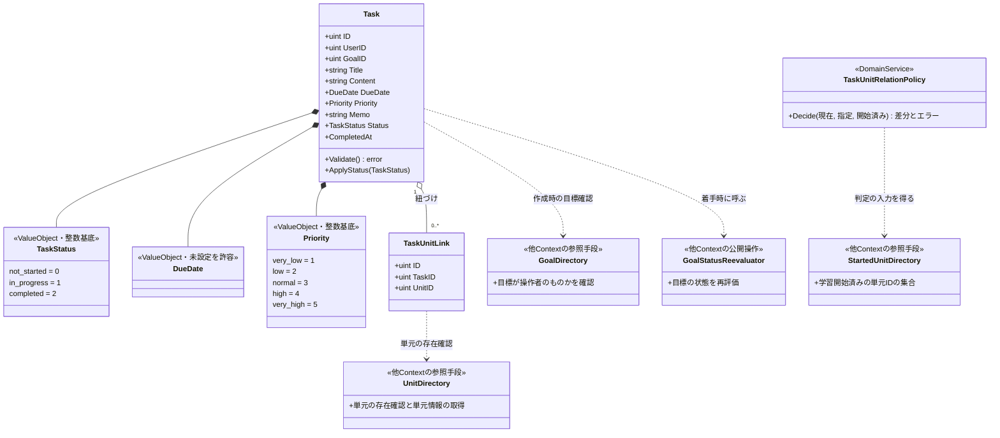
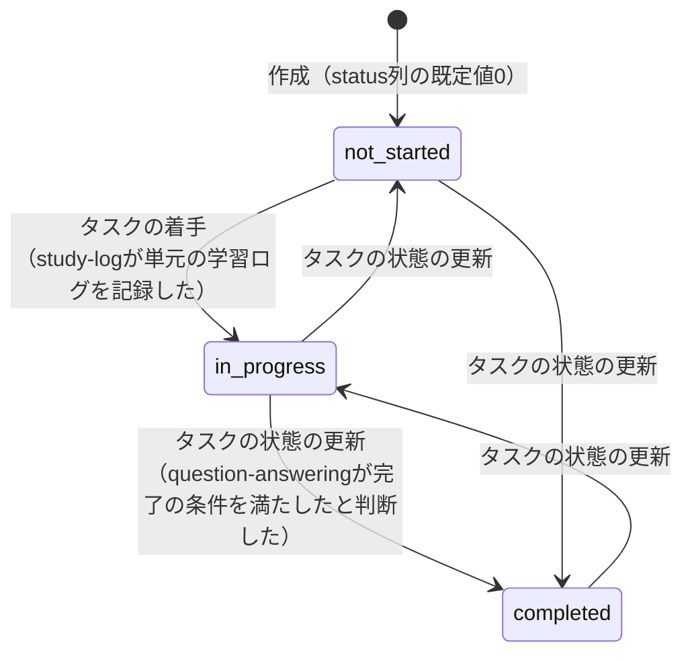
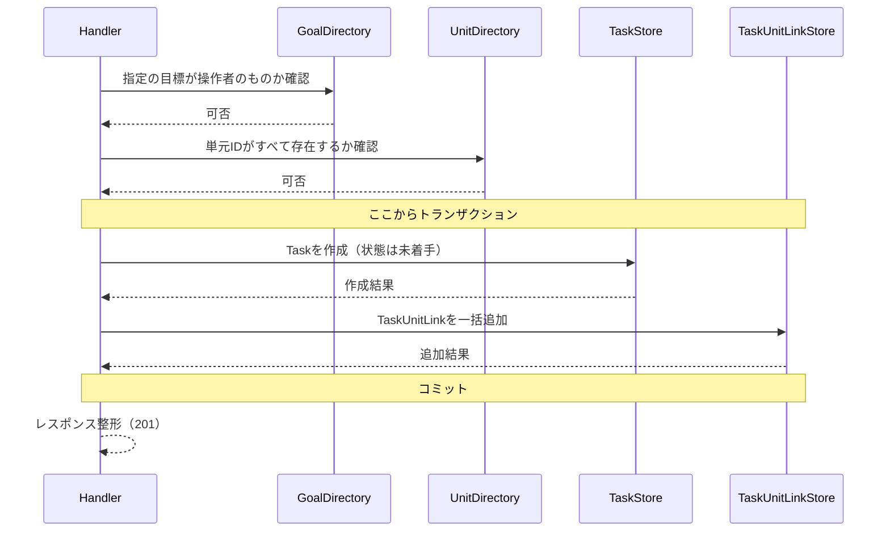
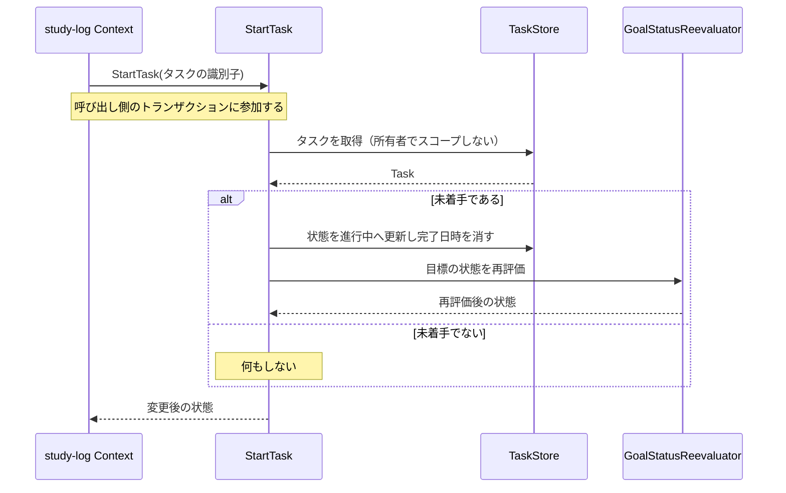
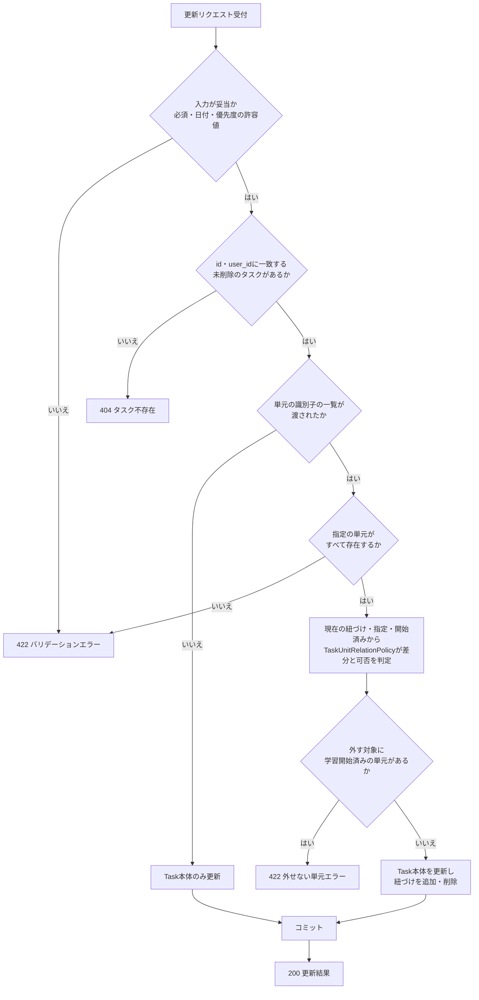

# タスク管理機能 Go移行・設計仕様書

---

# 1. 機能概要

## 機能概要

生徒が自分の学習タスクを登録・参照・更新できる機能である。Rails現行仕様では、一覧・詳細・作成・更新の4操作を提供しており、タスクに紐づく目標・単元情報を含めて扱う。

## 利用者

- 学生ユーザー（student ロール）
- 自分が作成したタスクのみ操作可能

## 業務上の目的

- 学習計画をタスクとして可視化し、期限と優先度を管理する
- 単元と目標に紐づく学習行動を一元管理する
- 生徒自身が自身のタスク状態を確認・更新できるようにする

---

# 2. 設計方針

本機能は、Rails実装の構造をそのまま置き換えるのではなく、業務上の責務を明確に分離したGo設計とする。

主な設計思想は以下のとおりである。

- 責務分離: HTTP・入力検証・認可・業務ルール・永続化を分離する
- 保守性: タスク状態や単元紐付けルールをドメイン側に集約し、変更に強い構造とする
- テスト容易性: ユースケース単位で振る舞いを検証できるようにする
- 拡張性: 目標や単元の関係が増えても、タスクのコアロジックを壊しにくい構造にする
- API互換性: 既存フロントエンドとの整合を保つため、エンドポイント・リクエスト形式・レスポンス構造・ステータスコードを維持する。維持しない箇所は「19. API仕様」の「Railsとの差分」に明記する

---

# 3. Bounded Context

## Context名

- `task-management`

## Contextの責務

- 生徒のタスクの作成・参照・更新
- タスクの状態の保持と、状態を変える操作の提供
- タスクと単元の紐づけの管理
- タスクに対する所有者スコープの管理

## 他Contextとの依存関係

本Contextから他Contextへの参照依存:

- `goal-management` Context: タスクが紐づく目標が操作者自身のものかを確認するために依存する（①「5. API / 処理詳細」`#create`）
- `unit-reference` Context: タスクに紐づける単元の存在確認と、レスポンスに含める単元情報の取得に依存する
- `question-answering` Context: そのタスクで学習を開始済みの単元を判定するため、解答履歴の有無を参照する（①「5. API / 処理詳細」`#show`・`#update`の`started_unit_ids`）
- `user` Context: 認証済み生徒の識別と所有権の確認に依存する

他Contextから本Contextへの依存（本Contextが公開する操作）:

- `study-log` Context: 単元の学習ログを記録した時点で、本Contextが公開する「タスクの着手」操作を呼ぶ（①「5. API / 処理詳細」の「タスクの着手」。`Student::CreateStudyLogService`→`Student::TaskStartService`に対応）
- `question-answering` Context: 問題の提出時に、本Contextが公開する「タスクの状態の更新」操作を呼ぶ（`Student::TaskStatusUpdaterService`に対応）

## 依存する理由

本機能は、タスク単体だけで完結せず、目標・単元・ユーザーの存在と所有権を前提として動作するためである。これらを別Contextとして扱い、本Contextでは「自分のタスクに関するルール」を中心に設計する。

逆向きの依存を設けるのは、タスクの状態の変え方を本Contextに閉じ込めるためである。状態を変える手続きを呼び出し側に持たせると、学習ログの記録と問題の提出の2箇所に同じ手続き（状態と完了日時の整合、目標の状態の再評価の呼び出し）が重複し、片方だけが修正される。Rails現行も状態変更を`Student::TaskStatusUpdaterService`・`Student::TaskStartService`に集約しており、同じ責務分担である（①「7. 状態管理」）。

**②からの補足**: `unit-reference`・`study-log`は、単元参照機能・学習ログ機能のContext名として本書で用いる名前である。両機能の②はまだ作成されていないため、名前はそれらの②の作成時に確定する（「25. 設計判断サマリー」）。

## 本Contextが公開する操作

|操作|呼び出し元|内容|
|-|-|-|
|タスクの着手|`study-log`|未着手のタスクを進行中にする。未着手でなければ何もしない。状態が変わった場合は`goal-management`の「目標の状態の再評価」を呼ぶ|
|タスクの状態の更新|`question-answering`|指定した状態へ変更し、完了日時を整合させる|

いずれもHTTPを経由せず、Goのパッケージとして直接呼ばれる。認可は呼び出し側Contextが行う。

---

# 4. 設計パターン

## 採用パターン

Active Record

## 判断根拠

本機能は、タスクの作成・一覧・詳細・更新というCRUD中心の業務であり、業務領域としては「補完CRUDが中心」に近い。状態遷移は「未着手・進行中・完了」の3段階に限定されるものの、主たる価値はタスクの登録・参照・更新と関連単元の同期にあり、複雑なドメイン振る舞いよりもデータの永続化・関連付け・更新の扱いが中心である。

このため、業務領域の分類に基づけば、単純な手続き処理よりも、Entity／モデルに対する保存・更新・関連付けの責務を寄せるActive Record寄りの構造が自然である。特に以下の理由がある。

- 主要操作がCRUD中心で、作成・取得・更新の流れが明確である
- タスクと単元との関連付けは、データの整合性を保つために集約しやすい
- Handlerが直接Storeを呼び出し、認可・入力検証はHandler／Store側で行うことで、データアクセスの振る舞いを一元化しやすい

したがって、過剰なDomain Modelや、手続き型に寄りすぎるTransaction Scriptではなく、Active Recordを採用する。

## 採用しなかったパターン

### Transaction Script

- 手続き型に寄りすぎるため、タスクの作成・更新・関連単元同期の挙動がユースケースに偏りやすい
- データの保存・更新・関連付けの責務が分散し、再利用性が低下しやすい
- CRUD中心の業務に対して、Active Recordほど自然に責務を集約しにくい

### Domain Model

- 状態遷移ルールは存在するが、現時点では複雑なビジネスルールが多いわけではない
- Entityに振る舞いを集約するメリットが限定的で、設計コストに対して恩恵が小さい
- 将来的にルールが増えた場合は、Entityへ振る舞いを寄せる方向へ段階的に移せる

### Event Sourcing

- 本機能ではイベント連携や多段の状態追跡が必要ない
- 現状の業務要件では過剰な設計である
- 監査性や再構築性の要件がないため、採用の妥当性が低い

---

# 5. Aggregate設計

本機能では、Aggregateを明示的に分ける必要はない。Task単体を中心に扱い、単元との紐付け関係はTaskの一部として扱う。

## Aggregate Root

- Task

## Aggregateに含めるEntity

- Task
- TaskUnitLink（関連情報として扱う）

## Aggregate境界

- Taskが自身の状態と関連単元を整合させる単位とする
- 目標や単元そのものはAggregateの外部の参照情報として扱い、Taskの整合性を保つための制約条件として利用する

## 整合性を保証する単位

- タスク作成・更新時に、TaskとTaskUnitLinkの同期を一貫して実行する

理由: 1つのユースケース内で、タスク本体と関連単元の整合性を保証するためである。

---

# 6. Entity設計

## Task

- 役割: 生徒の学習タスクの中心的なドメイン概念
- ライフサイクル: 作成 → 参照 → 更新 → 状態変更
- 状態変化: `not_started` / `in_progress` / `completed` の間を移る。移る契機は本機能のAPIではなく、他Contextからの操作である（「3. Bounded Context」）
- 保持する責務:
  - タイトル・内容・期限・優先度・メモ等の基本情報を保持する
  - 状態と完了日時の整合を保つ（完了であれば完了日時を設定し、完了でなければ消す。①「7. 状態管理」）
  - 入力された基本情報が業務上妥当かを判定する
- 保持しない責務: 状態をどの契機で変えるかの判断（呼び出し元Contextの責務）、単元を外せるかの判定（`TaskUnitRelationPolicy`の責務）
- 判断根拠: タスクの主要な業務情報と、状態と完了日時の整合という不変条件の持ち主であるため

## TaskUnitLink

- 役割: タスクと単元の関連付けを表す概念
- ライフサイクル: 作成・削除
- 状態変化: 追加・削除
- 保持する責務:
  - どのタスクにどの単元が紐づいているかを保持する
  - 削除可能性の判定に必要な参照情報を提供する
- 判断根拠: 単元紐付けは単なる外部キーではなく、業務ルールの対象となるため

## Goal / Unit

- 役割: 参照対象として利用する外部概念
- 判断根拠: 本機能の中心はタスクそのものなので、直接の管理対象にしない

---

# 7. Value Object設計

## TaskStatus

- 採用理由: 状態値を文字列のまま扱うと、無効な値や状態遷移の誤りが起きやすいため
- 独自ルール:
  - `not_started` / `in_progress` / `completed` のいずれかのみ許容する
  - `completed`では完了日時を設定し、それ以外では消す
- 永続化: `tasks.status`はRailsの`enum`として**整数**で保持される（`not_started`=0 / `in_progress`=1 / `completed`=2。①「6. データモデル」）。型は整数を基底とし、APIの出力時に文字列へ変換する
- Entity属性ではなくValue Objectにする理由: 状態の意味を型として明示し、許容値の判定を1箇所に集約するため

## DueDate

- 採用理由: 日付の表現が画面表示・永続化・比較で異なるため
- 独自ルール:
  - 入力は文字列で受け取り、日付として解釈できるかを判定する。特定のフォーマットには固定しない（①「10. Rails実装対応表」のとおりRails現行は`Date.parse`で判定している）
  - 表示は`YYYY/MM/DD`形式とする（①「5. API / 処理詳細」）
  - 期限の比較を一元化する
- 永続化: `tasks.due_date`はNULL可であり、既存データに未設定のタスクが存在し得る。型としては未設定を許容する。一方、作成・更新の入力では必須とする（①「5. API / 処理詳細」）
- Entity属性ではなくValue Objectにする理由: 期限の意味が単なる文字列ではなく、業務上の比較対象として重要であるため

## Priority

- 採用理由: 優先度は優先度名と数値の両方で受け取る現行仕様があるため、正規化の対象として扱うと整合しやすい
- 独自ルール:
  - 受け取った値を一貫した値へ正規化する。優先度名（`normal`等）でも数値（`1`〜`5`）でも受け取る（①「5. API / 処理詳細」`#create`）
  - 許容値は`very_low` / `low` / `normal` / `high` / `very_high`の5つのみとする
- 永続化: `tasks.priority`はRailsの`enum`として**整数**で保持される（`very_low`=1 / `low`=2 / `normal`=3 / `high`=4 / `very_high`=5。既定値は3。**0は使っていない**。①「6. データモデル」）。型は整数を基底とし、APIの出力時に文字列へ変換する
- Entity属性ではなくValue Objectにする理由: 入力の多様性を型の内側で吸収し、許容値外の入力を永続化の手前で弾くため

Rails現行は、許容値外の優先度名（例: `urgent`）が必須チェックを通過したあとで永続化時に失敗し、500になる（①「5. API / 処理詳細」`#create`）。本設計では許容値の判定をPriorityの生成時に行い、422として返す。これは「19. API仕様」の「Railsとの差分」に挙げる。

## Value Objectを採用しないもの

- タイトル・内容・メモ: 文字列そのものの意味が強く、別途複雑なルールを持たないため、Value Object化は不要とする

---

# 8. Domain Service

## TaskUnitRelationPolicy

- 責務: タスクに紐づく単元の紐づけを、指定された単元の集合へ同期してよいかを判定する。また、追加する単元と外す単元の差分を算出する
- 入力: 現在紐づいている単元のIDの集合、指定された単元のIDの集合、学習を開始済みの単元のIDの集合
- 判定: 外す対象に学習開始済みの単元が含まれていれば不可とする（①「5. API / 処理詳細」`#update`）
- Entityへ持たせない理由: この判定はTask単体の属性では決まらず、解答履歴（`question-answering` Contextが所有する事実）に依存するため
- 判断根拠: 差分の算出と可否の判定を1つの純粋な判定に閉じ込めることで、DBや他Contextの呼び出しを経由せずルール単体を検証できる。入力は「集合」として受け取り、単元の実体やタスクの識別子を持ち込まない

## 追加で必要としないService

- 状態と完了日時の整合はTask自身の不変条件であるため、Task側に寄せる
- 状態を変える契機の判断は呼び出し元Contextの責務であり、本Contextに判定を持たない

---

# 9. クラス図

Active Record採用のため、実装時はTask・TaskUnitLinkが同一packageのstructとメソッドに統合される（「4. 設計パターン」）。業務概念としての関係は以下のとおりである。

`Goal`・`Unit`・解答履歴は他Contextが所有するデータであり、本Contextは相手Contextが公開する参照手段を通じてのみ触れる。実体のstructを本Contextに持ち込まない（規約「5. Context間連携ルール」）。そのためのインターフェースは本Contextの`dependency.go`に置く。

Goのstruct定義（フィールドの可視性・タグ・メソッドシグネチャ）は③Go実装仕様書で扱う。

---

# 10. 状態遷移図

`Task`の状態は以下のとおり変わる（①「7. 状態管理」）。

遷移条件:

- `completed`へ移るときは完了日時を現在時刻に設定する
- `completed`以外へ移るときは完了日時を消す
- 「タスクの着手」は**未着手のときだけ**進行中へ移す。既に進行中・完了であれば何もしない（①「5. API / 処理詳細」の「タスクの着手」）
- 状態が変わると、紐づく目標の状態も再評価される（`goal-management`の公開操作）。着手の経路ではこの再評価を本Contextから呼ぶ

本機能のAPI（作成・更新）は`status`を入力として受け取らない。作成時は未着手で固定し、以後の変更は上記の公開操作のみを経路とする（①「7. 状態管理」）。

遷移の組み合わせに制約は設けない。「タスクの状態の更新」は呼び出し側が決めた状態をそのまま反映する。Rails現行も`Student::TaskStatusUpdaterService`が渡された状態をそのまま設定しており、遷移元による可否の判定を持たない（①「7. 状態管理」）。

---

# 11. Repository設計

**実装上の位置づけ**: 本機能はActive Record採用のため、Repository Interfaceをdomain層に定義しない。以下は永続化・検索責務の設計意図であり、実装時はEntity相当のstructと同一packageに置くStoreとして実装する（規約「3. 設計パターンごとの構造適用方針」）。

本Contextが所有するテーブルは`tasks`と`task_units`である。`goals`・`units`・解答履歴は他Contextが所有するため、本ContextからSQLを発行しない。相手Contextが公開する参照手段を呼び出す（規約「5. Context間連携ルール」）。

## TaskStore（本Contextが所有）

- 管理対象: Task
- 責務:
  - 生徒のタスク一覧取得（状態での絞り込み・期日昇順・ページネーション）
  - 特定タスクの取得（所有者スコープ）
  - 所有者を問わない取得（他Contextから呼ばれる公開操作が用いる）
  - 作成・更新
  - 状態と完了日時の更新
- 保持する検索機能:
  - `user_id`による絞り込み
  - 状態による絞り込み。未指定・未定義の値のときは未着手または進行中に絞り込む（①「5. API / 処理詳細」`#index`）
  - `due_date`昇順
  - ページネーション
  - 論理削除済みを除外する
- 保持しない責務:
  - 業務ルール判定
  - 認可判定
  - 状態を変える契機の判断
- 判断根拠: 永続化と検索に特化させ、業務ロジックを持たせないため

## TaskUnitLinkStore（本Contextが所有）

- 管理対象: TaskUnitLink
- 責務:
  - 紐づけの一括追加
  - 紐づけの一括削除
  - タスクに紐づく単元IDの取得
- 保持する検索機能:
  - タスクIDによる紐づけの取得
- 保持しない責務:
  - 追加・削除の可否判定（`TaskUnitRelationPolicy`の責務）
  - 差分の算出（同）
- 判断根拠: 紐づけの同期処理のうち、永続化の部分だけを担当させるため

## 他Contextの参照手段

本Contextの`dependency.go`にインターフェースとして宣言し、実装は相手Contextの公開操作へ委譲するアダプタに閉じ込める（規約「4. Bounded Context構成」・「5. Context間連携ルール」）。

|参照手段|相手Context|取得する内容|用途|
|-|-|-|-|
|GoalDirectory|`goal-management`|指定の目標が操作者自身のものかどうか|作成時の`goal_id`の検証（①「5. API / 処理詳細」`#create`）|
|UnitDirectory|`unit-reference`|指定の単元IDがすべて存在するか／レスポンスに含める単元情報（単元名・所属コース）|単元の存在確認と一覧・詳細の出力|
|StartedUnitDirectory|`question-answering`|そのタスクで学習を開始済みの単元IDの集合|詳細の`started`と、更新時の「学習開始済みの単元は外せない」判定（①「5. API / 処理詳細」`#show`・`#update`）|

Rails現行は、開始済みの単元を`Task#started_unit_ids`として`question_histories`から直接求めている（①「6. データモデル」）。本設計では解答履歴を所有する`question-answering` Contextの参照手段に委ねる。解答履歴の解釈（どの記録があれば「開始済み」と見なすか）は、その所有者側に置くべき判断であるためである。

## 他Contextの公開操作の呼び出し

|操作|相手Context|用途|
|-|-|-|
|目標の状態の再評価|`goal-management`|タスクの着手で状態が変わったときに呼ぶ（①「7. 状態管理」）|

これも`dependency.go`のインターフェースとして宣言する。状態変更を伴う連携であり、呼び出し側（本Context）の処理単位で順に呼ぶ形とする（規約「5. Context間連携ルール」）。トランザクションの扱いは「14. Transaction設計」で定める。

---

# 12. UseCase設計

**実装上の位置づけ**: 本機能はActive Record採用のため、UseCase層（struct）を設けない。以下はHandlerが行う業務操作の設計意図であり、実装時はHandlerがStoreと他Contextの参照手段を直接呼び出す処理として実装する。

末尾の2つ（タスクの着手・タスクの状態の更新）はHTTPを経由せず、他Contextから直接呼ばれる公開操作である。

## ListTasks（Handler処理）

- 目的: 生徒のタスク一覧を取得する
- 入力: current user、`status`、`page`、`per_page`
- 出力: タスク一覧とページ情報（総件数・総ページ数・現在のページ・1ページあたりの件数）
- トランザクション範囲: 読み取りのみのため不要
- 呼び出す先: TaskStore、UnitDirectory（単元情報）
- 判断根拠: 一覧取得は読み取りであり、業務ルールを持たないため

## ShowTask（Handler処理）

- 目的: 指定タスクの詳細と、紐づく単元情報を取得する
- 入力: current user、タスクの識別子
- 出力: タスク詳細と、紐づく単元の一覧（単元ごとに学習開始済みかを含む）
- トランザクション範囲: 読み取りのみのため不要
- 呼び出す先: TaskStore、UnitDirectory、StartedUnitDirectory
- 判断根拠: 単元ごとの開始済み判定を含めて返す必要があるため（①「5. API / 処理詳細」`#show`）

## CreateTask（Handler処理）

- 目的: 新しいタスクを作成する
- 入力: current user、タイトル・内容・期限・優先度・メモ・目標の識別子・単元の識別子の一覧
- 出力: 作成結果（メッセージ）
- トランザクション範囲: Taskの作成とTaskUnitLinkの追加を1トランザクションで扱う
- 呼び出す先: GoalDirectory、UnitDirectory、TaskStore、TaskUnitLinkStore
- 判断根拠: タスク本体と紐づけの整合性を同時に保証する必要があるため
- 状態は入力として受け取らず、未着手で作成する（①「5. API / 処理詳細」`#create`）

## UpdateTask（Handler処理）

- 目的: 既存タスクを更新する
- 入力: current user、タスクの識別子、タイトル・内容・期限・優先度・メモ・単元の識別子の一覧
- 出力: 更新結果（メッセージ）
- トランザクション範囲: Taskの更新とTaskUnitLinkの同期を1トランザクションで扱う
- 呼び出す先: TaskStore、TaskUnitLinkStore、UnitDirectory、StartedUnitDirectory、TaskUnitRelationPolicy
- 判断根拠: 紐づけの差分反映と、外せない単元の判定を一貫して行うため
- 目標の識別子・状態・完了日時は更新の対象に含めない（①「5. API / 処理詳細」`#update`）
- 単元の識別子の一覧が渡されなかった場合は、紐づけを変更しない（同）

## StartTask（他Contextから呼ばれる公開操作）

- 目的: 未着手のタスクを進行中にする
- 呼び出し元: `study-log` Context（単元の学習ログの記録。①「5. API / 処理詳細」の「タスクの着手」）
- 入力: タスクの識別子
- 出力: 変更後の状態
- 処理: 対象タスクが未着手でなければ何もしない。未着手であれば進行中へ変更し、完了日時を消し、`goal-management`の「目標の状態の再評価」を呼ぶ
- トランザクション範囲: 「14. Transaction設計」のとおり、呼び出し側のトランザクションに参加する
- 呼び出す先: TaskStore、GoalStatusReevaluator
- 認可: 行わない。所有者の確認は呼び出し元Contextの責務である

## UpdateTaskStatus（他Contextから呼ばれる公開操作）

- 目的: タスクの状態を指定した値へ変更する
- 呼び出し元: `question-answering` Context（問題の提出。①「10. Rails実装対応表」の`Student::TaskStatusUpdaterService`）
- 入力: タスクの識別子、変更後の状態
- 出力: なし
- 処理: 状態を変更し、完了であれば完了日時を現在時刻に、それ以外であれば未設定にする
- トランザクション範囲: 呼び出し側のトランザクションに参加する
- 呼び出す先: TaskStore
- 認可: 行わない

**②からの補足**: `UpdateTaskStatus`から`goal-management`の再評価を呼ぶかは本書では定めない。Rails現行では問題の提出の経路（`Student::SubmissionService`）が目標の状態の再評価を自ら呼んでおり（目標管理機能①「7. 状態管理」）、`Student::TaskStatusUpdaterService`は呼んでいない。どちらに寄せるかは問題解答機能の②で決める（「25. 設計判断サマリー」）。

---

# 13. シーケンス図・処理フロー図

## シーケンス図（CreateTask）

Active Record採用のためUseCase層はなく、HandlerがStoreと他Contextの参照手段を直接呼び出す（「4. 設計パターン」）。

## シーケンス図（StartTask・他Contextから呼ばれる公開操作）

## 処理フロー図（UpdateTask）

紐づけの差分反映と、外せない単元の判定は分岐が多いため、フローチャートで示す。

---

# 14. Transaction設計

## Transaction開始位置

- `CreateTask` / `UpdateTask`は、Handlerの処理単位でトランザクションを開始する。Taskの永続化と紐づけの同期という2つのStore操作にまたがるため、Storeメソッド内では境界を取れない
- 他Contextの参照（GoalDirectory・UnitDirectory・StartedUnitDirectory）は読み取りであり、トランザクションの外で行う
- `StartTask` / `UpdateTaskStatus`は自らトランザクションを開始せず、呼び出し側が開始したトランザクションに参加する

## Transaction終了位置

- `CreateTask`: Taskの作成と紐づけの追加が完了した時点でコミットする
- `UpdateTask`: Taskの更新と紐づけの同期が完了した時点でコミットする
- `ListTasks` / `ShowTask`: 読み取りのみのためトランザクションを使用しない

## 呼び出し側トランザクションの引き継ぎ

`StartTask`は`study-log`（学習ログの記録）から、`UpdateTaskStatus`は`question-answering`（問題の提出）から呼ばれる。呼び出し側が既にトランザクションを開始している場合はそれに参加する。トランザクションは`context.Context`で引き継ぐ（規約「11. Transaction実装パターン（TransactionManager）」の「呼び出し側トランザクションの引き継ぎ」）。

学習ログの記録とタスクの状態更新が別トランザクションになると、学習ログだけが残ってタスクが未着手のまま残る状態が起こりうるため、参加させる。

`StartTask`が呼ぶ`goal-management`の「目標の状態の再評価」も、同じトランザクションの中で実行される。タスクが進行中になったのに目標の状態が古いまま残ることを防ぐためである。

## 理由

- 1つの業務操作に対して、タスクと紐づけの整合性を保つため
- 状態変更を伴う他Contextとの連携を、呼び出し側の処理単位にまとめるため（規約「5. Context間連携ルール」）

---

# 15. Validation設計

## Presentation

- 型チェック: HTTP入力の型を検証する。リクエストボディは`task`キーでネストする（①「5. API / 処理詳細」`#create`）
- 必須チェック: `goal_id`（作成時のみ）・`title`・`content`・`due_date`・`priority`を検証する
- フォーマットチェック: `unit_ids`が配列であること、`page` / `per_page`が整数であること

## Domain

- 値の妥当性: 期限が日付として解釈できること、優先度が許容値であること
- 整合性: 状態と完了日時の整合（完了なら完了日時あり、それ以外はなし）
- 業務ルール: 指定された目標が操作者自身のものであること、指定された単元がすべて存在すること、学習開始済みの単元を紐づけから外さないこと

## 責務分離

- Presentationは「入力の形が正しいか」を担当する
- Domainは「業務的に妥当か」を担当する
- 所有権の確認は、検索条件（識別子と所有者の両方に一致するレコードを取得できるか）として表現する

## バリデーション仕様

|フィールド|検証層|ルール|Rails現行のメッセージ|
|-|-|-|-|
|`goal_id`|Presentation|必須（作成時のみ。更新では受け取らない）|`Goal を入力してください`|
|`goal_id`|Domain|操作者自身の目標であること|`Goal が不正です`|
|`title`|Presentation|必須|`Title を入力してください`|
|`title`|Domain|100文字以内（`tasks.title`が`string(100)`であるため）|—（Rails現行は長さを検証せず、DBの制約で失敗する）|
|`content`|Presentation|必須|`Content を入力してください`|
|`due_date`|Presentation|必須|`Due date を入力してください`|
|`due_date`|Domain|日付として解釈できること。フォーマットは固定しない|`Due date は正しい日付を入力してください`|
|`priority`|Presentation|必須|`Priority を入力してください`|
|`priority`|Domain|許容値（`very_low`〜`very_high`、または1〜5）であること|—（Rails現行は許容値外で500になる。「19. API仕様」の「Railsとの差分」）|
|`unit_ids`|Presentation|配列であること。空文字を除いて整数として扱う|—|
|`unit_ids`|Domain|指定されたすべての単元が存在すること|`Unit ids に不正な値が含まれています`|
|`unit_ids`|Domain|学習開始済みの単元を外さないこと（更新時のみ）|`Unit ids 学習開始済みの単元は削除できません`|
|`status`|—|入力として受け取らない|—|
|`page` / `per_page`|Presentation|整数であること。`per_page`の既定値は5、上限は100。0以下・数値以外は既定値、上限超過は上限値として扱い、エラーとしない|—（エラーとしない）|

`status`・`completed_at`・`estimated_time`は入力として受け取らない。`estimated_time`は作成時に0で固定する（①「5. API / 処理詳細」`#create`）。

Rails現行は、作成時に単元の存在確認を2回登録しているため同じメッセージが2件返る（①「5. API / 処理詳細」`#create`）。本設計では1件に統一する。重複は検証の二重登録による不具合であり、`errors`配列の要素数が減るだけでフロントエンドの修正を要しないためである。これは「19. API仕様」の「Railsとの差分」に挙げる。

エラーメッセージの文言は①のとおり項目名が英語のまま出る（`Title を入力してください`等）。フロントエンドを変更しない方針のため、本設計でもこの文言をそのまま維持する（「17. Error設計」の「エラーレスポンスの本文」）。

---

# 16. Authorization設計

## Middleware

- 認証済みユーザーを特定し、ユーザー情報を`context.Context`に保持する
- 役割が`student`であることを確認する
- CSRF: `POST` / `PATCH`はCookieで認可される状態変更であるため、CSRF検証の対象に含める（Gin規約「5. CSRF対策」の「適用範囲」）。一覧・詳細はGETのため対象外である

## Handler

- `context.Context`からcurrent userを取り出し、Store呼び出し時の`user_id`として使用する
- 具体的な業務権限判定は持たせず、Store呼び出しの検索条件として委譲する

## Store / Domain

- TaskStoreの取得メソッドが、識別子と`user_id`の両方一致を検索条件とすることで所有権の確認を実現する。一致しなければタスク不存在として扱う（①「5. API / 処理詳細」`#show`・`#update`）
- 作成時の目標も、`goal-management`の参照手段に「その目標が操作者自身のものか」を問う形で確認する。他の生徒の目標にタスクを紐づけられない（①「8. 権限制御」）
- Task自身は`UserID`を保持し、所有権確認の材料を提供するのみで、判定ロジックは持たない

## 公開操作の認可

`StartTask` / `UpdateTaskStatus`はHTTPを経由せず他Contextから呼ばれる。認可は呼び出し元Contextが行い、本操作では所有者でスコープしない（「12. UseCase設計」）。

## 判断理由

認可をHTTPレベル（Middleware）と検索条件（Store）に分けることで、権限の変更に強い構造とするためである。Active Record採用のためusecase層は存在せず、認可の判断をそこに置かない。

---

# 17. Error設計

## Domain Error

- 責務: 業務ルール違反を表現する
- 例: 期限が日付として解釈できない、優先度が許容値外、学習開始済みの単元を外そうとした、指定された単元が存在しない、指定された目標が操作者のものでない
- 判断理由: 業務ルール違反をドメイン側で明示的に扱うため

## Application Error

- 責務: 処理単位の失敗を表現する
- 例: 対象タスクが存在しない（他の生徒のタスクを含む）404相当、入力・業務検証の失敗の422相当
- 判断理由: 失敗理由をHTTPレスポンスへ変換しやすくするため

## Infrastructure Error

- 責務: DB接続失敗・永続化失敗を表現する
- 判断理由: 永続化層の失敗をドメインに漏らさず、技術的な障害として切り分けるため

## 層間の変換

- Domain ErrorはHTTPステータス・ログレベルを持たない。どう外部に見せるかはApplication層のエラー型が担う
- Active Record採用のためDomain Errorに相当する層が薄く、structやStoreが返すエラーをそのままApplication Error相当として扱ってよい（規約「12. Error変換パターン（AppError）」の「Transaction Script / Active Record採用時の変換」）
- Presentation層は、Application Errorが持つステータスコードを用いてレスポンスを組み立てる

## エラー仕様

|業務シナリオ|エラー種別|発生層|想定するHTTPステータス|
|-|-|-|-|
|対象タスクが存在しない、または他の生徒のタスク|NotFound|Store → Application（変換）|404|
|必須項目の未入力|Validation|Presentation|422|
|`due_date`が日付として解釈できない|Validation|Domain|422|
|`priority`が許容値外|Validation|Domain|422|
|指定された目標が操作者自身のものでない（存在しない場合を含む）|Validation|Domain|**422**|
|指定された単元が存在しない|Validation|Domain|422|
|学習開始済みの単元を紐づけから外そうとした|Validation|Domain|422|
|`page` / `per_page`の形式が不正|エラーとしない|—|—（既定値で処理する）|
|DB接続・永続化の失敗|Internal|Infrastructure → Application（変換）|500|

目標が操作者自身のものでない場合を403ではなく422とするのは、Rails現行が入力値の不正（`goal_id`に対する検証エラー）として422を返しているためである（①「5. API / 処理詳細」`#create`）。他人の目標を指定したことを403として区別すると、その目標が存在することが分かってしまう点でも422の方が望ましい。

## エラーレスポンスの本文

Rails現行の本文の形をそのまま維持する（①「6. データモデル」の「エラーレスポンスの本文」）。

|条件|HTTPステータス|本文|
|-|-|-|
|入力・業務検証の失敗|422|`{"errors": ["メッセージ", ...]}`|
|対象タスク不存在|404|`{"message": "タスクが見つかりません"}`|
|認可エラー|403|`{"errors": ["この操作を行う権限がありません"]}`|

422・403は規約「15. API規約（レスポンス形式・ページネーション・URL・クエリパラメータ）」の「エラーレスポンス」と同じ形式である。404のみ`message`の単一文字列であり、規約の形式と異なる。

404を`errors`形式へ揃えず、Rails現行のまま維持する。フロントエンドを変更しない方針であり、本文の形を変えるとフロントエンドの404ハンドリングの修正が必要になるためである。規約「15. API規約」は、Rails現行が規約と異なるステータスを返す機能について「互換を優先し、②で明記した上で維持する」としており、本件はその扱いに準じる。

なお404の本文の形は`ApplicationController`の共通ハンドラが決めており、本機能に固有の事項ではない。全機能で同じ形になる。

メッセージの文言もRails現行のまま維持する。①のとおり項目名が英語のまま出る（`Title を入力してください`等）が、フロントエンドがこの文言を表示している可能性があるため変更しない。

## Rails現行の不具合を引き継がないもの

次の2点は、Rails現行の挙動をそのまま維持しない。

- **更新処理の失敗が成功として返る**: Rails現行は`Student::UpdateTaskForm`が更新処理の結果を見ずに常に成功を返すため、永続化が失敗しても200と成功メッセージを返す（①「5. API / 処理詳細」`#update`）。本設計では失敗を500として返す
- **許容値外の優先度名で500になる**: 本設計では許容値の判定をPriorityの生成時に行い、422として返す（「7. Value Object設計」）

いずれもRails現行の挙動が意図されたものとは考えにくく、互換を維持する価値がないためである。これらは「19. API仕様」の「Railsとの差分」に挙げる。

---

# 18. Domain Event

本機能では現時点でDomain Eventを採用しない。理由は、タスク作成・更新に対して他処理へ通知するような非同期の副作用が明示されていないためである。

将来的に、タスク完了時に学習履歴や通知を送る要件が増えた場合は、イベント化を検討する。

---

# 19. API仕様

## エンドポイント一覧

|エンドポイント|HTTP Method|概要|
|-|-|-|
|/api/v1/student/tasks|GET|タスク一覧取得|
|/api/v1/student/tasks/:id|GET|タスク詳細取得|
|/api/v1/student/tasks|POST|タスク作成|
|/api/v1/student/tasks/:id|PATCH|タスク更新|

いずれもRails現行仕様と同じURL・HTTP Methodを維持する。削除は提供しない（①「4. API一覧」のとおりRails現行にも`destroy`は実装されていない）。

## 各エンドポイントの仕様

### GET /api/v1/student/tasks

- Request: クエリパラメータ`status`（任意）、`page`（任意・整数。0以下・数値以外は1ページ目として扱う）、`per_page`（任意・整数。既定値5、上限100）
- Response: 最上位は`tasks`と`meta`の2キー。`tasks`の各要素は識別子・所有者・目標の識別子・タイトル・内容・期限（`YYYY/MM/DD`形式。未設定なら`null`）・優先度（文字列）・状態（文字列）・完了日時（`YYYY/MM/DD`形式。未設定なら`null`）と、**紐づく単元の配列**。単元の各要素は識別子・所属コースの識別子・単元名と、所属コース（識別子・レベル番号・レベル名）である。`meta`は`current_page` / `total_pages` / `total_count` / `per_page`の4項目（①「5. API / 処理詳細」`#index`）
- 絞り込み: `status`が未指定、または定義されていない値の場合は、未着手または進行中のタスクのみを返す（同）
- 一覧の単元には、詳細で返す「学習開始済みか」を含めない（同）
- Status Code: 正常系200

### GET /api/v1/student/tasks/:id

- Request: パスパラメータ`id`
- Response: 最上位をラップしないオブジェクト。項目は一覧の各要素と同じだが、単元の各要素に**学習開始済みかの真偽値**が加わる（①「5. API / 処理詳細」`#show`）
- Status Code: 正常系200。異常系は対象タスク不存在404（他の生徒のタスクを含む）

### POST /api/v1/student/tasks

- Request: ボディは`task`キーの下に`goal_id`・`title`・`content`・`priority`・`due_date`・`memo`・`unit_ids`
- Response: `{"message": "タスクが作成されました。"}`（①「5. API / 処理詳細」`#create`）
- Status Code: 正常系**201**。異常系は入力・業務検証エラー422

### PATCH /api/v1/student/tasks/:id

- Request: パスパラメータ`id`。ボディは`task`キーの下に`title`・`content`・`priority`・`due_date`・`memo`・`unit_ids`。`goal_id`・`status`は受け取らない
- Response: `{"message": "タスクが更新されました。"}`
- Status Code: 正常系200。異常系は対象タスク不存在404、入力・業務検証エラー422

## エラーレスポンス

形式は「17. Error設計」の「エラーレスポンスの本文」のとおり。

## Railsとの差分

URL・HTTP Method・リクエスト形式・レスポンス構造・正常系のステータスコードはRails現行から変更しない。一覧が`tasks`と`meta`の2キーで返ること、詳細が単元ごとの開始済み判定を含むこと、作成・更新がメッセージのみを返すこと、作成が201であることも同一である。

次の4点のみ、Rails現行の挙動から変更する。

|変更点|Rails現行|本設計|変更理由|
|-|-|-|-|
|許容値外の優先度名|500|422|必須チェックを通過したあと永続化時に失敗して500になるのは意図された挙動とは考えにくいため（①「5. API / 処理詳細」`#create`）。フロントエンドは同じ入力エラーとして既に422を扱っており、修正を要しない|
|更新処理の失敗|200（成功メッセージを返す）|500|Formが更新処理の結果を見ずに常に成功を返すのは不具合であるため（①「5. API / 処理詳細」`#update`）。成功していない操作を成功として返し続ける理由がない|
|単元の存在確認のメッセージ重複|同じメッセージが2件返る|1件|検証が2回登録されていることによる重複であり、`errors`配列の要素数が減るだけでフロントエンドの修正を要しないため（①「5. API / 処理詳細」`#create`）|

いずれもRails現行の不具合であり、フロントエンドの修正を要しない範囲にとどまる。エラーの本文の形・メッセージの文言・正常系のステータスコードは変更しない。

内部の責務には次の差分がある。

- Rails仕様: タスクの状態変更（`Student::TaskStatusUpdaterService`）と着手（`Student::TaskStartService`）がタスク側のServiceとして置かれ、学習ログの記録・問題の提出から呼ばれている。開始済み単元の判定は`Task#started_unit_ids`が解答履歴を直接読んでいる（①「6. データモデル」「7. 状態管理」）
- Go設計での変更: 状態変更の責務分担は維持し、本Contextの公開操作（`StartTask` / `UpdateTaskStatus`。「12. UseCase設計」）として提供する。一方、開始済み単元の判定は解答履歴を所有する`question-answering` Contextの参照手段に委ねる
- 変更理由: 解答履歴の解釈はその所有者側に置くべき判断であり、本Contextから他Contextのテーブルを直接読むことは規約「5. Context間連携ルール」が禁じているため
- 影響範囲: 本機能の4エンドポイントの外部仕様に変更はない。`study-log`・`question-answering`の②③は、自前でタスクの状態を書き換えず、本Contextの公開操作を呼ぶ形になる

JSONスキーマの厳密な型定義・Goの構造体は③Go実装仕様書で扱う。

---

# 20. DB設計方針

## 現行DBを利用するか

- 既存Rails DBを継続利用する

## Schema変更有無

- 変更なし

## 変更理由

- 現行仕様でtasks / task_units を利用しており、移行対象の業務要件を満たしているため
- 追加スキーマは不要であり、既存データとの整合性を維持する方が安全である

## 変更を提案しない理由

- 今回の移行対象はCRUD中心であり、業務ルールの複雑化に応じたスキーマ拡張は現時点では不要である

---

# 21. DB操作仕様

本Contextが直接操作するテーブルは`tasks`と`task_units`のみである。

|Store|対象テーブル|操作種別|主な検索条件|結合|ページネーション/ソート|
|-|-|-|-|-|-|
|TaskStore|tasks|参照・作成・更新|`user_id`、状態、`deleted_at IS NULL`|紐づく単元を一括取得（`Preload`または`Joins`）|`due_date`昇順、ページネーションあり|
|TaskUnitLinkStore|task_units|参照・一括作成・一括削除|`task_id`、`unit_id`|なし|不要|

`goals`・`units`・解答履歴（`question_histories`）へは本Contextからクエリを発行しない。相手Contextが公開する参照手段を呼び出す（「11. Repository設計」の「他Contextの参照手段」、規約「5. Context間連携ルール」）。

一覧・詳細では、タスクごとに単元を個別に問い合わせるN+1を避けるため、紐づく単元を一括で取得する（Rails現行も`includes(units: :course)`で同じことを行っている。①「5. API / 処理詳細」`#index`）。

期日が同じタスクの並び順は、Rails現行では決まっていない（第2の並び順が指定されていない。①「5. API / 処理詳細」`#index`）。本設計では識別子の昇順を第2のキーとして加える。ページネーションを行う以上、順序が決定的でないとページ間で同じタスクが重複・欠落し得るためである。これは一覧の並びに影響するが、Rails現行でも順序は保証されていないため「19. API仕様」の差分には挙げない。

具体的なSQL・GORMのクエリコードは③Go実装仕様書（Gorm規約）で扱う。

---

# 22. テスト戦略

Active Record採用のため、規約「3. 設計パターンごとの構造適用方針」の読み替えルールに従う（Domain Test→Model Test、UseCase Test→対象外、Repository Test→Store Test）。

## Domain Test（Model Test）

- 目的: 状態と完了日時の整合、優先度・期限の許容値、`TaskUnitRelationPolicy`による差分の算出と可否の判定を検証する
- 対象: Task・TaskStatus・Priority・DueDate・TaskUnitRelationPolicy

## UseCase Test

- 対象外（usecase層を設けない）。他Contextから呼ばれる公開操作（`StartTask` / `UpdateTaskStatus`）は、Storeと他Contextの参照手段を差し替えたテストで検証する

## Repository Test（Store Test）

- 目的: TaskStore・TaskUnitLinkStoreによる永続化・検索の正確性を検証する
- 含めるもの: 所有者スコープ、状態の絞り込み（未指定・未定義の値で未着手または進行中になること）、期日昇順と第2キー、ページネーション、論理削除済みの除外、単元の一括取得でN+1が起きないこと

## Handler Test

- 目的: 入力検証の結果とHTTPステータス・レスポンス形状の変換を検証する
- 含めるもの: 一覧が`tasks`と`meta`の2キーで返ること、詳細が単元ごとの開始済み判定を含むこと、作成が201でメッセージを返すこと、更新が200でメッセージを返すこと、他の生徒のタスク・目標を指定した場合の扱い

## Integration Test

- 目的: エンドポイント経由で作成・一覧・詳細・更新が正常に動作することを確認する
- 含めるもの: 認可（未認証・`student`以外の拒否、他の生徒のタスクが404になること）、CSRF、学習ログの記録を契機にタスクが進行中になり目標の状態も再評価されること

---

# 23. Railsとの責務対応

| Rails | Go | 設計方針 |
|---|---|---|
| Controller | Handler | HTTP入力の受け取りとレスポンス整形に限定する |
| Form Object | Request DTO + Validation | 入力検証をPresentation層で分離する |
| Service | Handler + Store | 業務処理を担当（Active Record採用のためusecase層は設けない） |
| Model | struct + Store（同一package） | 業務ルールはstructのメソッド、永続化と関連付けはStoreの責務として整理する |
| Serializer | Presenter / Response DTO | 画面に返すレスポンス整形を分離する |
| Form Concern | Value Object / Domain Service | `PriorityCastable`の正規化はPriorityへ、`UnitIdsValidatable`の存在確認は他Contextの参照手段へ、学習開始済み単元の判定は`TaskUnitRelationPolicy`へ振り分ける |
| Service（状態変更） | 本Contextの公開操作 | `TaskStatusUpdaterService`・`TaskStartService`を`UpdateTaskStatus`・`StartTask`として提供する（「12. UseCase設計」） |
| `Task#started_unit_ids` | 他Contextの参照手段 | 解答履歴を所有する`question-answering` Contextへ問う（「11. Repository設計」） |

---

# 24. 採用しなかった設計

## Domain Model

- 採用しなかった理由: 業務ルールは状態と完了日時の整合、単元の紐づけ制約、入力値の妥当性に限られ、Entityへ振る舞いを集約するためのレイヤー分離に見合うだけの複雑さがないため
- 将来的に採用する可能性: タスクの完了条件が学習の進み方に応じて複雑化した場合、または状態遷移に遷移元ごとの可否が入る場合は再検討する

## Transaction Script

- 採用しなかった理由: 状態と完了日時の整合という不変条件の持ち主がTaskであり、これを関数側に出すと作成・更新・状態変更の3経路に同じ整合処理が重複するため
- 将来的に採用する可能性: 低い。不変条件が型の側にある限り、Active Recordの方が自然である

## Event Sourcing

- 採用しなかった理由: イベント履歴の再構築が不要であり、過剰な設計であるため
- 将来的に採用する可能性: 監査要件や履歴追跡要件が増えた場合に有効な可能性がある

## 状態変更を呼び出し側Contextに持たせる案

- 採用しなかった理由: 学習ログの記録と問題の提出の2経路に、状態と完了日時の整合と目標の状態の再評価という同じ手続きが重複し、片方だけが修正されるため（「3. Bounded Context」）
- 代わりに本Contextの公開操作として提供する

---

# 25. 設計判断サマリー

| 項目 | 採用 | 判断理由 |
|---|---|---|
| 設計パターン | Active Record | CRUD中心の業務であり、状態と完了日時の整合という不変条件をTask側に置けるため |
| Aggregate | Task単位（TaskUnitLinkを含む） | タスクと紐づけの整合性を保証する単位として十分 |
| Transaction境界 | `CreateTask` / `UpdateTask`はHandlerの処理単位。公開操作は呼び出し側に参加 | 2つのStore操作にまたがるため、Storeメソッド内では境界を取れない |
| Domain Event | 未採用 | 非同期の副作用要件がない |
| Value Object | TaskStatus・Priority・DueDate | 状態・優先度・期限の許容値と表現のルールを型に閉じ込めるため |
| Domain Service | TaskUnitRelationPolicy | 紐づけの差分と可否を、DBを経由しない純粋な判定として検証できるため |
| 他Contextの参照 | `dependency.go`のインターフェース + アダプタ | 規約「5. Context間連携ルール」に従い、他Contextのテーブルを直接読まないため |
| Authorization | Middleware + Storeの検索条件 | 認証と所有権の確認を分離して管理しやすい |
| 公開操作 | `StartTask` / `UpdateTaskStatus` | 状態の変え方を本Contextに閉じ込めるため |

## 本書で決めていない事項

|事項|決めていない理由|決める場所|
|-|-|-|
|`unit-reference`・`study-log`というContext名|単元参照機能・学習ログ機能の②がまだ作成されていない|両機能の②|
|`UpdateTaskStatus`から`goal-management`の再評価を呼ぶか|Rails現行では問題の提出の経路が自ら再評価を呼んでおり、`TaskStatusUpdaterService`は呼んでいない（「12. UseCase設計」）|問題解答機能の②|
|404の本文の形を規約の`errors`形式へ揃えるか|フロントエンドを変更しない方針のため本書では維持した。`ApplicationController`の共通ハンドラが決める事項であり、全機能に共通する|規約（揃えるなら規約「15. API規約」に本文の形についても互換優先の例外を明記する必要がある）|
|`title`の長さ上限をドメインで検証するか|Rails現行は検証せずDBの制約で失敗する（「15. Validation設計」）|③Go実装仕様書|

---

# 設計差分管理

## Rails現行仕様

- Form ObjectとServiceがControllerから呼ばれ、入力検証と業務処理が分散している
- 状態と完了日時の整合がモデルのコールバックとServiceの両方に置かれている
- 開始済み単元の判定がモデルから解答履歴のテーブルを直接読んでいる

## Go設計での変更内容

- 入力の形の検証はPresentation層に寄せ、値の妥当性と業務ルールはTask・Value Object・`TaskUnitRelationPolicy`に置く
- 状態と完了日時の整合はTask自身の不変条件として1箇所に集約する
- 状態を変える操作を本Contextの公開操作（`StartTask` / `UpdateTaskStatus`）として提供する
- 他Contextのデータ（目標・単元・解答履歴）は、相手Contextが公開する参照手段を通じて取得する
- Active Record採用のためusecase層は設けず、HandlerがStoreと参照手段を直接呼び出す

## 変更理由

- Railsの実装構造をそのままGoに写すと、責務が曖昧になりやすいため
- 他Contextのテーブルを直接読む構造は規約「5. Context間連携ルール」に反するため

## 影響範囲

- フロントエンドから見たAPIの外部仕様は、「19. API仕様」の「Railsとの差分」に挙げた4点を除き維持する
- `study-log`・`question-answering`の②③は、自前でタスクの状態を書き換えず、本Contextの公開操作を呼ぶ形になる
- `question-answering`の②③は、学習開始済みの単元を答える参照手段を公開する必要がある
- 既存DBスキーマは維持するため、データ移行やマイグレーションの追加は不要
