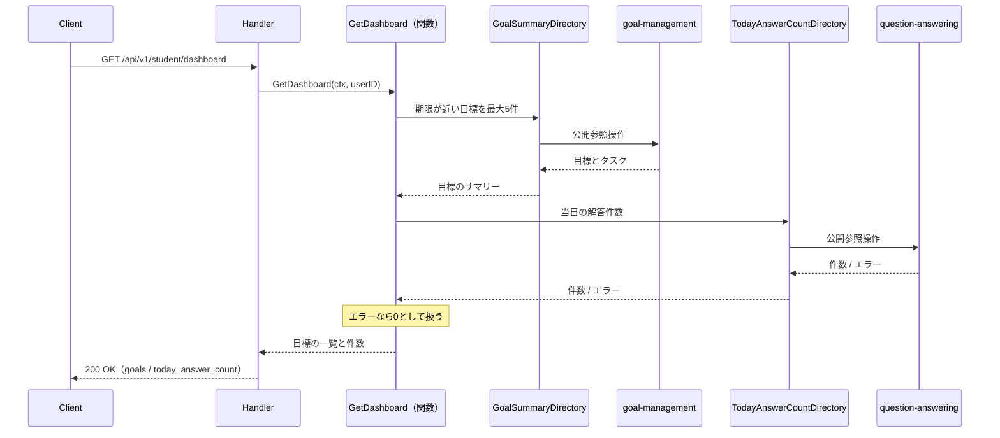
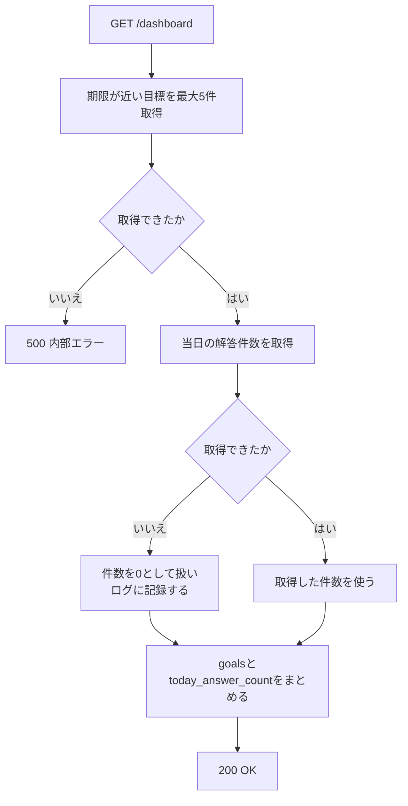

# ダッシュボード機能 Go移行・設計仕様書

---

# 1. 機能概要

## 機能概要

生徒のホーム画面に表示する情報を、1回のリクエストでまとめて取得する参照機能である。取得するのは次の2つである（①「5. API / 処理詳細」`#show`）。

- 期限が近い目標を最大5件。紐づくタスクも含む
- その生徒の当日の解答件数

いずれもこの機能が作成・更新するデータではない。他機能が記録したデータを参照して集約するだけである。

## 利用者

- 生徒ユーザー（`student`ロール）
- 自分自身の目標・解答件数のみ対象

## 業務上の目的

- 生徒がホーム画面から直近の学習目標と当日の取り組み状況を素早く把握できるようにする
- 期限が近い目標を優先的に表示し、学習計画の抜け漏れを防ぐ
- 当日の解答件数を示し、その日の学習量を自覚できるようにする

---

# 2. 設計方針

本機能は参照のみで完結する機能であるため、シンプルな構造を保ちつつ、将来的なダッシュボード項目の追加に耐えられる構造とする。

- 責務分離: 取得条件の組み立てとレスポンス整形を分離する
- **所有の尊重**: 目標・タスク・解答件数のいずれも所有しない。各データを所有するContextが公開する参照手段を呼ぶだけとし、業務ルールを本Contextに持たない（規約「4. Bounded Context構成」の「参照・集約専用Context」）
- 保守性: 表示件数・並び順といった条件の変更に対して影響範囲を限定する
- テスト容易性: 2つの参照手段を差し替えて、集約とレスポンス整形を検証できるようにする
- API互換性: 既存フロントエンドとの整合を保つため、エンドポイント・レスポンス構造・ステータスコードを維持する
- 拡張性: 将来的に他の集計項目が追加された場合、参照手段を1つ増やす形で対応できる構造とする

---

# 3. Bounded Context

## Context名

- `dashboard`

生徒向けダッシュボードを担うContextである。教師向け・管理者向けのダッシュボードは利用者と表示内容が異なるため、別Contextとして扱う（それぞれの機能文書で定める）。

## Contextの責務

- 生徒向けサマリー情報（期限が近い目標、当日の解答件数）の集約と提供
- 複数Contextからの参照結果を1つのレスポンスへまとめること

## 持たない責務

- 目標・タスク・単元の作成・更新・状態遷移（`goal-management`・`task-management`の責務）
- 当日の解答件数の加算（`question-answering`の責務。①「9. 非同期処理」）
- 表示件数・並び順以外の業務ルール

## 他Contextとの依存関係

本Contextから他Contextへの参照依存のみである。状態変更を伴う依存も、他Contextから本Contextへの依存も存在しない。

- `goal-management` Context: 期限が近い目標を最大5件、紐づくタスクとあわせて参照する（①「5. API / 処理詳細」`#show`）
- `question-answering` Context: その生徒の当日の解答件数を参照する（同）
- `user` Context: 認証済み生徒の識別に依存する

## 依存する理由

ダッシュボードはデータそのものを所有・管理せず、他Contextが管理するデータを読み取り専用で集約して表示する性質の機能である。規約「4. Bounded Context構成」の「Context分割基準」は、同一データに対する参照専用の切り口を別Contextとして切り出してよいとし、その場合「業務ルール（作成・更新・状態遷移）は元のContextに残し、参照専用Contextは持たない」と定めている。本Contextはこの方針に従う。

当日の解答件数を`question-answering`に依存するのは、カウンタを加算しているのが同Contextであるためである。Rails現行では問題の解答時に`Student::IncrementTodayAnswerCountService`が呼ばれてカウンタが増える（①「9. 非同期処理」）。値の意味（何を1件と数えるか）を決めているのは加算側であり、所有者は`question-answering`である。

**②からの補足**: 当日の解答件数は**Redis**に保持されており、RDBのテーブルではない（①「6. データモデル」）。本Contextから直接Redisを読まず、`question-answering`が公開する参照手段を通じて取得する。保持先がRedisであることも、キーの構成も、所有者側に閉じ込める。

---

# 4. 設計パターン

## 採用パターン

Transaction Script

## 判断根拠

本機能は「2つの参照手段を呼び、結果を1つのレスポンスへまとめる」だけで構成されており、状態管理・状態遷移・業務ルールが存在しない。

- 業務ルール: 「期限が近い順で最大5件」という並び順・件数の指定のみ。これも`goal-management`の参照手段に渡す条件であり、本Contextが判定するものではない
- 状態管理: 本機能側で状態を変更しない（読み取り専用）
- 整合性: 書き込みがないため、保証すべき整合性の単位が存在しない
- 将来拡張: 他の集計項目が追加される場合も、参照手段を1つ増やして関数の中で呼ぶだけでよい
- テスト容易性: 入力（操作者）に対する出力（2つの参照結果の集約）を検証するだけでよい

Entityに振る舞いを持たせる余地がなく、永続化の責務もないため、手続きを関数として置くTransaction Scriptが最も素直である。

## 採用しなかったパターン

### Active Record

本機能に作成・更新処理が含まれないため、モデルに保存・更新責務を持たせる意味がない。所有するテーブルも存在しない。

### Domain Model

目標・タスクの状態遷移や業務ルールは`goal-management`・`task-management`の責務であり、本機能では読み取り専用で参照するのみである。ダッシュボード固有のEntityに振る舞いを持たせる必要がない。

### Event Sourcing

履歴の再構築・監査要件が存在しない。

---

# 5. Aggregate設計

不要と判断する。

理由: 本機能は他Contextが管理するデータを読み取り専用で集約表示するのみであり、書き込みの整合性を保証する境界が存在しない。参照する目標・タスクの整合性は`goal-management`・`task-management`の責務であり、当日の解答件数の整合性は`question-answering`の責務である。

---

# 6. Entity設計

本機能では独自のEntityを定義しない。所有するデータがないためである。

他Contextから受け取る値は、本Contextが必要とする項目だけを持つ参照用の型として扱う。相手Contextの内部Entityをそのまま持ち込まない（規約「5. Context間連携ルール」）。

## 目標のサマリー（参照用）

- 役割: ダッシュボードに表示する目標の情報
- 項目: 識別子・タイトル・説明・状態・期限と、紐づくタスクの一覧
- ライフサイクル・状態変化: 本機能では扱わない（`goal-management`の責務）
- 判断根拠: 表示に必要な項目のみを受け取る。目標の所有・状態管理は`goal-management`の責務であり、本Contextは表示用の参照に徹するため

## 当日の解答件数（参照用）

- 役割: ダッシュボードに表示する当日の解答件数
- 項目: 整数1つ
- 判断根拠: 加算は`question-answering`の責務であり、本Contextは値を受け取るだけである

---

# 7. Value Object設計

不要と判断する。

理由: 期限による並び替え・最大5件への絞り込みは、`goal-management`の参照手段に渡す条件であり、本Contextが独自の業務ルールとして持つ値ではない。当日の解答件数も整数1つであり、独自ルールを持たない。

目標の期限の表示形式（`YYYY/MM/DD`）は`goal-management`が定める表現であり、本Contextは受け取った値をそのまま返す。表示形式を本Contextで決め直すと、同じ目標が機能によって別の形で返ることになる。

---

# 8. Domain Service

不要と判断する。

理由: 複数Entityにまたがる業務ルールの判定が存在しない。2つの参照結果を1つのレスポンスへまとめる処理は、業務ルールではなくレスポンスの組み立てであり、Presentation層に属する。

---

# 9. クラス図

参照のみの機能であり、Entityもstructの階層も持たないため、クラス図としての図示は省略する。

本Contextが持つのは、他Contextの参照手段を宣言するインターフェースと、それを呼んで結果をまとめる関数のみである。関係は「13. シーケンス図・処理フロー図」のシーケンス図で示す。

Goのstruct定義（参照用の型のフィールド・インターフェースのシグネチャ）は③Go実装仕様書で扱う。

---

# 10. 状態遷移図

省略する。

理由: 本機能に状態を持つデータが存在しない。目標・タスクの状態は参照して返すのみで変更せず、当日の解答件数も単調増加する整数であって状態として扱うものではない（①「7. 状態管理」）。図示すべき遷移が存在しない。

---

# 11. Repository設計

**実装上の位置づけ**: 本機能はTransaction Script採用のため、Repository Interfaceをdomain層に定義しない。また、**本Contextが所有するテーブルは存在しない**ため、Store・Repositoryに相当する実装も持たない。

本Contextが持つのは、他Contextの参照手段を宣言するインターフェースのみである。本Contextの`dependency.go`に置き、実装は相手Contextの公開操作へ委譲するアダプタに閉じ込める（規約「4. Bounded Context構成」・「5. Context間連携ルール」）。

## 他Contextの参照手段

|参照手段|相手Context|取得する内容|
|-|-|-|
|GoalSummaryDirectory|`goal-management`|期限が近い目標を最大5件。期限の昇順（同値は識別子の昇順）で並べ、紐づくタスクを含む（①「5. API / 処理詳細」`#show`）|
|TodayAnswerCountDirectory|`question-answering`|指定の生徒の当日の解答件数（同）|

`GoalSummaryDirectory`が返す目標の項目は、目標管理機能の一覧と同じである。Rails現行も同じシリアライザ（`Student::GoalSerializer`）を使っている（①「10. Rails実装対応表」）。

**②からの補足**: 目標管理機能②「11. Repository設計」の`GoalStore`は、一覧取得の検索機能として「期限の昇順・ページネーション」を持つ。本機能が必要とするのは「期限の昇順・最大5件・ページネーションなし」であり、ページングの有無が異なる。同じ検索を使い回せるか、件数制限専用の参照手段を設けるかは目標管理機能の③で確定する（「25. 設計判断サマリー」）。

`TodayAnswerCountDirectory`は、保持先がRedisであることを本Contextに漏らさない。キーの構成（`student:today_answer_count:{ユーザーID}:{日付}`）も有効期限の扱いも、所有者である`question-answering`に閉じ込める（①「6. データモデル」）。

## 保持しない責務

- 目標・タスク・単元の作成・更新・削除、状態遷移の判断
- 当日の解答件数の加算
- Redisへの直接アクセス

---

# 12. UseCase設計

**実装上の位置づけ**: 本機能はTransaction Script採用のため、UseCase層（struct）を設けない。以下は業務操作の設計意図であり、実装時はapplication層の関数として実装する。

## GetDashboard

- 目的: 期限が近い目標を最大5件と、当日の解答件数を取得する
- 入力: current user
- 出力: 目標の一覧（最大5件。紐づくタスクを含む）と、当日の解答件数
- トランザクション範囲: 読み取りのみのため不要（「14. Transaction設計」）
- 呼び出す先: GoalSummaryDirectory、TodayAnswerCountDirectory
- 処理:
  1. `GoalSummaryDirectory`で期限が近い目標を最大5件取得する
  2. `TodayAnswerCountDirectory`で当日の解答件数を取得する
  3. 2つをまとめて返す
- 判断根拠: 2つの参照を呼んでまとめるだけであり、業務ルールを組み合わせる必要がないため

**当日の解答件数の取得に失敗した場合は、エラーとせず`0`として扱う。** Rails現行がRedisの障害時にログを記録して`0`を返しており、目標の取得が成功していればダッシュボード全体が200で応答する（①「5. API / 処理詳細」`#show`のErrorケース）。目標の取得に失敗した場合は500とする。

この「一方の失敗を吸収する」挙動は、本Contextが集約を担うからこそ必要になる判断である。どちらの参照手段も、失敗を呼び出し側に伝える形でよい。吸収するかどうかは本Contextが決める。

---

# 13. シーケンス図・処理フロー図

## シーケンス図（GetDashboard）

Transaction Script採用のためUseCase層のstructはなく、application層の関数が参照手段を呼ぶ（「4. 設計パターン」）。

## 処理フロー図（GetDashboard）

当日の解答件数の失敗を吸収する分岐があるため図示する。

目標が0件の場合も`goals`を空配列として200を返す（①「5. API / 処理詳細」`#show`）。

---

# 14. Transaction設計

## Transaction開始位置

- なし

## Transaction終了位置

- なし

## 理由

状態を変更する処理が存在しないため、トランザクションによる整合性保証は不要である。

2つの参照手段が返す値の間に整合性を求めない。目標の取得と解答件数の取得の間に別のリクエストで解答が記録された場合、件数のみが新しい値になりうるが、表示用の集約であり業務上の問題にならない。Rails現行も2つの取得をトランザクションで囲んでいない（①「5. API / 処理詳細」`#show`）。

当日の解答件数はRedisに保持されており、RDBのトランザクションに含めることはできない（①「6. データモデル」）。整合性を求めない方針はこの制約とも一致する。

---

# 15. Validation設計

## Presentation

- 型チェック: リクエストパラメータが存在しないため、検証項目はない
- 必須チェック: なし
- フォーマットチェック: なし

パスパラメータ・クエリパラメータ・リクエストボディのいずれも受け取らない（①「5. API / 処理詳細」`#show`）。

## Domain

- 業務ルール: なし
- 状態チェック: なし
- 整合性チェック: なし

## 責務分離

本機能は入力を持たない参照であるため、入力検証は不要である。操作者の識別のみが前提条件となる。

表示件数（5件）と並び順（期限の昇順、同値は識別子の昇順）は検証の対象ではなく、参照手段に渡す条件である（「11. Repository設計」）。

---

# 16. Authorization設計

## Middleware

- 認証済みユーザーを特定し、ユーザー情報を`context.Context`に保持する
- 役割が`student`であることを確認する
- CSRF: 本機能はGETのみであり、CSRF検証の対象外である（Gin規約「5. CSRF対策」の「適用範囲」）

## Handler

- `context.Context`からcurrent userを取り出し、application層の関数へ渡す
- 業務権限判定は持たせない

## Application（Transaction Script採用時の関数）

- current userの識別子を2つの参照手段に渡すことで、操作者自身のデータのみ取得できるようにする

## Domain

- 権限判定を行わない。所有権のスコープは参照手段に渡す識別子で担保する

## 判断理由

本機能はcurrent userのスコープに閉じた参照であるため、認証確認と参照手段への識別子の受け渡しのみで十分である。追加の認可レイヤーを設けない。

Rails現行も`current_user.goals`を起点に目標を取得し、解答件数のキーに操作者の識別子を含めることで同じスコープを実現している（①「8. 権限制御」）。

---

# 17. Error設計

## Domain Error

本機能では業務ルール違反が発生しないため、使用しない。

## Application Error

- 責務: 目標の取得に失敗した場合を表現する
- 判断理由: 取得できなければダッシュボードを組み立てられないため、呼び出し元へ伝える必要がある

当日の解答件数の取得の失敗はApplication Errorとして扱わない。`0`として吸収する（「12. UseCase設計」）。

## Infrastructure Error

- 責務: DB接続失敗・Redisの障害など、技術的な障害を表現する
- 判断理由: 技術的な障害をドメインに漏らさず切り分けるため

Redisの障害は`question-answering`の参照手段の内部で発生し、本Contextへはエラーとして伝わる。本Contextはそれを`0`へ吸収し、ログに記録する。

## エラー仕様

|業務シナリオ|エラー種別|発生層|想定するHTTPステータス|
|-|-|-|-|
|当日の解答件数の取得に失敗した|エラーとしない|—|—（`0`として扱い200で応答する。ログに記録する）|
|目標の取得に失敗した|Internal|Infrastructure → Application（変換）|500|
|未認証|Unauthorized|Middleware|401|
|`student`ロールでない|Forbidden|Middleware|403|

固有の404・422は存在しない。対象が一意に定まるリクエストパラメータを持たず、入力検証の対象もないためである。

## エラーレスポンスの本文

Rails現行の本文の形をそのまま維持する。

|条件|HTTPステータス|本文|
|-|-|-|
|認可エラー|403|`{"errors": ["この操作を行う権限がありません"]}`|
|内部エラー|500|`{"errors": [...]}`|

いずれも規約「15. API規約（レスポンス形式・ページネーション・URL・クエリパラメータ）」の「エラーレスポンス」と同じ形式である。本機能には404を返す経路がないため、他機能にある`message`キーの本文は現れない。

---

# 18. Domain Event

不要と判断する。

理由: 参照のみの機能であり、表示に伴って他処理へ通知すべき副作用が現行仕様に存在しない（①「9. 非同期処理」）。

---

# 19. API仕様

## エンドポイント一覧

|エンドポイント|HTTP Method|概要|
|-|-|-|
|/api/v1/student/dashboard|GET|期限が近い目標と当日の解答件数を取得|

Rails現行仕様と同じURL・HTTP Methodを維持する。ルーティングは単数形（`dashboard`）であり、現行の`resource :dashboard, only: :show`に対応する（①「4. API一覧」）。

## 各エンドポイントの仕様

### GET /api/v1/student/dashboard

- Request: パラメータなし
- Response: 最上位は`goals`と`today_answer_count`の2キー
  - `goals`: 期限が近い目標の配列（最大5件）。各要素は識別子・タイトル・説明・状態・期限（`YYYY/MM/DD`形式。未設定なら`null`）と、**紐づくタスクの配列**。タスクの各要素は識別子・所有者・目標の識別子・タイトル・内容・期限・優先度・状態・完了日時と、紐づく単元の配列である（①「5. API / 処理詳細」`#show`）
  - `today_answer_count`: 当日の解答件数（整数）
- ページ情報（`meta`）は返さない。最大5件に固定されており、ページングを行わないため（同）
- Status Code: 正常系200。異常系は未認証401、`student`ロール不一致403、目標の取得に失敗した場合500

## エラーレスポンス

形式は「17. Error設計」の「エラーレスポンスの本文」のとおり。

## Railsとの差分

**API外部仕様の変更はない。** URL・HTTP Method・レスポンス構造・ステータスコード・エラー本文の形のいずれも変更しない。当日の解答件数の取得に失敗したときに`0`を返して200で応答する挙動も維持する。

内部の責務には次の差分がある。

- Rails仕様: Controllerが`GoalsQuery`で目標を直接取得し、`Student::TodayAnswerCountQuery`でRedisを直接読んでいる（①「5. API / 処理詳細」`#show`）
- Go設計での変更: 目標は`goal-management`、当日の解答件数は`question-answering`が公開する参照手段を通じて取得する。本Contextから`goals`・`tasks`へのクエリも、Redisへのアクセスも行わない
- 変更理由: 他Contextが所有するデータへの直接アクセスは規約「5. Context間連携ルール」が禁じているため。保持先がRedisであることやキーの構成を本Contextに漏らさないことで、保持先の変更が本Contextに波及しなくなる
- 影響範囲: 本機能の1エンドポイントの外部仕様に変更はない。`question-answering`の②③が、当日の解答件数を答える参照手段を公開する必要がある

JSONスキーマの厳密な型定義・Goの構造体は③Go実装仕様書で扱う。

---

# 20. DB設計方針

## 現行DBを利用するか

- 既存Rails DBを継続利用する

## Schema変更有無

- 変更なし

## 変更理由

- 本機能は参照のみであり、所有するテーブルを持たない
- 参照する`goals`・`tasks`・`units`はいずれも他Contextが所有し、現行のスキーマで本機能の要件を満たしている

## 変更を提案しない理由

- 表示に必要な項目はすべて既存カラムで取得できる
- 当日の解答件数はRedisに保持されており、RDBのスキーマに関わらない（①「6. データモデル」）

---

# 21. DB操作仕様

**本Contextから発行するクエリはない。**

|Store|対象テーブル|操作種別|
|-|-|-|
|—|—|—|

`goals`・`tasks`・`units`へは`goal-management`が公開する参照手段を通じて取得し、当日の解答件数は`question-answering`が公開する参照手段を通じて取得する（「11. Repository設計」、規約「5. Context間連携ルール」）。本ContextはRedisにもアクセスしない。

参照手段の内部で発行されるクエリの仕様は、所有者側の②③で定める。本機能が必要とする条件は次のとおりであり、参照手段への要求として伝える。

|要求|内容|根拠|
|-|-|-|
|目標の絞り込み|操作者自身の目標のみ。論理削除済みを除く|①「5. API / 処理詳細」`#show`|
|目標の並び順|期限の昇順。同値は識別子の昇順|同|
|目標の件数|最大5件。ページングなし|同|
|紐づくタスク|目標ごとに個別に問い合わせず一括で取得する（N+1を避ける）|同（Rails現行も`includes_tasks`で一括取得している）|
|当日の解答件数|操作者自身の、サーバの現在時刻の日付における件数|同|

---

# 22. テスト戦略

Transaction Script採用のため、規約「3. 設計パターンごとの構造適用方針」の読み替えルールに従う。Entityを持たないため、Domain Testに相当するものがない。

## Domain Test

- 対象外。本Contextに業務ルールを持つEntity・Value Objectが存在しない

## UseCase Test（Transaction Script採用時は関数のテスト）

- 目的: `GetDashboard`が2つの参照結果を正しくまとめることを検証する
- 含めるもの: 当日の解答件数の取得が失敗した場合に`0`として扱い、目標の取得結果はそのまま返すこと。目標の取得が失敗した場合はエラーを返すこと。目標が0件の場合に空配列を返すこと

## Repository Test

- 対象外。本Contextが所有するテーブルがなく、Store・Repositoryに相当する実装を持たない
- 他Contextの参照手段のアダプタについては、相手Contextの公開操作を呼び出して結果を変換することを検証する

## Handler Test

- 目的: レスポンス形状とHTTPステータスの変換を検証する
- 含めるもの: 最上位が`goals`と`today_answer_count`の2キーであること、`meta`を返さないこと、目標が最大5件であること、`status`が文字列で返ること、目標の取得に失敗した場合に500になること

## Integration Test

- 目的: エンドポイント経由で2つの情報がまとめて取得できることを確認する
- 含めるもの: 認可（未認証・`student`以外の拒否、他の生徒の目標が含まれないこと）、目標が6件以上あるときに期限の近い5件のみ返ること、解答を記録したあとに件数が増えて反映されること

---

# 23. Railsとの責務対応

| Rails | Go | 設計方針 |
|---|---|---|
| Controller（`DashboardsController`） | Handler | HTTP入力の受け取りとレスポンス整形に限定する |
| Controller内の集約処理 | application層の関数（`GetDashboard`） | 2つの参照結果をまとめる手続きとして分離する（Transaction Script採用のためUseCase structは設けない） |
| Query（`GoalsQuery`） | `goal-management`の参照手段 | 目標の取得条件は所有者側に委ねる（「11. Repository設計」） |
| Query（`Student::TodayAnswerCountQuery`） | `question-answering`の参照手段 | Redisへのアクセスとキーの構成を所有者側に閉じ込める |
| Serializer（`Student::GoalSerializer`） | Response DTO | 目標管理機能と同じ項目を返す。表示形式は所有者側の表現をそのまま用いる |
| Redisの障害時に`0`を返す扱い | application層の関数での吸収 | 一方の参照の失敗を吸収する判断は集約を担う本Contextが持つ（「12. UseCase設計」） |

---

# 24. 採用しなかった設計

## Active Record

- 採用しなかった理由: 作成・更新処理が存在せず、所有するテーブルもないため、モデルに保存・更新責務を持たせる意味がない
- 将来的に採用する可能性: 低い。ダッシュボードが自前のデータを持つようになった場合は再検討する

## Domain Model

- 採用しなかった理由: 目標・タスクの状態遷移や業務ルールは所有者側のContextの責務であり、ダッシュボード固有のEntityに振る舞いを持たせる必要がないため
- 将来的に採用する可能性: 低い。参照・集約専用Contextに業務ルールを持たせない方針（規約「4. Bounded Context構成」）に反するため

## Event Sourcing

- 採用しなかった理由: 履歴の再構築・監査要件が存在しないため
- 将来的に採用する可能性: 低い

## 本Contextから直接Redisを読む案

- 採用しなかった理由: カウンタを加算しているのは`question-answering`であり、値の意味を決めているのは加算側である。本Contextがキーの構成を知ると、キーの変更が2箇所に波及する。また規約「5. Context間連携ルール」の「相手Contextの内部Entity・Infrastructure実装に直接依存しない」に反する
- 代わりに`question-answering`が公開する参照手段を呼ぶ

## 目標の取得を本Contextで実装する案

- 採用しなかった理由: 同じ目標の一覧取得が`goal-management`と本Contextの2箇所に存在することになり、論理削除の扱い・並び順・表示形式が食い違う余地が生まれる。規約「4. Bounded Context構成」の参照専用Contextの方針にも反する
- 代わりに`goal-management`が公開する参照手段を呼ぶ

---

# 25. 設計判断サマリー

| 項目 | 採用 | 判断理由 |
|---|---|---|
| 設計パターン | Transaction Script | 2つの参照を呼んでまとめるだけで、Entityに振る舞いを持たせる余地も永続化の責務もないため |
| Aggregate | 不要 | 書き込みがなく、保証すべき整合性の単位が存在しないため |
| Entity | 定義しない | 所有するデータがなく、他Contextから受け取る値は参照用の型として扱うため |
| Transaction境界 | なし | 状態を変更する処理が存在しないため |
| Domain Event | 未採用 | 表示に伴う副作用が存在しないため |
| Value Object | 不要 | 並び順・件数は参照手段に渡す条件であり、独自の業務ルールを持つ値ではないため |
| 他Contextの参照 | `dependency.go`のインターフェース + アダプタ | 規約「5. Context間連携ルール」に従い、他Contextのテーブル・Redisを直接読まないため |
| Authorization | Middleware + 参照手段への識別子の受け渡し | current userのスコープに閉じた参照であり、追加の認可レイヤーが不要なため |
| 解答件数の取得失敗の扱い | `0`として吸収し200で応答する | Rails現行の挙動を維持するため（①「5. API / 処理詳細」`#show`） |

## 本書で決めていない事項

|事項|決めていない理由|決める場所|
|-|-|-|
|`GoalSummaryDirectory`の具体的なシグネチャ|目標管理機能②「11. Repository設計」の`GoalStore`はページネーション付きの一覧取得を持つが、本機能は「最大5件・ページングなし」を必要とする。同じ検索を使い回せるか、件数制限専用の参照手段を設けるかは所有者側で決める|目標管理機能の③|
|`TodayAnswerCountDirectory`の具体的なシグネチャ|`question-answering`の②③がまだ作成されていない|問題解答機能の②③|
|当日の解答件数の「当日」の基準となるタイムゾーン|Rails現行は`Time.current.to_date`で判定しており、アプリケーションのタイムゾーン設定に依存する。Go側で同じ基準を使う必要があるが、基準そのものは加算側が決める|問題解答機能の②③|

---

# 設計差分管理

## Rails現行仕様

- Controllerが`GoalsQuery`で目標を直接取得し、`Student::TodayAnswerCountQuery`でRedisを直接読んでいる
- 2つの取得結果をController内でハッシュにまとめて返している
- Redisの障害時に`0`を返す吸収がQuery側に置かれている

## Go設計での変更内容

- 目標は`goal-management`、当日の解答件数は`question-answering`が公開する参照手段を通じて取得する
- 2つの参照結果をまとめる処理をapplication層の関数（`GetDashboard`）として分離する
- 解答件数の取得失敗を`0`として吸収する判断を、集約を担う本Contextに置く

## 変更理由

- 他Contextが所有するデータへの直接アクセスは規約「5. Context間連携ルール」が禁じているため
- 保持先がRedisであることやキーの構成を本Contextに漏らさないことで、保持先の変更が本Contextに波及しなくなるため
- 吸収するかどうかは集約側の判断であり、参照手段の側に置くと他の利用者にも同じ吸収が強制されるため

## 影響範囲

- フロントエンドから見たAPIの外部仕様は変更しない
- 既存DBスキーマは維持するため、データ移行やマイグレーションの追加は不要
- `goal-management`の③が「期限が近い目標を最大5件、紐づくタスクとあわせて返す」参照手段を公開する必要がある
- `question-answering`の②③が「当日の解答件数を返す」参照手段を公開する必要がある
