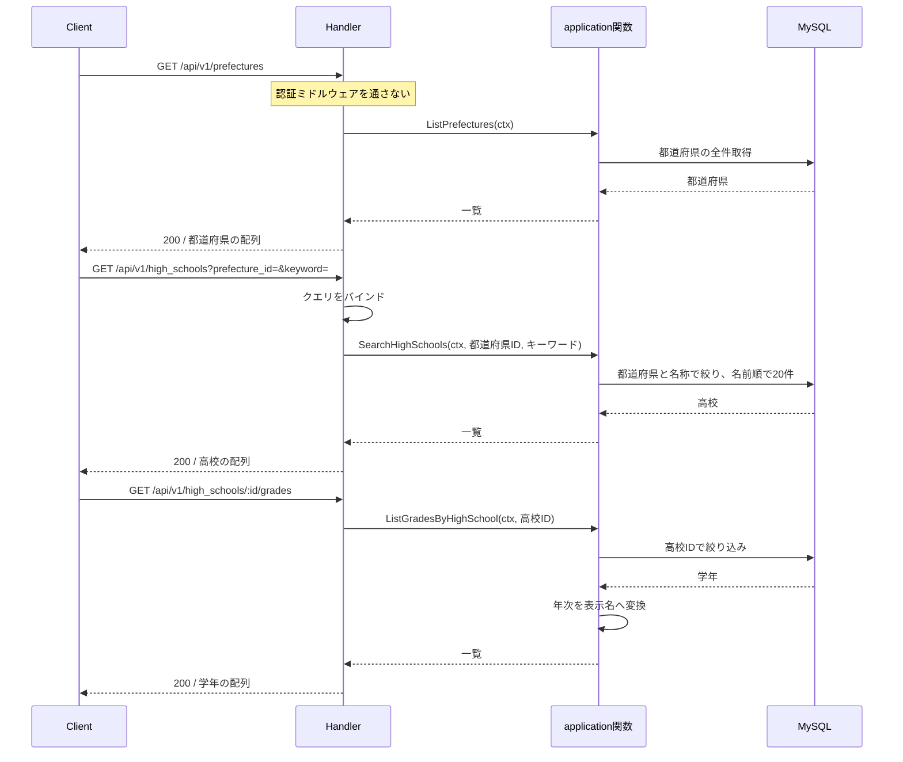
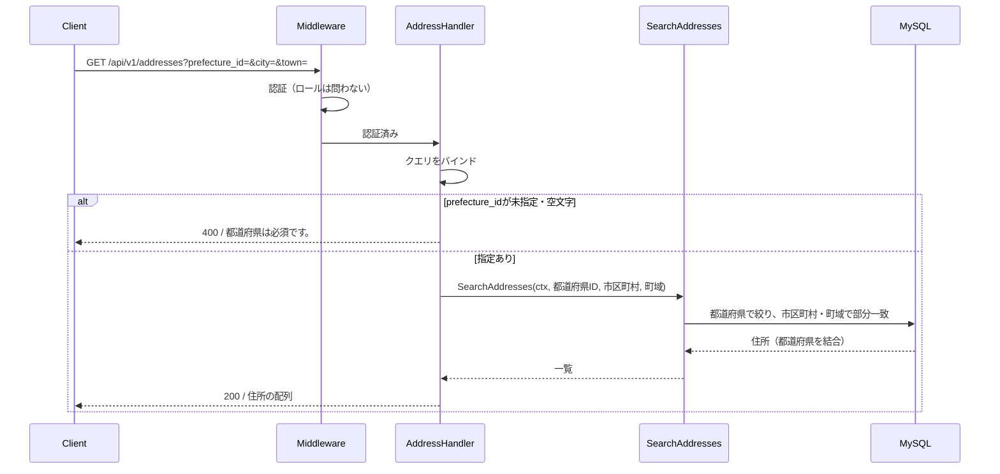
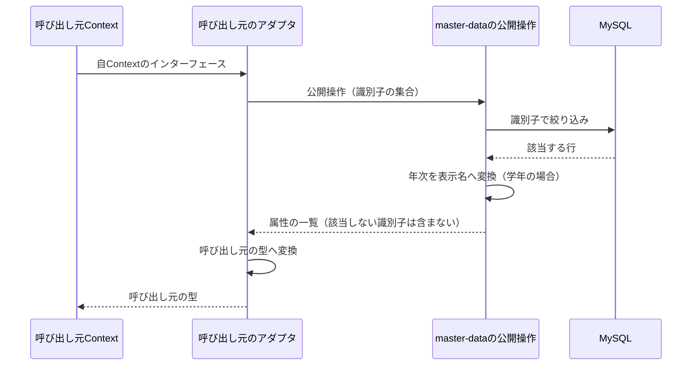
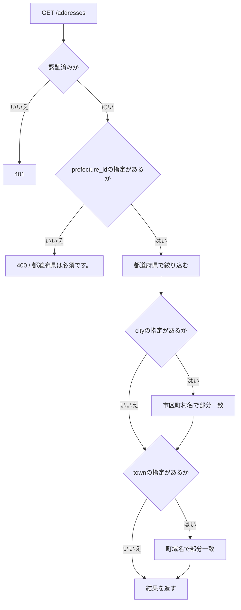
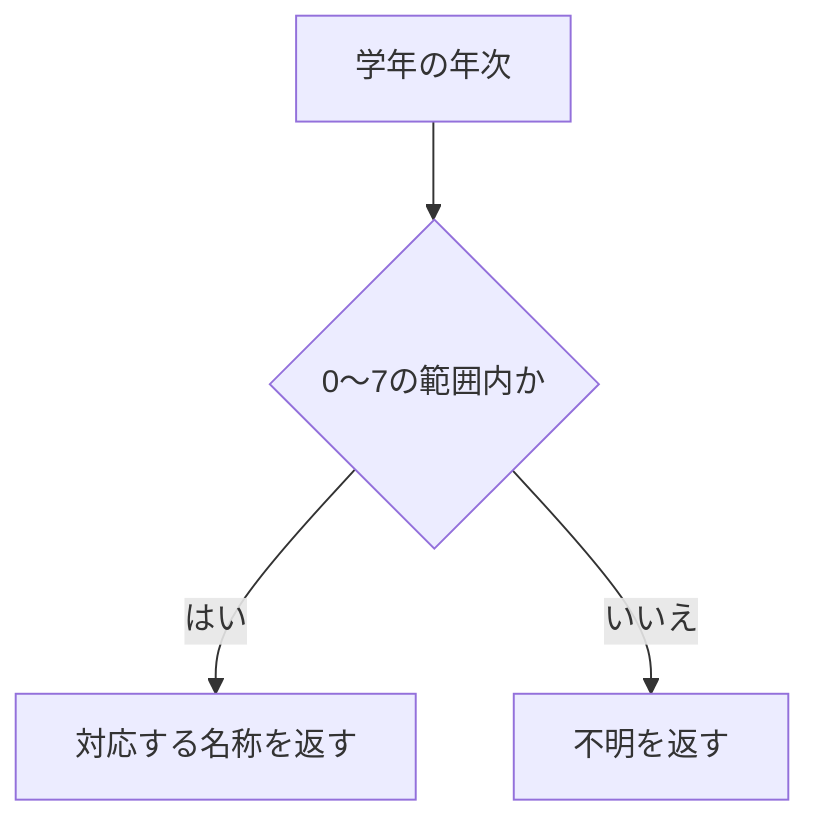

# 共通マスタ参照機能 Go移行・設計仕様書

---

# 1. 機能概要

## 機能概要

会員登録・プロフィール編集・生徒登録などの入力フォームが選択肢として必要とする共通マスタ（都道府県・住所・在籍高校・学年）を参照できるようにする機能である（①「1. 機能概要」）。

提供する操作は4つで、いずれも参照のみである（①「2. 機能一覧」）。

- 都道府県一覧取得（未認証可）
- 住所検索（認証必須。都道府県が必須条件）
- 高校検索（未認証可。都道府県と名称で絞り込み、最大20件）
- 学年一覧取得（未認証可。高校単位）

## 利用者

都道府県一覧・高校検索・学年一覧は未認証でも利用できる。会員登録フォームが登録前に呼ぶためである。住所検索のみ認証が必要で、ロールは問わない（①「8. 権限制御」）。

## 業務上の目的

どのユーザー種別の登録・編集フォームからも共通して使われる選択肢を、1か所から提供すること。都道府県 → 住所、都道府県 → 高校 → 学年という段階的な絞り込みを成立させること。

加えて、**他Contextが高校・学年・住所の実在確認や属性の取得に使う窓口になること。** 本Contextのエンドポイントを使う利用者より、公開参照手段を使う他Contextの方が数が多い（「3. Bounded Context」の依存集約表）。

---

# 2. 設計方針

- **公開範囲を絞る**: 他Contextへ公開する属性は、他の②が実際に必要としているものに限る（「3. Bounded Context」の集約表）。高校の学校コードは生徒番号の発行に必要なため公開するが、本機能のエンドポイントのレスポンスには含めない。
- **小さく安定した窓口にする**: 公開する参照操作の数を抑え、識別子の集合を渡して属性を受け取る形に揃える。実在確認・所属の判定・表示名の取得を、別々の操作に分けない。
- **画面向けの一覧は公開しない**: ページネーション・他テーブルとの結合・並び替えを伴う一覧は、それを必要とするContextが自前の参照モデルとして持つ。ユーザー基盤機能②「3. Bounded Context」が`users`について同じ方針を採っており、それに揃える。
- **表示名の規則を本Contextに閉じ込める**: 学年の年次から表示名（`中３生`・`高１生`等）への対応は本Contextが持ち、呼び出し元は結果を受け取るだけとする（管理者教員管理機能②「11. Repository設計」）。
- **API互換性を維持する**: URL・HTTPメソッド・レスポンス項目名・HTTPステータスをRails現行から変えない。フロントエンドを変更しない方針のため、Rails現行の振る舞いに不合理な点があっても本移行では踏襲し、Rails側の修正課題として別に管理する（「19. API仕様」の「Railsとの差分」）。
- **過剰な構造を持ち込まない**: 状態も業務ルールも持たないため、Entity・Repository Interface・UseCase層を設けない（規約「3. 設計パターンごとの構造適用方針」）。

---

# 3. Bounded Context

## Context名

- `master-data`

## Contextの責務

- 都道府県・住所・在籍高校・学年の保持と参照提供
- 住所の市区町村・町域による絞り込み、高校の都道府県・名称による絞り込み
- 学年の年次から表示名への対応
- **他Contextからの参照要求に答えること**（「11. Repository設計」の「他Contextへ公開する参照手段」）

## 持たない責務

|持たない責務|所有するContext|
|-|-|
|都道府県・住所・高校・学年の登録・更新・削除|どのContextにも実装がない。APIとして提供されていない（①「5. API / 処理詳細」の「実装のないアクションへの経路」）|
|学級（`school_classes`）の保持・参照|`school-class`（クラス編成機能②「3. Bounded Context」）|
|高校ごとの生徒数・教員数の集計と、管理者向けの高校一覧・詳細|`school-directory`（管理者高校学年参照機能②「3. Bounded Context」）|
|ユーザーの所属（どのユーザーがどの高校・学年に属するか）|`user`（ユーザー基盤機能②「3. Bounded Context」）|
|画面向けの一覧（ページネーション・結合・並び替えを伴うもの）|それを必要とする各Context|

## 他Contextからの依存の集約（高校・学年・住所に関する言及の全件）

他の②が`master-data`を参照している箇所を、実際に必要としている内容ごとに集約した。

|依存元（機能・Context）|必要としている内容|本②での扱い|
|-|-|-|
|認証（`authentication`）|生徒・教員としての登録時に、指定された高校・学年が実在するかの確認。仮アカウント有効化時に、仮アカウントの学校コードと選択高校の整合確認。`GET /me`のレスポンス合成に使う高校名・学年の表示名（認証機能②「3. Bounded Context」「11. Repository設計」）|FindHighSchools、FindGrades|
|ユーザー基盤（`user`）|生徒番号の発行に必要な高校の学校コードの取得（ユーザー基盤機能②「10. master-dataの公開参照における学校コードの取得（決定済み）」）|FindHighSchools（`school_code`を含む）|
|プロフィール管理（`profile`）|プロフィール更新時の住所IDの実在確認（本②の旧版「3. Bounded Context」）|FindAddresses|
|アカウント連携（`account-linking`）|統合対象候補とログイン中アカウントが同一高校に所属するかの判定に使う高校IDの参照（アカウント連携機能②「3. Bounded Context」）|FindHighSchools。ただし所属の判定自体は`user`が答える|
|教師教員管理（`teacher-management`）|担当学年の存在確認、学年が対象高校に属するかの判定（教師教員管理機能②「11. Repository設計」の`GradeStore`）|FindGrades（`high_school_id`を含むため所属の判定が呼び出し元で可能）|
|管理者教員管理（`teacher-management`）|対象高校の存在確認、`grade_ids`が対象高校に属する学年であることの確認、学年の表示名（管理者教員管理機能②「11. Repository設計」の`HighSchoolStore`・`GradeStore`）|FindHighSchools、FindGrades（表示名を含む）|
|教師生徒参照（`student-directory`）|登録先の学年が教師の所属校に属することの確認（教師生徒参照機能②「9. Repository設計」）|FindGrades|
|生徒CSVインポート（`student-import`）|CSV上の学年名から実在する学年を解決する（表示名から識別子への解決）（生徒CSVインポート機能②「11. Repository設計」の`GradeClassResolutionRepository`）|FindGradesByHighSchoolID（表示名を含む一覧を返し、突き合わせは呼び出し元が行う）|
|クラス編成（`school-class`）|学年情報の参照（クラス編成機能②「11. Repository設計」）|FindGrades、FindGradesByHighSchoolID|
|分析（`learning-analytics`）|学年の識別子から年次、年次から同じ年次を持つ学年の識別子の集合（分析機能②「11. Repository設計」の`master-data`への参照）|FindGrades（年次を含む）、FindGradeIDsByYear|
|管理者高校学年参照（`school-directory`）|高校に属する学年の一覧（年次の昇順・表示名を含む）|FindGradesByHighSchoolID。高校の一覧・詳細は同Contextが自前の参照モデルを持つ|

この表から、公開する参照操作は「高校の属性の取得」「学年の属性の取得」「高校配下の学年一覧」「年次による学年の検索」「住所の属性の取得」の5つで、上記の全てのニーズを満たせると判断した。

**実在確認のための専用操作を設けない。** 属性を取得する操作が、該当しない識別子を結果に含めないことで実在確認を兼ねる。確認と取得を分けると、呼び出し元が同じ識別子で2回問い合わせることになる。

**所属の判定を本Contextで行わない。** 学年の属性に所属高校の識別子を含めるため、「この学年はこの高校に属するか」は呼び出し元が突き合わせで判定できる。判定を本Contextの操作にすると、呼び出し元ごとに必要な組み合わせが増える。

## 他Contextとの依存関係（本Contextが依存する側）

**なし。** 本Contextが所有する4つのマスタは、他Contextのデータにも業務ルールにも依存しない（①「6. データモデル」）。本Contextは参照される側のみである。循環依存は発生しない。

## 依存する理由

都道府県・住所・在籍高校・学年は、どのユーザー種別の登録・編集フォームからも共通して参照される選択肢データであり、固有の意思決定（作成・更新・削除、状態遷移）を持たない。Rails現行もこの4つを1つの機能としてまとめて提供しており、常に一体で扱われるデータを無理に分割しないという方針（規約「4. Bounded Context構成」のContext分割基準）に沿って1つのContextとする。

## `school-directory` との関係

`school-directory`（管理者高校学年参照機能）は同じ`high_schools`・`grades`を参照するが、目的が異なる。本Contextは入力フォームの選択肢提供に特化した参照であり、`school-directory`は管理者向けの一覧・詳細参照と生徒数・教員数の集計という運用状況の把握を目的とする。

規約「4. Bounded Context構成」は「同一データに対する参照専用の切り口は、データを所有するContextとは別の『参照・集約専用Context』として切り出してよい。ただしその場合、業務ルール（作成・更新・状態遷移）は元のContextに残し、参照専用Contextは持たない」と定めている。両Contextとも業務ルールを持たないため、この条件は満たされる。別Contextとして維持する。

**高校の一覧・詳細は`school-directory`が自前の参照モデルを持つ。** 本Contextは公開しない。ページネーション・都道府県との結合・識別子による並び替えを伴う画面向けの一覧であり、ユーザー基盤機能②「3. Bounded Context」が`users`について採った方針（画面向けの一覧は所有Contextが公開せず、必要とするContextが自前の参照モデルを持つ）に揃える。

**学年の一覧は本Contextが公開する操作を`school-directory`が呼ぶ。** こちらはページネーションも結合も伴わず、かつ年次から表示名への対応規則を含むためである。規則を2つのContextに複製しない。

---

# 4. 設計パターン

## 採用パターン

Transaction Script

## 判断根拠

規約「3. 設計パターンごとの構造適用方針」のTransaction Script節は、対象を「一般・補完領域で、業務ルールが1〜2文で説明できる単純な処理（**単純な一覧参照**・集計・レポート生成・バッチ的処理等）」と定めている。本機能は単純な一覧参照であり、この定義に該当する。

- **業務ルール**: 「都道府県が未指定なら住所を検索しない」「高校は名前順で最大20件」「学年の年次を表示名に対応付ける」のみ。いずれも検索条件と表現の規則であり、満たすべき業務条件や禁止される操作ではない
- **状態管理**: 4つのマスタはいずれも状態を表すカラムを持たない（①「7. 状態管理」）
- **整合性**: 書き込みがないため、保証すべき整合性の単位が存在しない
- **将来拡張**: 検索条件（郵便番号による絞り込み等）が追加される場合も、条件を1つ増やすだけで足りる。公開する参照操作の追加も同様である
- **テスト容易性**: 入力条件に対する出力を検証するだけでよい

Entityに振る舞いを持たせる余地がなく、同じデータ構造を複数の関数が状態として持ち回る構図にもならないため、Active Recordへの格上げの目安（規約同節）にも達していない。

## 採用しなかったパターン

### Active Record

本機能に作成・更新処理が含まれない。永続化操作をstructに持たせる対象がない。Rails現行もルーティング上は高校の登録・更新・削除の経路を持つがアクションが実装されておらず（①「5. API / 処理詳細」の「実装のないアクションへの経路」）、移行対象の操作が存在しない。

### Domain Model

Entityが状態を持たず、状態遷移ルールもなく、Entityへ振る舞いを集約する対象が存在しない。複数Contextから参照される共通データであるという性質はContext分割の判断には影響するが、参照ロジック自体の複雑さには影響しない。参照専用Contextに集約・Repository Interface・UseCase層を設けると、関数1つで足りる処理に対して層だけが増える。

### Event Sourcing

履歴の再構築・監査要件が存在しない。マスタの変更履歴を業務上必要とする要件もない。

---

# 5. Aggregate設計

不要である。

理由: 本Contextは書き込みを行わないため、整合性を保証すべき単位が存在しない。都道府県・住所・高校・学年はいずれも独立したマスタであり、1つの整合性単位として扱う対象ではない。

---

# 6. Entity設計

本Contextで管理するEntityは存在しない。

理由: 規約「3. 設計パターンごとの構造適用方針」のTransaction Script節は「domain層は原則作らない」と定めており、本機能はこれに従う。4つのマスタはいずれも識別子を持つ永続データだが、状態もライフサイクルも振る舞いも持たないため、Entityとして扱う必要がない。

参照結果は、エンドポイントまたは公開参照手段が返す読み取り専用の型として扱う。公開する型は「11. Repository設計」で整理する。

---

# 7. Value Object設計

Value Objectは採用しない。

理由: 規約「3. 設計パターンごとの構造適用方針」のTransaction Script節は「入力検証が必要な場合も、Value Object等の型は作らず、関数内のガード節で行う」と定めている。

Value Objectの候補になりうる概念と、型を作らずに扱う場所を整理する。

|概念|持つ規則|扱う場所|
|-|-|-|
|学年の表示名|年次0〜7に対応する8つの名称。範囲外は「不明」（①「5. API / 処理詳細」`Api::V1::GradesController#index`）|application層の変換関数。年次から導出し、保持しない|
|学校コード|英数字6桁の大文字、一意、未設定を許す（①「6. データモデル」）|型を作らない。発行の経路がAPIとして存在せず、本Contextは読み取るだけである|
|郵便番号|8文字まで（①「6. データモデル」）|型を作らない。検証も整形も行わず、保存されている値をそのまま返す|

表示名の変換だけは、エンドポイントと公開参照手段の両方から使われるため、型を作らずとも1つの関数に集約する。年次と名称の対応が2か所に分かれないようにするためである。

---

# 8. Domain Service

不要である。

理由: Domain Serviceは、複数Entityにまたがる業務ルールの判定をEntityの外に出すための置き場所である。本ContextにはEntityが存在せず（「6. Entity設計」）、判定すべき業務ルールもない。

学年が特定の高校に属するかという判定は、呼び出し元が学年の属性に含まれる所属高校の識別子を突き合わせて行う（「3. Bounded Context」の依存集約表）。本Contextの判定として持たない。

---

# 9. クラス図

Entityもstructの階層も持たないため、クラス図としての図示は省略する。

本Contextが持つのは、マスタを読む関数群と、それが返す読み取り専用の型のみである。関係は「13. シーケンス図・処理フロー図」のシーケンス図で示す。

Goのstruct定義・関数のシグネチャは③Go実装仕様書で扱う。

---

# 10. 状態遷移図

省略する。

理由: 本Contextが扱う4つのマスタはいずれも状態を表すカラムを持たない（①「7. 状態管理」）。図示すべき遷移が存在しない。

---

# 11. Repository設計

本機能はTransaction Scriptを採用するため、Repository Interfaceは設けない（規約「3. 設計パターンごとの構造適用方針」）。本節は、業務上必要なデータアクセスの責務として整理する。実装はinfrastructure層の関数となる。

本Contextが所有するテーブルは`prefectures`・`addresses`・`high_schools`・`grades`の4つである。他Contextが所有するテーブルへはアクセスしない。

## 本機能のエンドポイントが使う検索

### 都道府県の検索

- 管理対象: 都道府県
- 責務: 全件取得
- 保持する検索機能: なし（条件を取らない）
- 保持しない責務: 並び替え・絞り込み・ページネーション（Rails現行がいずれも行っていない。①「5. API / 処理詳細」）
- 判断根拠: 件数が固定であり、絞り込む必要がない

### 住所の検索

- 管理対象: 住所
- 責務: 条件に一致する住所を、所属する都道府県とあわせて取得
- 保持する検索機能
  - 都道府県による絞り込み
  - 市区町村名による部分一致
  - 町域名による部分一致
- 保持しない責務: 都道府県が必須であることの検証（Presentation層の責務）、並び替え、ページネーション
- 論理削除の扱い: **除外しない。** `addresses`は`deleted_at`を持つが既定の絞り込みが定義されておらず、Rails現行は論理削除済みの行も返す（①「5. API / 処理詳細」`Api::V1::AddressesController#index`）
- 判断根拠: 都道府県との結合が必要なのは、レスポンスに都道府県名を含めるためである

### 高校の検索

- 管理対象: 在籍高校
- 責務: 条件に一致する高校を、名前順で件数を限って取得
- 保持する検索機能
  - 都道府県による絞り込み
  - 高校名による部分一致
  - 高校名の昇順、先頭20件
- 保持しない責務: ページネーション（Rails現行に手段がない）、生徒数・教員数の集計（`school-directory`の責務）
- 判断根拠: 件数制限は本機能の表示仕様である。絞り込みを増やして件数を減らすことを前提とした設計になっている

### 学年の検索

- 管理対象: 学年
- 責務: 指定された高校に属する学年を取得
- 保持する検索機能: 高校の識別子による絞り込み
- 保持しない責務: 高校の実在確認（Rails現行が行っておらず、存在しない識別子では空になる。①「5. API / 処理詳細」`Api::V1::GradesController#index`）、並び替え（同）
- 判断根拠: 学年は高校に属するため、高校単位でまとめて取得するのが自然な単位である

## 他Contextへ公開する参照手段

「3. Bounded Context」の依存集約表から導いた5つである。いずれも参照のみで、本Contextの状態を変更しない。

|公開する操作|内容|呼び出し元|
|-|-|-|
|高校の属性の取得|識別子の集合を受け取り、該当する高校の属性（識別子・名称・所属都道府県の識別子・学校コード・CSV管理かどうか）を返す。該当しない識別子は結果に含めない|`authentication`・`user`・`account-linking`・`teacher-management`|
|学年の属性の取得|識別子の集合を受け取り、該当する学年の属性（識別子・所属高校の識別子・年次・表示名）を返す。該当しない識別子は結果に含めない|`authentication`・`teacher-management`・`student-directory`・`school-class`・`learning-analytics`|
|高校配下の学年一覧の取得|高校の識別子を受け取り、その高校に属する学年の属性を年次の昇順で返す|`student-import`・`school-class`・`school-directory`|
|年次による学年の検索|年次を受け取り、同じ年次を持つ学年の識別子を返す。**学校で絞り込まない**|`learning-analytics`|
|住所の属性の取得|識別子の集合を受け取り、該当する住所の属性（識別子・郵便番号・市区町村・町域・所属都道府県の識別子）を返す。該当しない識別子は結果に含めない|`profile`|

### 公開操作における論理削除の扱い

|操作|扱い|理由|
|-|-|-|
|高校・学年に関する4操作|該当なし|`high_schools`・`grades`は`deleted_at`を持たない（①「6. データモデル」）|
|住所の属性の取得|**除外しない**|`addresses`は既定の絞り込みを持たず、Rails現行の住所検索も除外していない。実在確認の用途で除外すると、論理削除済みの住所を既に参照しているユーザーのプロフィール更新が通らなくなる|

### 公開操作が持たない責務

- 実在確認の専用操作（属性の取得が兼ねる。「3. Bounded Context」）
- 学年が特定の高校に属するかの判定（呼び出し元が属性を突き合わせる。同）
- 表示名から年次への逆引き（表示名を含む一覧を返し、突き合わせは呼び出し元が行う）
- 画面向けの一覧（ページネーション・結合・並び替えを伴うもの）

### 年次による学年の検索が学校で絞り込まない理由

学年は学校ごとに独立しており、同じ年次の学年が学校の数だけ存在する。分析の学年平均はRails現行が学校を絞らず年次だけで母集団を作っているため（分析機能①「6. データモデル」）、学校をまたいで学年の識別子を集める操作が必要になる。本Contextは要求どおりに返すだけとし、学校をまたぐことの妥当性は呼び出し元の業務判断とする。

---

# 12. UseCase設計

本機能はTransaction Script採用のため、UseCase層（struct）は設けない。1つの業務操作を1つの関数として実装する（規約「3. 設計パターンごとの構造適用方針」）。本節では業務操作の単位として整理する。

## エンドポイントの操作

### ListPrefectures

- 目的: 都道府県を全件取得する
- 入力: なし
- 出力: 都道府県の一覧（識別子・名称）
- トランザクション範囲: なし（「14. Transaction設計」）
- 呼び出す先: 都道府県の検索
- 判断根拠: 条件分岐がない単純な全件参照である

操作者の識別子を入力に含めない。未認証でも呼ばれるためである（①「8. 権限制御」）。

### SearchAddresses

- 目的: 条件に一致する住所を取得する
- 入力: 都道府県の識別子（必須）、市区町村名（任意）、町域名（任意）
- 出力: 住所の一覧（識別子・郵便番号・市区町村・町域・所属都道府県）
- トランザクション範囲: なし
- 呼び出す先: 住所の検索
- 判断根拠: 絞り込み条件の組み立てのみで完結する

都道府県が未指定の場合はPresentation層で弾くため、本操作には必ず指定された状態で渡る（「15. Validation設計」）。該当する住所がない場合は空の一覧を返す。エラーにしない。

### SearchHighSchools

- 目的: 条件に一致する高校を取得する
- 入力: 都道府県の識別子、高校名の一部（任意）
- 出力: 高校の一覧（識別子・名称・CSV管理かどうか）
- トランザクション範囲: なし
- 呼び出す先: 高校の検索
- 判断根拠: 絞り込み条件の組み立てと件数制限のみで完結する

**都道府県の識別子が未指定の場合も条件として適用する。** `high_schools.prefecture_id`は未設定を許さないカラムであるため結果は0件になる。都道府県の指定を必須とする仕様であり（①「5. API / 処理詳細」`Api::V1::HighSchoolsController#index`）、未指定を弾いたり絞り込みを省いたりしない。

### ListGradesByHighSchool

- 目的: 指定された高校に属する学年を取得する
- 入力: 高校の識別子
- 出力: 学年の一覧（識別子・年次・表示名）
- トランザクション範囲: なし
- 呼び出す先: 学年の検索
- 判断根拠: 高校単位の単純な参照である

**高校の実在確認を行わない。** 存在しない識別子では空の一覧を返す。Rails現行と同じ振る舞いである（①「5. API / 処理詳細」`Api::V1::GradesController#index`）。

## 他Contextへ公開する操作

「11. Repository設計」の「他Contextへ公開する参照手段」の5つである。いずれも検索を呼び、表示名の変換を添えるだけであり、業務上の手続きを持たない。

- トランザクション範囲: なし
- 認可: 行わない。HTTPを経由せず他Contextから直接呼ばれ、どの対象を取得するかは呼び出し元が決めている（「16. Authorization設計」）
- 判断根拠: 公開操作をエンドポイントの操作と分けるのは、返す項目が異なるためである。エンドポイントは画面に出す項目だけを返し、公開操作は他Contextが判定に使う項目（学校コード・所属高校の識別子）も返す

`ListGradesByHighSchool`と「高校配下の学年一覧の取得」は同じ検索を使うが、並び順が異なる。エンドポイントはRails現行に合わせて並び順を指定せず、公開操作は年次の昇順とする（「19. API仕様」の「Railsとの差分」）。

---

# 13. シーケンス図・処理フロー図

## シーケンス図

### 会員登録フォームからの段階的な絞り込み

### 住所検索

### 他Contextからの参照

## 処理フロー図

### 住所検索の必須条件

### 学年の表示名の決定

高校検索・学年一覧・都道府県一覧は分岐がほとんどないため、処理フロー図を省略する。高校検索の「キーワードの指定があれば絞り込む」という分岐は住所検索と同じ形であり、上図で代表させる。

---

# 14. Transaction設計

- **Transaction開始位置**: なし
- **Transaction終了位置**: なし

## 理由

本機能は参照のみで、1件のデータも作成・更新・削除しない（①「5. API / 処理詳細」Database変更）。書き込みがないため、原子性を保証する対象が存在しない。規約「11. Transaction実装パターン（TransactionManager）」の仕組みは使わない。

公開参照手段は、他Contextが開始したトランザクションの内側から呼ばれる場合がある。たとえば認証の登録処理が、高校・学年の実在確認とユーザーの作成を1つのトランザクションで行う（認証機能②「14. Transaction設計」）。本Contextは自らトランザクションを開始せず、呼び出し元の`context.Context`が持つトランザクションをそのまま使う（規約「11. Transaction実装パターン（TransactionManager）」の「呼び出し側トランザクションの引き継ぎ」）。

---

# 15. Validation設計

## Presentation

- 型チェック: `prefecture_id`・`high_school_id` が整数として解釈できること
- 必須チェック: 住所検索で `prefecture_id` が指定されていること。空文字は未指定として扱う
- フォーマットチェック: なし。`city`・`town`・`keyword` は任意の文字列を受け付ける

住所検索の必須チェックをPresentation層に置くのは、Rails現行がControllerで判定して`400`を返しており、業務ルールとしての検証ではなく入力の前提確認であるためである（①「5. API / 処理詳細」`Api::V1::AddressesController#index`）。

## Domain

本機能にDomain層は存在しない（「6. Entity設計」）。業務ルールによる検証も存在しない。

- 業務ルール: 検証対象なし
- 状態チェック: なし。状態を持たない
- 整合性チェック: なし。書き込みがない

## バリデーション仕様

|フィールド|検証層|ルール|エラーメッセージ方針|
|-|-|-|-|
|`prefecture_id`（住所検索）|Presentation|必須。空文字は未指定として扱う|Rails現行の文言を維持する。「都道府県は必須です。」|
|`prefecture_id`（住所検索・高校検索）|Presentation|指定された場合は整数として解釈できること|「都道府県の指定が不正です」|
|`city`・`town`|Presentation|任意。検証しない|-|
|`keyword`|Presentation|任意。検証しない|-|
|`prefecture_id`（高校検索）|Presentation|検証では必須としない。未指定でも処理を続け、結果が0件になる|-|
|`high_school_id`（学年一覧）|Presentation|整数として解釈できること|「高校の指定が不正です」|

高校検索の`prefecture_id`をPresentation層の検証で必須としないのは、未指定のとき`400`ではなく空の配列を返す仕様であるためである。都道府県の指定は実質必須だが、検証で弾く形ではなく、条件として適用した結果が0件になる形で表現されている（①「5. API / 処理詳細」`Api::V1::HighSchoolsController#index`）。フロントエンドは常に指定して呼ぶ。

`high_school_id`の実在確認を行わない。存在しない識別子では空の配列を返す（①「5. API / 処理詳細」`Api::V1::GradesController#index`）。`404`にしないのは、フロントエンドが受け取るステータスを変えないためである。

部分一致の検索文字列に対して、長さの上限や記号の制限を設けない。Rails現行も設けていない。

---

# 16. Authorization設計

|層|判定内容|理由|
|-|-|-|
|Middleware|住所検索のみ認証を要求する。都道府県一覧・高校検索・学年一覧は認証を通さない。いずれもロールによる制限を行わない|規約「7. 横断的関心事の置き場所」のとおり、認証・ロールレベルの制御はMiddlewareに置く。認証を通さない経路があるため、ルートのグループ分けで表現する|
|Handler|操作者を参照しない。住所検索でも認証済みであること以外は使わない|結果が操作者によって変わらないためである（①「8. 権限制御」）|
|application層|判定しない|参照対象が操作者に依存しない|
|Domain|存在しない|Domain層を設けない（「6. Entity設計」）|

## 判断理由

本機能は操作者によって結果が変わらない。そのため所有権の判定が必要にならない。操作者の識別子をapplication層へ渡さない設計にすることで、判定を書く必要自体をなくす。

**認証の要否が操作によって分かれる点が本機能の特徴である。** 会員登録フォームが登録前に呼ぶ3操作は認証を通さず、住所検索のみ認証を要求する。住所検索を使うのはログイン後のプロフィール編集画面であり、登録前に呼ばれることがないため認証を外す必要がない（①「8. 権限制御」）。意図された仕様として維持する。

他Contextへ公開する参照手段は認可を行わない。HTTPを経由せず呼ばれ、どの対象を取得するかは呼び出し元が決めている。公開操作が学校コードを返すのも、呼び出し元（`user`の生徒番号の発行）が必要とするためであり、本Contextが公開の可否を判定するものではない。

---

# 17. Error設計

## Domain Error

責務: なし。本Contextに業務ルール違反を表すエラーが存在しない。Domain層を設けないため、Domain Errorも定義しない。

## Application Error

責務: なし。

住所検索の「都道府県が必須」はPresentation層の入力検証であり、業務上の失敗ではない。それ以外に意味を持つ失敗が存在しない。該当する行がないことはエラーとして扱わず、空の結果を返す。

## Infrastructure Error

責務: DBアクセスの失敗を表す。

本Contextでは個別に判別せず、そのまま呼び出し元へ返して`500`として扱う。参照の失敗を本Contextで意味づけし直す余地がないためである。

## 判断理由

本Contextは書き込みを持たず、業務ルールによる失敗が存在しない。意味を持つエラーが1つもないため、エラーの種類を増やさない。

**該当する行がないことをエラーにしない。** これはエンドポイントでも公開参照手段でも同じとする。公開参照手段では、識別子を渡しても該当しない行があり得るが、これを「存在しない」というエラーにせず、結果に含めないことで表す。実在確認を兼ねる設計（「3. Bounded Context」）のため、呼び出し元が件数や内容で判断する。

## エラー仕様

|業務シナリオ|エラー種別|発生層|想定するHTTPステータス|
|-|-|-|-|
|住所検索で都道府県が未指定|Validation|Presentation|400|
|`prefecture_id`・`high_school_id`が整数として解釈できない|Validation|Presentation|422|
|住所検索で未認証|Unauthorized|Middleware|401|
|DBアクセスの失敗|Internal|Infrastructure|500|
|該当する行がない|エラーにしない|-|200（空の配列）|

住所検索の必須条件違反が`422`ではなく`400`であるのは、Rails現行がそうしているためである。規約「15. API規約（レスポンス形式・ページネーション・URL・クエリパラメータ）」も「Rails現行が上記と異なるステータスを返す機能（例：住所検索の`prefecture_id`未指定は400）は、互換を優先し、②で明記した上で維持する」と定めており、本機能がその例として挙げられている。

エラー本文の形式は規約「15. API規約（レスポンス形式・ページネーション・URL・クエリパラメータ）」に従い`{"errors": [...]}`とする。Rails現行の住所検索も同じ形式である（①「5. API / 処理詳細」）。

---

# 18. Domain Event

不要である。

理由: 本Contextは参照のみで、他の処理へ波及させるべき状態変化が発生しない。マスタが更新される経路がAPIとして存在しないため、通知する対象となる出来事もない。

---

# 19. API仕様

## エンドポイント一覧

|エンドポイント|HTTP Method|概要|認証|
|-|-|-|-|
|`/api/v1/prefectures`|GET|都道府県を全件取得|不要|
|`/api/v1/addresses`|GET|住所を検索|必要|
|`/api/v1/high_schools`|GET|在籍高校を検索|不要|
|`/api/v1/high_schools/:high_school_id/grades`|GET|指定高校の学年を取得|不要|

## 各エンドポイントの仕様

### `GET /api/v1/prefectures`

- Request: パラメータなし
- Response: 最上位がJSON配列。`id`・`name`
- Status Code: 正常系 `200`。異常系 `500`（DBアクセスの失敗）
- Error Response方針: `{"errors": [...]}`

### `GET /api/v1/addresses`

- Request: クエリパラメータ `prefecture_id`（必須）・`city`（任意）・`town`（任意）
- Response: 最上位がJSON配列。`id`・`postal_code`・`city`・`town`・`prefecture`（`id`・`name`、または`null`）
- Status Code: 正常系 `200`。異常系 `400`（都道府県が未指定）、`422`（`prefecture_id`が整数でない）、`401`、`500`
- Error Response方針: `{"errors": [...]}`。必須条件のメッセージはRails現行の文言を維持する

### `GET /api/v1/high_schools`

- Request: クエリパラメータ `prefecture_id`・`keyword`（いずれも任意）
- Response: 最上位がJSON配列。`id`・`name`・`csv_managed`
- Status Code: 正常系 `200`。異常系 `422`（`prefecture_id`が整数でない）、`500`
- Error Response方針: `{"errors": [...]}`

### `GET /api/v1/high_schools/:high_school_id/grades`

- Request: パスパラメータ `high_school_id`
- Response: 最上位がJSON配列。`id`・`year`・`display_name`
- Status Code: 正常系 `200`。異常系 `422`（`high_school_id`が整数でない）、`500`
- Error Response方針: `{"errors": [...]}`

## Railsとの差分

フロントエンドを変更しない方針のため、URL・HTTPメソッド・レスポンス項目名・HTTPステータスは変更しない。変更するのは以下の1点のみである。

### 1. 公開参照手段での学年の並び順を年次の昇順とする

- Rails仕様: 生徒向けの学年一覧（`Api::V1::GradesController#index`）は並び順を指定していない（①「5. API / 処理詳細」）
- Go設計での変更: **エンドポイントの並び順は変更しない。** 他Contextへ公開する「高校配下の学年一覧の取得」のみ年次の昇順で返す
- 変更理由: この公開操作の呼び出し元には`school-directory`が含まれ、同Contextは年次の昇順を外部仕様として持つ（管理者高校学年参照機能①「5. API / 処理詳細」`Api::V1::Admin::GradesController#index`）。呼び出し元ごとに並べ替えると同じ規則が複数Contextに分散する
- 影響範囲: 公開参照手段の戻り値の順序のみ。エンドポイントのレスポンスは変わらない

### 仕様として維持するもの

以下はRails現行の意図された仕様であり、Go設計でもそのまま維持する。Rails側の修正課題ではない。

|項目|仕様|
|-|-|
|高校検索の都道府県の指定|**都道府県の指定を必須とする。** 指定がなくても条件として適用されるため、`high_schools.prefecture_id`が未設定を許さないカラムであることにより結果が0件になる。高校の全件を返さないための制約であり、住所検索が`prefecture_id`を必須とするのと同じ意図である。高校検索では`400`を返さず空の配列を返す点のみが住所検索と異なる（①「5. API / 処理詳細」`Api::V1::HighSchoolsController#index`）|
|住所検索のみ認証が必要|他の3操作は会員登録フォームが登録前に呼ぶため認証を外している。住所検索を使うのはログイン後のプロフィール編集画面であり、登録前に呼ばれることがないため認証を外す必要がない（①「8. 権限制御」）|

### 変更しないもの（Rails現行の振る舞いを踏襲する点）

以下はRails現行の振る舞いとして不合理に見えるが、レスポンスが変わるため本移行では変更しない。Rails側の修正課題として別に管理する。

|項目|Rails現行の振る舞い|
|-|-|
|高校検索の件数制限|最大20件で、21件目以降を取得する手段がない（同）|
|学年一覧の高校の実在確認|存在しない高校の識別子でも`404`にならず、空の配列が返る（同）|
|学年一覧の並び順|並び順の指定がなく、年次の昇順になる保証がない（同）|
|住所の論理削除|論理削除済みの住所も検索結果に含まれる（同）|
|住所検索のステータス|必須条件違反が`422`ではなく`400`である（同）|
|実装のないアクションへの経路|`GET /api/v1/high_schools/:id`・`POST /api/v1/high_schools`等の経路が存在し、呼ぶと例外になる（①「5. API / 処理詳細」の「実装のないアクションへの経路」）|

---

# 20. DB設計方針

- **現行DBを利用するか**: 利用する
- **Schema変更有無**: なし
- **変更理由**: 該当なし

本Contextは`prefectures`・`addresses`・`high_schools`・`grades`の4テーブルを所有する（①「6. データモデル」）。いずれも既存のまま利用し、カラムの追加・変更・削除を行わない。

Schema変更の候補として検討した点と、提案しない理由を記す。

|検討した点|提案しない理由|
|-|-|
|`addresses.deleted_at`の扱いを揃える（論理削除を使わないなら列を落とす）|列を落とすと既存データの論理削除情報が失われる。また論理削除を使う機能が将来現れた場合に戻せない。本移行では現行の振る舞い（除外しない）を維持するため、列もそのまま残す|
|`high_schools`・`grades`に`deleted_at`を追加する|削除操作がAPIとして存在せず、追加しても使う経路がない|
|`high_schools.name`・`addresses.city`・`addresses.town`に部分一致検索用のインデックスを追加する|前後にワイルドカードを置く部分一致はB-treeインデックスで利用できない。全文検索インデックスの導入は検索の挙動（語の区切り方）を変えるため、外部仕様の変更にあたる。本移行の範囲としない|
|`grades`の年次に対する制約（0〜7）を追加する|Rails現行が範囲外の値を許し、表示名を「不明」として返している（①「5. API / 処理詳細」）。制約を加えると既存データの投入経路が壊れる可能性がある|

参照頻度は高いが更新されないマスタ（特に都道府県）のキャッシュも導入しない。Rails現行が都度取得しており（①「9. 非同期処理」）、キャッシュを入れると更新時の反映タイミングが変わる。

---

# 21. DB操作仕様

「11. Repository設計」で整理した検索が、どのテーブルに対してどのような操作を行うかを整理する。

|検索|対象テーブル|操作種別|主な検索条件|結合|ページネーション/ソート|
|-|-|-|-|-|-|
|都道府県の検索|`prefectures`|参照|なし（全件）|なし|不要|
|住所の検索|`addresses`|参照|`prefecture_id`、`city`の部分一致、`town`の部分一致|`prefectures`（都道府県名をレスポンスに含めるため）|ソートなし。ページネーションなし|
|高校の検索|`high_schools`|参照|`prefecture_id`、`name`の部分一致|なし|`name`昇順、先頭20件|
|学年の検索|`grades`|参照|`high_school_id`|なし|エンドポイントはソートなし。公開操作は`year`昇順|
|高校の属性の取得（公開）|`high_schools`|参照|`id IN (...)`|なし|不要|
|学年の属性の取得（公開）|`grades`|参照|`id IN (...)`|なし|不要|
|年次による学年の検索（公開）|`grades`|参照|`year`|なし|不要|
|住所の属性の取得（公開）|`addresses`|参照|`id IN (...)`|なし|不要|

いずれも書き込みを行わない。`deleted_at`による絞り込みは行わない（「11. Repository設計」の「公開操作における論理削除の扱い」）。

公開操作で`prefectures`と結合しないのは、呼び出し元が都道府県名を必要としていないためである（「3. Bounded Context」の依存集約表）。都道府県の識別子までを返す。

部分一致の検索は、検索語の前後にワイルドカードを置く形になる。インデックスが使えないため件数が増えると遅くなるが、高校検索は20件に制限され、住所検索は都道府県で必ず絞られるため、走査範囲は限定される。

他Contextが所有するテーブル（`users`・`school_classes`等）へは本Contextからクエリを発行しない。本Contextが他Contextへ依存しないためである（「3. Bounded Context」）。

具体的なSQL・GORMのクエリコードは③Go実装仕様書（`規約/Gorm規約.md`）で扱う。

---

# 22. テスト戦略

## Domain Test

対象外。Domain層を設けないため（「6. Entity設計」）。

## UseCase Test

UseCase層は設けないため、application層の関数に対するテストとして行う。

目的: 検索を差し替え、受け取った行から正しい結果が組み立てられることを検証する。

重点を置く観点:

- 表示名の変換: 年次0〜7がそれぞれ対応する名称になること、範囲外（負数・8以上）が「不明」になること
- 絞り込み条件の組み立て: `city`・`town`・`keyword`の空文字が未指定として扱われること
- 高校検索で都道府県が未指定のときも条件として渡ること
- 公開操作で、該当しない識別子が結果に含まれないこと
- 公開操作で、空の識別子の集合を渡したときに検索を呼ばずに空を返すこと

## Repository Test

本Contextが所有するテーブルへの検索のテストである。

重点を置く観点:

- 住所検索: 都道府県で絞られること、市区町村・町域が部分一致（前方一致でない）であること、複数条件が同時に効くこと、**論理削除済みの住所も返ること**、都道府県が結合されること、都道府県が未設定の住所でも取得できること
- 高校検索: 名前順になること、**21件目以降が返らないこと**、キーワードが部分一致であること、都道府県が未指定のとき0件になること
- 学年検索: 高校で絞られること、存在しない高校で空になること、公開操作では年次の昇順になること
- 公開操作: 識別子の集合で絞られること、該当しない識別子が含まれないこと、学校コードが取得できること
- 年次による学年の検索: 学校をまたいで同じ年次の学年がすべて返ること
- 他Contextが開始したトランザクションの内側から呼ばれた場合に同じ接続を使うこと

## Handler Test

目的: HTTPの入出力とPresentation層の検証を確認する。

重点を置く観点:

- 住所検索で`prefecture_id`が未指定・空文字のとき`400`とRails現行の文言が返ること
- `prefecture_id`・`high_school_id`が整数でないとき`422`が返ること
- レスポンスの項目名がRails現行と一致すること。住所に`street_address`を含めないこと、高校に都道府県・学校コードを含めないこと、学年に所属高校の識別子を含めないこと
- 住所の`prefecture`が、都道府県が未設定のとき`null`になること
- 該当なしのとき空の配列（`null`ではない）が返ること
- 都道府県一覧・高校検索・学年一覧が操作者を参照しないこと

## Integration Test

目的: 認証の要否を含めたエンドポイントの振る舞いと、公開参照手段を実装込みで通した結果を確認する。

重点を置く観点:

- **都道府県一覧・高校検索・学年一覧が未認証で`200`を返すこと**
- **住所検索が未認証で`401`を返すこと**
- いずれの操作もロールによって結果が変わらないこと
- 4つのエンドポイントがそれぞれ正しい構造で返ること
- 公開操作が各呼び出し元Contextから呼ばれて正しい結果を返すこと
- 公開操作が、呼び出し元が開始したトランザクションの内側で動作すること

認証の要否が操作によって分かれる点は、ルートのグループ分けの誤りで壊れやすいため、Integration Testで必ず確認する。

---

# 23. Railsとの責務対応

|Rails|Go|設計方針|
|-|-|-|
|`Api::V1::PrefecturesController`|PrefectureHandler|HTTP責務のみ担当|
|`Api::V1::AddressesController`|AddressHandler|HTTP責務のみ担当。必須条件の判定をPresentation層の検証へ移す|
|`Api::V1::HighSchoolsController`|HighSchoolHandler|HTTP責務のみ担当|
|`Api::V1::GradesController`|GradeHandler|HTTP責務のみ担当|
|`AddressesQuery`|infrastructure層の住所検索関数|絞り込み条件の組み立て。Rails同様に空文字を未指定として扱う|
|`HighSchoolsQuery`|infrastructure層の高校検索関数|絞り込み条件の組み立て。**Railsは絞り込みと件数制限がQueryとControllerに分かれているが、Goでは検索関数にまとめる**|
|`Grade#display_name`（モデルのメソッド）|application層の表示名の変換関数|年次から表示名を導出する。モデルに持たせず、エンドポイントと公開操作の両方から使える関数にする|
|`HighSchool#generate_school_code`（`before_create`）|移行対象外|高校の作成経路がAPIとして存在しない（①「5. API / 処理詳細」の「実装のないアクションへの経路」）。コードの発行規則は①「6. データモデル」に記録するにとどめる|
|`HighSchool.by_prefecture`（モデルのスコープ）|移行対象外|本機能のエンドポイントは使っていない（`HighSchoolsQuery`側の無条件の絞り込みを使っている）。`school-directory`が同等の絞り込みを自前で持つ|
|`Prefecture` / `Address` / `HighSchool` / `Grade`|GORMモデル|本Contextが所有するテーブルに対応する。Entityを設けない（「6. Entity設計」）|
|`PrefectureSerializer` / `AddressSerializer` / `HighSchoolSerializer` / `GradeSerializer`|Response DTO|検索結果をそのままJSON化せず、Response DTOへ変換する（規約「6. データフロー」）。項目名はRails現行と同一にする|
|他Contextからのモデル直接参照（`HighSchool.find`等）|公開参照手段|Rails現行は各機能が`HighSchool`・`Grade`を直接参照している。Goでは本Contextが公開する操作を呼ぶ形に改める（規約「5. Context間連携ルール」）|

Rails現行は、高校・学年を必要とする機能がそれぞれモデルを直接参照している。GoではContext境界を設けるため、参照の窓口を本Contextに集約する。これにより、学年の表示名の規則や学校コードの意味が複数の機能に散らばることを防ぐ。

---

# 24. 採用しなかった設計

## 高校の一覧・詳細を本Contextが公開する

- 採用しなかった案: `school-directory`が必要とする「都道府県で絞り、識別子の昇順、ページネーションあり、都道府県名を含む」高校一覧を、本Contextの公開操作として提供する
- 採用しなかった理由: ページネーション・結合・並び替えを伴う画面向けの一覧であり、ユーザー基盤機能②「3. Bounded Context」が`users`について「画面向けの一覧は公開しない。一覧を必要とする各機能のContextがそれぞれの②で自前の参照モデルとして定める」と決めている。同じ性質の要求に別の方針を採ると、どちらに寄せるかの基準が失われる
- 将来的に採用する可能性: 低い。画面の要求が変わるたびに公開操作の形が変わり、本Contextが画面仕様に引きずられる

## 実在確認の専用操作を公開する

- 採用しなかった案: `ExistsHighSchool(id) bool`・`ExistsGrade(id) bool`のような、存在するかどうかだけを返す操作を公開する
- 採用しなかった理由: 呼び出し元の多くは、実在確認の直後に属性（名称・所属高校の識別子・表示名）を必要とする。確認と取得を分けると同じ識別子で2回問い合わせることになる。属性を返す操作が、該当しない識別子を結果に含めないことで実在確認を兼ねられる
- 将来的に採用する可能性: 低い

## 学年が高校に属するかの判定を本Contextが行う

- 採用しなかった案: `GradeBelongsToHighSchool(gradeID, highSchoolID) bool`のような判定操作を公開する
- 採用しなかった理由: 学年の属性に所属高校の識別子を含めれば、呼び出し元が突き合わせで判定できる。判定を操作にすると、呼び出し元ごとに必要な組み合わせ（複数の学年を一度に判定したい、高校の集合に対して判定したい等）が増え、操作が膨らむ
- 将来的に採用する可能性: 低い

## 表示名から年次への逆引き操作を公開する

- 採用しなかった案: 生徒CSVインポートが必要とする「CSV上の学年名から学年の識別子を解決する」処理を、本Contextの公開操作として提供する
- 採用しなかった理由: 解決の規則（表記の揺れをどこまで許すか、一致しない場合にどう扱うか）はCSVインポートの入力仕様であり、本Contextの関心ではない。本Contextは表示名を含む一覧を返し、突き合わせは呼び出し元が行う
- 将来的に採用する可能性: 低い

## 都道府県マスタを別Contextに分ける

- 採用しなかった案: `prefectures`を独立したContextとして切り出す
- 採用しなかった理由: 都道府県は住所・高校の絞り込みにのみ使われ、独立した業務ドメインを持たない。常に住所・高校とあわせて扱われるため、規約「4. Bounded Context構成」の「常に一体で扱われるデータは無理に分割しない」に沿って同じContextに置く
- 将来的に採用する可能性: 低い

## マスタの更新操作を本Contextに設ける

- 採用しなかった案: 高校・学年の登録・更新・削除を本Contextの操作として設計する
- 採用しなかった理由: Rails現行にアクションの実装がなく、移行対象の振る舞いが存在しない（①「5. API / 処理詳細」の「実装のないアクションへの経路」）。存在しない仕様を設計すると、実装すべき範囲が不明確になる
- 将来的に採用する可能性: ある。マスタの管理画面が必要になった時点で、本Contextに書き込みを加えるか、管理用の別Contextを設けるかを判断する。その場合は本Contextの設計パターンの見直し（Transaction Script → Active Record）が必要になる

---

# 25. 設計判断サマリー

|項目|採用|判断理由|
|-|-|-|
|Bounded Context|`master-data`|常に一体で扱われる選択肢データであり、複数Contextから共通参照されるため（規約「4. Bounded Context構成」）|
|設計パターン|Transaction Script|単純な一覧参照であり、状態・状態遷移・業務ルールを持たない（規約「3. 設計パターンごとの構造適用方針」）|
|Aggregate|未採用|書き込みがなく、保証すべき整合性単位が存在しない|
|Entity|未採用|状態もライフサイクルも振る舞いも持たない|
|Value Object|未採用|Transaction Script採用時は型を作らず関数内で扱う（規約同節）。表示名の変換のみ1つの関数へ集約する|
|Domain Service|未採用|Entityが存在せず、判定すべき業務ルールもない|
|公開する参照手段|5つ（高校の属性・学年の属性・高校配下の学年一覧・年次による学年の検索・住所の属性）|他の②が実際に必要としているニーズの全件を満たす最小の集合（「3. Bounded Context」の依存集約表）|
|実在確認|属性の取得が兼ねる|確認と取得を分けると同じ識別子で2回問い合わせることになる|
|所属の判定|呼び出し元が行う|学年の属性に所属高校の識別子を含めれば突き合わせで判定できる|
|画面向けの一覧|公開しない|ユーザー基盤機能②が`users`について採った方針に揃える|
|表示名の規則|本Contextが持つ|年次と名称の対応が複数Contextに分散しないようにするため|
|`school-directory`との関係|別Contextとして維持。学年一覧のみ本Contextの公開操作を呼ぶ|規約「4. Bounded Context構成」が参照専用Contextの切り出しを認めている。表示名の規則を複製しないため学年一覧のみ委譲する|
|Transaction境界|なし|参照のみで書き込みがない。呼び出し元のトランザクションは引き継ぐ|
|Domain Event|未採用|参照のみで、波及させる状態変化が存在しない|
|住所検索の必須条件|Presentation層で判定し`400`を返す|Rails現行の振る舞いであり、規約「15. API規約（レスポンス形式・ページネーション・URL・クエリパラメータ）」が互換優先の例外として明記している|
|認証の要否|操作ごとに分ける（住所検索のみ必要）|会員登録フォームが登録前に3操作を呼ぶため認証を外す。住所検索はログイン後のプロフィール編集でのみ使う|
|キャッシュ|未採用|Rails現行が都度取得しており、更新の反映タイミングが変わる|
|Schema変更|なし|現行の振る舞いを維持する範囲では変更が不要|
|API互換性|URL・項目名・ステータスを維持|フロントエンドを変更しない方針。不合理な振る舞いもRails側の修正課題として別管理とする|
