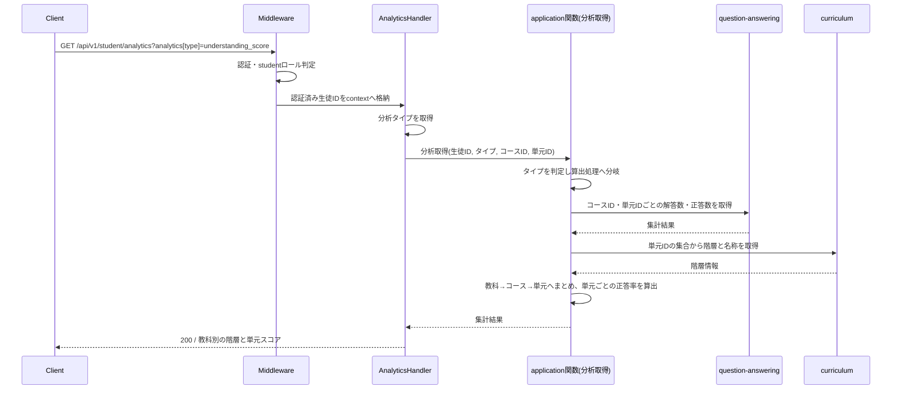
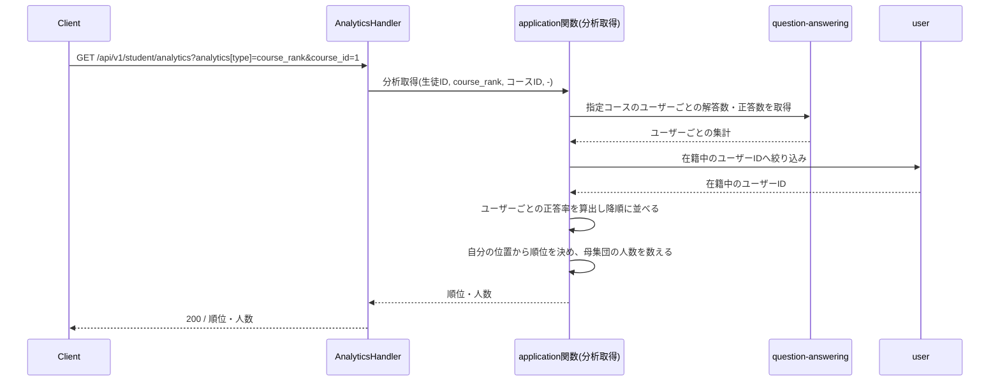
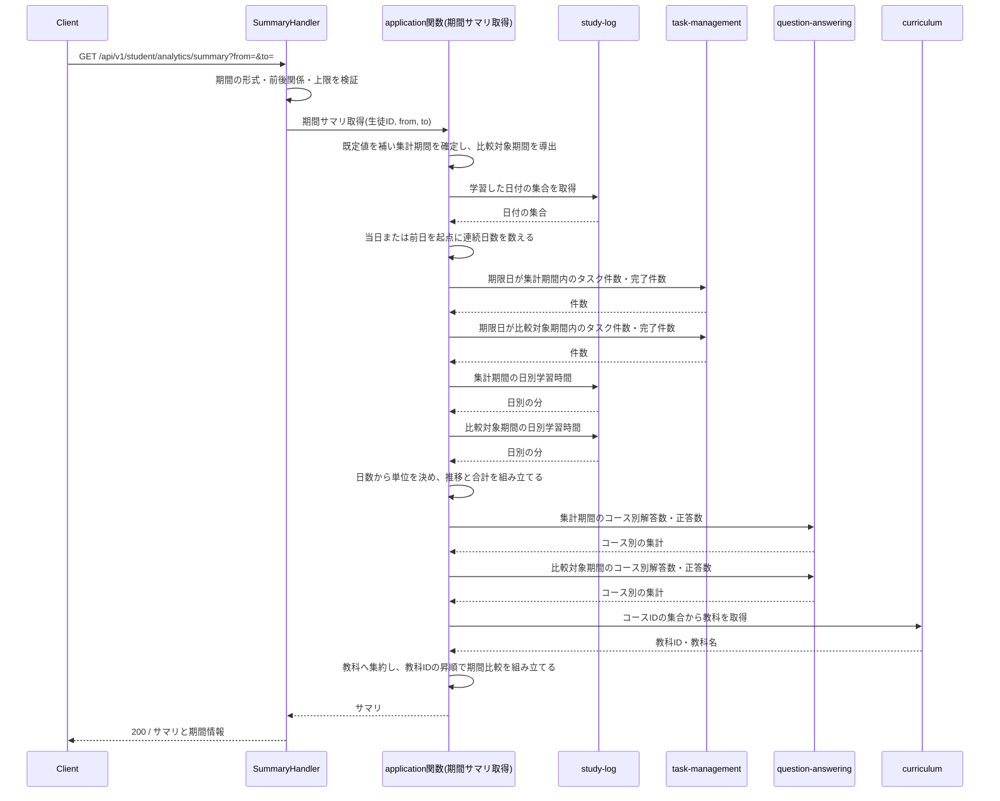
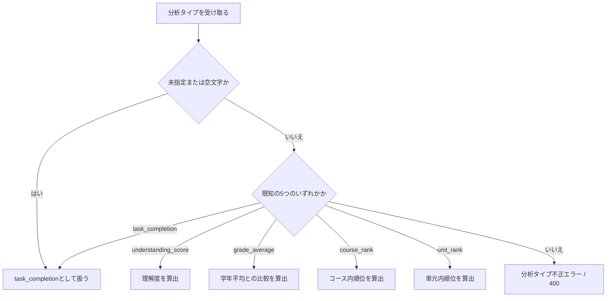
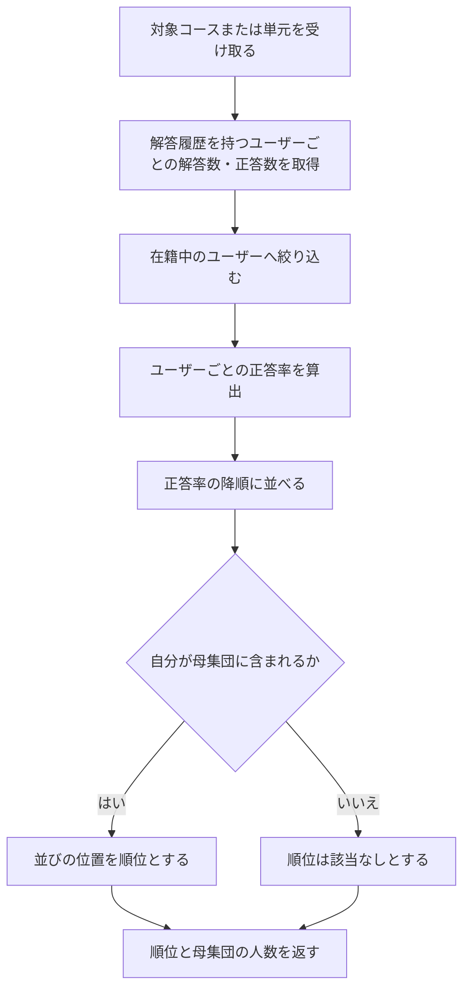
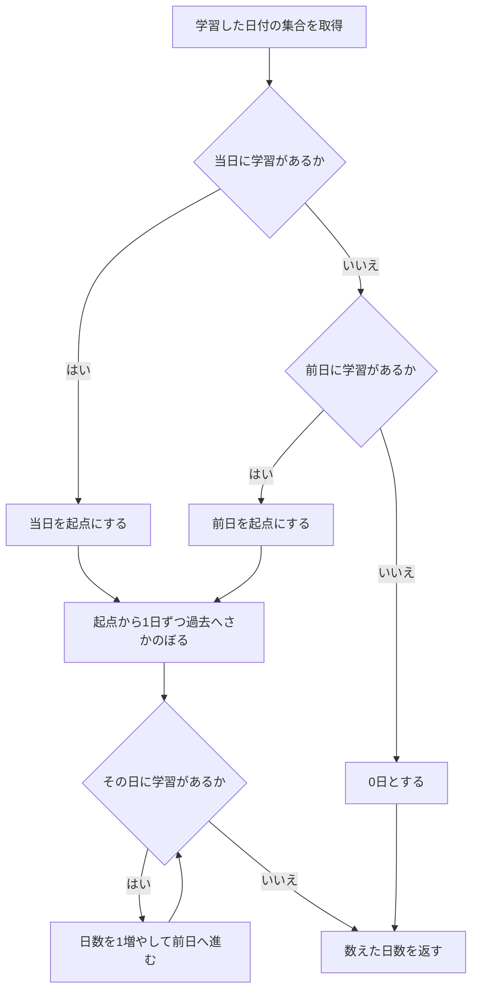
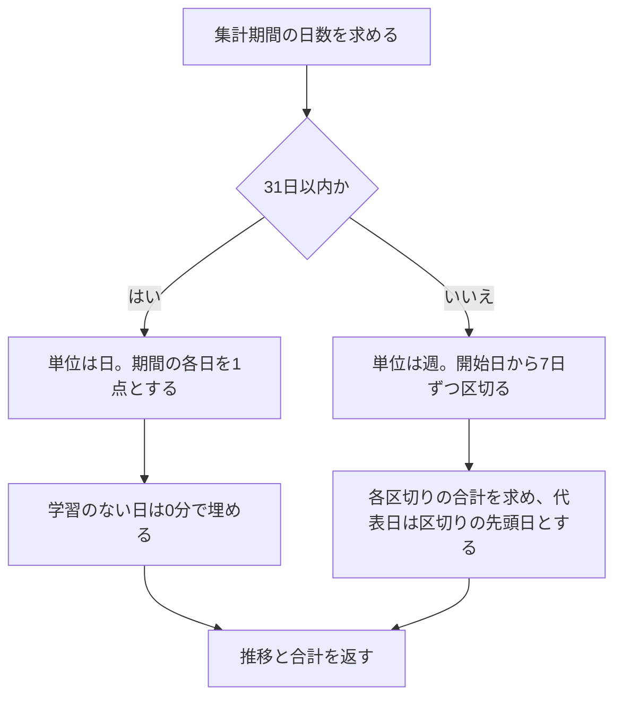

# 分析機能 Go移行・設計仕様書

---

# 1. 機能概要

## 機能概要

生徒自身の学習実績（タスクの達成状況・問題の正答率・学習時間・学習の継続日数）を集計し、生徒が自分の到達度や学年内での位置づけを把握できるようにする機能である（①「1. 機能概要」）。

提供する操作は2つである（①「2. 機能一覧」）。

- **分析取得**: 分析タイプを1つ指定し、その指標を生徒の全期間の実績から集計して返す。タイプは `task_completion` / `understanding_score` / `grade_average` / `course_rank` / `unit_rank` の5つ
- **期間サマリ取得**: 指定期間とその直前の同じ長さの期間を比較できる形で、継続日数・タスク達成率・学習時間・教科別正答率をまとめて返す

本機能はデータを作成・更新しない。他機能が蓄積した実績データを横断して読み取り、集計結果だけを返す。

## 利用者

`student` ロールのユーザー（生徒）のみ。集計対象は常にログイン中の生徒自身の実績であり、他の生徒の実績を指定して取得する手段はない（①「8. 権限制御」）。

## 業務上の目的

生徒が自分の学習の進み方を数値で確認し、次に何へ取り組むかを判断できるようにすること。順位・学年平均は、自分の相対的な位置づけを把握するための指標である。

---

# 2. 設計方針

- **参照専用に徹する**: 本Contextは書き込みを一切行わない。参照しているデータの業務ルール（何を完了とみなすか、何を正答とみなすか、どのログを有効とみなすか）は、そのデータを所有するContextに残す。
- **指標の算出だけを責務とする**: 他Contextからは集計の素（件数・分・日付・ID）を受け取り、率・順位・連続日数・期間比較といった指標の組み立ては本Contextで行う。丸め方や期間の切り方が機能ごとにぶれないようにするためである。
- **API互換性を維持する**: URL・HTTPメソッド・レスポンス項目名・HTTPステータスをRails現行から変えない。フロントエンドを変更しない方針のため、Rails現行の振る舞いに不合理な点があっても本移行では踏襲し、Rails側の修正課題として別に管理する（「19. API仕様」の「Railsとの差分」）。
- **過剰な構造を持ち込まない**: 状態も永続化も持たないため、Entity・Repository Interface・UseCase層を設けない。規約「3. 設計パターンごとの構造適用方針」の「複雑さのない領域に複雑さを管理するための構造を持ち込まない」に従う。
- **テスト容易性**: 他Contextへの依存をすべてインターフェースとして宣言し、集計ロジックを入出力の検証だけでテストできるようにする。期間・丸め・連続日数の境界条件が多いため、ここを差し替え可能にしておくことを優先する。

---

# 3. Bounded Context

## Context名

- `learning-analytics`

## Contextの責務

- 分析タイプの判定と、タイプごとの指標の算出（①「5. API / 処理詳細」`#index`）
- 集計期間と比較対象期間の決定、および期間指定の検証（同 `#show`）
- 率（百分率・小数第1位）の算出と丸め、順位付け、連続学習日数の数え上げ、学習時間推移の日単位・週単位への区切り
- 複数Contextから受け取った集計の素を1つのレスポンスへまとめること

## 持たない責務

- タスク・学習ログ・解答履歴の作成・更新・状態遷移（`task-management`・`study-log`・`question-answering`の責務）
- 「完了したタスク」「正答」「有効な学習ログ」の定義（同上。所有Context側に残す）
- 教科・コース・単元の階層の定義（`curriculum`の責務）
- 在籍状態・学年の定義（`user`の責務）

## 他Contextとの依存関係

本Contextから他Contextへの参照依存のみである。状態変更を伴う依存も、他Contextから本Contextへの依存も存在しない。循環依存は発生しない。

|依存先Context|参照する内容|根拠|
|-|-|-|
|`task-management`|タスク件数と完了件数（全期間 / 期限日が期間内 / 指定ユーザー集合）|①「5. API / 処理詳細」`task_completion`・`grade_average`・`#show`のタスク達成率|
|`study-log`|学習した日付（全期間）、期間内の日別学習時間合計|同 `#show`の継続日数・学習時間|
|`question-answering`|解答数と正答数（全期間 / 単元別 / 期間内のコース別 / 指定ユーザー集合 / 指定コース・単元のユーザー別）|同 `understanding_score`・`grade_average`・`course_rank`・`unit_rank`・`#show`の教科別正答率|
|`curriculum`|単元IDからの教科・コース・単元の階層情報、コースIDからの教科|同 `understanding_score`・`#show`の教科別正答率|
|`user`|認証済み生徒の識別、生徒の学年の年次、同じ年次に属するユーザーID、在籍中ユーザーの絞り込み|同 `grade_average`・`course_rank`・`unit_rank`、①「8. 権限制御」|

## 依存する理由

分析はデータそのものを所有・管理せず、他Contextが管理するデータを読み取り専用で集計して返す性質の機能である。規約「4. Bounded Context構成」の「Context分割基準」は、同一データに対する参照専用の切り口を別Contextとして切り出してよいとし、その場合「業務ルール（作成・更新・状態遷移）は元のContextに残し、参照専用Contextは持たない」と定めている。本Contextはこの方針に従う。

参照にあたっては、相手Contextのテーブルを直接読まず、相手Contextが公開する参照手段を呼び出す（規約「5. Context間連携ルール」）。「完了」「正答」「有効なログ」の判定条件は所有Context側に閉じ込め、本Contextは件数・分・日付といった素の値を受け取る。

受け取る値の粒度は、本Contextが指標を組み立てられる最小の粒度とする。率そのものを相手Contextに算出させない。百分率にするか小数第何位で丸めるかは分析の表現の問題であり、所有Contextの関心ではないためである。

在籍中かどうかの絞り込みを`user`に任せるのは、在籍状態を定義しているのが`user`であるためである。順位の母集団は在籍中の生徒に限られる（①「5. API / 処理詳細」`course_rank` / `unit_rank`）が、この条件を`question-answering`側に持たせると、同Contextが在籍状態の定義を抱え込むことになる。本Contextが`question-answering`から解答履歴を持つユーザーIDを受け取り、`user`に在籍中のものだけへ絞り込ませる。

---

# 4. 設計パターン

## 採用パターン

Transaction Script

## 判断根拠

規約「3. 設計パターンごとの構造適用方針」のTransaction Script節は、対象を「一般・補完領域で、業務ルールが1〜2文で説明できる単純な処理（単純な一覧参照・**集計**・**レポート生成**・バッチ的処理等）」と定めている。本機能はまさに集計・レポート生成であり、この定義に該当する。

- **業務ルール**: 「指定された指標を算出して返す」のみ。率の算出式・丸め・期間の切り方は計算規則であって、満たすべき業務条件や禁止される操作ではない
- **状態管理**: 本機能は何も書き込まず、自身の状態を持たない（①「7. 状態管理」）。参照するタスクの進行状態も、完了かどうかの判定に使うだけで遷移させない
- **整合性**: 書き込みがないため、保証すべき整合性の単位が存在しない
- **将来拡張**: 分析タイプの追加は、タイプの分岐先と算出関数を1つ増やすことで足りる。期間サマリの項目追加も、参照手段を1つ増やして関数の中で呼ぶだけでよい
- **テスト容易性**: 他Contextへの依存をインターフェースで差し替えれば、入力（期間・件数・日付）に対する出力（率・順位・推移）を検証するだけでテストできる

算出処理の分量は少なくないが、それは扱う指標の数が多いことによるもので、1つあたりの複雑さではない。同じデータ構造を複数の関数が状態として持ち回る構図にもならないため、Active Recordへの格上げの目安（規約同節）にも達していない。

## 採用しなかったパターン

### Active Record

本機能に作成・更新処理が含まれず、所有するテーブルも存在しない。永続化操作をstructに持たせる対象がない。

### Domain Model

②Go移行・設計仕様書_自動生成プロンプトの「Domain Model採用基準」が挙げる条件をいずれも満たさない。Entityが状態を持たず、状態遷移ルールもなく、Entityへ振る舞いを集約する対象が存在しない。タスク・学習ログ・解答履歴の業務ルールは所有Context側の責務であり、本Contextに持ち込むべきものではない。参照専用Contextに集約・Repository Interface・UseCase層を設けると、関数1つで足りる処理に対して層だけが増える。

### Event Sourcing

履歴の再構築・監査要件が存在しない。分析が読み取る解答履歴・学習ログは既に発生した事実の記録だが、それらを所有しているのは別Contextであり、本Contextがイベントストアを持つ理由にならない。

---

# 5. Aggregate設計

不要である。

理由: 本Contextが所有するデータがなく、書き込みも行わないため、整合性を保証すべき単位が存在しない。集計結果は複数Contextから受け取った値の組み合わせであり、1つの整合性単位として扱う対象ではない。

---

# 6. Entity設計

本Contextで管理するEntityは存在しない。

理由: 本Contextはデータのライフサイクルを持たない。集計結果は要求されたときに算出されて返るだけの値であり、同一性（識別子）も生存期間も持たないため、Entityの要件を満たさない。参照するタスク・学習ログ・解答履歴は、それぞれ`task-management`・`study-log`・`question-answering`が管理するEntityである（①「6. データモデル」）。

他Contextから受け取る値は、本Contextが必要とする項目だけを持つ参照用の型として扱い、相手Contextの内部Entityをそのまま持ち込まない（規約「5. Context間連携ルール」）。具体的な型は③Go実装仕様書で定める。

---

# 7. Value Object設計

Value Objectは採用しない。

理由: 規約「3. 設計パターンごとの構造適用方針」のTransaction Script節は「domain層は原則作らない。入力検証が必要な場合も、Value Object等の型は作らず、関数内のガード節で行う」と定めている。本機能はTransaction Scriptを採用するため、この方針に従う。

Value Objectの候補になりうる概念と、型を作らずに扱う場所を整理する。

|概念|持つ規則|扱う場所|
|-|-|-|
|分析タイプ|5つの既知の値、空文字・未指定は`task_completion`、それ以外はエラー（①「5. API / 処理詳細」`#index`）|application層の関数内の分岐。型は作らない|
|集計期間|両端を含む、省略時の既定値、最大366日、直前の同じ長さの期間の導出（同 `#show`）|Presentation層のリクエスト検証（形式・前後関係・上限）と、application層の関数内での既定値補完・比較対象期間の導出|
|率（百分率）|正答数または完了数 ÷ 総数 × 100、小数第1位で丸め、分母0のときは`0`|application層の算出関数。すべての率がこの1箇所を通るようにする|
|日本時間の日付|学習ログ・解答履歴の日時はUTC保存であり、日付の判定は日本時間で行う（同 `#show`）|日本時間への変換は所有Context側の参照手段に閉じ込め、本Contextは日付として受け取る|

率の算出だけはすべての指標で共通して使われるため、型を作らずとも1つの関数に集約する。異なる指標で丸め方がぶれると、同じ画面に並ぶ数値の整合が取れなくなるためである。

---

# 8. Domain Service

不要である。

理由: Domain Serviceは、複数Entityにまたがる業務ルールの判定をEntityの外に出すための置き場所である。本Contextには Entity が存在せず（「6. Entity設計」）、判定すべき業務ルールもない。

順位付け・連続日数の数え上げ・学習時間の週単位への区切りは、いずれも受け取った値に対する計算であり、業務ルールの判定ではない。これらはapplication層の関数として実装する（規約「3. 設計パターンごとの構造適用方針」Transaction Script節）。

---

# 9. クラス図

Entityもstructの階層も持たないため、クラス図としての図示は省略する。

本Contextが持つのは、他Contextの参照手段を宣言するインターフェースと、それを呼んで指標を組み立てる関数のみである。関係は「13. シーケンス図・処理フロー図」のシーケンス図で示す。

Goのstruct定義・インターフェースのシグネチャは③Go実装仕様書で扱う。

---

# 10. 状態遷移図

省略する。

理由: 本機能に状態を持つデータが存在しない（①「7. 状態管理」）。参照するタスクの進行状態（`not_started` / `in_progress` / `completed`）は完了かどうかの判定に使うだけで、本機能が遷移させることはない。図示すべき遷移が存在しない。

---

# 11. Repository設計

本機能はTransaction Scriptを採用するため、Repository Interfaceは設けない（規約「3. 設計パターンごとの構造適用方針」）。また本Contextが所有するテーブルがないため、DBへ直接アクセスする実装も持たない。

本節では、Repositoryの代わりに本Contextが必要とする**他Contextの参照手段**を、依存先Contextごとに整理する。これらは本Contextが宣言するインターフェースであり、実装は依存先Contextが公開する参照手段への委譲となる（規約「5. Context間連携ルール」）。インターフェース名・シグネチャは③Go実装仕様書で定める。

## `task-management` への参照

- 管理対象: タスクの件数と完了件数
- 責務: 指定された範囲のタスクについて、総数と完了状態の件数を返す
- 保持する検索機能
  - 生徒の全期間のタスク（論理削除済みを除く）の総数と完了件数
  - 生徒のタスクのうち、期限日が指定期間内にあるものの総数と完了件数
  - 指定されたユーザーID集合に属するタスクの総数と完了件数（学年平均の算出用）
- 保持しない責務: 率の算出。完了件数と総数をそのまま返し、率は本Contextが求める
- 判断根拠: 「完了したタスク」の定義と、論理削除済みタスクを除外する扱い（①「5. API / 処理詳細」共通の業務ルール）は`task-management`の責務である。期限日が未設定のタスクを全期間では含み、期間指定時には含まないという扱いも、タスク側のデータ構造に根ざした条件である

## `study-log` への参照

- 管理対象: 学習ログの日付と学習時間
- 責務: 有効な学習ログについて、学習した日付と日ごとの学習時間を返す
- 保持する検索機能
  - 生徒が学習した日付（日本時間の日付）の集合。期間指定なし
  - 生徒の指定期間内の、日本時間の日付ごとの学習時間合計（分）
- 保持しない責務: 連続日数の数え上げ、推移の日単位・週単位への区切り、合計値の期間比較
- 判断根拠: 論理削除済みログを除外する扱いと、学習時間が未記録のログを0分とみなす扱い（①「5. API / 処理詳細」`study_minutes`）は`study-log`の責務である。一方「何日連続か」「何日ごとに区切るか」は分析の表現であり、本Contextが決める

## `question-answering` への参照

- 管理対象: 解答履歴の解答数と正答数
- 責務: 指定された切り口で解答履歴を集計し、解答数と正答数を返す
- 保持する検索機能
  - 生徒の全期間の解答数と正答数
  - 生徒の全期間の解答数と正答数を、コースIDと単元IDの組ごとに集計したもの（理解度の3階層集計用）
  - 生徒の指定期間内の解答数と正答数を、コースIDごとに集計したもの（教科別正答率用）
  - 指定されたユーザーID集合の解答数と正答数の合計（学年平均の算出用）
  - 指定コースまたは指定単元に解答履歴を持つユーザーごとの、そのコース・単元での解答数と正答数（順位の算出用）
- 保持しない責務: 率の算出、順位付け、在籍中ユーザーへの絞り込み、教科への集約
- 判断根拠: 「正答」の定義と、分析では論理削除済みの解答履歴も集計対象に含めるという扱い（①「5. API / 処理詳細」共通の業務ルール）は`question-answering`の責務である。順位は本Contextが算出するため、同Contextからはユーザーごとの解答数・正答数を受け取るだけとする。教科への集約は`curriculum`が持つ階層情報を要するため、同Contextに教科単位の集計を持たせない（コースIDまでで返させ、教科への集約は本Contextが行う）

## `curriculum` への参照

- 管理対象: 教科・コース・単元の階層情報
- 責務: 単元IDまたはコースIDから、表示に必要な階層と名称を返す
- 保持する検索機能
  - 単元IDの集合から、単元名・所属コース（コース名・レベル番号）・所属教科（教科ID・教科名）を返す
  - コースIDの集合から、所属教科（教科ID・教科名）を返す

`curriculum`は既に「単元IDの集合から単元名・所属コースの識別子・レベル番号・レベル名を返す」操作を他機能向けに公開している（コース参照機能②「11. Repository設計」）。本Contextが必要とする単元の階層は、これに教科を加えたものである。同じ項目を返す操作を重ねて持たないため、`curriculum`側に追加するのはコースから教科を引く操作のみとし、階層の組み立ては本Context側で行う。
- 保持しない責務: 解答履歴の集計、並び順の決定（本Contextが教科IDの昇順等を決める）
- 判断根拠: 教科 → コース → 単元の階層は`curriculum`が所有する（①「6. データモデル」）。解答履歴はコースIDと単元IDを自身で保持しているため、階層をたどる必要があるのは名称と教科への集約のときだけである

## `user` への参照

- 管理対象: 生徒の学年と在籍状態
- 責務: 学年の年次の取得、同じ年次に属するユーザーの特定、在籍中ユーザーへの絞り込み
- 保持する検索機能
  - 生徒の学年の年次を返す。学年が設定されていない場合はその旨を返す
  - 指定された年次の学年に属するユーザーIDを返す。在籍中かどうかで絞り込まない（①「5. API / 処理詳細」`grade_average`）
  - 指定されたユーザーID集合のうち、在籍中（論理削除されていない）のものを返す
- 保持しない責務: 分析指標の算出
- 判断根拠: 学年と在籍状態を定義しているのは`user`である。学年平均の母集団が論理削除済みユーザーを含み、順位の母集団は含まないという非対称はRails現行の振る舞いであり（①「6. データモデル」参照する側の論理削除の扱い）、絞り込みを別の参照手段として分けることで、どちらの母集団かを呼び出し側で明示できるようにする

---

# 12. UseCase設計

本機能はTransaction Script採用のため、UseCase層（struct・interface）は設けない。1つの業務操作を1つの関数として実装する（規約「3. 設計パターンごとの構造適用方針」）。本節では業務操作の単位として整理する。

公開する業務操作は2つ、その内部で分析タイプごとに分岐する算出処理が5つである。

## 分析取得

- 目的: 指定された分析タイプの指標を、生徒の全期間の実績から算出して返す
- 入力: 操作者の生徒ID、分析タイプ、コースID（任意）、単元ID（任意）
- 出力: 分析タイプごとに構造の異なる集計結果（①「5. API / 処理詳細」`#index`のResponse）
- トランザクション範囲: なし（「14. Transaction設計」）
- 呼び出す参照手段: 分析タイプに応じて下記の算出処理が呼び出すもの
- 判断根拠: Rails現行では分析タイプの判定が1つの入口に集約されており、URLも1つである（①「4. API一覧」）。URLを分けるとフロントエンドの変更が必要になるため、入口を1つに保ち内部で分岐させる

### `task_completion` の算出

- 入力: 生徒ID
- 出力: 完了件数・総件数・達成率
- 呼び出す参照手段: `task-management`（全期間のタスク件数と完了件数）
- 判断根拠: 期限日が未設定のタスクも総件数に含める（①「5. API / 処理詳細」`task_completion`）。期間指定のない参照手段を使うことでこの扱いが保たれる

### `understanding_score` の算出

- 入力: 生徒ID
- 出力: 教科 → コース → 単元の3階層と、単元ごとの正答率
- 呼び出す参照手段: `question-answering`（コースIDと単元IDの組ごとの解答数・正答数）、`curriculum`（単元IDからの階層と名称）
- 判断根拠: 解答履歴が存在する単元だけが結果に現れる（同節）。履歴側を起点に集計し、得られた単元IDの階層を`curriculum`へ問い合わせることで、履歴のない単元が混入しない

### `grade_average` の算出

- 入力: 生徒ID
- 出力: 自分と学年平均の正答率、自分と学年平均のタスク達成率
- 呼び出す参照手段: `user`（学年の年次、同じ年次のユーザーID）、`question-answering`（生徒の解答数・正答数、ユーザー集合の解答数・正答数）、`task-management`（生徒のタスク件数、ユーザー集合のタスク件数）
- 判断根拠: 学年平均は生徒ごとの率を平均したものではなく、集団全体の合計から求める（同節）。合計値を受け取ってから率にすることでこの定義を満たす

### `course_rank` / `unit_rank` の算出

- 入力: 生徒ID、対象コースID または 対象単元ID
- 出力: 自分の順位（履歴がなければ該当なし）、母集団の人数
- 呼び出す参照手段: `question-answering`（指定コース・単元のユーザーごとの解答数・正答数）、`user`（在籍中ユーザーへの絞り込み）
- 判断根拠: 母集団は在籍中の生徒に限る（同節）。在籍判定を`user`へ委ねるため、解答履歴の集計と絞り込みを2段に分ける。コース指定と単元指定は絞り込む列だけが違うため、1つの算出処理として扱う

## 期間サマリ取得

- 目的: 指定期間と直前の同じ長さの期間を比較できる形で、学習状況のサマリを返す
- 入力: 操作者の生徒ID、集計開始日（任意）、集計終了日（任意）
- 出力: 継続日数、タスク達成率（期間・比較対象期間）、学習時間（単位・推移・合計の期間比較）、教科別正答率（期間比較）、実際に使われた期間情報（①「5. API / 処理詳細」`#show`のResponse）
- トランザクション範囲: なし（「14. Transaction設計」）
- 呼び出す参照手段: `study-log`（学習した日付、日別学習時間）、`task-management`（期限日が期間内のタスク件数）、`question-answering`（期間内のコース別解答数・正答数）、`curriculum`（コースIDからの教科）
- 判断根拠: 4つの指標が同じ期間定義（両端を含む・直前の同じ長さ）を共有するため、期間の確定を1箇所で行い各算出へ渡す。継続日数だけは期間を使わず常に当日基準で算出する（同節）。これはRails現行の振る舞いであり、フロントエンドを変更しない方針のため踏襲する

---

# 13. シーケンス図・処理フロー図

## シーケンス図

### 分析取得（`understanding_score` の場合）

### 分析取得（`course_rank` の場合）

### 期間サマリ取得

## 処理フロー図

### 分析タイプの判定

### 順位の算出

### 連続学習日数の算出

### 学習時間の推移の区切り

---

# 14. Transaction設計

- **Transaction開始位置**: なし
- **Transaction終了位置**: なし

## 理由

本機能は参照のみで、1件のデータも作成・更新・削除しない（①「5. API / 処理詳細」Database変更）。書き込みがないため、原子性を保証する対象が存在しない。規約「11. Transaction実装パターン（TransactionManager）」の仕組みは使わない。

期間サマリ取得は複数の参照手段を順に呼ぶため、呼び出しの間に他の生徒操作でデータが変わると、指標どうしがわずかにずれた時点のデータに基づく可能性がある。これを防ぐために読み取り専用トランザクションで束ねることはしない。理由は以下である。

- Rails現行も同様に個別のクエリを順に発行しており、同じ性質を持つ（①「9. 非同期処理」集計はすべてリクエスト時に同期で実行される）
- 対象は操作者自身のデータであり、同一生徒が集計中に別操作を完了させる可能性は低い
- ずれが生じても表示値が1件分前後するだけで、業務判断を誤らせる性質のものではない

---

# 15. Validation設計

## Presentation

- 型チェック: `course_id`・`unit_id`が整数として解釈できること。`from`・`to`が文字列であること
- 必須チェック: 分析取得では分析タイプの指定（`analytics`オブジェクト）が存在すること。期間サマリ取得に必須項目はない
- フォーマットチェック: `from`・`to`が`YYYY-MM-DD`形式であり、実在する日付であること。`from`が`to`以前であること。期間の日数が366日以内であること

期間に関する検証をPresentation層に置くのは、Rails現行でもFormオブジェクトが担っており（①「10. Rails実装対応表」`Student::AnalyticsPeriodForm`）、エラーが`422`としてフィールド単位のメッセージで返る形を維持する必要があるためである。

## Domain

本機能にDomain層は存在しない（「6. Entity設計」）。業務ルールによる検証も存在しない。

- 業務ルール: 検証対象なし。指標の算出は入力の妥当性に依存しない
- 状態チェック: なし。状態を持たない
- 整合性チェック: なし。書き込みがない

分析タイプが既知の5つのいずれかであるかの判定は、Presentation層ではなくapplication層の関数内で行う。タイプによって呼び出す算出処理が変わるため、判定と分岐が同じ場所にある方が追いやすく、また未指定時に`task_completion`として扱う既定値の扱いも分岐と同じ場所で決まるためである。

## バリデーション仕様

|フィールド|検証層|ルール|エラーメッセージ方針|
|-|-|-|-|
|`analytics`（オブジェクト）|Presentation|存在すること|「分析タイプを指定してください」|
|`analytics[type]`|application|空文字・未指定は`task_completion`として扱う。既知の5つ以外はエラー|Rails現行の文言を維持する。「指定された分析タイプ（{指定値}）は存在しません。」|
|`course_id`|Presentation|整数として解釈できること。未指定可|「コースの指定が不正です」|
|`unit_id`|Presentation|整数として解釈できること。未指定可|「単元の指定が不正です」|
|`from`|Presentation|`YYYY-MM-DD`形式かつ実在する日付。未指定可|Rails現行の文言を維持する。「From は正しい日付を入力してください」|
|`to`|Presentation|`YYYY-MM-DD`形式かつ実在する日付。未指定可|Rails現行の文言を維持する。「To は正しい日付を入力してください」|
|`to`（前後関係）|Presentation|`from`以降であること|Rails現行の文言を維持する。「To はfrom以降の日付を指定してください」|
|期間の日数|Presentation|両端を含めて366日以内|Rails現行の文言を維持する。「取得期間は366日以内で指定してください」|

`from`・`to`のメッセージ先頭が英語表記のままであるのは、Rails現行で項目名の日本語訳が定義されていないためである（①「5. API / 処理詳細」`#show`のErrorケース）。フロントエンドを変更しない方針のため、移行時に日本語へ直さず現行の文言を維持する。日本語化はRails側の修正課題として別に管理する。

`course_id`・`unit_id`は、Rails現行では未指定・不正値でも検証されず、該当する解答履歴が0件となって順位が該当なしで返る（①「5. API / 処理詳細」`course_rank` / `unit_rank`）。Go設計でも整数として解釈できない値のみを`422`で弾き、未指定・存在しないIDは現行どおり0件として扱う。存在確認を加えて`404`にしないのは、フロントエンドが受け取るステータスを変えないためである。

---

# 16. Authorization設計

|層|判定内容|理由|
|-|-|-|
|Middleware|認証（ログイン済みであること）と`student`ロールであることを判定する|規約「7. 横断的関心事の置き場所」のとおり、ロールレベルの粗い制御はMiddlewareに置く。認可はCasbin RBACで行う（Gin規約「4. 認可（Casbin RBAC）」）|
|Handler|操作者の生徒IDをcontextから取り出し、application層へ渡す|リクエストから生徒IDを受け取らない。クエリパラメータで他人のIDを指定できないようにするため|
|application層|判定しない|集計対象は常に渡された生徒IDに限られる。所有権の判定が成立する対象（他人のデータへのアクセス要求）がそもそも発生しない|
|Domain|存在しない|Domain層を設けない（「6. Entity設計」）|

## 判断理由

本機能は他人のデータを指定して取得する経路を持たないため、所有権の判定が必要にならない。生徒IDをリクエストから一切受け取らず、認証済みの操作者から取る設計にすることで、所有権チェックを書く必要自体をなくす。

順位・学年平均では他の生徒の実績を集計に用いるが、返すのは自分の順位・母集団の人数・平均値のみで、他の生徒を特定できる情報は返さない（①「8. 権限制御」）。他Contextから受け取るユーザーごとの集計結果はレスポンスへ出さず、順位と人数の算出にのみ使う。

---

# 17. Error設計

## Domain Error

責務: なし。本Contextに業務ルール違反を表すエラーが存在しない。Domain層を設けないため、Domain Errorも定義しない。

## Application Error

責務: 分析タイプが既知の5つのいずれでもないことを表す。

これは入力値の形式の問題ではなく、「指定された分析タイプは存在しない」という業務上の意味を持つ応答である。Rails現行でも専用のエラーとして定義され、`400`で返っている（①「10. Rails実装対応表」`Student::InvalidAnalyticsTypeError`）。

学年が設定されていない生徒が`grade_average`を要求した場合も、application層で検知する。Rails現行では集計を完了できず`500`になる（①「5. API / 処理詳細」`#index`のErrorケース）。Go設計でも`500`を返す。フロントエンドを変更しない方針のため、`400`や`422`へ変えない。Rails側の修正課題として別に管理する。

## Infrastructure Error

責務: 他Contextの参照手段の呼び出しに失敗したことを表す。DB接続の失敗・クエリの失敗等が該当する。

本Contextでは個別に判別せず、そのまま呼び出し元へ返して`500`として扱う。参照先の失敗を分析側で意味づけし直す余地がないためである。

## 判断理由

本Contextは書き込みを持たず、業務ルールによる失敗が存在しない。そのため意味を持つエラーは「分析タイプが存在しない」の1つに絞られる。エラーの種類を増やさないことで、どのエラーがどのステータスになるかの対応を単純に保つ。

参照先が0件を返すことはエラーとして扱わない。解答履歴のない生徒は空の結果が返るのが正常な応答であり、順位も該当なしとして返るのが現行の振る舞いである（①「5. API / 処理詳細」）。

## エラー仕様

|業務シナリオ|エラー種別|発生層|想定するHTTPステータス|
|-|-|-|-|
|分析タイプの指定（`analytics`オブジェクト）がない|Validation|Presentation|400|
|既知でない分析タイプを指定した|BusinessRule|Application|400|
|`from`・`to`の形式が不正、前後が逆、期間が上限超過|Validation|Presentation|422|
|`course_id`・`unit_id`が整数として解釈できない|Validation|Presentation|422|
|`grade_average`で生徒に学年が設定されていない|Internal|Application|500|
|他Contextの参照手段の呼び出しに失敗|Internal|Infrastructure|500|
|未認証|Unauthorized|Middleware|401|
|`student`ロール以外|Forbidden|Middleware|403|

エラー本文の形式は規約「15. API規約」に従い`{"errors": [...]}`とする。Rails現行も分析機能のエラーはすべてこの形式で返しているため（①「5. API / 処理詳細」）、形式の差分は生じない。

---

# 18. Domain Event

不要である。

理由: 本Contextは参照のみで、他の処理へ波及させるべき状態変化が発生しない。集計結果を返すことに副作用がないため、通知する対象となる出来事が存在しない。

規約「5. Context間連携ルール」は「複数の処理へ波及する非同期通知が必要な場合のみ、Domain Eventの採用を検討する」と定めており、本機能はこれに当たらない。

---

# 19. API仕様

## エンドポイント一覧

|エンドポイント|HTTP Method|概要|
|-|-|-|
|`/api/v1/student/analytics`|GET|分析タイプを指定して指標を取得|
|`/api/v1/student/analytics/summary`|GET|期間サマリを取得|

## 各エンドポイントの仕様

### `GET /api/v1/student/analytics`

- Request
  - クエリパラメータ: `analytics[type]`（必須。5つの既知の値、空文字は`task_completion`扱い）、`course_id`（任意）、`unit_id`（任意）
  - パスパラメータ・ボディ: なし
- Response
  - 分析タイプごとに構造が異なる（①「5. API / 処理詳細」`#index`のResponse）。項目名・階層をRails現行から変えない
- Status Code
  - 正常系: `200`
  - 異常系: `400`（分析タイプの指定なし / 既知でない分析タイプ）、`422`（`course_id`・`unit_id`が整数として解釈できない）、`500`（学年未設定で`grade_average`、参照先の失敗）、`401`、`403`
- Error Response方針
  - `{"errors": [メッセージ]}`。既知でない分析タイプのメッセージはRails現行の文言を維持する

### `GET /api/v1/student/analytics/summary`

- Request
  - クエリパラメータ: `from`（任意、`YYYY-MM-DD`）、`to`（任意、`YYYY-MM-DD`）
  - パスパラメータ・ボディ: なし
- Response
  - 継続日数、タスク達成率（期間・比較対象期間）、学習時間（単位・推移・合計の期間比較）、教科別正答率（期間比較）、期間情報（①「5. API / 処理詳細」`#show`のResponse）
  - 日付はすべて`YYYY-MM-DD`形式の文字列で返す
- Status Code
  - 正常系: `200`
  - 異常系: `422`（期間指定が不正）、`500`（参照先の失敗）、`401`、`403`
- Error Response方針
  - `{"errors": [メッセージ, ...]}`。複数のメッセージを同時に含みうる。文言はRails現行を維持する

## Railsとの差分

フロントエンドを変更しない方針のため、URL・HTTPメソッド・レスポンス項目名・HTTPステータスは変更しない。変更するのは以下の2点のみである。

### 1. `understanding_score` の並び順を「最初に解答した順」として定める

- Rails仕様: 教科・コース・単元の並び順は、解答履歴を取得した順に現れた順序である。明示的な並び順の指定がなく、DBが返す順に依存する（①「5. API / 処理詳細」`understanding_score`）
- Go設計での変更: 各階層を「その階層に属する最初の解答履歴が古い順」で並べる
- 変更理由: Rails現行の並び順は実装依存であり、同じデータでも同じ順序になることが保証されていない。そのまま再現することができないため、意味の通る安定した順序を定める。「最初に解答した順」は、Railsが実際に返している「履歴の出現順」と通常は一致する
- 影響範囲: 教科・コース・単元の表示順。フロントエンドは受け取った配列の順に表示するため、表示順が変わる可能性はあるが、項目名・階層・値は変わらない

### 2. 分析タイプの指定がない場合のエラー本文

- Rails仕様: 必須パラメータ不足として扱われ`400`になるが、本文は分析機能として定義されたものではなくフレームワーク既定の形式である（①「5. API / 処理詳細」`#index`のErrorケース）
- Go設計での変更: `400`のまま、本文を`{"errors": ["分析タイプを指定してください"]}`とする
- 変更理由: 規約「15. API規約」の形式に合わせる。ステータスは変えない
- 影響範囲: 分析タイプを指定せずに呼び出した場合の本文のみ。正常な呼び出しでは発生しない

### 変更しないもの（Rails現行の振る舞いを踏襲する点）

以下はRails現行の振る舞いとして不合理に見えるが、レスポンスの値が変わるため本移行では変更しない。Rails側の修正課題として別に管理する。

|項目|Rails現行の振る舞い|
|-|-|
|学年平均の母集団|学年の年次が一致すれば学校が異なる生徒も含む。学年は学校ごとに独立しているため、他校の生徒が平均に混ざる（①「6. データモデル」）|
|学年平均の母集団の在籍状態|論理削除済みユーザーを含む。順位の母集団は論理削除済みを除外しており、扱いが一致していない（同）|
|解答履歴の論理削除|分析では論理削除済みの解答履歴も集計対象に含む。他機能では除外している（①「5. API / 処理詳細」共通の業務ルール）|
|学年未設定の生徒|`grade_average`で`500`になる（同 Errorケース）|
|順位の同率|正答率が同じ生徒でも別の順位になる。並べた結果の位置がそのまま順位になる（同 `course_rank` / `unit_rank`）|
|継続日数と期間指定|期間を指定しても継続日数は常に当日基準で算出され、期間の影響を受けない（同 `#show`）|
|`from`・`to`の片方のみ指定|`to`のみ指定した場合、`from`は「今日の6日前」となり、指定した`to`と対応しない期間になる（同）|
|`from`・`to`のエラーメッセージ|項目名が英語表記（`From` / `To`）のまま出力される（同）|

---

# 20. DB設計方針

- **現行DBを利用するか**: 利用する
- **Schema変更有無**: なし
- **変更理由**: 該当なし

本Contextは所有するテーブルを持たず、DBへ直接アクセスする実装も持たない。必要なデータはすべて所有Contextの参照手段を通じて取得する（「11. Repository設計」）。

集計対象のテーブル（`tasks`・`study_logs`・`question_histories`・`units`・`courses`・`subjects`・`users`・`grades`）はいずれも他Contextが所有しており（①「6. データモデル」）、本Contextからの要求でSchemaを変更する必要はない。

集計結果を保持するテーブル・事前集計テーブルも設けない。Rails現行も都度集計しており（①「9. 非同期処理」）、キャッシュ・事前集計の導入は本移行の範囲としない。導入の検討が必要になるのは、学年平均や順位の母集団が大きくなり応答時間が問題になった場合であり、そのときは所有Context側の参照手段の実装を見直す形で対応する。本Contextの構造は変わらない。

---

# 21. DB操作仕様

本Contextは所有するテーブルを持たず、DBへ直接アクセスする実装を持たないため、本節に記載するDB操作はない。

「11. Repository設計」で整理した参照手段は、いずれも依存先Contextが公開するものへの委譲である。各参照手段が実際にどのテーブルへどのような操作を行うかは、所有Contextの文書で定める。本Contextの関心は、受け取る値の粒度（件数・分・日付・ID）だけである。

参照にあたって本Contextが依存先へ渡す条件と、期待する結果の粒度を整理する。

|依存先|渡す条件|受け取る粒度|結合の必要性|ページネーション・ソート|
|-|-|-|-|-|
|`task-management`|生徒ID / ユーザーID集合、期限日の範囲（任意）|総件数と完了件数の2つの整数|不要|不要。件数のみを受け取る|
|`study-log`|生徒ID、期間（任意）|学習した日付の集合、または日付ごとの分|不要|不要。日付の並び替えは本Contextで行う|
|`question-answering`|生徒ID / ユーザーID集合 / コースID / 単元ID、期間（任意）|解答数と正答数の組。切り口によりコースID・単元ID・ユーザーIDごとに分かれる|教科への集約には`curriculum`の階層が必要だが、`question-answering`側では結合しない。コースIDまでで返す|不要。順位付けのための並び替えは本Contextで行う|
|`curriculum`|単元IDの集合 / コースIDの集合|単元名・コース名・レベル番号・教科ID・教科名|単元 → コース → 教科の階層をたどる結合が必要|不要|
|`user`|生徒ID / 学年の年次 / ユーザーID集合|学年の年次、ユーザーIDの集合|学年の年次の取得に学年との結合が必要|不要|

ユーザーID集合を本Contextが受け取って別の参照手段へ渡す形を取っているため、学年の生徒数が多い場合は受け渡すIDの件数が大きくなる。学年単位（高校1学年分）であり、現実的な規模で問題にならない前提とする。規模が問題になる場合は、所有Context側で年次を条件に取る参照手段を追加して1往復に減らす余地があるが、在籍状態や学年の定義が所有Contextをまたいで散らばるため、現時点では採用しない。

---

# 22. テスト戦略

## Domain Test

対象外。Domain層を設けないため（「6. Entity設計」）。

## UseCase Test

UseCase層は設けないため、application層の関数に対するテストとして行う。本機能のテストの中心はここに置く。

目的: 他Contextへの依存をインターフェースで差し替え、受け取った値から指標が正しく組み立てられることを検証する。

重点を置く観点:

- 率の算出と丸め: 分母0のとき`0`になること、小数第1位で丸められること
- 分析タイプの分岐: 5つのタイプが正しい算出へ分岐すること、未指定・空文字が`task_completion`になること、既知でない値でエラーになること
- 順位: 正答率の降順に並ぶこと、自分が母集団にいないとき該当なしになること、母集団が0人のとき該当なしかつ人数0になること、同率が別順位になること
- 学年平均: 集団の合計から率を求めること（生徒ごとの率の平均ではないこと）、母集団が空のとき`0`になること、学年未設定でエラーになること
- 期間の確定: `from`・`to`の既定値補完、両端を含むこと、比較対象期間が「開始日の前日を終了日とする同じ日数」になること
- 連続日数: 当日起点・前日起点・どちらもない場合、途切れた時点で止まること、同日の複数ログが1日になること
- 学習時間: 31日と32日の境界で単位が切り替わること、学習のない日が0分で埋まること、週単位で7日ずつ区切られること、日数が7の倍数でないとき最後の区切りが7日未満になること
- 教科別正答率: 教科IDの昇順で並ぶこと、比較対象期間に履歴のない教科の比較値が該当なしになること、履歴が0件のとき空になること
- 理解度: 履歴のない教科・コース・単元が結果に現れないこと、階層が正しく組まれること、最初に解答した順に並ぶこと

## Repository Test

対象外。本Contextが所有するテーブルがなく、DBアクセス実装を持たないため（「21. DB操作仕様」）。

依存先Contextの参照手段そのもののテストは、所有Context側の文書で定める。

## Handler Test

目的: HTTPの入出力とPresentation層の検証を確認する。

重点を置く観点:

- クエリパラメータの受け取り（`analytics[type]`のネストした形式、`course_id`・`unit_id`、`from`・`to`）
- 期間検証のエラーが`422`とRails現行の文言で返ること、複数のメッセージが同時に返りうること
- 分析タイプの指定がないとき`400`になること
- 操作者の生徒IDがcontextから取られ、リクエストから受け取らないこと
- レスポンスの項目名・階層がRails現行と一致すること、日付が`YYYY-MM-DD`形式の文字列になること

## Integration Test

目的: 認証・認可を含めたエンドポイントの振る舞いと、所有Contextの参照手段を実装込みで通した結果を確認する。

重点を置く観点:

- 未認証で`401`、`student`以外のロールで`403`になること
- 5つの分析タイプと期間サマリがそれぞれ正しい構造で返ること
- 日付の判定が日本時間で行われること。UTC保存の日時が日本時間の日付境界をまたぐケース（日本時間の0時台・23時台の学習ログと解答履歴）で、集計される日が期待どおりになること
- 論理削除済みのタスク・学習ログが除外され、論理削除済みの解答履歴が含まれること

日本時間の境界は、Rails現行との差分が出やすく、単体テストでは検出しにくいため、Integration Testで必ず確認する。

---

# 23. Railsとの責務対応

|Rails|Go|設計方針|
|-|-|-|
|`Api::V1::Student::AnalyticsController`|AnalyticsHandler|HTTP責務のみ担当。分析タイプ・コースID・単元IDの受け取りと、認証済み生徒IDの取り出しに限る|
|`Api::V1::Student::Analytics::SummariesController`|SummaryHandler|HTTP責務のみ担当。期間の受け取りと検証結果の返却に限る|
|`Student::AnalyticsPeriodForm`・`DateRangeValidatable`|Request DTO + Presentation層の検証|入力検証をHandlerから分離する。既定値の補完はapplication層へ移す（検証ではなく業務の既定値であるため）|
|`Student::AnalyticsService`|application層の分析取得関数|分析タイプの判定と算出処理への分岐を担う。Rails同様に1つの入口へ集約する|
|`Student::Analytics::TaskCompletion`・`UnderstandingScore`・`GradeAverage`・`Rank`|application層のタイプ別算出関数|分析タイプごとの指標の組み立て。クラスではなく関数として置く（Transaction Script）|
|`Student::Analytics::Summary`|application層の期間サマリ取得関数|期間の確定と4指標の取りまとめ|
|`Student::Analytics::Streak`・`StudyMinutes`・`SubjectProgress`|application層の算出関数|サマリの各指標の組み立て。呼び出し元の関数から分けておくのは、境界条件のテストを独立して書けるようにするため|
|`Student::Analytics::TaskStats`|依存先Contextの参照手段（`task-management`）|タスク件数の集計そのものは所有Contextへ移す。本Contextは件数を受け取るだけとする|
|`Student::Analytics::Calculator`|application層の率算出関数|率の算出式と丸めを1箇所に集約する。Rails同様に全指標から共通で使う|
|`AnalyticsPeriodable`|application層の期間算出関数|期間の日数・比較対象期間の導出を担う。日本時間への変換は所有Context側の参照手段へ移す（保存形式の知識を所有Contextに閉じ込めるため）|
|`Student::InvalidAnalyticsTypeError`|Application Error|分析タイプ不正を表すエラー。`400`への変換は規約「12. Error変換パターン（AppError）」に従う|
|`Task`・`StudyLog`・`QuestionHistory`・`Unit`・`Course`・`Subject`・`User`・`Grade`|依存先Contextが管理|本Contextにモデル相当の型を持たない。受け取る値だけを持つ参照用の型を定める|
|Serializerなし（Hashをそのまま返却）|Response DTO|集計結果をそのままJSON化せず、Response DTOへ変換する（規約「6. データフロー」）。項目名・階層はRails現行と同一にする|

Rails現行は集計処理をクラスとして分けているが、いずれも状態を持たず`call`を1回呼ぶだけの構造である。Goではこれを関数として置き換える。クラスの境界をそのままstructの境界にしない。

一方、Rails現行が`TaskStats`・`Calculator`として分析側に持っている「タスク件数の集計」は、Go設計では所有Contextへ移す。Railsは単一アプリ内で全テーブルへアクセスできるため分析側に集計を置けたが、Context境界を設ける以上、完了の定義を持つ側に集計を置く必要がある（規約「5. Context間連携ルール」）。

---

# 24. 採用しなかった設計

## 分析Contextが集計対象のテーブルを直接読む

- 採用しなかった案: `learning-analytics`が`tasks`・`study_logs`・`question_histories`等を自身のGORM実装から直接読み、集計クエリを本Context内に置く
- 採用しなかった理由: 規約「5. Context間連携ルール」が「他Contextのデータを利用する場合は、相手Contextが公開する参照手段を呼び出す」と定めており、これに反する。また「完了したタスク」「正答」「有効な学習ログ」の判定条件が分析側と所有Context側の2箇所に分かれ、一方だけが変更されたときに数値が食い違う。Rails現行で分析が独自にタスク集計を持っていることは、まさにこの重複の例である
- 将来的に採用する可能性: 低い。応答時間が問題になった場合も、まずは所有Context側の参照手段の実装（集計クエリ）を最適化する方が、境界を壊すより影響範囲が小さい

## 分析タイプごとにエンドポイントを分ける

- 採用しなかった案: `/analytics/task_completion`・`/analytics/rank`のようにURLを分け、タイプの分岐をルーティングで解決する
- 採用しなかった理由: URLが変わりフロントエンドの変更が必要になる。レスポンス構造がタイプごとに異なる点はURLを分けると素直になるが、フロントエンドを変更しない方針を優先する
- 将来的に採用する可能性: ある。フロントエンドを変更できる段階で、タイプごとのURLとレスポンス型が1対1になる形へ整理する価値はある

## 集計結果をキャッシュする

- 採用しなかった案: 学年平均・順位のように母集団の大きい指標を一定時間キャッシュする
- 採用しなかった理由: Rails現行が都度集計しており（①「9. 非同期処理」）、キャッシュを入れると表示される数値の鮮度が変わる。現時点で応答時間の問題が確認されていない段階で導入すると、整合の取れない値が表示される原因になりうる
- 将来的に採用する可能性: ある。母集団の規模が問題になった場合、所有Context側の参照手段にキャッシュを設ける形が、分析側に持たせるより適切である（値の意味を知っているのが所有側であるため）

## 他Contextに率そのものを算出させる

- 採用しなかった案: `question-answering`に正答率、`task-management`に達成率を算出させ、本Contextは受け取って並べるだけにする
- 採用しなかった理由: 百分率にするか、小数第何位で丸めるかは分析の表現の問題であり、所有Contextの関心ではない。所有Contextごとに丸め方が分かれると、同じ画面に並ぶ数値の整合が取れなくなる。また学年平均は「集団全体の合計から求める」定義であり（①「5. API / 処理詳細」`grade_average`）、所有Contextに率を返させると合計へ戻せない
- 将来的に採用する可能性: 低い

## 継続日数を期間指定に対応させる

- 採用しなかった案: 期間サマリの継続日数を、指定期間の末日を起点に算出する
- 採用しなかった理由: Rails現行は期間を無視して常に当日基準で算出している（①「5. API / 処理詳細」`#show`）。過去の期間を指定したときに返る値が変わるため、フロントエンドを変更しない方針に反する
- 将来的に採用する可能性: ある。Rails側の修正と合わせて判断する

---

# 25. 設計判断サマリー

|項目|採用|判断理由|
|-|-|-|
|Bounded Context|`learning-analytics`|参照・集約専用Contextとして切り出す。業務ルールは所有Contextに残す（規約「4. Bounded Context構成」）|
|設計パターン|Transaction Script|集計・レポート生成であり、状態・状態遷移・永続化を持たない（規約「3. 設計パターンごとの構造適用方針」）|
|Aggregate|未採用|所有データがなく、保証すべき整合性単位が存在しない|
|Entity|未採用|集計結果は同一性も生存期間も持たない|
|Value Object|未採用|Transaction Script採用時は型を作らず関数内で扱う（規約同節）。率の算出のみ1つの関数へ集約する|
|Domain Service|未採用|Entityが存在せず、判定すべき業務ルールもない|
|他Contextへのアクセス|所有Contextの参照手段を呼び出す|規約「5. Context間連携ルール」。完了・正答・有効なログの定義を所有側に残すため|
|受け取る値の粒度|件数・分・日付・IDの素の値|率・順位・連続日数・期間比較の算出を本Contextに集約し、丸め方が機能ごとにぶれないようにするため|
|在籍中ユーザーの絞り込み|`user`へ委譲|在籍状態を定義しているのが`user`であるため。`question-answering`に在籍状態の知識を持たせない|
|Transaction境界|なし|参照のみで書き込みがない|
|Domain Event|未採用|参照のみで、波及させる状態変化が存在しない|
|期間検証の置き場所|Presentation層|Rails現行がFormで担い、`422`とフィールド単位のメッセージで返る形を維持するため|
|分析タイプ判定の置き場所|application層|タイプによって呼び出す算出処理が変わり、未指定時の既定値も分岐と同じ場所で決まるため|
|集計結果のキャッシュ|未採用|Rails現行が都度集計しており、鮮度が変わるため|
|API互換性|URL・項目名・ステータスを維持|フロントエンドを変更しない方針。不合理な振る舞いもRails側の修正課題として別管理とする|
|`understanding_score`の並び順|最初に解答した順として定める|Rails現行の並び順が実装依存で再現できないため|
