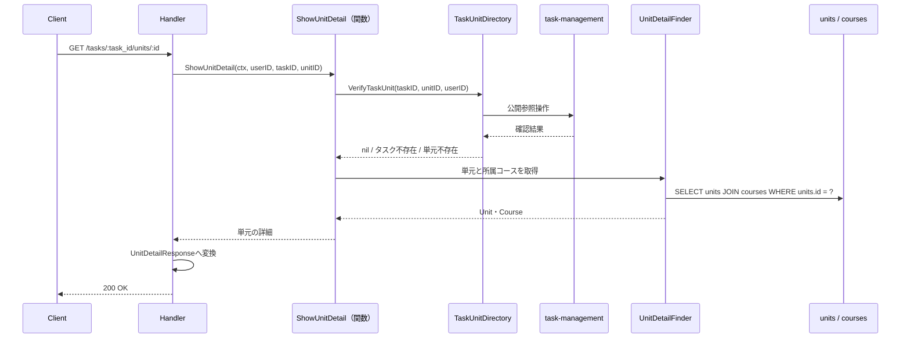

# 単元参照機能 Go移行・設計仕様書

---

# 1. 機能概要

## 機能概要

生徒のタスクに紐づく単元の詳細を取得する参照機能である。単元の情報と、その所属コースの情報をあわせて返す（①「5. API / 処理詳細」`#show`）。

単元の詳細は**タスク配下でのみ取得できる**。タスクに属さない単元を単体で取得するエンドポイントは存在しない（①「5. API / 処理詳細」`#show`）。

## 利用者

- 生徒ユーザー（`student`ロール）
- 操作者自身のタスクに紐づく単元のみ取得できる（①「8. 権限制御」）

## 業務上の目的

- 生徒が取り組んでいるタスクの単元を、所属コースとあわせて確認できるようにする

---

# 2. 設計方針

本機能はマスタデータの参照のみで完結するため、過度な抽象化を避け、読み取り専用の構造とする。

- 責務分離: 検索条件の組み立てとレスポンス整形を分離する
- **所有の尊重**: 単元・コースは本Contextが所有するが、**タスクと単元の紐づきは`task-management`が所有する**。紐づきの確認は同Contextの参照手段に委ねる（規約「5. Context間連携ルール」）
- 保守性: 単元・コースの属性追加に対して変更範囲を限定する
- テスト容易性: 対象の確認と取得を分けて検証できるようにする
- API互換性: 既存フロントエンドとの整合を保つため、エンドポイント・レスポンス構造・ステータスコードを維持する

---

# 3. Bounded Context

## Context名

- `curriculum`

コース参照機能（`コース参照機能_Go移行・設計仕様書`）と同一のContextとして扱う。両機能はいずれもCourse・Unitというマスタデータを参照する機能であり、Contextの責務を分割する理由がないためである。単元はコースに属するため、両者を別Contextにすると同じテーブルを2つのContextが所有することになる（規約「4. Bounded Context構成」の「常に一体で扱われるデータ（例：Course/Unit）は無理に分割しない」）。

**本Contextが他Contextへ公開する参照手段の定義は、コース参照機能②「11. Repository設計」に集約している。** 本書では繰り返さない。

## Contextの責務（本機能が担当する範囲）

- タスクに紐づく単元の詳細の提供
- 単元の所属コースの情報の付与

Context全体の責務はコース参照機能②「3. Bounded Context」を参照。

## 持たない責務

- 単元・コースの登録・更新・削除
- **タスクと単元の紐づきの管理**（`task-management`の責務）
- タスクの所有権の判定（同）

## 他Contextとの依存関係

- `task-management` Context: 指定のタスクが操作者自身のものであり、指定の単元がそのタスクに紐づいているかの確認に依存する（①「5. API / 処理詳細」`#show`）
- `user` Context: 認証済み生徒の識別に依存する

## 依存する理由

本機能は単元そのものを所有するが、**「どのタスクにどの単元が紐づくか」という関係は所有しない**。その関係は`tasks`・`task_units`で表され、`task-management`が所有する（タスク管理機能②「3. Bounded Context」）。

Rails現行は`current_user.tasks.find(task_id)`でタスクを取り、`task.units.find(id)`で単元を辿っている（①「5. API / 処理詳細」`#show`）。いずれも`task-management`が所有するデータへの問い合わせである。本設計では同Contextの参照手段に委ね、本Contextから`tasks`・`task_units`へクエリを発行しない。

確認が済んだあと、単元とコースの情報を本Contextが取得して返す。

**②からの補足**: 学習ログ機能②も同じ参照手段（タスクが操作者のもので単元がそのタスクに紐づくか）を必要とする（同機能②「11. Repository設計」の`TaskUnitDirectory`）。問題解答機能②も同じである。3つのContextが同じ参照手段を呼ぶ形になる。

---

# 4. 設計パターン

## 採用パターン

Transaction Script

コース参照機能②「4. 設計パターン」と同じである。Contextを共有する以上、採用パターンも揃える必要がある（規約「4. Bounded Context構成」の「1つのContextに複数の設計パターンが混在する場合」）。

## 判断根拠

本機能は単一の詳細取得のみで構成される参照機能であり、状態管理・業務ルールのいずれも現行仕様に存在しない。

- 業務ルール: 「タスクに紐づく単元のみ取得できる」という条件のみ。これも検索条件として表現できる
- 状態管理: 存在しない
- 整合性: 書き込みがないため、保証すべき整合性の単位が存在しない
- テスト容易性: 対象の確認の成否と、取得結果を検証するだけでよい

## 採用しなかったパターン

### Active Record

作成・更新処理が存在しないため、モデルに保存・更新責務を持たせる意味がない。

### Domain Model

単元・コースは状態も振る舞いも持たないマスタ参照データであり、Entityに業務ルールを集約するメリットがない。

### Event Sourcing

履歴管理・監査要件が存在しない。

---

# 5. Aggregate設計

不要と判断する。

理由: 更新を伴わない参照専用データであり、整合性を保証すべき書き込み境界が存在しない。

---

# 6. Entity設計

本機能では独自のEntityを定義しない。Transaction Script採用であり、業務ルールを持つEntityが存在しないためである。

## Unit（参照用）

- 役割: 学習単元のマスタ情報
- 項目: 識別子・コースの識別子・単元名
- **`deleted_at`・`created_at`・`updated_at`を含めない。** `UnitSerializer`が返していないためである（①「5. API / 処理詳細」`#show`）
- 判断根拠: レスポンスに含まれる項目のみを保持する型として扱う

**コース参照機能の`Unit`（参照用）とは項目が異なる。** 同機能は`as_json`で全カラムを返すため`deleted_at`等を含むが、本機能はシリアライザを通すため含まない（コース参照機能②「6. Entity設計」）。同じテーブルを扱うが、返す項目が違う。

## Course（参照用）

- 役割: 単元の所属コース
- 項目: 識別子・レベル番号・レベル名
- **`subject_id`・`description`・`deleted_at`等を含めない。** `UnitSerializer`の`course`が3項目のみを返すためである（①「5. API / 処理詳細」`#show`）
- 判断根拠: 同じく、レスポンスに含まれる項目のみを保持する型として扱う

## Task（参照用）

- 役割: 対象の確認に用いるタスク
- 用途: `task-management`の参照手段が確認を行うため、本Contextはタスクの情報を受け取らない
- 判断根拠: 確認の成否のみが必要であり、タスクの属性は不要である

---

# 7. Value Object設計

不要と判断する。

理由: 単元名・レベル番号・レベル名はいずれも単純な値であり、独自の比較ロジックや業務ルールを持たない。日付・日時はレスポンスに含まれないため、表示形式のルールも持たない。

コース参照機能②「7. Value Object設計」と同じ判断である。

---

# 8. Domain Service

不要と判断する。

理由: 複数Entityを横断する業務ルールの判定が存在しない。「タスクに紐づく単元か」の判定は`task-management`の参照手段が行い、本Contextは判定しない。

---

# 9. クラス図

参照のみの機能であり、Entityもstructの階層も持たないため、クラス図としての図示は省略する。

Context全体の構成はコース参照機能②「9. クラス図」を参照（同様に省略している）。関係は「13. シーケンス図・処理フロー図」のシーケンス図で示す。

---

# 10. 状態遷移図

省略する。

理由: 本Contextが扱うデータに状態が存在しない（①「7. 状態管理」）。コース参照機能②「10. 状態遷移図」と同じである。

---

# 11. Repository設計

**実装上の位置づけ**: 本機能はTransaction Script採用のため、Repository Interfaceをdomain層に定義しない。実装時はinfrastructure層の関数として実装する（規約「3. 設計パターンごとの構造適用方針」）。

## 本機能のエンドポイントが使う検索

### UnitDetailFinder

- 管理対象: Unit・Course
- 責務:
  - 指定の単元の詳細を取得する。所属コースを同時に読み込む
- 保持する検索機能:
  - 単元の識別子での1件取得
  - コースの一括取得（N+1を避ける）
- **論理削除の扱い: 除外しない。** `Unit`・`Course`はいずれも`active`という絞り込みを持つが`default_scope`を持たず、この機能では`active`を使っていない（①「5. API / 処理詳細」`#show`）
- 保持しない責務:
  - タスクと単元の紐づきの確認（`task-management`の責務）
  - 認可判定
- 判断根拠: 検索条件の組み立てに特化させるため

**タスクに紐づくかの条件を検索に含めない。** Rails現行は`task.units.find(id)`と1つのクエリで紐づきの確認と取得を同時に行っているが、`task_units`は`task-management`が所有するため本Contextからは結合できない。確認と取得を2段階に分ける（「3. Bounded Context」）。

## 他Contextの参照手段

本Contextの`dependency.go`にインターフェースとして宣言し、実装は相手Contextの公開操作へ委譲するアダプタに閉じ込める（規約「4. Bounded Context構成」・「5. Context間連携ルール」）。

|参照手段|相手Context|取得する内容|
|-|-|-|
|TaskUnitDirectory|`task-management`|指定のタスクが操作者自身のものであり、指定の単元がそのタスクに紐づいているか（①「5. API / 処理詳細」`#show`）|

学習ログ機能②・問題解答機能②も同じ参照手段を必要とする（各②「11. Repository設計」）。インターフェースは各Contextが自身の`dependency.go`に持つため共有しないが、相手Contextが公開する操作は同一のものを呼ぶ。

## 本Contextが他Contextへ公開する参照手段

コース参照機能②「11. Repository設計」に集約して定めている。本書では繰り返さない。

6つの公開操作のうち、**単元情報の取得（`FindUnitsByIDs`）は本機能の検索と似ているが別物である**。

|項目|本機能の`UnitDetailFinder`|公開操作の単元情報の取得|
|-|-|-|
|対象|単元1件|単元の識別子の集合|
|返す項目|単元（3項目）とコース（3項目）|同じ|
|タスクとの紐づきの確認|呼び出し前に`TaskUnitDirectory`で行う|行わない（呼び出し元の責務）|

返す項目が同じであるため、③では同じ検索関数を使い回せる可能性がある。確定は③で行う（「25. 設計判断サマリー」）。

---

# 12. UseCase設計

**実装上の位置づけ**: 本機能はTransaction Script採用のため、UseCase層（struct）を設けない。実装時はapplication層の関数として実装する。

## ShowUnitDetail

- 目的: タスクに紐づく単元の詳細を取得する
- 入力: current user、タスクの識別子、単元の識別子
- 出力: 単元の情報（識別子・コースの識別子・単元名）と、所属コースの情報（識別子・レベル番号・レベル名）
- トランザクション範囲: 読み取りのみのため不要
- 呼び出す先: TaskUnitDirectory、UnitDetailFinder
- 処理:
  1. `TaskUnitDirectory`で、タスクが操作者自身のものであり単元がそのタスクに紐づいているかを確認する
  2. 失敗した場合、タスクが見つからないか単元が見つからないかを区別してエラーを返す（いずれも404。「17. Error設計」）
  3. `UnitDetailFinder`で単元と所属コースを取得する
  4. 取得結果を返す
- 判断根拠: 確認と取得を順に行うだけであり、業務ルールを組み合わせる必要がないため

**1を先に行う。** 確認が済むまで単元を読まない。他の生徒のタスクに紐づく単元を読むことを防ぐためである。

3で単元が見つからない場合は、1の確認が済んでいる以上、通常は起きない。起きた場合は他Contextとの不整合であり、500として扱う（「17. Error設計」）。

---

# 13. シーケンス図・処理フロー図

## シーケンス図（ShowUnitDetail）

## 処理フロー図

省略する。

理由: 分岐は対象の確認の成否のみであり、シーケンス図で十分に表現できる。コース参照機能②「13. シーケンス図・処理フロー図」と同じ判断である。

---

# 14. Transaction設計

## Transaction開始位置

- なし

## Transaction終了位置

- なし

## 理由

状態を変更する処理が存在しないため、トランザクションによる整合性保証は不要である。コース参照機能②「14. Transaction設計」と同じである。

対象の確認と単元の取得の間に整合性を求めない。確認が済んだあとに単元が論理削除されても、本機能は論理削除を除外しないため結果は変わらない。

---

# 15. Validation設計

## Presentation

- 型チェック: パスパラメータ`task_id`・`id`が整数であることを検証する
- 必須チェック: いずれも必須である
- フォーマットチェック: なし

クエリパラメータ・リクエストボディを持たない（①「5. API / 処理詳細」`#show`）。

## Domain

- 業務ルール: タスクが操作者自身のものであること、単元がそのタスクに紐づいていること
- 状態チェック: なし
- 整合性チェック: なし

いずれも`task-management`の参照手段が判定する。本Contextは判定しない。

## 責務分離

- Presentationは「入力の形が正しいか」を担当する
- 対象の確認は`task-management`に委ねる
- 本Contextは確認が済んだ単元の取得のみを行う

## バリデーション仕様

|フィールド|検証層|ルール|Rails現行の扱い|
|-|-|-|-|
|`task_id`|Presentation|必須・整数|整数でなければ422|
|`id`（単元の識別子）|Presentation|必須・整数|同|
|`task_id`|他Contextへ問う|操作者自身のタスクであること|404 `{"message": "タスクが見つかりません"}`|
|`id`|他Contextへ問う|そのタスクに紐づく単元であること|404 `{"message": "Unitが見つかりません"}`（モデル名の訳がなく英語になる）|

---

# 16. Authorization設計

## Middleware

- 認証済みユーザーを特定し、ユーザー情報を`context.Context`に保持する
- 役割が`student`であることを確認する
- CSRF: 本機能はGETのみであり、CSRF検証の対象外である（Gin規約「5. CSRF対策」の「適用範囲」）

## Handler

- `context.Context`からcurrent userを取り出し、application層の関数へ渡す
- 業務権限判定は持たせない

## Application

- current userの識別子を`TaskUnitDirectory`に渡すことで、操作者自身のタスクに紐づく単元のみ取得できるようにする

## Domain

- 権限判定を行わない

## 判断理由

所有権のスコープはタスクに対して効く。単元そのものは全生徒に共通のマスタデータであり、単元に所有者はいない（①「8. 権限制御」）。

**コース参照機能と扱いが異なる。** 同機能は操作者による絞り込みを一切行わないが、本機能はタスクを経由するため操作者のスコープが効く（コース参照機能②「16. Authorization設計」）。同じContextだが、エンドポイントによって認可の効き方が違う。

「存在しない」と「他の生徒のもの」を区別しない。いずれも404として扱う（①「5. API / 処理詳細」`#show`）。

---

# 17. Error設計

## Domain Error

本機能では業務ルール違反が発生しないため、使用しない。

## Application Error

- 責務: 対象のタスク・単元が見つからないことを表現する
- 判断理由: 失敗理由をHTTPレスポンスに変換しやすくするため

**タスクと単元を区別する。** 404の本文に入るモデル名が異なるためである（下記）。

## Infrastructure Error

- 責務: DB接続失敗を表現する
- 判断理由: 技術的な障害をドメインに漏らさず切り分けるため

## エラー仕様

|業務シナリオ|エラー種別|発生層|想定するHTTPステータス|
|-|-|-|-|
|対象のタスクが存在しない、または他の生徒のタスク|NotFound|Application|404（名称: `タスク`）|
|対象の単元がそのタスクに紐づかない|NotFound|Application|404（名称: `Unit`）|
|確認が済んだあとに単元が取得できない|Internal|Infrastructure → Application（変換）|500|
|未認証|Unauthorized|Middleware|401|
|`student`ロールでない|Forbidden|Middleware|403|

確認が済んだあとに単元が取得できない場合を500とするのは、他Contextとの不整合を示すためである。`task-management`が「紐づいている」と答えた単元が本Contextに存在しないことは、データの不整合であり利用者の入力の誤りではない。

## エラーレスポンスの本文

Rails現行の本文の形をそのまま維持する（①「5. API / 処理詳細」`#show`）。

|条件|HTTPステータス|本文|
|-|-|-|
|対象のタスク・単元の不存在|404|`{"message": "〇〇が見つかりません"}`。`〇〇`は`タスク`または`Unit`|
|認可エラー|403|`{"errors": ["この操作を行う権限がありません"]}`|
|内部エラー|500|`{"errors": [...]}`|

404のみ`message`の単一文字列であり、規約「15. API規約（レスポンス形式・ページネーション・URL・クエリパラメータ）」の形式と異なる。本文の形は`ApplicationController#not_found`が決めており、全機能に共通する。

**単元の名称が`Unit`と英語になる。** `Unit`のモデル名の日本語訳が定義されていないためである（①「5. API / 処理詳細」`#show`）。`Task`は`タスク`と日本語になる。

いずれもRails現行のまま維持する。フロントエンドを変更しない方針であり、本文の形や文言を変えるとフロントエンドの修正が必要になるためである。

## Rails現行の挙動を維持するもの

|挙動|Rails現行|本設計|
|-|-|-|
|404のモデル名|`Unit`が英語のまま出る|同じ|
|論理削除済みの単元・コース|取得できる（除外しない）|同じ|

---

# 18. Domain Event

不要と判断する。

理由: 参照のみの機能であり、表示に伴って他処理へ通知すべき副作用が現行仕様に存在しない（①「9. 非同期処理」）。

---

# 19. API仕様

## エンドポイント一覧

|エンドポイント|HTTP Method|概要|
|-|-|-|
|/api/v1/student/tasks/:task_id/units/:id|GET|タスクに紐づく単元の詳細を取得|

Rails現行仕様と同じURL・HTTP Methodを維持する。パスはタスク配下の入れ子である（①「4. API一覧」）。

## 各エンドポイントの仕様

### GET /api/v1/student/tasks/:task_id/units/:id

- Request: パスパラメータ`task_id`・`id`
- Response: 最上位をラップしないオブジェクト
  - `id`・`course_id`・`unit_name`
  - `course`: 所属コースの`id`・`level_number`・`level_name`
- **`deleted_at`・`created_at`・`updated_at`を含まない。** `UnitSerializer`が返していないためである（①「5. API / 処理詳細」`#show`）
- `course`は3項目のみである。`subject_id`・`description`等は含まれない（同）
- 論理削除済みの単元・コースも取得できる（同）
- Status Code: 正常系200。異常系は対象のタスク・単元の不存在404

**コース参照機能のレスポンスとは項目が異なる。** 同機能は`as_json`でコース・単元の全カラムを返すが、本機能はシリアライザを通すため絞られる（コース参照機能②「19. API仕様」）。同じテーブルを扱うが返す項目が違う。

## エラーレスポンス

形式は「17. Error設計」の「エラーレスポンスの本文」のとおり。

## Railsとの差分

**API外部仕様の変更はない。** URL・HTTP Method・レスポンス構造・ステータスコード・エラー本文の形・404のモデル名のいずれも変更しない。論理削除済みを含めることも維持する。

内部の責務には次の差分がある。

- Rails仕様: Controllerが`current_user.tasks.find(task_id)`でタスクを取り、`task.units.find(id)`で単元を辿っている。紐づきの確認と単元の取得を1つのクエリで行っている（①「5. API / 処理詳細」`#show`）
- Go設計での変更: 紐づきの確認を`task-management`の参照手段に委ね、確認が済んだあとに単元を取得する。**確認と取得を2段階に分ける**
- 変更理由: `task_units`は`task-management`が所有し、本Contextからは結合できない（規約「5. Context間連携ルール」）
- 影響範囲: 本機能の1エンドポイントの外部仕様に変更はない。`task-management`が「タスクが操作者のもので単元がそのタスクに紐づくか」を答える参照手段を公開する必要がある。同じ参照手段を学習ログ機能・問題解答機能も必要とする

JSONスキーマの厳密な型定義・Goの構造体は③Go実装仕様書で扱う。

---

# 20. DB設計方針

## 現行DBを利用するか

- 既存Rails DBを継続利用する

## Schema変更有無

- 変更なし

## 変更理由

- 現行の`units`・`courses`で本機能の要件を満たしている

## 変更を提案しない理由

- 参照のみであり、構造的な問題が①から確認できない

Context全体のDB設計方針はコース参照機能②「20. DB設計方針」を参照。

---

# 21. DB操作仕様

本機能が直接操作するテーブルは`units`・`courses`のみである。

|操作|対象テーブル|操作種別|主な検索条件|結合|ページネーション/ソート|
|-|-|-|-|-|-|
|UnitDetailFinder|units|参照|`id`|`courses`と結合（レベル番号・レベル名を返すため）|不要（1件取得）|

`deleted_at`を条件に含めない（「11. Repository設計」）。

`tasks`・`task_units`へは本Contextからクエリを発行しない。`task-management`の参照手段に委ねる。**Rails現行が`task.units.find(id)`で結合していた部分が、Go設計では別Contextへの問い合わせになる。**

Context全体のDB操作仕様はコース参照機能②「21. DB操作仕様」を参照。

具体的なSQL・GORMのクエリコードは③Go実装仕様書（Gorm規約）で扱う。

---

# 22. テスト戦略

Transaction Script採用のため、規約「3. 設計パターンごとの構造適用方針」の読み替えルールに従う。業務ルールを持つEntityを持たないため、Domain Testに相当するものがない。

## Domain Test

- 対象外。本Contextに業務ルールを持つEntity・Value Objectが存在しない

## UseCase Test（Transaction Script採用時は関数のテスト）

- 目的: `ShowUnitDetail`が対象の確認を先に行い、確認が済んでから単元を取得することを検証する
- 含めるもの: 確認が失敗した場合に単元を取得しないこと、タスクの不存在と単元の不存在を区別して返すこと、確認が済んだあとに単元が取得できない場合に500相当のエラーを返すこと

## Repository Test

- 目的: `UnitDetailFinder`の検索の正確性を検証する
- 含めるもの: 単元と所属コースが1回のクエリで取得できること、**論理削除済みの単元・コースも取得できること**、存在しない識別子で該当なしが返ること

## Handler Test

- 目的: レスポンス形状とHTTPステータスの変換を検証する
- 含めるもの: 最上位をラップしないこと、`deleted_at`・`created_at`・`updated_at`を含まないこと、`course`が3項目であること、404の名称が対象ごとに`タスク`・`Unit`になること

## Integration Test

- 目的: エンドポイント経由で単元の詳細が取得できることを確認する
- 含めるもの: 認可（未認証・`student`以外の拒否、他の生徒のタスクを指定した場合に404）、タスクに紐づかない単元を指定した場合に404、論理削除済みの単元が取得できること

---

# 23. Railsとの責務対応

| Rails | Go | 設計方針 |
|---|---|---|
| Controller（`UnitsController`） | Handler | HTTP入力の受け取りとレスポンス整形に限定する |
| `current_user.tasks.find(task_id)` | `task-management`の参照手段 | タスクの所有権の判定を所有者側に委ねる |
| `task.units.find(id)` | `task-management`の参照手段（紐づきの確認） + 本Contextの単元の取得 | **1つのクエリを2段階に分ける**（`task_units`は他Contextの所有） |
| `UnitSerializer` | Response DTO | 画面に返すレスポンス整形を分離する。コース参照機能の`as_json`とは返す項目が異なる |
| Model（`Unit`・`Course`） | 参照用の型 | 業務ルールを持たないため、読み取り専用の型として扱う |

---

# 24. 採用しなかった設計

## Active Record

- 採用しなかった理由: 作成・更新処理が存在しないため、モデルに保存・更新責務を持たせる意味がない
- 将来的に採用する可能性: コース参照機能②「24. 採用しなかった設計」と同じ（管理者向けの登録・更新機能が同じContextを共有する場合は見直す）

## Domain Model

- 採用しなかった理由: 単元・コースは状態も振る舞いも持たないマスタ参照データである
- 将来的に採用する可能性: 低い

## Event Sourcing

- 採用しなかった理由: 履歴管理・監査要件が存在しない
- 将来的に採用する可能性: 低い

## 単元参照を独立したContextとする案

- 採用しなかった理由: 単元はコースに属し、常に一体で扱われる（規約「4. Bounded Context構成」）。別Contextにすると`units`を2つのContextが所有することになる
- 代わりにコース参照機能と`curriculum` Contextを共有する

## タスクとの紐づきを本Contextで確認する案

- 採用しなかった理由: `task_units`は`task-management`が所有する。本Contextから結合すると規約「5. Context間連携ルール」に反する
- 代わりに同Contextの参照手段に委ね、確認と取得を2段階に分ける

---

# 25. 設計判断サマリー

| 項目 | 採用 | 判断理由 |
|---|---|---|
| 設計パターン | Transaction Script | コース参照機能と同じ。Contextを共有する以上揃える必要がある |
| Context | `curriculum`（コース参照機能と共有） | 単元はコースに属し、常に一体で扱われるため |
| Aggregate | 不要 | 書き込みがなく、保証すべき整合性の単位が存在しないため |
| Entity | 定義しない | 業務ルールを持たず、読み取り専用の型として扱うため |
| 参照用の型の項目 | レスポンスに含まれる項目のみ | シリアライザを通すため。コース参照機能の`as_json`とは項目が異なる |
| Transaction境界 | なし | 状態を変更する処理が存在しないため |
| 他Contextの参照 | `dependency.go`のインターフェース + アダプタ | `task_units`は`task-management`の所有であるため |
| 対象の確認と取得 | 2段階に分ける | Rails現行は1つのクエリだが、`task_units`が他Contextの所有であるため結合できない |
| Authorization | タスクに対して効く | 単元そのものに所有者はいない。コース参照機能とは認可の効き方が異なる |

## 本書で決めていない事項

|事項|決めていない理由|決める場所|
|-|-|-|
|`UnitDetailFinder`と、公開操作の単元情報の取得（`FindUnitsByIDs`）で同じ検索関数を使い回すか|返す項目が同じであるため使い回せる可能性があるが、対象が1件と集合で異なる（「11. Repository設計」）|③Go実装仕様書|
|`task-management`が公開する参照手段の具体的なシグネチャ|同機能の③で確定する。学習ログ機能③・問題解答機能③も同じ参照手段を使うため、3者で揃える|③Go実装仕様書（利用側で定め、差はアダプタが吸収する。コーディング規約「7. インターフェース」）|

---

# 設計差分管理

## Rails現行仕様

- Controllerが`current_user.tasks.find(task_id)`でタスクを取り、`task.units.find(id)`で単元を辿っている
- 紐づきの確認と単元の取得を1つのクエリで行っている
- `UnitSerializer`で単元の3項目と所属コースの3項目を返す
- 論理削除済みの単元・コースを除外していない

## Go設計での変更内容

- 紐づきの確認を`task-management`の参照手段に委ね、確認が済んだあとに単元を取得する（2段階に分ける）
- 検索条件の組み立てをinfrastructure層の関数に閉じ込め、レスポンス整形をPresentation層に置く
- 論理削除を除外しない扱いを明示する

## 変更理由

- `task_units`は`task-management`が所有し、本Contextからは結合できない（規約「5. Context間連携ルール」）

## 影響範囲

- 本機能の1エンドポイントの外部仕様に変更はない
- `task-management`が「タスクが操作者のもので単元がそのタスクに紐づくか」を答える参照手段を公開する必要がある。同じ参照手段を学習ログ機能・問題解答機能も必要とする
- クエリが1回から2回（他Contextへの問い合わせ + 単元の取得）に増える。1件取得であり件数は増えないため、性能上の問題は想定しない
- 既存DBスキーマは維持するため、データ移行やマイグレーションの追加は不要
