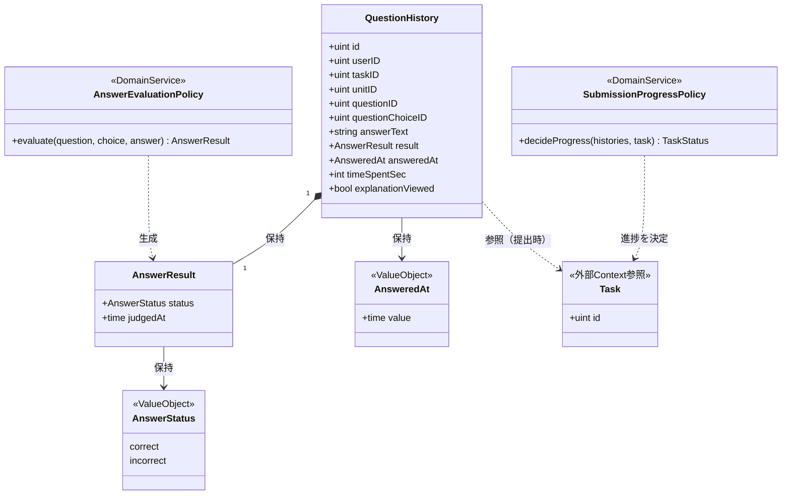
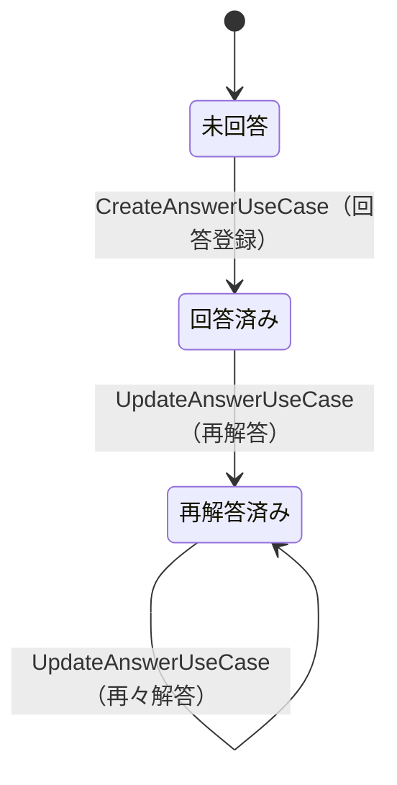
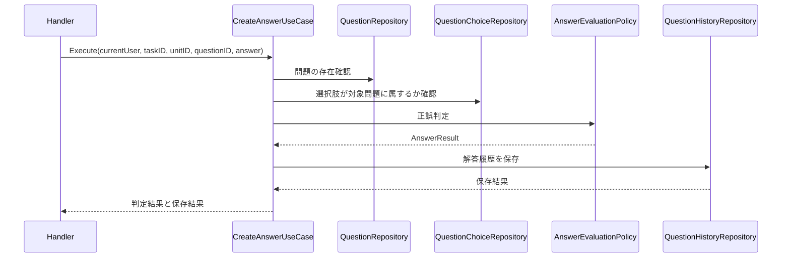
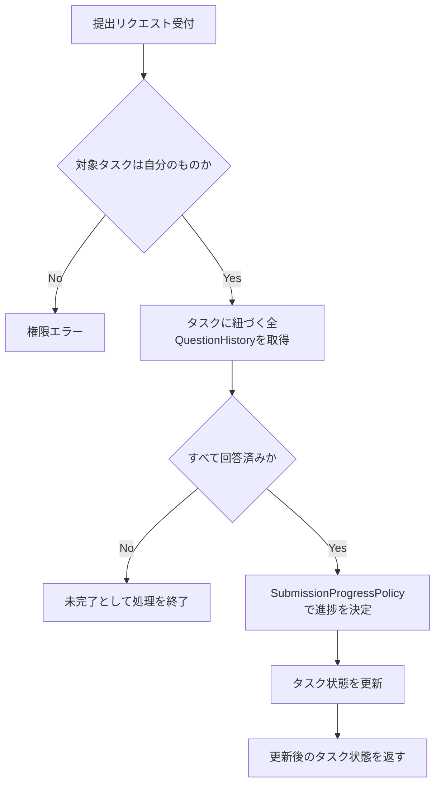

# 問題解答機能 Go移行・設計仕様書

---

# 1. 機能概要

## 機能概要

生徒がタスクに紐づく単元の問題に回答し、回答結果を保存・更新し、提出時にタスク状態を更新する機能である。Rails現行仕様では、問題一覧取得・解答登録・解答更新・確認表示・提出という5つの操作を提供している。

## 利用者

- 学生ユーザー（student ロール）
- 自分のタスク・単元・問題に紐づく操作のみ可能

## 業務上の目的

- 生徒が学習単元に対する理解度を確認しながら回答できるようにする
- 回答履歴を蓄積し、再解答・確認表示に反映する
- 提出時にタスクの進捗状態を更新し、学習の完了状況を可視化する

---

# 2. 設計方針

この機能は、Rails実装の構造をそのまま移すのではなく、問題解答という業務に集中したGo設計とする。

主な設計思想は以下のとおりである。

- 責務分離: 入力検証・正誤判定・履歴保存・タスク状態更新を分離する
- 保守性: 解答判定や提出状態更新のルールをドメイン側に集約する
- テスト容易性: 問題の正誤判定と提出状態の遷移をユースケース単位で検証しやすくする
- 拡張性: 今後、選択式だけでなくテキスト解答や複数解答形式へ拡張しやすい構造にする
- API互換性: 既存APIの主要なエンドポイントとレスポンスの意味は維持する

---

# 3. Bounded Context

## Context名

- `question-answering`

## Contextの責務

- 問題の一覧取得と、解答確認用データの提供
- 解答の登録・更新
- 正誤判定
- 解答履歴の保存
- **当日の解答件数の保持と加算**（①「6. データモデル」の「当日の解答件数」）
- タスクの提出を契機とした、タスクの状態と目標の状態の更新の呼び出し

## 持たない責務

- 問題・選択肢・ヒントの登録・更新（管理者問題インポート機能の責務）
- タスク・単元・目標そのものの管理（`task-management`・`curriculum`・`goal-management`の責務）
- タスク・目標の状態の決め方そのもの（下記）

## 他Contextとの依存関係

参照のための依存:

- `task-management` Context: タスクが操作者自身のものであること、単元がそのタスクに紐づいていることの確認に依存する（①「5. API / 処理詳細」）
- `curriculum` Context: 問題・選択肢・ヒントの参照に依存する。問題は単元に属するため、単元から問題を辿る参照も同Contextに問う
- `user` Context: 認証済み生徒の識別に依存する

状態変更を伴う依存:

- `task-management` Context: **タスクの提出時に、同Contextが公開する「タスクの状態の更新」操作を呼ぶ**（①「5. API / 処理詳細」`#update`（提出）。`Student::TaskStatusUpdaterService`に対応）
- `goal-management` Context: **同じ提出の中で、同Contextが公開する「目標の状態の再評価」操作を呼ぶ**（同。`Student::GoalCompletionService` / `Student::GoalStatusUpdaterService`に対応）

本Contextから他Contextへ公開する参照手段:

- `dashboard` Context: 当日の解答件数を参照する（ダッシュボード機能②「11. Repository設計」）
- `task-management` Context: タスクの単元ごとに学習を開始済みかどうか（解答履歴があるか）を参照する（タスク管理機能②「11. Repository設計」の`StartedUnitDirectory`）

## 依存する理由

本機能は単に「問題を表示する」だけでなく、タスク・単元・問題の関係が前提となるため、参照のための依存が生じる。

状態変更を伴う依存を持つのは、タスクの提出がタスクと目標の状態の双方に波及するためである。**状態の決め方そのものは所有者側のContextに閉じ込め、本Contextは呼ぶだけとする**（規約「5. Context間連携ルール」の「状態変更を伴う連携は呼び出し側の処理単位で両Context側の処理を順に呼び出す」）。

ただし「タスクのあるべき状態の判定」は本Contextに置く。判定は解答済みの問題数と対象の問題数の比較であり、**解答履歴を所有しているのは本Contextである**ためである。判定した結果を`task-management`の「タスクの状態の更新」に渡す形とする。Rails現行も`Student::TaskCompletionService`（判定）を提出側に置き、`Student::TaskStatusUpdaterService`（更新）をタスク側に置いている（①「10. Rails実装対応表」）。

一方「目標のあるべき状態の判定」は`goal-management`に置く。判定に必要なのは目標に紐づくタスクの状態であり、本Contextが所有しないためである。

**②からの補足**: `task-management`が公開する「タスクの状態の更新」は、目標の状態の再評価を呼ばない。Rails現行では提出の経路（`Student::SubmissionService`）が目標の再評価を自ら呼んでおり、`Student::TaskStatusUpdaterService`は呼んでいない（①「5. API / 処理詳細」`#update`（提出））。本設計もこの分担を維持する。タスク管理機能②「12. UseCase設計」が未確定としていた点は、この分担で確定する。

## 関連Context（依存関係ではないもの）

- `study-log` Context: 同じタスク・単元配下では、生徒が単元学習に取り組んだ開始・終了時刻を記録する学習ログ機能が並行して提供されている（①「1. 機能概要」の関連機能）。両Contextは同じタスク・単元を対象とするが、互いのデータを参照・更新することはなく、それぞれ独立して「解答の正誤・履歴」「学習時間の記録」という別の業務関心を扱う。そのためBounded Contextとしては分離し、依存関係としては扱わない
- ただし両Contextはいずれも`task-management`の状態を変える操作を呼ぶ。学習ログは「タスクの着手」、本機能は「タスクの状態の更新」であり、別の操作である（学習ログ機能②「3. Bounded Context」）

---

# 4. 設計パターン

## 採用パターン

Domain Model

## 判断根拠

本機能は、問題の正誤判定・回答履歴の更新・提出時の進捗状態決定という、学習成果に直結する業務ルールを含むため、業務領域としては中核に近い。単なるCRUDではなく、回答内容・正誤結果・履歴の整合性を一貫して扱う必要があるため、ドメイン概念を明確にしておく価値が高い。

このため、業務領域の分類に基づけば、回答履歴・正誤結果・状態遷移を一つのドメインとして扱うDomain Modelが自然である。特に以下の理由がある。

- 回答履歴は単なるデータではなく、学習成果と進捗の意味を持つ
- 問題・選択肢・タスク・単元の関係を踏まえ、正誤判定と履歴更新を一貫して扱う必要がある
- 提出時の状態遷移は、回答の集約結果に基づいて決定されるため、ドメインルールとして明示する価値がある

したがって、業務領域が中核であり、ルールの意味が重要であることを踏まえると、Domain Modelを採用するのが妥当である。

## 採用しなかったパターン

### Transaction Script

- 手続き型に寄りすぎるため、回答履歴・正誤判定・提出状態のルールがユースケースに偏りやすい
- ドメインルールが散在し、将来の拡張時に扱いづらくなる可能性がある
- 中核業務としての意味を持つルールを、手続き中心で表現すると保守性が低下しやすい

### Active Record寄りの設計

- 単なる永続化中心に寄りすぎると、回答履歴の意味や正誤判定ルールがモデルに散りやすい
- 中核業務としての評価ロジックと状態遷移を十分に表現しにくい
- ドメイン上の意味を明示するためには、Entityに責務を持たせる方が適切である

### Event Sourcing

- 提出や解答が他システムに通知される要件がなく、イベント履歴の再構築が必要ない
- 現状の業務では過剰な設計である

---

# 5. Aggregate設計

本機能では、Aggregateを大きく分ける必要はない。回答履歴単位を中心に扱い、タスク・単元・問題との関係は参照・検証対象として扱う。

## Aggregate Root

- QuestionHistory

## Aggregateに含めるEntity

- QuestionHistory
- AnswerResult（回答結果として扱う）

## Aggregate境界

- QuestionHistoryが回答内容・正誤・解答時刻・対象関係を一貫して扱う単位とする
- タスクや単元はAggregateの外部参照として扱い、回答履歴の整合性を保つための条件として利用する

## 整合性を保証する単位

- 解答登録・更新時に、履歴の作成・更新と正誤判定の結果を一貫して処理する

理由: 1つの操作で回答内容と判定結果の整合性を保つためである。

---

# 6. Entity設計

## QuestionHistory

- 役割: 生徒の解答履歴の中心的な概念
- ライフサイクル: 作成 → 更新 → 再判定
- 状態変化: 未回答 → 回答済み → 再解答済み
- 保持する責務:
  - 回答内容と判定結果を保持する
  - 解答時間・解説閲覧フラグなどの補助情報を保持する
  - 既存履歴がある場合の更新ルールを管理する
- 判断根拠: 回答履歴自体が本機能の主要な業務情報であるため

## AnswerResult

- 役割: 正誤判定の結果を表す概念
- ライフサイクル: 判定時に生成
- 状態変化: correct / incorrect
- 保持する責務:
  - 正誤結果を保持する
  - 回答内容との整合を管理する
- 判断根拠: 判定結果は単なるフラグではなく、業務上意味を持つため

## Task

- 役割: 提出時の状態更新対象として参照される
- 判断根拠: 本機能の中心は回答履歴であり、Taskは回答処理の外部参照として扱う

---

# 7. Value Object設計

## AnswerStatus

- 採用理由: 正誤を文字列やboolean単位で扱うより、意味を持つvalueとして明示した方が保守しやすい
- 独自ルール:
  - correct / incorrect のいずれかのみ許容する
  - 既存履歴の再判定時も同じ状態へ正規化する
- Entity属性ではなくValue Objectにする理由: 判定結果は単なる真偽ではなく、業務的に意味のある状態だから

## AnsweredAt

- 採用理由: 回答時刻は表示・比較・ソートに使われるため、型として扱うと扱いやすい
- 独自ルール:
  - 日付時刻の整合性を保証する
- Entity属性ではなくValue Objectにする理由: 時刻の意味をドメインで明示できるため

## Value Objectを採用しないもの

- 選択肢ID・問題ID・タスクID: 識別子として単純な値であり、追加ルールがないためValue Object化は不要とする

---

# 8. Domain Service

## AnswerEvaluationPolicy

- 責務: 問題の正誤判定ロジックをまとめて扱う
- Entityへ持たせない理由: 正誤判定は問題・選択肢・回答内容の組み合わせに依存し、QuestionHistory単体だけで完結しないため
- 判断根拠: 判定ルールは独立した業務ポリシーとして扱う方が明確であるため

## SubmissionProgressPolicy

- 責務: 提出時にタスク状態をどのように決定するかを判定する
- Entityへ持たせない理由: 提出時の状態決定は回答履歴の集合とタスクの状況に依存し、単一Entityに閉じ込めにくいため
- 判断根拠: 進捗判定は複数情報を横断するルールとして扱う方が自然だから

---

# 9. クラス図

Question / QuestionChoiceは他Context（Question Context）が所有するデータであり、本機能からは参照のみ行うため、クラス図には含めていない（「3. Bounded Context」の依存関係を参照）。Goのstruct定義（フィールドの可視性・タグ等）は③Go実装仕様書で扱う。

---

# 10. 状態遷移図

QuestionHistoryは以下の状態を持つ（「6. Entity設計」の状態変化を可視化したもの）。

遷移条件:

- 「未回答→回答済み」は、対象問題・選択肢が正しく紐づいている場合のみ許可する
- 「回答済み→再解答済み」は、既存履歴が存在する場合のみ許可する

禁止される組み合わせ:

- 「未回答」から直接「再解答済み」への遷移はない（必ず一度「回答済み」を経る）

---

# 11. Repository設計

本Contextが所有するテーブルは`question_histories`のみである。`tasks`・`task_units`・`units`・`questions`・`question_choices`・`question_hints`・`goals`はいずれも他Contextが所有するため、本ContextからSQLを発行しない。相手Contextが公開する参照手段を呼び出す（規約「5. Context間連携ルール」）。

加えて、当日の解答件数（Redis）は本Contextが所有する。RDBのテーブルではないが、加算しているのが本Contextであり、値の意味（何を1件と数えるか）を決めているのも本Contextであるためである（①「6. データモデル」）。

## QuestionHistoryRepository（本Contextが所有）

- 管理対象: QuestionHistory
- 責務:
  - 解答履歴の保存
  - 既存履歴の取得（操作者・タスク・単元・問題の4条件）
  - 既存履歴の更新
  - 指定のタスク・単元における解答済みの問題IDの取得（問題一覧の`answered`、確認表示に用いる）
  - 指定のタスクにおける解答済み件数の集計（提出の判定に用いる）
- 保持する検索機能:
  - `user_id` / `task_id` / `unit_id` / `question_id`による検索
  - タスク単位の集計。**論理削除されていない履歴のうち、論理削除されていない問題に対するものに限る**（①「6. データモデル」の`on_active_questions`）
- 論理削除の扱い: 用途によって異なる。集計（提出の判定）では論理削除を除外するが、`answered`の判定・確認表示・解答の更新では除外しない。`QuestionHistory`が`default_scope`を持たないためである（①「6. データモデル」）
- 保持しない責務:
  - 正誤判定
  - 提出状態の決定
  - 認可判定
- 判断根拠: 永続化と検索・集計に集中させ、業務ロジックを持たせないため

## TodayAnswerCountStore（本Contextが所有）

- 管理対象: 当日の解答件数（**Redis**）
- 責務:
  - 指定の生徒の当日の解答件数を1加算する
  - 指定の生徒の当日の解答件数を取得する（`dashboard`への公開参照手段が用いる）
- 保持する責務（本Contextに閉じ込めるもの）:
  - キーの構成（生徒の識別子と日付からキーを組み立てる）
  - 有効期限の設定（キーが新規作成されたときのみ当日の終わり + 5分を設定する）
  - 「当日」の基準となる日付の決め方
- 保持しない責務: 加算を呼ぶ契機の判断（解答の登録の処理が決める）
- 障害時の扱い: **加算の失敗はエラーとして呼び出し元に伝えない。** ログに記録して処理を続ける。加算の失敗で解答の記録が失敗してはならない（①「9. 非同期処理」）
- 判断根拠: RDBとは別の保持先であり、キーの構成と有効期限という保持先固有の関心を1箇所に閉じ込めるため

**②からの補足**: Redisへのアクセスを扱う部品の置き場所について、規約「4. Bounded Context構成」は`internal/shared/`配下にRedisのディレクトリを定めていない。接続の管理を複数Contextで共有するか、本Contextに閉じるかは③で判断する（「25. 設計判断サマリー」）。

## 他Contextの参照手段

本Contextの`dependency.go`にインターフェースとして宣言し、実装は相手Contextの公開操作へ委譲するアダプタに閉じ込める（規約「4. Bounded Context構成」・「5. Context間連携ルール」）。

|参照手段|相手Context|取得する内容|
|-|-|-|
|TaskUnitDirectory|`task-management`|指定のタスクが操作者自身のものか、かつ指定の単元がそのタスクに紐づいているか（①「5. API / 処理詳細」）|
|TaskUnitQuestionCountDirectory|`curriculum`|指定のタスクに紐づく単元に属する問題の件数（提出の判定に用いる対象の問題数）|
|QuestionDirectory|`curriculum`|単元に属する問題の一覧（選択肢・ヒントを含む）／指定の問題が指定の単元に属するか／指定の選択肢が指定の問題のものか／問題の正解|

`TaskUnitDirectory`は学習ログ機能②も同じ参照手段を必要とする（同機能②「11. Repository設計」）。インターフェースは各Contextが自身の`dependency.go`に持つため共有しないが、相手Contextが公開する操作は同一のものを呼ぶ。

提出の判定に必要な「対象の問題数」は、タスクに紐づく単元に属する問題の件数である。タスクと単元の紐づきは`task-management`、単元と問題の紐づきは`curriculum`が持つ。Rails現行は`TaskAnswerStatsQuery`が`task_units`と`questions`を直接結合して数えているが（①「10. Rails実装対応表」）、本設計では件数を答える参照手段を`curriculum`に求める形とする。

**②からの補足**: 件数を数えるために「タスクに紐づく単元」を知る必要があるため、`curriculum`が`task_units`を読むことはできない。`task-management`から単元の識別子の集合を受け取り、それを`curriculum`に渡して件数を問う2段階にする。参照手段の分割の仕方は③で確定する（「25. 設計判断サマリー」）。

## 他Contextの公開操作の呼び出し

|操作|相手Context|用途|
|-|-|-|
|タスクの状態の更新|`task-management`|提出時に、判定した状態へ更新する（①「5. API / 処理詳細」`#update`（提出））|
|目標の状態の再評価|`goal-management`|同じ提出の中で、タスクが属する目標の状態を再評価する（同）|

これらも`dependency.go`のインターフェースとして宣言する。トランザクションの扱いは「14. Transaction設計」で定める。

## 本Contextが他Contextへ公開する参照手段

|公開する操作|呼び出し元|内容|
|-|-|-|
|当日の解答件数の取得|`dashboard`|指定の生徒の当日の解答件数を返す（ダッシュボード機能②「11. Repository設計」）|
|学習開始済みの単元の取得|`task-management`|指定のタスクについて、解答履歴のある単元の識別子の集合を返す（タスク管理機能②「11. Repository設計」の`StartedUnitDirectory`）|

学習開始済みの単元の判定を本Contextが答えるのは、判定の根拠が解答履歴であり、本Contextが所有しているためである。Rails現行は`Task#started_unit_ids`がタスク側から`question_histories`を直接読んでいるが（タスク管理機能①「6. データモデル」）、本設計では所有者側が答える形に改める。

---

# 12. UseCase設計

## ListQuestionsUseCase

- 目的: タスク・単元に紐づく問題一覧を、問題ごとの解答済みかどうかとあわせて取得する
- 入力: current user、タスクの識別子、単元の識別子
- 出力: 問題一覧（選択肢・ヒントを含む）と、問題ごとの解答済みかどうか
- トランザクション範囲: 読み取りのみのため不要
- 呼び出す先: TaskUnitDirectory、QuestionDirectory、QuestionHistoryRepository
- 処理: 対象のタスク・単元を確認し、単元の問題一覧を取得し、解答済みの問題IDの集合と突き合わせて`answered`を付与する
- 判断根拠: 問題と履歴の照会をまとめて行うため
- 正解（`correct_answer`）は出力に含めない。解答前に正解を明かさないためである（①「5. API / 処理詳細」`#index`）

## CreateAnswerUseCase

- 目的: 問題への解答を登録し、当日の解答件数を加算する
- 入力: current user、タスク・単元・問題・選択肢の識別子、テキスト解答、解答時間、解説閲覧の有無
- 出力: 判定結果（選択した番号・正解の番号・正誤）
- 処理:
  1. 対象のタスク・単元・問題の紐づきを確認する
  2. 選択肢が対象問題のものであることを確認する
  3. 正誤判定を行う
  4. 解答履歴を保存する
  5. **当日の解答件数を1加算する**
- トランザクション範囲: 4を1トランザクションで扱う。5は含めない（「14. Transaction設計」）
- 呼び出す先: TaskUnitDirectory、QuestionDirectory、QuestionHistoryRepository、TodayAnswerCountStore
- 判断根拠: 解答内容の妥当性確認と履歴保存を一貫して行うため
- **5が失敗しても1〜4は巻き戻さない。** 加算の失敗で解答の記録が失敗してはならない（①「9. 非同期処理」）
- 同一のタスク・単元・問題に対する重複した履歴を防がない。Rails現行の挙動を維持する（①「5. API / 処理詳細」`#create`）

## UpdateAnswerUseCase

- 目的: 既存の解答履歴を更新し、再判定する
- 入力: `CreateAnswerUseCase`と同じ
- 出力: 判定結果（同じ3項目）
- 処理:
  1. 操作者・タスク・単元・問題の4条件に一致する解答履歴を取得する。見つからなければエラーとする
  2. 正誤判定を行う。判定には**取得した解答履歴が参照している問題**を用いる
  3. 解答履歴を更新する。解答日時は現在時刻で上書きする
- トランザクション範囲: 3を1トランザクションで扱う
- 呼び出す先: QuestionDirectory、QuestionHistoryRepository
- 判断根拠: 再解答時には既存履歴を更新し、判定結果も反映するため
- **タスク・単元・問題の紐づきを確認しない。** 解答履歴の検索条件がその役割を兼ねている（①「5. API / 処理詳細」`#update`（解答））
- **当日の解答件数を加算しない。** 加算は登録時のみである（同）
- 対象が見つからない場合のステータスは**422**とする。404ではない。Rails現行がFormの検証エラーとして扱っているためである（同）

## ShowConfirmationUseCase

- 目的: 確認表示用の解答状況を取得する
- 入力: current user、タスクの識別子、単元の識別子、解答済みの問題の識別子の一覧
- 出力: 問題ごとの解答状況（問題文・正解・正誤・選択した番号・状態・解答時間）
- トランザクション範囲: 読み取りのみのため不要
- 呼び出す先: TaskUnitDirectory、QuestionDirectory、QuestionHistoryRepository
- 処理: 対象のタスク・単元を確認し、**単元のすべての問題**を取得する。受け取った問題の識別子の一覧で解答履歴を検索し、問題ごとに突き合わせる
- 判断根拠: 問題と履歴を照合して確認表示に必要な状態を返すため
- 受け取った識別子の一覧が空の場合、解答履歴を1件も取得しない。すべての問題が未解答として返る（①「5. API / 処理詳細」`#show`（確認表示））
- 解答履歴がない問題では正解を返さない

## SubmitTaskUseCase

- 目的: タスクを提出し、タスクの状態と目標の状態を更新する
- 入力: current user、タスクの識別子
- 出力: 判定したタスクの状態
- 処理:
  1. タスクが操作者自身のものであることを確認する
  2. 既に完了していれば、判定せず完了を返す
  3. そうでなければ、解答済み件数と対象の問題数を集計し、あるべき状態を判定する
  4. `task-management`の「タスクの状態の更新」を呼ぶ
  5. `goal-management`の「目標の状態の再評価」を呼ぶ
  6. 判定した状態を返す
- トランザクション範囲: 4と5を1トランザクションで扱う（「14. Transaction設計」）
- 呼び出す先: TaskUnitDirectory、TaskUnitQuestionCountDirectory、QuestionHistoryRepository、TaskStatusUpdater（`task-management`）、GoalStatusReevaluator（`goal-management`）
- 判断根拠: 解答履歴の集合に基づいて状態を判定し、タスクと目標の状態を一貫して更新するため
- 判定に用いる解答履歴は、論理削除されていない履歴のうち論理削除されていない問題に対するものに限る（①「6. データモデル」）
- **対象の問題が0件の場合、完了と判定される。** 解答済み件数（0）と対象の問題数（0）が一致するためである。Rails現行の挙動を維持する（①「5. API / 処理詳細」`#update`（提出））

### あるべき状態の判定を本Contextに置く理由

判定は解答済みの問題数と対象の問題数の比較であり、**解答履歴を所有しているのは本Context**である。判定を`task-management`に置くと、同Contextが解答履歴を読む必要が生じ、規約「5. Context間連携ルール」に反する。

判定した結果を`task-management`の「タスクの状態の更新」に渡す形とし、状態の反映と完了日時の整合は所有者側に委ねる。Rails現行も判定（`Student::TaskCompletionService`）を提出側に、更新（`Student::TaskStatusUpdaterService`）をタスク側に置いている（①「10. Rails実装対応表」）。

---

# 13. シーケンス図・処理フロー図

## シーケンス図（CreateAnswerUseCase）

## 処理フロー図（SubmitTaskUseCase）

提出時の進捗判定は、対象タスクに紐づく全QuestionHistoryの状態に依存する分岐処理のため、フローチャートで可視化する。

---

# 14. Transaction設計

## Transaction開始位置

操作によって境界の位置が異なる。

- `CreateAnswerUseCase`: 解答履歴の保存のみを囲む。書き込みは1件である
- `UpdateAnswerUseCase`: 解答履歴の更新のみを囲む。書き込みは1件である
- `SubmitTaskUseCase`: **UseCaseの処理単位で開始する。** `task-management`の「タスクの状態の更新」と`goal-management`の「目標の状態の再評価」という2つの書き込みにまたがるため、1つの操作の内側では境界を取れない
- `ListQuestionsUseCase` / `ShowConfirmationUseCase`: 読み取りのみのため使用しない

他Contextの参照（TaskUnitDirectory・QuestionDirectory・TaskUnitQuestionCountDirectory）は読み取りであり、トランザクションの外で行う。

## Transaction終了位置

- `CreateAnswerUseCase`: 解答履歴の保存が完了した時点でコミットする
- `UpdateAnswerUseCase`: 解答履歴の更新が完了した時点でコミットする
- `SubmitTaskUseCase`: タスクの状態の更新と目標の状態の再評価が完了した時点でコミットする。いずれかが失敗した場合はロールバックする

## 当日の解答件数の加算をトランザクションに含めない

当日の解答件数は**Redis**に保持されており、RDBのトランザクションに含めることはできない（①「6. データモデル」）。

そのため`CreateAnswerUseCase`では、解答履歴の保存をコミットしたあとに加算する。加算が失敗しても解答履歴は残る。Rails現行も同じ順序であり、加算の失敗はログに記録するだけで解答の記録は続行する（①「9. 非同期処理」）。

逆の順序（先に加算してから保存）にしない。保存が失敗したときに件数だけが増える状態になるためである。件数が実際の解答より少なくなる方が、多くなるより望ましい。

## 他Contextの操作をトランザクションに含める理由

タスクの状態の更新と目標の状態の再評価を別トランザクションにすると、タスクだけが完了になって目標の状態が古いまま残る状態が起こりうる。Rails現行も`Student::SubmissionService`が`ActiveRecord::Base.transaction`の中で両方を行っており、同じ境界である（①「5. API / 処理詳細」`#update`（提出））。

トランザクションは`context.Context`で引き継ぐ。`task-management`・`goal-management`の操作は自らトランザクションを開始せず、本Contextが開始したものに参加する（規約「11. Transaction実装パターン（TransactionManager）」の「呼び出し側トランザクションの引き継ぎ」）。

## 理由

- 1つの業務操作に対して、解答履歴とタスク・目標の状態の整合を保つため
- 状態変更を伴う他Contextとの連携を、呼び出し側の処理単位にまとめるため（規約「5. Context間連携ルール」）

---

# 15. Validation設計

## Presentation

- 型チェック: task_id / unit_id / question_id / question_choice_id の型と必須項目を検証する
- 必須チェック: 回答登録・更新時に必要な識別子を検証する
- フォーマットチェック: answer_text / time_spent_sec / explanation_viewed の形式を検証する

## Domain

- 業務ルール: 指定された問題・選択肢・タスク・単元が正しく紐づいているかを検証する
- 状態チェック: 既存履歴がある場合に更新対象として妥当かを確認する
- 整合性チェック: 回答が対象問題の選択肢であること、提出時に回答済み状態が反映されることを確認する

## 責務分離

- Presentationは「入力が適切か」を担当する
- Domainは「業務上妥当か」を担当する
- これにより、HTTP依存の検証と業務ルールを分離できる

## バリデーション仕様

|フィールド|検証層|ルール|エラーメッセージ方針|
|-|-|-|-|
|task_id / unit_id / question_id|Presentation|必須・数値形式|「タスク・単元・問題の指定が不正です」|
|question_choice_id|Presentation|選択式の場合は必須|「選択肢を指定してください」|
|answer_text|Presentation|テキスト解答の場合は必須|「解答内容を入力してください」|
|question_choice_id と answer_text|Domain|少なくとも一方が設定されていること|「解答形式が不正です」|
|question_choice_id|Domain|対象問題に属する選択肢であること|「選択肢が対象の問題と一致しません」|
|task_id / unit_id / question_id|Domain|current userのタスクに紐づく組み合わせであること|「指定された問題にアクセスできません」|

---

# 16. Authorization設計

## Middleware

- 認証済みユーザーを特定し、studentロールであることを確認する

## Handler

- APIエントリポイントで認証失敗時のレスポンスを整える
- 業務権限の判定は持たせない

## UseCase

- current userのタスク・単元・問題に対する所有権を前提に処理を実行する
- 取得・更新対象が自分のタスクに属するかを確認する

## Domain

- 回答履歴や提出処理に対して、所有者外の操作が行われないようにする
- ただし、認可の本体はUseCase側に寄せる

## 判断理由

認可はHTTPレベル・業務レベル・ドメインレベルで責務を分けることで、権限ルールの変更に強い構造とするためである

---

# 17. Error設計

## Domain Error

- 責務: ドメインルール違反を表現する
- 例: 選択肢が対象問題に属さない、既存履歴が存在しない、提出状態の遷移が不正である
- 判断理由: 業務ルール違反をアプリケーション層に漏らさず、ドメイン側で明示的に扱うため

## Application Error

- 責務: ユースケース実行時の失敗を表現する
- 例: 対象タスクが存在しない、対象問題が見つからない、保存処理の失敗
- 判断理由: ユースケースの失敗理由をHTTPレスポンスに変換しやすくするため

## Infrastructure Error

- 責務: DB接続失敗・永続化失敗・外部依存の不整合を表現する
- 判断理由: 永続化層の失敗をドメインに漏らさず、技術的な障害として切り分けるため

## エラー仕様

|業務シナリオ|エラー種別|発生層|想定するHTTPステータス|
|-|-|-|-|
|問題一覧・確認表示・提出で、対象のタスクまたは単元が見つからない（他の生徒のタスクを含む）|NotFound|Application|404|
|解答の登録で、タスク・単元・問題の紐づきが不正|Validation|Application|**422**（404ではない。①「5. API / 処理詳細」`#create`）|
|選択肢が対象問題に属さない|Validation|Domain|422|
|必須項目の未入力|Validation|Presentation|422|
|`time_spent_sec`が0未満または3600超|Validation|Domain|422|
|`explanation_viewed`が真偽値でない|Validation|Presentation|422|
|解答の更新で、対象の解答履歴が見つからない|Validation|Application|**422**（404ではない。①「5. API / 処理詳細」`#update`（解答））|
|提出で、タスクに目標が紐づいていない|NotFound|Application|404（目標として扱われる。①「5. API / 処理詳細」`#update`（提出））|
|当日の解答件数の加算に失敗した|エラーとしない|—|—（ログに記録し、解答の記録は成功として返す）|
|保存・更新処理の失敗|Internal|Infrastructure → Application（変換）|500|
|未認証|Unauthorized|Middleware|401|
|`student`ロールでない|Forbidden|Middleware|403|

**対象が「自分のものでない」ことを403で区別しない。** 操作者自身のタスクを起点に検索し、見つからなければ不存在として扱う（①「8. 権限制御」）。他人のタスクが存在することを漏らさないためでもある。

**同じ「対象が見つからない」でもステータスが分かれる。** 問題一覧・確認表示・提出は404、解答の登録・更新は422である。Rails現行が、前者はControllerの検索で例外を投げ、後者はFormの検証エラーとして扱っているためである（①「5. API / 処理詳細」）。フロントエンドを変更しない方針により、この分かれ方を維持する。

## エラーレスポンスの本文

Rails現行の本文の形をそのまま維持する。**この機能は404の本文の形が2通りある**（①「6. データモデル」の「エラーレスポンスの本文」）。

|条件|HTTPステータス|本文|
|-|-|-|
|入力・業務検証の失敗|422|`{"errors": ["メッセージ", ...]}`|
|確認表示で対象のタスク・単元が見つからない|404|`{"errors": ["対象データが見つかりません"]}`|
|上記以外の対象不存在|404|`{"message": "〇〇が見つかりません"}`。`〇〇`は`タスク`・`目標`・`Unit`のいずれか。`Unit`は日本語訳が定義されていないため英語になる|
|認可エラー|403|`{"errors": ["この操作を行う権限がありません"]}`|

確認表示だけ本文の形が異なるのは、Rails現行の`ConfirmationsController`が独自に例外を捕まえているためである。規約「15. API規約（レスポンス形式・ページネーション・URL・クエリパラメータ）」は`errors`形式を正本としており、確認表示の形がむしろ規約に沿っている。それでも他の経路を`errors`形式へ揃えず現行のまま維持する。フロントエンドを変更しない方針であり、本文の形を変えると修正が必要になるためである。

メッセージの文言もRails現行のまま維持する。422のメッセージは項目名が英語のまま出る（`Task が不正です`・`Question choice はこの問題の選択肢ではありません`等）が、フロントエンドがこの文言を表示している可能性があるため変更しない（①「6. データモデル」）。

## Rails現行の挙動を維持するもの

|挙動|Rails現行|本設計|
|-|-|-|
|404の本文の形|確認表示だけ`errors`形式、他は`message`形式|同じ|
|404のモデル名|`Unit`が英語のまま出る|同じ|
|解答の登録・更新で対象が見つからない場合|422（404ではない）|同じ|
|対象の問題が0件のタスクの提出|完了と判定される|同じ|
|同一のタスク・単元・問題への重複した解答履歴|防がない|同じ|
|解答の更新で解答日時を上書きする|初回の解答日時を保持しない|同じ|

---

# 18. Domain Event

本機能では現時点でDomain Eventを採用しない。理由は、回答登録・提出に対して他処理へ通知するような非同期副作用が明示されていないためである。

将来的に、回答完了や提出完了をトリガーに学習履歴や通知を送る要件が発生した場合はイベント化を検討する。

---

# 19. API仕様

## エンドポイント一覧

|エンドポイント|HTTP Method|概要|
|-|-|-|
|/api/v1/student/tasks/:task_id/units/:unit_id/questions|GET|問題一覧取得|
|/api/v1/student/tasks/:task_id/units/:unit_id/answers|POST|解答登録|
|/api/v1/student/tasks/:task_id/units/:unit_id/answers/update|PATCH|解答更新|
|/api/v1/student/tasks/:task_id/units/:unit_id/confirmation|GET|確認表示|
|/api/v1/student/tasks/:task_id/submission|PATCH|提出|

いずれもRails現行仕様と同じURL・HTTP Methodを維持する。

解答の更新のパスが`/answers/update`となっているのは、Rails現行が`resources :answers, only: [:create]`の`collection`に`patch :update`を足した形であるためである。RESTの慣例では`PATCH /answers/:id`となるところだが、解答履歴の識別子をパスに持たず、タスク・単元・問題の組で対象を特定する（①「4. API一覧」）。本設計でもこのパスを維持する。

## 各エンドポイントの仕様

### GET /api/v1/student/tasks/:task_id/units/:unit_id/questions

- Request: パスパラメータ`task_id`・`unit_id`
- Response: 最上位は**配列**。各要素は問題の識別子・単元の識別子・問題文・コースの識別子・解答済みかどうかと、ヒントの配列（識別子・問題の識別子・手順番号・ヒント文）、選択肢の配列（識別子・問題の識別子・選択肢番号・選択肢文）
- **正解はレスポンスに含まれない**（①「5. API / 処理詳細」`#index`）
- Status Code: 正常系200。異常系は対象のタスク・単元の不存在404

### POST /api/v1/student/tasks/:task_id/units/:unit_id/answers

- Request: `task_id`・`unit_id`はパスパラメータ。`question_id`・`question_choice_id`は必須、`answer_text`・`time_spent_sec`・`explanation_viewed`は任意
- Response: 選択した選択肢の番号・正解の番号・正誤の3項目（①「5. API / 処理詳細」`#create`）
- Status Code: 正常系**201**。異常系は入力・業務検証エラー422
- 副作用: 当日の解答件数が1加算される

### PATCH /api/v1/student/tasks/:task_id/units/:unit_id/answers/update

- Request: 登録と同じ項目
- Response: 同じ3項目
- Status Code: 正常系200。異常系は入力・業務検証エラー422（対象の解答履歴が見つからない場合も422）
- 副作用: なし（当日の解答件数を加算しない）

### GET /api/v1/student/tasks/:task_id/units/:unit_id/confirmation

- Request: パスパラメータ`task_id`・`unit_id`。クエリパラメータ`answered_question_ids`（任意。カンマ区切りの整数）
- Response: 最上位は**配列**。各要素は問題の識別子・問題文・正解・正誤・選択した選択肢番号・状態（`answered` / `unanswered`）・解答時間
- 解答履歴がない問題では正解・正誤・選択した番号・解答時間がいずれも`null`になる（①「5. API / 処理詳細」`#show`（確認表示））
- Status Code: 正常系200。異常系は対象のタスク・単元の不存在404（**本文は`errors`形式**）

### PATCH /api/v1/student/tasks/:task_id/submission

- Request: パスパラメータ`task_id`。リクエストボディはない
- Response: `{"status": "<判定した状態>"}`。状態を`status`キーでラップして返す（①「5. API / 処理詳細」`#update`（提出））
- Status Code: 正常系200。異常系は対象のタスクの不存在404、タスクに目標が紐づいていない場合404
- 副作用: タスクの状態と完了日時、およびタスクが属する目標の状態が更新される

## エラーレスポンス

形式は「17. Error設計」の「エラーレスポンスの本文」のとおり。

## Railsとの差分

**API外部仕様の変更はない。** URL・HTTP Method・リクエスト形式・レスポンス構造・ステータスコード・エラー本文の形・メッセージの文言のいずれも変更しない。確認表示だけ404の本文の形が異なることも維持する（「17. Error設計」の「Rails現行の挙動を維持するもの」）。

内部の責務には次の差分がある。

- Rails仕様: Controller・Formが`tasks`・`task_units`・`units`・`questions`・`question_choices`を直接引いている。`TaskAnswerStatsQuery`が`task_units`と`questions`を結合して対象の問題数を数えている。タスクの状態の更新と目標の状態の再評価を`Student::SubmissionService`が呼んでいる。当日の解答件数の加算をFormが呼んでいる（①「10. Rails実装対応表」）
- Go設計での変更: 他Contextが所有するデータは、`task-management`・`curriculum`が公開する参照手段を通じて取得する。タスク・目標の状態の更新は、それぞれのContextが公開する操作を呼ぶ。当日の解答件数は本Contextが所有し、`dashboard`へは参照手段として公開する
- 変更理由: 他Contextが所有するデータへの直接アクセスは規約「5. Context間連携ルール」が禁じているため。当日の解答件数を本Contextの所有とするのは、加算しているのが本Contextであり値の意味を決めているのも本Contextであるため
- 影響範囲: 本機能の5エンドポイントの外部仕様に変更はない。`task-management`が「タスクの状態の更新」と「タスク・単元の確認」を、`goal-management`が「目標の状態の再評価」を、`curriculum`が問題の参照と件数の集計を公開する必要がある。また本Contextは`dashboard`へ当日の解答件数、`task-management`へ学習開始済みの単元を公開する

JSONスキーマの厳密な型定義・Goの構造体は③Go実装仕様書で扱う。

---

# 20. DB設計方針

## 現行DBを利用するか

- 既存Rails DBを継続利用する

## Schema変更有無

- 変更なし

## 変更理由

- 現行仕様でquestion_historiesを利用しており、移行対象の業務要件を満たしているため
- 追加スキーマは現時点では不要であり、既存データとの整合性を維持する方が安全である

## 変更を提案しない理由

- 今回の移行対象は回答履歴と提出状態更新であり、業務ルールが複雑化するまではスキーマ拡張は不要である

---

# 21. DB操作仕様

本Contextが直接操作するテーブルは`question_histories`のみである。

|Repository|対象テーブル|操作種別|主な検索条件|結合|ページネーション/ソート|
|-|-|-|-|-|-|
|QuestionHistoryRepository|question_histories|参照・作成・更新|`user_id`、`task_id`、`unit_id`、`question_id`|集計時のみ`questions`と結合して論理削除済みの問題を除く|不要（問題単位で1件）|

`tasks`・`task_units`・`units`・`questions`・`question_choices`・`question_hints`・`goals`へは本Contextからクエリを発行しない。相手Contextが公開する参照手段を呼び出す（「11. Repository設計」、規約「5. Context間連携ルール」）。

論理削除の扱いが用途によって異なる点に注意する（①「6. データモデル」）。

|用途|論理削除の扱い|
|-|-|
|提出の判定の集計|論理削除されていない履歴のうち、論理削除されていない問題に対するものに限る|
|問題一覧の`answered`の判定|除外しない|
|確認表示の解答履歴の取得|除外しない|
|解答の更新の対象の検索|除外しない|

`question_histories`に`default_scope`に相当する既定の絞り込みを設けない。用途ごとに明示する。

## 当日の解答件数（RDBではない）

|Store|保持先|操作種別|キー|
|-|-|-|-|
|TodayAnswerCountStore|**Redis**|加算・参照|生徒の識別子と日付から組み立てる（①「6. データモデル」）|

RDBのトランザクションに含めることはできない（「14. Transaction設計」）。

具体的なSQL・GORMのクエリコードは③Go実装仕様書（Gorm規約）で扱う。Redisのクライアントの扱いも③で定める。

---

# 22. テスト戦略

## Domain Test

- 目的: 正誤判定ルール、解答履歴の更新ルール、タスクのあるべき状態の判定を検証する
- 含めるもの: 選択した選択肢の番号と正解の番号の比較、解答日時が更新のたびに上書きされること、**対象の問題が0件のときに完了と判定されること**、既に完了しているタスクは判定せず完了とすること、1件以上解答済みなら進行中とすること

## UseCase Test

- 目的: 5つのUseCaseの業務動作を検証する
- 含めるもの: 解答の登録で当日の解答件数の加算が呼ばれること、**加算が失敗しても解答の記録は成功として返ること**、解答の更新では加算が呼ばれないこと、提出でタスクの状態の更新と目標の状態の再評価の双方が呼ばれること、確認表示で解答済みの識別子が空のときすべて未解答として返ること

## Repository Test

- 目的: QuestionHistoryRepository の永続化・検索・集計の正確性を検証する
- 含めるもの: 操作者・タスク・単元・問題の4条件での検索、**用途ごとの論理削除の扱いの違い**（集計では論理削除された履歴・問題を除き、`answered`の判定・確認表示・更新の対象の検索では除かないこと）、同一のタスク・単元・問題に対する重複した履歴が作成できること
- TodayAnswerCountStore: 加算で値が増えること、キーが新規作成されたときのみ有効期限が設定されること、日付が変わると別のキーになること、**Redisの障害時にエラーを返さずログに記録すること**

## Handler Test

- 目的: 入力検証の結果とHTTPステータス・レスポンス形状の変換を検証する
- 含めるもの: 解答の登録が201であること、問題一覧・確認表示が配列を返すこと、問題一覧に正解が含まれないこと、提出が`status`キーでラップされること、**404の本文の形が確認表示だけ`errors`形式で他は`message`形式になること**、解答の登録・更新で対象が見つからない場合が422になること

## Integration Test

- 目的: エンドポイント経由で問題一覧取得・解答登録・更新・確認表示・提出が一貫して動作することを確認する
- 含めるもの: 認可（未認証・`student`以外の拒否、他の生徒のタスクが404になること）、CSRF、解答の登録後にダッシュボードの当日の解答件数が増えること、提出後にタスクと目標の状態が更新されること、提出でタスクの状態の更新が失敗した場合に目標の状態も巻き戻ること

---

# 23. Railsとの責務対応

| Rails | Go | 設計方針 |
|---|---|---|
| Controller | Handler | HTTP入力の受け取りとレスポンス整形に限定する |
| Form Object | Request DTO + Validation | 入力検証をPresentation層で分離する |
| Service | UseCase | 業務処理の起点として扱う |
| Model（`QuestionHistory`） | Entity + Repository Interface + 実装 | 業務ルールはEntity、永続化はRepositoryの責務として整理する |
| Serializer | Presenter / Response DTO | 画面に返すレスポンス整形を分離する |
| `Student::QuestionAnswerJudgeService` | Domain Service | 正誤判定をドメインのポリシーとして扱う |
| `Student::TaskCompletionService` | Domain Service | タスクのあるべき状態の判定を本Contextに置く（「12. UseCase設計」） |
| `Student::TaskStatusUpdaterService` の呼び出し | `task-management` の公開操作の呼び出し | 状態の反映は所有者側のContextに委ねる |
| `Student::GoalCompletionService` / `GoalStatusUpdaterService` の呼び出し | `goal-management` の公開操作の呼び出し | 目標の状態の判定と反映はいずれも所有者側に委ねる |
| `Student::IncrementTodayAnswerCountService` | TodayAnswerCountStore | 当日の解答件数を本Contextの所有として扱う（「11. Repository設計」） |
| `TaskAnswerStatsQuery` | QuestionHistoryRepository の集計 + `curriculum` の件数の参照 | 解答済み件数は本Contextが数え、対象の問題数は所有者側に問う |
| `Task#started_unit_ids` | 本Context が公開する参照手段 | 判定の根拠が解答履歴であるため所有者側が答える |

---

# 24. 採用しなかった設計

## Transaction Script

- 採用しなかった理由: ルールが散在しやすく、中核業務としての意味を持つ状態遷移を明示しにくいため
- 将来的に採用する可能性: 機能が極めて単純な場合には、簡略化の観点から再検討できる

## Event Sourcing

- 採用しなかった理由: 現状には履歴再構築やイベント再生の要件がないため
- 将来的に採用する可能性: 学習履歴分析や監査要件が強化された場合に有効な可能性がある

## Active Record寄りの設計

- 採用しなかった理由: モデル中心に業務ルールを寄せると、回答判定と提出状態更新が分散しやすいため
- 将来的に採用する可能性: 機能が極めて単純な場合には、簡略化の観点から再検討できる

---

# 25. 設計判断サマリー

| 項目 | 採用 | 判断理由 |
|---|---|---|
| 設計パターン | Domain Model | 中核業務であり、正誤判定・回答履歴・提出状態の整合性をドメインとして扱うため |
| Aggregate | QuestionHistory単位 | 解答履歴と判定結果の整合性を保つ単位として十分 |
| Transaction境界 | 解答の登録・更新は書き込み1件、提出はUseCaseの処理単位 | 提出は他Contextの2つの書き込みにまたがるため |
| 当日の解答件数 | 本Contextの所有（Redis） | 加算しているのが本Contextであり、値の意味を決めているのも本Contextであるため |
| タスクのあるべき状態の判定 | 本Contextに置く | 判定の根拠が解答履歴であり、本Contextが所有しているため |
| 目標のあるべき状態の判定 | `goal-management` に委ねる | 判定の根拠が目標に紐づくタスクの状態であり、本Contextが所有しないため |
| Domain Event | 未採用 | 現時点で他処理への非同期通知の要件がない |
| Value Object | 一部採用 | 正誤や解答時刻の意味を明示したいため |
| Authorization | UseCase + Middleware | 認証と業務スコープを分離しやすい |
| 他Contextの参照・呼び出し | `dependency.go` のインターフェース + アダプタ | 規約「5. Context間連携ルール」に従い、他Contextのテーブルを直接読み書きしないため |

## 本書で決めていない事項

|事項|決めていない理由|決める場所|
|-|-|-|
|Redisへのアクセスを扱う部品の置き場所|規約「4. Bounded Context構成」は`internal/shared/`配下にRedisのディレクトリを定めていない。接続の管理を複数Contextで共有するか、本Contextに閉じるか|③Go実装仕様書（規約に定めるべきかはユーザーの判断）|
|対象の問題数を問う参照手段の分割の仕方|件数を数えるには「タスクに紐づく単元」を知る必要があるが、その関係は`task-management`が持つ。単元の識別子の集合を受け取って`curriculum`に渡す2段階にするか、他の形にするか|③Go実装仕様書と`curriculum`の③|
|「当日」の基準となるタイムゾーン|Rails現行は`Time.current.to_date`で判定しており、アプリケーションのタイムゾーン設定に依存する。Go側で同じ基準を使う必要がある|③Go実装仕様書|
|`task-management`・`goal-management`・`curriculum`が公開する操作の具体的なシグネチャ|各機能の③で確定する|各機能の③|

---

# 設計差分管理

## Rails現行仕様

- Form ObjectとServiceがControllerから呼ばれ、入力検証と判定処理が分散している
- モデル側に一部の業務ルールが寄りやすい

## Go設計での変更内容

- 入力検証はPresentation層に寄せる
- 正誤判定と提出状態判定はDomain Service / UseCaseに集約する
- 認可はMiddlewareとUseCaseで管理する

## 変更理由

- Railsの実装構造をそのままGoに写すと、責務が曖昧になりやすいため
- Goでは責務を明確に分けた方が、テストと保守性に優れるため

## 影響範囲

- フロントエンドから見たAPIの外部仕様は概ね維持するが、内部構造はGoらしい責務分割に変更する
- 既存DBスキーマは維持するため、データ移行やマイグレーションの追加は不要
