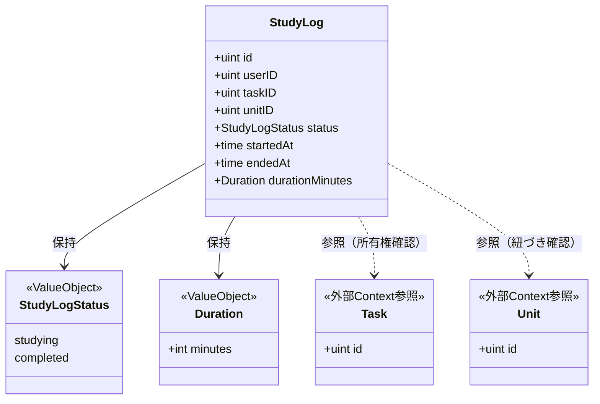
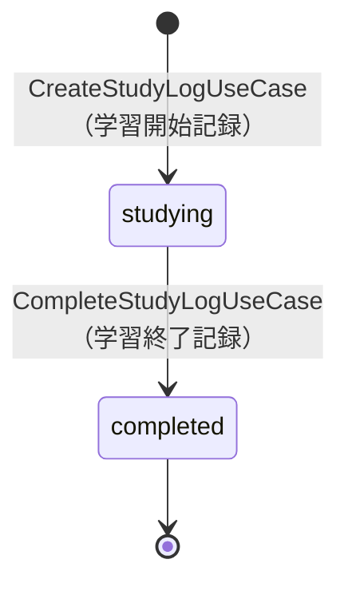
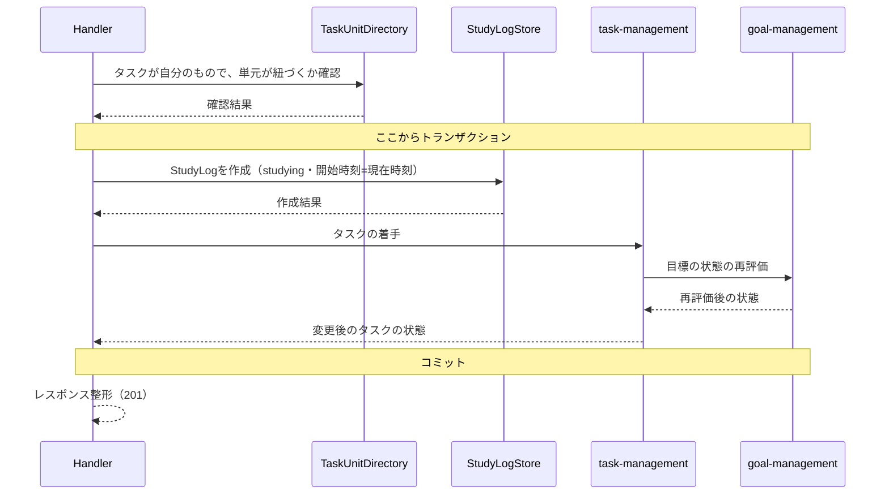

# 学習ログ機能 Go移行・設計仕様書

---

# 1. 機能概要

## 機能概要

生徒がタスク内の単元学習にどれだけ取り組んだかを記録する機能である。Rails現行仕様では、学習開始記録（作成）と学習終了記録（完了）の2操作を提供する。同一のタスク・単元に対して、学習セッションごとに複数の学習ログを作成できる。

## 利用者

- 生徒ユーザー（student ロール）
- 自分のタスク・単元・学習ログのみ操作可能

## 業務上の目的

- 生徒がどの単元学習にどれだけ時間をかけたかを可視化する
- 学習セッション単位で開始・終了・所要時間を記録し、将来の学習分析の基礎データとする

---

# 2. 設計方針

本機能は、開始・完了という2操作のみで完結し、業務ルールも「所有権の確認」「未完了であることの確認」「所要時間の算出」という単純な範囲にとどまるため、過剰な抽象化を避けたシンプルな設計とする。

- 責務分離: 所有権チェック・状態チェック・所要時間算出・永続化を分離する
- 保守性: 学習ログの状態と所要時間算出ロジックをEntity側に寄せ、変更に強い構造とする
- テスト容易性: 開始・完了それぞれの振る舞いを独立して検証できるようにする
- 拡張性: 将来的に学習セッションの一時中断・再開等が追加された場合でも、コアロジックへの影響を限定できる構造にする
- API互換性: 既存エンドポイントと主要なリクエスト・レスポンス構造を維持する

---

# 3. Bounded Context

## Context名

- `study-log`

## Contextの責務

- タスク内の単元学習の開始記録の作成
- 学習ログの完了（終了時刻・所要時間の記録）
- 学習開始を契機とした、タスクの着手の呼び出し

## 他Contextとの依存関係

参照のための依存:

- `task-management` Context: 対象タスクが生徒自身のものであることの確認に依存する
- `curriculum` Context: 対象単元が指定タスクに紐づいていることの確認に依存する。ただし「タスクに紐づく単元か」という関係は`task-management`が持つため、確認は同Contextの参照手段に対して行う（下記）
- `user` Context: 認証済み生徒の識別に依存する

状態変更を伴う依存:

- `task-management` Context: **学習ログの作成時に、同Contextが公開する「タスクの着手」操作を呼ぶ**（①「5. API / 処理詳細」`#create`。`Student::CreateStudyLogService`が`Student::TaskStartService`を呼び出している）

他Contextから本Contextへの依存（本Contextが公開する操作）:

- `learning-analytics` Context: 継続日数・学習時間の推移の算出のため、本Contextが公開する「学習した日の参照」「日付ごとの学習時間の集計」操作を呼ぶ（分析機能②「11. Repository設計」）
- `admin-dashboard` Context: アクティブな生徒の判定のため、本Contextが公開する「指定時刻以降に学習ログがある利用者の参照」操作を呼ぶ（管理者ダッシュボード機能②「11. Repository設計」）

## 本Contextが公開する操作

|操作|呼び出し元|内容|
|-|-|-|
|学習した日の参照|`learning-analytics`|その生徒が学習した日（日本時間の暦日）を重複なく返す。期間を取らない|
|日付ごとの学習時間の集計|`learning-analytics`|指定期間について、日本時間の暦日ごとの学習時間の合計（分）を返す。学習ログのない日は結果に含めない|
|指定時刻以降に学習ログがある利用者の参照|`admin-dashboard`|学習の開始時刻が指定時刻以降である学習ログを持つ利用者の識別子を、重複なく返す|

いずれもHTTPを経由せず、Goのパッケージとして直接呼ばれる。認可は呼び出し側Contextが行う（「16. Authorization設計」）。

**この2つは論理削除済みのログを除外する。** 本機能のエンドポイント（`#update`）が論理削除済みを除外しないのとは扱いが逆である（「11. Repository設計」の論理削除の扱い）。分析は論理削除済みのログを集計対象としないためであり（分析機能①「5. API / 処理詳細」`#show`）、同じStoreに2通りの扱いを混在させない形で公開する。

## 依存する理由

学習ログは単独で存在する概念ではなく、「どのタスクの、どの単元の学習か」という関係が前提となる。そのため、学習ログの作成・完了いずれの操作でも、対象タスク・単元の確認のために`task-management`への参照依存が発生する。

加えて、**学習ログの作成はタスクの状態に波及する**。未着手のタスクが「進行中」になり、さらにタスクが属する目標の状態も再評価される（①「7. 状態管理」）。この波及は本Contextが`task-management`の公開操作を呼ぶ形で実現する。タスクの状態を本Contextが直接書き換えることはしない。状態の変え方は所有者側（`task-management`）に閉じ込める（規約「5. Context間連携ルール」の「状態変更を伴う連携は呼び出し側の処理単位で両Context側の処理を順に呼び出す」）。

目標の状態の再評価は`task-management`が`goal-management`に対して行うため、本Contextは`goal-management`に依存しない。

なお、同じタスク・単元配下では、生徒が問題に解答し正誤判定・提出処理を行う問題解答機能（`question-answering` Context）も並行して提供されている。両Contextは同じタスク・単元を対象とするが、互いのデータを参照・更新することはなく、それぞれ独立して「学習時間の記録」「解答の正誤・提出」という別の業務関心を扱うため、依存関係としては扱わない。

ただし、`question-answering`も`task-management`の「タスクの状態の更新」を呼ぶ（タスク管理機能②「3. Bounded Context」）。本Contextが呼ぶのは「タスクの着手」であり、別の操作である。

`curriculum`は、コース参照機能・単元参照機能が共有するContextである（単元参照機能②「3. Bounded Context」）。本Contextは`curriculum`への依存を持たないが、依存関係の整理のうえで言及している。

---

# 4. 設計パターン

## 採用パターン

Active Record

## 判断根拠

本機能は、学習ログの作成（開始記録）と更新（完了記録）という2操作のみで構成される。状態は「学習中」「完了」の2つのみで、遷移も「学習中→完了」という一方向・単純な遷移であり、分岐や複数の遷移経路を持たない。業務ルールも「対象タスク・単元が自分のものであること」「既に完了している学習ログを重ねて完了させられないこと」という限定的な範囲にとどまる。

- 主要操作が開始・完了の2操作のみで、CRUDに近い単純さを持つ
- 状態遷移は存在するが、一方向・単一経路であり、複数の業務ルールが絡み合うものではない
- 所要時間の算出（開始時刻からの経過時間を分単位で算出）は、学習ログEntity自身の属性から導出できる単純な計算であり、Entityのメソッドとして自然に表現できる

このため、状態を持つEntityであっても直ちにDomain Modelを選択する必要はなく、「Domain Model採用基準」（状態遷移ルールが複数の業務ルールと絡み合う場合に採用する）には該当しない。CRUD中心の業務として、Entity/Storeに保存・更新の責務を寄せやすいActive Recordを採用する。

## 採用しなかったパターン

### Transaction Script

所有権チェック・完了済みチェック・所要時間算出をユースケースに直接書き続けることは可能だが、開始・完了それぞれの検証と算出ロジックをEntity側にまとめた方が、将来的なルール追加（例: 最小学習時間の検証等）に対して変更箇所を限定しやすい。

### Domain Model

状態は「学習中」「完了」の2つのみであり、遷移は一方向・単一経路で、複数の業務ルールが絡み合う複雑さは現行仕様に存在しない。DDDを目的化してEntityに過度な振る舞いを持たせることは「Domain Model採用基準」に反するため見送る。

### Event Sourcing

学習セッションの開始・終了イベントの再構築・監査要件は現行仕様に存在しない。

---

# 5. Aggregate設計

Aggregateを大きく分ける必要はなく、StudyLog単体を中心に扱う。

## Aggregate Root

- StudyLog

## Aggregateに含めるEntity

- StudyLogのみ（Task / Unitは含めない）

## Aggregate境界

- StudyLogは自身の状態（学習中／完了）・開始時刻・終了時刻・所要時間の整合性のみを保証する単位とする
- Task / Unitは、対象確認のための外部参照として扱い、それらの整合性はそれぞれのContextの責務とする

## 整合性を保証する単位

- StudyLog単体の作成・完了

理由: 学習ログの作成・完了は、タスクや単元の状態を変更する業務ルールを伴わないため、Task / UnitとStudyLogを1つのAggregateとして統合する必要はない。

---

# 6. Entity設計

## StudyLog

- 役割: 生徒がタスク内の単元学習に取り組んだ開始・終了・所要時間を表す中心的なドメイン概念
- ライフサイクル: 作成（学習中） → 完了
- 状態変化: `studying`（学習中） → `completed`（完了）
- 保持する責務:
  - user_id / task_id / unit_id、状態（`studying` / `completed`）、開始時刻・終了時刻・所要時間を保持する
  - 完了操作時に、既に完了状態でないことを検証する
  - 完了操作時に、開始時刻から終了時刻までの経過時間を分単位（切り捨て）で算出する
- 判断根拠: 学習ログの主要な業務情報と、単純ながら状態変化・所要時間算出という振る舞いの中心であるため

## Task（参照専用）

- 役割: 学習ログの作成・完了時に、対象タスクが生徒自身のものであることの確認対象として参照される
- 判断根拠: 本機能の中心はStudyLogであり、Taskの実体管理はTask Contextの責務であるため、本機能では参照専用として扱う

## Unit（参照専用）

- 役割: 学習ログの作成時に、対象単元が指定タスクに紐づいていることの確認対象として参照される
- 判断根拠: 本機能の中心はStudyLogであり、Unitの実体管理はUnit（curriculum）Contextの責務であるため、本機能では参照専用として扱う

---

# 7. Value Object設計

## StudyLogStatus

- 採用理由: 状態値を文字列のまま扱うと、無効な値の混入や、完了済みの学習ログを再度完了させるといった不正な遷移を防げないため
- 独自ルール: `studying` / `completed`のいずれかのみ許容し、`completed`から`studying`への逆遷移は許可しない
- 永続化: `study_logs.status`はRailsの`enum`として**整数**で保持される（`studying`=0 / `completed`=1。既定値は0。①「6. データモデル」）。型は整数を基底とし、APIの出力時に文字列へ変換する
- **2値のみである**。目標・タスク・タスク下書きの`status`は3値（`not_started` / `in_progress` / `completed`）だが、学習ログは`studying`と`completed`の2値である。型を共有しない
- 入力: APIの入力として受け取らない。作成時は`studying`で固定し、完了操作で`completed`にする（①「7. 状態管理」）
- Entity属性ではなくValue Objectにする理由: 状態の意味と許容される遷移方向を型として明示し、完了済みチェックのロジックを一元化するため

## Duration（所要時間）

- 採用理由: 所要時間は「開始時刻から終了時刻までの経過時間を分単位・切り捨てで算出する」という業務上のルールを持つ計算値であり、算出ロジックを一元化する必要があるため
- 独自ルール: 開始時刻・終了時刻から分単位（切り捨て）で算出する。1分未満の学習は`0`になる（①「5. API / 処理詳細」`#update`）
- 永続化: `study_logs.duration_minutes`はNULL可である。完了するまで未設定であるため、型としては未設定を許容する（①「6. データモデル」）
- Entity属性ではなくValue Objectにする理由: 算出ロジックを一元化し、表示・保存の両方で同じ計算結果を再利用できるようにするため

## Value Objectを採用しないもの

- 開始時刻・終了時刻そのもの（`started_at` / `ended_at`）: 単純な日時属性であり、比較・算出以外の独自ルールを持たないため、Value Object化は不要とする（所要時間算出のロジックはDuration側に集約する）

---

# 8. Domain Service

不要と判断する。

理由: 所有権確認（対象タスク・単元が自分のものか）はTask Context・Unit Contextの参照結果に基づく単純な照合であり、複数のEntityを横断する業務ルールとしての複雑さを持たない。完了時の状態チェック・所要時間算出はいずれもStudyLog単体の振る舞いとして表現でき、独立したDomain Serviceを設ける必要はない。

---

# 9. クラス図

Active Record採用のため実装時はStudyLogが単一のstructとメソッドに統合されるが（4章参照）、業務概念としての関係は以下のとおり整理する。

Goのstruct定義（フィールドの可視性・タグ等）は③Go実装仕様書で扱う。

---

# 10. 状態遷移図

StudyLog.statusは以下の状態を持つ（「6. Entity設計」の状態変化を可視化したもの）。

遷移条件:

- `studying`から`completed`への遷移時は、終了時刻を記録し、所要時間（Duration）を算出する

禁止される組み合わせ:

- `completed`から`studying`への逆遷移、および`completed`状態の学習ログを再度完了させる操作は許可されない

---

# 11. Repository設計

**実装上の位置づけ**: 本機能はActive Record採用のため、Repository Interfaceをdomain層に定義しない。以下は永続化・検索責務の設計意図であり、実装時はEntity相当のstructと同一packageに置くStore(例: `〇〇Store`)として直接実装する（規約「3. 設計パターンごとの構造適用方針」）。

## StudyLogStore

- 管理対象: StudyLog
- 責務:
  - 学習開始記録（新規作成）
  - 指定学習ログの取得
  - 完了記録（更新）
- 保持する検索機能:
  - user_id + task_id + unit_id + idによる単一取得
  - user_idによる学習日の重複なし取得（「3. Bounded Context」の公開操作「学習した日の参照」から呼ばれる。日本時間の暦日へ変換して重複を除く。論理削除済みを除外する）
  - user_id + 日付の範囲による、暦日ごとの学習時間の合計（同「日付ごとの学習時間の集計」から呼ばれる。論理削除済みを除外する。学習時間が未記録のログは0分として扱う）
  - 学習の開始時刻が指定時刻以降である学習ログを持つuser_idの重複なし取得（同「指定時刻以降に学習ログがある利用者の参照」から呼ばれる。論理削除済みを除外する）
- 論理削除の扱い: `deleted_at`による絞り込みを**行わない**。`StudyLog`は`active`という絞り込みを持つが`default_scope`は持たず、`#update`も`active`を使っていない（①「6. データモデル」）。`Goal`・`Task`とは異なる点である
- 保持しない責務:
  - 所有権判定そのもの（Handlerが呼び出す他Contextの参照手段の結果を前提とする）
  - 完了可否の最終判断（StudyLogのメソッドとしてEntity側が担う）
- 判断根拠: 永続化と検索に特化させ、業務ロジックを持たせないため

## 他Contextの参照手段と公開操作

`tasks`・`units`は他Contextが所有するため、本ContextからSQLを発行しない。相手Contextが公開する操作を呼び出す（規約「5. Context間連携ルール」）。本Contextの`dependency.go`にインターフェースとして宣言し、実装は相手Contextの公開操作へ委譲するアダプタに閉じ込める（同「4. Bounded Context構成」）。

参照のための依存:

|参照手段|相手Context|取得する内容|用途|
|-|-|-|-|
|TaskUnitDirectory|`task-management`|指定のタスクが操作者自身のものか、かつ指定の単元がそのタスクに紐づいているか|`#create`・`#update`の対象確認（①「5. API / 処理詳細」）|

本Contextが公開する操作（「3. Bounded Context」）は、いずれも`study_logs`に対する集計であり、他Contextのデータを必要としない。暦日への変換を本Contextで行うのは、`started_at`・`ended_at`がUTCで保存されており、日本時間の暦日として数えるという解釈を所有Context側に閉じ込めるためである（分析機能②「11. Repository設計」）。

Rails現行は`Task.find_by!(id:, user:)`でタスクを取り、`task.units.find(unit_id)`で単元を取っている（①「5. API / 処理詳細」`#create`）。いずれも`task-management`が所有するデータ（`tasks`と`task_units`経由の紐づき）に対する問い合わせであるため、単元の確認も`curriculum`ではなく`task-management`の参照手段に対して行う。`curriculum`への依存は、本機能のレスポンスに単元の情報を含めないため発生しない。

状態変更を伴う依存:

|操作|相手Context|用途|
|-|-|-|
|タスクの着手|`task-management`|学習ログの作成時に呼ぶ。未着手のタスクを進行中にし、タスクが属する目標の状態も再評価される（①「5. API / 処理詳細」`#create`、タスク管理機能②「12. UseCase設計」の`StartTask`）|

これも`dependency.go`のインターフェースとして宣言する。トランザクションの扱いは「14. Transaction設計」で定める。

---

# 12. UseCase設計

**実装上の位置づけ**: 本機能はActive Record採用のため、UseCase層(struct)を設けない。以下はHandlerが行う業務操作の設計意図であり、実装時はHandlerがStoreを直接呼び出す処理として実装する。

## CreateStudyLog（Handler処理）

- 目的: タスク内の単元学習の開始を記録し、タスクの着手を呼ぶ
- 入力: current user、`task_id`、`unit_id`
- 出力: 作成した学習ログの識別子
- 処理:
  1. `task-management`の参照手段で、対象タスクが操作者自身のものか、かつ対象単元がそのタスクに紐づいているかを確認する
  2. 学習ログを`studying`・開始時刻=現在時刻で作成する
  3. `task-management`の「タスクの着手」を呼ぶ。未着手のタスクは進行中になり、タスクが属する目標の状態も再評価される
- トランザクション範囲: 2と3を1トランザクションで扱う（「14. Transaction設計」）
- 呼び出す先: TaskUnitDirectory、StudyLogStore、`task-management`の「タスクの着手」
- 判断根拠: 学習ログだけが残ってタスクが未着手のまま残る状態を防ぐため。Rails現行も`Student::CreateStudyLogService`が両方を1つのトランザクションで行っている（①「5. API / 処理詳細」`#create`）

## CompleteStudyLog（Handler処理）

- 目的: 開始済みの学習ログを完了させ、終了時刻と所要時間を記録する
- 入力: current user、`task_id`、`unit_id`、学習ログの識別子
- 出力: 更新後の学習ログ情報（識別子・状態・開始時刻・終了時刻・所要時間）
- 処理:
  1. `task-management`の参照手段で、対象タスク・単元を確認する
  2. user_id・task_id・unit_id・idに一致する学習ログを取得する
  3. 既に完了していれば完了済みエラーとする
  4. 終了時刻を現在時刻とし、所要時間を算出して完了状態に更新する
- トランザクション範囲: 2〜4を1トランザクションで扱う
- 呼び出す先: TaskUnitDirectory、StudyLogStore
- 判断根拠: 既に完了している学習ログの二重完了を防ぐため、チェックと更新を一貫して行う必要があるため
- **タスク・目標の状態には波及しない**（①「7. 状態管理」）

## FindStudiedDates（他Contextから呼ばれる公開操作）

- 目的: その生徒が学習した日を重複なく返す
- 呼び出し元: `learning-analytics` Context（継続日数。分析機能①「5. API / 処理詳細」`streak_days`）
- 入力: 操作者の識別子
- 出力: 学習した日（日本時間の暦日）の集合
- 処理: 論理削除済みのログを除外し、学習ログの日時を日本時間の暦日へ変換して重複を除く
- トランザクション範囲: 読み取りのみ、トランザクションは不要
- 呼び出す先: StudyLogStore
- 認可: 行わない（呼び出し側の責務）
- 期間を入力に取らない。継続日数は当日を起点に過去へさかのぼって数えるもので、さかのぼる範囲を事前に決められないためである（分析機能③基盤編「8. Infrastructure層設計」）

## FindActiveUserIDsSince（他Contextから呼ばれる公開操作）

- 目的: 指定時刻以降に学習ログがある利用者の識別子を返す
- 呼び出し元: `admin-dashboard` Context（アクティブな生徒の判定。管理者ダッシュボード機能①「5. API / 処理詳細」`#show`）
- 入力: 判定の起点となる時刻
- 出力: 利用者の識別子の集合（重複なし）
- 処理: 学習の開始時刻が指定時刻以降である学習ログを対象とし、論理削除済みを除外して識別子を重複なく返す
- トランザクション範囲: 読み取りのみ、トランザクションは不要
- 認可: 行わない（呼び出し側の責務）
- 判断根拠: 「学習を記録した」の意味（学習ログの開始時刻）を決めているのは本Contextである。在籍中かどうかの判定は行わない。`user`が「在籍中の生徒とは何か」を決めており、呼び出し側が識別子の集合を`user`へ渡して絞り込む（管理者ダッシュボード機能②「11. Repository設計」）

## SumStudyMinutesByDate（他Contextから呼ばれる公開操作）

- 目的: 指定期間について、暦日ごとの学習時間の合計を返す
- 呼び出し元: `learning-analytics` Context（学習時間の推移。同①「5. API / 処理詳細」`#show`）
- 入力: 操作者の識別子、期間の開始日・終了日（いずれも日本時間の暦日。両端を含む）
- 出力: 暦日と学習時間の合計（分）の組の一覧。学習ログのない日は含めない
- 処理: 論理削除済みのログを除外し、日本時間の暦日ごとに学習時間を合計する。学習時間が未記録のログは0分として扱う
- トランザクション範囲: 読み取りのみ、トランザクションは不要
- 呼び出す先: StudyLogStore
- 認可: 行わない（呼び出し側の責務）
- 判断根拠: 「学習時間とは何か」（所要時間の記録）と暦日の区切り（日本時間）を決めているのは本Contextである。呼び出し側が`study_logs`を直接集計すると、同じ判断が2か所に分かれる（規約「5. Context間連携ルール」）
---

# 13. シーケンス図・処理フロー図

## シーケンス図（CreateStudyLog）

Active Record採用のためUseCase層はなく、Handlerが各Storeを直接呼び出す（4章参照）。

タスクが既に進行中・完了であれば、タスクの着手は何もしない。目標の状態の再評価も行われない（①「5. API / 処理詳細」`#create`）。

## 処理フロー図（CompleteStudyLog）

完了可否の分岐が単純なため、フローチャートは省略する。理由: 「対象学習ログが自分のものか」「既に完了していないか」という2条件の直列判定のみであり、分岐が複雑化する要素がないため、「13. シーケンス図・処理フロー図」の説明で十分に表現できる。

---

# 14. Transaction設計

## Transaction開始位置

- `CreateStudyLog`は、Handlerの処理単位でトランザクションを開始する。学習ログの作成と`task-management`の「タスクの着手」という2つの書き込みにまたがるため、Storeメソッド内では境界を取れない
- `CompleteStudyLog`は、Storeの完了更新メソッド内でトランザクションを開始する。書き込みは学習ログ1件のみである
- 対象タスク・単元の確認は読み取りであり、トランザクションの外で行う

## Transaction終了位置

- `CreateStudyLog`: 学習ログの作成と、タスクの着手（およびそこから呼ばれる目標の状態の再評価）が完了した時点でコミットする。いずれかが失敗した場合はロールバックする
- `CompleteStudyLog`: 完了可否の判定と更新が完了した時点でコミットする

## 他Contextの操作をトランザクションに含める理由

学習ログの作成とタスクの着手を別トランザクションにすると、学習ログだけが残ってタスクが未着手のまま残る状態が起こりうる。Rails現行も`Student::CreateStudyLogService`が`ActiveRecord::Base.transaction`の中で学習ログの作成と`Student::TaskStartService`の呼び出しを行っており、同じ境界である（①「5. API / 処理詳細」`#create`）。

トランザクションは`context.Context`で引き継ぐ。`task-management`の「タスクの着手」は自らトランザクションを開始せず、本Contextが開始したものに参加する（規約「11. Transaction実装パターン（TransactionManager）」の「呼び出し側トランザクションの引き継ぎ」、タスク管理機能②「14. Transaction設計」）。

「タスクの着手」からさらに呼ばれる`goal-management`の「目標の状態の再評価」も、同じトランザクションの中で実行される。

## 理由

- 1つの業務操作に対して、学習ログとタスク・目標の状態の整合を保つため
- 状態変更を伴う他Contextとの連携を、呼び出し側の処理単位にまとめるため（規約「5. Context間連携ルール」）

---

# 15. Validation設計

## Presentation

- 型チェック: `task_id` / `unit_id` / `id`が数値であることを検証する
- 必須チェック: いずれのパスパラメータも必須であることを検証する
- フォーマットチェック: 特になし（数値形式チェックのみ）

## Domain

- 業務ルール: 対象タスクが自分のものであること、対象単元が対象タスクに紐づいていること
- 状態チェック: 完了操作時に、対象学習ログが既に完了状態でないこと
- 整合性チェック: 対象学習ログが自分のものであること

## 責務分離

- Presentationは「入力値の形式が正しいか」を担当する
- Domainは「その操作が業務的に妥当か（所有権・状態）」を担当する

## バリデーション仕様

|フィールド|検証層|ルール|Rails現行の扱い|
|-|-|-|-|
|`task_id`|Presentation|必須・整数|—|
|`unit_id`|Presentation|必須・整数|—|
|`id`（学習ログの識別子）|Presentation|必須・整数（完了操作時）|—|
|`task_id`|Domain|操作者自身のタスクであること|404 `{"message": "タスクが見つかりません"}`|
|`unit_id`|Domain|対象タスクに紐づく単元であること|404 `{"message": "Unitが見つかりません"}`（モデル名の訳がなく英語になる）|
|学習ログ|Domain|操作者自身の、指定タスク・単元に紐づくものであること|404 `{"message": "Study logが見つかりません"}`（同）|
|`status`|Domain|完了操作時に未完了（`studying`）であること|**400** `{"errors": ["この学習ログはすでに完了しています"]}`|

リクエストボディは存在しない。作成・完了ともにパスパラメータのみで動作する（①「5. API / 処理詳細」）。

所有権・紐づきの違反はいずれも404として返す。「存在しない」と「他人のもの」を区別しない（①「8. 権限制御」）。

---

# 16. Authorization設計

## Middleware

- 認証済みユーザーを特定し、ユーザー情報を`context.Context`に保持する
- 役割が`student`であることを確認する
- CSRF: `POST`・`PATCH`はCookieで認可される状態変更であるため、CSRF検証の対象に含める（Gin規約「5. CSRF対策」の「適用範囲」）。本機能にGETのエンドポイントはない

## Handler

- `context.Context`からcurrent userを取り出し、他Contextの参照手段とStore呼び出しの`user_id`として使用する
- 具体的な業務権限判定は持たせず、参照手段と検索条件に委譲する

## Store

- StudyLogStoreの取得メソッドが、`user_id`・`task_id`・`unit_id`・`id`のすべて一致を検索条件とすることで所有権と紐づきの確認を実現する。一致しなければ対象不存在として扱う（①「5. API / 処理詳細」`#update`）
- タスク・単元の確認は`task-management`の参照手段に委ねる

## Domain

- StudyLogがuser_idを保持し、Handler側からの所有権確認の材料を提供する

## 判断理由

Rails現行仕様も「`current_user`本人のタスク・単元・学習ログ」を起点に全検索を行うシンプルな設計であり、これをHandlerでのスコープ限定としてそのまま踏襲するのが自然である。

---

# 17. Error設計

## Domain Error

- 責務: 状態ルール違反（完了済み学習ログの再完了試行）を表現する
- 判断理由: 業務ルール違反をアプリケーション層に漏らさず、ドメイン側で明示的に扱うため

## Application Error

- 責務: 対象タスク・単元・学習ログが存在しない、または自分のものでない場合の失敗を表現する
- 判断理由: ユースケースの失敗理由をHTTPレスポンスに変換しやすくするため

## Infrastructure Error

- 責務: DB接続失敗・永続化失敗を表現する
- 判断理由: 永続化層の失敗をドメインに漏らさず、技術的な障害として切り分けるため

## エラー仕様

|業務シナリオ|エラー種別|発生層|想定するHTTPステータス|
|-|-|-|-|
|対象タスクが存在しない、または自分のものでない|NotFound|Application|404|
|対象単元がタスクに紐づいていない|NotFound|Application|404|
|対象学習ログが存在しない、または自分のものでない|NotFound|Application|404|
|対象学習ログが既に完了している|Validation|Domain|**400**|
|未認証|Unauthorized|Middleware|401|
|`student`ロールでない|Forbidden|Middleware|403|
|DB接続・永続化の失敗|Internal|Infrastructure → Application（変換）|500|

完了済みの学習ログへの再完了を**400**とするのは、Rails現行が`Student::AlreadyCompletedStudyLogError`を`Api::V1::Student::BaseController`の`rescue_from`で捕まえ、400で返しているためである（①「5. API / 処理詳細」`#update`）。業務ルール違反としては422が自然だが、フロントエンドを変更しない方針を優先する。規約「15. API規約（レスポンス形式・ページネーション・URL・クエリパラメータ）」も「Rails現行が上記と異なるステータスを返す機能は、互換を優先し、②で明記した上で維持する」としている。

## エラーレスポンスの本文

Rails現行の本文の形をそのまま維持する（①「6. データモデル」の「エラーレスポンスの本文」）。

|条件|HTTPステータス|本文|
|-|-|-|
|対象タスク・単元・学習ログの不存在|404|`{"message": "〇〇が見つかりません"}`|
|完了済みの学習ログへの再完了|400|`{"errors": ["この学習ログはすでに完了しています"]}`|
|認可エラー|403|`{"errors": ["この操作を行う権限がありません"]}`|

404のみ`message`の単一文字列であり、規約「15. API規約（レスポンス形式・ページネーション・URL・クエリパラメータ）」の形式と異なる。本文の形は`ApplicationController#not_found`が決めており、全機能に共通する。

さらに、404の`〇〇`に入る名称は対象によって異なる。`Task`は`タスク`と日本語になるが、`Unit`と`StudyLog`は**モデル名の日本語訳が定義されていないため英語（`Unit`・`Study log`）のまま出る**（①「6. データモデル」の「エラーレスポンスの本文」）。

いずれもRails現行のまま維持する。フロントエンドを変更しない方針であり、本文の形や文言を変えるとフロントエンドの修正が必要になるためである。

## Rails現行の挙動を維持するもの

|挙動|Rails現行|本設計|
|-|-|-|
|完了済みの学習ログへの再完了|400（業務ルール違反としては422が自然）|同じ|
|404のモデル名|`Unit`・`Study log`が英語のまま出る|同じ|
|学習中の学習ログが既にある状態での再作成|重複を防がず、新しい学習ログを作る|同じ|

---

# 18. Domain Event

本機能では現時点でDomain Eventを採用しない。理由は、Rails現行仕様書9章に「`StudyLog`の作成・完了に紐づくJob/Mailerは見当たらない」と明記されており、他処理への通知のような非同期の副作用が存在しないためである。

将来的に、学習時間の集計・分析機能と連携する要件が生まれた場合は、イベント化を検討する。

---

# 19. API仕様

## エンドポイント一覧

|エンドポイント|HTTP Method|概要|
|-|-|-|
|/api/v1/student/tasks/:task_id/units/:unit_id/study_logs|POST|単元学習の開始を記録|
|/api/v1/student/tasks/:task_id/units/:unit_id/study_logs/:id|PATCH|学習ログを完了させる|

## 各エンドポイントの仕様

### POST /api/v1/student/tasks/:task_id/units/:unit_id/study_logs

- Request: パスパラメータ`task_id`・`unit_id`。リクエストボディはない
- Response: `{"study_log_id": <作成した学習ログの識別子>}`。識別子を`study_log_id`キーでラップして返す（①「5. API / 処理詳細」`#create`）
- Status Code: 正常系**201**。異常系は対象タスク・単元の不存在404
- 副作用: 対象タスクが未着手であれば「進行中」になり、タスクが属する目標の状態も再評価される（①「7. 状態管理」）

### PATCH /api/v1/student/tasks/:task_id/units/:unit_id/study_logs/:id

- Request: パスパラメータ`task_id`・`unit_id`・`id`。リクエストボディはない
- Response: `id`・`status`（`studying` / `completed`の文字列）・`started_at`・`ended_at`・`duration_minutes`。最上位をラップしない
- `started_at`・`ended_at`は**日付フォーマットの加工を行わず日時のまま返す**（他機能のシリアライザが`YYYY/MM/DD`に整形しているのとは異なる。①「5. API / 処理詳細」`#update`）
- `user_id`・`task_id`・`unit_id`はレスポンスに含まれない
- Status Code: 正常系200。異常系は対象の不存在404、既に完了している場合**400**
- 副作用: なし（タスク・目標の状態には波及しない）

## エラーレスポンス

形式は「17. Error設計」の「エラーレスポンスの本文」のとおり。

## Railsとの差分

**API外部仕様の変更はない。** URL・HTTP Method・リクエスト形式・レスポンス構造・ステータスコード・エラー本文の形・メッセージの文言のいずれも変更しない。完了済みへの再完了が400であること、404のモデル名が`Unit`・`Study log`と英語になることも維持する（「17. Error設計」の「Rails現行の挙動を維持するもの」）。

内部の責務には次の差分がある。

- Rails仕様: `Student::CreateStudyLogService`が学習ログの作成と`Student::TaskStartService`の呼び出しを1つのトランザクションで行っている。タスクの着手と目標の状態の再評価の手続きは`Student::TaskStartService`側にある（①「5. API / 処理詳細」`#create`）
- Go設計での変更: 同じ責務分担を維持し、`task-management`が公開する「タスクの着手」を本Contextから呼ぶ形とする。タスクの状態を本Contextが直接書き換えることはしない
- 変更理由: 状態の変え方を所有者側のContextに閉じ込めるため（規約「5. Context間連携ルール」）
- 影響範囲: 本機能の2エンドポイントの外部仕様に変更はない。`task-management`の②③が「タスクの着手」を公開操作として提供していることが前提となる（タスク管理機能②「12. UseCase設計」）

JSONスキーマの厳密な型定義・Goの構造体は③Go実装仕様書で扱う。

---

# 20. DB設計方針

## 現行DBを利用するか

- 既存Rails DBを継続利用する

## Schema変更有無

- 変更なし

## 変更理由

- 現行の`study_logs`テーブルで本機能の要件を満たしているため

## 変更を提案しない理由

- 今回の移行対象は開始・完了の2操作のみであり、既存カラムの参照・更新で完結するため、スキーマ拡張は不要である

---

# 21. DB操作仕様

本Contextが直接操作するテーブルは`study_logs`のみである。

|Store|対象テーブル|操作種別|主な検索条件|結合|ページネーション/ソート|
|-|-|-|-|-|-|
|StudyLogStore|study_logs|参照・作成・更新|`user_id`、`task_id`、`unit_id`、`id`|なし|不要（単一の学習ログ単位）|

`tasks`・`task_units`・`units`へは本Contextからクエリを発行しない。`task-management`が公開する参照手段を呼び出す（「11. Repository設計」の「他Contextの参照手段と公開操作」、規約「5. Context間連携ルール」）。

`deleted_at`による絞り込みは行わない。`StudyLog`は`active`という絞り込みを持つが`default_scope`は持たず、`#update`も`active`を使っていない（①「6. データモデル」）。

更新は`status`・`ended_at`・`duration_minutes`の3列のみを対象とする。`started_at`は作成時に設定し、以後変更しない。

具体的なSQL・GORMのクエリコードは③Go実装仕様書（Gorm規約）で扱う。

---

# 22. テスト戦略

Active Record採用のため、規約「3. 設計パターンごとの構造適用方針」の読み替えルールに従う（Domain Test→Model Test、UseCase Test→対象外、Repository Test→Store Test）。

## Domain Test（Model Test）

- 目的: StudyLogStatusの許容値と遷移（`completed`からの逆遷移禁止）、所要時間の算出（分単位切り捨て）を検証する
- 含めるもの: 1分未満が`0`になること、完了済みの再完了が拒否されること

## UseCase Test

- 対象外（usecase層を設けない）

## Repository Test（Store Test）

- 目的: StudyLogStoreによる検索・作成・更新の正確性を検証する
- 含めるもの: `user_id`・`task_id`・`unit_id`・`id`のすべて一致で絞ること、**論理削除済みのレコードも取得できること**、作成時に`status`が0・`started_at`が設定されること、更新が`status`・`ended_at`・`duration_minutes`の3列のみであること

## Handler Test

- 目的: 入力検証の結果とHTTPステータス・レスポンス形状の変換を検証する
- 含めるもの: 作成が201で`study_log_id`キーのレスポンスを返すこと、完了が200で5項目を返すこと、`started_at`・`ended_at`が日時のまま返ること、完了済みへの再完了が400になること、404の本文が対象ごとに`タスク`・`Unit`・`Study log`になること

## Integration Test

- 目的: エンドポイント経由で学習開始・終了が正常に動作し、完了済みログの二重完了が防がれることを確認する

---

# 23. Railsとの責務対応

| Rails | Go | 設計方針 |
|---|---|---|
| Controller | Handler | HTTP入力の受け取りとレスポンス整形に限定する |
| Service（`Student::CreateStudyLogService` / `Student::CompleteStudyLogService`） | Handler + Store | 業務処理を担当（Active Record採用のためusecase層は設けない） |
| `Student::TaskStartService` の呼び出し | `task-management` の公開操作「タスクの着手」の呼び出し | 状態の変え方を所有者側のContextに閉じ込める（「11. Repository設計」） |
| Model（`StudyLog`） | struct + Store（同一package） | 状態遷移・所要時間算出はstructのメソッド、永続化はStoreの責務として整理する |
| Serializer | Presenter / Response DTO | 画面に返すレスポンス整形を分離する |

---

# 24. 採用しなかった設計

## Domain Model

- 採用しなかった理由: 状態遷移が一方向・単一経路であり、複数の業務ルールが絡み合う複雑さが現行仕様に存在しないため
- 将来的に採用する可能性: 学習セッションの一時中断・再開や、複数の学習ログを横断した集計ルールが追加された場合は再検討する

## Transaction Script

- 採用しなかった理由: 状態チェック・所要時間算出をEntity側に寄せた方が、将来のルール追加時の変更範囲を限定しやすいため
- 将来的に採用する可能性: 機能がさらに単純化された場合には再検討できる

## Event Sourcing

- 採用しなかった理由: 学習セッションのイベント履歴再構築・監査要件が現行仕様に存在しないため
- 将来的に採用する可能性: 学習時間の詳細な履歴分析要件が生じた場合に有効な可能性がある

---

# 25. 設計判断サマリー

| 項目 | 採用 | 判断理由 |
|-|-|-|
| 設計パターン | Active Record | 開始・完了の2操作のみで、状態遷移も一方向・単一経路であるため |
| Aggregate | StudyLog単位 | Task/Unitとの関連は参照に留まり、統合する業務要件がないため |
| Transaction境界 | 作成はHandlerの処理単位、完了はStoreメソッド内 | 作成は学習ログとタスクの着手の2つの書き込みにまたがるため |
| 他Contextの参照・呼び出し | `dependency.go`のインターフェース + アダプタ | 規約「5. Context間連携ルール」に従い、他Contextのテーブルを直接読み書きしないため |
| Domain Event | 未採用 | 現行仕様に非同期の副作用が存在しないため |
| Value Object | StudyLogStatus / Durationを採用 | 状態の許容遷移と所要時間算出ルールを明示するため |
| Authorization | Handler/Store + Middleware | 認証と業務スコープを分離して管理しやすくするため |

## 本書で決めていない事項

|事項|決めていない理由|決める場所|
|-|-|-|
|`task-management`が公開する「タスクの着手」と参照手段の具体的なシグネチャ|同機能の③で確定する（タスク管理機能③「8. Infrastructure層設計」）|タスク管理機能の③|
|完了済みへの再完了を400から422へ改めるか|Rails現行が400を返しており、フロントエンドを変更しない方針のため本書では維持した|フロントエンドの修正方針を決める時点|
|404のモデル名が`Unit`・`Study log`と英語になる点をいつ正すか|`ja.yml`の`activerecord.models`に訳を足せば日本語になるが、フロントエンドが文言を表示している可能性があるため触っていない|同上|
|学習中の学習ログが既にある状態での再作成を防ぐか|Rails現行は重複を防いでおらず、新しい学習ログを作る。意図された仕様かは現行コードから判断できない|要確認（業務要件の確認が必要）|

---

# 設計差分管理

## Rails現行仕様

- `Student::CreateStudyLogService` / `Student::CompleteStudyLogService`がController・Modelとは別にサービスとして処理を担っている
- 所要時間の算出ロジックがServiceの手続き内に存在する
- 対象タスクの取得（`Task.find_by!(id:, user:)`）と単元の取得（`task.units.find(unit_id)`）をControllerが直接行っている
- 学習ログの作成と`Student::TaskStartService`の呼び出しを、`Student::CreateStudyLogService`が1つのトランザクションで行っている

## Go設計での変更内容

- 完了可否の状態チェックと所要時間の算出をStudyLog（struct）のメソッドとして集約する
- 対象タスク・単元の確認は`task-management`が公開する参照手段に委ねる。`tasks`・`task_units`へ本Contextからクエリを発行しない
- タスクの着手は`task-management`が公開する操作を呼ぶ形とする。トランザクション境界は現行と同じく、学習ログの作成とタスクの着手を1つにまとめる

## 変更理由

- 状態チェックと算出ロジックをEntity側に集約することで、将来的なルール追加（最小学習時間の検証等）の変更範囲を限定できるため
- 他Contextが所有するデータへの直接アクセスは規約「5. Context間連携ルール」が禁じているため

## 影響範囲

- フロントエンドから見たAPIの外部仕様は変更しない
- 既存DBスキーマは維持するため、データ移行は不要
- `task-management`の②③が「タスクの着手」を公開操作として提供し、かつ「タスクが操作者のもので、単元がそのタスクに紐づくか」を答える参照手段を公開する必要がある
