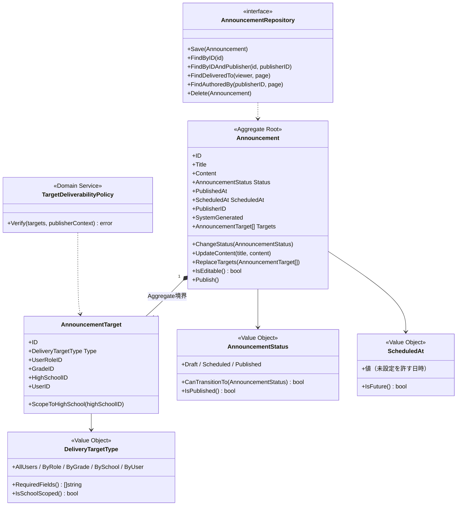
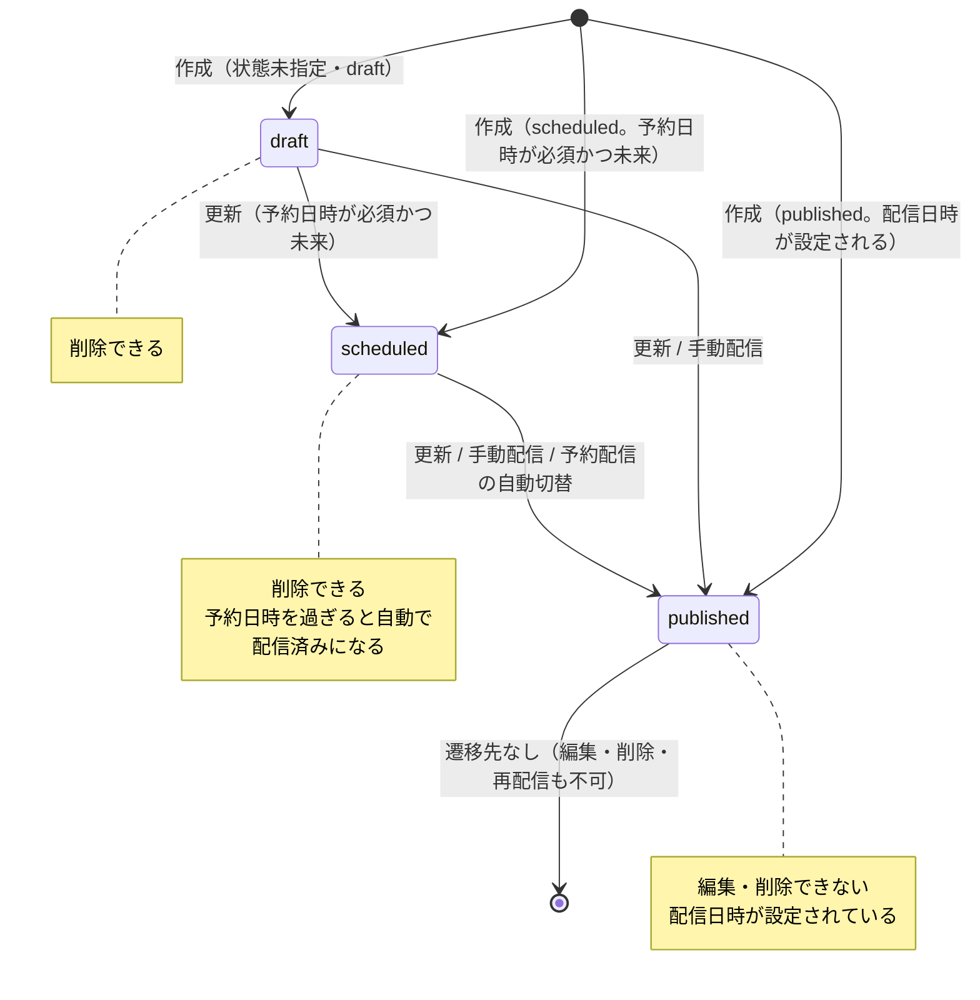
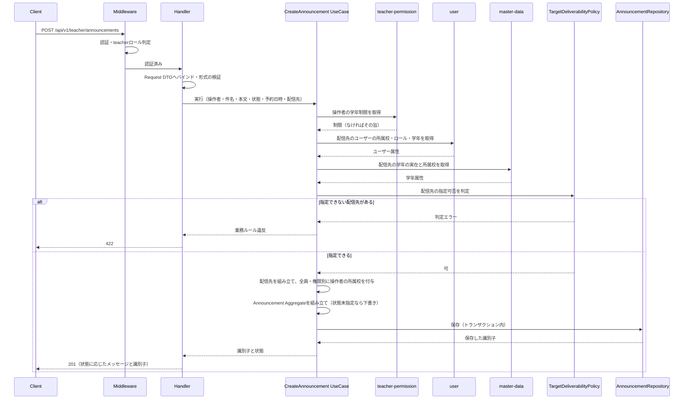
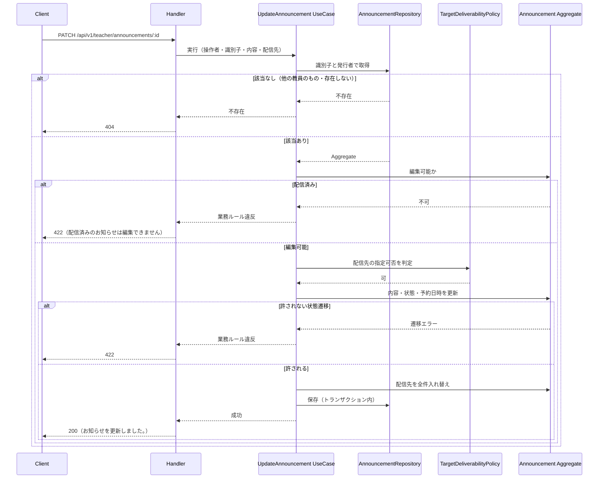
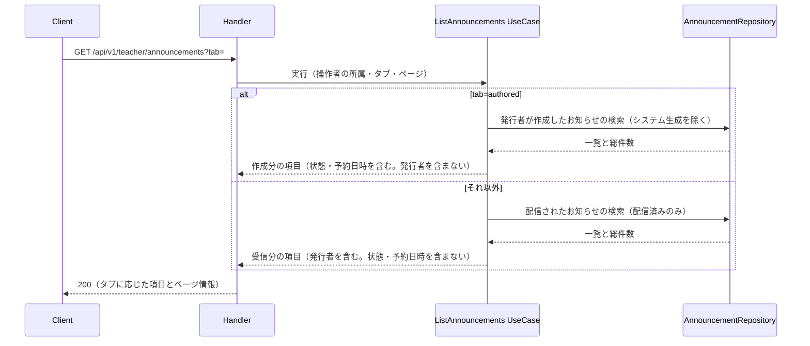
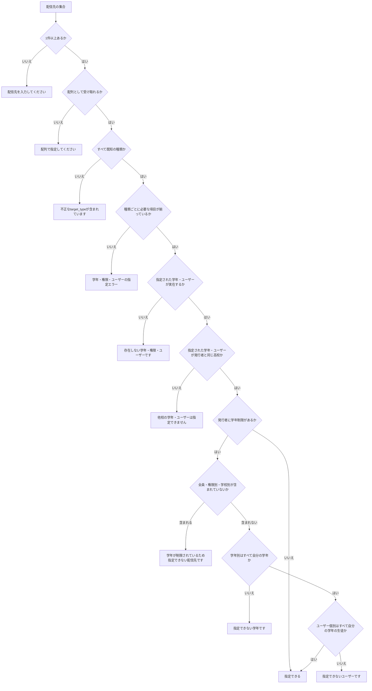
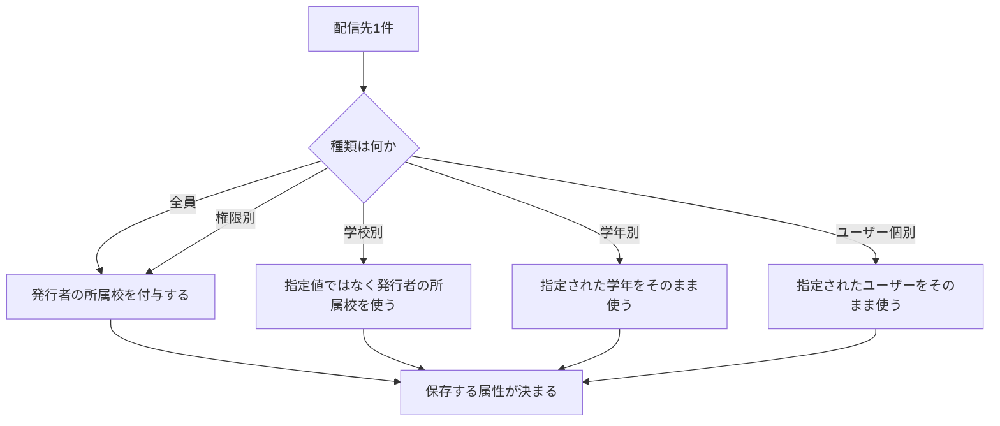

# 教師お知らせ機能 Go移行・設計仕様書

---

# 1. 機能概要

## 機能概要

教員が、自校の生徒・教員に向けたお知らせを作成・更新し、自分に配信されたお知らせも読めるようにする機能である（①「1. 機能概要」）。

提供する操作は6つである（①「2. 機能一覧」）。

- お知らせ一覧取得（`tab=authored` で「自分が作成した」「自分に配信された」を切り替える）
- お知らせ詳細取得
- 新規作成フォームの選択肢取得
- 編集フォームの内容取得
- お知らせ作成
- お知らせ更新

**配信先の指定を伴う点が本機能の中心である。** 全員・権限別・学年別・学校別・ユーザー個別の5種類から1件以上を指定し、教員が作成したお知らせは自校内にのみ配信される。担当学年が制限されている教員は、自分の学年に絞り込める配信先しか指定できない。

## 利用者

`teacher` ロールのユーザー（教員）のみ（①「8. 権限制御」）。

## 業務上の目的

教員が担当する生徒・同僚へ連絡を届けられるようにすること。配信範囲を自校内（学年制限があればその学年内）に限ることで、教員の権限を越えた連絡が行われないようにすること。

---

# 2. 設計方針

- **配信範囲の決め方をドメインに集約する**: 「誰に届くか」は配信先の指定で決まる。指定できる配信先の制約（自校内であること、学年制限）と、保存時に自校へ絞り込む規則を、いずれもドメイン層の判定として表す。Controllerに散らさない。
- **状態遷移をEntityに閉じ込める**: 下書き・予約・配信済みの遷移規則と、配信済みが編集できないという制約をEntityが持つ。遷移の可否を呼び出し側が判定しない。
- **Contextを共有する3機能で定義を1つにする**: `announcement` Contextはお知らせ機能・教師お知らせ機能・管理者お知らせ管理機能の3文書が共有する（規約「4. Bounded Context構成」が例として挙げている）。**Domain層の定義（Aggregate・Entity・Value Object・状態遷移・Domain Service・Repository）は本書に集約し、他の2文書では繰り返さない。**
- **API互換性を維持する**: URL・HTTPメソッド・レスポンス項目名・HTTPステータスをRails現行から変えない。フロントエンドを変更しない方針のため、Rails現行の振る舞いに不合理な点があっても本移行では踏襲し、Rails側の修正課題として別に管理する（「19. API仕様」の「Railsとの差分」）。
- **テスト容易性**: 配信先の制約判定・状態遷移・自校への絞り込みを、DBや他Contextの呼び出しから切り離した判定として表す。入力に対する可否だけを検証できるようにする。

---

# 3. Bounded Context

## Context名

- `announcement`

## Contextを共有する機能

本Contextは**3つの機能文書が共有する**（規約「4. Bounded Context構成」の「命名規則」が例として挙げている）。

|機能|担当するエンドポイント|採用パターン|
|-|-|-|
|お知らせ機能|GET /student/announcements、GET /student/announcements/:id|Transaction Script|
|教師お知らせ機能（本書）|GET・POST /teacher/announcements、GET /teacher/announcements/:id、GET /teacher/announcements/new、GET /teacher/announcements/:id/edit、PATCH /teacher/announcements/:id|Domain Model|
|管理者お知らせ管理機能|GET・POST /admin/announcements、GET・PATCH・DELETE /admin/announcements/:id、POST /admin/announcements/:id/publish、GET /admin/high_schools/:id/announcements|Domain Model|

3機能はいずれも同じ`announcements`・`announcement_targets`を扱い、同じ状態遷移・同じ配信先の仕組みに従う。利用者ロールが違うだけで業務の対象が同じであるため、Contextを分けない。

**Contextディレクトリの構成は、採用されている最も複雑なパターン（Domain Model）に合わせる**（規約「4. Bounded Context構成」の「1つのContextに複数の設計パターンが混在する場合」）。お知らせ機能の参照処理もusecase層を経由する。

**Domain層の定義は本書に集約する。** Aggregate・Entity・Value Object・状態遷移・Domain Service・Repositoryを本書で定め、お知らせ機能②・管理者お知らせ管理機能②では繰り返さない。本書を正本とするのは、配信先の5種類と学年制限という最も複雑な業務ルールを本機能が扱うためである。

## Contextの責務

- お知らせ（件名・本文・状態・配信日時・予約日時・発行者）の保持と、作成・更新・削除・配信
- 配信先の保持と、配信範囲の決定
- 状態遷移（下書き・予約・配信済み）の規則の適用
- 利用者ごとの「自分に配信されたお知らせ」の判定と提供
- 予約状態のお知らせを予約日時に配信済みへ切り替えること（管理者お知らせ管理機能②「18. Domain Event」）

## 持たない責務

|持たない責務|所有するContext|
|-|-|
|ユーザーの所属（学校・学年）・ロール・在籍状態の定義|`user`（ユーザー基盤機能②「3. Bounded Context」）|
|学年・高校マスタの保持|`master-data`（共通マスタ参照機能②「3. Bounded Context」）|
|教員の権限設定（担当学年の制限）の保持|`teacher-permission`（教師権限管理機能②「3. Bounded Context」）|
|生徒一覧の画面向けの絞り込み・並び替え|`student-directory`（教師生徒参照機能②「3. Bounded Context」）|
|承認・却下等の通知の発生契機|`school-class`・`interview-request`等。本Contextは通知の作成手段を公開する|

## 他Contextとの依存関係

本Contextから他Contextへの参照依存のみである。状態変更を伴う依存は持たない。

|依存先Context|参照する内容|根拠|
|-|-|-|
|`user`|操作者の識別・所属校・学年・ロール。配信先に指定されたユーザーの所属校とロール・学年。権限の選択肢|①「5. API / 処理詳細」`#create`の配信先の検証、`#new`の選択肢|
|`master-data`|配信先に指定された学年の実在と所属校。学年の選択肢（表示名を含む）|同|
|`teacher-permission`|操作者の担当学年の制限|同 `#new`・`#create`の学年制限の制約|
|`student-directory`|新規作成フォームの生徒一覧（所属校・学年・キーワードで絞り込み、氏名カナ昇順、ページネーション）|同 `#new`|

## 他Contextから本Contextへの依存

|呼び出し元Context|用途|
|-|-|
|`school-class`・`interview-request`等|承認・却下・申請発生の通知を作成する（システム生成のお知らせ）|
|`admin-dashboard`|最近のお知らせの参照（管理者ダッシュボード機能②）|
|`teacher-dashboard`|教師向けの公開中のお知らせの参照（教師ダッシュボード機能②）|

システム生成のお知らせの作成手段は本Contextが公開する。呼び出し元は件名・本文・配信先を渡し、**下書きを経ずに配信済みで作成される**（①「10. Rails実装対応表」の`Common::CreateSystemAnnouncementService`）。

## 依存する理由

お知らせの配信範囲は、利用者の所属（学校・学年・ロール）と突き合わせて決まる。本Contextは配信先の指定を保持するが、利用者がどの学校・学年・ロールに属するかを定義していない。そのため`user`・`master-data`への参照依存が生じる。

教員が指定できる配信先の制約は、担当学年の制限に依存する。制限の有無を定義しているのは`teacher-permission`であるため、同Contextへ問う。

生徒一覧を`student-directory`へ委ねるのは、ページネーション・キーワード検索・並び替えを伴う画面向けの一覧であり、同機能が既に自前の参照モデルとして持っているためである（ユーザー基盤機能②「3. Bounded Context」が`users`について定めた方針に従う）。

---

# 4. 設計パターン

## 採用パターン

Domain Model

## 判断根拠

②Go移行・設計仕様書_自動生成プロンプトの「Domain Model採用基準」が挙げる条件を満たす。

- **Entityが状態を持つ**: お知らせは下書き・予約・配信済みの3状態を持つ（①「7. 状態管理」）
- **状態遷移ルールが存在する**: 下書き → 予約・配信済み、予約 → 配信済みのみ許される。配信済みからは遷移できず、編集・削除もできない。許されない組み合わせは拒否する
- **複数の業務ルールがEntityに関連する**: 予約日時が未来であること、配信済みになると配信日時が設定されること、配信済みは編集・削除できないこと、配信先が1件以上あること、配信先の種類ごとに必要な項目が異なること
- **将来的な機能追加が想定される**: 配信先の種類の追加、配信の取り消し、既読管理などが考えられる。状態と配信範囲の規則が1か所にあれば追加の影響を限定できる
- **Entityへ振る舞いを集約することで保守性が向上する**: Rails現行は状態遷移の検証をモデルのConcernに、配信先の検証をFormのConcernに、自校への絞り込みをServiceに分散させている。これらは「誰に、いつ届くか」という1つの業務領域であり、Entityと集約に集めた方が追いやすい

単純CRUDではない。配信先の指定が5種類あり、種類ごとに必要な項目と制約が異なる。加えて学年制限のある教員には別の制約が重なる（①「5. API / 処理詳細」`#create`）。

**本Contextを共有する3機能のうち、本機能と管理者お知らせ管理機能がDomain Modelを採用する。** お知らせ機能はTransaction Scriptで足りるが、Contextの構成はDomain Modelに合わせる（規約「4. Bounded Context構成」）。

## 採用しなかったパターン

### Transaction Script

状態遷移の規則と配信先の制約を関数内のガード節で表すことになる。作成・更新・配信・削除の各関数に同じ判定が重複し、片方だけが修正される余地が生まれる。Rails現行がまさにその構造であり、状態遷移の検証と配信先の検証が別のファイルに分かれている。

### Active Record

structと永続化操作を同じpackageに置く形では、お知らせと配信先の整合（配信先の全件入れ替え、1件以上あること）を保証する単位を表現できない。また状態遷移の規則をStoreの操作の前後に置くことになり、遷移の可否がEntityから読めなくなる。規約「3. 設計パターンごとの構造適用方針」のActive Record節も、対象を「複雑な状態遷移がない機能」としている。

### Event Sourcing

状態変化の履歴・監査そのものが業務価値を持つ要件がない。お知らせは現在の状態と配信日時が分かれば足り、いつ下書きから予約に変わったかを遡る要件はない。

---

# 5. Aggregate設計

## Aggregate Root

`Announcement`（お知らせ）

## Aggregateに含めるEntity

- `Announcement`（Aggregate Root）
- `AnnouncementTarget`（配信先）。1件以上

## Aggregate境界

お知らせと、その配信先の全件を1つの境界とする。

境界に含めない:

- 発行者（`users`）。識別子のみを保持する
- 配信先に指定されたユーザー・学年・権限・高校。いずれも識別子のみを保持する

## 整合性を保証する単位

次の不変条件を、この境界の中で保証する。

|不変条件|理由|
|-|-|
|配信先が1件以上ある|配信先のないお知らせは誰にも届かず、存在する意味がない（①「5. API / 処理詳細」`#create`の配信先は必須）|
|配信先の種類ごとに必要な項目が揃っている|学年別なら学年と権限、ユーザー個別ならユーザーが必要（同）|
|状態と配信日時が整合している|配信済みなら配信日時が設定されている（①「7. 状態管理」）|
|状態と予約日時が整合している|予約なら予約日時が設定され、未来日時である（同）|
|配信済みのお知らせは変更されない|編集・削除・再配信のいずれもできない（同）|

配信先の更新が**差分ではなく全件入れ替え**であるのは、この境界の設計と整合する。配信先を個別に追加・削除する操作を公開せず、お知らせを通して配信先の集合を置き換える（①「5. API / 処理詳細」`#update`）。

**Aggregateの定義は本書を正本とする。** お知らせ機能②・管理者お知らせ管理機能②は本節を参照する。

---

# 6. Entity設計

## Announcement（お知らせ。Aggregate Root）

- 役割: 配信する内容（件名・本文）と、いつ誰に届けるか（状態・予約日時・配信日時・配信先）を保持する
- ライフサイクル: 作成 → （更新・状態遷移）→ 配信済み。配信済みになると変更できない。配信済みでない間は削除できる
- 状態変化: 下書き・予約・配信済みの3状態。遷移は「10. 状態遷移図」のとおり
- 保持する責務
  - 状態遷移の可否の判定
  - 配信済みかどうかによる変更可否の判定
  - 状態が配信済みに変わるときの配信日時の設定
  - 予約状態における予約日時の必須と未来日時の検証
  - 配信先の集合の保持と、1件以上あることの保証
  - 配信先の全件入れ替え
- 判断根拠: 「いつ配信されるか」と「誰に配信されるか」はどちらもお知らせ固有の判断であり、同じEntityに置くことで状態と配信範囲が食い違わないようにする

保持する属性（概要）: 識別子・件名・本文・状態・配信日時・予約日時・発行者の識別子・システム生成かどうか・配信先の集合。

**システム生成かどうかは属性として保持する。** 教師お知らせ機能の一覧（`authored`）が除外に使い、本Contextが通知の作成手段を公開するためである（①「5. API / 処理詳細」`#index`）。

## AnnouncementTarget（配信先）

- 役割: お知らせが誰に届くかを1件分表す
- ライフサイクル: お知らせに従属する。お知らせの作成・更新で作られ、お知らせの削除と更新で削除される。単独で存在しない
- 状態変化: 持たない
- 保持する責務
  - 配信先の種類と、種類ごとに必要な項目が揃っていることの検証
  - 自校への絞り込みの適用（全員・権限別に発行者の所属校を付与する）
- 判断根拠: 種類ごとに使う項目が異なるため、「この種類ならこの項目が必要」という判定を配信先自身に持たせる。Rails現行はこの判定をFormのConcernと配信先を組み立てるServiceに分けているが、どちらも配信先1件の妥当性に関する判断である

保持する属性（概要）: 識別子・配信先の種類・権限の識別子・学年の識別子・高校の識別子・ユーザーの識別子。いずれの識別子も未設定を許す（①「6. データモデル」）。

**識別子を持つためEntityとして扱う。** 編集フォームのレスポンスに配信先の識別子を含めるため（①「5. API / 処理詳細」`#edit`）、識別子のない値として扱えない。ただしAggregate内部でのみ参照され、単独で取得・更新する操作は公開しない。

**Entity設計は本書を正本とする。**

---

# 7. Value Object設計

## AnnouncementStatus（お知らせの状態）

- 採用理由: 3つの既知の値しか取らず、値どうしの遷移に規則がある。整数で保持されるが（①「6. データモデル」）、整数のまま扱うと範囲外の値や許されない遷移を防げない
- 独自ルール: 下書き・予約・配信済みの3値のみ。遷移の可否を自身が判定する（下書き → 予約・配信済み、予約 → 配信済み、配信済み → なし）
- Entity属性ではなくValue Objectにする理由: 遷移の可否という規則が値に属する。Entityのメソッドとして書くこともできるが、3機能が同じ規則を使うため、値の側に置いて取り違えを防ぐ

## ScheduledAt（予約日時）

- 採用理由: 「予約状態のときに必須」「未来日時であること」という規則を持つ。未設定を許す日時であり、単なる`time.Time`では規則を表せない
- 独自ルール: 未設定を許す。状態が予約のときは必須かつ未来日時（①「5. API / 処理詳細」`#create`）。手動配信では消される
- Entity属性ではなくValue Objectにする理由: 検証が状態と組み合わさるため、状態と一緒に判定する入口を設ける

## DeliveryTargetType（配信先の種類）

- 採用理由: 5つの既知の値しか取らず、種類ごとに必要な項目が決まる。整数で保持されるが、範囲外の値を防ぐ必要がある
- 独自ルール: 全員・権限別・学年別・学校別・ユーザー個別の5値。種類ごとに必要な項目の組み合わせを自身が示す。自校への絞り込みの対象になる種類（全員・権限別）を自身が示す
- Entity属性ではなくValue Objectにする理由: 「この種類なら何が必要か」「この種類は自校絞り込みの対象か」という規則が値に属する

## Value Objectを採用しないもの

|概念|理由|
|-|-|
|件名・本文|長さの上限（件名255文字、本文10,000文字）はあるが、他の規則を持たない。Entityの属性として検証する|
|配信日時|状態が配信済みに変わるときに設定されるだけで、値自身に規則がない|
|発行者の識別子・配信先の各識別子|他Contextが所有する実体への参照であり、本Contextで規則を持たない|
|システム生成かどうか|真偽値であり規則を持たない|

**Value Object設計は本書を正本とする。**

---

# 8. Domain Service

## TargetDeliverabilityPolicy（配信先の指定可否の判定）

- 責務: 指定された配信先の集合が、発行者にとって指定できるものかを判定する
  - 配信先に指定された学年・ユーザーが発行者と同じ高校に属するか
  - 担当学年が制限されている教員の場合、学年で絞り込める配信先に限られているか、学年・ユーザーが自分の学年のものか
- Entityへ持たせない理由: 判定には、配信先の指定だけでなく**発行者の所属校・学年制限、指定されたユーザーの所属校とロール・学年、指定された学年の所属校という外部情報**が必要である。これらは`user`・`master-data`・`teacher-permission`が所有しており、Entityが参照すると他Contextへの依存をDomain層が抱えることになる
- 判断根拠: 外部情報を引数として受け取る純粋な判定にすることで、DBや他Contextの呼び出しから切り離してテストできる

判定の内容は①「5. API / 処理詳細」`#create`の「配信先の検証」「学年制限のある教員の制約」のとおりである。

**この判定は本機能と管理者お知らせ管理機能で使い方が異なる。** 管理者が作成するお知らせは配信先が「全員」1件で固定され、自校への絞り込みも行わないため、判定の対象にならない（管理者お知らせ管理機能②「8. Domain Service」）。

## 追加で必要としないService

|検討した判定|持たせない理由|
|-|-|
|状態遷移の可否|`AnnouncementStatus`が自身で判定できる。外部情報を必要としない|
|配信済みかどうかによる変更可否|`Announcement`が自身の状態から判定できる|
|自校への絞り込みの適用|`AnnouncementTarget`が、発行者の所属校を受け取って自身に適用できる。種類ごとの対象は`DeliveryTargetType`が示す|
|「自分に配信されたか」の判定|利用者の所属と配信先を突き合わせる検索であり、Repositoryの検索条件として表現する（「11. Repository設計」）。全件を読み込んで判定する形にはしない|

**Domain Service設計は本書を正本とする。**

---

# 9. クラス図

`Announcement`が`AnnouncementTarget`を保持し、配信先を外から直接操作できない形にする。配信先の入れ替えは`ReplaceTargets`を通す。

`TargetDeliverabilityPolicy`は発行者の文脈（所属校・学年制限）と指定されたユーザー・学年の情報を引数で受け取る。他Contextへの参照をDomain層に持ち込まない（「8. Domain Service」）。

**クラス図は本書を正本とする。** 管理者お知らせ管理機能②は、同機能が使うUseCaseとの関係のみを示す。

---

# 10. 状態遷移図

禁止される組み合わせ:

|遷移|扱い|
|-|-|
|予約 → 下書き|拒否する|
|配信済み → 下書き・予約|拒否する|
|配信済み → 配信済み（再配信）|手動配信では「すでに配信済みです」として拒否する|

遷移に伴う副作用:

|遷移|副作用|
|-|-|
|→ 配信済み|配信日時が未設定であれば現在時刻を設定する。既に設定されている場合は上書きしない|
|手動配信による → 配信済み|**予約日時を消す**（管理者お知らせ管理機能①「5. API / 処理詳細」`#publish`）|
|自動切替による予約 → 配信済み|**予約日時を消さない**（同①「9. 非同期処理」）|

手動配信と自動切替で予約日時の扱いが異なる点は、Rails現行の振る舞いである。移行でも維持する（「19. API仕様」の「変更しないもの」）。

**状態遷移図は本書を正本とする。**

---

# 11. Repository設計

## AnnouncementRepository

- 管理対象: `Announcement` Aggregate（お知らせと配信先の全件）
- 責務
  - Aggregateの保存（配信先の入れ替えを含む）
  - Aggregateの取得
  - 利用者ごとの「自分に配信されたお知らせ」の検索
  - 発行者ごとのお知らせの検索
  - Aggregateの削除
- 保持する検索機能

|検索|条件|用途|
|-|-|-|
|識別子による取得|識別子|管理者お知らせ管理機能の詳細・更新・削除・配信|
|識別子と発行者による取得|識別子、発行者の識別子|本機能の編集フォーム・更新。所有権の確認をクエリ条件として実現する|
|配信されたお知らせの検索|**利用者の所属（学校・学年・ロール）と識別子を配信先と突き合わせる**。状態が配信済み。配信日時の降順（同値は識別子の降順）。ページネーション|お知らせ機能・本機能の一覧・詳細|
|発行者が作成したお知らせの検索|発行者の識別子、システム生成でないもの。配信日時の降順（同値は識別子の降順）。ページネーション|本機能の一覧（`authored`）|
|発行者のロールによる検索|発行者のロールが管理者であるもの。件名の部分一致・状態・作成日時の降順・ページネーション|管理者お知らせ管理機能の一覧|
|高校を配信先に含むお知らせの検索|配信先の高校が一致するもの。作成日時の降順。ページネーション|管理者お知らせ管理機能の高校別一覧|
|予約日時を過ぎた予約の検索|状態が予約、予約日時が現在時刻以前|予約配信の自動切替|

- 保持しない責務
  - 配信先の単独の取得・更新・削除（Aggregateを通す）
  - 配信先の指定可否の判定（`TargetDeliverabilityPolicy`の責務）
  - 状態遷移の可否の判定（`AnnouncementStatus`の責務）
  - 生徒・学年・権限の選択肢の取得（他Contextの責務）
- 判断根拠: 配信範囲の突き合わせは件数が多くなりうるため、全件を読み込んでアプリケーション側で判定しない。検索条件として表現する

### 配信されたお知らせの検索について

「自分に配信されたか」の判定は、配信先の5種類それぞれの条件を満たすものを集め、重複を除いてからお知らせと突き合わせる形で行う（①「5. API / 処理詳細」`#index`の配信先の突き合わせ）。

- 条件を満たす配信先が複数あっても、お知らせは1件として返す
- 識別子の集合を条件に入れる形にはしない。Rails現行も、派生テーブルとして結合する形を選んでいる（①「10. Rails実装対応表」）。件数が増えたときの評価の仕方が変わるためである
- **論理削除済みの発行者のお知らせも返す。** 発行者の在籍状態で絞り込まない（①「6. データモデル」）

**Repository設計は本書を正本とする。**

## 他Contextの参照手段

本Contextの`dependency.go`にインターフェースとして宣言し、実装は相手Contextの公開操作へ委譲するアダプタに閉じ込める（規約「4. Bounded Context構成」・「5. Context間連携ルール」）。

|参照手段|相手Context|取得する内容|用途|
|-|-|-|-|
|ユーザー属性の参照|`user`|指定されたユーザーの所属校・ロール・学年。操作者の所属校・学年・ロール|配信先の検証、配信範囲の突き合わせ（①「5. API / 処理詳細」`#create`・`#index`）|
|学年の参照|`master-data`|指定された学年の実在と所属高校。高校配下の学年一覧（表示名を含む）|配信先の検証、`#new`の選択肢|
|権限の選択肢の参照|`user`|権限の一覧。管理者・保護者を除く|`#new`の選択肢|
|学年制限の参照|`teacher-permission`|操作者の担当学年の制限。制限がない場合はその旨|`#new`・`#create`の学年制限の制約|
|生徒一覧の参照|`student-directory`|所属校・学年・キーワードで絞り込んだ生徒の一覧（氏名カナ昇順・ページネーション）|`#new`の選択肢|

生徒一覧を他Contextへ委ねるのは、ページネーション・キーワード検索・並び替えを伴う画面向けの一覧であるためである（「3. Bounded Context」の「依存する理由」）。

## 本Contextが他Contextへ公開する操作

|公開する操作|呼び出し元|内容|
|-|-|-|
|システム生成のお知らせの作成|`school-class`・`interview-request`等|件名・本文・配信先を受け取り、**下書きを経ずに配信済みで**お知らせを作成する。システム生成として記録する|
|最近のお知らせの参照|`admin-dashboard`|管理者ダッシュボードに表示するお知らせを返す（管理者ダッシュボード機能②）|
|教師向けの公開中のお知らせの参照|`teacher-dashboard`|指定した教師を配信対象に含む公開中のお知らせを、配信日時の降順で件数の上限まで返す。件名・本文・配信日時と、発行者の識別子・氏名・氏名カナを含む（教師ダッシュボード機能①「5. API / 処理詳細」`#show`）|

システム生成のお知らせの作成を公開操作とするのは、通知の発生契機が他Contextにあり、作り方（配信済みで作る、システム生成として記録する）は本Contextの責務であるためである。

---

# 12. UseCase設計

本機能のUseCaseを整理する。Aggregate・Repositoryは「5. Aggregate設計」「11. Repository設計」のとおりである。

## ListAnnouncements

- 目的: タブの指定によって、自分に配信されたお知らせと自分が作成したお知らせを切り替えて取得する
- 入力: 操作者の識別子・所属校・学年・ロール、タブの指定、ページ番号、1ページあたりの件数
- 出力: お知らせの一覧とページ情報。**タブによって項目が変わる**
- トランザクション範囲: 読み取りのみのため不要
- 呼び出すRepository: `AnnouncementRepository`（配信されたお知らせの検索 / 発行者が作成したお知らせの検索）
- 判断根拠: タブの判定が「どちらの検索を呼ぶか」だけであるため、1つのUseCaseの中で分岐させる。URLを分けるとフロントエンドの変更が必要になる

タブが`authored`のときはシステム生成を除外する（①「5. API / 処理詳細」`#index`）。

## ShowAnnouncement

- 目的: 自分に配信された配信済みのお知らせ1件を取得する
- 入力: 操作者の識別子・所属校・学年・ロール、お知らせの識別子
- 出力: お知らせ（件名・本文・配信日時・発行者）
- トランザクション範囲: 不要
- 呼び出すRepository: `AnnouncementRepository`（配信されたお知らせの検索）
- 判断根拠: 一覧と同じ絞り込みで1件を取得する。**自分が作成したお知らせでも、自分に配信されていなければ取得できない**（①「5. API / 処理詳細」`#show`）

## GetAnnouncementFormOptions

- 目的: 配信先として指定できる学年・権限・生徒の一覧と、操作者の学年制限を取得する
- 入力: 操作者の識別子・所属校、キーワード、ページ番号、1ページあたりの件数
- 出力: 学年の一覧、権限の一覧、生徒の一覧とページ情報、学年制限
- トランザクション範囲: 不要
- 呼び出す先: 学年制限の参照（`teacher-permission`）、学年の参照（`master-data`）、権限の選択肢の参照（`user`）、生徒一覧の参照（`student-directory`）
- 判断根拠: 4つの参照結果を1つのレスポンスへまとめるだけであり、本Contextのデータを読まない。**本Contextが所有するお知らせに触れないUseCaseである**

学年制限がある場合は学年の選択肢をその学年のみに絞る。権限の選択肢から管理者・保護者を除く（①「5. API / 処理詳細」`#new`）。

## GetAnnouncementForEdit

- 目的: 自分が作成した編集可能なお知らせと、その配信先を取得する
- 入力: 操作者の識別子、お知らせの識別子
- 出力: お知らせ（件名・本文・状態・予約日時）と配信先の全件。**ユーザー個別の配信先にはユーザーの氏名を含む**
- トランザクション範囲: 不要
- 呼び出すRepository: `AnnouncementRepository`（識別子と発行者による取得）
- 呼び出す参照手段: ユーザー属性の参照（`user`。配信先のユーザーの氏名）
- 判断根拠: 所有権の確認を検索条件で行う。編集可能でない（配信済み）場合は取得できないものとして扱い、`404`を返す（①「5. API / 処理詳細」`#edit`）

## CreateAnnouncement

- 目的: 件名・本文・配信先・配信方法を指定してお知らせを作成する
- 入力: 操作者の識別子・所属校、件名、本文、状態、予約日時、配信先の指定の配列
- 出力: 作成したお知らせの識別子と、状態に応じたメッセージの種別
- トランザクション範囲: **お知らせと配信先の作成を1つのトランザクションで行う**
- 呼び出すRepository: `AnnouncementRepository`（保存）
- 呼び出す参照手段: 学年制限の参照、ユーザー属性の参照、学年の参照
- 処理
  1. 操作者の学年制限を取得する
  2. 配信先に指定されたユーザー・学年の情報を取得する
  3. `TargetDeliverabilityPolicy`で配信先の指定可否を判定する
  4. 配信先を組み立て、全員・権限別には操作者の所属校を付与する。学校別は操作者の所属校を使う
  5. お知らせを組み立てる。状態が未指定なら下書きとする
  6. Aggregateを保存する
- 判断根拠: 配信先の判定に必要な外部情報をUseCaseが集め、判定自体はDomain Serviceに委ねる。Domain層が他Contextを参照しない形を保つ

## UpdateAnnouncement

- 目的: 自分が作成した編集可能なお知らせの内容・配信先・配信方法を更新する
- 入力: 操作者の識別子・所属校、お知らせの識別子、件名、本文、状態、予約日時、配信先の指定の配列
- 出力: なし（成功のメッセージのみ）
- トランザクション範囲: **お知らせの更新と配信先の入れ替えを1つのトランザクションで行う**
- 呼び出すRepository: `AnnouncementRepository`（識別子と発行者による取得、保存）
- 呼び出す参照手段: 作成と同じ
- 処理
  1. 識別子と発行者でAggregateを取得する。該当しなければ不存在として扱う
  2. お知らせが編集可能であることを確認する。配信済みなら拒否する
  3. 作成と同じ手順で配信先の指定可否を判定する
  4. 内容・状態・予約日時を更新する。状態遷移の可否はEntityが判定する
  5. 配信先を全件入れ替える
  6. Aggregateを保存する
- 判断根拠: 配信先の入れ替えとお知らせの更新が1つの整合性単位であるため、同じトランザクションに収める（「5. Aggregate設計」）

**配信済みの編集を拒否する扱いが`edit`と異なる。** 編集フォームの取得は`404`、更新は`422`である。Rails現行の振る舞いであり維持する（「19. API仕様」の「変更しないもの」）。

---

# 13. シーケンス図・処理フロー図

## シーケンス図

### CreateAnnouncement

### UpdateAnnouncement

### ListAnnouncements（タブの切り替え）

## 処理フロー図

### 配信先の指定可否の判定

### 自校への絞り込みの適用

全員・権限別に所属校を付与するのは、付与しないと他校の利用者にも配信されるためである（①「5. API / 処理詳細」`#create`の「自校内への絞り込み」）。

---

# 14. Transaction設計

- **Transaction開始位置**: UseCase
- **Transaction終了位置**: UseCase

## 理由

規約「11. Transaction実装パターン（TransactionManager）」の基本方針（UseCase単位）に従う。

|UseCase|トランザクション|理由|
|-|-|-|
|`CreateAnnouncement`|**使う**|お知らせと配信先（1件以上）の作成が複数の書き込みにまたがる。配信先のないお知らせが残らないようにする|
|`UpdateAnnouncement`|**使う**|お知らせの更新・配信先の全件削除・配信先の作成が複数の書き込みにまたがる。配信先が空の状態で止まらないようにする|
|`ListAnnouncements`・`ShowAnnouncement`・`GetAnnouncementFormOptions`・`GetAnnouncementForEdit`|使わない|読み取りのみ|

`UpdateAnnouncement`では、取得したAggregateに対する**排他ロック**を取る。配信先の入れ替え中に同じお知らせが別のリクエストで更新されると、配信先が混ざる可能性があるためである（①「5. API / 処理詳細」`#update`）。

他Contextの参照手段の呼び出しは、トランザクションの外で行う。配信先の検証に必要な情報の取得であり、本Contextの書き込みと原子性を保証する関係にないためである。`TargetDeliverabilityPolicy`の判定もトランザクションの外で行う。

---

# 15. Validation設計

## Presentation

- 型チェック: `id` が整数として解釈できること。`scheduled_at` が日時として解釈できること。`announcement_targets` が配列であること
- 必須チェック: `announcement` オブジェクトが存在すること
- フォーマットチェック: `page`・`per_page` が整数として解釈できること

**配信先が配列であることの検証はPresentation層に置く。** Rails現行はFormで検証しているが（①「5. API / 処理詳細」`#create`）、「配列として受け取れるか」は入力の形式の問題であり、業務ルールではない。

## Domain

- 業務ルール
  - 件名が入力されていること、255文字以内であること
  - 本文が入力されていること、10,000文字以内であること
  - 状態が既知の3値のいずれかであること
  - 予約状態のとき、予約日時が設定され未来日時であること
  - 配信先が1件以上あること
  - 配信先の種類ごとに必要な項目が揃っていること
  - 配信先に指定された学年・ユーザーが発行者と同じ高校に属すること
  - 学年制限のある教員が、指定できる配信先に限られていること
- 状態チェック
  - 状態遷移が許される組み合わせであること
  - 配信済みのお知らせを編集しようとしていないこと
- 整合性チェック
  - 配信先の入れ替え後も1件以上あること

## バリデーション仕様

|フィールド|検証層|ルール|エラーメッセージ方針|
|-|-|-|-|
|`announcement`|Presentation|存在すること|「お知らせの内容を指定してください」|
|`title`|Domain|必須、255文字以内|Rails現行の文言を維持する。「Title を入力してください」「Title は255文字以内で入力してください」|
|`content`|Domain|必須、10,000文字以内|同。「Content を入力してください」「Content は10000文字以内で入力してください」|
|`status`|Domain|既知の3値のいずれか。空文字は下書きとして扱う|同。「Status は一覧にありません」|
|`scheduled_at`|Presentation|日時として解釈できること|「配信日時の指定が不正です」|
|`scheduled_at`|Domain|状態が予約のとき必須かつ未来日時|Rails現行の文言を維持する。「配信日時 を指定してください」「配信日時 は未来日時を指定してください」|
|`announcement_targets`|Presentation|配列であること|Rails現行の文言を維持する。「Announcement targets 配列で指定してください」|
|`announcement_targets`|Domain|1件以上|同。「Announcement targets を入力してください」|
|`announcement_targets[].target_type`|Domain|既知の5値のいずれか|同。「不正なtarget_typeが含まれています」|
|`announcement_targets[].grade_id`|Domain|学年別のとき必須、実在すること、発行者と同じ高校であること|同。「Announcement targets 学年を指定してください」「存在しない学年です」「他校の学年は指定できません」|
|`announcement_targets[].user_role_id`|Domain|権限別・学年別のとき必須、実在すること|同。「Announcement targets 権限を指定してください」「存在しない権限です」|
|`announcement_targets[].user_id`|Domain|ユーザー個別のとき必須、実在すること、発行者と同じ高校であること|同。「Announcement targets ユーザーを指定してください」「存在しないユーザーです」「他校のユーザーは指定できません」|
|配信先（学年制限あり）|Domain|全員・権限別・学校別を含まないこと、学年別は自分の学年のみ、ユーザー個別は自分の学年の生徒のみ|同。「学年が制限されているため指定できない配信先です」「指定できない学年です」「指定できないユーザーです」|
|状態遷移|Domain|許される組み合わせであること|同。「status は {遷移元} から {遷移先} へは変更できません」|
|編集可否|Domain|配信済みでないこと|同。「配信済みのお知らせは編集できません」|

項目名が英語表記（`Title`・`Content`・`Status`・`Announcement targets`）になるのは、Rails現行で日本語訳が定義されていないためである。`scheduled_at` のみ「配信日時」という訳がある（①「5. API / 処理詳細」`#create`）。フロントエンドを変更しない方針のため、移行時に日本語へ直さず現行の文言を維持する。日本語化はRails側の修正課題として別に管理する。

**更新時は件名・本文の必須検証をRails現行のFormが行っていないが、モデル側の検証が働く。** Go設計ではEntityが常に検証するため、同じ結果になる（①「5. API / 処理詳細」`#update`）。

---

# 16. Authorization設計

|層|判定内容|理由|
|-|-|-|
|Middleware|認証（ログイン済みであること）と`teacher`ロールであることを判定する|規約「7. 横断的関心事の置き場所」のとおり、ロールレベルの粗い制御はMiddlewareに置く。認可はCasbin RBACで行う（Gin規約「4. 認可（Casbin RBAC）」）|
|Handler|操作者の識別子・所属校・学年・ロールをcontextから取り出し、UseCaseへ渡す。リクエストから受け取らない|他人として振る舞えないようにするため|
|UseCase|所有権の確認を**Repositoryの検索条件として**行う（編集フォーム・更新）。配信範囲の判定も検索条件として行う（一覧・詳細）|該当しないものを取得できない形にすることで、「取得してから権限を判定する」経路を作らない|
|Domain|配信先の指定可否を判定する（`TargetDeliverabilityPolicy`）。配信済みの編集可否を判定する（`Announcement`）|業務上の制約であり、操作者のロールではなく発行者の権限設定と配信先の内容に依存する|

## 判断理由

所有権の確認を検索条件に寄せるのは、他の教員のお知らせを`404`として返すRails現行の振る舞いに合わせるためである（①「8. 権限制御」）。取得してから発行者を比較する形にすると、`403`を返す経路を作ることになり挙動が変わる。

**学年制限はロールではなく権限設定に基づく。** 同じ`teacher`ロールでも、権限設定が「自分の学年のみ」の教員は指定できる配信先が狭い。これはMiddlewareのロール判定では表せないため、Domain層の判定として扱う。

配信先に他校のユーザー・学年を指定できないことが、実質的な配信範囲の制限になっている。認可の判定としてではなく、配信先の妥当性の判定として扱う。

---

# 17. Error設計

## Domain Error

責務: 業務ルール違反を表す。

|エラー|意味|
|-|-|
|配信先の指定が不正|種類が既知でない、必要な項目が欠けている、実在しない、他校のもの、学年制限に反する|
|状態遷移が許されない|許されない組み合わせへの変更|
|配信済みのため編集できない|配信済みのお知らせへの更新|
|件名・本文・状態・予約日時の検証失敗|必須・長さ・値域・未来日時|

## Application Error

責務: 対象が存在しないことを表す。

|エラー|意味|
|-|-|
|お知らせが存在しない|識別子に該当しない、他の教員が発行した、**編集フォームの取得で配信済みである**|

**編集フォームの取得では、配信済みを「存在しない」として扱う。** Rails現行が`404`を返すためである（①「5. API / 処理詳細」`#edit`）。更新では同じ状況を業務ルール違反（`422`）として扱う。同じ状態に対して経路によって扱いが異なるが、Rails現行の振る舞いを維持する。

## Infrastructure Error

責務: DBアクセスの失敗、他Contextの参照手段の呼び出しの失敗を表す。

本Contextでは個別に判別せず、そのまま呼び出し元へ返して`500`として扱う。

## 判断理由

業務ルール違反とデータの不存在を分けるのは、HTTPステータスが異なるためである（`422`と`404`）。所有権の確認を検索条件で行うため、「存在するが権限がない」という状態がなく、`403`はMiddlewareのロール判定でのみ発生する。

## エラー仕様

|業務シナリオ|エラー種別|発生層|想定するHTTPステータス|
|-|-|-|-|
|`announcement`パラメータがない|Validation|Presentation|400|
|`id`が整数として解釈できない、`scheduled_at`が日時として解釈できない、`announcement_targets`が配列でない|Validation|Presentation|422|
|件名・本文・状態・予約日時の検証失敗|BusinessRule|Domain|422|
|配信先の指定が不正|BusinessRule|Domain|422|
|状態遷移が許されない|BusinessRule|Domain|422|
|配信済みのため編集できない（更新）|BusinessRule|Domain|422|
|お知らせが存在しない・他の教員が発行した|NotFound|Application|404|
|配信済みのため編集できない（編集フォームの取得）|NotFound|Application|404|
|自分に配信されていない（詳細）|NotFound|Application|404|
|DBアクセス・他Contextの呼び出しの失敗|Internal|Infrastructure|500|
|未認証|Unauthorized|Middleware|401|
|`teacher`ロール以外|Forbidden|Middleware|403|

`422`の本文は規約「15. API規約（レスポンス形式・ページネーション・URL・クエリパラメータ）」に従い`{"errors": [...]}`とする。**複数のメッセージを同時に含みうる**（①「5. API / 処理詳細」`#create`）。

`404`の本文はRails現行の`{"message": "Announcementが見つかりません"}`を維持する。モデル名が英語表記になる点も維持する（①「5. API / 処理詳細」`#show`）。

---

# 18. Domain Event

不要である。

理由: 本機能の操作（作成・更新）に、他の処理へ波及させる必要のある状態変化がない。お知らせを作成しても、メール送信・通知の送信は行わない（①「9. 非同期処理」）。利用者が一覧を開いたときに読まれる仕組みであるため、配信を他の処理へ通知する契機がない。

**予約配信の自動切替もDomain Eventを使わない。** 予約日時を過ぎた予約を検索して状態を変える定期実行であり、イベントの発火ではない。設計は管理者お知らせ管理機能②「18. Domain Event」に記載する。

規約「5. Context間連携ルール」は「複数の処理へ波及する非同期通知が必要な場合のみ、Domain Eventの採用を検討する」と定めており、本機能はこれに当たらない。

---

# 19. API仕様

## エンドポイント一覧

|エンドポイント|HTTP Method|概要|
|-|-|-|
|`/api/v1/teacher/announcements`|GET|お知らせ一覧を取得（`tab`で切り替え）|
|`/api/v1/teacher/announcements/:id`|GET|お知らせ詳細を取得|
|`/api/v1/teacher/announcements/new`|GET|新規作成フォームの選択肢を取得|
|`/api/v1/teacher/announcements/:id/edit`|GET|編集フォームの内容を取得|
|`/api/v1/teacher/announcements`|POST|お知らせを作成|
|`/api/v1/teacher/announcements/:id`|PATCH / PUT|お知らせを更新|

## 各エンドポイントの仕様

### `GET /api/v1/teacher/announcements`

- Request: クエリパラメータ `tab`（任意）・`page`（任意）・`per_page`（任意）
- Response: `{"announcements": [...], "meta": {...}}`。**`tab=authored`のとき項目が変わる**（①「5. API / 処理詳細」`#index`）
- Status Code: 正常系 `200`。異常系 `401`・`403`・`500`
- Error Response方針: `{"errors": [...]}`

### `GET /api/v1/teacher/announcements/:id`

- Request: パスパラメータ `id`
- Response: 最上位が単体のオブジェクト。`id`・`title`・`content`・`published_at`・`publisher`
- Status Code: 正常系 `200`。異常系 `404`・`422`・`401`・`403`・`500`
- Error Response方針: `404`は`{"message": "..."}`、それ以外は`{"errors": [...]}`

### `GET /api/v1/teacher/announcements/new`

- Request: クエリパラメータ `keyword`（任意）・`page`（任意）・`per_page`（任意）
- Response: `grades`・`user_roles`・`students`（`items`と`meta`の入れ子）・`own_grade_restriction`
- Status Code: 正常系 `200`。異常系 `401`・`403`・`500`

### `GET /api/v1/teacher/announcements/:id/edit`

- Request: パスパラメータ `id`
- Response: `{"announcement": {...}, "announcement_targets": [...]}`。配信先のユーザー個別には`user_name`を含む
- Status Code: 正常系 `200`。異常系 `404`（他の教員のもの・存在しない・**配信済み**）・`422`・`401`・`403`・`500`

### `POST /api/v1/teacher/announcements`

- Request: ボディ `announcement`（`title`・`content`・`status`・`scheduled_at`・`announcement_targets`）
- Response: `{"message": "...", "announcement_id": N}`。メッセージは状態に応じて3種類（①「5. API / 処理詳細」`#create`）
- Status Code: 正常系 `201`。異常系 `422`・`400`・`401`・`403`・`500`

### `PATCH /api/v1/teacher/announcements/:id`

- Request: パスパラメータ `id`、ボディ `announcement`（作成と同じ項目）
- Response: `{"message": "お知らせを更新しました。"}`
- Status Code: 正常系 `200`。異常系 `422`・`404`・`400`・`401`・`403`・`500`

## Railsとの差分

フロントエンドを変更しない方針のため、URL・HTTPメソッド・レスポンス項目名・HTTPステータスは変更しない。**差分はない。**

### 変更しないもの（Rails現行の振る舞いを踏襲する点）

以下はRails現行の振る舞いとして不合理に見えるが、レスポンスが変わるため本移行では変更しない。Rails側の修正課題として別に管理する。

|項目|Rails現行の振る舞い|
|-|-|
|配信済みの編集の扱いが経路で異なる|編集フォームの取得は`404`、更新は`422`（①「5. API / 処理詳細」`#edit`・`#update`）|
|`authored`タブの並び順|配信日時の降順で並べるが、下書き・予約の配信日時は未設定であるため並び順が安定しない（同`#index`）|
|タブでレスポンスの項目が変わる|同じURL・同じキー（`announcements`）で、項目が`status`・`scheduled_at`を含む形と`publisher`を含む形に切り替わる（同）|
|自分が作成したお知らせの詳細が取得できない|`authored`タブの一覧に現れるお知らせでも、自分に配信されていなければ詳細は`404`（同`#show`）|
|項目名が英語表記|`Title`・`Content`・`Status`・`Announcement targets`。日本語訳が定義されていない（同`#create`）|
|`404`の本文のモデル名が英語表記|`{"message": "Announcementが見つかりません"}`（同`#show`）|
|配信先の検証メッセージが同じ項目に重複しうる|同じ種類の配信先を複数指定し、いずれも不正な場合、同じメッセージが件数分返る（同`#create`）|

---

# 20. DB設計方針

- **現行DBを利用するか**: 利用する
- **Schema変更有無**: なし
- **変更理由**: 該当なし

本Contextは`announcements`・`announcement_targets`を所有する（①「6. データモデル」）。いずれも既存のまま利用し、カラムの追加・変更・削除を行わない。

Schema変更の候補として検討した点と、提案しない理由を記す。

|検討した点|提案しない理由|
|-|-|
|`announcements`に論理削除の列を追加する|Rails現行は物理削除である（管理者お知らせ管理機能①「5. API / 処理詳細」`#destroy`）。論理削除に変えると、配信済みでないお知らせの削除後に一覧へ現れないようにする絞り込みが全経路に必要になる|
|`announcement_targets`の種類ごとに必要な列へNOT NULL制約を追加する|種類によって使う列が変わるため、列単位の制約では表せない。CHECK制約で表す案もあるが、Rails現行が検証をアプリケーション側に持っており、制約を追加すると検証をすり抜けた場合のエラーがDBの制約違反（`500`）になる|
|`announcements.content`の列の型を検証に合わせる|検証が10,000文字以内、列は65,535文字まで（①「5. API / 処理詳細」`#create`）。既存データに10,000文字超が存在する可能性があり、列を縮めると投入できなくなる|
|配信範囲の突き合わせ用のインデックスを追加する|Rails現行が種類ごとに条件を分けて既存のインデックスを効かせる形を採っている（①「10. Rails実装対応表」）。追加の必要性は実測で判断すべきであり、本移行の範囲としない|

---

# 21. DB操作仕様

「11. Repository設計」で整理した`AnnouncementRepository`が行う操作を整理する。

|操作|対象テーブル|操作種別|主な検索条件|結合|ページネーション/ソート|
|-|-|-|-|-|-|
|Aggregateの保存（作成）|`announcements`, `announcement_targets`|作成|-|なし|不要|
|Aggregateの保存（更新）|`announcements`, `announcement_targets`|更新・削除・作成|`announcements.id`|なし|不要|
|識別子による取得|`announcements`, `announcement_targets`|参照|`id`|配信先を一括取得|不要|
|識別子と発行者による取得|`announcements`, `announcement_targets`|参照|`id`, `publisher_id`|同|不要|
|配信されたお知らせの検索|`announcements`, `announcement_targets`|参照|配信先の5種類それぞれの条件を満たすものを集め、重複を除いて結合。`status`が配信済み|発行者を一括取得|`published_at`降順・`id`降順、ページネーションあり|
|発行者が作成したお知らせの検索|`announcements`|参照|`publisher_id`, `system_generated`が偽|なし|同|
|発行者のロールによる検索|`announcements`, `users`, `user_roles`|参照|発行者のロールが管理者。`title`の部分一致、`status`|発行者・配信先を一括取得|`created_at`降順・`id`降順、ページネーションあり|
|高校を配信先に含むお知らせの検索|`announcements`, `announcement_targets`|参照|配信先の`high_school_id`が一致。重複を除く|同|同|
|予約日時を過ぎた予約の検索|`announcements`|参照|`status`が予約、`scheduled_at`が現在時刻以前|なし|不要|
|Aggregateの削除|`announcements`, `announcement_targets`|削除|`announcements.id`|なし|不要|

- 論理削除の列を持たないため、`deleted_at`による絞り込みは行わない
- お知らせの削除では配信先も削除する。Aggregateの境界に含まれるためである（「5. Aggregate設計」）
- 配信先の更新は全件削除と再作成で行う。差分更新を行わない（①「5. API / 処理詳細」`#update`）
- 一覧・詳細で配信先・発行者をまとめて取得する。お知らせごとに個別に問い合わせるN+1を避ける
- **発行者の在籍状態で絞り込まない。** 論理削除済みの発行者のお知らせも返る（①「6. データモデル」）
- `users`・`user_roles`との結合は、発行者のロールによる絞り込みのみで行う。配信範囲の突き合わせでは、利用者の所属を**条件の値として**受け取り、`users`と結合しない

**配信範囲の突き合わせで`users`と結合しない理由**: 突き合わせに必要なのは操作者の所属校・学年・ロールの値であり、これは`user`の参照手段から取得してUseCaseが保持する。本Contextから`users`を読むと、ユーザーの所属の定義を本Contextが抱えることになる（規約「5. Context間連携ルール」）。発行者のロールによる絞り込みだけは、管理者が発行したお知らせという対象の定義に必要であり、例外として結合する（管理者お知らせ管理機能②「21. DB操作仕様」）。

具体的なSQL・GORMのクエリコードは③Go実装仕様書（`規約/Gorm規約.md`）で扱う。

---

# 22. テスト戦略

## Domain Test

目的: 状態遷移・配信先の制約・自校への絞り込みを、DBや他Contextから切り離して検証する。本機能のテストの中心をここに置く。

重点を置く観点:

- `AnnouncementStatus`: 許される遷移（下書き → 予約・配信済み、予約 → 配信済み）と許されない遷移（予約 → 下書き、配信済み → 任意）
- `ScheduledAt`: 予約状態で未設定・過去日時を拒否すること、下書き・配信済みでは検証しないこと
- `DeliveryTargetType`: 種類ごとに必要な項目、自校絞り込みの対象になる種類（全員・権限別）
- `Announcement`: 配信済みで編集を拒否すること、配信済みになるとき配信日時が設定されること（既に設定済みなら上書きしないこと）、配信先が1件以上であること、配信先の全件入れ替え
- `AnnouncementTarget`: 種類ごとの必要項目の検証、自校への絞り込みの適用（全員・権限別に所属校を付与、学校別は指定値ではなく所属校を使う）
- `TargetDeliverabilityPolicy`: 他校の学年・ユーザーの拒否、学年制限がある場合の3つの制約（全員・権限別・学校別の拒否、学年別は自分の学年のみ、ユーザー個別は自分の学年の生徒のみ）、学年制限がない場合に制約が働かないこと

## UseCase Test

目的: Repositoryと他Contextの参照手段を差し替え、手順と分岐を検証する。

重点を置く観点:

- `ListAnnouncements`: タブによって呼ぶ検索が変わること、`authored`でシステム生成を除外すること
- `ShowAnnouncement`: 自分が作成したお知らせでも配信されていなければ不存在になること
- `GetAnnouncementFormOptions`: 学年制限があるとき学年の選択肢がその学年のみになること、権限の選択肢から管理者・保護者が除かれること、本Contextのお知らせを読まないこと
- `GetAnnouncementForEdit`: 他の教員のものが不存在になること、配信済みが不存在になること
- `CreateAnnouncement`: 配信先の判定が呼ばれること、状態未指定で下書きになること、トランザクションの中で保存されること、判定に失敗したとき保存を呼ばないこと
- `UpdateAnnouncement`: 他の教員のものが不存在になること、配信済みが業務ルール違反になること、配信先が全件入れ替えされること、排他ロックを取ること

## Repository Test

目的: 配信範囲の突き合わせと検索条件を、実際のDBに対して検証する。

重点を置く観点:

- **配信範囲の突き合わせ**: 5種類それぞれで配信される／されないこと
  - 全員（高校未設定）がすべての利用者に届くこと
  - 全員（高校設定済み）がその高校の利用者にのみ届くこと
  - 権限別が権限の一致で届き、高校が設定されていればその高校に限られること
  - 学年別が学年の一致で届き、権限が設定されていればその権限に限られること
  - 学校別がその高校の利用者に届くこと
  - ユーザー個別がその利用者にのみ届くこと
  - **複数の配信先が条件を満たしても1件として返ること**
- 配信済みのみが返ること（下書き・予約が含まれないこと）
- 並び順（配信日時の降順、同値は識別子の降順）とページネーション
- 発行者が論理削除済みのお知らせも返ること
- `authored`の検索でシステム生成が除外されること、状態で絞り込まないこと
- 発行者のロールによる検索で、教員が発行したお知らせが除かれること
- 高校を配信先に含む検索で、重複が除かれること
- Aggregateの保存で配信先が入れ替わること、削除で配信先も削除されること

## Handler Test

目的: HTTPの入出力とPresentation層の検証を確認する。

重点を置く観点:

- タブによってレスポンスの項目が変わること
- `new`のレスポンスで生徒一覧のみが`items`と`meta`の入れ子になること
- `edit`のレスポンスでユーザー個別の配信先に`user_name`が含まれ、それ以外では`null`になること
- 作成のレスポンスで状態に応じたメッセージと識別子が返ること
- 操作者をcontextから取り出し、リクエストから受け取らないこと
- `422`の本文に複数のメッセージが含まれうること
- `404`の本文が`message`キーであること

## Integration Test

目的: 認証・認可を含めたエンドポイントの振る舞いと、他Contextの参照手段を実装込みで通した結果を確認する。

重点を置く観点:

- 未認証で`401`、`teacher`以外のロールで`403`
- 作成したお知らせが、配信先に一致する生徒の一覧に現れること
- **教員が作成したお知らせが他校の利用者に届かないこと**（全員・権限別を指定した場合も）
- 学年制限のある教員が、全員・権限別・学校別を指定して`422`になること
- 学年制限のある教員が、自分の学年の学年別・自分の学年の生徒のユーザー個別を指定して成功すること
- 他校の学年・ユーザーを指定して`422`になること
- 更新で配信先が入れ替わり、以前の配信先の利用者に届かなくなること
- 配信済みのお知らせの編集フォーム取得が`404`、更新が`422`になること
- 予約で作成したお知らせが、予約日時を過ぎると配信済みになること（管理者お知らせ管理機能②「18. Domain Event」の自動切替）

**教員が作成したお知らせが他校に届かないことは、配信先への所属校の付与が効いているかを確かめるものである。** 付与を忘れると全校に届くため、Integration Testで必ず確認する。

---

# 23. Railsとの責務対応

|Rails|Go|設計方針|
|-|-|-|
|`Api::V1::Teacher::AnnouncementsController`|Handler|HTTP責務のみ担当。6つのアクションに対応するメソッドを持つ|
|`TeacherStudentsScope`（Controller Concern）|`student-directory`の参照手段の呼び出し|生徒一覧の取得を所有Contextへ委ねる|
|`Teacher::CreateAnnouncementForm` / `UpdateAnnouncementForm`|Request DTO + UseCase + Domain|形式の検証はRequest DTO、業務ルールはDomain、手順はUseCaseへ分ける|
|`AnnouncementTargetsValidatable`（Form Concern）|`TargetDeliverabilityPolicy` + `AnnouncementTarget`|「種類ごとに必要な項目が揃っているか」は配信先自身、「実在するか・自校か」は外部情報を要するためDomain Service|
|`AnnouncementTargetGradeScopeValidatable`（Form Concern）|`TargetDeliverabilityPolicy`|学年制限の制約。外部情報（学年制限）を引数で受け取る|
|`Teacher::CreateAnnouncementService`（`school_scoped?`を真に上書き）|`AnnouncementTarget.ScopeToHighSchool`|自校への絞り込みを、継承による振る舞いの切り替えではなく、配信先に所属校を適用する操作として表す|
|`Teacher::UpdateAnnouncementService`|`UpdateAnnouncement` UseCase + `Announcement.ReplaceTargets`|配信先の全件入れ替えをAggregateの操作として表す。排他ロックはUseCaseが取る|
|`Common::AnnouncementCreateService`|`CreateAnnouncement` UseCase + Aggregate|3機能で共有される作成の手順。継承で振る舞いを変える形をやめ、引数で渡す|
|`Common::BuildAnnouncementTargetAttributesService`|`AnnouncementTarget`の組み立て|配信先1件の属性の決め方を配信先自身に持たせる|
|`Common::CreateSystemAnnouncementService`|本Contextが公開する「システム生成のお知らせの作成」|他Contextから呼ばれる操作として公開する（「11. Repository設計」）|
|`StatusTransitionValidatable`（Model Concern）|`AnnouncementStatus.CanTransitionTo`|状態遷移の規則を値に持たせる|
|`Announcement`（Model）|`Announcement` Entity + GORMモデル|EntityとGORMモデルを分ける（規約「2. レイヤー責務と依存方向（Domain Model / Event Sourcing）」）。`for_user`はRepositoryの検索へ|
|`AnnouncementTarget`（Model）|`AnnouncementTarget` Entity + GORMモデル|同|
|`AnnouncementSerializer` / `AuthoredAnnouncementSerializer` / `Teacher::AnnouncementEditSerializer` / `Teacher::AnnouncementTargetSerializer`|Response DTO|Entityをそのまま返さず、Response DTOへ変換する（規約「6. データフロー」）。項目名はRails現行と同一にする|

Rails現行は、同じ「配信先が妥当か」という判断をFormのConcern2つに分け、「自校に絞り込む」という処理をServiceの継承で表している。Go設計では、配信先1件の妥当性を配信先Entityに、外部情報を要する判定をDomain Serviceに、自校への絞り込みを配信先の操作に置く。判断の置き場所を「何に依存するか」で分ける。

---

# 24. 採用しなかった設計

## 配信先をValue Objectとして扱う

- 採用しなかった案: `AnnouncementTarget`を識別子を持たないValue Objectとし、お知らせの属性の一部として扱う
- 採用しなかった理由: 編集フォームのレスポンスに配信先の識別子を含める（①「5. API / 処理詳細」`#edit`）。識別子を返す以上、識別子を持つ実体として扱う必要がある。また配信先はテーブルの行として独立して存在する
- 将来的に採用する可能性: 低い。フロントエンドが識別子を使わなくなれば検討できるが、現状では返す必要がある

## 「自分に配信されたか」の判定をDomain Serviceにする

- 採用しなかった案: お知らせと利用者を受け取り、配信されたかを判定するDomain Serviceを設ける
- 採用しなかった理由: 一覧を返すには、該当するお知らせを絞り込んだ上でページネーションする必要がある。全件を読み込んで判定すると、件数が増えたときに成立しない。Rails現行も検索条件として表現しており（①「10. Rails実装対応表」）、同じ形を採る
- 将来的に採用する可能性: 低い。ただし「このお知らせはこの利用者に届くか」を1件だけ判定する要件が生じた場合は、検索条件と同じ規則をDomain Serviceにも置くことになる。その場合は規則が2か所になるため、どちらを正とするか決める必要がある

## 自校への絞り込みをUseCaseで行う

- 採用しなかった案: 配信先を組み立てる段階でUseCaseが所属校を付与する
- 採用しなかった理由: どの種類に付与するかという規則（全員・権限別のみ）が、UseCaseに置かれると3機能で重複する。管理者が作成するお知らせでは付与しないという違いも、規則の有無としてではなく呼び出し方の違いとして表せる
- 将来的に採用する可能性: 低い

## 配信先を差分更新する

- 採用しなかった案: 更新時に、追加された配信先のみ作成し、削除された配信先のみ削除する
- 採用しなかった理由: Rails現行が全件入れ替えである（①「5. API / 処理詳細」`#update`）。差分更新にすると、配信先の識別子が維持されるかどうかが変わる。編集フォームが識別子を返しているため、フロントエンドが識別子を保持している可能性がある
- 将来的に採用する可能性: ある。配信先の件数が多くなった場合は、全件削除・再作成の負荷が問題になりうる

## 予約配信をDomain Eventで表す

- 採用しなかった案: 予約日時に達したことをイベントとして発火し、購読側が状態を変える
- 採用しなかった理由: 「予約日時に達した」という出来事を観測する仕組みが必要であり、結局は定期的な検索になる。イベントの発火元が時刻であるため、Domain Eventの形に合わない
- 将来的に採用する可能性: 低い。設計は管理者お知らせ管理機能②「18. Domain Event」に記載する

## タブごとにURLを分ける

- 採用しなかった案: `/teacher/announcements`（受信）と`/teacher/announcements/authored`（作成分）に分ける
- 採用しなかった理由: URLが変わりフロントエンドの変更が必要になる。レスポンスの項目がタブごとに異なる点はURLを分けると素直になるが、フロントエンドを変更しない方針を優先する
- 将来的に採用する可能性: ある。フロントエンドを変更できる段階で、タブごとのURLとレスポンス型が1対1になる形へ整理する価値はある

---

# 25. 設計判断サマリー

|項目|採用|判断理由|
|-|-|-|
|Bounded Context|`announcement`|3機能が同じお知らせと配信先を扱い、利用者ロールが違うだけであるため分けない（規約「4. Bounded Context構成」）|
|Contextの構成|Domain Model|採用されている最も複雑なパターンに合わせる（同）。お知らせ機能の参照処理もusecase層を経由する|
|Domain層の正本|**本書**|配信先の5種類と学年制限という最も複雑な業務ルールを本機能が扱うため|
|設計パターン|Domain Model|状態遷移があり、複数の業務ルールがEntityに関連する（②Go移行・設計仕様書_自動生成プロンプトの「Domain Model採用基準」）|
|Aggregate|`Announcement`（配信先を含む）|配信先が1件以上あること、配信先の全件入れ替え、削除時の連鎖を1つの境界で保証するため|
|Entity|`Announcement`・`AnnouncementTarget`|配信先は識別子を返す必要があるためEntityとする|
|Value Object|`AnnouncementStatus`・`ScheduledAt`・`DeliveryTargetType`|遷移の規則・未来日時の規則・種類ごとの必要項目が値に属するため|
|Domain Service|`TargetDeliverabilityPolicy`|判定に外部情報（所属校・学年制限・指定された学年とユーザーの属性）を要し、Entityに持たせると他Contextへの依存をDomain層が抱えるため|
|配信範囲の突き合わせ|Repositoryの検索条件|全件を読み込んで判定すると件数が増えたときに成立しないため|
|自校への絞り込み|配信先Entityの操作|どの種類に付与するかの規則を1か所に保つため|
|Transaction境界|UseCase単位（作成・更新）|お知らせと配信先の複数の書き込みにまたがるため|
|Domain Event|未採用|他の処理へ波及させる状態変化がない。予約配信も定期的な検索であるため|
|所有権の確認|Repositoryの検索条件|他の教員のお知らせを`404`とするRails現行の振る舞いに合わせるため|
|生徒一覧|`student-directory`へ委譲|画面向けの一覧であり、ユーザー基盤機能②の方針に揃えるため|
|学年制限|`teacher-permission`へ参照|制限の有無を定義しているのが同Contextであるため|
|API互換性|URL・項目名・ステータスを維持。差分なし|フロントエンドを変更しない方針。不合理な振る舞いもRails側の修正課題として別管理とする|
|Schema変更|なし|現行の振る舞いを維持する範囲では変更が不要|
