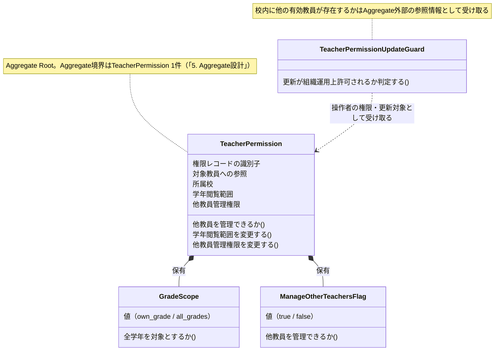
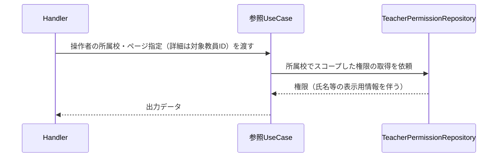
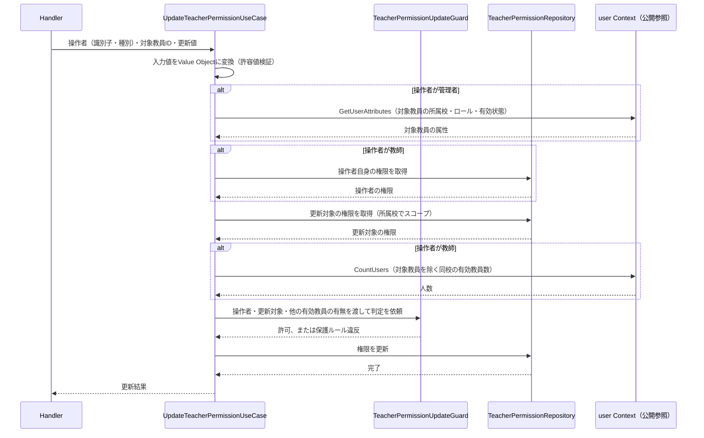
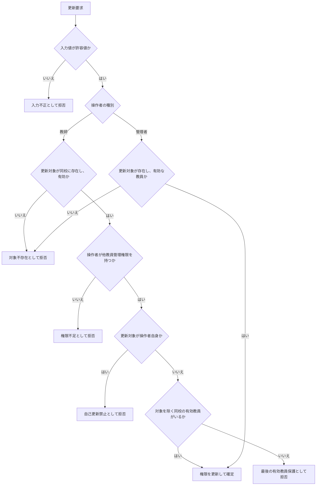

# 教師権限管理機能 Go移行・設計仕様書

---

# 1. 機能概要

## 機能概要

教師が同校教員の権限（学年閲覧範囲 `grade_scope`、他教員管理権限 `manage_other_teachers`）を確認・更新できる機能である。Rails現行仕様では、`manage_other_teachers` 権限を持つ教師のみが更新操作を許可され、さらに「自分自身の権限は更新できない」「校内で最後の有効教員の権限は更新できない」という組織運用上の保護ルールが存在する。

## 利用者

- `teacher` ロールのユーザー（教師）のうち、`manage_other_teachers` 権限を持つ者（更新操作のみ）
- 一覧・詳細参照は同校教員であれば可能

## 業務上の目的

- 教員体制の変化に応じて、権限（閲覧範囲・管理権限）を柔軟に見直せるようにする
- 誤操作や権限剥奪によって「学校に権限管理者が誰もいなくなる」「本人が自分の権限を誤って変更する」といった運用上の事故を防ぐ

---

# 2. 設計方針

- 責務分離: HTTP入出力、入力形式検証、権限更新に伴う組織運用上の保護ルール、永続化を分離する
- 保守性: 「自己更新禁止」「最後の有効教員保護」という業務上重要な不変条件を、UseCase内の条件分岐として散在させず、ドメイン層に集約する
- テスト容易性: 保護ルールを独立した単位でテストできるようにする
- API互換性: 既存フロントエンドとの接続を維持するため、エンドポイント・レスポンス構造を維持する
- 拡張性: 将来的に権限の種類が増える、保護ルールが追加される場合に対応しやすい構造とする

---

# 3. Bounded Context

## Context名

- teacher-permission

## Contextの責務

- 教員権限（`grade_scope` / `manage_other_teachers`）の参照・更新。教員権限の書き換えは本Contextの操作に一本化し、他Contextは自前で`teacher_permissions`を更新しない
- 権限更新時の組織運用上の保護ルール（自己更新禁止・最後の有効教員保護）の適用。保護ルールは操作者が教師である場合にのみ適用する
- 権限更新を実行できる教師かどうかの業務的な判定

## 他Contextとの依存関係

- `user` Context（②は`ユーザー基盤機能_Go移行・設計仕様書.md`）: 操作者および更新対象教員の識別・ロール・所属校・有効状態の参照に`GetUserAttributes`、校内に他の有効な教員が存在するかの確認に`CountUsers`（所属校・役割・除外IDを指定し、無効化済みを除外する）を用いる。更新対象が同校の有効な教員であるかの判定も、ユーザーの基本属性に対する参照であり`user` Contextの公開参照による
- `teacher-management` Context（②は`教師教員管理機能_Go移行・設計仕様書.md`・`管理者教員管理機能_Go移行・設計仕様書.md`）: 教員の着任時に権限レコードが作成されることを前提とする。教員アカウント自体の作成・一覧管理は`teacher-management` Contextの責務であり、本Contextは権限の参照・更新のみを担う

## 依存する理由

権限更新の対象となる教員そのものの存在・ロール・所属校の判定は、ユーザーの基本属性を1箇所で提供する`user` Contextに依存する。本Contextは権限（TeacherPermission）そのものの整合性と保護ルールに責務を集中させ、教員アカウントの管理には関与しない。

---

# 4. 設計パターン

## 採用パターン

Domain Model

## 判断根拠

本機能は、単なる `grade_scope` / `manage_other_teachers` の値更新にとどまらず、更新操作そのものに対して以下の業務上の不変条件（invariant）が課されている。

- 更新者は `manage_other_teachers` 権限を持つ教師でなければならない
- 更新者は自分自身の権限を更新できない
- 更新対象が校内で最後の有効教員である場合は更新できない（校内の権限管理者が不在になることを防ぐ）

このうち特に「最後の有効教員保護」は、対象教員1件の属性だけでは判定できず、同校に所属する他の教員（有効な教員の集合）の状態を踏まえて初めて判定できる、複数エンティティにまたがる業務ルールである。これは単純なCRUD検証（値が範囲内か等）とは性質が異なり、組織としての整合性を守るための保護ルールであるため、Active RecordやTransaction Scriptで都度条件分岐を書くよりも、Domain Model（Entity + Domain Service）としてルールを集約した方が、ルールの見落としを防ぎやすく、保守性が高い。

判断基準に照らすと以下のとおりである。

- ドメインロジックの複雑さ: 単一値の検証ではなく、組織内の他教員の状態を踏まえた判定が必要
- 状態管理の有無: `TeacherPermission` は「誰が何を管理できるか」という重要な状態を保持し、その変更には慎重な保護が必要
- 業務ルールの複雑さ: 自己更新禁止・最後の教員保護という、単なる入力検証を超えた組織運用ルールが存在する
- 将来の拡張性: 今後、権限の種類が増えたり、保護ルールが追加された場合にも、ルールをEntity/Domain Serviceに閉じ込めておく方が変更に強い
- テスト容易性: 保護ルールを独立したDomain Serviceとして切り出すことで、DBや他の全業務フローを経由せずにルール単体を検証できる

## 採用しなかったパターン

### Transaction Script

- 自己更新禁止・最後の教員保護という保護ルールをUseCase内の手続きとして書くと、将来ルールが増えた際に条件分岐が積み重なり、可読性・保守性が低下しやすい
- 組織運用上重要なルールであるにもかかわらず、手続きの中に埋没してしまうリスクがある

### Active Record

- 保護ルールの判定に「同校の他教員の状態」という、対象レコード単体を超えた情報が必要であり、モデルの属性検証だけでは自然に表現しにくい
- モデルに保護ルールを持たせると、モデルが他教員の集合を検索する責務まで抱えることになり、責務が肥大化する

### Event Sourcing

- 権限変更の現在値を正しく保護・更新できれば業務要件を満たしており、変更履歴の全再構築という要件は現行仕様上明示されていない
- 監査ログ要件が生じた場合に検討すべきであり、現時点では過剰な設計である

---

# 5. Aggregate設計

## Aggregate Root

- TeacherPermission

## Aggregateに含めるEntity

- TeacherPermission単体（保護ルール判定に必要な「同校の他教員の有効性」は、Aggregate外部の参照情報として扱う）

## Aggregate境界

- TeacherPermission 1件を整合性の単位とする
- 「校内で最後の有効教員かどうか」の判定に必要な他教員の情報は、Aggregateの外部から取得する参照情報（Domain Serviceが受け取る入力）として扱い、TeacherPermission Aggregateには含めない

## 整合性を保証する単位

- 1回の更新操作において、権限者チェック・自己更新禁止チェック・最後の教員保護チェックをすべて満たした上でのみ、TeacherPermissionの更新を確定する

理由: 校内の教員集合全体を1つのAggregateとして扱うと、同校の教員数が多い場合にAggregateが肥大化し、通常の一覧・詳細参照にも影響が及ぶ。保護ルールの判定は「更新時に一時的に必要となる参照情報」であるため、Aggregateの内部に含めず、Domain Serviceが都度参照する設計とする方が、通常時の参照コストを抑えられる。

---

# 6. Entity設計

## TeacherPermission

- 役割: 教師が持つ権限（学年閲覧範囲・他教員管理権限）を表す中心的なドメイン概念
- ライフサイクル: 教員着任時に初期作成される（teacher-management Context側の責務） → 本Contextにおいて参照・更新される
- 状態変化: `grade_scope`（own_grade / all_grades）、`manage_other_teachers`（true / false）の値が更新される。名前付きの状態遷移ではないが、値の変化が他機能（お知らせ対象指定の学年制約等）に影響する重要な状態である
- 保持する責務:
  - `grade_scope` が許容値であることを保持・検証する
  - `manage_other_teachers` が真偽値であることを保持する
  - 保有する権限で「他教員を管理できるか」を自ら判定できるようにする
  - **更新の競合を検出するための版を保持する**（①「6. データモデル」の`lock_version`）
- 判断根拠: 権限そのものの妥当性検証と、自身が持つ権限の意味（他教員管理可否）を問い合わせる責務は、TeacherPermission自身が持つのが自然であるため

**版の一致判定はEntityに持たせない。** 版は「取得してから更新するまでの間に他の更新がなかったか」を表す永続化の関心であり、権限そのものの業務ルールではない。判定はRepositoryの更新条件として行う（「11. Repository設計」）。Gorm規約「12. 楽観ロック（Optimistic Locking）」も、更新条件の付与と競合の検出をRepositoryの責務として定めている。

---

# 7. Value Object設計

## GradeScope

- 採用理由: `own_grade` / `all_grades` という定義済みの値以外を許容すべきではないため
- 独自ルール:
  - 定義済みの値以外を許容しない
- Entity属性ではなくValue Objectにする理由: 許容値のチェックを型として表現し、教師教員管理機能（着任時の初期権限設定）とも概念を共有できるようにするため（推測: 両機能はTeacherPermissionという同一概念を扱うため、Value Objectとしての定義を揃えておくことが将来の一貫性維持に資すると考えられる）

## ManageOtherTeachersFlag

- 採用理由: 単なる真偽値ではなく、「この値がtrueであることが、他教員の権限更新操作を行える前提条件である」という業務的な意味を持つため
- 独自ルール:
  - true/false以外の値を許容しない
- Entity属性ではなくValue Objectにする理由: 「他教員を管理できるか」という問い合わせを型の振る舞いとして表現し、TeacherPermission Entityおよび後述のDomain Serviceから再利用しやすくするため

## Value Objectを採用しないもの

- 対象教員のID・氏名: 権限管理の対象を識別する情報であり、TeacherPermissionが直接保持するのではなく、対象教員（teacher-management Contextが管理するTeacher）への参照として扱う

---

# 8. Domain Service

## TeacherPermissionUpdateGuard

- 責務: 権限更新操作が組織運用上許可されるかどうかを判定する。判定は操作者の種別によって次のように分かれる
  - 操作者が教師の場合: 更新者が `manage_other_teachers` 権限を持つか、更新者が更新対象本人ではないか（自己更新禁止）、更新対象が校内で最後の有効教員でないか（最後の教員保護）
  - 操作者が管理者の場合: 上記3つの判定をいずれも適用しない。管理者は自校という概念を持たず、他教員管理権限も持たないため、教師向けの保護ルールの前提が成り立たない（Rails現行の挙動と同じ。管理者経路の現行仕様は`管理者教員管理機能_Rails現行仕様書.md`「`Api::V1::Admin::TeachersController#update`」の「業務ルール」に記載があり、保護ルールに相当する定めは置かれていない）
- Entityへ持たせない理由: 判定には更新者自身の権限情報、対象教員の情報、さらに「同校に所属する他の有効教員の集合」というTeacherPermission単体では保持し得ない情報が必要なため。TeacherPermission Entityに持たせると、Entityが他教員の集合を検索する責務まで抱えることになり、責務が肥大化する
- 判断根拠: 自己更新禁止・最後の教員保護という組織運用上の不変条件は、単一のEntityに閉じた判定ではなく、Aggregateをまたいだ集合的な判定であるため、独立したDomain Serviceとして切り出すことで、ルールの所在を明確にし、テスト・変更を容易にする

## 追加で必要としないService

- `grade_scope` / `manage_other_teachers` の値そのものの妥当性検証は、各Value Objectの責務に閉じており、複数Entityをまたぐ判定ではないため、別途Domain Serviceを設ける必要はない

---

# 9. クラス図

「5. Aggregate設計」「6. Entity設計」「7. Value Object設計」「8. Domain Service」で整理した関係を次のとおり可視化する。属性・操作は概要レベルで示し、Goのstruct定義（フィールドの可視性・タグ）は③Go実装仕様書で扱う。

対象教員の氏名はTeacherPermissionが保持しない（「7. Value Object設計」の「Value Objectを採用しないもの」）ため、図にも含めない。

---

# 10. 状態遷移図

本機能では状態遷移図を作成しない。

理由: TeacherPermissionは「下書き → 公開」のような名前付きの状態を持たず、`grade_scope`（own_grade / all_grades）と`manage_other_teachers`（true / false）という2つの値が互いに独立して更新されるだけである（「6. Entity設計」の「状態変化」）。値の組み合わせは4通りあるが、業務上禁止される組み合わせはなく、遷移の条件は「更新操作が保護ルールを満たすこと」の一点に集約される。その判定内容は「16. Authorization設計」および「13. シーケンス図・処理フロー図」の処理フロー図で表現できるため、状態遷移図を別に設ける意味がない。

---

# 11. Repository設計

## TeacherPermissionRepository

- 管理対象: TeacherPermission
- 責務:
  - 同校教員の権限一覧取得（氏名カナ順、ページネーション）
  - 指定教員の権限詳細取得
  - 権限の更新（**版を更新条件に含め、競合を検出する**）
- 保持する検索機能:
  - 高校IDによる絞り込み
  - 有効教員（論理削除されていない）による絞り込み
  - 氏名カナ順のソート
  - ページネーション
- 保持しない責務:
  - 更新可否の判定（TeacherPermissionUpdateGuardの責務）
- 判断根拠: 永続化と検索条件の実行に責務を限定し、保護ルールの判断はDomain Serviceに残すため

## 楽観ロックによる競合の検出

Gorm規約「12. 楽観ロック（Optimistic Locking）」に従う。

|項目|内容|
|-|-|
|版を保持する列|`teacher_permissions.lock_version`（①「6. データモデル」）|
|更新条件|版が取得時の値と一致すること。更新が成功すると版が1つ進む|
|競合の検出|更新された行数が0件なら、他の利用者が先に更新したものとして扱う|
|競合時の扱い|共有の`ErrOptimisticLockConflict`を返し、`409 Conflict`へ変換する（Gorm規約同節）|
|版を返す経路|一覧・詳細のレスポンスに版を含める。更新リクエストはその値を送り返す（「19. API仕様」）|

**版を更新リクエストの必須項目とする。** 指定がない場合は更新を行わず`422`とする。Rails現行も版の指定を必須としている（①「5. API / 処理詳細」`#update`）。

**版の列名が`lock_version`であり、Gorm規約の例が示す`version`ではない。** 既存DBの列名はRailsの慣習に由来する。Schema変更を行わない方針のため、列名はそのままとし、GORMモデル側で`lock_version`へ対応付ける（「20. DB設計方針」）。クラス編成機能②も同じ列名を同じ方針で扱っている（`クラス編成機能_Go移行・設計仕様書.md`「11. Repository設計」）。

## 他Contextの参照手段

- 取得元: `user` Context（`GetUserAttributes` / `CountUsers`）
- 責務:
  - 指定教員を除いた、校内の有効教員が他に存在するかどうかを確認する（`CountUsers`。所属校・役割`teacher`・除外IDを指定し、無効化済みを除外した人数が0より大きいかで判定する）
  - 操作者および更新対象の識別・ロール・所属校・無効化状態を確認する（`GetUserAttributes`）
- 保持しない責務:
  - 保護ルールそのものの判断（TeacherPermissionUpdateGuardの責務。本参照手段は判断に必要な事実の取得のみを行う）
- 判断根拠: 教員の有効状態・ロール・所属校はユーザーの基本属性であり、`user` Contextが正として管理する。本Contextが`users`テーブルを独自に解釈すると、「有効な教員とは何か」の判断が2箇所に分かれる。規約「5. Context間連携ルール」に従い、`user` Contextの公開参照を呼び出す形とし、そのためのインターフェースは本Contextの`dependency.go`に置く

---

# 12. UseCase設計

## ListTeacherPermissionsUseCase

- 目的: 同校教員の権限管理対象一覧を取得する
- 入力: current user, page
- 出力: current userの情報、権限一覧、ページ情報
- トランザクション範囲: 読み取りのみ、トランザクションは不要
- 呼び出すRepository:
  - TeacherPermissionRepository
- 判断根拠: 単純な絞り込み・ページネーションのみであるため

## ShowTeacherPermissionUseCase

- 目的: 指定教員の権限詳細を取得する
- 入力: current user, teacher id
- 出力: 教員の権限詳細
- トランザクション範囲: 読み取りのみ
- 呼び出すRepository:
  - TeacherPermissionRepository
- 判断根拠: 同校教員の権限情報を取得する単純な参照処理であるため

## UpdateTeacherPermissionUseCase

- 目的: 指定教員の権限（`grade_scope` / `manage_other_teachers`）を更新する
- 入力: 操作者（識別子・種別）、teacher id, grade_scope, manage_other_teachers, **lock_version（取得時の版）**
- 出力: 更新結果
- トランザクション範囲: TeacherPermissionの更新を1トランザクションで扱う
- 呼び出すもの:
  - TeacherPermissionRepository（対象取得・更新）
  - `user` Contextの公開参照（`CountUsers`による最後の教員判定、`GetUserAttributes`による対象教員の有効性確認）
- 操作者の種別: 教師と管理者の2種類を入力として受け取る。本UseCaseは、教師の権限管理画面（`PATCH /api/v1/teacher/permissions/:id`）と、管理者の教員更新（管理者教員管理機能）の双方から呼ばれる、教員権限の唯一の更新経路である
- 対象教員の所属校の確認: 操作者が教師の場合は、操作者自身の所属校でスコープする。操作者が管理者の場合は、管理者が自校という概念を持たないため本UseCaseでは所属校でスコープせず、対象教員が指定高校に所属することの確認は呼び出し側（管理者教員管理機能）の責務とする。Rails現行の管理者の教員更新も、対象高校を取得した上でその高校に所属する教員として対象を特定している（`管理者教員管理機能_Rails現行仕様書.md`「`Api::V1::Admin::TeachersController#update`」の「処理内容」）ため、呼び出し側で確認することで現行の挙動を保てる
- 版の扱い: 入力の版をそのままRepositoryの更新へ渡す。UseCaseは版を比較しない。更新された行数が0件であることをRepositoryが競合として返すため、UseCaseはそれを`409`に対応するエラーへ変換するだけである（「17. Error設計」）
- **保護ルールの判定と版の判定の順序**: 保護ルール（自己更新禁止・最後の教員保護・他教員管理権限）を先に判定し、版の判定は更新の実行時に行う。Rails現行も同じ順序であり、版が古い場合でも自己更新・最後の教員の更新は`422`が先に返る（①「5. API / 処理詳細」`#update`の処理順）
- 判断根拠: TeacherPermissionUpdateGuardによる保護ルール判定を経てから更新を確定する必要があるため。操作者の種別を入力に含めるのは、保護ルールと他教員管理権限の判定が操作者が教師である場合にのみ適用されるためである。Rails現行では、教師の画面にのみ保護ルール（①「8. 権限制御」）があり、管理者の教員更新は同じ項目を保護ルールなしで更新している（`管理者教員管理機能_Rails現行仕様書.md`「`Api::V1::Admin::TeachersController#update`」の「業務ルール」。`grade_scope` / `manage_other_teachers`のうち送信された項目のみを更新すると定められており、保護ルールに相当する定めはない）

---

# 13. シーケンス図・処理フロー図

## シーケンス図

### 参照（一覧・詳細）

### 更新

`user` Contextへの参照は、相手Contextが公開する参照手段の呼び出しである（「3. Bounded Context」、規約「5. Context間連携ルール」）。

## 処理フロー図

更新操作は保護ルールの判定を複数経るため、判断の流れを次のとおり整理する。

一覧・詳細の参照は所属校による絞り込みのみで分岐を持たないため、処理フロー図を設けない。

---

# 14. Transaction設計

## Transaction開始位置

- UpdateTeacherPermissionUseCaseの開始時にトランザクションを開始する

## Transaction終了位置

- 保護ルール判定（TeacherPermissionUpdateGuard）を通過し、TeacherPermissionの更新が完了した時点でコミットする
- ListTeacherPermissionsUseCase / ShowTeacherPermissionUseCase ではトランザクションを使用しない

## 理由

- 権限更新という1つの業務操作に対して、保護ルール判定と更新を一貫した単位で扱うため
- UseCase単位で境界を統一し、保守・テストのしやすさを確保するため

---

# 15. Validation設計

## Presentation

- 型チェック: HTTP入力の型（文字列・真偽値）を検証する
- 必須チェック: grade_scope / manage_other_teachers を検証する
- フォーマットチェック: grade_scopeが文字列として送信されていること等の形式検証

## Domain

- 業務ルール: 更新者が `manage_other_teachers` 権限を持つか（TeacherPermissionUpdateGuard）
- 状態チェック: 自己更新でないか、最後の有効教員でないか（TeacherPermissionUpdateGuard）
- 整合性チェック: grade_scopeが許容値（`own_grade` / `all_grades`）であるか（GradeScope Value Object）、manage_other_teachersが真偽値であるか（ManageOtherTeachersFlag Value Object）

## 責務分離

- Presentationは「入力の形式が正しいか」を担当する
- Domainは「業務的に妥当か（更新してよい権限者か、保護対象でないか）」を担当する
- これにより、入力仕様の変更と組織運用ルールの変更を独立して扱える

## バリデーション仕様

|フィールド|検証層|ルール|エラーメッセージ方針|
|-|-|-|-|
|`grade_scope`|Presentation|必須・文字列であること|入力形式の不正として扱う|
|`grade_scope`|Domain|`own_grade` / `all_grades` のいずれかであること（GradeScope Value Object）|許容値以外は業務ルール違反として扱う|
|`manage_other_teachers`|Presentation|必須・真偽値であること。未送信と`false`を区別する|入力形式の不正として扱う|
|`manage_other_teachers`|Domain|真偽値であること（ManageOtherTeachersFlag Value Object）|Goの型で保証されるため実行時の検証は生じない|
|`page`|Presentation|整数であること。不正な形式は未指定として扱い、エラーとしない|Rails現行仕様と同じ扱いを維持する|
|`per_page`|Presentation|1以上の整数であること。既定値20・上限100。不正な形式は既定値として扱い、エラーとしない|Rails現行仕様と同じ扱いを維持する|
|対象教員（`id`）|Domain|同校に所属する有効な教員であること|対象不存在として扱う|
|操作者の権限|Domain|操作者が教師の場合、`manage_other_teachers`を持つこと（TeacherPermissionUpdateGuard）|権限不足として扱う|
|操作者と更新対象の関係|Domain|操作者が教師の場合、更新対象が操作者自身でないこと（TeacherPermissionUpdateGuard）|「自分自身は更新できません」相当のメッセージを維持する|
|校内の有効教員|Domain|操作者が教師の場合、更新対象を除く有効教員が校内に存在すること（TeacherPermissionUpdateGuard）|「最後の教員は更新できません」相当のメッセージを維持する|

---

# 16. Authorization設計

## Middleware

- 認証済みユーザーを特定し、`teacher` ロールであることを確認する（本Contextが公開するHTTPエンドポイントの場合）
- 管理者教員管理機能から本Contextの更新操作を呼ぶ経路では、`admin` ロールの確認は呼び出し側のMiddlewareが行う

## Handler

- ルーティングとHTTP入出力の変換のみを担当し、業務権限判定は持たせない

## UseCase

- current userの所属校IDを用いて、権限一覧・詳細の取得範囲を同校にスコープする
- 更新時、対象教員が同校であることを確認する

## Domain

- TeacherPermissionUpdateGuardにおいて、操作者が教師の場合に以下を判定する
  - 更新者が `manage_other_teachers` 権限を持つか
  - 更新者が更新対象本人でないか
  - 更新対象が校内で最後の有効教員でないか
- 操作者が管理者の場合、上記は適用しない。管理者であることの確認と、対象教員が指定高校に所属することの確認は、管理者教員管理機能側のMiddleware・Handlerの責務とする（「12. UseCase設計」）

## 判断理由

「同校教員のみを対象とする」という認証・スコープ確認はMiddleware/UseCaseに配置し、「更新してよい権限者か」「保護対象でないか」という組織運用上の判断はDomain（Guard）に集約することで、権限体系や保護ルールの変更が生じてもDomain層のみの修正で対応できるようにする。

他教員管理権限の不足はHTTPの403、保護ルール違反は422として区別する。いずれもDomain Errorとして表現し、HTTPステータスの決定はApplication Errorが担う（「17. Error設計」）。Domainはステータスコードという関心事を持たない。

---

# 17. Error設計

## Domain Error

責務: 業務ルール違反を表現する

- 更新権限（`manage_other_teachers`）を持たない
- 自分自身の権限を更新しようとした
- 校内で最後の有効教員の権限を更新しようとした
- grade_scopeが許容値でない

## Application Error

責務: ユースケース実行時の失敗を表現する

- 対象教員が存在しない、または同校でない
- **版が一致しない（他の利用者が先に更新した）**

## Infrastructure Error

責務: DB接続・永続化失敗等の技術的障害を表現する

## 層間の変換

- Domain ErrorはHTTPステータス・ログレベルを持たない。Domainが`grade_scope`の許容値違反や保護ルール違反を表現し、それをどう外部に見せるかはApplication層の責務とする
- UseCaseは、Domain Error・Infrastructure Errorを受け取り、ステータスコードとログレベルを持つApplication Errorへ変換して返す
- Presentation層は、Application Errorが持つステータスコードを用いてレスポンスを組み立てる。個々の業務ルール違反をPresentation層で列挙して判定しない

この分担は規約「12. Error変換パターン（AppError）」に従う。

## 判断理由

自己更新禁止・最後の教員保護・権限不足といった組織運用上の拒否理由は、単なる入力ミスとは性質が異なる業務ルール違反であるため、Domain Errorとして明確に区別する。これにより、Rails現行仕様のように個別の日本語メッセージ（「自分自身は更新できません」等）をControllerに直接書くのではなく、Domain層でルールごとに意味のあるエラーとして表現し、Application層で外部に見せる形へ変換する構造とする。

Domain ErrorにHTTPステータスを持たせないのは、「権限不足を403、保護ルール違反を422とする」というAPIの見せ方の都合で、組織運用ルールを表すDomain層の定義を書き換えずに済むようにするためである。

## エラー仕様

|業務シナリオ|エラー種別|発生層|想定するHTTPステータス|
|-|-|-|-|
|操作者（教師）が`manage_other_teachers`権限を持たない|Forbidden|Domain（判定）→ Application（変換）|403|
|操作者が自分自身の権限を更新しようとした|BusinessRuleViolation|Domain（判定）→ Application（変換）|422|
|更新対象が校内で最後の有効教員である|BusinessRuleViolation|Domain（判定）→ Application（変換）|422|
|`grade_scope`が許容値でない|Validation|Domain（判定）→ Application（変換）|422|
|`grade_scope` / `manage_other_teachers`が未送信・型不正|Validation|Presentation|422|
|**`lock_version`が未送信**|Validation|Presentation|422|
|対象教員が存在しない、同校でない、または論理削除済み|NotFound|Application|404|
|**版が一致しない（他の利用者が先に更新した）**|**Conflict**|Infrastructure（検出）→ Application（変換）|**409**|
|未認証|Unauthorized|Middleware|401|
|`teacher`ロールでない|Forbidden|Middleware|403|
|DB接続・永続化の失敗|Internal|Infrastructure → Application（変換）|500|

対象教員の特定は権限判定より先に行う。存在しないIDを指定した場合は、操作者の権限の有無によらず404とする（Rails現行仕様と同じ処理順）。

**版の判定は最後に行う。** 保護ルール違反（自己更新・最後の教員）と権限不足は、版が古い場合でも先に返る。Rails現行の`before_action`と`update`の順序に一致する（①「5. API / 処理詳細」`#update`の処理順）。版の不一致はRepositoryの更新で検出され、Gorm規約「12. 楽観ロック（Optimistic Locking）」の`ErrOptimisticLockConflict`として返る。

---

# 18. Domain Event

本機能では現時点でDomain Eventを採用しない。

理由: 権限更新に対して、他処理（通知・監査ログ等）への非同期の波及がRails現行仕様上明示されていないためである。

将来的に、権限変更の監査ログを別途記録する要件や、権限変更を対象教員に通知する要件が追加された場合は、「TeacherPermissionChanged」イベントの導入を検討する余地がある（推測）。

---

# 19. API仕様

## エンドポイント一覧

|エンドポイント|HTTP Method|概要|
|-|-|-|
|/api/v1/teacher/permissions|GET|同校教員の権限一覧取得|
|/api/v1/teacher/permissions/:id|GET|指定教員の権限詳細取得|
|/api/v1/teacher/permissions/:id|PATCH|指定教員の権限更新|

いずれもRails現行仕様と同じURL・HTTP Methodを維持する。

## 各エンドポイントの仕様

### GET /api/v1/teacher/permissions

- Request: クエリパラメータ`page`（任意・整数。1以上の整数以外は未指定として扱う）、`per_page`（任意・整数。既定値20、上限100。1以上の整数以外は既定値を使う）
- Response: 操作者自身の情報、同校教員の権限一覧（氏名カナ昇順）、ページ情報の3要素
- **一覧の各要素の権限には版（`lock_version`）を含める。** 操作者自身の権限には含めない。更新の対象になるのは一覧の各要素のみであるためである（①「5. API / 処理詳細」`#index`）
- Status Code: 正常系200。異常系は未認証401・`teacher`ロール不一致403
- Error Response方針: `page` / `per_page`の形式不正はエラーとせず、Rails現行仕様と同じ既定値での処理を維持する

### GET /api/v1/teacher/permissions/:id

- Request: パスパラメータ`id`（対象教員）
- Response: 対象教員の識別子・氏名・権限（**版を含む**）。最上位は単体のオブジェクトであり、キーで包まない
- Status Code: 正常系200。異常系は対象教員不存在404（他校・論理削除済みを含む）、未認証401、`teacher`ロール不一致403
- Error Response方針: 他校の教員・論理削除済みの教員を指定した場合も、存在しない場合と区別せず404とする

### PATCH /api/v1/teacher/permissions/:id

- Request: パスパラメータ`id`（対象教員）。ボディは`teacher_permission`キーの下に`grade_scope`・`manage_other_teachers`・**`lock_version`**を持つ（Rails現行の`params.require(:teacher_permission).permit(...)`と同じ形）。3項目すべてが必須であり、部分更新はできない
- Response: 更新成功を示すメッセージ。更新後の権限そのものは返さない
- Status Code: 正常系200。異常系は他教員管理権限の不足403、対象教員不存在404、保護ルール違反および入力不正（`lock_version`の未送信を含む）422、**版の不一致409**
- Error Response方針: 既存のerrors形式と日本語メッセージ（`自分自身は更新できません`・`他教員を編集する権限がありません`・`lock_versionは必須です`・`他のユーザーによってデータが更新されています。再読み込みしてください`等）を踏襲する

権限不足を403、保護ルール違反を422として区別する。対象教員の特定は権限判定より先に行うため、存在しないIDを指定した場合は権限の有無によらず404を返す（「17. Error設計」）。

## Railsとの差分

API外部仕様（URL・HTTP Method・リクエスト形式・レスポンス構造・エラーメッセージ・ステータスコード）はRails現行仕様から変更しない。既存フロントエンドとの接続を維持することを優先する（「2. 設計方針」）。

内部の呼び出し経路には次の差分がある。

- Rails仕様: 教員権限（`grade_scope` / `manage_other_teachers`）の書き換え経路が2つある。教師の権限管理画面は保護ルールを適用し（①「8. 権限制御」）、管理者の教員更新は同じ項目を保護ルールなしで更新している（`管理者教員管理機能_Rails現行仕様書.md`「`Api::V1::Admin::TeachersController#update`」）
- Go設計での変更: 書き換え経路を本Contextの更新操作に一本化し、管理者の教員更新も同じ操作を呼ぶ。保護ルールと他教員管理権限の判定は操作者が教師である場合にのみ適用する
- 変更理由: 権限の書き換えが2箇所にあると、保護ルールや権限項目の追加時に片方だけが修正される。経路を1つにすることで、権限体系の変更が本Contextに閉じる
- 影響範囲: 本機能の3エンドポイントの外部仕様に変更はない。管理者教員管理機能側は、自前で`teacher_permissions`を更新せず本Contextの更新操作を呼ぶ形になる。操作者が管理者の場合は保護ルールを適用しないため、管理者の教員更新の挙動もRailsと変わらない

---

# 20. DB設計方針

## 現行DBを利用するか

- 既存Rails DBを継続利用する

## Schema変更有無

- 変更なし

## 変更理由

- 現行の `teacher_permissions` テーブルは、権限の参照・更新という業務要件を満たしており、追加のスキーマ変更は不要である
- 「最後の有効教員」判定は `users.deleted_at` による既存の論理削除の仕組みを利用でき、新たなスキーマは不要である
- 既存カラムの型・制約もそのまま利用する。とくに次の2点は、現行DBを継続利用する以上、Go側の永続化がこれに合わせる必要がある（①「6. データモデル」）
  - `grade_scope` はRailsの `enum` として**整数**で保持される（`own_grade`=0 / `all_grades`=1）。APIの入出力は文字列であり、永続化との間で相互変換が必要になる
  - `user_id` に一意制約があり、権限レコードは教員1人につき1件である
  - **`lock_version`（既定値0・NULL不可）が楽観ロックの版を保持する。** 列名はRailsの慣習に由来し、Gorm規約「12. 楽観ロック（Optimistic Locking）」の例が示す`version`とは異なる。Schema変更を行わないため列名はそのままとし、GORMモデル側で対応付ける（「11. Repository設計」の「楽観ロックによる競合の検出」）

---

# 21. DB操作仕様

## TeacherPermissionRepository

- 対象テーブル: `teacher_permissions`（本Contextが所有する）、`users`（所属校・有効状態・氏名の判定のために参照する）
- 値の表現: `grade_scope` は整数で保持されるため、Value Object が扱う文字列表現との相互変換を永続化の境界で行う（「20. DB設計方針」）
- 操作種別:
  - 参照: 同校教員の権限一覧、指定教員の権限1件（**いずれも版を取得する**）
  - 更新: 指定教員の`grade_scope`・`manage_other_teachers`（**版を更新条件に含め、版を1つ進める**）
- 主な検索条件・絞り込み条件:
  - 所属校が一致すること
  - 教員が論理削除されていない（有効である）こと
  - 詳細取得・更新時は対象教員が一致すること
  - **更新時は版が取得時の値と一致すること。** 更新された行数が0件なら競合として扱う（「11. Repository設計」の「楽観ロックによる競合の検出」）
- 関連テーブルとの結合: 必要である。`teacher_permissions`は`user_id`・`grade_scope`・`manage_other_teachers`のみを持ち、所属校・有効状態・氏名を持たない（①「6. データモデル」）。これらは`users`との結合で判定する
- ページネーション・ソート: 一覧取得で必要である。氏名カナの昇順で並べ、ページ単位で取得するとともに、絞り込み条件に一致する総件数を取得する

## 他Contextの参照手段

- 対象テーブル: なし。本Contextからはクエリを発行しない
- 「校内に対象教員以外の有効な教員が存在するか」の確認は`user` Contextの`CountUsers`、操作者・更新対象の属性確認は`GetUserAttributes`に委ねる（「11. Repository設計」）
- 判断根拠: 「有効な教員とは何か」の判断を`user` Contextに集約するためである。本Contextが`users`を独自に解釈すると判断が2箇所に分かれる

一覧・詳細の表示に必要な氏名は画面向けの参照であり、本Contextが`users`との結合で取得する。一方、保護ルールの判定に用いる有効教員数は業務判断の前提となる事実であるため、`user` Contextの公開参照に委ねる。

---

# 22. テスト戦略

## Domain Test

- 目的: GradeScope/ManageOtherTeachersFlagの値検証、TeacherPermissionUpdateGuardによる自己更新禁止・最後の教員保護・権限不足の判定を検証する

## UseCase Test

- 目的: ListTeacherPermissionsUseCase / ShowTeacherPermissionUseCase / UpdateTeacherPermissionUseCaseの業務振る舞いを検証する

## Repository Test

- 目的: TeacherPermissionRepositoryによる同校絞り込み・氏名カナ順のソート・ページネーションの正確性と、**楽観ロックの挙動（版が一致するとき更新され版が1つ進むこと、一致しないとき更新されず競合が返ること）**を検証する。`user` Contextの公開参照（`CountUsers` / `GetUserAttributes`）を呼び出す部分は、本Contextが定義したインターフェースの実装として、委譲内容が正しいことを検証する

## Handler Test

- 目的: API入力のバリデーション結果とHTTPステータスの変換を検証する。**`lock_version`の未送信が422、版の不一致が409へ変換されること**を含む

## Integration Test

- 目的: エンドポイント経由で、正常更新・自己更新拒否・最後の教員保護・権限不足拒否のそれぞれが正しく動作することを確認する
- 重点を置く観点:
  - **同じ版で2回更新すると、1回目が成功し2回目が409になること**
  - **`lock_version`を送らないと422になり、権限情報が変化しないこと**
  - 版が古い場合でも、自己更新・最後の教員の更新は422が先に返ること（判定の順序）
  - 一覧・詳細のレスポンスに版が含まれ、その値で更新できること

---

# 23. Railsとの責務対応

| Rails | Go | 設計方針 |
|---|---|---|
| Controller | Handler | HTTP入出力のみを担当する |
| Concern `RequireManageOtherTeachers` の `require_manage_other_teachers!` | TeacherPermissionUpdateGuard（Domain Service） | 権限判定を業務ルールとしてドメイン層に集約する。操作者が教師の場合にのみ適用する |
| Controllerの `only_active_teacher?` | `user` Contextの`CountUsers` + TeacherPermissionUpdateGuard | 事実確認（他Contextの公開参照）と判断（Domain Service）を分離する |
| `Api::V1::Admin::TeachersController#update` による `teacher_permissions` の更新（`管理者教員管理機能_Rails現行仕様書.md`） | UpdateTeacherPermissionUseCase（操作者の種別を管理者として呼ぶ） | 権限の書き換え経路を1つにまとめる |
| Form（UpdatePermissionForm） | Request DTO + Presentation Validation + Value Object | 入力形式検証と値の妥当性検証を分離する |
| Query（TeachersQuery） | TeacherPermissionRepository | 検索条件の実行をRepositoryの責務として整理する |
| Serializer | Presenter / Response DTO | レスポンス整形をPresentation層に分離する |
| Model（TeacherPermission） | TeacherPermission Entity + Value Object | 値の妥当性はEntity/Value Objectに、組織運用ルールはDomain Serviceに分離する |

---

# 24. 採用しなかった設計

## Transaction Script

- 採用しなかった理由: 自己更新禁止・最後の教員保護という保護ルールを手続きの中に書くと、将来のルール追加時に条件分岐が積み重なり保守性が低下するため
- 将来的に採用する可能性: 保護ルールが撤廃され単純な値更新のみになった場合は再検討できるが、現状は見込みが低い

## Active Record

- 採用しなかった理由: 保護ルールの判定に「同校の他教員の集合」という単一レコードを超えた情報が必要であり、モデル単体の検証だけでは責務が肥大化するため
- 将来的に採用する可能性: 保護ルールが撤廃された場合は検討の余地がある

## Event Sourcing

- 採用しなかった理由: 権限変更履歴の再構築・監査要件が現時点で存在しないため
- 将来的に採用する可能性: 権限変更の監査ログ要件が生じた場合に有効な可能性がある

---

# 25. 設計判断サマリー

| 項目 | 採用 | 判断理由 |
|---|---|---|
| 設計パターン | Domain Model | 自己更新禁止・最後の教員保護という、単一Entityを超えた組織運用上の不変条件が存在するため |
| Aggregate | TeacherPermission単体 | 他教員集合の参照は判定時の外部参照情報として扱い、Aggregateを軽量に保つため |
| Transaction境界 | UseCase単位 | 保護ルール判定と更新を1つの業務操作として保証するため |
| Domain Service | TeacherPermissionUpdateGuard | 複数教員にまたがる保護ルールをEntity単体に持たせず、独立した判定単位とするため |
| 権限更新の経路 | UpdateTeacherPermissionUseCaseに一本化 | 教師経路・管理者経路で権限の書き換えが二重化するのを防ぐため。保護ルールは操作者が教師の場合にのみ適用する |
| Domain Event | 未採用 | 現時点で他処理への通知・監査要件がない |
| Value Object | 採用（GradeScope/ManageOtherTeachersFlag） | 許容値・業務的意味を型として明示し再利用するため |

---

# 設計差分管理

## Rails現行仕様

- Controllerのbefore_actionとアクション内条件分岐（`RequireManageOtherTeachers` concernの`require_manage_other_teachers!`、`only_active_teacher?`、自己更新チェック）に保護ルールが直接実装されている
- 保護ルール違反時のエラーメッセージがController内にハードコードされている
- 教員権限（`grade_scope` / `manage_other_teachers`）の書き換え経路が2つある。教師の権限管理画面は保護ルールを適用し（①「8. 権限制御」）、管理者の教員更新は同じ項目を保護ルールなしで更新している（`管理者教員管理機能_Rails現行仕様書.md`「`Api::V1::Admin::TeachersController#update`」）

## Go設計での変更内容

- 権限不足・自己更新禁止・最後の教員保護の判定をTeacherPermissionUpdateGuard（Domain Service）に集約する
- 「最後の有効教員かどうか」の事実確認を`user` Contextの公開参照に委ね、判断ロジックと事実確認を分離する
- 入力形式検証をPresentation層、値の妥当性検証をValue Objectに分離する
- 教員権限の更新経路をUpdateTeacherPermissionUseCaseに一本化する。管理者教員管理機能は自前で`teacher_permissions`を更新せず、操作者の種別を管理者として本UseCaseを呼ぶ。保護ルールと他教員管理権限の判定は操作者が教師の場合にのみ適用し、Railsと同じ挙動を保つ

## 変更理由

- Rails実装ではController内に保護ルールとエラーメッセージが直接書かれており、ルール変更時にHTTP層まで修正が及ぶ
- Go設計では保護ルールをDomain Serviceに集約することで、HTTP層を変更せずに業務ルールのみを修正できるようにし、保守性・テスト容易性を高める
- 権限の書き換えが2箇所にあると、保護ルールや権限項目の追加時に片方だけが修正される。更新経路を1つにすることで、権限体系の変更が本Contextに閉じる

## 影響範囲

- フロントエンドから見たAPI外部仕様（エラーメッセージ含む）は維持する
- 既存DBスキーマは維持するため、データ移行は不要
- 管理者教員管理機能の②③は、`TeacherPermissionStore`相当の直接更新を持たず、本Contextの更新操作を呼ぶ形とする
- Context間の依存は`teacher-management` → `teacher-permission`の一方向とする。本Contextが必要とする教員の有効状態・所属校の確認は`user` Contextの公開参照を用いるため、`teacher-management`への依存は持たない
