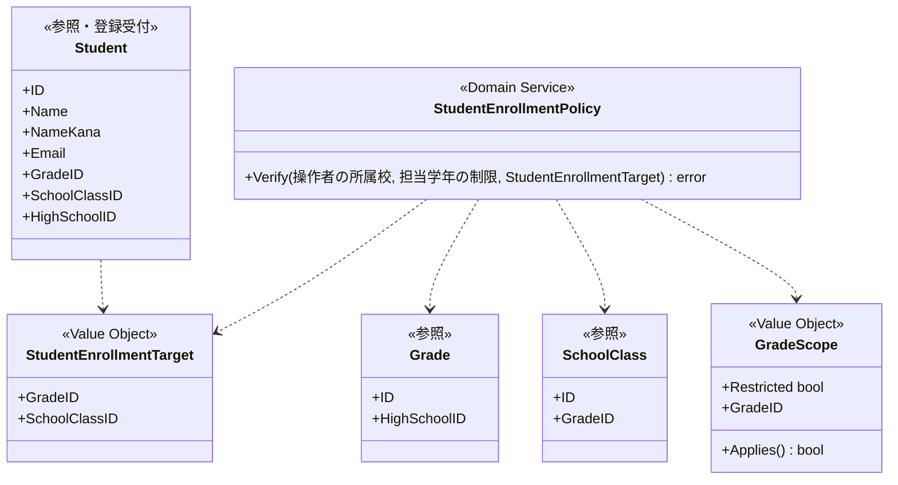
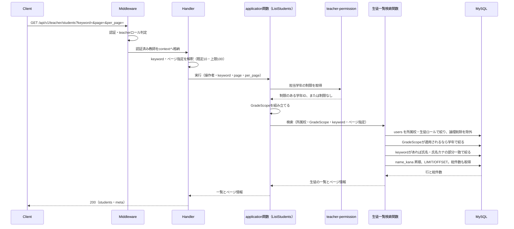
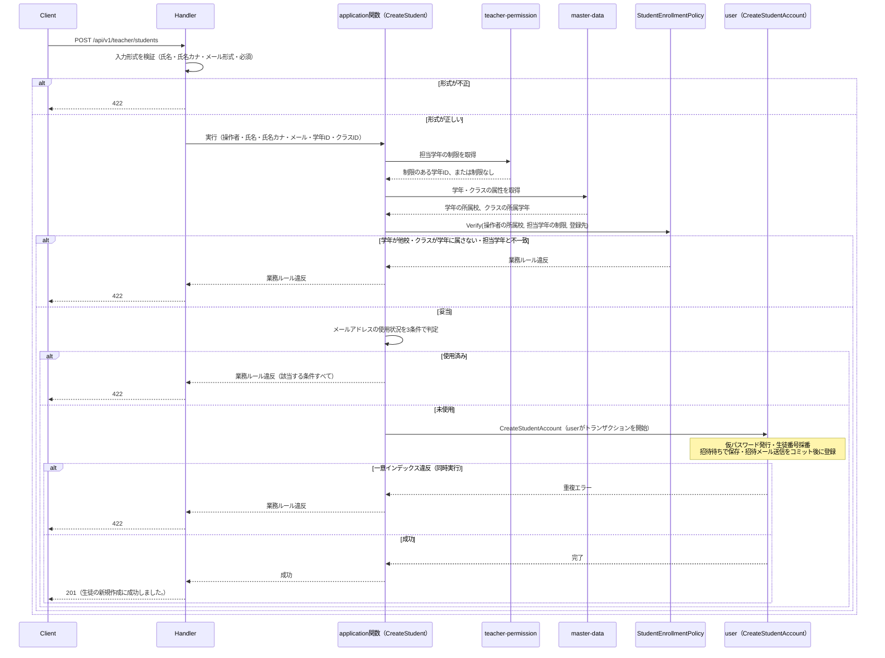
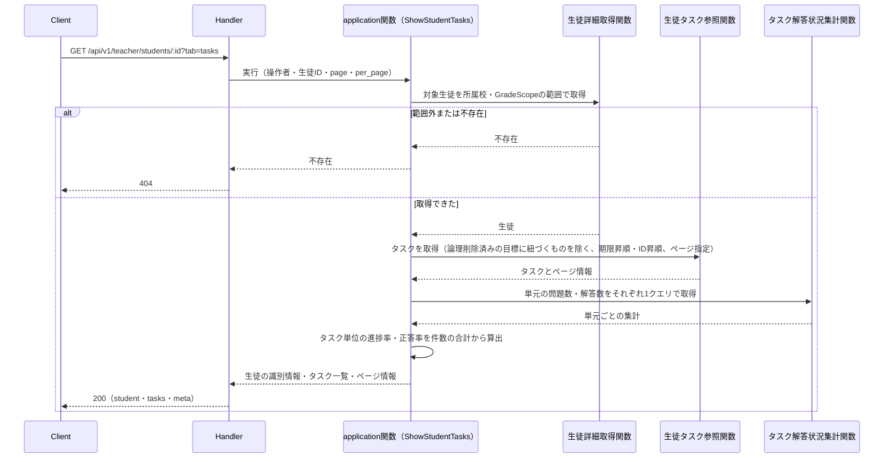
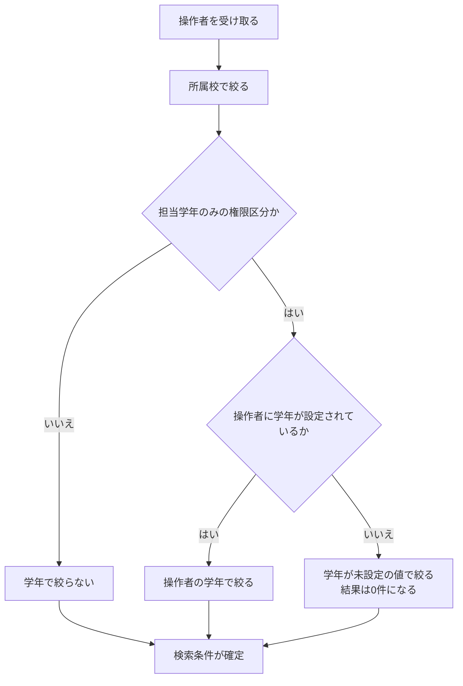
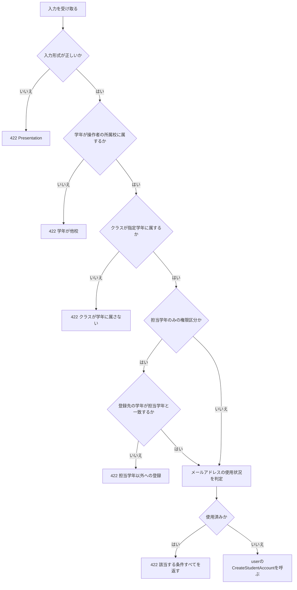

# 教師生徒参照機能 Go移行・設計仕様書

---

# 1. 機能概要

## 機能概要

教師が同校の生徒一覧および生徒詳細を参照し、あわせて生徒アカウントを1件ずつ新規登録できる機能である。一覧は氏名・氏名（カナ）の部分一致で絞り込める。生徒詳細は`tab`の指定により、プロフィール・目標・タスクの3つの切り口を返す。Rails現行仕様では、一覧取得・詳細取得に加え、氏名・氏名（カナ）・メールアドレス・学年・クラスを指定した生徒アカウントの新規作成（create）を提供する。一覧・詳細取得では、担当学年権限を持つ教師は担当学年の生徒のみに閲覧範囲が制限される。新規作成の作成経路は、生徒CSVインポート機能と共通のアカウント作成処理（仮パスワード発行・招待メール送信を含む）を利用する。

## 利用者

- 教師ユーザー（teacher ロール）
- 同校の生徒のみ参照・登録可能。担当学年権限がある場合は、参照も登録先の学年も担当学年に制限される（Rails現行の`GradeScopeValidatable`。担当学年以外の学年を指定した登録は拒否する）

## 業務上の目的

- 教師が担当する生徒の状況を把握できるようにする
- 学校・学年という権限範囲に基づいて、閲覧できる生徒を適切に制限する
- 教師が生徒アカウントを個別に登録できるようにし、着任・転入時など少人数の追加登録に対応する
- 生徒データの参照・個別登録の窓口として提供し、既存データの更新は行わない

---

# 2. 設計方針

本機能は「参照」を中心としつつ、生徒アカウントの個別新規登録（create）を1操作だけ持つ機能であり、Rails実装の構造をそのまま移すのではなく、権限に基づく検索条件の組み立て・レスポンス整形と、登録時の同校妥当性検証に責務を絞ったGo設計とする。生徒アカウント本体の作成処理（仮パスワード発行・生徒番号採番・招待メール送信）は`user` Contextの`CreateStudentAccount`が担うため、本機能内に重複実装しない。

主な設計思想は以下のとおりである。

- 責務分離: HTTP・検索条件構築・権限スコープ・登録時の同校妥当性検証・レスポンス整形を分離する
- 保守性: 学校・学年による絞り込み条件を一箇所に集約し、権限ルール変更の影響範囲を限定する。生徒アカウント作成自体の業務ルール（仮パスワード発行・生徒番号採番・招待メール送信等）は`user` Contextに委譲し、本機能側の変更範囲を「誰が・どの学年/クラスに登録してよいか」に限定する
- テスト容易性: 検索条件の組み立てとページングをユースケース単位で検証できるようにする。新規登録時の同校妥当性検証も独立して検証できるようにする
- 拡張性: 将来的な検索条件の追加に対応しやすい構造とする。氏名・氏名カナによる絞り込みは現行にすでに存在する（①「5. API / 処理詳細」`#index`）
- API互換性: 既存エンドポイント・レスポンス構造（`students` + `meta`）およびcreateエンドポイントを維持する

---

# 3. Bounded Context

## Context名

- student-directory

## Contextの責務

- 教師視点での生徒情報の参照（一覧・詳細。詳細はプロフィール・目標・タスクの3タブ）
- 学校・学年スコープに基づく絞り込み
- 生徒アカウントの個別新規登録受付（同校の学年・クラスに対する登録であることの妥当性検証）

## 他Contextとの依存関係

- `user` Context（`user`。②は`ユーザー基盤機能_Go移行・設計仕様書.md`）: 生徒アカウント本体の作成を、公開操作`CreateStudentAccount`の直接の呼び出しで依頼する。入力は氏名・氏名カナ・メールアドレス・所属校ID・学年ID・クラスIDで、招待待ち・作成時の招待メール送信は固定（入力に持たない）、生徒番号は`user`が発行する。学年・クラスの実在と整合は、本Contextが検証済みの内容を渡す（`user`②「15. Validation設計」）。生徒・学年・所属校の一覧・詳細の参照は、ページネーション・結合を伴うため、本Context自身が参照モデルを持つ（`user`②「3. Bounded Context」）
- `master-data` Context: 登録先の学年が教師の所属校に属することの確認に依存する。学年の属性の参照（公開操作）を呼ぶ（`master-data`②「11. Repository設計」の「本Contextが他Contextへ公開する操作」）
- `school-class` Context（②は`クラス編成機能_Go移行・設計仕様書.md`）: 登録先のクラスが指定学年に属することの確認に依存する。**クラスを所有するのは`school-class`であり、`master-data`ではない。** `master-data`が公開するのは高校・学年・住所の3つであり、クラスは含まれない（`master-data`②「11. Repository設計」）。`school-class`に「クラスの属性の参照」の公開操作が必要になる（「19. API仕様」の「Railsとの差分」）
- `goal-management` Context・`task-management` Context: 生徒詳細の目標タブ・タスクタブで、対象生徒の目標とタスクを参照する。いずれも画面向けの一覧（並び替え・ページネーション・単元との結合を伴う）であるため、`user`②「3. Bounded Context」の「画面向けの一覧は、一覧を必要とする各Contextが自前の参照モデルとして持つ」に従い、本Contextが参照専用の参照モデルを持つ。目標・タスクの作成・更新・状態遷移は各Contextに残し、本Contextは持たない
- `question-answering` Context: タスクタブの解答状況（単元ごとの問題数・解答数・正答数）の集計元データを参照する。集計そのものは本Contextの参照モデルで行う

## 依存する理由

生徒データそのものは`user` Contextが正として管理する情報であり、本機能はその情報を教師の権限範囲に応じて参照するビューを提供するに過ぎない。新規登録についても、本Contextが担うのは「同校の教師が、同校の学年・クラスに対して登録しようとしているか」という業務権限・スコープの検証までであり、生徒アカウントそのものの作成（仮パスワード発行・生徒番号採番・招待メール送信）は`user` Contextの`CreateStudentAccount`へ委譲する。Rails現行では、`Teacher::CreateStudentForm`が入力検証・同校妥当性確認を行い、`Student::CreateStudentService`（`Common::CreateUserService`を継承）がアカウントを作成しており、この分担をそのまま維持する。これにより、アカウント作成の詳細ルールが変更された場合の影響範囲を`user`の1箇所に閉じ込め、生徒CSVインポート機能（`student-import`。同じ操作を呼ぶ）との間でロジックが重複・乖離することを防ぐ。本Contextと`student-import`の間に依存関係はない。

---

# 4. 設計パターン

## 採用パターン

Transaction Script

## 判断根拠

本機能は一覧取得・詳細取得を中心とした参照系機能に、生徒アカウントの新規登録が1操作加わったものである。新規登録が加わったことで書き込みが発生するものの、以下の理由からTransaction Scriptの水準を超えないと判断する。

- 一覧・詳細取得の業務ルールは「同校であること」「担当学年権限がある場合は担当学年のみ」という2条件の絞り込みに限定され、状態遷移・状態管理は存在しない
- 新規登録における本Context自身の業務ルールは「指定した学年・クラスが教師の所属校に属し、かつクラスが指定学年に属すること」という同校妥当性検証に限定される。氏名カナ・メール形式の入力検証は本Contextの入力検証（Presentation）が行い、仮パスワード発行・生徒番号採番・招待メール送信といった作成本体の複雑な処理は`user`の`CreateStudentAccount`へ委譲するため、本Context側にはEntityへ振る舞いを集約するほどの複雑さが生まれない
- 新規登録によって「同じデータ構造を複数の関数で扱う」状態にはなるが、それぞれの関数（一覧・詳細・新規登録）が扱う業務ルールは単純な条件判定にとどまり、Active Recordへの格上げの目安（規約3章）である「複雑な業務ルール・状態遷移の発生」には該当しない
- 検索条件構築・ページングおよび登録時の同校妥当性検証という、いずれも手続き的な処理が中心であり、Entityに振る舞いを持たせる必要性が薄い
- 将来的な拡張（検索条件の追加、登録項目の追加）があっても、手続き的な条件追加で十分に対応可能である

以上より、参照系機能に新規登録が加わった現状の複雑さに対しては、引き続きTransaction Scriptが適していると判断する。

## 採用しなかったパターン

### Active Record

新規登録操作が加わったことで作成責務自体は存在するが、その作成処理の実体（仮パスワード発行・生徒番号採番・招待メール送信）は`user`の`CreateStudentAccount`へ委譲するため、本Context側にモデル（struct）へ保存・更新ロジックを持たせる必要がない。同校妥当性検証という単純な条件判定のみであれば、structへ振る舞いを持たせるActive Recordの構造を導入するメリットが薄く、不採用とする。

### Domain Model

生徒Entityは本機能内では状態やライフサイクルを持たず、複数の業務ルールが絡む振る舞いも存在しない。Entityに責務を集約するメリットがなく、DDDを目的化した過剰設計になるため不採用とする。

### Event Sourcing

状態変化や他処理への通知が発生しない参照専用機能であり、過剰設計であるため不採用とする。

---

# 5. Aggregate設計

不要と判断する。

理由: 本機能は`users`への書き込み（作成・更新）を自身では行わない（新規登録の書き込みは`user`の`CreateStudentAccount`が行う）ため、整合性を保証すべき書き込み単位（Aggregate）が存在せず、Aggregateとして境界を定義する必要がない。

---

# 6. Entity設計

## Student

- 役割: 教師が参照・登録する生徒情報を表す概念
- ライフサイクル: 新規登録リクエストとして受け付けられ（本Context側では同校妥当性検証のみ行う）、実際のアカウント生成は`user` Contextの`CreateStudentAccount`に委ねられる。以降の参照は一覧・詳細取得のみで、本機能内での更新・削除は行わない
- 状態変化: 本Context内では状態を持たない（作成後の状態管理は`user` Contextの責務）
- 保持する責務: 生徒の基本情報（氏名・かな氏名・学年・所属校）を表現する。新規登録時は入力された氏名・氏名カナ・メールアドレス・学年・クラスを保持し、`user`の`CreateStudentAccount`へ引き渡す
- 判断根拠: 生徒情報の永続的な管理・状態は`user` Contextが管理する実体であり、本機能では読み取り専用の表現と、新規登録リクエストの受け皿として扱うため、作成処理そのものの責務は持たせない

## Grade / SchoolClass / HighSchool（参照対象）

- 役割: 絞り込み条件、および新規登録時の同校妥当性検証の判定材料として利用される外部概念
- 判断根拠: 本機能の中心はStudentの参照・登録受付であり、Grade/SchoolClass/HighSchoolは条件判定用の参照情報として扱う。SchoolClassは、生徒単体新規登録（学年・クラス指定）の追加に伴い新たに参照対象として加わった。所有Contextは、GradeとHighSchoolが`master-data`、SchoolClassが`school-class`である

---

# 7. Value Object設計

## GradeScope

- 採用理由: 「担当学年権限の有無」と「対象学年ID」の組み合わせを検索条件として明示的に扱うため
- 独自ルール:
  - 担当学年権限がない場合は学年による絞り込みを行わない
  - 権限がある場合は、対象学年IDと一致する生徒のみを対象とする
- Entity属性ではなくValue Objectにする理由: この絞り込み条件はStudent Entityの属性ではなく、教師の権限に基づく検索パラメータであるため、Entityとは独立した概念として扱う方が責務が明確になる

## StudentEnrollmentTarget（学年・クラスの組）

- 採用理由: 新規登録時に指定される学年ID・クラスIDの組み合わせは、「教師の所属校に属する学年であること」「クラスがその学年に属すること」という2つの整合性ルールを同時に満たす必要があり、単純な外部キーの集合として扱うべきではないため
- 独自ルール:
  - `grade_id` は登録する教師の所属高校に属する学年でなければならない
  - `school_class_id` は、指定された `grade_id` の学年に属するクラスでなければならない
- Entity属性ではなくValue Objectにする理由: 学年・クラスの組み合わせ妥当性を単体で検証できるようにし、Student Entityの責務を「登録リクエストの保持」に集中させるため。教師教員管理機能におけるGradeScope（担当学年の許容値検証）と役割は類似するが、対象が「閲覧範囲」ではなく「登録先」である点が異なるため別のValue Objectとして扱う

## Value Objectを採用しないもの

- 氏名・かな氏名・メールアドレス: 形式検証（氏名カナのカタカナ形式・メールアドレス形式）は入力検証（Presentation。「15. Validation設計」）で行い、文字数・メールアドレスの一意性は`user`の`CreateStudentAccount`が検証するため、本Context内では独自のValue Objectとして持たない

---

# 8. Domain Service

## StudentEnrollmentPolicy

- 責務: 新規登録時に指定された学年ID・クラスIDが、登録する教師の所属校に属し、かつクラスが指定学年に属しているかどうかを判定する
- Entityへ持たせない理由: 判定にはGrade（`master-data`が所有）/SchoolClass（`school-class`が所有）という、Student Entity単体では保持しない外部情報が必要なため
- 判断根拠: 教師教員管理機能におけるTeacherGradeAssignmentPolicyと同様、同校制約の判定は単一のEntityの責務に寄せると不自然であり、独立したDomain Serviceとして切り出すことで判定ロジックの所在を明確にする

## 追加で必要としないもの

- 一覧・詳細取得の絞り込みロジックはGradeScope（Value Object）とapplication関数内の検索条件組み立てで表現できる範囲に収まり、複数Entityを横断する業務ルールが存在しないため、Domain Serviceとして独立させる必要がない

---

# 9. クラス図

**Aggregate境界を持たない。** 本Contextは`users`への書き込みを自身で行わないため、整合性を保証すべき境界が存在しない（「5. Aggregate設計」）。図はEntity相当の表現とValue Object・Domain Serviceの関係のみを示す。

`Student`を`<<参照・登録受付>>`としているのは、一覧・詳細では読み取り専用の表現であり、新規登録では`user` Contextへ引き渡す入力の受け皿であるためである（「6. Entity設計」）。本Contextに状態も振る舞いもない。

`Grade`は`master-data` Context、`SchoolClass`は`school-class` Contextが所有する概念であり、本Contextは判定材料として参照するだけである。図には判定に必要な属性のみを示す。

目標・タスク・解答状況は、`Student`と関連を持つEntityとして図示しない。本Contextが持つのは画面向けの参照モデルであり、Entityとしての表現を持たないためである（「3. Bounded Context」）。

---

# 10. 状態遷移図

省略する。

理由: 本Contextに状態を持つEntityが存在しない（「6. Entity設計」）。

- 一覧・詳細は参照のみであり、状態を変化させる操作がない
- 新規登録で作成される生徒アカウントの状態（招待待ち → パスワード設定済み）は`user` Contextが管理する。本Contextはその遷移に関与しない（①「7. 状態管理」）
- 詳細取得の`tab=goals` / `tab=tasks`が返す目標・タスクの状態は、`goal-management`・`task-management`が管理する。本Contextは参照するだけである

---

# 11. Repository設計

**実装上の位置づけ**: 本機能はTransaction Script採用のため、Repository Interfaceをdomain層に定義しない。以下は永続化・検索責務の設計意図であり、実装時はinfrastructure層の関数として直接実装する(規約: アーキテクチャ規約.md「3. 設計パターンごとの構造適用方針」)。

## StudentRepository

- 管理対象: Student（`user` Contextの生徒情報への参照）
- 責務:
  - 同校生徒の一覧取得
  - 指定IDの生徒取得
  - 新規生徒アカウント作成の依頼（`user` Contextの`CreateStudentAccount`の呼び出し）
- 保持する検索機能:
  - high_school_idによる絞り込み
  - grade_idによる絞り込み
  - name_kana順ソート
  - ページネーション（1ページあたりの件数を可変指定可能。未指定時のデフォルト件数・上限件数を持つ）
- 保持しない責務:
  - 権限判定そのもの（絞り込み条件の適用は呼び出し元のapplication関数から受け取る）
  - 生徒アカウント作成の実処理（仮パスワード発行・生徒番号採番・招待メール送信は`user`の`CreateStudentAccount`の責務）
- 判断根拠: 検索・参照および作成依頼の受け渡しに特化させ、権限判定ロジックと作成の実処理は、それぞれ呼び出し元のapplication関数・`user`の`CreateStudentAccount`に置くことで責務を分離するため

## 学年の参照（`master-data` Contextの公開操作）

- 管理対象: Grade（参照専用）
- 責務: 新規登録時、指定された学年が教師の所属校に属することの確認
- 保持する検索機能: 学年IDによる属性の取得（所属校の識別子を含む）
- 保持しない責務: 学年自体の作成・更新（`master-data`の責務）。学年の表示名の組み立て（同）
- 判断根拠: 学年を所有するのは`master-data`であり、本Contextは`grades`を直接読まない（規約「5. Context間連携ルール」）

## クラスの参照（`school-class` Contextの公開操作）

- 管理対象: SchoolClass（参照専用）
- 責務: 新規登録時、指定されたクラスが指定学年に属することの確認
- 保持する検索機能: クラスIDによる属性の取得（所属学年の識別子を含む）
- 保持しない責務: クラスの新設・改名・削除（`school-class`の責務。承認ワークフローを伴う）
- 判断根拠: **クラスを所有するのは`school-class`であり、`master-data`ではない。** `master-data`が公開するのは高校・学年・住所の3つであり、クラスは含まれない（「3. Bounded Context」）

---

# 12. UseCase設計

**実装上の位置づけ**: 本機能はTransaction Script採用のため、UseCase層(struct)を設けない。以下は業務操作の設計意図であり、実装時はapplication層の関数として直接実装する。

## ListStudents

- 目的: 教師が閲覧可能な同校生徒一覧を取得する
- 入力: current teacher, keyword（任意）, page, per_page
- 出力: 生徒一覧、ページ情報
- トランザクション範囲: 読み取りのみ、トランザクション不要
- 呼び出す関数: 生徒一覧検索関数、担当学年の制限の参照（`teacher-permission`）
- 絞り込み: 所属校、生徒ロール、論理削除されていないこと。担当学年のみの権限区分であれば学年。`keyword`があれば氏名または氏名カナの部分一致
- 並び順: 氏名カナの昇順（①「5. API / 処理詳細」`#index`）
- 判断根拠: 権限に基づく絞り込み条件と、リクエストごとに可変の検索語・ページング条件を組み立てた上で一覧を取得することが主目的であるため

**`keyword`が空文字・未指定のときは絞り込みを行わない。** エラーにしない（①「5. API / 処理詳細」`#index`）。

## ShowStudent

- 目的: 指定生徒の詳細（プロフィール）を取得する
- 入力: current teacher, student id
- 出力: 生徒詳細情報
- トランザクション範囲: 読み取りのみ
- 呼び出す関数: 生徒詳細取得関数
- 判断根拠: 権限範囲外の生徒へのアクセスを防止しつつ、詳細情報を取得するため

## ShowStudentGoals

- 目的: 指定生徒の目標一覧と、目標ごとのタスク進捗を取得する（`tab=goals`）
- 入力: current teacher, student id
- 出力: 生徒の識別情報（ID・氏名）、目標一覧（目標ごとのタスク一覧と進捗を含む）
- トランザクション範囲: 読み取りのみ
- 呼び出す関数: 生徒目標参照関数（本Contextの参照モデル）
- 並び順: 期限の昇順、同一期限ではIDの昇順（Rails現行の`GoalsQuery#due_soon`）
- ページネーション: 行わない（Rails現行もページネーションしない）
- 判断根拠: 対象生徒の権限範囲の確認はプロフィール取得と共通であり、取得するデータの切り口のみが異なるため、同じ権限判定を通したうえで参照先を変える操作として分ける

## ShowStudentTasks

- 目的: 指定生徒のタスク一覧と、タスク単位・タスク×単元単位の解答状況を取得する（`tab=tasks`）
- 入力: current teacher, student id, page, per_page
- 出力: 生徒の識別情報（ID・氏名）、タスク一覧（目標・解答状況・単元ごとの解答状況を含む）、ページ情報
- トランザクション範囲: 読み取りのみ
- 呼び出す関数: 生徒タスク参照関数、タスク解答状況集計関数（いずれも本Contextの参照モデル）
- 並び順: 期限の昇順、同一期限ではIDの昇順（Rails現行の`TasksQuery#due_soon`）
- 絞り込み: 論理削除済みの目標に紐づくタスクを除外する（Rails現行は`Goal`の`default_scope`が`joins`に効くことで除外している。Goでは結合条件に明示する）
- 集計規則: タスク単位の進捗率・正答率は、単元ごとの率の平均ではなく、件数を合計してから算出する。正答率は解答数が0件のとき`null`を返し、進捗率は分母が0のとき0を返す
- 判断根拠: 解答状況の集計は単元ごとと合計の2段階で必要になり、タスク件数に比例してクエリが増えやすい。Rails現行は2クエリに集約しているため、Go側でも単元の問題数と解答数をそれぞれ1クエリで取得し、アプリケーション側で突き合わせる方針を維持する

## CreateStudent

- 目的: 教師が同校の生徒アカウントを1件新規登録する
- 入力: current teacher, name, name_kana, email, grade_id, school_class_id
- 出力: 作成結果
- トランザクション範囲: 本Context自身の書き込みはなく、アカウントの保存と招待メール送信依頼の登録は`user`の`CreateStudentAccount`が1つのトランザクションで扱う（呼び出し側がトランザクションを開始していなければ`user`が開始する）。学年・クラスの事前確認は読み取りのみで、このトランザクションには含めない
- 呼び出す関数:
  - 学年の参照（`master-data`の公開操作）・クラスの参照（`school-class`の公開操作）（登録先の学年が同校に属し、クラスが指定学年に属することの確認。StudentEnrollmentPolicyの判定材料）
  - StudentRepository（`user`の`CreateStudentAccount`への作成依頼。入力は氏名・氏名カナ・メールアドレス・所属校ID（操作者の所属校）・学年ID・クラスID）
- 判断根拠: StudentEnrollmentPolicyによる同校妥当性検証を行った上で、実際のアカウント生成処理は`user`の`CreateStudentAccount`に委ねることで、本機能側の責務を登録可否の判定と作成依頼の起点に限定するため。Rails現行の`Teacher::CreateStudentForm`→`Student::CreateStudentService`の流れと同じ分担である

---

# 13. シーケンス図・処理フロー図

## シーケンス図

### ListStudents

### CreateStudent

### ShowStudentTasks（tab=tasks）

## 処理フロー図

### 閲覧範囲の絞り込み

**操作者に学年が設定されていない場合を分けて示す。** 担当学年のみの権限区分であれば、絞り込みに使う学年IDは操作者自身の学年である（①「8. 権限制御」）。この値が未設定の教師は、絞り込みの結果が0件になる。Rails現行も同じ挙動である（`own_grade_restriction`が`nil`を返すため絞り込みが行われず全件になる、という挙動ではない点に注意が必要である。「19. API仕様」の「Railsとの差分」参照）。

### 新規登録の判定

---

# 14. Transaction設計

## Transaction開始位置

- ListStudents / ShowStudent / ShowStudentGoals / ShowStudentTasksでは使用しない（読み取りのみ）
- CreateStudentでは、本Contextはトランザクションを開始しない。`user`の`CreateStudentAccount`が、アカウントの保存と招待メール送信依頼の登録を1つのトランザクションとして開始する

## Transaction終了位置

- CreateStudentでは、`user`の`CreateStudentAccount`が生徒アカウントの作成を完了した時点で、`user`側でコミットする

## 理由

一覧・詳細取得はデータ変更を一切伴わない読み取り専用処理であるため、トランザクション管理は不要である。一方、新規登録は「アカウントは作成されたが招待メール送信の起点となる記録が残らない」といった不整合を避ける必要があるが、本Contextが書き込む対象はなく、アカウントの保存と招待メール送信依頼の登録は`user`の`CreateStudentAccount`が同一トランザクションで扱う（`user`②「14. Transaction設計」）。学年・クラスの同校妥当性検証は読み取りのみの事前確認であり、書き込みとは独立している（Rails現行でも、`Teacher::CreateStudentForm`の検証はトランザクションの外で、`Common::CreateUserService`が自身のトランザクションを持つ）。

---

# 15. Validation設計

## Presentation

- 型チェック: page / per_pageパラメータが整数であることを検証する
- `keyword`は検証しない: 長さ・文字種の制約がなく、空文字は絞り込みを行わない値として扱う（①「5. API / 処理詳細」`#index`）。ワイルドカード文字のエスケープは検索の実装で行う（「21. DB操作仕様」）
- 必須チェック: 詳細取得時のid（route由来）、新規登録時のname / name_kana / email / grade_id / school_class_idを検証する
- フォーマットチェック: 新規登録時のメールアドレス形式、氏名カナのカタカナ形式（Rails現行の`NameValidatable`。`user`は氏名カナの形式を検証しないため、本Contextが行う）、per_pageの上限値（100件）を超えていないかの形式的な検証

## Domain

- 業務ルール: 新規登録時、指定された学年・クラスが登録する教師の所属校に属し、クラスが指定学年に属しているか（StudentEnrollmentPolicy）。あわせて、操作者が担当学年のみの権限区分である場合は、登録先の学年が担当学年と一致するか（GradeScope）
- 状態チェック: 該当なし（一覧・詳細取得の絞り込み条件はapplication関数内で組み立てるのみで、入力値そのものに対する業務ルール違反は発生しない）
- 整合性チェック: 新規登録時のメールアドレスが既存アカウントに使用されていないかを、本Contextが次の3つに区別して判定する（Rails現行の`Teacher::CreateStudentForm`と`ExistingUserValidatable`が`Student::CreateStudentService`の呼び出し前に判定しているため、本Contextの責務とする）

|条件|Rails現行のメッセージ|
|-|-|
|既存アカウントの所属校が操作者の所属校と異なる|`は他の高校のアカウントで使用されています`|
|既存アカウントのロールが生徒以外|`は生徒以外のアカウントで使用されています`|
|既存アカウントが同校の生徒|`は既に生徒として登録されています`|

上の3条件は同時に成立しうる（他校の教員のメールアドレスを指定した場合は1つ目と2つ目の両方）。Rails現行はいずれも検証エラーとして積み上げるため、1件に丸めない。

`user`の`CreateStudentAccount`側は、`users.email`の一意インデックスによる最終的な拒否を担う。本Contextの判定をすり抜けた同時実行時の重複は、ここで検出される。

## 責務分離

- Presentationは「入力形式が正しいか」を担当する
- UseCase/Domainは「権限スコープに基づく絞り込みが正しく適用されているか」「登録先の学年・クラスが同校として妥当か」を担当する

---

# 16. Authorization設計

## Middleware

- 認証済みユーザーを特定し、teacherロールであることを確認する

## Handler

- ルーティング層でAPIの入口を担当し、認証失敗時のHTTP応答を整える
- 具体的な権限判定は持たせない

## UseCase

- current_userの所属校IDによる絞り込みを適用する（一覧・詳細取得）
- 担当学年権限がある場合はgrade_idによる絞り込みを適用する（一覧・詳細取得）
- 対象生徒が権限範囲外である場合は、存在しない場合と同様に扱う
- 新規登録時、current_userの所属校を基準に登録先の学年・クラスの同校妥当性を検証する
- 新規登録時、操作者が担当学年のみの権限区分である場合は、登録先の学年が担当学年と一致することを検証する（Rails現行の`Teacher::CreateStudentForm`が`GradeScopeValidatable`をincludeしている。一致しない場合は`grade_id`に対する検証エラーとして422を返す）
- 新規登録に「他職員操作権限」のような追加の業務権限は課さない（Rails現行仕様どおり）

## Domain

- GradeScope（Value Object）が一覧・詳細取得の絞り込み条件の妥当性を表現する
- StudentEnrollmentPolicyが新規登録時の学年・クラスの同校妥当性を判定する
- 認可の本体は該当するapplication関数側に寄せ、Domainは条件表現・判定ロジックの提供に留める

## 判断理由

権限のロジック（同校・担当学年）は単純な条件分岐であり、複雑なドメインルールではないため、該当するapplication関数に一元化する。Domain層はその表現をValue Object/Domain Serviceとして提供するに留めることで、責務を過度に分散させない。新規登録に「他職員操作権限」のような追加の業務権限チェックが不要である点は、教師教員管理機能（教員の新規作成には他職員操作権限が必要）との明確な違いであり、Rails現行仕様の権限制御節にもその旨が明記されている。

---

# 17. Error設計

## Domain Error

責務: 業務ルール違反の表現。本機能では、権限範囲外の生徒への直接アクセス試行、新規登録時の学年・クラス同校不整合（StudentEnrollmentPolicy違反）を表現する

## Application Error

責務: ユースケース実行時の失敗を表現する。対象生徒が存在しない、または権限範囲外（学校・学年不一致）である場合の未検出エラーのほか、`user`の`CreateStudentAccount`が一意インデックス違反で返すメールアドレス重複エラーを含む

## Infrastructure Error

責務: DB接続失敗等の技術的な障害を表現する

## 判断理由

権限範囲外アクセスと未存在を区別せず「見えない」扱いとすることで、生徒IDの存在自体を第三者に推測させない設計とする（Rails現行仕様と同様、いずれも404として扱う）。業務ルール違反・ユースケース失敗・技術的失敗を分離することで、HTTPレスポンスへの変換を明確にする。新規登録時のメールアドレス重複は、本Contextが3つの条件に区別して判定するため、Domain Errorとして扱う。`user`の`CreateStudentAccount`が一意インデックス違反で返す重複エラーは、同時実行時にのみ発生する最終防御であり、こちらはApplication Errorとして扱う。

## エラー仕様

|業務シナリオ|エラー種別|発生層|想定するHTTPステータス|
|-|-|-|-|
|対象生徒が存在しない、または権限範囲外|NotFound（Application Error）|UseCase|404|
|新規登録の学年・クラスが同校でない、またはクラスが指定学年に属さない|Validation（Domain Error）|Domain（StudentEnrollmentPolicy）|422|
|新規登録の学年が操作者の担当学年と一致しない（担当学年のみの権限区分の場合）|Validation（Domain Error）|Domain（GradeScope）|422|
|新規登録のメールアドレスが他校のアカウントで使用済み|Validation（Domain Error）|Domain|422|
|新規登録のメールアドレスが生徒以外のアカウントで使用済み|Validation（Domain Error）|Domain|422|
|新規登録のメールアドレスが同校の既存生徒で使用済み|Validation（Domain Error）|Domain|422|
|新規登録のメールアドレスが一意インデックスに違反（同時実行時）|Validation（Application Error）|Application（`user`の`CreateStudentAccount`からの結果）|422|
|入力形式が不正（必須項目欠如・メール形式不正等）|Validation|Presentation|422|

---

# 18. Domain Event

不要と判断する。

理由: 一覧・詳細取得は参照のみであり、他処理へ通知すべき状態変化が一切発生しない。新規登録についても、招待メール送信は`user`の`CreateStudentAccount`の責務であり、本Context自身が複数の後続処理へ波及する通知の起点になるわけではないため、Domain Eventを導入するメリットが薄い。

---

# 19. API仕様

## エンドポイント一覧

|エンドポイント|HTTP Method|概要|
|-|-|-|
|`/api/v1/teacher/students`|GET|同校の生徒一覧を取得（氏名・氏名カナの部分一致で絞り込める）|
|`/api/v1/teacher/students/:id`|GET|生徒詳細を取得（`tab`でプロフィール・目標・タスクを切り替える）|
|`/api/v1/teacher/students`|POST|生徒アカウントを1件新規登録|

## 各エンドポイントの仕様

### `GET /api/v1/teacher/students`

- Request: クエリパラメータ `keyword`（任意。氏名・氏名カナの部分一致）・`page`（任意）・`per_page`（任意。**既定10**・上限100）
- Response: `{"students": [...], "meta": {...}}`。`meta`は`current_page` / `total_pages` / `total_count` / `per_page`
- Status Code: 正常系 `200`。異常系 `422`（ページ指定が整数として解釈できない）・`401`・`403`・`500`
- Error Response方針: 規約「15. API規約（レスポンス形式・ページネーション・URL・クエリパラメータ）」の`{"errors": [...]}`に従う
- 該当する生徒がいない場合は空の配列とページ情報を返す。エラーにしない

### `GET /api/v1/teacher/students/:id`

- Request: パスパラメータ `id`、クエリパラメータ `tab`（任意。`goals` / `tasks`。未指定および上記以外の値はプロフィール）、`tab=tasks`のとき`page` / `per_page`
- Response:
  - `tab`未指定（プロフィール）: 生徒の基本情報と関連情報。最上位は単体のオブジェクト
  - `tab=goals`: `{"student": {...}, "goals": [...]}`。**`meta`を返さない**
  - `tab=tasks`: `{"student": {...}, "tasks": [...], "meta": {...}}`
- Status Code: 正常系 `200`。異常系 `404`（不存在・閲覧範囲外）・`422`・`401`・`403`・`500`
- Error Response方針: `404`はRails現行の`{"message": "..."}`を維持する。それ以外は`{"errors": [...]}`

### `POST /api/v1/teacher/students`

- Request: ボディ `user`（`name` / `name_kana` / `email` / `grade_id` / `school_class_id`。すべて必須）
- Response: `{"message": "生徒の新規作成に成功しました。"}`。**作成した生徒の識別子を返さない**
- Status Code: 正常系 `201`。異常系 `422`（入力形式・学年／クラスの同校不整合・担当学年以外への登録・メールアドレス重複）・`401`・`403`・`500`
- Error Response方針: `{"errors": [...]}`。**メールアドレスの使用状況の判定は、該当する条件をすべて返す**（「15. Validation設計」）

## Railsとの差分

フロントエンドを変更しない方針のため、URL・HTTPメソッド・レスポンス項目名・HTTPステータスは変更しない。**外部から見た差分はない。**

### 設計上の前提として他Contextに必要となるもの

|必要なもの|所有Context|状態|
|-|-|-|
|クラスの属性の参照（クラスIDから所属学年の識別子を取得する）|`school-class`|**同Contextの②に公開操作として未定義。** 本Contextが`school_classes`を直接読まないために必要である（「11. Repository設計」）|
|担当学年の制限の参照|`teacher-permission`|同Contextの②に定義済み|
|学年の属性の参照|`master-data`|同Contextの②に定義済み（`master-data`②「11. Repository設計」）|
|生徒アカウントの作成（`CreateStudentAccount`）|`user`|同Contextの②に定義済み|

### 変更しないもの（Rails現行の振る舞いを踏襲する点）

|項目|Rails現行の振る舞い|
|-|-|
|1ページあたりの既定が10件|他のAPIの既定（20件）と異なる。Controllerが`DEFAULT_PER_PAGE = 10`で上書きしている（①「5. API / 処理詳細」`#index`）|
|`keyword`は氏名・氏名カナのみを検索|メールアドレス・生徒番号は検索しない。検索語のワイルドカード文字はエスケープされる（同）|
|論理削除済みの生徒を一覧・詳細から除外|教員一覧（教師教員管理機能・管理者教員管理機能）は論理削除済みを含める。同じ`users`に対する一覧で扱いが異なる（同）|
|`tab`に既知でない値を渡すとプロフィールを返す|エラーにしない（同`#show`）|
|`tab=goals`がページネーションを持たない|目標の件数が多いと全件返る（同）|
|閲覧範囲外の生徒が`404`|存在する生徒でも、所属校・担当学年の範囲外なら不存在として扱う（①「8. 権限制御」）|
|担当学年のみの権限区分で学年が未設定の教師は0件|絞り込みに使う学年IDが未設定になるため、一覧が空になる（「13. シーケンス図・処理フロー図」）|
|作成が識別子を返さない|メッセージのみを返す（①「5. API / 処理詳細」`#create`）|
|作成の`422`に複数のメッセージが入りうる|メールアドレスの使用状況が複数条件に同時に該当する場合など（同）|

---

# 20. DB設計方針

## 現行DBを利用するか

- 既存Rails DBを継続利用する

## Schema変更有無

- 変更なし

## 変更理由

- 参照および新規登録のみの機能であり、既存の users / grades / school_classes / high_schools テーブルで業務要件を満たしているため

---

# 21. DB操作仕様

|参照・操作|対象テーブル|操作種別|主な検索条件|結合|ページネーション/ソート|
|-|-|-|-|-|-|
|生徒一覧の検索|`users`, `user_roles`|参照|所属校、ロールが生徒、論理削除されていない、GradeScopeが適用されるなら学年、`keyword`があれば氏名・氏名カナの部分一致|`user_roles`（ロールの判定）。表示項目のため`grades`・`high_schools`・`user_personal_infos`・`addresses`・`prefectures`|`name_kana`昇順。ページネーションあり（既定10・上限100）|
|生徒1件の取得|同上|参照|同上＋`users.id`|同上|不要|
|学年の属性の確認|`master-data`の公開操作|参照|学年ID|-|不要|
|クラスの属性の確認|`school-class`の公開操作|参照|クラスID|-|不要|
|メールアドレスの使用状況の確認|`users`, `user_roles`|参照|メールアドレス（完全一致）。論理削除済みも対象に含める|`user_roles`（ロールの判定）|不要|
|生徒アカウントの作成|`user`の公開操作（`CreateStudentAccount`）|作成|-|-|不要|
|目標の参照（`tab=goals`）|`goals`, `tasks`|参照|対象生徒、論理削除されていない|`tasks`（目標ごとのタスクと進捗）|期限昇順・ID昇順。ページネーションなし|
|タスクの参照（`tab=tasks`）|`tasks`, `goals`, `task_units`, `units`|参照|対象生徒、論理削除済みの目標に紐づくものを除く|`goals`（目標の表示と除外条件）、`task_units`・`units`（単元の表示）|期限昇順・ID昇順。ページネーションあり|
|解答状況の集計（`tab=tasks`）|`units`, `questions`, `question_histories`|参照|対象のタスクに紐づく単元、対象生徒の解答|単元ごとの問題数と解答数をそれぞれ1クエリで取得する|不要|

本Context固有の点:

- **`keyword`は氏名と氏名カナの両方に対する部分一致である。** メールアドレス・生徒番号は検索しない。検索語に含まれるワイルドカード文字（`%`・`_`）をエスケープしてから渡す。Rails現行も`sanitize_sql_like`でエスケープしている（①「5. API / 処理詳細」`#index`）
- **生徒一覧・生徒1件の取得では論理削除済みを除外する。** 教員一覧（教師教員管理機能・管理者教員管理機能）が論理削除済みを含めるのとは扱いが異なる（①「5. API / 処理詳細」`#index`）
- **メールアドレスの使用状況の確認では論理削除済みも対象に含める。** 論理削除済みのアカウントが使っているメールアドレスは再利用できない（`users.email`の一意インデックスが論理削除を考慮しないため）
- 学年の属性は`master-data`の公開操作で取得する。本Contextが`grades`を直接読まない（規約「5. Context間連携ルール」）
- **クラスの属性は`school-class`の公開操作で取得する。** 本Contextが`school_classes`を直接読まない（規約「5. Context間連携ルール」）。`master-data`はクラスを公開していない（「3. Bounded Context」）
- タスクの解答状況の集計は、タスク件数に比例してクエリが増えないよう、単元の問題数と解答数をそれぞれ1クエリで取得してアプリケーション側で突き合わせる（「12. UseCase設計」）

具体的なSQL・GORMのクエリコードは③Go実装仕様書（`規約/Gorm規約.md`）で扱う。

---

# 22. テスト戦略

## Domain Test

- 目的: GradeScopeによる絞り込み条件の組み立てロジック、StudentEnrollmentPolicyによる学年・クラスの同校妥当性判定ロジックを検証する

## UseCase Test

- 目的: 権限（同校・担当学年）に応じた一覧・詳細取得の挙動、`keyword`が検索条件へ渡ること（空文字で絞り込まないこと）、CreateStudentにおける同校妥当性検証と`user`の`CreateStudentAccount`の呼び出し（入力の受け渡し・メールアドレス重複の結果の変換）の挙動を検証する

## Repository Test

- 目的: 検索条件（所属校・担当学年・`keyword`）・可変ページングの正確性、`master-data`・`school-class`の公開操作を呼ぶアダプタが属性を正しく取り出すことを検証する

## Handler Test

- 目的: page / per_pageパラメータおよび新規登録の入力バリデーションと、HTTPステータス変換を検証する

## Integration Test

- 目的: エンドポイント経由で一覧・詳細取得が権限どおりに動作すること、新規登録が同校妥当性検証を経て`user`の`CreateStudentAccount`へ連携され、招待待ちの生徒アカウントが作成されることを確認する
- 重点を置く観点:
  - 担当学年のみの権限区分の教師に、担当学年以外の生徒が一覧・詳細のいずれでも見えないこと
  - 他校の生徒が見えないこと
  - 論理削除済みの生徒が一覧・詳細のいずれでも見えないこと
  - `keyword`が氏名・氏名カナの両方に当たること、ワイルドカード文字がそのまま文字として扱われること
  - `per_page`を指定しないとき10件で返ること
  - 担当学年以外の学年を指定した新規登録が拒否されること

---

# 23. Railsとの責務対応

| Rails | Go | 設計方針 |
|---|---|---|
| Controller | Handler | HTTP入力の受け取りとレスポンス整形に限定する |
| Query（Teacher::StudentsQuery） | infrastructure関数 + application関数内の検索条件組み立て | 検索条件の構築とスコープ適用を分離する(Transaction Script採用のためusecase層・Repository Interfaceは設けない) |
| Form（Teacher::CreateStudentForm） | Request DTO + Presentation Validation | 入力形式の検証を分離する |
| Form内の同校妥当性検証 | StudentEnrollmentPolicy（Domain Service） | 業務ルールをドメイン層に集約する |
| Service（Student::CreateStudentService, Common::CreateUserService） | `user` Contextの`CreateStudentAccount` | 仮パスワード発行・生徒番号採番・招待メール送信という実処理は`user`が担い、本Context（単体登録）は直接呼ぶ。生徒CSVインポート機能も同じ操作を呼ぶ |
| Serializer（StudentSerializer） | Presenter / Response DTO | レスポンス整形を分離する |
| Model（User） | Entity（Student）+ Repository | データ表現と永続化アクセスの責務を分離する |

---

# 24. 採用しなかった設計

## Active Record

- 採用しなかった理由: 新規登録操作は加わったが、アカウント作成の実処理は`user`の`CreateStudentAccount`へ委譲するため、本Context側のstructに保存・更新ロジックを持たせる必要がない
- 将来的に採用する可能性: 教師による生徒情報の更新（氏名変更等）や生徒メモ登録など、本Context自身が保存・更新ロジックを持つ操作が追加された場合は再検討する余地がある

## Domain Model

- 採用しなかった理由: 生徒Entityが状態・振る舞いを持たず、複雑な業務ルールも存在しないため
- 将来的に採用する可能性: 現時点では想定しない

## Event Sourcing

- 採用しなかった理由: 通知すべき状態変化が存在しないため
- 将来的に採用する可能性: 現時点では想定しない

---

# 25. 設計判断サマリー

| 項目 | 採用 | 判断理由 |
|---|---|---|
| 設計パターン | Transaction Script | 参照が中心で、新規登録が加わっても本Context自身の業務ルールは同校妥当性検証にとどまり、複雑な状態管理を持たないため |
| Aggregate | 不要 | 整合性を保証すべき書き込み単位（アカウント生成の実処理）は`user`に委譲するため |
| Transaction境界 | 本Contextは開始しない（新規登録のトランザクションは`user`の`CreateStudentAccount`が持つ） | 本Context自身の書き込みがなく、アカウントの保存と招待メール送信依頼の登録の整合性は`user`が保つため |
| Domain Event | 未採用 | 招待メール送信は`user`の`CreateStudentAccount`の責務であり、本Context自身が非同期通知の起点にならないため |
| Value Object | GradeScope（絞り込み）/ StudentEnrollmentTarget（登録先の同校妥当性）を採用 | 権限に基づく絞り込み条件と、登録先学年・クラスの整合性ルールをそれぞれ明示するため |
| Domain Service | StudentEnrollmentPolicy | 学年・クラスの同校妥当性判定がStudent Entity単体の責務に収まらないため |
| Authorization | application関数 + Middleware | ロール確認と業務スコープ判定を分離して管理しやすくするため。新規登録には教員新規作成のような追加の業務権限チェックを課さない（Rails現行仕様どおり） |
| Context間連携 | `user` Contextの`CreateStudentAccount`を直接呼ぶ | 仮パスワード発行・生徒番号採番・招待メール送信のロジックを重複実装しないため。Rails現行の`Teacher::CreateStudentForm`→`Student::CreateStudentService`の流れと整合する |

---

# 設計差分管理

## Rails現行仕様

- Query（Teacher::StudentsQuery）とSerializerがControllerから直接利用され、権限による絞り込みロジックがController/Query間に分散している
- 一覧取得は`per_page`パラメータで1ページあたりの件数を可変に指定でき、未指定時は10件・上限100件である。`keyword`で氏名・氏名カナの部分一致による絞り込みができる
- 生徒単体新規登録（create）は、Teacher::CreateStudentFormが入力検証・同校妥当性確認を行い、Student::CreateStudentService / Common::CreateUserServiceが、生徒CSVインポート機能の新規行と共通のアカウント作成処理（仮パスワード発行・招待メール送信を含む）を実行する

## Go設計での変更内容

- 絞り込み条件（GradeScope）をapplication関数に集約する
- Repositoryは検索条件の適用（クエリ実行）、および可変ページングの実行のみを担当する
- 新規登録における同校妥当性検証をStudentEnrollmentPolicy（Domain Service）に集約する
- 生徒アカウント作成の実処理（仮パスワード発行・生徒番号採番・招待メール送信）は本Context内に実装せず、`user` Contextの`CreateStudentAccount`を直接呼び出す構成とする

## 変更理由

- 権限ロジックの変更に強い構造とし、テスト容易性を高めるため
- Rails実装が単体登録・CSV一括登録の双方で同じService（Student::CreateStudentService, Common::CreateUserService）を共有している構造を踏襲し、Go設計でもアカウント作成ロジックを`user`に置いて二重実装を避けることで、仮パスワード発行や招待メール送信などのルール変更時の影響範囲を1箇所に限定する

## 影響範囲

- フロントエンドから見た外部APIの互換性は維持する（新規登録エンドポイントの追加を含む）
- 既存DBスキーマは維持するため、データ移行やマイグレーションの追加は不要
- `user`の`CreateStudentAccount`の規則（生徒は常に招待待ち・作成時に招待メール送信、生徒番号の発行、メールアドレス重複の扱い）が、本機能の新規登録処理に適用される。生徒CSVインポート機能（student-import）も同じ操作を呼ぶが、両Contextの間に依存関係はない
