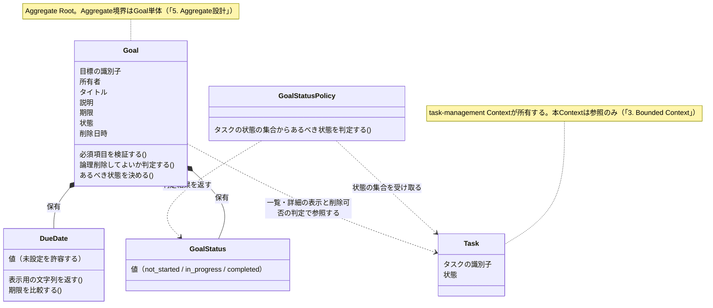
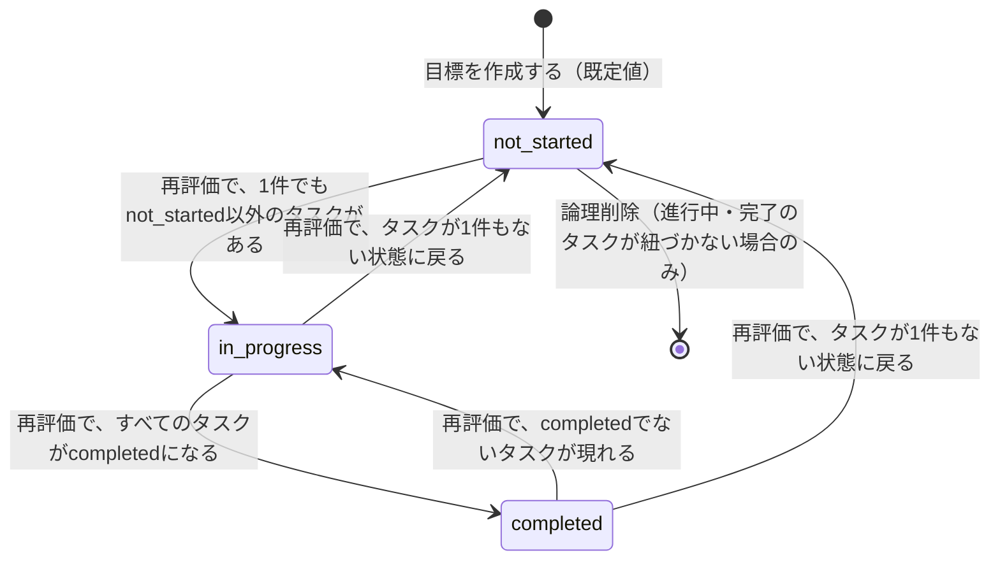
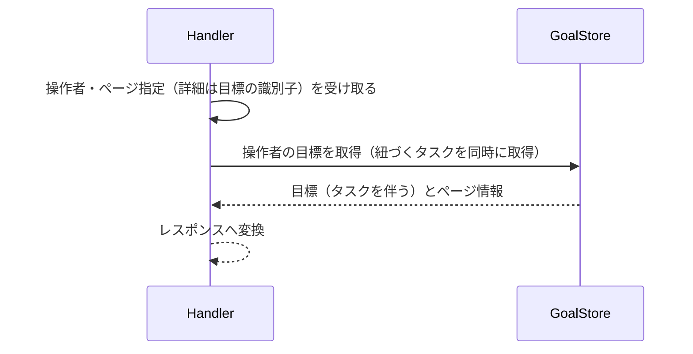
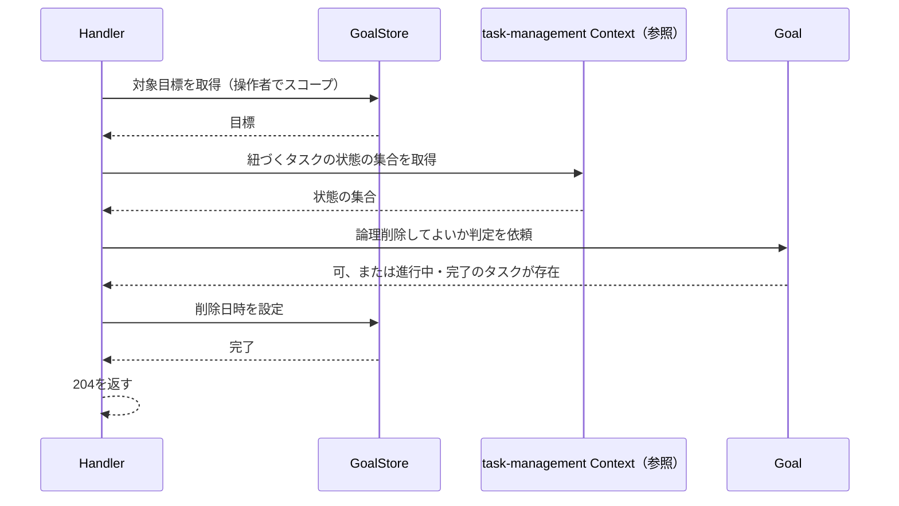
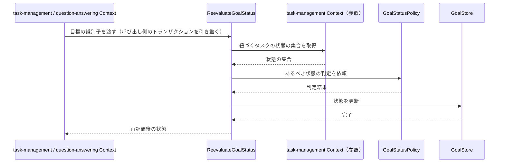
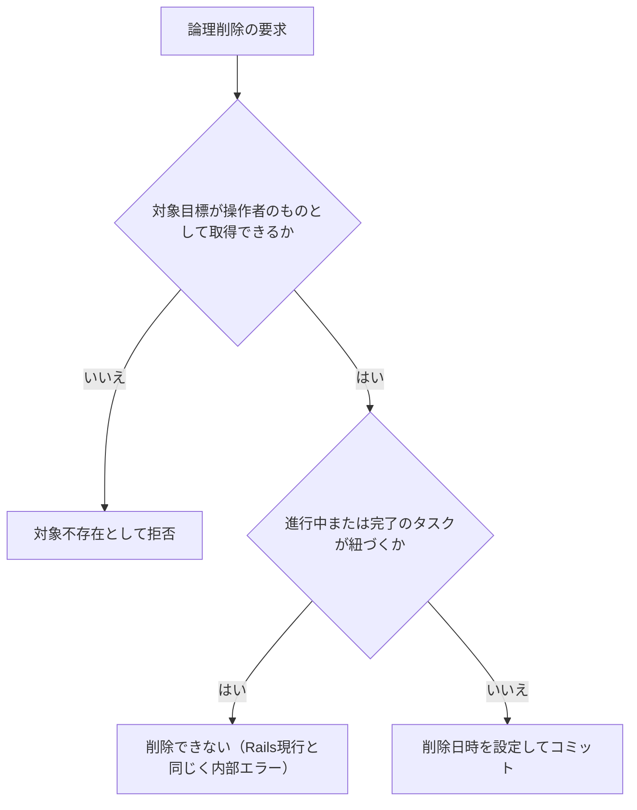
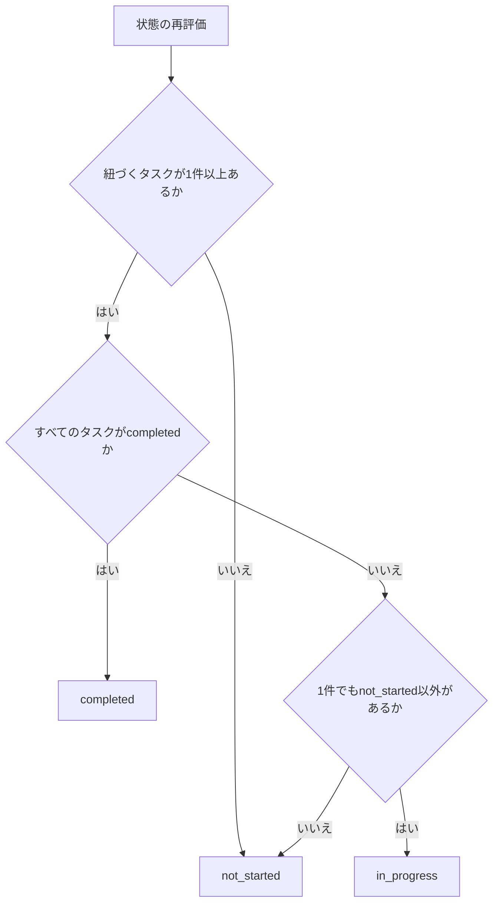

# 目標管理機能 Go移行・設計仕様書

---

# 1. 機能概要

## 機能概要

生徒が自分の学習目標を登録・参照・更新・削除できる機能である。Rails現行仕様では、一覧・詳細（いずれも紐づくタスク一覧を含む）・作成・更新・論理削除の5操作を提供する（①「4. API一覧」）。

目標の `status`（not_started / in_progress / completed）は、本機能のAPIでは直接変更しない。紐づくタスクの状況から自動的に決まり、その判定と更新は他機能の操作（タスクの着手・問題の提出）を契機に行われる（①「7. 状態管理」）。

## 利用者

- 生徒ユーザー（student ロール）
- 自分が作成した目標のみ操作可能

## 業務上の目的

- 学習目標を可視化し、期限を管理できるようにする
- 目標の一覧・詳細で、目標に紐づくタスクの状況を合わせて確認できるようにする
- 生徒自身が自分の目標を作成・更新・削除できるようにする
- タスクの進捗に応じて目標の状態が自動的に追随するようにする

---

# 2. 設計方針

本機能は、Rails実装の構造をそのまま置き換えるのではなく、目標というデータの作成・参照・更新という業務に責務を絞ったGo設計とする。特に `status` 属性の扱いについては、現行仕様に存在しない遷移ルールをGo側で先回りして作り込まないことを方針とする。

主な設計思想は以下のとおりである。

- 責務分離: HTTP・入力検証・所有権チェック・永続化を分離する
- 保守性: status属性を型として明示しつつ、将来遷移ルールが追加された際の拡張ポイントを意識した構造にする
- テスト容易性: ユースケース単位で作成・更新・参照の振る舞いを検証できるようにする
- 拡張性: タスクとの関連参照が増えても、目標のコアロジックに影響しない構造にする
- API互換性: 既存エンドポイントと主要なリクエスト・レスポンス構造を維持する

---

# 3. Bounded Context

## Context名

- goal-management

## Contextの責務

- 生徒の目標の作成・参照・更新・論理削除
- 目標の基本情報（タイトル・詳細・期限・状態）の整合性管理
- 紐づくタスクの状況から目標の状態を再評価して更新する操作の公開。判定ルール（どのタスク状況がどの状態に対応するか）は本Contextが持つ

## 他Contextとの依存関係

- `task-management` Context: 目標詳細取得時に、紐づくタスク一覧を参照するために依存する
- `draft-task` Context: 目標には、正式なタスクのほかに生徒が作成途中で保存した下書きタスク（DraftTask）が紐づき得る（Rails現行仕様書6章 `has_many :draft_tasks`）。下書きタスク自体の登録・管理は`draft-task` Contextの責務であり、本Contextは目標詳細表示等で参照する立場に限定される
- `user` Context: 認証済み生徒の識別と所有権の確認に依存する

本Contextを参照する側の依存も生じる。

- `task-management` Context: タスクの着手時に、本Contextが公開する「目標の状態の再評価」操作を呼ぶ（①「7. 状態管理」の`Student::TaskStartService`に対応）
- `question-answering` Context: 問題の提出時に、同じ操作を呼ぶ（同`Student::SubmissionService`に対応）

## 依存する理由

目標詳細画面では、目標そのものの情報に加えて紐づくタスクの状況を表示する業務要件がある。そのため詳細取得時には`task-management` Contextへの参照依存が発生する。同様に、下書きタスクも目標に紐づくデータであるため、目標詳細表示等で参照する場面では`draft-task` Contextへの参照依存が生じ得る。ただし、目標の作成・更新自体はタスク・下書きタスクいずれの状態にも依存しないため、本Contextから他Contextへの依存は「参照のための依存」に限定される。

逆向きの依存（`task-management`・`question-answering` → 本Context）は、目標の状態の決まり方を本Contextに閉じ込めるために設ける。判定ルールを呼び出し側に持たせると、タスクの着手と問題の提出の2箇所に同じルールが重複し、片方だけが修正される。Rails現行も判定（`Student::GoalCompletionService`）と更新（`Student::GoalStatusUpdaterService`）を目標側のServiceに置いており、同じ責務分担である（①「7. 状態管理」）。

本Contextは、この操作の中でタスクの状況を知る必要があるため`task-management` Contextの参照手段を用いる。`question-answering` Contextからの呼び出しでも、参照するのはタスクの状況のみである。

---

# 4. 設計パターン

## 採用パターン

Active Record

## 判断根拠

目標データの主要操作は一覧・詳細・作成・更新というCRUD中心の業務である。ここで重要なのは、Goalが `status` という状態属性を持つにもかかわらず、Rails現行仕様書7章に明記されているとおり、本APIの中には状態遷移ロジック（遷移条件・遷移禁止ルール等）が一切存在しない点である。つまり現行仕様におけるGoalの `status` は「保持・表示されるだけの属性」であり、業務ルールとして扱われる遷移ルールを伴わない。

これは、状態を持つEntityであっても直ちにDomain Modelを選択すべきではないことを示す典型例である。「Domain Model採用基準」（状態遷移ルールが存在する場合に採用する）に照らすと、Goalには遷移ルールが存在しないため、この基準を満たさない。

- 主要操作がCRUD中心で、作成・取得・更新の流れが明確である
- 詳細取得時のタスク関連付けは参照であり、Goal側で整合性を管理する必要がない（タスクの実体管理は`task-management` Contextの責務）
- 状態属性はあるが遷移ルールを伴わないため、Entityに複雑な振る舞いを持たせる必要がない

したがって、単純な手続き型のTransaction Scriptよりも、目標データの保存・更新・検証の責務をEntity/Repositoryに寄せやすいActive Recordを採用する。

## 採用しなかったパターン

### Transaction Script

作成・更新時のバリデーション（title/due_date必須）程度であれば手続き型でも表現できる。しかし所有権チェックや期限（DueDate）の妥当性検証をユースケースに直接書き続けると、将来の状態遷移ルール追加時に手続きが肥大化しやすい。データの整合性検証をEntityに寄せる方が保守しやすいため見送る。

### Domain Model

Goalは `status` という状態属性を持つが、現行業務仕様には遷移ルール・遷移条件・複数の業務ルールが存在しない。DDDを目的化してEntityに振る舞いを持たせることは「Domain Model採用基準」に反するため見送る。ただし、将来的に「タスクの完了状況からGoalのstatusを自動算出する」等の業務ルールが追加された場合は、Domain Model化を再検討する対象とする（推測を含む将来拡張の想定）。

### Event Sourcing

状態遷移イベントの再構築要件が存在せず、過剰設計であるため見送る。

---

# 5. Aggregate設計

Aggregateを大きく分ける必要はなく、Goal単体を中心に扱う。

## Aggregate Root

- Goal

## Aggregateに含めるEntity

- Goalのみ（Task / DraftTaskは含めない）

## Aggregate境界

- Goalは自身の基本情報（title / description / due_date / status）の整合性のみを保証する単位とする
- Task / DraftTaskはGoalのAggregate外の参照情報として扱い、それらの整合性は`task-management` Contextの責務とする

## 整合性を保証する単位

- Goal単体の作成・更新

理由: 目標詳細取得時に紐づくタスクを表示するが、タスクの整合性は`task-management` Context側の責務であり、Goalの更新がタスクの整合性に影響を与える業務ルールが現行仕様には存在しない。そのため、GoalとTaskを1つのAggregateとして統合する必要はない。

---

# 6. Entity設計

## Goal

- 役割: 生徒の学習目標を表す中心的なドメイン概念
- ライフサイクル: 作成 → 参照・更新 → 論理削除
- 状態変化: `status`（not_started / in_progress / completed）を保持する。値は本機能のAPIの入力では変更せず、紐づくタスクの状況から再評価して決まる（「3. Bounded Context」の公開操作、「8. Domain Service」）
- 保持する責務:
  - title / description / due_dateの基本情報を保持する
  - 必須項目（title）の整合性を維持する。期限（due_date）は、カラムがNULL可であるため型としては未設定を許容するが、API経由の作成・更新では必須である（①「6. データモデル」・①「5. API / 処理詳細」）
  - 所有者（user_id）を保持する
  - 論理削除してよいかを自ら判定する。**進行中または完了のタスクが紐づく場合は削除できない**（①「5. API / 処理詳細」`#destroy`の業務ルール）
  - 与えられたタスクの状況から、自身のあるべき状態を決める
- 判断根拠: 目標情報の主要な業務データであり、操作の中心対象であるため。削除可否の判定と状態の決定は、いずれも「目標から見た業務ルール」であり、目標自身が持つのが自然である

## Task（参照専用）

- 役割: 目標詳細画面で関連情報として参照される
- 判断根拠: 本機能の中心はGoalであり、Taskの実体管理は`task-management` Contextの責務であるため、本機能では参照専用として扱う

## DraftTask（参照専用）

- 役割: 目標に紐づき得る下書きタスクとして、目標詳細画面等で関連情報の対象となる
- 判断根拠: 下書きタスクの作成・編集・正式タスクへの変換といった実体管理は`draft-task` Contextの責務であるため、本機能では正式なTaskと同様に参照専用として扱う（Rails現行仕様書6章の`has_many :draft_tasks`に基づく関係）

---

# 7. Value Object設計

## GoalStatus

- 採用理由: 状態値を文字列のまま扱うと無効な値が混入する余地があるため、許容値を型として明示する
- 独自ルール: not_started / in_progress / completedのいずれかのみ許容する。ただし現行仕様どおり、遷移ルールは持たせない（許容値の集合を表現するのみ）
- Entity属性ではなくValue Objectにする理由: 許容値の妥当性検証をEntity内に散在させず一元化するため。将来、遷移ルールが追加された場合の受け皿としても位置づける

## DueDate

- 採用理由: Rails現行仕様では期限日を `YYYY/MM/DD` 形式で表示しており、表示・保存・比較の扱いを一元化する必要があるため
- 独自ルール: 保存値と表示用フォーマットを分離する、期限の比較演算を提供する。型としては**未設定（NULL）を許容する**（①「6. データモデル」のとおりカラムがNULL可で、Serializerも未設定なら`null`を返す）。ただしAPI経由の作成・更新では必須であり、未設定の目標は既存データとしてのみ存在しうる
- Entity属性ではなくValue Objectにする理由: 期限の意味が業務上重要であり、フォーマット変換ロジックを分離して再利用しやすくするため

## Value Objectを採用しないもの

- title / description: 単純な文字列表現であり、追加の業務ルールを持たないため、Value Object化は不要とする

---

# 8. Domain Service

## GoalStatusPolicy

- 責務: 目標に紐づくタスクの状況から、目標のあるべき状態を判定する。判定は次のとおりである（①「7. 状態管理」の`Student::GoalCompletionService`と同じ）
  - タスクが1件もない場合: `not_started`
  - すべてのタスクが`completed`の場合: `completed`
  - 1件でも`not_started`以外がある場合: `in_progress`
  - 上記以外: `not_started`
- Entityへ持たせない理由: 判定にはGoal単体では保持し得ない「紐づくタスクの集合の状態」が必要なため。Goal Entityに持たせると、Entityがタスクの集合を検索する責務まで抱えることになる
- 判断根拠: この判定は`task-management`（タスクの着手）と`question-answering`（問題の提出）の2つの経路から呼ばれる。ルールを1箇所に集約しないと、経路ごとに同じ判定が重複して片方だけが修正される。Policyとして切り出すことで、タスクの集合の状態を引数で受け取る純粋な判定にでき、DBを経由せずルール単体を検証できる

## 追加で必要としないService

- 論理削除の可否判定（進行中・完了のタスクが紐づくか）は、判定に必要な事実を引数で受け取れば単一の目標に閉じるため、Goal Entityの責務とする（「6. Entity設計」）

---

# 9. クラス図

「5. Aggregate設計」「6. Entity設計」「7. Value Object設計」「8. Domain Service」で整理した関係を次のとおり可視化する。Active Record採用のため、永続化操作はEntity相当のstructと同一packageに置くStoreとして実装される（「11. Repository設計」）。属性・操作は概要レベルで示し、Goのstruct定義は③Go実装仕様書で扱う。

DraftTaskは目標に紐づき得るが、本機能のレスポンスには現れないため図に含めない（「6. Entity設計」）。

---

# 10. 状態遷移図

目標は`status`という状態を持ち、紐づくタスクの状況に応じて遷移する（①「7. 状態管理」）。遷移は本機能のAPIの入力では起こらず、タスクの着手・問題の提出を契機に再評価されたときに起こる。

遷移が禁止される組み合わせはない。再評価は毎回タスクの状況から状態を決め直すため（「8. Domain Service」のGoalStatusPolicy）、現在の状態に関わらずどの状態へも移りうる。

論理削除できるのは、進行中または完了のタスクが紐づかない場合に限る（①「5. API / 処理詳細」`#destroy`）。`in_progress`・`completed`はいずれも「not_started以外のタスクが存在する」状態であるため、実際には`not_started`からのみ削除できる。

---

# 11. Repository設計

**実装上の位置づけ**: 本機能はActive Record採用のため、Repository Interfaceをdomain層に定義しない。以下は永続化・検索責務の設計意図であり、実装時はEntity相当のstructと同一packageに置くStore(例: `〇〇Store`)として直接実装する(規約: アーキテクチャ規約.md「3. 設計パターンごとの構造適用方針」)。

## GoalStore

- 管理対象: Goal
- 責務:
  - 生徒の目標一覧取得（紐づくタスクを同時に取得する）
  - 指定目標の取得（同じく紐づくタスクを同時に取得する）
  - 作成
  - 更新
  - 論理削除（削除日時の設定）
  - 状態の更新（「3. Bounded Context」の公開操作から呼ばれる）
- 保持する検索機能:
  - user_idによる絞り込み
  - due_date昇順ソート。期限が同じ場合はid昇順で並べる（①「5. API / 処理詳細」`#index`）
  - ページネーション
  - 論理削除済みを除外する絞り込み（①「6. データモデル」の`default_scope`に相当）
- 保持しない責務:
  - 業務ルール判定（削除可否・状態の決定）
  - 認可判定
- 判断根拠: 永続化と検索に特化させ、業務ロジックを持たせないため
- 関連の取得: 一覧・詳細のレスポンスはいずれも紐づくタスクを含むため、目標ごとにタスクを個別に問い合わせる形にはしない（①「5. API / 処理詳細」`#index`の処理内容。Rails現行も`includes_tasks`で一括読み込みしている）

## TaskStore（参照用）

- 管理対象: Task（本Contextでは読み取り専用）
- 責務:
  - 指定goal_idに紐づくタスク一覧取得（一覧・詳細の表示用）
  - 指定goal_idに紐づくタスクの状態の集合の取得（状態の再評価・削除可否の判定に用いる）
- 保持しない責務: タスクの作成・更新（`task-management` Contextの責務）、状態の判定そのもの（GoalStatusPolicy・Goal Entityの責務）
- 判断根拠: 目標の一覧・詳細に必要な関連情報の取得と、業務ルールの判定に必要な事実の取得に限定するため。`task-management` Contextが公開する参照手段を呼び出す形とし、そのためのインターフェースは本Contextの`dependency.go`に置く（規約「5. Context間連携ルール」）

---

# 12. UseCase設計

**実装上の位置づけ**: 本機能はActive Record採用のため、UseCase層(struct)を設けない。以下はHandlerが行う業務操作の設計意図であり、実装時はHandlerがStoreを直接呼び出す処理として実装する。

## ListGoals(Handler処理)

- 目的: 生徒の目標一覧を取得する
- 入力: current user, page, per_page
- 出力: 目標一覧（各目標に紐づくタスクを含む）とページ情報
- トランザクション範囲: 読み取りのみ、トランザクション不要
- 呼び出すStore: GoalStore
- 判断根拠: 単純な一覧取得であり、業務ルールが少ないため。紐づくタスクは目標ごとに問い合わせず、一覧取得で一括して得る（「11. Repository設計」）

## ShowGoal(Handler処理)

- 目的: 指定目標の詳細と、紐づくタスク一覧を取得する
- 入力: current user, goal id
- 出力: 目標詳細情報とタスク一覧
- トランザクション範囲: 読み取りのみ
- 呼び出すStore: GoalStore, TaskStore
- 判断根拠: 詳細画面表示に必要な関連タスク情報を含めて返すため

## CreateGoal(Handler処理)

- 目的: 新しい目標を作成する
- 入力: current user, 目標作成リクエスト
- 出力: 作成結果（id）
- トランザクション範囲: Goal作成を1トランザクションで扱う
- 呼び出すStore: GoalStore
- 判断根拠: 単一Entityの作成のみで完結し、他Entityとの整合性同期が不要なため

## UpdateGoal(Handler処理)

- 目的: 既存目標を更新する
- 入力: current user, goal id, 更新リクエスト
- 出力: 更新結果（id）
- トランザクション範囲: Goal更新を1トランザクションで扱う
- 呼び出すStore: GoalStore
- 判断根拠: 所有権確認と更新を一貫して行うため。更新できるのはtitle / description / due_dateであり、statusは入力として受け取らない（①「5. API / 処理詳細」`#update`）

## DeleteGoal(Handler処理)

- 目的: 指定目標を論理削除する
- 入力: current user, goal id
- 出力: なし（削除成功のみ）
- トランザクション範囲: Goalの削除日時の設定を1トランザクションで扱う
- 呼び出すStore・Context:
  - GoalStore（対象取得・削除日時の設定）
  - `task-management` Contextの参照（紐づくタスクの状態の集合）
- 判断根拠: 進行中または完了のタスクが紐づく目標は削除できないという業務ルールがあるため（①「5. API / 処理詳細」`#destroy`）。判定はGoal Entityが行い、判定に必要なタスクの状態は参照で取得する。物理削除ではなく削除日時の設定であり、タスク側の行は削除しない

## ReevaluateGoalStatus(他Contextから呼ばれる公開操作)

- 目的: 紐づくタスクの状況から目標の状態を再評価し、変化があれば更新する
- 入力: 目標の識別子
- 出力: 再評価後の状態
- トランザクション範囲: 呼び出し側がトランザクションを開始していればそれに参加し、なければ本操作が開始する（「14. Transaction設計」）
- 呼び出すStore・Context:
  - `task-management` Contextの参照（紐づくタスクの状態の集合）
  - GoalStatusPolicy（状態の判定）
  - GoalStore（状態の更新）
- 呼び出し元: `task-management` Context（タスクの着手）、`question-answering` Context（問題の提出）
- 判断根拠: ①「7. 状態管理」のとおり、Rails現行は判定（`Student::GoalCompletionService`）と更新（`Student::GoalStatusUpdaterService`）を目標側のServiceに置き、タスクの着手・問題の提出から呼んでいる。同じ責務分担を維持する。本操作は認可を行わない。「その目標の状態を変えてよいか」は呼び出し側が判定済みである（「16. Authorization設計」）

---

# 13. シーケンス図・処理フロー図

## シーケンス図

Active Record採用のため、HandlerがStoreを直接呼び出す（「12. UseCase設計」）。

### 一覧・詳細の参照

目標ごとにタスクを個別に問い合わせない（「11. Repository設計」）。

### 論理削除

### 状態の再評価（他Contextから呼ばれる）

呼び出し側がトランザクションを開始している場合はそれに参加する（「14. Transaction設計」）。

## 処理フロー図

論理削除と状態の再評価に判断が集まるため、それぞれの流れを示す。

一覧・詳細の参照と、作成・更新は所有者による絞り込みと入力検証のみで分岐を持たないため、処理フロー図を設けない。

---

# 14. Transaction設計

## Transaction開始位置

- Handlerの処理単位に対応するStoreメソッド内でトランザクションを開始する

## Transaction終了位置

- CreateGoal / UpdateGoal / DeleteGoalの処理では、Goalの保存（削除日時の設定を含む）が完了した時点でコミットする
- ListGoals / ShowGoalの処理ではトランザクションを使用しない

## 呼び出し側トランザクションの引き継ぎ

ReevaluateGoalStatusは他Contextから呼ばれる。呼び出し側（`task-management`のタスクの着手、`question-answering`の問題の提出）が既にトランザクションを開始している場合はそれに参加し、なければ本操作が開始する。トランザクションは`context.Context`で引き継ぐ（規約「11. Transaction実装パターン（TransactionManager）」の「呼び出し側トランザクションの引き継ぎ」）。

タスクの着手・問題の提出と目標の状態更新が別トランザクションになると、タスクだけが進んで目標の状態が古いまま残る状態が起こりうるため、参加させる。

## 理由

- Goal単体の作成・更新・削除であり、複数テーブルにまたがる整合性維持が不要なため、タスク管理機能のような複合的なトランザクション設計は不要である
- Handlerの処理単位で境界を明確にし、テスト・保守のしやすさを確保するため

---

# 15. Validation設計

## Presentation

- 型チェック: HTTP入力の型を検証する
- 必須チェック: title / due_dateの必須項目を検証する
- フォーマットチェック: due_dateの日付形式を検証する

## Domain

- 業務ルール: 他ユーザーの目標へのアクセス・更新を禁止する（所有権チェック）
- 状態チェック: statusは許容値（GoalStatus）の範囲内であることのみを確認し、遷移の妥当性チェックは行わない（現行仕様に遷移ルールがないため）
- 整合性チェック: DueDateとして不正な日付でないことを確認する

## 責務分離

- Presentationは「入力が正しいか」を担当する
- Domainは「業務的に妥当か（所有権・値の許容範囲・削除可否）」を担当する

## バリデーション仕様

|フィールド|検証層|ルール|エラーメッセージ方針|
|-|-|-|-|
|`id`（パス）|Presentation|必須・整数であること|入力形式の不正として扱う|
|`page`|Presentation|整数であること。不正な形式は未指定として扱い、エラーとしない|Rails現行と同じ扱いを維持する|
|`per_page`|Presentation|整数であること。既定値は5、上限は100。0以下・数値以外は既定値、上限超過は上限値として扱い、エラーとしない|Rails現行と同じ扱いを維持する（①「5. API / 処理詳細」`#index`）。規約「15. API規約（レスポンス形式・ページネーション・URL・クエリパラメータ）」は既定値と上限を②で定めることとしている|
|`title`|Presentation|作成時は必須・文字列であること|入力形式の不正として扱う|
|`description`|Presentation|文字列であること（任意）|入力形式の不正として扱う|
|`due_date`|Presentation|**必須**・日付として解釈できる文字列であること。Rails現行のFormが`presence: true`としており、API経由では未設定にできない（①「5. API / 処理詳細」`#create`・`#update`）|未入力・形式不正はいずれも入力形式の不正として扱う。形式不正のメッセージは`は正しい日付を入力してください`を踏襲する|
|`status`|—|**入力として受け取らない。** 紐づくタスクの状況から決まる（「3. Bounded Context」）|—|
|対象目標|Domain|操作者自身の目標であること。他の生徒の目標は対象不存在として扱う|対象不存在として扱う（Rails現行も`current_user.goals`を起点にするため404になる）|
|削除可否|Domain|進行中または完了のタスクが紐づかないこと（①「5. API / 処理詳細」`#destroy`）|Rails現行はこの違反時に500となる。「17. Error設計」のとおり現行の挙動を維持する|

---

# 16. Authorization設計

## Middleware

- 認証済みユーザーを特定し、ユーザー情報をコンテキストに保持する
- 役割がstudentであることを確認する

## Handler

- ルーティング層でAPIの入口を担当し、認証失敗時のHTTP応答を整える
- 具体的な業務権限判定は持たせない

## UseCase

- current userのスコープに基づいて、自分の目標のみ取得・作成・更新・削除できるようにする
- 取得・更新・削除の対象の目標が自分のものかどうかをHandler/Store側で判断する
- ReevaluateGoalStatus（他Contextから呼ばれる公開操作）は認可を行わない。「その目標の状態を変えてよいか」は呼び出し側（タスクの着手・問題の提出）が、操作者と対象の関係を確認済みである。本操作にcurrent userを渡さないのは、認可の二重実装を避けるためである

## Domain

- Goal Entityが所有者（user_id）を保持し、Handler側からの所有権確認の材料を提供する

## 判断理由

Rails現行仕様も「current_user.goalsを起点に全検索を行う」というシンプルな設計であり、これをHandlerでのスコープ限定としてそのまま踏襲するのが自然である。認可はHTTPレベル・業務レベルで責務を分けることで、権限の変更に強い構造とする。

---

# 17. Error設計

## Domain Error

- 責務: ドメインルール違反を表現する
- 例: 不正なdue_date、statusの許容値外の値
- 判断理由: 業務ルール違反をアプリケーション層に漏らさず、ドメイン側で明示的に扱うため

## Application Error

- 責務: ユースケース実行時の失敗を表現する
- 例: 対象目標が存在しない、または他ユーザーの目標である場合の404相当のエラー、バリデーション失敗の422相当のエラー
- 判断理由: ユースケースの失敗理由をHTTPレスポンスに変換しやすくするため

## Infrastructure Error

- 責務: DB接続失敗・永続化失敗を表現する
- 判断理由: 永続化層の失敗をドメインに漏らさず、技術的な障害として切り分けるため

## 層間の変換

- Domain ErrorはHTTPステータス・ログレベルを持たない。どう外部に見せるかはApplication層のエラー型が担う
- Active Record採用のためDomain Errorに相当する層が薄く、structやStoreが返すエラーをそのままApplication Error相当として扱ってよい（規約「12. Error変換パターン（AppError）」の「Transaction Script / Active Record採用時の変換」）
- Presentation層は、Application Errorが持つステータスコードを用いてレスポンスを組み立てる

## 判断理由

タスク管理機能・問題解答機能と同様に、業務ルール違反・ユースケース失敗・技術的失敗を分離することで、HTTPステータスへの変換を明確にするため。

## エラー仕様

|業務シナリオ|エラー種別|発生層|想定するHTTPステータス|
|-|-|-|-|
|対象目標が存在しない、または他の生徒の目標|NotFound|Application|404|
|`title`が未入力（作成時）|Validation|Presentation|422|
|`due_date`の形式が不正|Validation|Presentation|422|
|`page` / `per_page`の形式が不正|エラーとしない|—|—（既定値で処理する）|
|進行中または完了のタスクが紐づく目標を削除しようとした|Internal|Domain（判定）→ Application（変換）|**500**|
|未認証|Unauthorized|Middleware|401|
|`student`ロールでない|Forbidden|Middleware|403|
|DB接続・永続化の失敗|Internal|Infrastructure → Application（変換）|500|

## エラーレスポンスの本文

Rails現行の本文の形をそのまま維持する（①「6. データモデル」の「エラーレスポンスの本文」）。

|条件|HTTPステータス|本文|
|-|-|-|
|入力・業務検証の失敗|422|`{"errors": ["メッセージ", ...]}`|
|対象目標不存在|404|`{"message": "目標が見つかりません"}`|
|認可エラー|403|`{"errors": ["この操作を行う権限がありません"]}`|

422・403は規約「15. API規約（レスポンス形式・ページネーション・URL・クエリパラメータ）」の「エラーレスポンス」と同じ形式である。404のみ`message`の単一文字列であり、規約の形式と異なる。

404を`errors`形式へ揃えず、Rails現行のまま維持する。フロントエンドを変更しない方針であり、本文の形を変えるとフロントエンドの404ハンドリングの修正が必要になるためである。規約「15. API規約」は、Rails現行が規約と異なるステータスを返す機能について「互換を優先し、②で明記した上で維持する」としており、本件はその扱いに準じる。

なお404の本文の形は`ApplicationController#not_found`が決めており、本機能に固有の事項ではない。全機能で同じ形になる。揃えるのであれば規約側に本文の形についての例外を明記する必要がある。

削除できない場合を500とするのは、Rails現行がそうなっているためである。`Goal::HasActiveTasksError`に対するハンドラがControllerにも`ApplicationController`にも無く、例外がそのまま500になる（①「5. API / 処理詳細」`#destroy`のErrorケース）。業務ルール違反としては422が自然だが、API外部仕様を変えない方針（「2. 設計方針」）を優先する。422へ改めるかは別途の判断とする。

---

# 18. Domain Event

本機能では現時点でDomain Eventを採用しない。

理由: 目標の作成・更新・削除に対して、他処理へ波及する非同期の通知が現行仕様に存在しないためである。

タスクの状況から目標の状態を更新する連携は存在するが（①「7. 状態管理」）、これはイベントによる非同期の波及ではない。Rails現行も、タスクの着手・問題の提出の処理の中で目標側のServiceを**同期的に**呼んでいる。本設計も同じく、呼び出し側のトランザクションに参加する同期の操作とする（「12. UseCase設計」ReevaluateGoalStatus、「14. Transaction設計」）。複数の処理へ波及する通知ではないため、規約「5. Context間連携ルール」のDomain Event採用条件も満たさない。

---

# 19. API仕様

## エンドポイント一覧

|エンドポイント|HTTP Method|概要|
|-|-|-|
|/api/v1/student/goals|GET|生徒の目標一覧取得|
|/api/v1/student/goals/:id|GET|目標詳細取得|
|/api/v1/student/goals|POST|目標の作成|
|/api/v1/student/goals/:id|PATCH|目標の更新|
|/api/v1/student/goals/:id|DELETE|目標の論理削除|

いずれもRails現行仕様と同じURL・HTTP Methodを維持する。

## 各エンドポイントの仕様

### GET /api/v1/student/goals

- Request: クエリパラメータ`page`（任意・整数。0以下・数値以外は1ページ目として扱う）、`per_page`（任意・整数。既定値5、上限100）
- Response: 最上位は`goals`と`meta`の2キー。`goals`の各要素は目標の識別子・タイトル・説明・状態・期限（`YYYY/MM/DD`形式。未設定なら`null`）と、**紐づくタスクの配列**。タスクの各要素は識別子・所有者・目標の識別子・タイトル・内容・期限・優先度・状態・完了日時と、紐づく単元の配列である。`meta`は`current_page` / `total_pages` / `total_count` / `per_page`の4項目（①「5. API / 処理詳細」`#index`）
- Status Code: 正常系200。異常系は未認証401、`student`ロール不一致403
- Error Response方針: 「17. Error設計」の「エラーレスポンスの本文」のとおり

### GET /api/v1/student/goals/:id

- Request: パスパラメータ`id`
- Response: 最上位をラップしないオブジェクトとし、項目は一覧の各要素と同じ（①「5. API / 処理詳細」`#show`）
- Status Code: 正常系200。異常系は対象目標不存在404（他の生徒の目標を含む）、未認証401、`student`ロール不一致403

### POST /api/v1/student/goals

- Request: ボディは`goal`キーの下に`title`・`description`・`due_date`
- Response: 作成された目標の識別子のみ（①「5. API / 処理詳細」`#create`）
- Status Code: 正常系201。異常系は入力不正422、未認証401、`student`ロール不一致403

### PATCH /api/v1/student/goals/:id

- Request: パスパラメータ`id`。ボディは`goal`キーの下に`title`・`description`・`due_date`。`status`は受け取らない
- Response: 更新された目標の識別子のみ
- Status Code: 正常系200。異常系は対象目標不存在404、入力不正422、未認証401、`student`ロール不一致403

### DELETE /api/v1/student/goals/:id

- Request: パスパラメータ`id`
- Response: 本文なし
- Status Code: 正常系204。異常系は対象目標不存在404、進行中または完了のタスクが紐づく場合500（「17. Error設計」）、未認証401、`student`ロール不一致403

## Railsとの差分

API外部仕様（URL・HTTP Method・リクエスト形式・レスポンス構造・ステータスコード）はRails現行仕様から変更しない。一覧・詳細がいずれも紐づくタスクを含むこと、作成・更新が識別子のみを返すこと、削除が204で本文を返さないこと、削除できない場合が500になることも、Rails現行と同一である。

内部の責務には次の差分がある。

- Rails仕様: 目標の状態の判定（`Student::GoalCompletionService`）と更新（`Student::GoalStatusUpdaterService`）が、目標側のServiceとして置かれ、タスクの着手・問題の提出から呼ばれている（①「7. 状態管理」）
- Go設計での変更: 同じ責務分担を維持し、判定ルールをGoalStatusPolicy（「8. Domain Service」）に、更新を本Contextの公開操作ReevaluateGoalStatus（「12. UseCase設計」）に置く
- 変更理由: 判定ルールを呼び出し側に持たせると、タスクの着手と問題の提出の2箇所に同じルールが重複し、片方だけが修正される
- 影響範囲: 本機能の5エンドポイントの外部仕様に変更はない。`task-management`・`question-answering`の②③は、自前で目標の状態を書き換えず、本Contextの公開操作を呼ぶ形になる

---

# 20. DB設計方針

## 現行DBを利用するか

- 既存Rails DBを継続利用する

## Schema変更有無

- 変更なし

## 変更理由

- 現行仕様で `goals` テーブルを利用しており、statusカラムを含め移行対象の業務要件を満たしているため
- 追加スキーマは不要であり、既存データとの整合性を維持する方が安全である

## 既存カラムの型・制約

既存カラムの型・制約もそのまま利用する。とくに次の3点は、現行DBを継続利用する以上、Go側の実装がこれに合わせる必要がある（①「6. データモデル」）。

- `status`はRailsの`enum`として**整数**で保持される（`not_started`=0 / `in_progress`=1 / `completed`=2）。既定値は`0`である。APIの入出力は文字列であり、永続化との間で相互変換が必要になる
- `due_date`は**NULL可**である。既存データに未設定の目標が存在しうるため、Value Object（DueDate）も未設定を許容する。一方、API経由の作成・更新ではFormが必須としているため、新たに未設定の目標は作られない（①「5. API / 処理詳細」）
- 論理削除は`deleted_at`で表す。Railsは`default_scope`で削除済みを除外しており、本設計でも検索条件に含める

## 変更を提案しない理由

- 今回の移行対象はCRUDと状態の再評価であり、いずれも既存カラムで表現できるためスキーマ拡張は不要である

---

# 21. DB操作仕様

## GoalStore

- 対象テーブル: `goals`
- 操作種別:
  - 参照: 操作者の目標一覧、指定目標1件
  - 作成: 目標の追加
  - 更新: タイトル・説明・期限の更新、状態の更新（再評価の結果）、削除日時の設定
- 主な検索条件・絞り込み条件:
  - 所有者が操作者と一致すること
  - 削除日時が未設定であること（①「6. データモデル」の`default_scope`に相当）
  - 1件取得では目標の識別子が一致すること（所有者スコープ付き）
- 関連テーブルとの結合: 必要である。一覧・詳細のレスポンスが紐づくタスクを含むため、`tasks`をあわせて取得する。**目標ごとにタスクを個別に問い合わせない**（①「5. API / 処理詳細」`#index`の処理内容。Rails現行も一括で読み込んでいる）
- ページネーション・ソート: 一覧取得で必要である。期限の昇順で並べ、期限が同じ場合は識別子の昇順とする。ページ単位で取得するとともに、絞り込み条件に一致する総件数を取得する。1ページあたり件数の既定値は5

## 他Contextの参照手段

- 対象テーブル: なし。本Contextからはクエリを発行しない
- 紐づくタスクの状態の集合の取得は`task-management` Contextに委ねる（「11. Repository設計」）。削除可否の判定と状態の再評価の、いずれもこの参照結果を入力とする
- 判断根拠: 「タスクの状態とは何か」の判断を`task-management` Contextに集約するためである。本Contextが`tasks`を独自に解釈すると判断が2箇所に分かれる

一覧・詳細の表示に必要なタスクの情報は、画面向けの一覧であるため`goals`との結合で取得する。一方、業務ルールの判定に用いるタスクの状態の集合は、判断の前提となる事実であるため`task-management` Contextの参照に委ねる。

---

# 22. テスト戦略

## Domain Test

- 目的: GoalStatus / DueDateの許容値・妥当性検証（DueDateは未設定を許容すること）、Goalの論理削除可否の判定、GoalStatusPolicyによる状態の判定（タスクが0件・全件completed・1件でもnot_started以外の3分岐）を検証する

## UseCase Test

- 目的: 一覧・詳細・作成・更新・論理削除・状態の再評価の各Handler処理の業務振る舞いと所有権チェックを検証する（Active Record採用のためUseCase層を設けないため、③では本区分を「対象外」とし、Handler Testに統合する。「12. UseCase設計」）。論理削除では、進行中または完了のタスクが紐づく場合に削除されないこと、状態の再評価では、呼び出し側のトランザクションに参加することを検証する

## Repository Test

- 目的: GoalStoreによる所有者絞り込み・期限昇順（期限が同じ場合は識別子昇順）・ページング・作成・更新・削除日時の設定の正確性を検証する（Active Record採用のため、③では「Store Test」として扱う）。一覧・詳細で紐づくタスクが一括取得され、目標ごとの追加クエリが発生しないことも検証する

## Handler Test

- 目的: API入力のバリデーション結果とHTTPステータスの変換を検証する。一覧が`goals`と`meta`の2キーで返り、各目標が紐づくタスクを含むこと、作成・更新が識別子のみを返すこと、削除が204で本文を返さないことを含む

## Integration Test

- 目的: エンドポイント経由で一覧・詳細・作成・更新・論理削除が正常に動作することを確認する。あわせて、タスクの着手・問題の提出を契機に目標の状態が再評価されることを、`task-management`・`question-answering`との連携として確認する

---

# 23. Railsとの責務対応

| Rails | Go | 設計方針 |
|---|---|---|
| Controller | Handler | HTTP入力の受け取りとレスポンス整形に限定する |
| Form Object（Student::CreateGoalForm / UpdateGoalForm） | Request DTO + Validation | 入力検証をPresentation層で分離する |
| Query（GoalsQuery） | Store | 検索条件の構築をStoreに集約する |
| Model（Goal） | struct + Store（同一package） | 業務ルールはstructのメソッド、永続化・検索はStoreとして整理する |
| Serializer（Student::GoalSerializer / GoalDetailSerializer） | Presenter / Response DTO | 画面に返すレスポンス整形を分離する。いずれも紐づくタスクを含める |
| Model（Goal#soft_delete! / active_tasks） | struct のメソッド（論理削除可否の判定） | 削除可否の判定を目標自身の責務として整理する |
| Service（Student::GoalCompletionService） | GoalStatusPolicy（Domain Service） | 状態の判定ルールを本Contextに集約する |
| Service（Student::GoalStatusUpdaterService） | ReevaluateGoalStatus（本Contextの公開操作） | 他Contextから呼ばれる更新の入口を1つにまとめる |

---

# 24. 採用しなかった設計

## Domain Model

- 採用しなかった理由: 主要操作が一覧・詳細・作成・更新・削除というCRUD中心であり、Entityに振る舞いを集約するコストに見合う複雑さがないため。状態の遷移は存在するが、判定ルールは「紐づくタスクの状態の集合から決まる」という1つのPolicyに収まり、遷移の可否を条件分岐で管理する必要がない（「10. 状態遷移図」のとおり禁止される組み合わせがない）
- 将来的に採用する可能性: 遷移の可否に条件が加わる（特定の状態からの遷移を禁じる等）、または目標が複数のEntityにまたがる整合性を持つようになった場合は再検討する

## Transaction Script

- 採用しなかった理由: 所有権チェックやDueDateの妥当性検証をユースケースに集中させすぎると、将来のルール追加時に保守性が下がるため
- 将来的に採用する可能性: 機能が極めて単純化された場合には再検討できる

## Event Sourcing

- 採用しなかった理由: 現状の要件には状態遷移イベントの再構築が不要であり、過剰な設計であるため
- 将来的に採用する可能性: 目標の変更履歴を監査する要件が生じた場合に有効な可能性がある

---

# 25. 設計判断サマリー

| 項目 | 採用 | 判断理由 |
|---|---|---|
| 設計パターン | Active Record | CRUD中心の業務であり、状態の判定が1つのPolicyに収まるため |
| Aggregate | Goal単位 | タスクとの関連は参照に留まり、統合する業務要件がないため |
| Transaction境界 | Handlerの処理単位（Storeメソッド内） | 1業務処理と整合性保証の単位として自然なため |
| Domain Event | 未採用 | 状態の更新は同期の操作であり、複数処理へ波及する通知がないため |
| Value Object | GoalStatus / DueDateを採用 | 状態の許容値と期限の意味を明示するため。DueDateは未設定を許容する |
| Domain Service | GoalStatusPolicyを採用 | 状態の判定ルールを、2つの呼び出し経路で重複させないため |
| 状態の更新の入口 | 本Contextの公開操作に一本化 | 判定ルールを呼び出し側に持たせると、タスクの着手と問題の提出で重複するため |
| 論理削除 | Goal自身が可否を判定 | 判定に必要な事実（タスクの状態）を引数で受け取れば単一の目標に閉じるため |
| Authorization | Handler/Store + Middleware | 認証と業務スコープを分離して管理しやすくするため |

---

# 設計差分管理

## Rails現行仕様

- Form Object（CreateGoalForm / UpdateGoalForm）とControllerで入力検証・保存処理が分散している
- 目標の状態は、`Student::GoalCompletionService`（判定）と`Student::GoalStatusUpdaterService`（更新）が担い、`Student::TaskStartService`（タスクの着手）と`Student::SubmissionService`（問題の提出）から呼ばれる（①「7. 状態管理」）
- 論理削除の可否判定（進行中・完了のタスクが紐づくか）は`Goal#soft_delete!`がモデル内で行う。違反時の例外にハンドラがなく500になる（①「5. API / 処理詳細」`#destroy`）

## Go設計での変更内容

- 入力検証をPresentation層に集約する
- 所有権チェック・値の整合性チェックをDomain/Handler層に集約する
- 状態の判定ルールをGoalStatusPolicy（Domain Service）に、更新を本Contextの公開操作に置く。`task-management`・`question-answering`は自前で状態を書き換えず、この操作を呼ぶ
- 論理削除の可否判定をGoal自身の責務とし、判定に必要なタスクの状態は`task-management` Contextの参照で取得する

## 変更理由

- 状態の判定ルールを呼び出し側に持たせると、タスクの着手と問題の提出の2箇所に同じルールが重複し、片方だけが修正される。Rails現行も判定・更新を目標側のServiceに置いており、その責務分担を維持する
- 論理削除の可否は目標から見た業務ルールであり、Goal自身が判定するのが自然である。判定に必要なタスクの状態は事実の取得にとどめ、`task-management` Contextに委ねる

## 影響範囲

- フロントエンドから見たAPI外部仕様は維持する。削除できない場合が500になる点も現行のままとする
- `task-management`・`question-answering`の②③は、目標の状態を自前で書き換えず、本Contextの公開操作を呼ぶ形になる。`question-answering`はバッチ3の対象外であり、同機能の②③の追随時に合わせる
- 既存DBスキーマは維持するため、データ移行は不要
- 入力検証と業務ルール判定を分離することで、テストと保守性を高めるため

## 影響範囲

- フロントエンドから見たAPIの外部仕様は概ね維持するが、内部構造はGoらしい責務分割に変更する
- 既存DBスキーマは維持するため、データ移行やマイグレーションの追加は不要
- 将来的にstatus遷移ルールが追加された場合は、Domain Model化のための再設計が必要になる点を影響範囲として明記する
