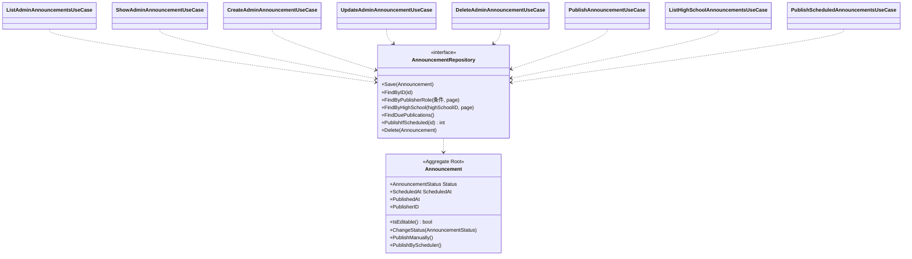
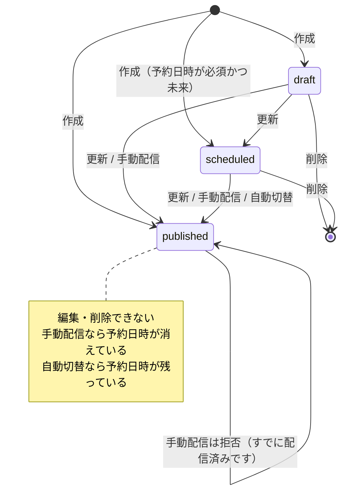
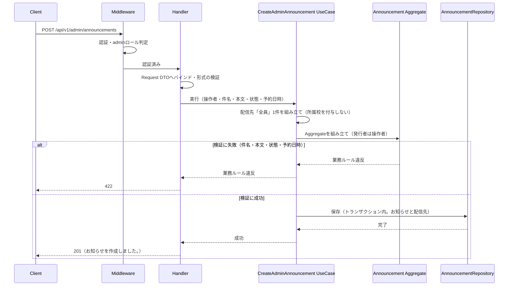
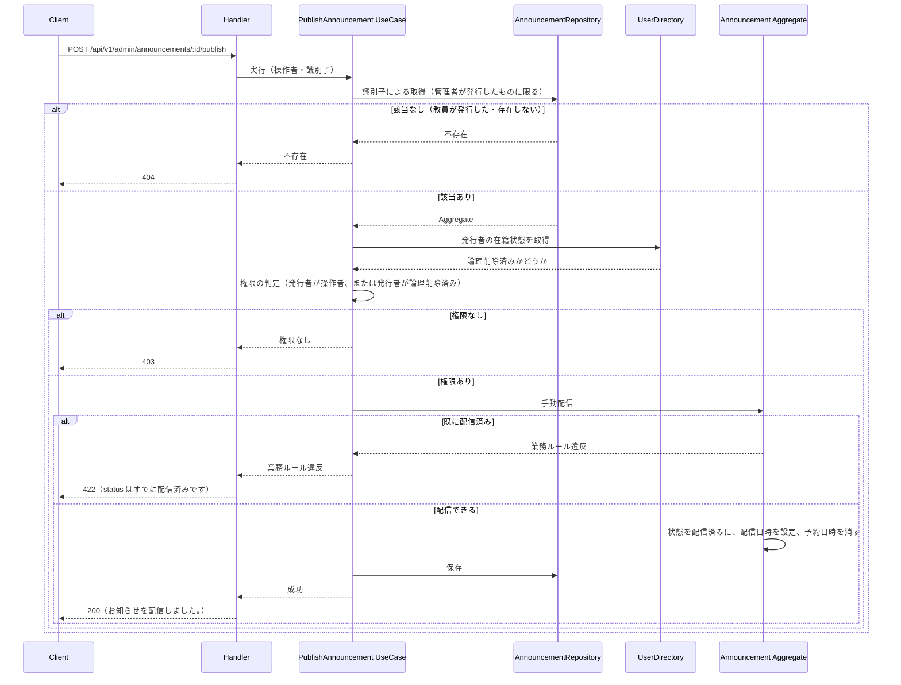
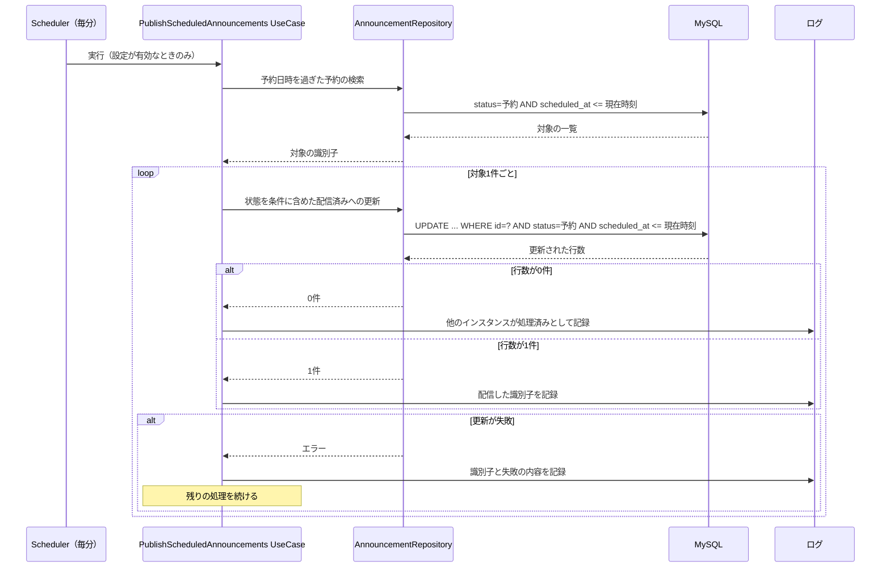
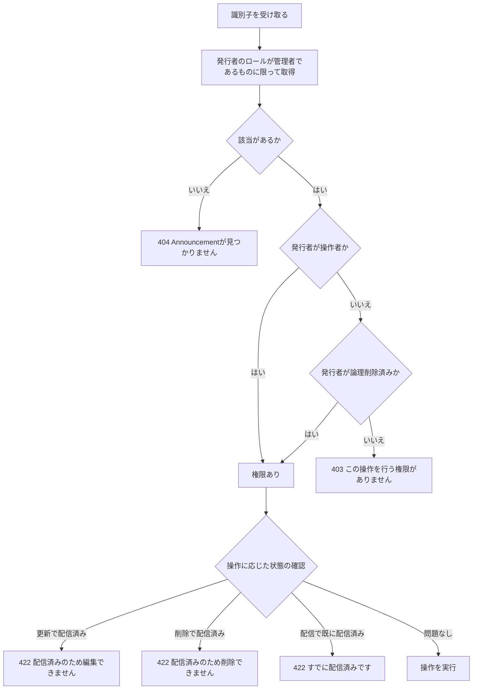
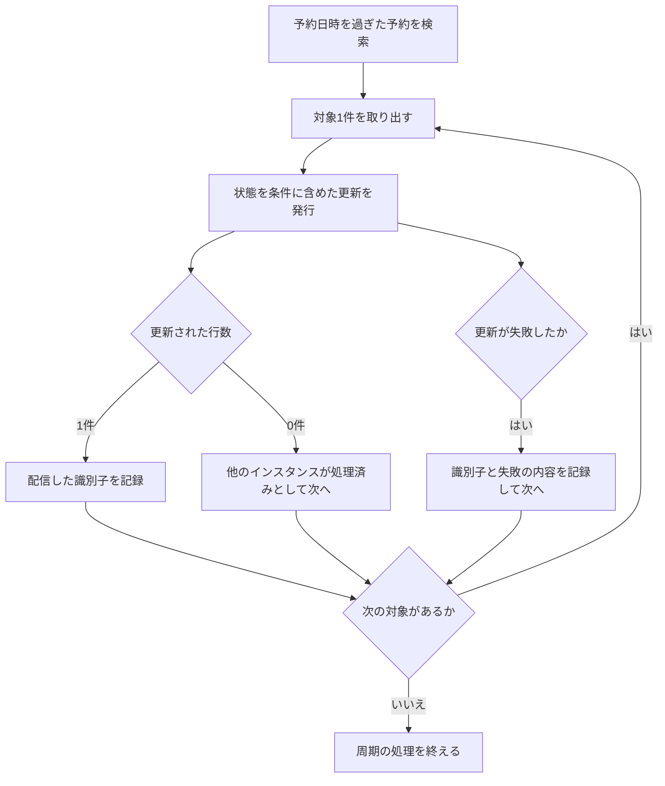

# 管理者お知らせ管理機能 Go移行・設計仕様書

---

# 1. 機能概要

## 機能概要

管理者が、全利用者に向けたお知らせを作成・更新・削除・配信できるようにする機能である。あわせて高校ごとのお知らせを参照できるようにする（①「1. 機能概要」）。

提供する操作は7つである（①「2. 機能一覧」）。

- お知らせ一覧取得（件名の検索・状態の絞り込み・ページ指定）
- お知らせ詳細取得
- お知らせ作成
- お知らせ更新（部分更新）
- お知らせ削除
- お知らせ配信（手動）
- 高校別お知らせ一覧取得

**3つのお知らせ機能のうち、削除と手動配信を持つのは本機能のみである。** また**予約配信の自動切替**も本機能が担う。

**管理者が作成するお知らせは全利用者に届く。** 配信先は「全員」が自動的に1件だけ設定され、所属校による絞り込みを行わない。管理者が配信先を指定する手段はない。

## 利用者

`admin` ロールのユーザー（管理者）のみ（①「8. 権限制御」）。

## 業務上の目的

全利用者に向けた連絡（システムの告知・運用上の案内など）を届けられるようにすること。配信前の内容を下書きとして保持し、予約配信で指定した日時に届けられるようにすること。高校ごとのお知らせを確認できるようにすることで、教員が自校向けに出した連絡を把握できるようにすること。

---

# 2. 設計方針

- **Contextを共有する他機能の定義に従う**: `announcement` Contextはお知らせ機能・教師お知らせ機能・管理者お知らせ管理機能の3文書が共有する。**Domain層の定義（Aggregate・Entity・Value Object・状態遷移・Domain Service・Repository）は教師お知らせ機能②に集約されている。** 本書では繰り返さず、同書を参照する。
- **配信先を固定することを設計で表す**: 管理者が配信先を指定できない点は、入力項目を持たないことと、配信先を「全員」で組み立てることで表す。配信先の指定可否の判定（`TargetDeliverabilityPolicy`）の対象にしない。
- **予約配信の自動切替を定期実行として設計する**: 規約「13. 非同期ジョブ実行パターン（JobQueue）」の「定期実行」に従う。`jobs`テーブルを使わず、対象データ自身の状態を条件にした更新で二重実行を防ぐ。
- **手動配信と自動切替の違いを保つ**: 手動配信は予約日時を消し、自動切替は消さない。Rails現行の振る舞いであり、どちらの経路で配信されたかが状態から分かる形を維持する。
- **API互換性を維持する**: URL・HTTPメソッド・レスポンス項目名・HTTPステータスをRails現行から変えない。フロントエンドを変更しない方針のため、Rails現行の振る舞いに不合理な点があっても本移行では踏襲し、Rails側の修正課題として別に管理する（「19. API仕様」の「Railsとの差分」）。

---

# 3. Bounded Context

## Context名

- `announcement`

## Contextを共有する機能

本Contextは3つの機能文書が共有する。一覧・責務・持たない責務・他Contextとの依存関係は**教師お知らせ機能②「3. Bounded Context」に集約する。** 本書では本機能に関わる点のみを示す。

|機能|本書との関係|
|-|-|
|お知らせ機能|配信されたお知らせの参照のみ|
|教師お知らせ機能|**Domain層の定義の正本。** 自校内への配信を担う|
|管理者お知らせ管理機能（本書）|全利用者への配信、削除、手動配信、予約配信の自動切替、高校別の参照|

## 本機能の責務

- 管理者が発行したお知らせの作成・更新・削除・手動配信
- 管理者が発行したお知らせの一覧・詳細の提供（件名の検索・状態の絞り込み）
- 高校を配信先に含むお知らせの提供
- **予約配信の自動切替**（予約日時を過ぎた予約状態のお知らせを配信済みへ切り替える）

## 本機能が持たない責務

|持たない責務|担う機能・Context|
|-|-|
|配信先の指定とその検証|教師お知らせ機能。本機能は配信先を「全員」で固定する|
|自校内への絞り込み|同。管理者は所属校を持たないため適用しない|
|ユーザーのロール・在籍状態の定義|`user`（ユーザー基盤機能②「3. Bounded Context」）|
|高校マスタの保持|`master-data`（共通マスタ参照機能②「3. Bounded Context」）|
|生徒・教員向けのお知らせの参照|お知らせ機能・教師お知らせ機能|

## 他Contextとの依存関係

本Contextから他Contextへの参照依存のみである。

|依存先Context|参照する内容|根拠|
|-|-|-|
|`user`|認証済み管理者の識別。発行者の在籍状態（権限の判定に使う）。管理者のロールの識別子（一覧の対象の絞り込みに使う）|①「5. API / 処理詳細」`#index`・`#update`、①「8. 権限制御」|
|`master-data`|高校別一覧で指定された高校の実在|同`Api::V1::Admin::HighSchools::AnnouncementsController#index`|

## 依存する理由

一覧・詳細・更新・削除・配信の対象を「発行者のロールが管理者であるお知らせ」で絞り込む（①「5. API / 処理詳細」`#index`）。この絞り込みには管理者のロールが何であるかの情報が必要であり、ロールを定義しているのは`user`である。

更新・削除・配信の権限の判定に「発行者が論理削除済みであるか」を使う（①「8. 権限制御」）。在籍状態を定義しているのも`user`である。

高校別一覧は高校の実在確認を行い、存在しない識別子を`404`とする（①「5. API / 処理詳細」）。高校マスタを所有しているのは`master-data`である。

---

# 4. 設計パターン

## 採用パターン

Domain Model

## 判断根拠

判断根拠は**教師お知らせ機能②「4. 設計パターン」に集約する。** 同じContextを共有し、同じ`Announcement` Aggregateを扱うためである。

本機能に固有の根拠として次を加える。

- **状態遷移の経路が本機能で最も多い。** 作成（3状態）・更新・手動配信・自動切替の4つの経路から配信済みへ遷移する。遷移の規則をEntityに集約しないと、4か所に同じ判定が重複する
- **削除の可否が状態に依存する。** 配信済みでないお知らせのみ削除できる（①「5. API / 処理詳細」`#destroy`）。この判定もEntityが持つ
- **手動配信と自動切替で副作用が異なる。** どちらも配信済みへ遷移するが、予約日時の扱いが違う（①「7. 状態管理」）。遷移に伴う副作用の違いをEntityの操作として表し分ける

## 採用しなかったパターン

**教師お知らせ機能②「4. 設計パターン」の「採用しなかったパターン」に集約する。**

本機能に固有の点として、Transaction Scriptを採用しない理由を補う。本機能は配信済みかどうかの判定を更新・削除・配信の3経路で行う。関数内のガード節で表すと3か所に重複し、Rails現行がまさにその構造である（モデルのコールバック・Policy・Serviceに分散）。

---

# 5. Aggregate設計

**教師お知らせ機能②「5. Aggregate設計」に集約する。** `Announcement`をAggregate Rootとし、配信先（`AnnouncementTarget`）を含む境界である。

本機能がこの境界に対して行う操作を整理する。

|操作|境界への作用|
|-|-|
|作成|お知らせと配信先（「全員」1件）を同時に作る|
|更新|お知らせの属性のみを変える。**配信先は変えない**|
|削除|お知らせと配信先をまとめて削除する|
|手動配信|お知らせの状態・配信日時・予約日時を変える。配信先は変えない|
|自動切替|お知らせの状態・配信日時を変える。配信先は変えない|

**本機能に配信先を入れ替える操作がない。** 作成時の「全員」1件が維持される（①「5. API / 処理詳細」`#update`）。教師お知らせ機能が配信先を全件入れ替えるのとは異なる。

削除で配信先もまとめて削除するのは、配信先が単独で存在しないためである（教師お知らせ機能②「6. Entity設計」）。

---

# 6. Entity設計

**教師お知らせ機能②「6. Entity設計」に集約する。** `Announcement`・`AnnouncementTarget`の定義は同書のとおりである。

本機能に固有の点として、`Announcement`が持つ責務のうち本機能が使うものを示す。

|責務|使う操作|
|-|-|
|状態遷移の可否の判定|更新・手動配信・自動切替|
|配信済みかどうかによる変更可否の判定|更新・削除|
|状態が配信済みに変わるときの配信日時の設定|作成（配信済み）・更新・手動配信・自動切替|
|予約状態における予約日時の必須と未来日時の検証|作成・更新|
|配信先の集合の保持と1件以上あることの保証|作成|

本機能が使わない責務: 配信先の全件入れ替え（「5. Aggregate設計」）。

`AnnouncementTarget`は作成時に「全員」1件を組み立てるためにのみ使う。**自校への絞り込みを適用しない。** 管理者は所属校を持たず、付与しても意味がないためである（①「5. API / 処理詳細」`#create`）。

---

# 7. Value Object設計

**教師お知らせ機能②「7. Value Object設計」に集約する。** `AnnouncementStatus`・`ScheduledAt`・`DeliveryTargetType`の定義は同書のとおりである。

本機能が使う範囲を示す。

|Value Object|本機能での使い方|
|-|-|
|`AnnouncementStatus`|作成・更新・手動配信・自動切替の遷移判定。一覧の絞り込み条件|
|`ScheduledAt`|作成・更新の検証。**手動配信で消す**|
|`DeliveryTargetType`|作成時に「全員」を指定するためにのみ使う。自校絞り込みの対象かの判定は使わない|

本機能に固有のValue Objectは設けない。

|概念|理由|
|-|-|
|件名の検索語|部分一致の対象となる文字列であり、規則を持たない。ワイルドカード文字のエスケープは検索の実装で行う|
|状態の絞り込み条件|`AnnouncementStatus`の値を任意で受け取る。既知でない値は未指定として扱う（①「5. API / 処理詳細」`#index`）。この扱いはPresentation層で表す|

---

# 8. Domain Service

**教師お知らせ機能②「8. Domain Service」に集約する。** 同書が定める`TargetDeliverabilityPolicy`は配信先の指定可否の判定である。

**本機能ではこの判定を使わない。** 配信先が「全員」1件で固定され、管理者が指定する手段がないためである（①「5. API / 処理詳細」`#create`）。判定の対象になる入力が存在しない。

本機能に固有のDomain Serviceも設けない。

|検討した判定|持たせない理由|
|-|-|
|更新・削除・配信の権限の判定（発行者が操作者か、発行者が論理削除済みか）|お知らせと操作者の識別子、発行者の在籍状態を突き合わせる判定である。在籍状態は`user`が所有する外部情報だが、判定自体は「2つの識別子が一致するか」「真偽値が真か」であり、規則と呼べる複雑さがない。UseCaseのガード節として扱う|
|手動配信の可否（既に配信済みでないか）|`Announcement`が自身の状態から判定できる|
|削除の可否（配信済みでないか）|同|
|自動切替の対象かどうか|状態が予約で予約日時が現在時刻以前であるという検索条件であり、判定ではない（「11. Repository設計」）|

---

# 9. クラス図

**教師お知らせ機能②「9. クラス図」に集約する。** Entity・Value Object・Domain Service・Repositoryの関係は同書のとおりである。

本機能のUseCaseとの関係を示す。

`PublishManually`と`PublishByScheduler`を分けるのは、予約日時の扱いが異なるためである（①「7. 状態管理」）。どちらも配信済みへ遷移し配信日時を設定するが、手動のみ予約日時を消す。

`PublishIfScheduled`は自動切替専用の操作である。更新条件に遷移前の状態を含めた更新を行い、更新された行数を返す（規約「13. 非同期ジョブ実行パターン（JobQueue）」の「二重実行は状態の更新条件で防ぐ」）。

Goのstruct定義・インターフェースのシグネチャは③Go実装仕様書で扱う。

---

# 10. 状態遷移図

**教師お知らせ機能②「10. 状態遷移図」に集約する。**

本機能が関与する経路を示す。

|操作|遷移|副作用|
|-|-|-|
|作成（`draft`）|→ 下書き|なし|
|作成（`scheduled`）|→ 予約|予約日時が必須かつ未来日時|
|作成（`published`）|→ 配信済み|配信日時に現在時刻を設定|
|更新|下書き → 予約・配信済み、予約 → 配信済み|配信済みへの遷移で配信日時を設定|
|手動配信|下書き・予約 → 配信済み|配信日時を設定し、**予約日時を消す**|
|自動切替|予約 → 配信済み|配信日時を設定し、**予約日時を消さない**|
|削除|配信済みでない状態からのみ可能|お知らせと配信先を削除|

**配信済みのお知らせに予約日時が残っているかどうかで、どちらの経路で配信されたかが分かる。** 手動配信は予約日時を消し、自動切替は残す（①「9. 非同期処理」）。この違いはRails現行の振る舞いであり、移行でも維持する（「19. API仕様」の「変更しないもの」）。

---

# 11. Repository設計

**教師お知らせ機能②「11. Repository設計」に集約する。** `AnnouncementRepository`の定義は同書のとおりである。

本機能が使う検索・操作を示す。

|操作|条件|用途|
|-|-|-|
|Aggregateの保存|-|作成・更新・手動配信|
|識別子による取得|識別子（**発行者のロールが管理者であるものに限る**）|詳細・更新・削除・手動配信|
|発行者のロールによる検索|発行者のロールが管理者。件名の部分一致・状態。作成日時の降順（同値は識別子の降順）。ページネーション|一覧|
|高校を配信先に含むお知らせの検索|配信先の高校が一致するもの。重複を除く。作成日時の降順。ページネーション|高校別一覧|
|予約日時を過ぎた予約の検索|状態が予約、予約日時が現在時刻以前|自動切替|
|状態を条件に含めた配信済みへの更新|識別子、状態が予約、予約日時が現在時刻以前|自動切替。更新された行数を返す|
|Aggregateの削除|識別子|削除|

## 対象の絞り込みについて

一覧・詳細・更新・削除・配信の対象は「発行者のロールが管理者であるお知らせ」である（①「5. API / 処理詳細」`#index`）。この絞り込みはRepositoryの検索条件として表す。

- **教員が発行したお知らせは絞り込みで除かれ、`404`となる。** 権限の判定より前の段階である（①「8. 権限制御」）
- 発行者が論理削除済みの管理者であっても対象に含まれる。在籍状態で絞り込まない
- 管理者のロールの識別子は`user`の参照手段から取得する。本Contextがロールの定義を持たない

## 自動切替の検索と更新について

規約「13. 非同期ジョブ実行パターン（JobQueue）」の「定期実行」に従う。

- **`jobs`テーブルを使わない。** 対象データ自身が状態（予約・予約日時）を持っており、ジョブ行は同じ情報の二重管理になる（規約同節）
- 対象の検索と更新を分ける。検索でまとめて対象を取り、更新は1件ずつ行う
- **更新条件に遷移前の状態を含める。** 「状態が予約、かつ予約日時が現在時刻以前、かつ識別子が一致」を条件にした更新を発行し、更新された行数が0件なら他のインスタンスが既に処理したものとして扱う（規約同節）
- 配信日時も同時に更新する。Rails現行では状態の変更に伴ってモデルが配信日時を埋めるが、Go側では更新条件付きの更新で同時に設定する（規約同節が同じ判断を示している）
- **予約日時を消さない**（①「9. 非同期処理」）
- 予約日時の比較がずれないよう、接続のタイムゾーンを固定する（Gorm規約「4. タイムスタンプのトラッキング」）

## 他Contextの参照手段

本Contextの`dependency.go`にインターフェースとして宣言し、実装は相手Contextの公開操作へ委譲するアダプタに閉じ込める（規約「4. Bounded Context構成」・「5. Context間連携ルール」）。

|参照手段|相手Context|取得する内容|用途|
|-|-|-|-|
|管理者のロールの参照|`user`|管理者ロールの識別子|一覧・詳細・更新・削除・配信の対象の絞り込み|
|ユーザー属性の参照|`user`|発行者の在籍状態（論理削除済みかどうか）|更新・削除・配信の権限の判定|
|高校の実在確認|`master-data`|指定された高校が存在するか|高校別一覧|

発行者の氏名・氏名カナは`announcements.publisher_id`から`users`を結合して取得する。Repositoryの検索の中で行う（お知らせ機能②「11. Repository設計」と同じ扱い）。

---

# 12. UseCase設計

## ListAdminAnnouncements

- 目的: 管理者が発行したお知らせを、件名の検索・状態の絞り込み・ページ指定で取得する
- 入力: 件名の検索語（任意）、状態（任意）、ページ番号、1ページあたりの件数
- 出力: お知らせの一覧（識別子・件名・状態・最初の配信先の種類・配信日時・予約日時・作成日時・発行者）とページ情報。**本文を含まない**
- トランザクション範囲: 読み取りのみのため不要
- 呼び出すRepository: `AnnouncementRepository`（発行者のロールによる検索）
- 呼び出す参照手段: 管理者のロールの参照（`user`）
- 判断根拠: 絞り込み条件を検索へ渡すだけであり、分岐を持たない

**権限の判定を行わない。** 管理者が発行したお知らせであれば、他の管理者のものも一覧に現れる（①「8. 権限制御」）。

**`target_type`は最初の配信先の種類のみを返す。** 管理者が作成したお知らせは配信先が「全員」1件であるため常に同じ値になるが、Rails現行の実装に合わせる（①「5. API / 処理詳細」`#index`）。

状態の絞り込みで既知でない値を受け取った場合は絞り込みを行わない。エラーにしない（同）。

## ShowAdminAnnouncement

- 目的: 管理者が発行したお知らせ1件を取得する
- 入力: お知らせの識別子
- 出力: 一覧の各要素と同じ項目に本文を加えたもの
- トランザクション範囲: 不要
- 呼び出すRepository: `AnnouncementRepository`（識別子による取得）
- 呼び出す参照手段: 管理者のロールの参照
- 判断根拠: 状態による絞り込みを行わないため、下書き・予約も取得できる

**権限の判定を行わない。** 他の管理者が発行したお知らせの詳細も取得できる（①「5. API / 処理詳細」`#show`）。更新・削除・配信では判定する点と異なる。

## CreateAdminAnnouncement

- 目的: 件名・本文・配信方法を指定してお知らせを作成する
- 入力: 操作者の識別子、件名、本文、状態、予約日時
- 出力: なし（成功のメッセージのみ）
- トランザクション範囲: **お知らせと配信先の作成を1つのトランザクションで行う**
- 呼び出すRepository: `AnnouncementRepository`（保存）
- 処理
  1. 配信先として「全員」1件を組み立てる。**所属校を付与しない**
  2. お知らせを組み立てる。発行者は操作者とする
  3. Aggregateを保存する
- 判断根拠: 配信先が固定であるため、配信先の指定可否の判定を行わない（「8. Domain Service」）

**作成したお知らせの識別子を返さない。** 教師お知らせ機能の作成が`announcement_id`を返すのとは異なる（①「5. API / 処理詳細」`#create`）。

状態は必須である。教師お知らせ機能が未指定を下書きとして扱うのとは異なる（同）。

## UpdateAdminAnnouncement

- 目的: お知らせの内容・配信方法を部分的に更新する
- 入力: 操作者の識別子、お知らせの識別子、**渡された項目のみ**（件名・本文・状態・予約日時）
- 出力: なし（成功のメッセージのみ）
- トランザクション範囲: お知らせの更新のみであり、単一の書き込みである。Repositoryの保存に委ねる
- 呼び出すRepository: `AnnouncementRepository`（識別子による取得、保存）
- 呼び出す参照手段: 管理者のロールの参照、ユーザー属性の参照
- 処理
  1. 識別子でAggregateを取得する。該当しなければ不存在として扱う
  2. 操作者に権限があることを確認する。ない場合は拒否する
  3. お知らせが編集可能であることを確認する。配信済みなら拒否する
  4. 渡された項目のみを更新する。状態遷移の可否はEntityが判定する
  5. Aggregateを保存する
- 判断根拠: 部分更新であるため、どの項目が渡されたかを入力で区別する必要がある

**部分更新である。** リクエストに含まれなかった項目は更新しない（①「5. API / 処理詳細」`#update`）。渡された項目の集合を入力に含める。

**配信先を更新しない。** 作成時の「全員」1件が維持される。

## DeleteAdminAnnouncement

- 目的: 配信済みでないお知らせを削除する
- 入力: 操作者の識別子、お知らせの識別子
- 出力: なし
- トランザクション範囲: **お知らせと配信先の削除を1つのトランザクションで行う**
- 呼び出すRepository: `AnnouncementRepository`（識別子による取得、削除）
- 呼び出す参照手段: 管理者のロールの参照、ユーザー属性の参照
- 処理
  1. 識別子でAggregateを取得する。該当しなければ不存在として扱う
  2. 操作者に権限があることを確認する
  3. お知らせが配信済みでないことを確認する。配信済みなら拒否する
  4. Aggregateを削除する
- 判断根拠: 物理削除であり、配信先もまとめて削除する（「5. Aggregate設計」）

## PublishAnnouncement

- 目的: お知らせを手動で配信済みにする
- 入力: 操作者の識別子、お知らせの識別子
- 出力: なし（成功のメッセージのみ）
- トランザクション範囲: お知らせの更新のみであり、単一の書き込みである
- 呼び出すRepository: `AnnouncementRepository`（識別子による取得、保存）
- 呼び出す参照手段: 管理者のロールの参照、ユーザー属性の参照
- 処理
  1. 識別子でAggregateを取得する。該当しなければ不存在として扱う
  2. 操作者に権限があることを確認する
  3. **既に配信済みであれば拒否する**
  4. 手動配信としてお知らせを配信済みにする。配信日時を設定し、**予約日時を消す**
  5. Aggregateを保存する
- 判断根拠: 手動配信と自動切替で副作用が異なるため、Entityの操作を分ける（「9. クラス図」）

**下書き・予約のいずれからも配信できる。** 既に配信済みの場合のみ拒否する（①「5. API / 処理詳細」`#publish`）。

## ListHighSchoolAnnouncements

- 目的: 指定した高校を配信先に含むお知らせを取得する
- 入力: 高校の識別子、ページ番号、1ページあたりの件数
- 出力: お知らせの一覧（識別子・件名・**本文**・状態・配信日時・予約日時・作成日時・**その高校に向けられた配信先**・発行者）とページ情報
- トランザクション範囲: 不要
- 呼び出すRepository: `AnnouncementRepository`（高校を配信先に含むお知らせの検索）
- 呼び出す参照手段: 高校の実在確認（`master-data`）
- 処理
  1. 高校の実在を確認する。存在しない場合は不存在として扱う
  2. その高校を配信先に含むお知らせを取得する
  3. お知らせごとに、**その高校に向けられた配信先だけを抜き出す**
- 判断根拠: 高校の実在確認を行うのはRails現行の振る舞いである（①「5. API / 処理詳細」）

**本文を返す。** 管理者向けのお知らせ一覧が本文を返さないのとは異なる（同）。

**発行者のロールを問わない。** 教員が自校向けに作成したお知らせが主な対象になる。管理者が作成したお知らせは配信先の高校が未設定であるため現れない（同）。

配信先を絞り込んで返すのは、他校向け・全校向けの配信先を管理者に見せないためである。この絞り込みはUseCaseで行う。Repositoryは配信先の全件を含むAggregateを返し、表示に出す範囲をUseCaseが決める。

## PublishScheduledAnnouncements（定期実行）

- 目的: 予約日時を過ぎた予約状態のお知らせを配信済みへ切り替える
- 入力: なし（現在時刻を基準とする）
- 出力: なし
- トランザクション範囲: **1件ごとに更新を発行する。全体を1つのトランザクションで囲まない**
- 呼び出すRepository: `AnnouncementRepository`（予約日時を過ぎた予約の検索、状態を条件に含めた配信済みへの更新）
- 処理
  1. 状態が予約で予約日時が現在時刻以前のお知らせを検索する
  2. 1件ずつ、状態を条件に含めた更新を発行する
  3. 更新された行数が0件なら、他のインスタンスが既に処理したものとして次へ進む
  4. **1件が失敗しても、残りの処理を続ける**
  5. 成功・失敗をそれぞれ記録に残す
- 判断根拠: 規約「13. 非同期ジョブ実行パターン（JobQueue）」の「定期実行」に従う

全体を1つのトランザクションで囲まない理由は、1件の失敗で周期全体が巻き戻ると、先頭の1件が恒久的に失敗する状態になったときに以降のすべての配信が止まるためである（規約同節）。

**発行者のロールを問わない。** 管理者が作成した予約も教員が作成した予約も対象になる（①「9. 非同期処理」）。

有効・無効は設定値で切り替える（規約同節）。

---

# 13. シーケンス図・処理フロー図

## シーケンス図

### CreateAdminAnnouncement

### PublishAnnouncement（手動配信）

### PublishScheduledAnnouncements（定期実行）

## 処理フロー図

### 更新・削除・配信の対象の絞り込みと権限の判定

**対象の絞り込みと権限の判定が別の段階である。** 教員が発行したお知らせは絞り込みで除かれて`404`、他の管理者が発行したお知らせは絞り込みを通過してから権限の判定で`403`になる（①「8. 権限制御」）。

### 自動切替の二重実行の防止

更新条件に遷移前の状態を含めることで、複数インスタンスが同じ対象を取得しても二重に配信されない（規約「13. 非同期ジョブ実行パターン（JobQueue）」の「二重実行は状態の更新条件で防ぐ」）。

---

# 14. Transaction設計

- **Transaction開始位置**: UseCase
- **Transaction終了位置**: UseCase

## 理由

規約「11. Transaction実装パターン（TransactionManager）」の基本方針（UseCase単位）に従う。

|UseCase|トランザクション|理由|
|-|-|-|
|`CreateAdminAnnouncement`|**使う**|お知らせと配信先（「全員」1件）の作成が複数の書き込みにまたがる|
|`DeleteAdminAnnouncement`|**使う**|お知らせと配信先の削除が複数の書き込みにまたがる|
|`UpdateAdminAnnouncement`|使わない|お知らせの更新のみであり単一の書き込みである。配信先を変えない|
|`PublishAnnouncement`|使わない|同|
|`PublishScheduledAnnouncements`|**使わない（全体として）**|1件ごとに更新を発行する。1件の失敗で周期全体を巻き戻さないため（規約「13. 非同期ジョブ実行パターン（JobQueue）」の「定期実行」）|
|一覧・詳細・高校別一覧|使わない|読み取りのみ|

`UpdateAdminAnnouncement`・`PublishAnnouncement`で排他ロックを取らない。配信先を入れ替えないため、同時更新で配信先が混ざる余地がないためである。教師お知らせ機能の更新がロックを取るのとは異なる（教師お知らせ機能②「14. Transaction設計」）。

同じお知らせに対する同時更新では、後の更新が前の更新を上書きする。Rails現行も同様であり、楽観ロックの仕組みを持たない。配信済みへの遷移が重なった場合も、状態遷移の規則により2回目が拒否される。

`PublishScheduledAnnouncements`の1件ごとの更新は、**更新条件に遷移前の状態を含めることで排他する。** トランザクションではなく更新条件で二重実行を防ぐ（規約同節）。

他Contextの参照手段の呼び出しは、トランザクションの外で行う。管理者のロール・発行者の在籍状態・高校の実在はいずれも判定に必要な情報の取得であり、本Contextの書き込みと原子性を保証する関係にない。

---

# 15. Validation設計

## Presentation

- 型チェック: `id`・`high_school_id` が整数として解釈できること。`scheduled_at` が日時として解釈できること
- 必須チェック: `announcement` オブジェクトが存在すること
- フォーマットチェック: `page`・`per_page` が整数として解釈できること
- **渡された項目の記録**: 更新では、どの項目がリクエストに含まれていたかを区別する必要がある（部分更新のため）

状態の絞り込み（`status`）で既知でない値を受け取った場合は、絞り込みを行わない値として扱う。エラーにしない（①「5. API / 処理詳細」`#index`）。

## Domain

- 業務ルール
  - 件名が入力されていること（作成時）、255文字以内であること
  - 本文が入力されていること（作成時）、10,000文字以内であること
  - 状態が入力されていること（作成時）、既知の3値のいずれかであること
  - 予約状態のとき、予約日時が設定され未来日時であること
  - 配信先が1件以上あること（作成時に「全員」を設定するため常に満たす）
- 状態チェック
  - 状態遷移が許される組み合わせであること
  - 配信済みのお知らせを編集・削除しようとしていないこと
  - 手動配信の対象が既に配信済みでないこと
- 整合性チェック
  - なし（配信先を入れ替えないため）

## バリデーション仕様

|フィールド|検証層|ルール|エラーメッセージ方針|
|-|-|-|-|
|`announcement`|Presentation|存在すること|「お知らせの内容を指定してください」|
|`title`|Domain|**作成時のみ必須**、255文字以内|Rails現行の文言を維持する。「Title を入力してください」「Title は255文字以内で入力してください」|
|`content`|Domain|**作成時のみ必須**、10,000文字以内|同。「Content を入力してください」「Content は10000文字以内で入力してください」|
|`status`|Domain|**作成時のみ必須**、既知の3値のいずれか|同。「Status を入力してください」「Status は一覧にありません」|
|`scheduled_at`|Presentation|日時として解釈できること|「配信日時の指定が不正です」|
|`scheduled_at`|Domain|状態が予約のとき必須かつ未来日時|Rails現行の文言を維持する。「配信日時 を指定してください」「配信日時 は未来日時を指定してください」|
|状態遷移|Domain|許される組み合わせであること|同。「status は {遷移元} から {遷移先} へは変更できません」|
|編集可否|Domain|配信済みでないこと|同。「is 配信済みのため編集できません」|
|削除可否|Domain|配信済みでないこと|同。「is 配信済みのため削除できません」|
|手動配信の可否|Domain|既に配信済みでないこと|同。「status はすでに配信済みです」|
|`id`・`high_school_id`|Presentation|整数として解釈できること|「お知らせの指定が不正です」「高校の指定が不正です」|
|`page`・`per_page`|Presentation|整数として解釈できること。0以下・数値以外は既定値|エラーにしない|

**更新時に件名・本文・状態の必須検証を行わない。** 作成時のみ必須である（①「5. API / 処理詳細」`#update`）。ただし空文字で渡した場合はDomain層の検証で拒否される。

項目名が英語表記（`Title`・`Content`・`Status`）になるのは、Rails現行で日本語訳が定義されていないためである。`scheduled_at` のみ「配信日時」という訳がある（①「5. API / 処理詳細」`#create`）。

配信済みの編集・削除を拒否するメッセージの項目名の位置に`is`が入るのは、検証の対象が特定の項目ではなく全体であるためである（同`#update`）。Rails現行の文言を維持する。

---

# 16. Authorization設計

|層|判定内容|理由|
|-|-|-|
|Middleware|認証（ログイン済みであること）と`admin`ロールであることを判定する|規約「7. 横断的関心事の置き場所」のとおり、ロールレベルの粗い制御はMiddlewareに置く。認可はCasbin RBACで行う（Gin規約「4. 認可（Casbin RBAC）」）|
|Handler|操作者の識別子をcontextから取り出し、UseCaseへ渡す。リクエストから受け取らない|他人として振る舞えないようにするため|
|UseCase|**対象の絞り込み**（発行者のロールが管理者）をRepositoryの検索条件として行う。**権限の判定**（発行者が操作者、または発行者が論理削除済み）をガード節として行う|絞り込みと権限の判定でHTTPステータスが異なる（`404`と`403`）ため、別の段階として扱う|
|Domain|状態による操作の可否を判定する（配信済みの編集・削除の拒否、既に配信済みの手動配信の拒否）|業務上の制約であり、操作者のロールではなく対象の状態に依存する|

## 判断理由

**対象の絞り込みと権限の判定を分ける。** Rails現行が「発行者のロールが管理者であるお知らせの範囲で識別子を探す」ことと「操作者が発行者か」を別の段階で行っており、結果として返るステータスが異なる（①「8. 権限制御」）。

|状況|段階|ステータス|
|-|-|-|
|教員が発行したお知らせ|絞り込みで除かれる|`404`|
|他の管理者が発行したお知らせ（発行者が在籍中）|絞り込みを通過し、権限の判定で拒否|`403`|
|他の管理者が発行したお知らせ（発行者が論理削除済み）|絞り込みを通過し、権限の判定を通過|操作できる|

**一覧・詳細・高校別一覧では権限の判定を行わない。** 管理者が発行したお知らせであれば、他の管理者のものも参照できる（①「8. 権限制御」）。参照と変更で扱いが異なる。

**発行者が論理削除済みの場合に他の管理者へ操作を許すのは、退職した管理者のお知らせが編集も削除もできなくなることを防ぐためである**（同）。この判定に必要な在籍状態は`user`から取得する。

高校別一覧は全高校のお知らせを参照できる。操作者の所属校による制限はない（管理者は所属校を持たない）。

定期実行（自動切替）は操作者を持たない。認証・認可の対象外である。

---

# 17. Error設計

## Domain Error

責務: 業務ルール違反を表す。

|エラー|意味|
|-|-|
|件名・本文・状態・予約日時の検証失敗|必須・長さ・値域・未来日時|
|状態遷移が許されない|許されない組み合わせへの変更|
|配信済みのため編集できない|配信済みのお知らせへの更新|
|配信済みのため削除できない|配信済みのお知らせの削除|
|すでに配信済み|配信済みのお知らせへの手動配信|

## Application Error

責務: 対象が存在しないこと、および権限がないことを表す。

|エラー|意味|ステータス|
|-|-|-|
|お知らせが存在しない|識別子に該当しない、**教員が発行した**|`404`|
|高校が存在しない|高校別一覧で指定された高校に該当しない|`404`|
|操作する権限がない|発行者が操作者でなく、かつ発行者が在籍中|`403`|

**権限がないことをApplication Errorとして扱う。** Middlewareのロール判定とは別の段階であり、対象の発行者に依存するためである。

## Infrastructure Error

責務: DBアクセスの失敗、他Contextの参照手段の呼び出しの失敗を表す。

本Contextでは個別に判別せず、そのまま呼び出し元へ返して`500`として扱う。

**定期実行では扱いが異なる。** 1件の更新が失敗しても例外を上位へ伝えず、記録に残して次の対象へ進む（「12. UseCase設計」）。

## 判断理由

業務ルール違反・不存在・権限なしを分けるのは、HTTPステータスが異なるためである（`422`・`404`・`403`）。本機能は3つすべてが発生する。他の2つのお知らせ機能は`403`を持たない（お知らせ機能②「17. Error設計」、教師お知らせ機能②「17. Error設計」）。

定期実行で失敗を上位へ伝えないのは、1件の失敗で周期全体が止まることを避けるためである（規約「13. 非同期ジョブ実行パターン（JobQueue）」の「定期実行」）。

## エラー仕様

|業務シナリオ|エラー種別|発生層|想定するHTTPステータス|
|-|-|-|-|
|`announcement`パラメータがない|Validation|Presentation|400|
|`id`・`high_school_id`が整数として解釈できない、`scheduled_at`が日時として解釈できない|Validation|Presentation|422|
|件名・本文・状態・予約日時の検証失敗|BusinessRule|Domain|422|
|状態遷移が許されない|BusinessRule|Domain|422|
|配信済みのため編集できない|BusinessRule|Domain|422|
|配信済みのため削除できない|BusinessRule|Domain|422|
|すでに配信済み（手動配信）|BusinessRule|Domain|422|
|お知らせが存在しない・教員が発行した|NotFound|Application|404|
|高校が存在しない|NotFound|Application|404|
|操作する権限がない|Forbidden|Application|403|
|DBアクセス・他Contextの呼び出しの失敗|Internal|Infrastructure|500|
|未認証|Unauthorized|Middleware|401|
|`admin`ロール以外|Forbidden|Middleware|403|
|定期実行で1件の更新が失敗|記録に残して継続|Application|-（HTTPを経由しない）|

`422`・`403`の本文は規約「15. API規約（レスポンス形式・ページネーション・URL・クエリパラメータ）」に従い`{"errors": [...]}`とする。

`404`の本文はRails現行の`{"message": "..."}`を維持する。お知らせは`{"message": "Announcementが見つかりません"}`、高校は`{"message": "High schoolが見つかりません"}`。モデル名が英語表記になる点も維持する（①「5. API / 処理詳細」）。

---

# 18. Domain Event

不要である。

理由: 本機能の操作に、他の処理へ波及させる必要のある状態変化がない。お知らせを配信してもメール送信・通知の送信は行わない（①「9. 非同期処理」）。

## 予約配信の自動切替をDomain Eventで表さない

予約日時に達したことを契機とする処理であるが、Domain Eventとして設計しない。

- Domain Eventは「集約の状態が変わったこと」を他へ伝える仕組みである。予約配信の契機は**時刻の経過**であり、集約の状態変化ではない
- 「予約日時に達した」という出来事を観測するには、結局は定期的に対象を検索する必要がある。イベントの発火元が存在しない
- 規約「13. 非同期ジョブ実行パターン（JobQueue）」の「定期実行」が、この処理を**`jobs`テーブルを使わない定期実行**として設計することを定めている

## 定期実行としての設計

規約同節に従う。

|項目|設計|
|-|-|
|基盤|ワーカーのプロセス内で一定間隔（毎分）対象を検索して処理する。`jobs`テーブルを使わない|
|`jobs`テーブルを使わない理由|対象データ自身が状態（予約・予約日時）を持っており、ジョブ行は同じ情報の二重管理になる。予約日時の変更・予約の取り消しで`jobs`行の側も更新・削除が必要になる|
|二重実行の防止|**更新条件に遷移前の状態を含めた更新で排他する。** 更新された行数が0件なら他のインスタンスが処理済みとして扱う|
|配信日時|更新と同時に設定する。Rails現行ではモデルが状態の変更に伴って埋めるが、Go側では更新条件付きの更新で同時に設定する|
|予約日時|**消さない**（①「9. 非同期処理」）|
|タイムゾーン|予約日時の比較がずれないよう、接続のタイムゾーンを固定する（Gorm規約「4. タイムスタンプのトラッキング」）|
|失敗時の扱い|1件が失敗しても残りの処理を続ける。失敗は記録に残す|
|有効・無効|設定値（環境変数）で切り替える。Railsの`ENABLE_SIDEKIQ_CRON`に対応する|
|対象|発行者のロールを問わない。管理者が作成した予約も教員が作成した予約も対象|

---

# 19. API仕様

## エンドポイント一覧

|エンドポイント|HTTP Method|概要|
|-|-|-|
|`/api/v1/admin/announcements`|GET|お知らせ一覧を取得|
|`/api/v1/admin/announcements/:id`|GET|お知らせ詳細を取得|
|`/api/v1/admin/announcements`|POST|お知らせを作成|
|`/api/v1/admin/announcements/:id`|PATCH / PUT|お知らせを更新|
|`/api/v1/admin/announcements/:id`|DELETE|お知らせを削除|
|`/api/v1/admin/announcements/:id/publish`|POST|お知らせを配信|
|`/api/v1/admin/high_schools/:high_school_id/announcements`|GET|高校別お知らせ一覧を取得|

## 各エンドポイントの仕様

### `GET /api/v1/admin/announcements`

- Request: クエリパラメータ `q`（任意）・`status`（任意）・`page`（任意）・`per_page`（任意）
- Response: `{"announcements": [...], "meta": {...}}`。**本文を含まない**。各要素は`id`・`title`・`status`・`target_type`・`published_at`・`scheduled_at`・`created_at`・`publisher`
- Status Code: 正常系 `200`。異常系 `401`・`403`・`500`

### `GET /api/v1/admin/announcements/:id`

- Request: パスパラメータ `id`
- Response: `{"announcement": {...}}`。一覧の各要素に`content`を加えたもの
- Status Code: 正常系 `200`。異常系 `404`・`422`・`401`・`403`・`500`

### `POST /api/v1/admin/announcements`

- Request: ボディ `announcement`（`title`・`content`・`status`・`scheduled_at`）。**配信先の項目はない**
- Response: `{"message": "お知らせを作成しました。"}`。**識別子を返さない**
- Status Code: 正常系 `201`。異常系 `422`・`400`・`401`・`403`・`500`

### `PATCH /api/v1/admin/announcements/:id`

- Request: パスパラメータ `id`、ボディ `announcement`（渡された項目のみ更新）
- Response: `{"message": "お知らせを更新しました。"}`
- Status Code: 正常系 `200`。異常系 `422`・`403`・`404`・`400`・`401`・`500`

### `DELETE /api/v1/admin/announcements/:id`

- Request: パスパラメータ `id`
- Response: 本文なし
- Status Code: 正常系 `204`。異常系 `422`・`403`・`404`・`422`・`401`・`500`

### `POST /api/v1/admin/announcements/:id/publish`

- Request: パスパラメータ `id`
- Response: `{"message": "お知らせを配信しました。"}`
- Status Code: 正常系 `200`。異常系 `422`・`403`・`404`・`401`・`500`

### `GET /api/v1/admin/high_schools/:high_school_id/announcements`

- Request: パスパラメータ `high_school_id`、クエリパラメータ `page`・`per_page`
- Response: `{"announcements": [...], "meta": {...}}`。**本文を含む**。配信先は`targets`というキーで、その高校に向けられたものだけ
- Status Code: 正常系 `200`。異常系 `404`・`422`・`401`・`403`・`500`

## Railsとの差分

フロントエンドを変更しない方針のため、URL・HTTPメソッド・レスポンス項目名・HTTPステータスは変更しない。**差分はない。**

### 変更しないもの（Rails現行の振る舞いを踏襲する点）

|項目|Rails現行の振る舞い|
|-|-|
|配信先が「全員」1件で固定|管理者が配信先を指定する手段がない。所属校の絞り込みもしないため全利用者に届く（①「5. API / 処理詳細」`#create`）|
|一覧が本文を返さない|詳細・高校別一覧は本文を返す。一覧だけ扱いが異なる（同`#index`）|
|一覧の並び順が作成日時の降順|生徒向け・教員向けの一覧は配信日時の降順。扱いが異なる（同）|
|一覧の`target_type`が最初の配信先のみ|配信先が複数あるお知らせでは1件目しか分からない（同）|
|作成が識別子を返さない|教師お知らせ機能の作成は`announcement_id`を返す（同`#create`）|
|一覧・詳細で権限を確認しない|他の管理者が発行したお知らせも参照できる。更新・削除・配信では確認する（①「8. 権限制御」）|
|手動配信が予約日時を消す|自動切替は消さない。配信済みのお知らせに予約日時が残っているかで経路が分かる（①「7. 状態管理」）|
|配信済みの編集・削除のメッセージに`is`が入る|検証の対象が全体であるため、項目名の位置に`is`が入る（①「5. API / 処理詳細」`#update`）|
|項目名が英語表記|`Title`・`Content`・`Status`。日本語訳が定義されていない（同`#create`）|
|`404`の本文のモデル名が英語表記|`Announcement`・`High school`（同）|
|削除が物理削除|論理削除の列がない（同`#destroy`）|
|定期実行の有効・無効が設定に依存|本番で有効かどうかはコードから判断できない（①「9. 非同期処理」）|

---

# 20. DB設計方針

- **現行DBを利用するか**: 利用する
- **Schema変更有無**: なし
- **変更理由**: 該当なし

**教師お知らせ機能②「20. DB設計方針」に集約する。** 検討した候補と提案しない理由は同書のとおりである。

本機能に固有の検討として次を加える。

|検討した点|提案しない理由|
|-|-|
|予約配信の対象を探すためのインデックス（状態と予約日時）を追加する|毎分の検索であり、対象が予約状態のお知らせに限られるため件数が少ない。実測で必要性を判断すべきであり、本移行の範囲としない|
|手動配信と自動切替を区別する列を追加する|予約日時が残っているかどうかで区別できる（①「7. 状態管理」）。列を追加すると、既存データで区別がつかない行の扱いを決める必要がある|
|定期実行の実行履歴を保持するテーブルを設ける|規約「13. 非同期ジョブ実行パターン（JobQueue）」の「定期実行」が`jobs`テーブルを使わない方針を定めている。実行の記録はログに残す|

---

# 21. DB操作仕様

**教師お知らせ機能②「21. DB操作仕様」に集約する。** `AnnouncementRepository`が行う操作の一覧は同書のとおりである。

本機能が使う操作を示す。

|操作|対象テーブル|操作種別|主な検索条件|結合|ページネーション/ソート|
|-|-|-|-|-|-|
|Aggregateの保存（作成）|`announcements`, `announcement_targets`|作成|-|なし|不要|
|Aggregateの保存（更新・配信）|`announcements`|更新|`id`|なし|不要|
|識別子による取得|`announcements`, `announcement_targets`, `users`, `user_roles`|参照|`id`、発行者のロールが管理者|発行者・配信先を一括取得|不要|
|発行者のロールによる検索|同|参照|発行者のロールが管理者、`title`の部分一致、`status`|同|`created_at`降順・`id`降順、ページネーションあり|
|高校を配信先に含むお知らせの検索|`announcements`, `announcement_targets`, `users`|参照|配信先の`high_school_id`が一致、重複を除く|同|同|
|予約日時を過ぎた予約の検索|`announcements`|参照|`status`が予約、`scheduled_at`が現在時刻以前|なし|不要|
|状態を条件に含めた配信済みへの更新|`announcements`|更新|`id`、`status`が予約、`scheduled_at`が現在時刻以前|なし|不要。更新された行数を返す|
|Aggregateの削除|`announcements`, `announcement_targets`|削除|`id`|なし|不要|

本機能に固有の点:

- **`users`・`user_roles`と結合して発行者のロールで絞り込む。** 管理者が発行したお知らせという対象の定義に必要であり、教師お知らせ機能②「21. DB操作仕様」が例外として認めている
- **件名の部分一致でワイルドカード文字をエスケープする。** Rails現行も同じ扱いである（①「5. API / 処理詳細」`#index`）
- 状態の絞り込みは既知の値のみ条件に加える
- 更新は渡された項目のみを対象とする（部分更新）
- **状態を条件に含めた更新で更新された行数を返す。** 0件なら他のインスタンスが処理済みとして扱う（規約「13. 非同期ジョブ実行パターン（JobQueue）」の「二重実行は状態の更新条件で防ぐ」）
- 削除は物理削除。配信先もまとめて削除する
- 予約日時の比較がずれないよう、接続のタイムゾーンを固定する（Gorm規約「4. タイムスタンプのトラッキング」）

具体的なSQL・GORMのクエリコードは③Go実装仕様書（`規約/Gorm規約.md`）で扱う。

---

# 22. テスト戦略

## Domain Test

**教師お知らせ機能②「22. テスト戦略」の`Domain Test`に集約する。** 状態遷移・Entityの不変条件のテストは同書のとおりである。

本機能に固有の観点として次を加える。

- `Announcement`: 配信済みで削除を拒否すること
- `Announcement`: 手動配信で予約日時が消えること、配信日時が設定されること
- `Announcement`: 自動切替で予約日時が消えないこと、配信日時が設定されること
- `Announcement`: 既に配信済みのお知らせへの手動配信を拒否すること
- `Announcement`: 下書き・予約のいずれからも手動配信できること

## UseCase Test

目的: Repositoryと他Contextの参照手段を差し替え、手順と分岐を検証する。

重点を置く観点:

- `ListAdminAnnouncements`: 件名の検索語・状態・ページ指定が検索へ渡ること、既知でない状態で絞り込まないこと、権限の判定を行わないこと
- `ShowAdminAnnouncement`: 権限の判定を行わないこと、下書き・予約も取得できること
- `CreateAdminAnnouncement`: 配信先「全員」1件が組み立てられること、**所属校を付与しないこと**、配信先の指定可否の判定を呼ばないこと、トランザクションの中で保存されること
- `UpdateAdminAnnouncement`: **渡された項目のみが更新されること**、配信先を更新しないこと、配信済みで拒否すること、権限がないとき拒否すること
- `DeleteAdminAnnouncement`: 配信済みで拒否すること、権限がないとき拒否すること、トランザクションの中で削除されること
- `PublishAnnouncement`: 既に配信済みで拒否すること、手動配信としてEntityの操作を呼ぶこと（予約日時が消えること）
- 更新・削除・配信: **対象の絞り込み（教員発行は不存在）と権限の判定（他の管理者は権限なし）が別の結果になること**
- 更新・削除・配信: 発行者が論理削除済みのとき、他の管理者でも操作できること
- `ListHighSchoolAnnouncements`: 高校の実在確認を先に行うこと、その高校に向けられた配信先だけを抜き出すこと
- `PublishScheduledAnnouncements`: 1件ずつ更新を発行すること、更新された行数が0件のとき次へ進むこと、**1件が失敗しても残りを続けること**、全体をトランザクションで囲まないこと

## Repository Test

**教師お知らせ機能②「22. テスト戦略」の`Repository Test`に集約する。**

本機能に固有の観点として次を加える。

- 発行者のロールによる検索で、教員が発行したお知らせが除かれること
- 同じ検索で、発行者が論理削除済みの管理者のお知らせが含まれること
- 件名の部分一致で、検索語に`%`・`_`が含まれてもパターンとして解釈されないこと
- 状態の絞り込みが効くこと
- 並び順が作成日時の降順、同値のとき識別子の降順になること
- 高校を配信先に含む検索で、複数の配信先が同じ高校を指すお知らせが1件として返ること
- 高校を配信先に含む検索で、管理者が作成したお知らせ（配信先の高校が未設定）が現れないこと
- 予約日時を過ぎた予約の検索で、予約日時が未来のものが含まれないこと、下書き・配信済みが含まれないこと
- **状態を条件に含めた更新で、既に配信済みの行に対して更新された行数が0件になること**
- 削除でお知らせと配信先の両方が消えること

## Handler Test

目的: HTTPの入出力とPresentation層の検証を確認する。

重点を置く観点:

- 一覧が`announcements`キーと`meta`を持ち、**本文を含まないこと**
- 詳細が`announcement`キーで包まれ、本文を含むこと
- 作成が`201`とメッセージを返し、**識別子を返さないこと**
- 削除が`204`で本文を返さないこと
- 高校別一覧が本文を含み、配信先が`targets`キーであること
- **更新でどの項目が渡されたかを区別すること**（部分更新のため）
- `status`に既知でない値を渡しても`200`が返ること
- `404`の本文が`message`キーであること、お知らせと高校でモデル名が異なること
- `403`の本文が`errors`キーであること
- 操作者をcontextから取り出し、リクエストから受け取らないこと

## Integration Test

目的: 認証・認可を含めたエンドポイントの振る舞いと、他Contextの参照手段を実装込みで通した結果を確認する。

重点を置く観点:

- 未認証で`401`、`admin`以外のロール（生徒・教員）で`403`
- **管理者が作成したお知らせが全利用者（他校の生徒・教員を含む）に届くこと**
- 管理者が作成したお知らせが高校別一覧に現れないこと
- 教員が自校向けに作成したお知らせが、その高校の高校別一覧に現れること
- 教員が発行したお知らせの詳細・更新・削除・配信が`404`になること
- 他の管理者が発行したお知らせの詳細が取得でき、更新・削除・配信が`403`になること
- **発行者を論理削除すると、他の管理者が更新・削除・配信できるようになること**
- 配信済みのお知らせの更新・削除が`422`、再配信が`422`になること
- 手動配信で予約日時が消えること
- **予約で作成したお知らせが、予約日時を過ぎると定期実行で配信済みになり、予約日時が残ること**
- 定期実行が無効の設定では切り替わらないこと
- 定期実行が複数回動いても二重に配信されないこと（配信日時が上書きされないこと）

**手動配信と自動切替で予約日時の扱いが異なることは、どちらの経路で配信されたかを区別する手がかりである。** Integration Testで両方を確認する。

---

# 23. Railsとの責務対応

|Rails|Go|設計方針|
|-|-|-|
|`Api::V1::Admin::AnnouncementsController`|Handler|HTTP責務のみ担当。6つのアクションに対応するメソッドを持つ|
|`Api::V1::Admin::HighSchools::AnnouncementsController`|Handler|高校別一覧を担当。別のHandlerとする|
|`Api::V1::Admin::BaseController#pagination_meta`|Response DTOの組み立て|ページ情報の形は全APIで共通であり、規約「15. API規約（レスポンス形式・ページネーション・URL・クエリパラメータ）」に従う|
|`AnnouncementPolicy`|UseCaseのガード節|権限の判定（発行者が操作者、または発行者が論理削除済み）をUseCaseで行う。Domain Serviceにしない（「8. Domain Service」）|
|`Admin::AnnouncementForm`（作成と更新を兼ねる）|Request DTO + 2つのUseCase|作成と更新で必須検証が異なり、更新は部分更新である。1つのFormで兼ねる形をやめ、UseCaseを分ける|
|`Admin::CreateAnnouncementService`（配信先を「全員」で固定）|`CreateAdminAnnouncement` UseCase|配信先の組み立てをUseCaseが行う。所属校を付与しない点を明示する|
|`Admin::PublishAnnouncementService`|`PublishAnnouncement` UseCase + `Announcement.PublishManually`|予約日時を消す副作用をEntityの操作に持たせる|
|`Common::AnnouncementCreateService`|`CreateAdminAnnouncement` UseCase + Aggregate|継承で振る舞いを変える形をやめる（教師お知らせ機能②「23. Railsとの責務対応」）|
|`AnnouncementsQuery`|`AnnouncementRepository`の検索|既定の対象（管理者発行分）・件名の検索・状態の絞り込み・並び順をRepositoryの検索条件として表す|
|`PublishScheduledAnnouncementsJob`|`PublishScheduledAnnouncements` UseCase + 定期実行の基盤|`jobs`テーブルを使わず、ワーカーのプロセス内で毎分検索する。二重実行は更新条件で防ぐ（規約「13. 非同期ジョブ実行パターン（JobQueue）」の「定期実行」）|
|`config/schedule.yml`・`config/initializers/sidekiq_cron.rb`|設定値（環境変数）による有効・無効の切り替え|Sidekiq Cronに相当する仕組みを持たず、プロセス内の定期実行とする|
|`StatusTransitionValidatable`（Model Concern）|`AnnouncementStatus.CanTransitionTo`|教師お知らせ機能②「23. Railsとの責務対応」のとおり|
|`Announcement`（Model）|`Announcement` Entity + GORMモデル|同|
|`Admin::AnnouncementListSerializer` / `AnnouncementDetailSerializer` / `AnnouncementSerializer` / `AnnouncementTargetSerializer`|Response DTO|Entityをそのまま返さず、Response DTOへ変換する（規約「6. データフロー」）。項目名はRails現行と同一にする|

Rails現行は`Admin::AnnouncementForm`が作成と更新を兼ね、更新時のみ必須検証を外し、渡された項目名を記録して部分更新する実装になっている。Go設計ではUseCaseを分け、部分更新のために「どの項目が渡されたか」を入力の形で表す。

`Admin::PublishAnnouncementService`が予約日時を`null`にする処理は、Entityの`PublishManually`に移す。自動切替との副作用の違いをEntityの操作として表し分けるためである。

---

# 24. 採用しなかった設計

## 予約配信を`jobs`テーブルで表す

- 採用しなかった案: 予約時に`jobs`テーブルへジョブ行を登録し、ポーリングワーカーが実行する
- 採用しなかった理由: 規約「13. 非同期ジョブ実行パターン（JobQueue）」の「定期実行」が、この処理に`jobs`テーブルを使わない方針を定めている。対象データ自身が状態（予約・予約日時）を持っており、ジョブ行は同じ情報の二重管理になる。予約日時の変更・予約の取り消しが起きたときに`jobs`行の側も更新・削除しなければならず、整合を取る手間が増える
- 将来的に採用する可能性: 低い

## 予約配信をDomain Eventで表す

- 採用しなかった案: 予約日時に達したことをDomain Eventとして発火し、購読側が状態を変える
- 採用しなかった理由: 「18. Domain Event」に記載のとおり、契機が時刻の経過であり集約の状態変化ではない。発火元が存在しないため、結局は定期的な検索になる
- 将来的に採用する可能性: 低い

## 定期実行をトランザクションで囲む

- 採用しなかった案: 1周期の処理全体を1つのトランザクションで囲む
- 採用しなかった理由: 1件の失敗で周期全体が巻き戻る。先頭の1件が恒久的に失敗する状態になったときに、以降のすべての配信が止まる（規約「13. 非同期ジョブ実行パターン（JobQueue）」の「定期実行」）
- 将来的に採用する可能性: ない

## 二重実行を排他ロックで防ぐ

- 採用しなかった案: 対象を1件ずつ排他ロックして状態を確認してから更新する
- 採用しなかった理由: 規約「13. 非同期ジョブ実行パターン（JobQueue）」の「定期実行」が、更新条件に遷移前の状態を含めた更新で排他する方針を定めている。ロックを取る形は、ロックの取得と状態の確認・更新で複数のやり取りが必要になる。更新条件に含める形は1回の更新で済み、更新された行数で判断できる
- 将来的に採用する可能性: 低い

## 権限の判定をDomain Serviceにする

- 採用しなかった案: お知らせと操作者を受け取り、操作できるかを判定するDomain Serviceを設ける
- 採用しなかった理由: 判定の内容が「2つの識別子が一致するか」「発行者が論理削除済みか」であり、規則と呼べる複雑さがない。在籍状態は`user`が所有する外部情報であり、Domain Serviceにすると引数で受け取る形になるが、それならUseCaseのガード節と変わらない
- 将来的に採用する可能性: 低い。権限の条件が増えた場合は検討できる

## 配信先を管理者が指定できるようにする

- 採用しなかった案: 管理者も教員と同様に配信先を指定できるようにする
- 採用しなかった理由: Rails現行に配信先を指定する入力項目がなく、「全員」1件で固定されている（①「5. API / 処理詳細」`#create`）。追加するとフロントエンドの変更が必要になる
- 将来的に採用する可能性: ある。全利用者ではなく特定の高校・学年へ向けた告知が必要になった場合は、教師お知らせ機能と同じ仕組み（配信先の指定と`TargetDeliverabilityPolicy`）を使える。ただし管理者は所属校を持たないため、自校への絞り込みの代わりに別の制約を決める必要がある

## 一覧でも本文を返す

- 採用しなかった案: 管理者向けの一覧でも本文を返し、他の一覧と揃える
- 採用しなかった理由: Rails現行が本文を返していない（①「5. API / 処理詳細」`#index`）。返すようになると転送量が増える。フロントエンドが本文を使っていない前提で作られている
- 将来的に採用する可能性: 低い

## 手動配信で予約日時を残す

- 採用しなかった案: 手動配信でも予約日時を消さず、自動切替と揃える
- 採用しなかった理由: Rails現行が消している（①「5. API / 処理詳細」`#publish`）。残すようになると、配信済みのお知らせに予約日時が残り、予約していたかどうかの区別がつかなくなる
- 将来的に採用する可能性: 低い。ただし「どちらの経路で配信されたか」を予約日時の有無で区別している現状は分かりにくいため、専用の記録を設ける案はありうる（「20. DB設計方針」で検討した）

---

# 25. 設計判断サマリー

|項目|採用|判断理由|
|-|-|-|
|Bounded Context|`announcement`|3機能が同じお知らせと配信先を扱うため分けない（規約「4. Bounded Context構成」）|
|Domain層の定義|**教師お知らせ機能②に集約**|同書が配信先の5種類と学年制限という最も複雑な業務ルールを扱うため|
|設計パターン|Domain Model|状態遷移の経路が本機能で最も多く、削除の可否も状態に依存するため|
|Aggregate|`Announcement`（配信先を含む）|削除で配信先もまとめて削除するため。**配信先の入れ替えは行わない**|
|配信先|作成時に「全員」1件で固定|Rails現行に指定する手段がない。所属校を付与しない|
|Domain Service|使わない|配信先を指定しないため`TargetDeliverabilityPolicy`の対象外|
|権限の判定|UseCaseのガード節|判定が「識別子の一致」と「在籍状態」であり、規則と呼べる複雑さがないため|
|対象の絞り込みと権限の判定|**別の段階として扱う**|結果として返るステータスが異なる（`404`と`403`）|
|手動配信と自動切替|Entityの操作を分ける|予約日時の扱いが異なる（手動は消す、自動は消さない）|
|予約配信の自動切替|**`jobs`テーブルを使わない定期実行**|対象データ自身が状態を持つため（規約「13. 非同期ジョブ実行パターン（JobQueue）」の「定期実行」）|
|二重実行の防止|**更新条件に遷移前の状態を含めた更新**|1回の更新で済み、更新された行数で判断できる（規約同節）|
|定期実行のトランザクション|全体を囲まない|1件の失敗で周期全体が止まらないようにするため|
|定期実行の有効・無効|設定値で切り替え|Railsの`ENABLE_SIDEKIQ_CRON`に対応する|
|Transaction境界|作成・削除はUseCase単位。更新・配信は単一の書き込み|配信先を伴う操作のみ複数の書き込みにまたがる|
|Domain Event|未採用|他の処理へ波及させる状態変化がない。予約配信も契機が時刻の経過であるため|
|削除|物理削除|Rails現行の振る舞い。論理削除の列がない|
|更新|部分更新|Rails現行の振る舞い。渡された項目のみを更新する|
|API互換性|URL・項目名・ステータスを維持。差分なし|フロントエンドを変更しない方針|
|Schema変更|なし|現行の振る舞いを維持する範囲では変更が不要|
