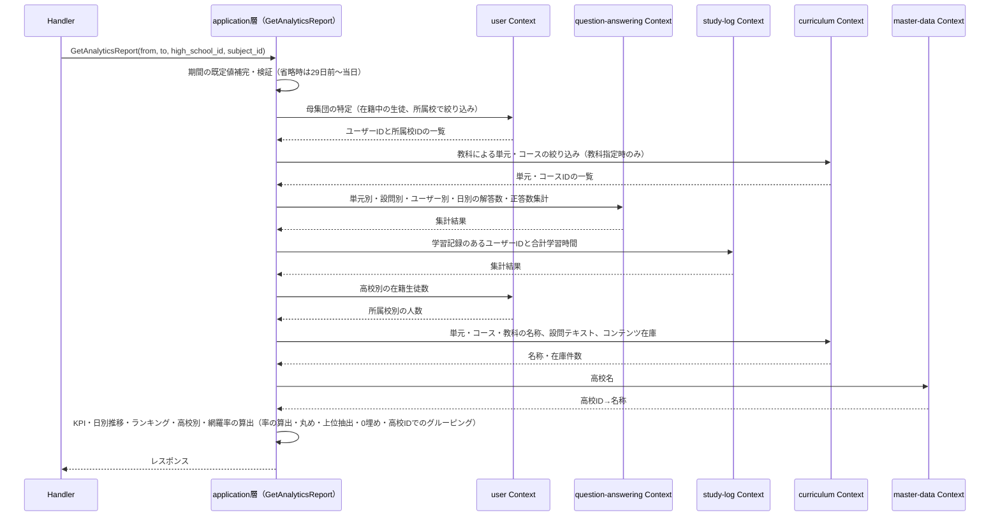
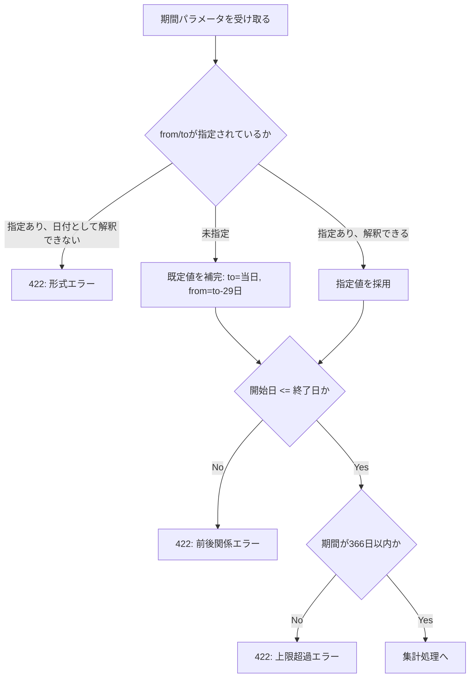

# 管理者分析機能 Go移行・設計仕様書

---

# 1. 機能概要

管理者が、全生徒の学習状況をKPI・日別推移・正答率ワーストランキング・高校別利用状況・コンテンツ網羅率の観点で把握するための機能である。期間・高校・教科で絞り込みができる。本機能はデータを所有せず、他機能が管理するデータを読み取り専用で集約して返す（①「1. 機能概要」）。

- 利用者: `admin`ロールのユーザー（管理者）
- 業務上の目的: 運用状況の把握（KPIの推移比較、学習が進んでいない単元・設問の発見、利用が少ない高校の発見、コンテンツの不足箇所の発見）

---

# 2. 設計方針

- **責務分離**: 「完了」「正答」「在籍中」等の定義は所有Context側に残し、本機能は所有Contextから受け取った素の値（件数・合計時間・識別子）を集計・整形するだけに留める
- **保守性**: 指標の追加は、新しい算出関数を1つ増やし、必要な参照手段を呼ぶだけで済む形にする
- **テスト容易性**: 他Contextへの依存をインターフェースで差し替え、入力（期間・件数・識別子）に対する出力（率・順位・日別推移）を検証できる形にする
- **API互換性**: Rails現行のレスポンス構造（envelopeなしのトップレベルオブジェクト）・エンドポイント・ステータスコードを変更しない
- **拡張性**: 高校・教科以外の絞り込み軸が増えても、母集団の決定ロジックを1箇所に保てるようにする

---

# 3. Bounded Context

## Context名

- `admin-analytics`

## Contextの責務

- 期間・高校・教科による絞り込みの検証と確定（既定値の補完を含む）
- KPI（現在期間・直前の同じ長さの期間の比較）の算出
- 日別推移の算出（データの無い日を0件で埋める）
- 正答率が低い単元・設問のランキング抽出（閾値判定・上位N件抽出）
- 高校別の利用状況の算出（高校ごとのグルーピング）
- コンテンツ網羅率の算出
- 率（百分率・小数第1位）の算出と丸め
- 複数Contextから受け取った値を1つのレスポンスへまとめること

## 持たない責務

|持たない責務|所有するContext|
|-|-|
|解答履歴の保存・正誤判定、解答数・正答数の素の集計|`question-answering`|
|学習ログの保存、学習時間・学習日の素の集計|`study-log`|
|単元・問題・コース・教科の保持、設問テキストの保持|`curriculum`|
|高校の保持|`master-data`|
|ユーザーの在籍状態・所属校の定義、人数の集計条件|`user`|

## 他Contextとの依存関係

本Contextから他Contextへの参照依存のみである。状態変更を伴う依存も、他Contextから本Contextへの依存も存在しない。循環依存は発生しない。

|依存先Context|参照する内容|根拠|
|-|-|-|
|`user`|集計対象の母集団の特定（招待受諾済みかつ有効な生徒、高校による絞り込み）。母集団に属するユーザーの所属校（高校別グルーピング用）。高校別の在籍生徒数の集計|①「5. API / 処理詳細」の業務ルール、①「8. 権限制御」|
|`question-answering`|指定した期間・母集団について、単元別・設問別・ユーザー別・日別の解答数・正答数の集計|①「5. API / 処理詳細」のKPI・日別推移・ランキング・高校別利用状況|
|`study-log`|指定した期間・母集団について、学習記録のあるユーザーの識別、合計学習時間|同KPIの`study_minutes`・`active_student_count`|
|`curriculum`|単元・コース・教科の名称、設問テキスト、指定教科に属するコース・単元の識別子、有効な単元の総数、問題を保持する単元の識別子|同ランキングの表示項目、コンテンツ網羅率、教科による絞り込み|
|`master-data`|高校の名称|同高校別利用状況の`high_school_name`|

## 依存する理由

本Contextは他機能が所有するデータを集計するだけであり、データそのものを所有・管理しない。規約「4. Bounded Context構成」の「Context分割基準」は、同一データに対する参照専用の切り口を別Contextとして切り出してよいとし、その場合「業務ルール（作成・更新・状態遷移）は元のContextに残し、参照専用Contextは持たない」と定めている。本Contextはこの方針に従う。

参照にあたっては、相手Contextのテーブルを直接読まず、相手Contextが公開する参照手段を呼び出す（規約「5. Context間連携ルール」）。「在籍中」「論理削除されていない」といった判定条件は所有Context側に閉じ込め、本Contextは件数・合計・識別子といった素の値を受け取る。

既存の`learning-analytics`（分析機能）も同じ性質の参照専用Contextだが、本Contextはそれに依存しない。管理者ダッシュボード機能（`admin-dashboard`）が`learning-analytics`を経由せず`question-answering`に直接依存しているのと同じ考え方で、本Contextも所有Contextへ直接依存する。読み取り専用Context同士を連結すると、どちらの変更がどちらに波及するかが分かりにくくなるためである。

高校ごとのグルーピングを本Context内のアプリケーション層で行う理由は「11. Repository設計」に記載する。

---

# 4. 設計パターン

## 採用パターン

Transaction Script

## 判断根拠

規約「3. 設計パターンごとの構造適用方針」のTransaction Script節は、対象を「一般・補完領域で、業務ルールが1〜2文で説明できる単純な処理（単純な一覧参照・集計・レポート生成・バッチ的処理等）」と定めている。本機能は集計・レポート生成そのものであり、この定義に該当する。

- **業務ルール**: 「指定された条件で集計して返す」のみ。期間の既定値補完・366日の上限・ランキングの閾値（20件）・上位件数（10件）はいずれも計算規則であり、満たすべき業務条件や禁止される操作ではない
- **状態管理**: 本機能は何も書き込まず、自身の状態を持たない（①「7. 状態管理」）
- **整合性**: 書き込みがないため、保証すべき整合性の単位が存在しない
- **将来拡張**: 指標の追加は、所有Contextへの参照手段を1つ増やし、算出関数を1つ増やすことで足りる
- **テスト容易性**: 他Contextへの依存をインターフェースで差し替えれば、入力（期間・件数・識別子）に対する出力（率・ランキング・日別推移）を検証するだけでテストできる

## 採用しなかったパターン

### Active Record

本機能に作成・更新処理が含まれず、所有するテーブルも存在しない。永続化操作をstructに持たせる対象がない。

### Domain Model

Domain Model採用基準（②自動生成プロンプト）が挙げる条件をいずれも満たさない。Entityが状態を持たず、状態遷移ルールもなく、Entityへ振る舞いを集約する対象が存在しない。解答履歴・学習ログ・単元・問題・ユーザーの業務ルールは所有Context側の責務であり、本Contextに持ち込む対象ではない。参照専用Contextに集約・Repository Interface・UseCase層を設けると、関数1つで足りる処理に層だけが増える。

### Event Sourcing

履歴の再構築・監査要件が存在しない。本機能が読み取る解答履歴・学習ログは既に発生した事実の記録だが、それらを所有しているのは別Contextであり、本Contextがイベントストアを持つ理由にならない。

---

# 5. Aggregate設計

不要である。

理由: 本Contextが所有するデータがなく、書き込みも行わないため、整合性を保証すべき単位が存在しない。集計結果は複数Contextから受け取った値の組み合わせであり、1つの整合性単位として扱う対象ではない。

---

# 6. Entity設計

本Contextで管理するEntityは存在しない。

理由: 本Contextはデータのライフサイクルを持たない。集計結果は要求されたときに算出されて返るだけの値であり、同一性（識別子）も生存期間も持たないため、Entityの要件を満たさない。参照する解答履歴・学習ログ・単元・問題・ユーザー・高校は、それぞれ`question-answering`・`study-log`・`curriculum`・`user`・`master-data`が管理するEntityである（①「6. データモデル」）。

他Contextから受け取る値は、本Contextが必要とする項目だけを持つ参照用の型として扱い、相手Contextの内部Entityをそのまま持ち込まない（規約「5. Context間連携ルール」）。具体的な型は③Go実装仕様書で定める。

---

# 7. Value Object設計

Value Objectは採用しない。

理由: 規約「3. 設計パターンごとの構造適用方針」のTransaction Script節は「domain層は原則作らない。入力検証が必要な場合も、Value Object等の型は作らず、関数内のガード節で行う」と定めている。本機能はTransaction Scriptを採用するため、この方針に従う。

Value Objectの候補になりうる概念と、型を作らずに扱う場所を整理する。

|概念|持つ規則|扱う場所|
|-|-|-|
|集計期間|両端を含む、省略時の既定値（当日から29日前〜当日）、最大366日、開始日は終了日より後にできない（①「5. API / 処理詳細」）|Presentation層のリクエスト検証（形式・前後関係・上限）と、application層の関数内での既定値補完・直前期間の導出|
|率（百分率・アクティブ率）|正答数・アクティブ数 ÷ 総数 × 100、小数第1位で丸め、分母0のときは`0`|application層の算出関数。KPI・日別推移・ランキング・高校別利用状況のすべての率がこの1箇所を通るようにする|
|ランキングの閾値・上位件数|期間内の解答件数が20件以上の単元・設問のみを対象に、正答率の低い順に最大10件（同率は識別子の昇順）|application層の関数内の定数とガード節|
|日本時間の日付|解答履歴の日時はUTC保存であり、日付の判定は日本時間で行う（①「5. API / 処理詳細」）|日本時間への変換は所有Context側（`question-answering`）の参照手段に閉じ込め、本Contextは日付として受け取る|

率の算出は複数の指標で共通して使われるため、型を作らずとも1つの関数に集約する。異なる指標で丸め方がぶれると、同じ画面に並ぶ数値の整合が取れなくなるためである。

---

# 8. Domain Service

不要である。

理由: Domain Serviceは、複数Entityにまたがる業務ルールの判定をEntityの外に出すための置き場所である。本Contextには Entity が存在せず（「6. Entity設計」）、判定すべき業務ルールもない。

ランキングの抽出・閾値判定・日別の0埋め・高校ごとのグルーピングは、いずれも受け取った値に対する計算であり、業務ルールの判定ではない。これらはapplication層の関数として実装する（規約「3. 設計パターンごとの構造適用方針」Transaction Script節）。

---

# 9. クラス図

Entityもstructの階層も持たないため、クラス図としての図示は省略する。

本Contextが持つのは、他Contextの参照手段を宣言するインターフェースと、それを呼んで指標を組み立てる関数のみである。関係は「13. シーケンス図・処理フロー図」のシーケンス図で示す。

Goのstruct定義・インターフェースのシグネチャは③Go実装仕様書で扱う。

---

# 10. 状態遷移図

省略する。

理由: 本機能に状態を持つデータが存在しない（①「7. 状態管理」）。図示すべき遷移が存在しない。

---

# 11. Repository設計

本機能はTransaction Scriptを採用するため、Repository Interfaceは設けない（規約「3. 設計パターンごとの構造適用方針」）。本節は、業務上必要なデータアクセスの責務として整理する。

## 本Contextが持つ参照（自前の参照モデル）

なし。本Contextは所有するテーブルを持たず、すべてのデータを他Contextの参照手段から取得する。

## 他Contextの参照手段

本Contextの`dependency.go`にインターフェースとして宣言し、実装は相手Contextの公開操作へ委譲するアダプタに閉じ込める（規約「4. Bounded Context構成」・「5. Context間連携ルール」）。

|参照手段|相手Context|取得する内容|用途|既存/新規|
|-|-|-|-|-|
|母集団の特定|`user`|招待受諾済みかつ有効な生徒のID一覧（所属校による絞り込み可）|すべての指標の対象ユーザーの決定|既存（ユーザー基盤機能②「12. UseCase設計」の`SearchUsers`。役割=生徒、在籍中のみ、所属校の複数指定可）|
|高校ごとの在籍生徒数|`user`|所属校別の在籍生徒数|高校別利用状況の`student_count`|既存（同`CountUsers`の所属校別集計。管理者高校学年参照機能②「11. Repository設計」と同じ使い方）|
|母集団のユーザーごとの所属校|`user`|母集団に含まれる各ユーザーの所属校ID|高校別利用状況のグルーピング（本Context側で集計結果を所属校IDで束ねるための対応表）|既存を想定（`SearchUsers`が返す基本属性に所属校IDが含まれる前提。③で確認）|
|期間・母集団を指定した単元別・設問別・ユーザー別・日別の解答数・正答数の集計|`question-answering`|指定した期間・ユーザーID集合に対する、単元ごと／設問ごと／ユーザーごと／日（日本時間）ごとの解答数・正答数|KPI・日別推移・ランキング（単元・設問）・高校別利用状況の素材|**新規**（下記「他Context側への追加が必要な公開操作」参照）|
|期間・母集団を指定した学習記録の有無・合計時間|`study-log`|指定した期間・ユーザーID集合に対する、学習記録のあるユーザーIDの集合と合計学習時間|KPIの`active_student_count`・`study_minutes`|**新規**（同上）|
|単元・コース・教科の名称|`curriculum`|単元IDから単元名・コース名・教科名|ランキング（単元）の表示項目|既存を想定（既存の階層参照の組み合わせで足りるか③で確認）|
|設問テキストと単元・コースの対応|`curriculum`|設問IDから設問テキスト・単元ID・単元名・コースID|ランキング（設問）の表示項目|**新規**（既存の公開操作に設問テキストを返すものが見当たらない）|
|教科に属するコース・単元の識別子|`curriculum`|指定教科に属するコースの識別子、コースに属する単元の識別子|教科による絞り込み|**新規**（既存は単元→教科の順方向参照のみで、教科→コース・単元の逆方向参照が見当たらない）|
|コンテンツ在庫|`curriculum`|有効な単元の総数、問題を1件以上持つ単元の識別子|コンテンツ網羅率の`total_units`・`units_without_questions`|**新規**|
|高校の名称|`master-data`|高校IDから高校名|高校別利用状況の`high_school_name`|既存（共通マスタ参照機能③_1「3. 公開操作の定義」の`FindHighSchools`と同等の参照。②時点では概念としてのみ扱う）|

## 他Context側への追加が必要な公開操作

既存の②③を確認したところ、`question-answering`・`study-log`・`curriculum`が公開している参照手段は、いずれも「単一ユーザーに対する全期間の集計」または「単一ユーザーに対する期間内のコース単位の集計」であり、本Contextが必要とする「期間 × 複数ユーザーの母集団 × 単元／設問／日単位」の組み合わせを満たさない（分析機能②「11. Repository設計」の`UnitAnswerStatsDirectory`・`CourseAnswerStatsDirectory`・`RankAnswerStatsDirectory`、学習ログ機能②の`FindStudiedDates`・`SumStudyMinutesByDate`を確認した）。

これは、分析機能（`learning-analytics`）の設計時に繰り返し発生した「所有Context側の②に必要な公開操作が未定義」という状況（分析機能②「11. Repository設計」の脚注、バッチ記録）と同種である。本書では必要な参照内容のみを概念として整理し、具体的な関数シグネチャの確定と、所有Context側（`question-answering`②「11. Repository設計」・`study-log`②「11. Repository設計」・`curriculum`②「11. Repository設計」）への公開操作の追加は、本機能の③Go実装仕様書に着手する前に別途行う（規約「5. Context間連携ルール」に従い、呼び出し側の③が所有Context側の②に無い操作を前提にしないようにするため）。

|所有Context|追加が必要な公開操作（概要）|
|-|-|
|`question-answering`|期間・ユーザーID集合を指定した、単元別／設問別／ユーザー別／日別（日本時間）の解答数・正答数集計|
|`study-log`|期間・ユーザーID集合を指定した、学習記録のあるユーザーIDの集合、および合計学習時間|
|`curriculum`|設問IDから設問テキストを取得する参照、教科IDから所属するコース・単元の識別子を取得する参照、有効な単元の総数と問題を1件以上持つ単元の識別子を取得する参照|

## 他Contextへ公開する参照手段

なし。本Contextを参照する他Contextは存在しない。管理者向けの表示に特化した切り口であり、他の機能が必要とする形ではない。

---

# 12. UseCase設計

**実装上の位置づけ**: 本機能はTransaction Script採用のため、UseCase層（struct）は設けない。以下は業務操作の設計意図であり、実装時はapplication層の関数として直接実装する。

## GetAnalyticsReport

- 目的: 指定した期間・絞り込み条件（高校・教科）で、KPI・日別推移・正答率ワーストランキング・高校別利用状況・コンテンツ網羅率を1件のレスポンスとして組み立てる
- 入力: 期間（開始日・終了日。省略可）、高校ID（省略可）、教科ID（省略可）
- 出力: KPI（現在・直前期間の組）、日別推移の配列、単元ランキングの配列、設問ランキングの配列、高校別利用状況の配列、コンテンツ網羅率、集計条件（meta）
- トランザクション範囲: 読み取りのみ、トランザクションは不要
- 呼び出す参照手段: 「11. Repository設計」の全項目
- 判断根拠: Rails現行の`Admin::AnalyticsController#show`が1回の呼び出しで全指標を返す構成を踏襲する。指標ごとに別エンドポイントへ分割する利点がない（フロントエンドが1画面で全指標を同時に表示するため）

---

# 13. シーケンス図・処理フロー図

## シーケンス図

## 処理フロー図

期間の検証は分岐が複数あるため、フローチャートで示す。

単元・設問ランキングの閾値判定・上位抽出や、高校別のグルーピングは条件分岐ではなく機械的な並べ替え・絞り込みであるため、フローチャートでは示さない。

---

# 14. Transaction設計

- Transaction開始位置: なし
- Transaction終了位置: なし
- 理由: 本機能は読み取りのみであり、書き込みを行わない（①「6. データモデル」のDatabase変更は「なし」）。トランザクションで保護すべき処理が存在しない

---

# 15. Validation設計

## Presentation

- `from`・`to`: 文字列が指定されている場合、日付（`YYYY-MM-DD`）として解釈できること
- `from` <= `to`であること
- 期間が366日以内であること
- `high_school_id`・`subject_id`: 整数として解釈できること。Rails現行は変換に失敗した値を無視して絞り込みを適用しない（エラーにならない）ため、Go設計でもエラーにしない

## Domain

該当なし。Domain層を設けない（「6. Entity設計」）。

## バリデーション仕様

|フィールド|検証層|ルール|エラーメッセージ方針|
|-|-|-|-|
|from|Presentation|日付として解釈できること|「は正しい日付形式(YYYY-MM-DD)で指定してください」|
|to|Presentation|日付として解釈できること|同上|
|from・to|Presentation|開始日が終了日より後でないこと|「開始日は終了日より前の日付を指定してください」|
|from・to|Presentation|期間が366日以内であること|「指定できる期間は366日以内です」|

既定値の補完（未指定時の29日前〜当日）は検証ではなく業務上の既定値であるため、application層の関数内で行う（「7. Value Object設計」）。

---

# 16. Authorization設計

|層|判定内容|理由|
|-|-|-|
|Middleware|認証（ログイン済みであること）と`admin`ロールであることを判定する|規約「7. 横断的関心事の置き場所」のとおり、ロールレベルの粗い制御はMiddlewareに置く。認可はCasbin RBACで行う（Gin規約「4. 認可（Casbin RBAC）」）|
|Handler|判定しない。クエリパラメータ（期間・高校ID・教科ID）をそのままapplication層へ渡す|本機能は操作者自身のデータではなく全体の集計を扱うため、操作者の識別子に基づく絞り込みが発生しない|
|application層|判定しない|所有権の判定が成立する対象（他人のデータへのアクセス要求）がそもそも発生しない。高校ID・教科IDの指定は集計範囲の絞り込みであり、アクセス制御ではない|
|Domain|存在しない|Domain層を設けない（「6. Entity設計」）|

## 判断理由

本機能は管理者が全体の集計を見るための機能であり、「自分のデータ」という概念を持たない。したがって所有権チェックは発生せず、ロールレベルの制御（`admin`であること）のみで十分である。

---

# 17. Error設計

## Domain Error

責務: なし。本Contextに業務ルール違反を表すエラーが存在しない。Domain層を設けないため、Domain Errorも定義しない。

## Application Error

責務: なし。本Contextには「業務上の意味を持つ失敗」が存在しない。期間の検証エラーはPresentation層の入力検証として扱う（「15. Validation設計」）。

## Infrastructure Error

責務: 他Contextの参照手段の呼び出しに失敗したことを表す。DB接続の失敗・クエリの失敗等が該当する。

本Contextでは個別に判別せず、そのまま呼び出し元へ返して500として扱う。参照先の失敗を本機能側で意味づけし直す余地がないためである。

## 判断理由

本機能は書き込みを持たず、業務ルールによる失敗が存在しない。意味を持つ失敗は入力検証（期間の形式・前後関係・上限）のみであり、これはPresentation層の責務とする。

参照先が0件を返すことはエラーとして扱わない。該当するデータが無い高校・期間では、集計結果が0件・空配列で返るのが正常な応答である（①「5. API / 処理詳細」の業務ルール）。

## エラー仕様

|業務シナリオ|エラー種別|発生層|想定するHTTPステータス|
|-|-|-|-|
|`from`・`to`の形式が不正|Validation|Presentation|422|
|開始日が終了日より後|Validation|Presentation|422|
|指定した期間が366日を超える|Validation|Presentation|422|
|他Contextの参照手段の呼び出しに失敗|Internal|Infrastructure|500|
|未認証|Unauthorized|Middleware|401|
|`admin`ロール以外|Forbidden|Middleware|403|

エラー本文の形式は規約「15. API規約（レスポンス形式・ページネーション・URL・クエリパラメータ）」に従い`{"errors": [...]}`とする。Rails現行も本機能のエラーはすべてこの形式で返しているため（①「5. API / 処理詳細」）、形式の差分は生じない。

---

# 18. Domain Event

不要である。

理由: 本機能は書き込みを行わず、状態変化が発生しない。複数の処理へ波及する通知の必要性もない（規約「5. Context間連携ルール」）。

---

# 19. API仕様

## エンドポイント一覧

|エンドポイント|HTTP Method|概要|
|-|-|-|
|`/api/v1/admin/analytics`|GET|KPI・日別推移・正答率ワーストランキング・高校別利用状況・コンテンツ網羅率を取得|

## 各エンドポイントの仕様

### `GET /api/v1/admin/analytics`

- Request: クエリパラメータ`from`・`to`・`high_school_id`・`subject_id`（いずれも任意）
- Response: 最上位がenvelopeなしのJSONオブジェクト。`kpis`・`daily_activity`・`low_accuracy_units`・`low_accuracy_questions`・`high_school_usage`・`content_coverage`・`meta`の7項目（①「5. API / 処理詳細」のResponse項目）
- Status Code: 正常系`200`。異常系`422`（期間の検証エラー）、`401`、`403`、`500`
- Error Response方針: `{"errors": [...]}`

## Railsとの差分

フロントエンドを変更しない方針のため、URL・HTTPメソッド・レスポンス項目名・HTTPステータスは変更しない。**差分はない。**

### 変更しないもの（Rails現行の振る舞いを踏襲する点）

|項目|Rails現行の振る舞い|
|-|-|
|レスポンスの最上位構造|7項目をenvelopeなしで直接返す。規約「15. API規約」の「単体（取得・作成・更新）」の形式に相当するものとして扱う（本機能は単体のレポートを返す操作であり、一覧のページネーションを持たない）|
|`high_school_id`・`subject_id`が整数として解釈できない場合|Rails現行はエラーにせず絞り込みを適用しない（無視する）。②の判断でもこの挙動を維持する（「15. Validation設計」）|
|存在しない`high_school_id`・`subject_id`を指定した場合|404にならず、該当する集計結果が0件・空配列で返る（①「5. API / 処理詳細」の業務ルール）|

---

# 20. DB設計方針

- 現行DBを利用するか: 利用する。既存のRails DB（`question_histories`・`study_logs`・`units`・`questions`・`courses`・`subjects`・`high_schools`・`users`）をそのまま参照する
- Schema変更有無: なし
- 変更理由: 本機能は既存データの読み取り専用の集計であり、新たなテーブル・カラムを必要としない

---

# 21. DB操作仕様

該当なし。本Contextは所有するテーブルを持たず、Repositoryを持たない（「11. Repository設計」）。実際のDBアクセスは、各所有Context（`question-answering`・`study-log`・`curriculum`・`user`・`master-data`）側の実装で行われる。

---

# 22. テスト戦略

## Domain Test

対象外。Domain層を設けないため（「6. Entity設計」）。

## UseCase Test

UseCase層は設けないため、application層の関数（`GetAnalyticsReport`）に対するテストとして行う。本機能のテストの中心はここに置く。

目的: 他Contextへの依存をインターフェースで差し替え、受け取った値から指標が正しく組み立てられることを検証する。

重点を置く観点:

- 期間の確定: 未指定時の既定値補完（29日前〜当日）、両端を含むこと、直前期間が「同じ日数だけ遡った、開始日の前日までの期間」になること
- 率の算出と丸め: 分母0のとき`0`になること、小数第1位で丸められること
- 日別推移: 期間内の全日分が生成されること、記録の無い日が0件で埋まること
- ランキング: 期間内の解答件数が20件未満の単元・設問が対象から外れること、正答率の低い順に最大10件になること、同率のときは識別子の昇順になること
- 高校別利用状況: 在籍生徒が0人の高校が対象から外れること、アクティブ率の低い順になること、同率のときは高校IDの昇順になること、高校IDによるグルーピングが正しく行われること
- コンテンツ網羅率: 高校・教科による絞り込みの影響を受けないこと、期間内に解答の無い単元の判定が期間に応じて変わること
- 高校ID・教科IDに該当するデータが存在しない場合、エラーにならず空の結果になること

## Repository Test

対象外。本Contextが所有するテーブルがなく、DBアクセス実装を持たないため（「21. DB操作仕様」）。

依存先Context（`question-answering`・`study-log`・`curriculum`・`user`・`master-data`）の参照手段そのもののテストは、所有Context側の文書で定める。

## Handler Test

目的: HTTPの入出力とPresentation層の検証を確認する。

重点を置く観点:

- クエリパラメータの受け取り（`from`・`to`・`high_school_id`・`subject_id`）
- 期間検証のエラーが`422`とRails現行の文言で返ること
- `high_school_id`・`subject_id`が整数でない場合にエラーにならず無視されること
- レスポンスの項目名・階層がRails現行と一致すること

## Integration Test

目的: 認証・認可を含めたエンドポイントの振る舞いと、所有Contextの参照手段を実装込みで通した結果を確認する。

重点を置く観点:

- 未認証で`401`、`admin`以外のロールで`403`になること
- 既定の期間（直近30日）で正しい件数・構造のレスポンスが返ること
- 日付の判定が日本時間で行われること。UTC保存の解答時刻が日本時間の日付境界をまたぐケースで、集計される日が期待どおりになること
- 高校・教科で絞り込んだ場合に、対象が正しく制限されること

---

# 23. Railsとの責務対応

|Rails|Go|設計方針|
|-|-|-|
|`Api::V1::Admin::AnalyticsController`|Handler|HTTP責務のみ担当。クエリパラメータの受け取りに限る|
|`Admin::AnalyticsFilterForm`|Request DTO + Presentation層の検証|入力検証をHandlerから分離する。既定値の補完はapplication層へ移す（検証ではなく業務の既定値であるため）|
|`Admin::AnalyticsQuery`|application層の集計関数（`GetAnalyticsReport`）|KPI・直前期間の算出・全体の取りまとめを担う|
|`AnalyticsRankable`・`AnalyticsHighSchoolUsable`・`AnalyticsDailyActivityable`・`AnalyticsContentCoverable`|application層の指標別算出関数|指標ごとの組み立て。クラス・モジュールではなく関数として置く（Transaction Script）|
|`Student::Analytics::Calculator`（`correct_rate_from_counts`の再利用）|application層の率算出関数|率の算出式と丸めを1箇所に集約する。`learning-analytics`と同じ算出式を用いるが、共有部品化するかは本書では判断しない（「24. 採用しなかった設計」）|
|`QuestionHistory`・`StudyLog`・`Unit`・`Question`・`Course`・`Subject`・`HighSchool`・`User`|依存先Contextが管理|本Contextにモデル相当の型を持たない。受け取る値だけを持つ参照用の型を定める|
|Serializerなし（Hashをそのまま返却）|Response DTO|集計結果をそのままJSON化せず、Response DTOへ変換する（規約「6. データフロー」）。項目名・階層はRails現行と同一にする|
|`AdminServicePolicy`|Middleware（Casbin RBAC）|`admin`ロールの判定。他の管理者向け機能と共通の判定ロジックを使う|

Rails現行は`question_histories`・`users`・`high_schools`等を1つのSQLクエリ内でJOINして集計しているが（①「10. Rails実装対応表」）、Go設計ではBounded Context境界に従い、所有Contextごとに参照手段を呼び、本Context側のapplication層で結果を組み合わせる。これによりクエリの往復回数が増える点は「24. 採用しなかった設計」に記載する。

---

# 24. 採用しなかった設計

## Railsと同じ単一クエリでの集計

Rails現行は、解答履歴・ユーザー・高校等を1つのSQLクエリでJOINし、効率的に集計している。Go設計でこれを再現するには、本Contextが`question_histories`・`users`・`high_schools`等のテーブルへ直接SQLを発行する必要があるが、これは規約「5. Context間連携ルール」の「相手Contextの内部Entity・Infrastructure実装に直接依存しない」に反する。

不採用とし、各所有Contextの参照手段を呼び出し、本Context側のapplication層で結果を組み合わせる設計を採用した。クエリの往復回数はRails現行より増えるが、Bounded Context境界を優先する（規約「1. 全体方針」）。性能上の懸念が実際に生じた場合の対処（所有Context側に複合的な参照手段を追加する等）は、③Go実装仕様書または実装後の計測を踏まえて判断する（推測: 現時点では管理者が閉じた画面で低頻度に参照する機能であり、致命的な性能問題にはならないと見込むが、確証はない）。

## 率算出ロジックの共有部品化

正答率・アクティブ率の算出式（分母0のとき0、小数第1位で丸め）は`learning-analytics`（分析機能）と同じである。`internal/shared/`配下に共有の算出関数を置く案を検討したが、規約「4. Bounded Context構成」は「複数のContextが共有することが確定した部品のみ」を`shared/`に置くと定めており、現時点で重複するのは2機能のみである。小さな関数であり、重複によるコストも小さいため、各Contextが個別に持つ設計を採用した。将来3機能目が同じ算出式を必要とする場合は、共有部品化を規約側で判断する。

## Domain Model

「4. 設計パターン」に記載のとおり、状態を持つEntityが存在せず不採用。

---

# 25. 設計判断サマリー

|項目|採用|判断理由|
|-|-|-|
|設計パターン|Transaction Script|業務ルールが集計規則のみで、状態管理・整合性単位が存在しないため|
|Context名|`admin-analytics`|管理者向けの運用把握という業務目的が、生徒向けの`learning-analytics`と異なるため分離する（`admin-dashboard`と`dashboard`の関係と同じ）|
|Aggregate|不要|所有データがなく、整合性を保証する単位が存在しないため|
|Value Object|不要|Transaction Script方針により、検証はガード節・application層の関数内で行うため|
|Domain Event|未採用|書き込みが無く、複数処理への通知が不要なため|
|Transaction境界|なし|読み取りのみであり、保護すべき処理が存在しないため|
|高校別グルーピング|本Context側のapplication層で実施|所有Context間を直接JOINできないため、各Contextから受け取った値を本Context側で組み合わせる|
|率算出ロジックの共有化|見送り|重複が2機能のみで、共有化のコストに見合わないため（将来再検討）|

---

# 設計差分管理

Rails:

`Admin::AnalyticsQuery`が`question_histories`・`users`・`high_schools`等を1つのSQLクエリでJOINして集計する。

Go:

本Contextは各所有Context（`question-answering`・`study-log`・`curriculum`・`user`・`master-data`）が公開する参照手段を個別に呼び出し、application層で結果を組み合わせる。

理由:

Bounded Context境界を優先し、相手Contextの内部テーブルへ直接依存しないため（規約「5. Context間連携ルール」）。

影響範囲:

レスポンスの内容・構造は変わらない（API互換性を維持する）。内部実装のクエリ往復回数が増えるが、画面の利用頻度・データ量から許容範囲と判断する（推測）。性能上の懸念が実際に生じた場合は、所有Context側に複合的な参照手段を追加する対応を検討する。
