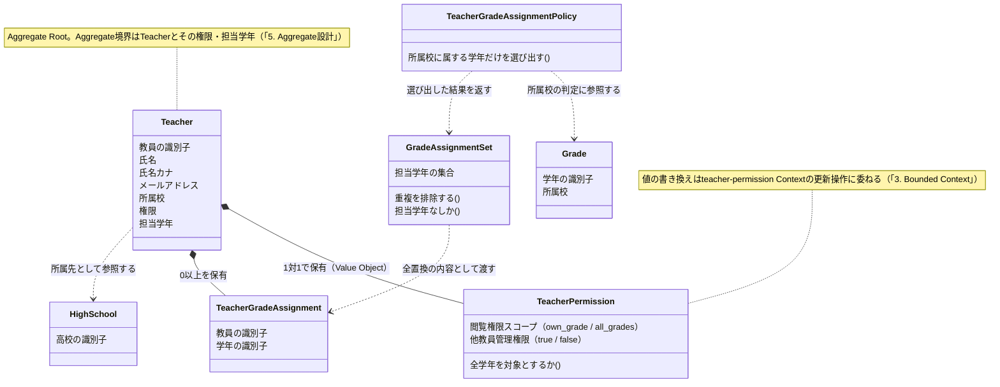
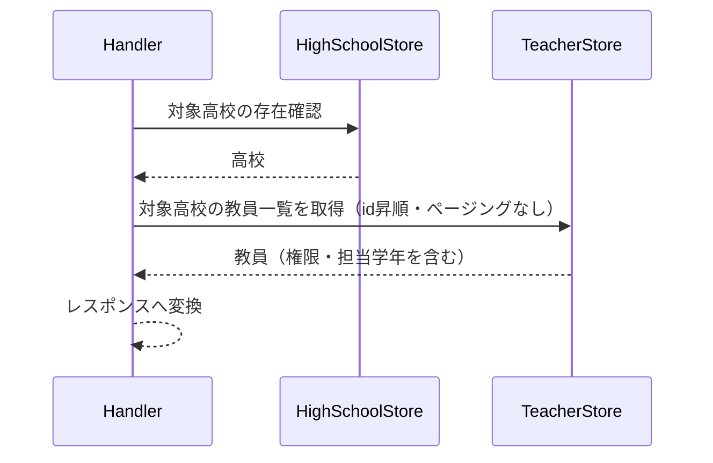
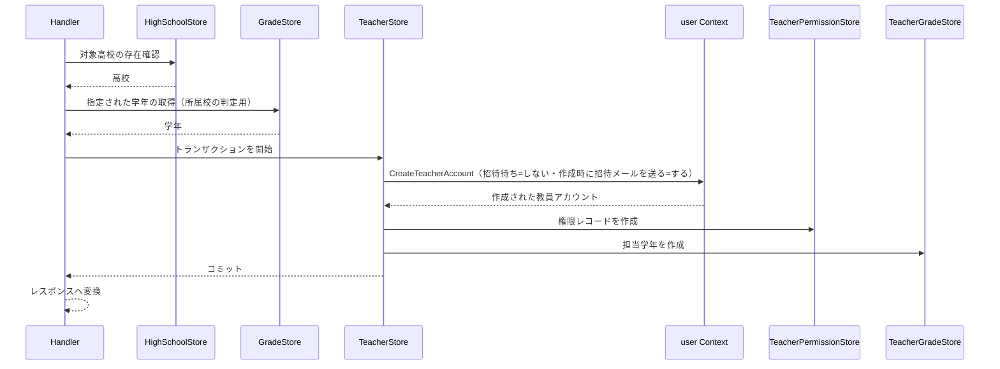
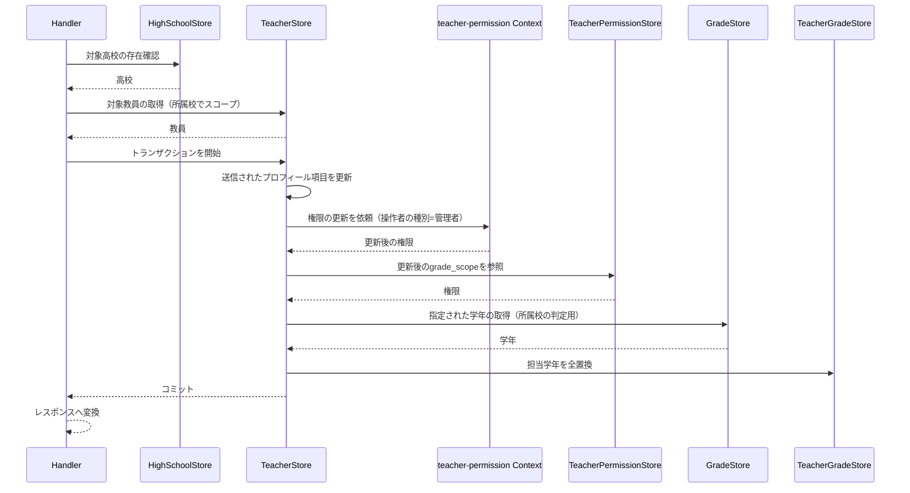
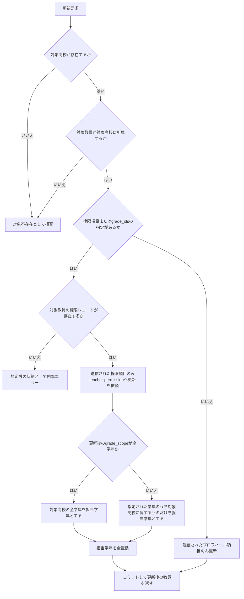

# 管理者教員管理機能 Go移行・設計仕様書

---

# 1. 機能概要

## 機能概要

管理者が自校（選択中の高校）に所属する教員アカウントを一覧参照し、新規教員の招待、既存教員のプロフィール・権限・担当学年の更新を行う機能である。Rails現行仕様では一覧・作成・更新の3操作を提供し、教員の権限情報（`teacher_permissions`）と担当学年情報（`teacher_grades`）を合わせて扱う。新規教員の招待では、氏名・メールアドレスと、権限（閲覧権限スコープ・他教員管理権限）・担当学年を指定して教員アカウントを作成し、作成時に、パスワード設定用の招待メールが対象のメールアドレスへ送信される。

## 利用者

- `admin` ロールのユーザー（管理者）
- 対象は、パスパラメータで指定された高校に所属する教員に限定される（①「7. 権限制御」）。Rails現行は、指定された高校を取得してからその高校に所属する教員として対象を絞り込むことでこの制約を実現しており、操作する管理者と高校の対応は確認していない（①「5. API / 処理詳細」の各アクションの処理内容）。本設計もこれを変更しない（「16. Authorization設計」）

## 業務上の目的

- 学校単位で教員アカウントを一覧管理できるようにする
- 新規教員を、氏名・メールアドレスと権限・担当学年を指定して招待できるようにする（作成時に招待メールが送信される）
- 教員の閲覧権限スコープ・他教員管理権限・担当学年を管理者が統制できるようにする

---

# 2. 設計方針

Railsの Controller / Service / Serializer 構造をそのまま移植するのではなく、「教員アカウントとその権限・担当学年をどう一貫して管理するか」という業務責務を中心に設計する。

- 責務分離: HTTP入出力、高校スコープの解決、権限・担当学年の同期処理、永続化を分離する
- 保守性: 教員の権限属性（閲覧スコープ・他教員管理可否）と担当学年の同期ルールをドメイン層に集約し、Serviceが持っていた手続きを整理する
- テスト容易性: 「担当学年を全置換する」という業務ルールを業務操作の単位で検証できるようにする
- 拡張性: 将来的に権限スコープの種類が増えても、教員エンティティのコアな責務を壊しにくい構造にする
- API互換性: 既存フロントエンドとの整合を保つため、エンドポイント構成とレスポンス構造は維持する

---

# 3. Bounded Context

## Context名

- teacher-management

本Contextは、教師視点の機能（教師教員管理機能）と同一のContextである。同じ3テーブル（`users`の教員レコード / `teacher_permissions` / `teacher_grades`）に対するAggregate（Teacher）・Entity・Repository（Store）を共有し、両機能の違いは利用者の視点（管理者が自校の教員を管理する視点／教師が自校の同僚教員を確認し、他職員操作権限を持つ場合に新規作成する視点）のみである（アーキテクチャ規約4章「Context分割基準」：Railsの`Teacher::`/`Admin::`の名前空間をそのままContext境界にしない）。教師視点の責務は教師教員管理機能_Go移行・設計仕様書「3. Bounded Context」を参照する。

## Contextの責務

管理者視点で本機能が担う責務は以下のとおりである。

- 高校に所属する教員アカウントの一覧参照
- 教員アカウントの新規招待（教員アカウント本体の作成は`user` Contextに任せ、本Contextは権限・担当学年の作成を担う）
- 教員の権限情報（閲覧スコープ・他教員管理可否）の管理
- 教員の担当学年の同期管理

## 他Contextとの依存関係

- `master-data` Context: 対象高校の存在確認、教員が所属する高校の特定、担当学年として指定された `grade_ids` が対象高校に属する学年であることの確認に依存する
- `teacher-permission` Context（②は`教師権限管理機能_Go移行・設計仕様書.md`）: 教員権限（`grade_scope` / `manage_other_teachers`）の更新を、`teacher-permission`の更新操作に依頼する。操作者の種別は管理者として渡す。本Contextは権限の値を自分で書き換えない
- `user` Context: 教員アカウント本体（`users`の1行）の作成と、作成時の招待メールの送信依頼は、`user` Contextの`CreateTeacherAccount`に依存する。管理者による教員作成では、次のとおり指定する（`user`②「12. UseCase設計」の経路ごとの指定値）
  - 招待待ち状態で作成するか: しない（Rails現行の`Admin::CreateTeacherService`は`password_reset_required`を偽のままにする。このため、教員招待通知機能の「招待未完了の教員一覧」には現れない）
  - 作成時に招待メールを送るか: する
  - 氏名・氏名カナ・メールアドレス・所属校ID: 氏名カナには、氏名と同じ値を設定する（Rails現行は、画面に氏名カナの入力欄がないため氏名と同じ値を設定している）。学年（`users.grade_id`）は設定しない（`CreateTeacherAccount`の学年ID（任意）を指定しない）

## 依存する理由

教員管理コンテキストは「教員としての権限・担当学年」という業務ルールに責務を限定し、アカウントそのものの生成（ユーザーレコード作成・仮パスワードの発行・招待メールの送信依頼）は`user` Contextへ、高校・学年の実在確認は、それぞれの責務を持つ別Contextに委譲する。これにより、教員管理コンテキストの変更が認証基盤や学校情報の変更に波及しにくくなる。

---

# 4. 設計パターン

## 採用パターン

Active Record

## 判断根拠

本機能はCRUD中心の業務であり、主要な価値は「教員情報の一覧・作成・更新」と「権限・担当学年の同期」にある。状態遷移と呼べるものはなく（教員アカウントに有効／招待中のようなライフサイクル状態は現行仕様に明記されていない）、複雑な業務ルールの塊も存在しない。

- 主要操作が一覧・作成・更新というCRUDに限定される
- 権限情報（`teacher_permissions`）は教員に対して1:1で従属する属性群であり、独立した振る舞いを持たない
- 担当学年（`teacher_grades`）は「更新時に全置換する」という単純な同期ルールであり、複雑な状態遷移を伴わない
- Handlerが直接Storeを呼び出し、認可・入力検証はHandler／Store側で行うことで、教員データの保存・関連付けの振る舞いを一元化しやすい

したがって、過剰なDomain Modelや、手続き型に寄りすぎるTransaction Scriptではなく、Active Recordを採用する。

## 採用しなかったパターン

### Transaction Script

- 権限更新・担当学年同期のロジックがUseCaseに偏り、再利用性が下がる
- 教員データの保存・関連付けの責務が分散しやすい

### Domain Model

- 教員の権限・担当学年に複雑な状態遷移や多段階の業務ルールが存在しない
- Entityへ振る舞いを集約するコストに対して、現状得られる保守性の恩恵が小さい
- 将来的に権限モデルが複雑化（役職に応じた権限テンプレート等）した場合は再検討の余地がある

### Event Sourcing

- 教員情報変更に対して他処理へ非同期通知する要件が現行仕様に存在しない
- 監査目的での変更履歴保持要件も明記されていない
- 現時点では過剰な設計である

---

# 5. Aggregate設計

## Aggregate Root

- Teacher（教員としての `User`）

## Aggregateに含めるEntity

- Teacher
- TeacherPermission（VOとして扱う。詳細は7章）
- TeacherGradeAssignment（担当学年の紐付け）

## Aggregate境界

- Teacherが自身の権限情報と担当学年紐付けの整合性を保つ単位とする
- 高校（HighSchool）・学年（Grade）そのものはAggregateの外部参照とし、担当学年の妥当性を判定するための制約条件として利用する

## 整合性を保証する単位

- 教員招待時、`user` Contextが作成する教員アカウント（および招待メールの送信依頼）と、本Contextが作成するTeacherPermission・TeacherGradeAssignmentを、同一トランザクションで扱う（`user`②の作成操作は呼び出し側のトランザクションに参加する）
- 教員更新時、`grade_ids` が指定された場合はTeacherGradeAssignmentの全置換をTeacherの更新と同一トランザクションで行う

理由: 権限更新と担当学年の同期がそれぞれ別トランザクションで行われると、片方だけ反映された不整合な状態が生まれうるため、1つの業務操作として整合性を保証する必要がある。

---

# 6. Entity設計

## Teacher

- 役割: 学校に所属する教員アカウントを表す中心的な概念
- ライフサイクル: 招待作成（アカウント本体は`user` Contextが作成する） → 参照 → プロフィール／権限／担当学年の更新
- 状態変化: 現行仕様には有効／無効といった明示的な状態フィールドはなく、作成後は属性更新のみが行われる
- 保持する責務:
  - 名前・メールアドレスなどの基本情報を保持する
  - 自身がどの高校に所属するかを保持する
  - 権限情報・担当学年との整合性維持の起点となる
- 判断根拠: 教員管理業務の中心的な操作対象であり、権限・担当学年の変更はすべてTeacherを起点に発生するため

## TeacherGradeAssignment

- 役割: 教員と学年の紐付けを表す概念
- ライフサイクル: 作成・全置換（削除＋再作成に相当）
- 状態変化: 追加・削除
- 保持する責務:
  - どの教員がどの学年を担当しているかを保持する
  - 更新時に既存紐付けとの差分（全置換）を扱うための単位となる
- 判断根拠: 単なる中間テーブルではなく、「担当学年の指定」という業務概念そのものを表すため

## HighSchool / Grade

- 役割: 参照対象として利用する外部概念
- 判断根拠: 本機能の中心は教員そのものであり、高校・学年は存在確認・所属確認のための参照情報として扱う

---

# 7. Value Object設計

## TeacherPermission

- 採用理由: `grade_scope`（閲覧権限スコープ）と `manage_other_teachers`（他教員管理権限）は常に対で意味を持ち、単独のプリミティブ値として扱うより、権限の組み合わせとして扱う方が業務的に自然である
- 独自ルール:
  - `grade_scope` は許容される範囲値のみを受け付ける
  - `manage_other_teachers` は真偽値として扱い、他教員のデータへのアクセス可否判定の入力となる
- Entity属性ではなくValue Objectにする理由: 権限の組み合わせに対して将来的にバリデーションや組み合わせ制約（例: 特定スコープでは他教員管理を許可しない等）が追加された場合に、Teacherエンティティを肥大化させずに拡張できるため

## GradeAssignmentSet

- 採用理由: `grade_ids` の指定は「担当学年の集合をこの内容に置き換える」という業務的な意味を持ち、単なる配列以上の意味を持つ
- 独自ルール:
  - 空配列の場合は担当学年なしとして扱う
  - 重複IDは排除する
- Entity属性ではなくValue Objectにする理由: 「全置換」という操作の意味をドメイン内で一貫して表現するため

## Value Objectを採用しないもの

- 名前・メールアドレス: メールアドレスは形式検証の対象ではあるが、本機能内で独自の複雑なルールを持たないため、単純な文字列属性として扱う（招待メールの内容・送信は`user` Contextの責務とする）

---

# 8. Domain Service

## TeacherGradeAssignmentPolicy

- 責務: 指定された `grade_ids` のうち、対象教員の所属高校に属する学年だけを担当学年として選び出す
- 所属しない学年IDの扱い: 担当学年の対象から除外する。拒否はしない（Rails現行の`Admin::CreateTeacherService` / `Admin::UpdateTeacherService`と同じ挙動）
- Entityへ持たせない理由: 学年の所属確認は`master-data` Contextの情報に依存する判定であり、Teacherエンティティ単体では完結しないため
- 判断根拠: 他高校の学年を誤って割り当てるような不整合を防ぐための業務ポリシーであり、Repositoryから取得した学年情報をもとにユースケースが呼び出す形が自然であるため

## 追加で必要としないService

- 権限属性（`grade_scope` / `manage_other_teachers`）の更新自体は単純な値の置き換えであり、独立したDomain Serviceを必要としない

---

# 9. クラス図

「5. Aggregate設計」「6. Entity設計」「7. Value Object設計」「8. Domain Service」で整理した関係を次のとおり可視化する。Active Record採用のため、永続化操作はEntity相当のstructと同一packageに置くStoreとして実装される（「11. Repository設計」）。属性・操作は概要レベルで示し、Goのstruct定義は③Go実装仕様書で扱う。

HighSchool・GradeはAggregateの外部参照であり、本Contextが所有しない（「5. Aggregate設計」）。

---

# 10. 状態遷移図

本機能では状態遷移図を作成しない。

理由: 「6. Entity設計」のとおり、Teacherには有効／無効・招待中といった明示的な状態フィールドが現行仕様に存在せず、作成後は属性の更新のみが行われる。担当学年（TeacherGradeAssignment）も追加・削除があるだけで、名前付きの状態を持たない。遷移条件として表現すべきものがないため、状態遷移図を設けない。

---

# 11. Repository設計

**実装上の位置づけ**: 本機能はActive Record採用のため、Repository Interfaceをdomain層に定義しない。以下は永続化・検索責務の設計意図であり、実装時はEntity相当のstructと同一packageに置くStore(例: `〇〇Store`)として直接実装する(規約: アーキテクチャ規約.md「3. 設計パターンごとの構造適用方針」)。

## TeacherStore

- 管理対象: Teacher（教員としてのUser）
- 責務:
  - 対象高校に所属する教員一覧の取得
  - 特定教員の取得（高校スコープ付き）
  - 教員レコードの更新
  - 教員の招待（作成）時の、トランザクションの開始と、`user` Contextの`CreateTeacherAccount`の呼び出し（`users`の1行の作成は`user` Contextが行う。本Storeは`users`の行を直接作成しない）
- 保持する検索機能:
  - `high_school_id` による絞り込み（管理者視点の一覧は、ページングを行わず対象高校の教員を全件返す。Rails現行の`Api::V1::Admin::TeachersController#index`がページングしないことに合わせる）
  - `id` による単一取得（所属高校スコープ付き）
- 管理者視点の一覧の並び順: Rails現行は並び順を指定しない（定めがない）。Go設計では、返却順が取得のたびに変わらないよう、`id`昇順で固定する（②からの補足。業務ルールの追加ではなく、順序が未定義であることによる実装上の不安定さを避けるための判断であり、Rails現行と厳密に同一の順序を保証するものではない）
- 保持しない責務:
  - 権限の妥当性判定
  - 学年の所属確認
- 判断根拠: 永続化と検索に特化させ、業務ルールを持たせないため

## TeacherPermissionStore

- 管理対象: TeacherPermission
- 責務:
  - 教員に紐づく権限情報の取得と、教員の着任時の作成（作成は、`user` Contextが作成した教員の`user_id`に対して行う）
- 保持する検索機能:
  - `user_id` による取得
- 保持しない責務:
  - 権限値の妥当性判定
  - 既存の権限情報の更新（`teacher-permission` Contextの更新操作の責務。本Contextは`grade_scope` / `manage_other_teachers`を自分で書き換えない）
- 判断根拠: 権限情報の永続化に特化させるため。更新を持たないのは、教員権限の書き換えの入口を`teacher-permission`に一本化するためである（`teacher-permission`②「3. Bounded Context」）

## TeacherGradeStore

- 管理対象: TeacherGradeAssignment
- 責務:
  - 教員の担当学年一覧取得
  - 担当学年の全置換（既存削除＋新規作成）
- 保持する検索機能:
  - `user_id` による担当学年取得
- 保持しない責務:
  - 学年が対象高校に属するかの判定
- 判断根拠: 紐付けデータの同期処理に特化させるため

## HighSchoolStore

- 管理対象: HighSchool
- 責務:
  - 指定 `high_school_id` の存在確認
- 保持しない責務:
  - 教員管理そのものの業務ルール
- 判断根拠: 高校の実在確認はHandlerの処理の前提条件として必要だが、教員管理ドメインの中心ではないため

## GradeStore

- 管理対象: Grade
- 責務:
  - 指定 `grade_ids` が存在するか、対象高校に属するかの情報取得
  - 対象高校に属する学年の一覧取得（`grade_scope`が全学年の場合に担当学年として用いる）
  - 担当学年をレスポンスへ出すための、学年の識別子と表示名の取得（①「5. API / 処理詳細」のとおり、レスポンスの担当学年は識別子と表示名の組である）
- 保持しない責務:
  - 担当学年として妥当かどうかの最終判断
- 判断根拠: 学年情報の参照に集中させ、判断はDomain Service側に委ねるため。表示名の決定規則（学年の年次を`中３生`・`高１生`等に対応付ける）は`master-data` Contextが持つ情報であり、本Contextは結果を受け取るだけとする

---

# 12. UseCase設計

**実装上の位置づけ**: 本機能はActive Record採用のため、UseCase層(struct)を設けない。以下はHandlerが行う業務操作の設計意図であり、実装時はHandlerがStoreを直接呼び出す処理として実装する。

## ListTeachers(Handler処理)

- 目的: 対象高校の教員一覧を取得する
- 入力: current admin, high_school_id（`page` / `per_page`は受け付けない）
- 出力: 教員一覧（権限・担当学年を含む）。ページ情報は返さない。権限レコードが存在しない教員は、`grade_scope` / `manage_other_teachers`が`null`（値なし）となる（Rails現行は、権限レコードの有無に関わらず一覧を返し、権限レコードが存在しない教員の権限項目を`null`として返す）
- トランザクション範囲: 読み取りのみ、トランザクションは不要
- 呼び出すStore:
  - HighSchoolStore
  - TeacherStore
- 判断根拠: 一覧取得は単純な読み取り処理であり、業務ルールが少ないため

## InviteTeacher(Handler処理)

- 目的: 新規教員を招待（作成）する
- 入力: current admin, high_school_id, name, email, grade_scope, manage_other_teachers, grade_ids
- 出力: 作成された教員情報（権限・担当学年を含む）
- トランザクション範囲: 教員アカウントの作成（`user` Contextの`CreateTeacherAccount`。招待メール送信依頼の登録を含む）・権限レコードの作成・担当学年の作成を1トランザクションで扱う。`user` Contextの作成操作は、本Contextが開始したトランザクションに参加する
- 呼び出すStore・Context:
  - HighSchoolStore
  - GradeStore（`grade_ids`が対象高校に属するかの確認）
  - TeacherStore（トランザクションの開始と、`user` Contextの呼び出し）
  - `user` Context: `CreateTeacherAccount`（招待待ち=しない、作成時に招待メールを送る=する。氏名カナには氏名と同じ値を設定し、学年は指定しない）
  - TeacherPermissionStore
  - TeacherGradeStore
- 担当学年の作成: `grade_scope`が全学年（`all_grades`）の場合は、指定された`grade_ids`に関わらず対象高校の全学年を担当学年とする（Rails現行）。それ以外の場合は、指定された`grade_ids`のうち対象高校に属する学年のみを担当学年とする。対象高校に属さない学年IDは除外する（UpdateTeacherと同じTeacherGradeAssignmentPolicyによる）
- 判断根拠: 教員アカウントと権限レコード・担当学年の初期状態を同時に整合させる必要があるため。招待メールは、`user` Contextがコミットされた場合にのみ送信するため、本Contextの権限・担当学年の作成が失敗した場合（ロールバック）は、送信されない。教員アカウント本体の作成規則（仮パスワードの発行・メールアドレスの一意性・招待メールの内容）は`user` Contextに一本化し、本Contextは持たない

## UpdateTeacher(Handler処理)

- 目的: 既存教員のプロフィール・権限・担当学年を更新する
- 入力: current admin, high_school_id, teacher_id, update request
- 出力: 更新後の教員情報
- トランザクション範囲: プロフィール更新・権限更新・担当学年の全置換を1トランザクションで扱う。`teacher-permission` Contextの更新操作は、本Contextが開始したトランザクションに参加する（規約「11. Transaction実装パターン（TransactionManager）」の「呼び出し側トランザクションの引き継ぎ」のとおり`context.Context`で引き継ぐ）
- 呼び出すStore・Context:
  - HighSchoolStore
  - TeacherStore
  - TeacherPermissionStore（更新後の`grade_scope`の参照。担当学年の決定に用いる）
  - TeacherGradeStore
  - GradeStore
  - `teacher-permission` Context: 権限（`grade_scope` / `manage_other_teachers`）の更新。操作者の種別を管理者として渡すため、自己更新禁止・最後の有効教員保護・他教員管理権限の判定は適用されない（`teacher-permission`②「8. Domain Service」「12. UseCase設計」）
- 権限の更新: `grade_scope` / `manage_other_teachers`のうち送信された項目のみを更新する（Rails現行の`Admin::UpdateTeacherService`が`slice(...).compact`で`nil`を除くことに合わせる）。本Contextは値を自分で書き換えず、`teacher-permission`の更新操作に委ねる
- 担当学年の決定順序: 権限の更新を先に行い、更新後の`grade_scope`をもとに担当学年を決める（Rails現行の`Admin::UpdateTeacherService`が`update_permission_attributes`の後に`update_teacher_grades`を呼び、`valid_grade_ids`が更新後の`all_grades?`を参照することに合わせる）
- 権限レコードが存在しない対象教員の扱い: 権限項目（`grade_scope` / `manage_other_teachers`）の更新、または`grade_ids`による担当学年の全置換が指定された場合、権限レコードを参照できないため、想定外の状態として内部エラー（500）とする。氏名・メールアドレスのみの更新は影響を受けない。Rails現行が、この場合に特別な扱いをせず、権限情報を参照する処理が例外となって500になることに合わせる
- 判断根拠: `grade_ids` が指定された場合の全置換と、権限更新の整合性を一貫して保証する必要があるため

---

# 13. シーケンス図・処理フロー図

## シーケンス図

Active Record採用のため、HandlerがStoreを直接呼び出す（「12. UseCase設計」）。

### 一覧参照

### 招待（作成）

### 更新

`teacher-permission` Contextへの依頼は、相手Contextが公開する更新操作の呼び出しである（「3. Bounded Context」、規約「5. Context間連携ルール」）。本Contextが開始したトランザクションに参加する（「14. Transaction設計」）。

## 処理フロー図

更新操作は、権限の更新順序と担当学年の決定に業務ルールがあるため、判断の流れを次のとおり整理する。

対象高校に属さない学年IDは、拒否せず担当学年の対象から除外する（「8. Domain Service」）。一覧参照は所属校による絞り込みのみで分岐を持たないため、処理フロー図を設けない。

---

# 14. Transaction設計

## Transaction開始位置

- Handlerの処理単位に対応するStoreメソッド内でトランザクションを開始する

## Transaction終了位置

- InviteTeacherの処理では、教員アカウント（`user` Contextの作成操作）・権限レコード・担当学年の作成が完了した時点でコミットする。招待メールの送信依頼は、`user` Contextがアカウントの作成と同一トランザクションで登録するため、コミットされた場合にのみ送信される
- UpdateTeacherの処理では、プロフィール・権限・担当学年の同期が完了した時点でコミットする
- ListTeachersの処理ではトランザクションを使用しない

## 理由

- 教員アカウントと権限・担当学年という複数テーブルにまたがる更新を、1つの業務操作として整合させるため
- Handlerの処理単位で境界を明確にし、テスト・保守のしやすさを確保するため

---

# 15. Validation設計

## Presentation

- 型チェック: HTTP入力の型を検証する
- 必須チェック: 作成時の `name` / `email` / `grade_scope` / `manage_other_teachers`、高校IDの必須性を検証する
- フォーマットチェック: メールアドレス形式、`grade_ids` の配列形式を検証する

## Domain

- 業務ルール: 指定学年が対象高校に属するかどうか、`grade_scope`が許容値（`own_grade` / `all_grades`）であるか
- 状態チェック: 現行仕様には教員の状態遷移がないため、更新可能かどうかの状態チェックは行わない
- 整合性チェック: 更新対象の教員が対象高校に所属しているかどうか

## 責務分離

- Presentationは「入力が正しいか」を担当する
- Domainは「業務的に妥当か（自校の学年か、自校の教員か）」を担当する

## バリデーション仕様

|フィールド|検証層|ルール|エラーメッセージ方針|
|-|-|-|-|
|`high_school_id`（パス）|Presentation|必須・整数であること|入力形式の不正として扱う|
|`id`（パス、更新時）|Presentation|必須・整数であること|入力形式の不正として扱う|
|`name`|Presentation|作成時は必須・文字列であること。更新時は未送信と値を区別する|氏名未入力は`user` Contextの作成操作が返すValidationエラーに従う|
|`email`|Presentation|作成時は必須・メールアドレス形式であること。更新時は未送信と値を区別する|形式不正・重複は`user` Contextの作成操作が返すValidationエラーに従う|
|`grade_scope`|Presentation|作成時は必須・文字列であること。更新時は未送信と値を区別する|入力形式の不正として扱う|
|`grade_scope`|Domain|`own_grade` / `all_grades` のいずれかであること|許容外の値は業務ルール違反として扱う（Rails現行は`ArgumentError`で422）|
|`manage_other_teachers`|Presentation|作成時は必須・真偽値であること。更新時は未送信と値を区別する|入力形式の不正として扱う|
|`grade_ids`|Presentation|整数の配列であること|入力形式の不正として扱う|
|`grade_ids`|Domain|対象高校に属する学年のみを担当学年とする。属さないIDは除外し、拒否しない|エラーとしない（Rails現行と同じ挙動。「8. Domain Service」）|
|対象高校|Domain|指定された高校が存在すること|対象不存在として扱う|
|対象教員|Domain|対象教員が指定高校に所属すること|対象不存在として扱う|

更新で送信されなかった項目は検証も更新も行わない（Rails現行の`slice(...).compact`に合わせる）。`name`・`email`のいずれも送信されない場合は、教員本体の更新そのものを行わない（①「5. API / 処理詳細」`#update`の業務ルール）。このため入力の表現は、項目ごとに「未送信」と「値」を区別できる形とする。

---

# 16. Authorization設計

## Middleware

- 認証済みユーザーを特定し、コンテキストに保持する
- 役割がadminであることを確認する
- 操作する管理者と、パスパラメータで指定された高校との対応は確認しない。Rails現行がこの確認を行っておらず（①「5. API / 処理詳細」の各アクションの処理内容）、管理者と高校の対応を表すデータモデルも①に記載がないためである。対象範囲は指定された高校によって決まり、「対象教員がその高校に所属するか」の確認で担保する（「15. Validation設計」の整合性チェック）。将来この制約を認可として強制する場合は、管理者と高校の対応を①に整理した上で本節に追加する

## Handler

- ルーティング層でAPIの入口を担当し、パスパラメータ（`high_school_id` 等）を受け渡す
- 具体的な業務権限判定は持たせない

## UseCase

- 対象教員が指定高校に所属するかどうかをHandler/Store側で判断する
- 学年が対象高校に属するかどうかの確認をDomain Serviceに委ねつつ、呼び出しはHandlerが行う

## Domain

- 教員・権限・担当学年の整合性ルールを保持するが、認可の本体はHandler・Middleware側に寄せる

## 判断理由

管理者ロールの確認というシステムレベルの認可と、「自校の教員・学年か」という業務レベルのスコープ確認を分離することで、将来的に管理者の権限体系が変わった場合にも影響範囲を限定できるため。

---

# 17. Error設計

## Domain Error

- 責務: ドメインルール違反を表現する
- 例: `grade_scope`に許容外の値を指定した場合（Rails現行は`ArgumentError`となり422）
- 他校の学年を担当学年として指定した場合は、Domain Errorとしない。TeacherGradeAssignmentPolicyが対象から除外するため、エラーにならない（Rails現行と同じ挙動）
- 判断理由: 業務ルール違反をアプリケーション層に漏らさず、ドメイン側で明示的に扱うため

## Application Error

- 責務: ユースケース実行時の失敗を表現する
- 例: 高校未存在、教員未存在、対象教員が指定高校に所属しない
- 招待時のメールアドレス重複・氏名未入力などのアカウント作成の入力不備は、`user` Contextの作成操作が返すValidationエラーをそのまま422として扱う
- 判断理由: ユースケースの失敗理由をHTTPレスポンスに変換しやすくするため

## Infrastructure Error

- 責務: DB接続失敗・永続化失敗を表現する。教員の更新時に対象教員の権限レコードが存在しない場合のように、業務上は想定されていないデータ状態（Rails現行では例外となり500になる）も、この種別として500に対応させる
- 判断理由: 技術的な障害を業務エラーと切り分けるため

## 層間の変換

- Domain ErrorはHTTPステータス・ログレベルを持たない。どう外部に見せるかはApplication層のエラー型が担う
- Active Record採用のためDomain Errorに相当する層が薄く、structやStoreが返すエラーをそのままApplication Error相当として扱ってよい（規約「12. Error変換パターン（AppError）」の「Transaction Script / Active Record採用時の変換」）
- Presentation層は、Application Errorが持つステータスコードを用いてレスポンスを組み立てる。個々のエラーをPresentation層で列挙して判定しない

## エラー仕様

|業務シナリオ|エラー種別|発生層|想定するHTTPステータス|
|-|-|-|-|
|対象高校が存在しない|NotFound|Application|404|
|対象教員が存在しない、または指定高校に所属しない|NotFound|Application|404|
|`grade_scope`が許容値でない|Validation|Domain（判定）→ Application（変換）|422|
|必須項目が未指定・型不正|Validation|Presentation|422|
|氏名未入力・メールアドレスの不備や重複（招待時）|Validation|`user` Contextの作成操作 → Application|422|
|`grade_ids`に対象高校に属さない学年が含まれる|エラーとしない|—|—（該当IDを除外して処理する）|
|未認証|Unauthorized|Middleware|401|
|`admin`ロールでない|Forbidden|Middleware|403|
|更新時に対象教員の権限レコードが存在しない|Internal|Infrastructure → Application（変換）|500|
|DB接続・永続化の失敗|Internal|Infrastructure → Application（変換）|500|

管理者経路では、教師経路の保護ルール（自己更新禁止・最後の有効教員保護・他教員管理権限）が適用されないため、これらによる403・422は発生しない（`teacher-permission`②「8. Domain Service」）。

---

# 18. Domain Event

本機能では現時点でDomain Eventを採用しない。教員の招待時に送信される招待メールは、`user` Contextの`CreateTeacherAccount`が、アカウントの作成と同一トランザクションで、招待メールの送信依頼（規約13の`jobs`テーブル）として登録する。本Contextは、メール送信のためのイベント・アダプタを持たない。

将来的に、権限変更の監査ログ記録といった要件が明確になった場合は、イベント化を検討する。

---

# 19. API仕様

## エンドポイント一覧

|エンドポイント|HTTP Method|概要|
|-|-|-|
|/api/v1/admin/high_schools/:high_school_id/teachers|GET|対象高校の教員一覧取得|
|/api/v1/admin/high_schools/:high_school_id/teachers|POST|教員の招待（作成）|
|/api/v1/admin/high_schools/:high_school_id/teachers/:id|PATCH|教員のプロフィール・権限・担当学年の更新|

いずれもRails現行仕様と同じURL・HTTP Methodを維持する。

## 各エンドポイントの仕様

### GET /api/v1/admin/high_schools/:high_school_id/teachers

- Request: パスパラメータ`high_school_id`。`page` / `per_page`は受け付けない
- Response: 最上位を`teachers`キーでラップした配列とし、対象高校の教員を全件返す。各要素は教員の識別子・氏名・メールアドレス・閲覧権限スコープ・他教員管理権限・担当学年の6項目とする。担当学年は学年の識別子と表示名の組の配列である。権限レコードが存在しない教員の権限項目は`null`とする。所属校・作成日時・更新日時は返さない。ページ情報（`meta`）は返さない（①「5. API / 処理詳細」`#index`）
- Status Code: 正常系200。異常系は対象高校不存在404、未認証401、`admin`ロール不一致403
- Error Response方針: 既存の`errors`形式（`{"errors": ["メッセージ", ...]}`）を踏襲する。規約「15. API規約」の「エラーレスポンス」と同じ形式である

### POST /api/v1/admin/high_schools/:high_school_id/teachers

- Request: パスパラメータ`high_school_id`。ボディに`name`・`email`・`grade_scope`・`manage_other_teachers`・`grade_ids`
- Response: 最上位を`teacher`キーでラップしたオブジェクトとし、中身は一覧の各要素と同じ6項目とする（①「5. API / 処理詳細」`#create`）
- Status Code: 正常系201。異常系は対象高校不存在404、入力不正（氏名未入力・メールアドレスの不備や重複・`grade_scope`の許容外の値・必須項目の未指定）422、未認証401、`admin`ロール不一致403
- Error Response方針: 氏名・メールアドレスに関する入力不備は、`user` Contextの作成操作が返すValidationエラーをそのまま422として返す。形式は`{"errors": ["メッセージ", ...]}`とする

### PATCH /api/v1/admin/high_schools/:high_school_id/teachers/:id

- Request: パスパラメータ`high_school_id`・`id`。ボディは`name`・`email`・`grade_scope`・`manage_other_teachers`・`grade_ids`のうち送信された項目のみを更新対象とする。入力の表現は項目ごとに「未送信」と「値」を区別できる形とする（Rails現行の`slice(...).compact`と同じ）
- Response: 最上位を`teacher`キーでラップしたオブジェクトとし、中身は一覧の各要素と同じ6項目とする（①「5. API / 処理詳細」`#update`）
- Status Code: 正常系200。異常系は対象高校・対象教員不存在404、入力不正422、未認証401、`admin`ロール不一致403、対象教員の権限レコードが存在しない場合500
- Error Response方針: 既存の`errors`形式（`{"errors": ["メッセージ", ...]}`）を踏襲する。規約「15. API規約」の「エラーレスポンス」と同じ形式である

`grade_ids`に対象高校に属さない学年IDが含まれていても、エラーとせず該当IDを無視する（Rails現行と同じ）。管理者経路では、教師経路の保護ルール（自己更新禁止・最後の有効教員保護・他教員管理権限）が適用されないため403・422にはならない（`teacher-permission`②「19. API仕様」）。

## Railsとの差分

API外部仕様（URL・HTTP Method・リクエスト形式・レスポンス構造・ステータスコード）はRails現行仕様から変更しない。レスポンスのラップも維持する。単体（作成・更新）は`teacher`キーでラップしたオブジェクト、一覧は`teachers`キーでラップした配列である。規約「15. API規約（レスポンス形式・ページネーション・URL・クエリパラメータ）」は、リソース名でラップしている機能は②の互換方針に従って維持するとしており、またページネーションのない一覧をJSON配列とするとしているが、本機能はRails現行の`teachers`キーを維持する（同規約の互換優先の方針による）。一覧のページングなし、権限レコードが存在しない教員の権限項目を`null`とすること、更新時に権限レコードが存在しない場合の500も、Rails現行と同一である。操作する管理者と指定された高校の対応を確認しないことも変更しないため、これに起因する403は追加しない（「16. Authorization設計」）。

内部の呼び出し経路には次の差分がある。

- Rails仕様: `Admin::UpdateTeacherService`が`teacher_permissions`を直接更新しており、教師の権限管理画面と権限の書き換え経路が二重化している。また`Admin::CreateTeacherService`が共通の作成処理を継承して教員アカウント本体・仮パスワード・招待メールを扱っている
- Go設計での変更: 権限の更新を`teacher-permission` Contextの更新操作に委ね、操作者の種別を管理者として渡す。教員アカウント本体の作成と作成時の招待メールの送信依頼を`user` Contextの`CreateTeacherAccount`に委ねる
- 変更理由: 権限の書き換えが2箇所にあると、保護ルールや権限項目の追加時に片方だけが修正される。アカウント作成規則（仮パスワード・メールアドレスの一意性・招待メールの内容）も`user`に一本化することで、本Contextは権限・担当学年の業務ルールに責務を限定できる
- 影響範囲: 本機能の3エンドポイントの外部仕様に変更はない。管理者経路では保護ルールが適用されないため、更新の挙動もRailsと変わらない。招待では教員アカウントが招待待ちにならず、作成時に招待メールが届く点もRailsと変わらない

---

# 20. DB設計方針

## 現行DBを利用するか

- 既存Rails DBを継続利用する

## Schema変更有無

- 変更なし

## 変更理由

- `users` / `teacher_permissions` / `teacher_grades` で現行の業務要件を満たしており、追加スキーマは不要である
- 既存カラムの型・制約もそのまま利用する。とくに次の2点は、現行DBを継続利用する以上、Go側の永続化がこれに合わせる必要がある（①「6. データモデル」）
  - `teacher_permissions.grade_scope`はRailsの`enum`として**整数**で保持される（`own_grade`=0 / `all_grades`=1）。APIの入出力は文字列であり、永続化との間で相互変換が必要になる
  - `teacher_permissions.user_id`、および`teacher_grades`の`(user_id, grade_id)`に一意制約がある。権限レコードは教員1人につき1件、担当学年は同一組み合わせの重複を持てない
- 教員のライフサイクル状態（有効／招待中等）が現行仕様に明記されていないため、推測でスキーマを追加することは避ける

---

# 21. DB操作仕様

## TeacherStore

- 対象テーブル: `users`（教員レコード）
- 操作種別: 参照（一覧・1件）、更新。作成は行わない（`user` Contextの`CreateTeacherAccount`の責務）
- 主な検索条件・絞り込み条件: 所属校が一致すること。1件取得では教員の識別子が一致すること（所属校スコープ付き）
- 関連テーブルとの結合: 一覧・1件取得で、権限（`teacher_permissions`）と担当学年（`teacher_grades`）をあわせて取得する必要がある。権限レコードが存在しない教員も一覧に含めるため、権限側は存在しない場合でも教員が落ちない形で取得する。**教員ごとに権限・担当学年を個別に問い合わせる形にはしない**（Rails現行も一括で読み込んでいる。①「5. API / 処理詳細」`#index`の処理内容）
- ページネーション・ソート: ページネーションは行わない（Rails現行の一覧がページングしないことに合わせる）。並び順は教員の識別子の昇順で固定する

## TeacherPermissionStore

- 対象テーブル: `teacher_permissions`
- 操作種別: 参照、作成（教員の着任時）。更新は行わない（`teacher-permission` Contextの更新操作の責務）
- 主な検索条件・絞り込み条件: 対象教員の識別子が一致すること。`user_id`に一意制約があるため、取得結果は0件または1件である（①「6. データモデル」）
- 関連テーブルとの結合: 不要
- ページネーション・ソート: 不要

## TeacherGradeStore

- 対象テーブル: `teacher_grades`
- 操作種別: 参照、全置換（対象教員の既存紐付けの削除と、新しい紐付けの作成）。`(user_id, grade_id)`に一意制約があるため、削除を先に行ってから作成する（①「6. データモデル」）
- 主な検索条件・絞り込み条件: 対象教員の識別子が一致すること
- 関連テーブルとの結合: 担当学年の表示に学年の情報が必要な場合は`grades`を参照する
- ページネーション・ソート: 不要

## HighSchoolStore

- 対象テーブル: `high_schools`
- 操作種別: 参照（存在確認）
- 主な検索条件・絞り込み条件: 高校の識別子が一致すること
- 関連テーブルとの結合: 不要
- ページネーション・ソート: 不要

## GradeStore

- 対象テーブル: `grades`
- 操作種別: 参照
- 主な検索条件・絞り込み条件: 指定された学年の識別子に一致すること。対象高校に属するかの判定に所属校を用いる。`grade_scope`が全学年の場合は、対象高校に属する学年を全件取得する。レスポンス用に、担当学年の識別子と表示名を取得する
- 関連テーブルとの結合: 不要
- ページネーション・ソート: 不要

HighSchoolStore・GradeStoreは`master-data` Contextが所有するデータへの参照であり、本Contextは参照のみを行う（「3. Bounded Context」）。

---

# 22. テスト戦略

## Domain Test

- 目的: TeacherGradeAssignmentPolicyが対象高校に属さない学年IDを除外すること、GradeAssignmentSetの重複排除ルールを検証する

## UseCase Test

- 目的: 一覧参照・招待・更新の各Handler処理の業務振る舞いを検証する（Active Record採用のためUseCase層を設けないため、③では本区分を「対象外」とし、Handler Testに統合する。「12. UseCase設計」）。更新では、権限の更新を`teacher-permission` Contextの更新操作に委ね、操作者の種別を管理者として渡すこと（保護ルールが適用されないこと）、送信された項目のみを更新すること、更新後の`grade_scope`をもとに担当学年を決めることを検証する。InviteTeacherでは、`user` Contextの`CreateTeacherAccount`を「招待待ち=しない・作成時に招待メールを送る=する」の指定で呼ぶこと、氏名カナに氏名と同じ値を渡すこと、`grade_scope`が全学年の場合に対象高校の全学年が担当学年になること、権限・担当学年の作成に失敗した場合にアカウントも作成されない（招待メールも送信されない）ことを検証する

## Repository Test

- 目的: TeacherStore・TeacherPermissionStore・TeacherGradeStore・HighSchoolStore・GradeStoreによる永続化・検索の正確性を検証する（Active Record採用のため、③では「Store Test」として扱う）

## Handler Test

- 目的: API入力のバリデーション結果とHTTPステータスの変換を検証する

## Integration Test

- 目的: エンドポイント経由で一覧・招待・更新が正常に動作し、他校の学年IDが無視されて残りの学年で担当学年が作られることを確認する。また、校内で最後の有効教員や、他教員管理権限を持たない教員に対する更新が、管理者経路では拒否されないことを確認する。招待では、作成された教員が招待待ちにならず（教員招待通知機能の招待未完了一覧に現れない）、招待メールの送信依頼が登録されることを確認する

---

# 23. Railsとの責務対応

| Rails | Go | 設計方針 |
|---|---|---|
| Controller | Handler | HTTP入出力の受け取りとレスポンス整形に限定する |
| Service（Create/UpdateTeacherService） | Handler + Store（教員アカウント本体の作成は`user` Contextの`CreateTeacherAccount`） | 業務処理（担当学年の同期を含む）を担当（Active Record採用のためusecase層は設けない）。`Common::CreateUserService`が担っていた仮パスワードの発行・招待メールの送信は`user` Contextが担う |
| `Admin::UpdateTeacherService#update_permission_attributes` | `teacher-permission` Contextの更新操作（操作者の種別を管理者として呼ぶ） | 教員権限の書き換え経路を1つにまとめる |
| Model（User, TeacherPermission, TeacherGrade） | struct + Store（同一package） | 業務ルールはstruct/Value Object、永続化はStoreに整理する |
| Serializer | Response DTO | レスポンス整形をPresentation層に分離する |

---

# 24. 採用しなかった設計

## Domain Model

- 採用しなかった理由: 権限・担当学年に複雑な状態遷移が現状存在しないため
- 将来的に採用する可能性: 権限モデルが役職ベースなど複雑化した場合は再検討する

## Event Sourcing

- 採用しなかった理由: 現状の要件にイベント履歴の再構築が不要であるため
- 将来的に採用する可能性: 権限変更の監査要件が明確になった場合

## Transaction Script

- 採用しなかった理由: 権限・担当学年の同期ロジックがユースケースに偏り、再利用性が低下するため
- 将来的に採用する可能性: 業務ルールがこれ以上増えない場合は簡略化の余地がある

---

# 25. 設計判断サマリー

| 項目 | 採用 | 判断理由 |
|---|---|---|
| 設計パターン | Active Record | CRUD中心の業務であり、権限・担当学年の永続化と同期を集約しやすいため |
| Aggregate | Teacher単位 | 権限・担当学年の整合性を担保する単位として十分 |
| Transaction境界 | Handlerの処理単位（Storeメソッド内） | 教員本体と権限・担当学年の整合性を1操作で保証するため |
| Domain Event | 未採用 | 招待メールは`user` Contextの送信依頼（`jobs`）に任せ、本Contextに購読者を持たないため |
| 教員アカウントの作成 | `user` Contextの`CreateTeacherAccount`（招待待ち=しない・作成時メール=する） | Rails現行の`Admin::CreateTeacherService`が共通の作成処理（招待メール送信を含む）を通り、招待待ちにしないため。仮パスワード・招待メールの規則を`user`に一本化するため |
| Value Object | 一部採用 | 権限の組み合わせと担当学年の全置換ルールを明示するため |
| Authorization | Middleware（ロール確認）+ Handler/Store（自校スコープ確認） | システムレベルと業務レベルの認可を分離するため |

---

# 設計差分管理

## Rails現行仕様

- ControllerがHighSchool取得・教員取得を直接行い、ServiceがUser・TeacherPermission・TeacherGradeの更新を一括で担う
- 学年の所属確認ロジックがServiceの手続きの中に埋め込まれている
- `Admin::UpdateTeacherService`が`teacher_permissions`を直接更新しており、教師の権限管理画面（`Api::V1::Teacher::PermissionsController#update`。`教師権限管理機能_Rails現行仕様書.md`）と権限の書き換え経路が二重化している。管理者経路には自己更新禁止・最後の有効教員保護・他教員管理権限の判定がない（教師側の判定は同書「7. 権限制御」）
- 教員の招待（`Admin::CreateTeacherService`）は、共通の作成処理（`Common::CreateUserService`）を継承し、`name` / `email` / `grade_scope` / `manage_other_teachers` / `grade_ids`を受け取る。仮パスワードの発行・教員アカウントの作成・権限と担当学年の作成を1つのトランザクションで行い、作成時に招待メール（`AuthMailer#invite_user`）をコミット後に非同期で送る。教員アカウントは招待待ち（`password_reset_required`）にならず、氏名カナには氏名と同じ値を設定し、学年は設定しない

## Go設計での変更内容

- 高校・教員の存在確認、学年所属確認をRepository＋Domain Serviceとして明確に分離する
- 権限情報をValue Object（TeacherPermission）として扱い、単純な属性以上の意味を明示する
- 担当学年の全置換ルールをGradeAssignmentSetとして明示する
- 教員アカウント本体の作成と作成時の招待メールの送信依頼を、`user` Contextの`CreateTeacherAccount`（招待待ち=しない・作成時に招待メールを送る=する）に任せ、本Contextは権限と担当学年の作成を担う。同一トランザクションで扱う
- 一覧のページングなし・権限レコードが存在しない対象教員の扱い（更新時は500）は、Rails現行と同一とする（変更しない）
- 指定された`grade_ids`に対象高校に属さない学年が含まれる場合は、該当のIDを無視して残りで担当学年を作成・置換する（Rails現行の`Admin::CreateTeacherService` / `Admin::UpdateTeacherService`と同じ）。`grade_scope`が全学年の場合に指定値を使わず対象高校の全学年とする点も、Rails現行のまま維持する
- 権限（`grade_scope` / `manage_other_teachers`）の更新を、`teacher-permission` Contextの更新操作の呼び出しに置き換える。操作者の種別を管理者として渡すため、教師経路にのみ存在する保護ルールは適用されず、Rails現行の挙動は変わらない

## 変更理由

- Railsの手続き的なService実装をそのまま移植すると、業務ルールが手続きに埋没し保守性が下がるため
- 権限の書き換えが管理者経路と教師経路の2箇所にあると、保護ルールや権限項目の追加時に片方だけが修正される。更新経路を`teacher-permission`の1つにまとめることで、権限体系の変更がそのContextに閉じる
- 責務を明確に分けることで、権限モデルの将来的な拡張に対応しやすくするため

## 影響範囲

- フロントエンドから見たAPIの外部仕様は維持するため、影響はない
- 招待時の教員アカウントの作成は、`user` Contextの作成操作の呼び出しになる。Rails現行の挙動（招待待ちにならない・作成時に招待メールが届く）は変わらない
- 更新時の権限の書き換えは、`teacher-permission` Contextの更新操作の呼び出しになる。Rails現行の挙動（保護ルールが適用されない）は変わらない
- Context間の依存は`teacher-management` → `teacher-permission`の一方向である。`teacher-permission`側は教員の有効状態・所属校の確認を`user` Contextに委ねるため、本Contextへの依存を持たない（`teacher-permission`②「3. Bounded Context」）
- 既存DBスキーマは維持するため、データ移行やマイグレーションの追加は不要
