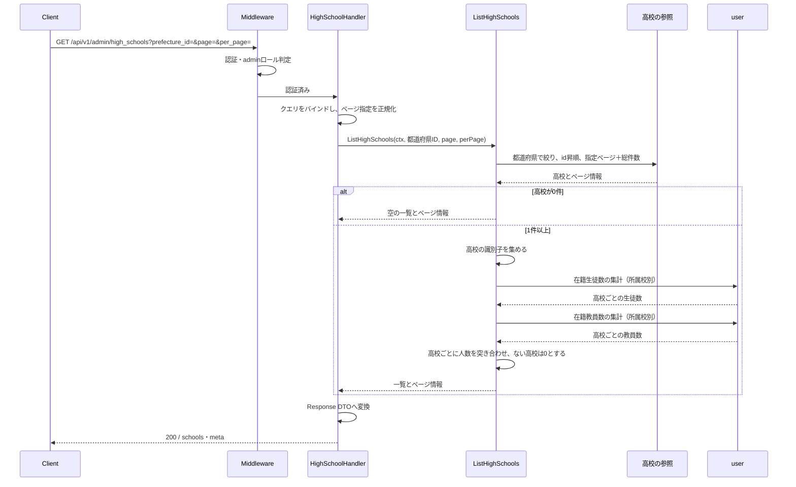
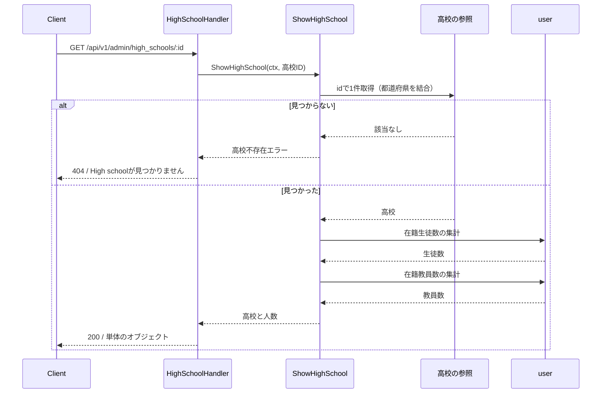
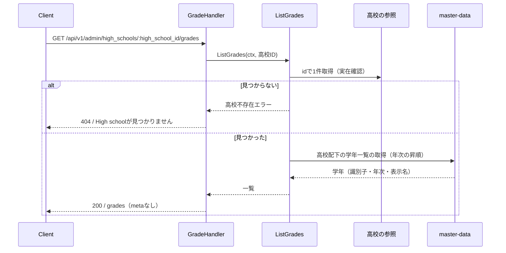
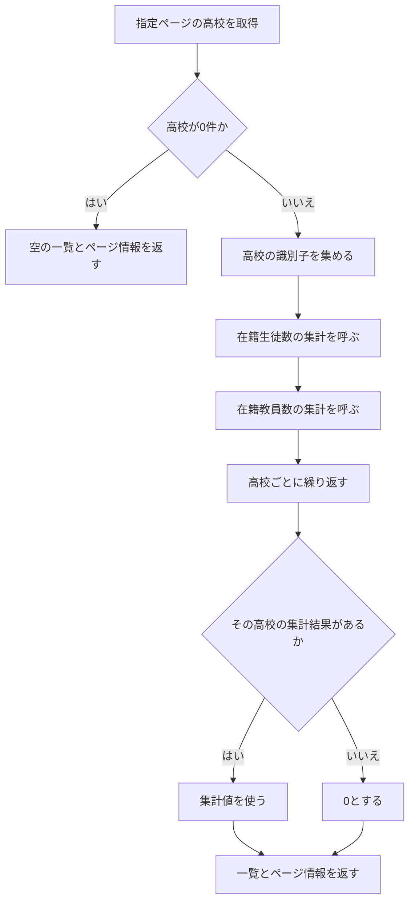
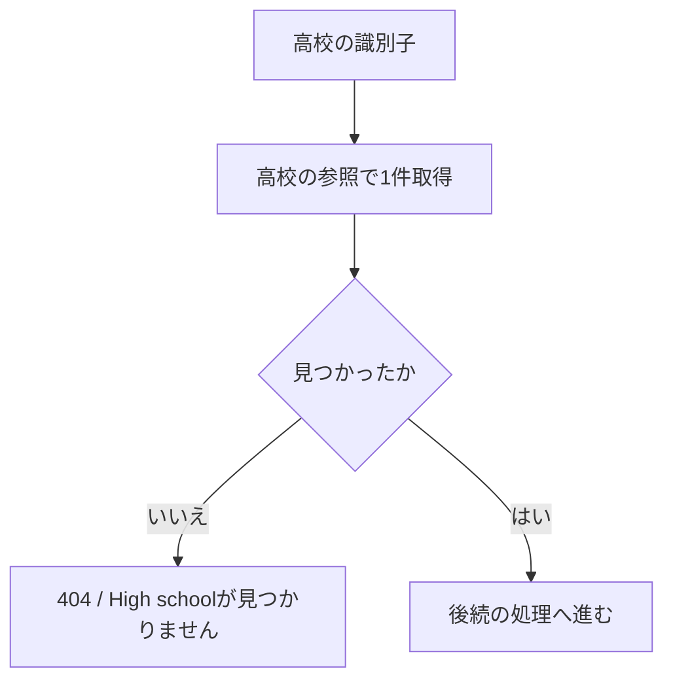

# 管理者高校学年参照機能 Go移行・設計仕様書

---

# 1. 機能概要

## 機能概要

管理者が、システムに登録されている高校の一覧と詳細、および高校ごとの在籍人数を把握できるようにする機能である（①「1. 機能概要」）。あわせて高校に属する学年を参照できるようにする。

提供する操作は3つで、いずれも参照のみである（①「2. 機能一覧」）。

- 高校一覧取得（都道府県で絞り込み、ページ単位。生徒数・教員数を含む）
- 高校詳細取得（生徒数・教員数を含む）
- 学年一覧取得（年次の昇順）

## 利用者

`admin` ロールのユーザー（管理者）のみ。3つの操作すべてに適用される（①「8. 権限制御」）。

## 業務上の目的

管理者が各高校の利用状況を把握できるようにすること。高校そのものの情報に加えて在籍生徒数・在籍教員数を返すことで、どの高校がどの程度利用されているかを一覧で確認できるようにする。

高校の詳細は、その高校の教員管理・お知らせ参照といった管理画面へ遷移する起点にもなる。

---

# 2. 設計方針

- **参照・集約専用に徹する**: 本Contextは書き込みを一切行わない。高校・学年・ユーザーの業務ルールは、それぞれの所有Contextに残す。
- **画面向けの一覧は自前の参照モデルで持つ**: ページネーション・都道府県との結合・識別子による並び替えを伴う高校一覧は、本Contextが自前の参照として持つ。ユーザー基盤機能②「3. Bounded Context」が`users`について採った方針（画面向けの一覧は所有Contextが公開せず、必要とするContextが自前の参照モデルを持つ）に揃える。
- **規則を複製しない**: 学年の年次から表示名への対応は`master-data`が持つ規則であるため、同Contextの公開操作を呼んで結果を受け取る。人数の集計条件（どのロールを数えるか、在籍状態をどう扱うか）は`user`が持つため、同Contextの公開操作を呼ぶ。
- **API互換性を維持する**: URL・HTTPメソッド・レスポンス項目名・HTTPステータスをRails現行から変えない。フロントエンドを変更しない方針のため、Rails現行の振る舞いに不合理な点があっても本移行では踏襲し、Rails側の修正課題として別に管理する（「19. API仕様」の「Railsとの差分」）。
- **過剰な構造を持ち込まない**: 状態も書き込みも持たないため、Entity・Repository Interface・UseCase層を設けない（規約「3. 設計パターンごとの構造適用方針」）。

---

# 3. Bounded Context

## Context名

- `school-directory`

## Contextの責務

- 管理者向けの高校一覧・詳細の提供（都道府県による絞り込み、ページネーション、識別子の昇順、都道府県名の付与）
- 高校ごとの在籍生徒数・在籍教員数の付与
- 高校に属する学年一覧の提供
- 複数Contextからの参照結果を1つのレスポンスへまとめること

## 持たない責務

|持たない責務|所有するContext|
|-|-|
|高校・学年・都道府県の保持と、入力フォーム向けの選択肢提供|`master-data`（共通マスタ参照機能②「3. Bounded Context」）|
|学年の年次から表示名への対応規則|同|
|ユーザーの所属と在籍状態の定義、人数の集計条件|`user`（ユーザー基盤機能②「3. Bounded Context」）|
|高校・学年の登録・更新・削除|どのContextにも実装がない（共通マスタ参照機能①「5. API / 処理詳細」の「実装のないアクションへの経路」）|
|教員の管理、高校単位のお知らせ参照|`teacher-management`・`announcement`。本Contextは遷移の起点を提供するだけで、それらの機能を持たない|

## 他Contextとの依存関係

本Contextから他Contextへの参照依存のみである。状態変更を伴う依存も、他Contextから本Contextへの依存も存在しない。循環依存は発生しない。

|依存先Context|参照する内容|根拠|
|-|-|-|
|`master-data`|高校に属する学年の一覧（識別子・年次・表示名。年次の昇順）|①「5. API / 処理詳細」`Api::V1::Admin::GradesController#index`。共通マスタ参照機能②「11. Repository設計」の「高校配下の学年一覧の取得」|
|`user`|高校ごとの在籍生徒数と在籍教員数|①「5. API / 処理詳細」`#index`・`#show`。ユーザー基盤機能②「12. UseCase設計」の`CountUsers`（所属校別）|
|`user`|認証済み管理者の識別|①「8. 権限制御」|

## `high_schools` と `prefectures` の扱い

**高校の一覧・詳細は、本Contextが自前の参照モデルとして`high_schools`・`prefectures`を直接読む。** `master-data`の公開操作を呼ばない。

規約「4. Bounded Context構成」は「同一データに対する参照専用の切り口（例：ダッシュボードでの集約表示）は、データを所有するContextとは別の『参照・集約専用Context』として切り出してよい。ただしその場合、業務ルール（作成・更新・状態遷移）は元のContextに残し、参照専用Contextは持たない」と定めている。本Contextは業務ルールを持たないため、この条件を満たす。

`master-data`へ委譲しない理由は、本Contextが必要とする高校一覧が「都道府県で絞り、識別子の昇順、ページネーションあり、都道府県名を結合」という画面向けの形であることによる。ユーザー基盤機能②「3. Bounded Context」は`users`について、画面向けの一覧（ページネーション・他テーブルとの結合・並び替えを伴うもの）を所有Contextが公開せず、必要とするContextがそれぞれの②で自前の参照モデルとして定めると決めている。高校一覧も同じ性質であるため、同じ方針を採る。

**学年の一覧だけは`master-data`の公開操作を呼ぶ。** こちらはページネーションも結合も伴わず、かつ年次から表示名への対応規則を含むためである。規則を2つのContextに複製しない（共通マスタ参照機能②「3. Bounded Context」の「`school-directory`との関係」）。

**人数の集計は`user`の公開操作を呼ぶ。** 「生徒とは何か」「在籍中とは何か」の定義は`user`が持つ。本Contextが`users`を直接読むと、ロールの判定条件と在籍状態の扱いが2か所に分かれる（規約「5. Context間連携ルール」）。

## 依存する理由

本Contextは高校・学年そのものを管理せず、管理者が運用状況を把握するための切り口を提供する。表示に必要な情報のうち、高校の属性と都道府県名は本Contextの参照モデルで取得し、学年の表示名と人数の集計は定義を持つContextへ委ねる。

---

# 4. 設計パターン

## 採用パターン

Transaction Script

## 判断根拠

規約「3. 設計パターンごとの構造適用方針」のTransaction Script節は、対象を「一般・補完領域で、業務ルールが1〜2文で説明できる単純な処理（単純な一覧参照・**集計**・レポート生成・バッチ的処理等）」と定めている。本機能は一覧参照と集計であり、この定義に該当する。

- **業務ルール**: 「都道府県が指定されていれば絞り込む」「識別子の昇順」「人数が0の高校は0と表示する」のみ。いずれも検索条件と表現の規則である
- **状態管理**: 本機能は何も書き込まず、自身の状態を持たない（①「7. 状態管理」）
- **整合性**: 書き込みがないため、保証すべき整合性の単位が存在しない
- **将来拡張**: 表示項目が増える場合も、参照を1つ増やして関数の中で呼ぶだけでよい
- **テスト容易性**: 入力（絞り込み条件・ページ指定）に対する出力（高校の一覧と人数）を検証するだけでよい

Entityに振る舞いを持たせる余地がなく、永続化の責務もないため、手続きを関数として置くTransaction Scriptが最も素直である。

## 採用しなかったパターン

### Active Record

本機能に作成・更新処理が含まれない。永続化操作をstructに持たせる対象がない。

### Domain Model

高校・学年・ユーザーの業務ルールはそれぞれの所有Contextの責務であり、本機能では読み取り専用で参照するのみである。本Context固有のEntityに振る舞いを持たせる必要がない。参照専用Contextに集約・Repository Interface・UseCase層を設けると、関数1つで足りる処理に対して層だけが増える。

### Event Sourcing

履歴の再構築・監査要件が存在しない。

---

# 5. Aggregate設計

不要である。

理由: 本Contextが所有するデータがなく、書き込みも行わないため、整合性を保証すべき単位が存在しない。高校の情報と人数の組み合わせは複数の取得元から集めた値であり、1つの整合性単位として扱う対象ではない。

---

# 6. Entity設計

本Contextで管理するEntityは存在しない。

理由: 規約「3. 設計パターンごとの構造適用方針」のTransaction Script節は「domain層は原則作らない」と定めており、本機能はこれに従う。参照する高校・学年・ユーザーは、それぞれ`master-data`・`user`が管理するデータである（①「6. データモデル」）。

他Contextから受け取る値は、本Contextが必要とする項目だけを持つ参照用の型として扱い、相手Contextの内部Entityをそのまま持ち込まない（規約「5. Context間連携ルール」）。本Contextの参照モデルが読む高校・都道府県も、表示に必要な項目だけを持つ読み取り専用の型として扱う。

---

# 7. Value Object設計

Value Objectは採用しない。

理由: 規約「3. 設計パターンごとの構造適用方針」のTransaction Script節は「入力検証が必要な場合も、Value Object等の型は作らず、関数内のガード節で行う」と定めている。

Value Objectの候補になりうる概念と、型を作らずに扱う場所を整理する。

|概念|持つ規則|扱う場所|
|-|-|-|
|ページ指定|既定20、上限100、0以下・数値以外は既定値（①「5. API / 処理詳細」`#index`）|Presentation層のリクエスト検証。全APIで共通の規則であり、本機能固有の型を作らない（規約「15. API規約（レスポンス形式・ページネーション・URL・クエリパラメータ）」のページネーション）|
|学年の表示名|年次0〜7に対応する8つの名称|`master-data`が決めた値を文字列として受け取る。本Contextで変換しない|
|人数|0以上の整数。集計対象が0件のときは0|`user`から受け取った集計結果を整数として扱う。該当する高校の値がない場合に0とする扱いだけを本Contextで行う|

学年の表示名を文字列で受け取るのは、表示形式を`master-data`が定める表現に委ねるためである。年次から本Contextで変換し直すと、同じ学年が機能によって別の名前で返る余地が生まれる。

---

# 8. Domain Service

不要である。

理由: Domain Serviceは、複数Entityにまたがる業務ルールの判定をEntityの外に出すための置き場所である。本ContextにはEntityが存在せず（「6. Entity設計」）、判定すべき業務ルールもない。

高校の情報と人数を1つのレスポンスへまとめる処理は業務ルールではなく、application層の関数が担う（「12. UseCase設計」）。

---

# 9. クラス図

参照のみの機能であり、Entityもstructの階層も持たないため、クラス図としての図示は省略する。

本Contextが持つのは、高校・都道府県を読む参照モデル、他Contextの参照手段を宣言するインターフェース、およびそれらを呼んで結果をまとめる関数のみである。関係は「13. シーケンス図・処理フロー図」のシーケンス図で示す。

Goのstruct定義・インターフェースのシグネチャは③Go実装仕様書で扱う。

---

# 10. 状態遷移図

省略する。

理由: 本機能が参照する高校・学年に状態が存在しない（①「7. 状態管理」）。集計で参照するユーザーの在籍状態は、生徒数の集計条件として使うのみで、本機能が変更することはない。図示すべき遷移が存在しない。

---

# 11. Repository設計

本機能はTransaction Scriptを採用するため、Repository Interfaceは設けない（規約「3. 設計パターンごとの構造適用方針」）。本節は、業務上必要なデータアクセスの責務として整理する。

## 本Contextが持つ参照（自前の参照モデル）

### 高校の参照

- 管理対象: 高校（管理者向けの一覧・詳細に必要な項目）
- 責務: 条件に一致する高校を、所属都道府県の名称とあわせて取得。および識別子による1件取得
- 保持する検索機能
  - 都道府県による絞り込み。未指定・空文字のときは絞り込まない
  - 識別子の昇順
  - ページネーション（総件数の取得を含む）
  - 識別子による1件取得
- 保持しない責務
  - 入力フォーム向けの高校検索（名称の部分一致・名前順・20件制限は`master-data`の責務）
  - 人数の集計（`user`の責務）
  - 高校の登録・更新・削除
- 論理削除の扱い: 該当なし。`high_schools`・`prefectures`は`deleted_at`を持たない（①「6. データモデル」）
- 判断根拠: ページネーション・結合・並び替えを伴う画面向けの一覧であり、所有Contextが公開しない方針のため本Contextが持つ（「3. Bounded Context」の「`high_schools`と`prefectures`の扱い」）

**都道府県の絞り込みが未指定のときは適用しない。** `master-data`の高校検索が未指定でも条件として適用し結果が0件になるのとは扱いが異なる（共通マスタ参照機能①「5. API / 処理詳細」`Api::V1::HighSchoolsController#index`）。Rails現行がそれぞれ別の実装になっているためであり、両方の振る舞いを維持する。

## 他Contextの参照手段

本Contextの`dependency.go`にインターフェースとして宣言し、実装は相手Contextの公開操作へ委譲するアダプタに閉じ込める（規約「4. Bounded Context構成」・「5. Context間連携ルール」）。

|参照手段|相手Context|取得する内容|用途|
|-|-|-|-|
|学年一覧の参照|`master-data`|指定された高校に属する学年の識別子・年次・表示名。年次の昇順|学年一覧取得（①「5. API / 処理詳細」`Api::V1::Admin::GradesController#index`）|
|在籍生徒数の集計|`user`|指定された高校ごとの、在籍中の生徒の人数|一覧・詳細の`student_count`（同`#index`・`#show`）|
|在籍教員数の集計|`user`|指定された高校ごとの、教員の人数（論理削除済みを含む）|一覧・詳細の`teacher_count`（同）|

生徒数と教員数を別の参照手段として分けるのは、**論理削除の扱いが異なる**ためである。生徒数は在籍中のみを数え、教員数は論理削除済みも含む（①「5. API / 処理詳細」`#index`の業務ルール）。`user`の集計操作は在籍状態の扱いを呼び出し側に必須で指定させる形になっており（ユーザー基盤機能②「12. UseCase設計」の`CountUsers`）、別の呼び出しとして分けることでどちらの扱いかを呼び出し箇所で明示できる。

人数の集計を本Contextで行わない理由は「3. Bounded Context」に記載のとおりである。

## 他Contextへ公開する参照手段

**なし。** 本Contextを参照する他Contextは存在しない（「3. Bounded Context」）。管理者向けの表示に特化した切り口であり、他の機能が必要とする形ではない。

---

# 12. UseCase設計

本機能はTransaction Script採用のため、UseCase層（struct）は設けない。1つの業務操作を1つの関数として実装する（規約「3. 設計パターンごとの構造適用方針」）。本節では業務操作の単位として整理する。

## ListHighSchools

- 目的: 高校の一覧を、生徒数・教員数とあわせてページ単位で取得する
- 入力: 都道府県の識別子（任意）、ページ番号、1ページあたりの件数
- 出力: 高校の一覧（識別子・名称・都道府県名・生徒数・教員数）とページ情報（①「5. API / 処理詳細」`#index`のResponse）
- トランザクション範囲: なし（「14. Transaction設計」）
- 呼び出す先: 高校の参照、在籍生徒数の集計、在籍教員数の集計
- 処理
  1. 高校の参照で、都道府県の絞り込みと識別子の昇順、指定ページの取得を行う。総件数も取得する
  2. 取得した高校の識別子を集める
  3. 在籍生徒数の集計を、その識別子の集合に対して呼ぶ
  4. 在籍教員数の集計を、同じ識別子の集合に対して呼ぶ
  5. 高校ごとに人数を突き合わせる。集計結果に含まれない高校は0とする
  6. ページ情報とあわせて返す
- 判断根拠: 人数の集計を取得したページに限るため、高校の取得を先に行い、その識別子を集計に渡す必要がある

高校が0件の場合、空の一覧とページ情報を返す。エラーにしない。人数の集計も呼ばない（識別子の集合が空になるため）。

## ShowHighSchool

- 目的: 指定された高校の情報を、生徒数・教員数とあわせて取得する
- 入力: 高校の識別子
- 出力: 高校の情報（識別子・名称・都道府県名・生徒数・教員数）
- トランザクション範囲: なし
- 呼び出す先: 高校の参照、在籍生徒数の集計、在籍教員数の集計
- 処理
  1. 高校の参照で1件取得する。見つからなければ対象が存在しないことを表すエラーを返す
  2. 在籍生徒数の集計を、その高校の識別子に対して呼ぶ
  3. 在籍教員数の集計を、同じ識別子に対して呼ぶ
  4. 高校の情報に人数を添えて返す
- 判断根拠: 返す項目は一覧の各要素と同じであるが、最上位の構造が異なるため別の操作とする（①「5. API / 処理詳細」`#show`）

**高校の実在確認を行う。** 見つからない場合は`404`とする。`master-data`の学年一覧取得が実在確認を行わないのとは扱いが異なる（共通マスタ参照機能①「5. API / 処理詳細」`Api::V1::GradesController#index`）。

## ListGrades

- 目的: 指定された高校に属する学年を取得する
- 入力: 高校の識別子
- 出力: 学年の一覧（識別子・年次・表示名）
- トランザクション範囲: なし
- 呼び出す先: 高校の参照、学年一覧の参照
- 処理
  1. 高校の参照で1件取得する。見つからなければ対象が存在しないことを表すエラーを返す
  2. 学年一覧の参照で、その高校に属する学年を取得する
  3. 取得した一覧をそのまま返す
- 判断根拠: 高校の実在確認が必要なため、学年の取得だけでは足りない

**高校の実在確認を本Contextの参照で行う。** 学年一覧の参照は実在確認を兼ねない。`master-data`の「高校配下の学年一覧の取得」は、存在しない高校に対して空の一覧を返す仕様である（共通マスタ参照機能②「11. Repository設計」）。空の一覧を`404`と区別できないため、実在確認を別に行う必要がある。

学年が0件の高校では空の一覧を返す。エラーにしない（①「5. API / 処理詳細」`Api::V1::Admin::GradesController#index`）。

---

# 13. シーケンス図・処理フロー図

## シーケンス図

### ListHighSchools

### ShowHighSchool

### ListGrades

## 処理フロー図

### 人数の突き合わせ

集計結果に含まれない高校を0とする扱いが必要なのは、人数が0の高校が集計結果に現れないためである（①「5. API / 処理詳細」`#index`の業務ルール）。

### 高校の実在確認

`#show`と学年一覧取得で共通の流れである。一覧取得には実在確認がない。

---

# 14. Transaction設計

- **Transaction開始位置**: なし
- **Transaction終了位置**: なし

## 理由

本機能は参照のみで、1件のデータも作成・更新・削除しない（①「5. API / 処理詳細」Database変更）。書き込みがないため、原子性を保証する対象が存在しない。規約「11. Transaction実装パターン（TransactionManager）」の仕組みは使わない。

高校の取得と人数の集計を順に呼ぶため、呼び出しの間にユーザーの登録・退会が起きると、高校の一覧と人数がわずかにずれた時点のデータに基づく可能性がある。これを防ぐために読み取り専用トランザクションで束ねることはしない。理由は以下である。

- Rails現行も同様に個別のクエリを順に発行しており、同じ性質を持つ（①「9. 非同期処理」）
- ずれが生じても人数が1人分前後するだけで、管理者の判断を誤らせる性質のものではない
- `user`の集計操作が本Contextのトランザクションに参加するかは相手Contextの実装に依存し、本Contextが前提にできない

---

# 15. Validation設計

## Presentation

- 型チェック: `prefecture_id`・`id`・`high_school_id`・`page`・`per_page` が整数として解釈できること
- 必須チェック: パスパラメータ（`id`・`high_school_id`）が存在すること。クエリパラメータに必須のものはない
- フォーマットチェック: なし

ページ指定の正規化（0以下・数値以外を既定値とする、上限を超える値を上限に丸める）はPresentation層で行う。全APIで共通の規則であり、規約「15. API規約（レスポンス形式・ページネーション・URL・クエリパラメータ）」のページネーションに従う。

## Domain

本機能にDomain層は存在しない（「6. Entity設計」）。業務ルールによる検証も存在しない。

- 業務ルール: 検証対象なし
- 状態チェック: なし。状態を持たない
- 整合性チェック: なし。書き込みがない

高校の実在確認は検証ではなく、参照の結果として扱う。該当する行が取得できなければ対象が存在しないことを表すエラーを返す（「12. UseCase設計」）。

## バリデーション仕様

|フィールド|検証層|ルール|エラーメッセージ方針|
|-|-|-|-|
|`prefecture_id`|Presentation|任意。指定された場合は整数として解釈できること。空文字は未指定として扱う|「都道府県の指定が不正です」|
|`page`|Presentation|任意。整数として解釈できること。0以下・数値以外は未指定として扱う|エラーにしない。既定値を使う|
|`per_page`|Presentation|任意。整数として解釈できること。0以下・数値以外は既定値（20）、上限（100）を超える値は上限に丸める|エラーにしない|
|`id`（詳細取得）|Presentation|整数として解釈できること|「高校の指定が不正です」|
|`high_school_id`（学年一覧）|Presentation|整数として解釈できること|「高校の指定が不正です」|

`page`・`per_page`の不正値をエラーにせず既定値で処理するのは、Rails現行がそうしているためである（①「5. API / 処理詳細」`#index`）。

---

# 16. Authorization設計

|層|判定内容|理由|
|-|-|-|
|Middleware|認証（ログイン済みであること）と`admin`ロールであることを判定する|規約「7. 横断的関心事の置き場所」のとおり、ロールレベルの粗い制御はMiddlewareに置く。認可はCasbin RBACで行う（Gin規約「4. 認可（Casbin RBAC）」）|
|Handler|操作者を参照しない|管理者は全高校の情報を参照でき、結果が操作者によって変わらない（①「8. 権限制御」）|
|application層|判定しない|参照対象が操作者に依存しない|
|Domain|存在しない|Domain層を設けない（「6. Entity設計」）|

## 判断理由

管理者は所属校を持たず（①の確認範囲では管理者の`high_school_id`は未設定）、全高校を参照できる。操作者による絞り込みがないため、所有権の判定が必要にならない。操作者の識別子をapplication層へ渡さない設計にすることで、判定を書く必要自体をなくす。

人数の集計では他のユーザーのデータを参照するが、返すのは人数のみで、個々のユーザーを特定できる情報は返さない（①「8. 権限制御」）。`user`から受け取る集計結果もレスポンスへは人数としてのみ出す。

---

# 17. Error設計

## Domain Error

責務: なし。本Contextに業務ルール違反を表すエラーが存在しない。Domain層を設けないため、Domain Errorも定義しない。

## Application Error

責務: 指定された高校が存在しないことを表す。

`#show`と学年一覧取得で、指定された識別子の高校が取得できない場合に発生する。`404`として返す（①「5. API / 処理詳細」）。

## Infrastructure Error

責務: 本Contextの参照の失敗、および他Contextの参照手段の呼び出しの失敗を表す。

本Contextでは個別に判別せず、そのまま呼び出し元へ返して`500`として扱う。参照先の失敗を本Contextで意味づけし直す余地がないためである。

## 判断理由

本Contextは書き込みを持たず、業務ルールによる失敗が存在しない。そのため意味を持つエラーは「高校が存在しない」の1つに絞られる。

人数の集計が0件を返すことはエラーとして扱わない。生徒・教員が0人の高校も一覧に現れ、件数は`0`となるのが正常な応答である（①「5. API / 処理詳細」`#index`）。

**人数の集計の失敗を吸収しない。** `user`の集計が失敗した場合はエラーを返し`500`とする。Rails現行に吸収の仕組みがなく、人数が欠けたまま`200`で返ると誤った数値が表示される。ダッシュボード機能③が当日の解答件数の失敗を`0`として吸収しているのとは扱いが異なる（同③「6. Application層設計」）。あちらはRails現行が吸収しているためであり、本機能には該当しない。

## エラー仕様

|業務シナリオ|エラー種別|発生層|想定するHTTPステータス|
|-|-|-|-|
|指定された高校が存在しない|NotFound|Application|404|
|`prefecture_id`・`id`・`high_school_id`が整数として解釈できない|Validation|Presentation|422|
|本Contextの参照の失敗|Internal|Infrastructure|500|
|他Contextの参照手段の呼び出しの失敗|Internal|Infrastructure|500|
|未認証|Unauthorized|Middleware|401|
|`admin`ロール以外|Forbidden|Middleware|403|

`404`の本文は`{"message": "High schoolが見つかりません"}`とする。規約「15. API規約（レスポンス形式・ページネーション・URL・クエリパラメータ）」はエラー本文を`{"errors": [...]}`と定めているが、Rails現行の`404`は`message`キーであり、フロントエンドを変更しない方針のため維持する。モデル名が英語表記になる点も維持する（①「5. API / 処理詳細」`#show`）。この扱いは他機能③と同じであり、Rails側で`404`の本文の形を揃える修正が入った時点で見直す。

---

# 18. Domain Event

不要である。

理由: 本Contextは参照のみで、他の処理へ波及させるべき状態変化が発生しない。一覧・詳細を表示することに副作用がないため、通知する対象となる出来事が存在しない。

---

# 19. API仕様

## エンドポイント一覧

|エンドポイント|HTTP Method|概要|
|-|-|-|
|`/api/v1/admin/high_schools`|GET|高校一覧を取得（生徒数・教員数・ページ情報を含む）|
|`/api/v1/admin/high_schools/:id`|GET|高校詳細を取得（生徒数・教員数を含む）|
|`/api/v1/admin/high_schools/:high_school_id/grades`|GET|指定高校の学年一覧を取得|

## 各エンドポイントの仕様

### `GET /api/v1/admin/high_schools`

- Request: クエリパラメータ `prefecture_id`（任意）・`page`（任意）・`per_page`（任意）
- Response: `{"schools": [...], "meta": {...}}`。各要素は`id`・`name`・`prefecture_name`・`student_count`・`teacher_count`。`meta`は`current_page`・`total_pages`・`total_count`・`per_page`
- Status Code: 正常系 `200`。異常系 `422`（整数でないパラメータ）、`401`、`403`、`500`
- Error Response方針: `{"errors": [...]}`

### `GET /api/v1/admin/high_schools/:id`

- Request: パスパラメータ `id`
- Response: 最上位が単体のJSONオブジェクト。`id`・`name`・`prefecture_name`・`student_count`・`teacher_count`
- Status Code: 正常系 `200`。異常系 `404`（高校が存在しない）、`422`、`401`、`403`、`500`
- Error Response方針: `404`は`{"message": "..."}`、それ以外は`{"errors": [...]}`

### `GET /api/v1/admin/high_schools/:high_school_id/grades`

- Request: パスパラメータ `high_school_id`
- Response: `{"grades": [...]}`。各要素は`id`・`year`・`display_name`。`meta`は返さない
- Status Code: 正常系 `200`。異常系 `404`、`422`、`401`、`403`、`500`
- Error Response方針: 同上

## Railsとの差分

フロントエンドを変更しない方針のため、URL・HTTPメソッド・レスポンス項目名・HTTPステータスは変更しない。**差分はない。**

### 変更しないもの（Rails現行の振る舞いを踏襲する点）

以下はRails現行の振る舞いとして不合理に見えるが、レスポンスが変わるため本移行では変更しない。Rails側の修正課題として別に管理する。

|項目|Rails現行の振る舞い|
|-|-|
|生徒数と教員数の在籍状態の扱い|生徒数は論理削除済みを除外するが、教員数は含む。同じレスポンスの中で扱いが揃っていない（①「5. API / 処理詳細」`#index`）|
|一覧と詳細の最上位の構造|一覧は`schools`キーで包み`meta`を持つが、詳細は包まずに単体のオブジェクトを返す（同`#show`）|
|学年一覧の構造|`grades`キーで包むが`meta`を持たない。一方、共通マスタ参照機能の学年一覧は裸の配列を返す。同じデータの一覧で形が異なる（同`Api::V1::Admin::GradesController#index`、共通マスタ参照機能①「5. API / 処理詳細」）|
|`404`の本文の形とモデル名|`{"message": "High schoolが見つかりません"}`。他のエラーは`errors`形式であり、モデル名の日本語訳も定義されていない（①「5. API / 処理詳細」`#show`）|
|高校一覧の並び順|識別子の昇順であり、高校名の昇順ではない。共通マスタ参照機能の高校検索は名前順である（同`#index`）|
|都道府県の絞り込みの扱い|未指定のとき絞り込まない。共通マスタ参照機能の高校検索は未指定でも条件として適用し0件になる（同）|

---

# 20. DB設計方針

- **現行DBを利用するか**: 利用する
- **Schema変更有無**: なし
- **変更理由**: 該当なし

本Contextが所有するテーブルはない。高校・都道府県は`master-data`が所有し、学年も同じく`master-data`が、ユーザーは`user`が所有する（①「6. データモデル」）。本Contextは`high_schools`・`prefectures`を参照専用の切り口として読むが、所有はしない（「3. Bounded Context」）。

本Contextからの要求でSchemaを変更する必要はない。

Schema変更の候補として検討した点と、提案しない理由を記す。

|検討した点|提案しない理由|
|-|-|
|`users.high_school_id`に人数集計用のインデックスを追加する|集計を行うのは`user`であり、インデックスの必要性は同Contextが判断する。既に外部キーのインデックスが存在する前提であり、本Contextからの提案としない|
|高校ごとの生徒数・教員数を保持する集計列・集計テーブルを設ける|Rails現行が都度集計しており（①「9. 非同期処理」）、保持すると更新の整合を保つ責務が生まれる。ユーザーの登録・退会・所属変更を行うContextがすべて更新に関与することになり、Context境界を越えた結合が増える|

集計結果のキャッシュも導入しない。管理者向けの画面であり呼び出し頻度が低く、現時点で応答時間の問題が確認されていない。

---

# 21. DB操作仕様

「11. Repository設計」で整理した参照が、どのテーブルに対してどのような操作を行うかを整理する。

|参照|対象テーブル|操作種別|主な検索条件|結合|ページネーション/ソート|
|-|-|-|-|-|-|
|高校の参照（一覧）|`high_schools`|参照|`prefecture_id`（指定がある場合）|`prefectures`（都道府県名をレスポンスに含めるため）|`id`昇順、ページネーションあり（総件数の取得を含む）|
|高校の参照（1件）|`high_schools`|参照|`id`|`prefectures`（同）|不要|

`deleted_at`による絞り込みは行わない。`high_schools`・`prefectures`はいずれも論理削除の列を持たない（①「6. データモデル」）。

`users`・`user_roles`・`grades`へは本Contextからクエリを発行しない。人数の集計は`user`が、学年の取得は`master-data`が公開する参照手段に委ねる（「11. Repository設計」、規約「5. Context間連携ルール」）。

他Contextへ渡す条件と期待する結果の粒度を整理する。

|依存先|渡す条件|受け取る粒度|
|-|-|-|
|`master-data`|高校の識別子|学年の識別子・年次・表示名の一覧（年次の昇順）|
|`user`|高校の識別子の集合、数える対象のロール、在籍状態の扱い|高校の識別子ごとの人数|

`user`へ高校の識別子の集合を渡す形を取っているため、1ページあたりの件数（最大100）がそのまま渡す識別子の件数になる。現実的な規模で問題にならない前提とする。

具体的なSQL・GORMのクエリコードは③Go実装仕様書（`規約/Gorm規約.md`）で扱う。

---

# 22. テスト戦略

## Domain Test

対象外。Domain層を設けないため（「6. Entity設計」）。

## UseCase Test

UseCase層は設けないため、application層の関数に対するテストとして行う。本機能のテストの中心はここに置く。

目的: 高校の参照と他Contextの参照手段をテストダブルに差し替え、受け取った値から正しい結果が組み立てられることを検証する。

重点を置く観点:

- 人数の突き合わせ: 集計結果に含まれない高校が`0`になること、高校ごとに正しい人数が対応すること
- 高校が0件のとき、人数の集計を呼ばずに空の一覧とページ情報を返すこと
- 生徒数と教員数で在籍状態の扱いを別に指定して呼ぶこと（生徒は在籍中のみ、教員は論理削除済みを含む）
- 人数の集計が失敗した場合にエラーを返すこと（`0`として吸収しないこと）
- `#show`・学年一覧取得で、高校が見つからないときに高校不存在エラーを返すこと
- 学年一覧取得で、高校の実在確認を学年の取得より先に行うこと
- 学年が0件の高校で空の一覧を返すこと（エラーにしないこと）
- 学年の表示名を本Contextで変換せず、受け取った文字列をそのまま返すこと

## Repository Test

本Contextの参照モデルのテストである。

重点を置く観点:

- 都道府県の絞り込みが、指定時に効き、未指定・空文字のとき効かないこと
- 識別子の昇順になること
- ページネーションが効き、総件数が正しいこと
- 都道府県が結合され、都道府県名が取得できること
- 1件取得で、存在しない識別子のとき該当なしが返ること
- `users`・`grades`へクエリを発行しないこと

## Handler Test

目的: HTTPの入出力とPresentation層の検証を確認する。

重点を置く観点:

- ページ指定の正規化（0以下・数値以外が既定値、上限超過が上限に丸められること）
- `prefecture_id`・`id`・`high_school_id`が整数でないとき`422`が返ること
- 一覧が`schools`キーと`meta`を持つこと、詳細が包まずに単体のオブジェクトを返すこと、学年一覧が`grades`キーを持ち`meta`を持たないこと
- 高校が存在しないとき`404`と`{"message": "High schoolが見つかりません"}`が返ること
- `schools`・`grades`が0件のとき空の配列（`null`ではない）が返ること
- 操作者を参照しないこと
- レスポンスに都道府県の識別子・学校コード・`csv_managed`を含めないこと

## Integration Test

目的: 認証・認可を含めたエンドポイントの振る舞いと、他Contextの参照手段を実装込みで通した結果を確認する。

重点を置く観点:

- 未認証で`401`、`admin`以外のロール（生徒・教員）で`403`になること
- 3つのエンドポイントがそれぞれ正しい構造で返ること
- **生徒数が論理削除済みの生徒を除外し、教員数が論理削除済みの教員を含むこと**
- 生徒・教員が0人の高校で人数が`0`になること
- 都道府県で絞り込めること、ページをまたいで重複・欠落がないこと
- 学年が年次の昇順で返ること、表示名が`master-data`の規則どおりであること
- 存在しない高校の識別子で`404`になること（詳細・学年一覧の両方）

生徒数と教員数の在籍状態の扱いが異なる点は、Rails現行との差分が出やすく、テストダブルを使う単体テストでは実データでの確認ができないため、Integration Testで必ず確認する。

---

# 23. Railsとの責務対応

|Rails|Go|設計方針|
|-|-|-|
|`Api::V1::Admin::HighSchoolsController`|HighSchoolHandler|HTTP責務のみ担当。絞り込み条件・ページ指定の受け取りに限る|
|`Api::V1::Admin::GradesController`|GradeHandler|HTTP責務のみ担当|
|`Api::V1::Admin::BaseController#authorize_admin_service`|Middleware|`admin`ロールの認可。Casbin RBACで行う（Gin規約「4. 認可（Casbin RBAC）」）|
|`Api::V1::Admin::BaseController#pagination_meta`|Response DTOの組み立て|ページ情報の形は全APIで共通であり、規約「15. API規約（レスポンス形式・ページネーション・URL・クエリパラメータ）」に従う。Handlerごとに組み立てない|
|Controller内の`HighSchool.includes(:prefecture).order(:id).by_prefecture(...).page(...)`|infrastructure層の高校の参照関数|Railsは絞り込み・並び替え・ページングをControllerに直接書いている。Goでは参照関数にまとめる|
|Controller内の`User.students.active.by_high_school(...).group(:high_school_id).count`|`user`の公開操作の呼び出し|**集計をRailsのようにControllerで組み立てない。** 「生徒とは何か」「在籍中とは何か」の定義を持つ`user`に委ねる（規約「5. Context間連携ルール」）|
|Controller内の`User.teachers.by_high_school(...).group(:high_school_id).count`|同|同。在籍状態の扱いが生徒と異なることを、呼び出し時の指定で明示する|
|Controller内の`school.grades.order(:year)`|`master-data`の公開操作の呼び出し|学年の取得と表示名の規則を所有Contextに委ねる|
|`HighSchool.by_prefecture`（モデルのスコープ）|高校の参照関数の条件|未指定のとき絞り込まないという扱いを関数内のガード節で表現する|
|`Grade#display_name`（モデルのメソッド）|`master-data`が返す値|本Contextで変換しない（「7. Value Object設計」）|
|`Admin::HighSchoolSerializer`|Response DTO|`instance_options`で人数を受け取る形をやめ、application層が組み立てた値をDTOへ移す（規約「6. データフロー」）|
|`Admin::GradeSerializer`|Response DTO|同|
|`HighSchool` / `Grade` / `Prefecture` / `User` / `UserRole`|GORMモデルは`high_schools`・`prefectures`のみ|`grades`・`users`・`user_roles`に対応するモデルを本Contextに持たない。所有Contextの参照手段を呼ぶ|

Rails現行は、高校の取得・人数の集計・学年の取得をすべてControllerが直接組み立てている。Goでは「画面向けの一覧は自前の参照、定義を伴うものは所有Contextへ委譲」という線で分ける。この線引きの根拠は「3. Bounded Context」に記載のとおりである。

---

# 24. 採用しなかった設計

## 高校の一覧・詳細も`master-data`へ委譲する

- 採用しなかった案: 高校の一覧・詳細を`master-data`の公開操作として呼び、本Contextは人数を添えるだけにする
- 採用しなかった理由: 本Contextが必要とする一覧は「都道府県で絞り、識別子の昇順、ページネーションあり、都道府県名を結合」という画面向けの形である。ユーザー基盤機能②「3. Bounded Context」は`users`について、画面向けの一覧（ページネーション・他テーブルとの結合・並び替えを伴うもの）を所有Contextが公開せず、必要とするContextがそれぞれの②で自前の参照モデルとして定めると決めている。同じ性質の要求に別の方針を採ると基準が失われる。また`master-data`に画面向けの一覧を持たせると、管理画面の仕様変更が同Contextへ波及する
- 将来的に採用する可能性: 低い

## 人数の集計を本Contextで行う

- 採用しなかった案: 本Contextが`users`・`user_roles`を直接読み、高校ごとの人数を集計する
- 採用しなかった理由: 「生徒とは何か」「教員とは何か」「在籍中とは何か」の定義は`user`が持つ。本Contextが直接読むと、ロールの判定条件と在籍状態の扱いが2か所に分かれ、一方だけが変更されたときに人数が食い違う（規約「5. Context間連携ルール」）。Rails現行がControllerで組み立てていることは、まさにこの重複の例である
- 将来的に採用する可能性: 低い。応答時間が問題になった場合も、まずは`user`側の集計操作の実装を最適化する方が影響範囲が小さい

## 学年の表示名を本Contextで変換する

- 採用しなかった案: `master-data`から年次だけを受け取り、本Contextで表示名へ変換する
- 採用しなかった理由: 年次と名称の対応規則が2つのContextに分かれる。管理者教員管理機能②「11. Repository設計」も「表示名の決定規則は`master-data` Contextが持つ情報であり、本Contextは結果を受け取るだけとする」と決めており、それに揃える
- 将来的に採用する可能性: 低い

## 高校の実在確認を`master-data`へ委譲する

- 採用しなかった案: `#show`・学年一覧取得の実在確認を、`master-data`の「高校の属性の取得」で行う
- 採用しなかった理由: 本Contextは詳細取得で高校の属性（名称・都道府県名）を自前の参照で取得する。実在確認を別Contextへ投げると、同じ高校に2回問い合わせることになる。学年一覧取得では高校の属性を返さないため委譲でも成立するが、2つの操作で確認の方法が分かれると、`404`になる条件が揃っているかを追いにくい
- 将来的に採用する可能性: 低い

## 一覧と詳細のレスポンスの形を揃える

- 採用しなかった案: 詳細も`school`のようなキーで包む、または一覧の`schools`を外して配列にする
- 採用しなかった理由: フロントエンドが受け取る構造が変わる。規約「15. API規約（レスポンス形式・ページネーション・URL・クエリパラメータ）」も、Rails現行がリソース名でラップしている機能は互換方針に従いそのまま維持すると定めている
- 将来的に採用する可能性: ある。フロントエンドを変更できる段階で、一覧・詳細・学年一覧の形を揃える価値はある

## 高校ごとの人数を保持する

- 採用しなかった案: 高校に生徒数・教員数の列を設け、ユーザーの登録・退会・所属変更時に更新する
- 採用しなかった理由: 更新の整合を保つ責務が、ユーザーを操作するすべてのContextに広がる。参照のたびに集計する方が、Context境界を保ったまま正しい値を返せる
- 将来的に採用する可能性: 低い

---

# 25. 設計判断サマリー

|項目|採用|判断理由|
|-|-|-|
|Bounded Context|`school-directory`|管理者向けの運用状況の把握という目的が`master-data`と異なる。規約「4. Bounded Context構成」が参照・集約専用Contextの切り出しを認めている|
|設計パターン|Transaction Script|一覧参照と集計であり、状態・状態遷移・業務ルールを持たない（規約「3. 設計パターンごとの構造適用方針」）|
|Aggregate|未採用|書き込みがなく、保証すべき整合性単位が存在しない|
|Entity|未採用|参照する高校・学年・ユーザーはいずれも他Contextが管理する|
|Value Object|未採用|Transaction Script採用時は型を作らず関数内で扱う（規約同節）|
|Domain Service|未採用|Entityが存在せず、判定すべき業務ルールもない|
|高校の一覧・詳細|本Contextの自前の参照モデル|画面向けの一覧であり、ユーザー基盤機能②が`users`について採った方針に揃える|
|学年の一覧|`master-data`の公開操作へ委譲|表示名の決定規則を複製しないため|
|人数の集計|`user`の公開操作へ委譲|ロールと在籍状態の定義を持つのが`user`であるため|
|生徒数と教員数|別の参照手段として分ける|在籍状態の扱いが異なる（生徒は在籍中のみ、教員は論理削除済みを含む）ことを呼び出し箇所で明示するため|
|他Contextへの公開|なし|本Contextを参照する他Contextが存在しない|
|Transaction境界|なし|参照のみで書き込みがない|
|Domain Event|未採用|参照のみで、波及させる状態変化が存在しない|
|人数の集計の失敗|吸収しない（500）|Rails現行に吸収の仕組みがなく、人数が欠けた値を表示しないため|
|`404`の本文|`{"message": "..."}`を維持|Rails現行の形。フロントエンドを変更しない方針|
|集計結果のキャッシュ・保持|未採用|更新の整合を保つ責務がContextをまたいで広がる|
|Schema変更|なし|本Contextからの要求で変更する必要がない|
|API互換性|URL・項目名・ステータスを維持。差分なし|フロントエンドを変更しない方針。不合理な振る舞いもRails側の修正課題として別管理とする|
