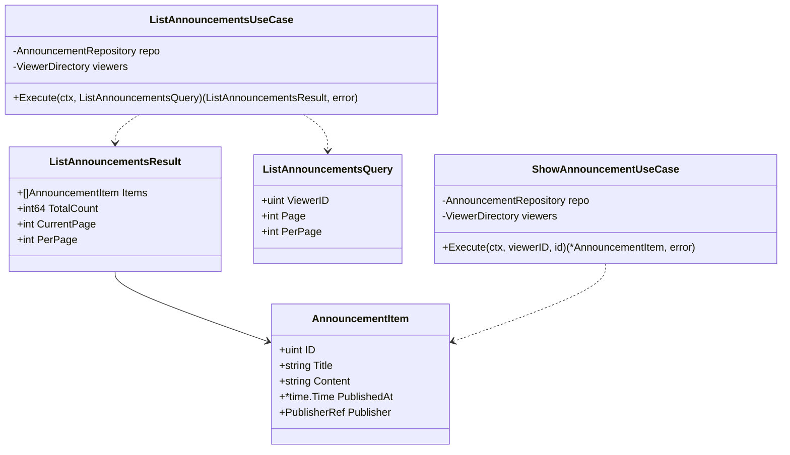
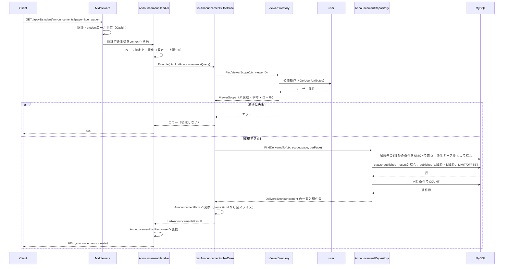
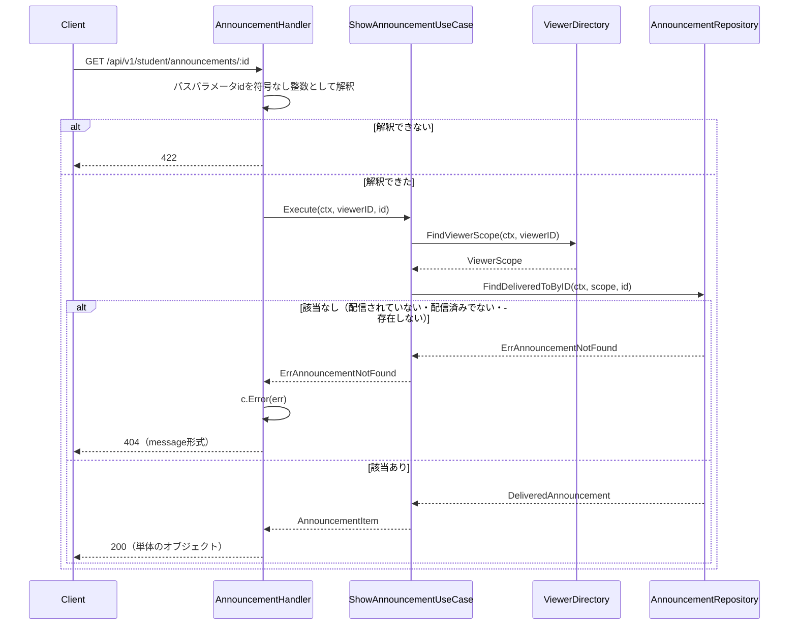

# お知らせ機能 Go実装仕様書

---

# 1. 機能概要

## 機能概要

生徒が、自分に配信されたお知らせを一覧・詳細で読めるようにする機能である（②「1. 機能概要」）。エンドポイントは2つで、いずれも参照のみである。

|エンドポイント|概要|
|-|-|
|`GET /api/v1/student/announcements`|お知らせ一覧（配信日時の降順。**1ページあたりの既定は5件**）|
|`GET /api/v1/student/announcements/:id`|お知らせ詳細|

生徒がお知らせを作成・更新・削除することはできない。

## 採用設計パターンとその理由（②からの要約）

**本機能の業務はTransaction Script相当だが、Contextの構成はDomain Modelに従う**（②「4. 設計パターン」）。

本機能は状態も書き込みも業務ルールも持たない。しかし`announcement` Contextは教師お知らせ機能・管理者お知らせ管理機能がDomain Modelを採用しており、規約「4. Bounded Context構成」の「1つのContextに複数の設計パターンが混在する場合」が、Contextディレクトリの構成を最も複雑なパターンに合わせることと、パターンの異なる構造を併存させないことを定めている。

したがって本機能の参照処理も次の形になる。

|項目|形|
|-|-|
|業務操作の置き場所|`application/student/usecase/`のUseCase struct|
|データアクセス|`domain/repository/`のRepository Interfaceと`infrastructure/gormrepo/`の実装（**教師お知らせ機能③_1が定める**）|
|Entity|`announcement` Contextの`Announcement` Entityを使う（同）|

## 本書が対象とする実装範囲

- application層（`application/student/`配下のUseCase 2つとDTO 2つ）
- Presentation層（`presentation/student/`配下のHandler 1つ・Response DTO 1ファイル）

Domain層・Infrastructure層・`context.go`・`dependency.go`・Transaction / Validation / Authorization / Errorの実装方針は、**`教師お知らせ機能_Go実装仕様書_1_Domain・Infrastructure.md`（以下「基盤編」）に記載する。** 本書では繰り返さず参照する。

`routes.go`は教師お知らせ機能③_2が作成する。本書は自身の2ルートを同ファイルへ追加する。

---

# 2. ディレクトリ構成

## 対象Bounded Context名

- `announcement`（②「3. Bounded Context」）。ディレクトリは`internal/announcement/`、package名は`announcement`

Context全体のファイル一覧と担当文書の対応は基盤編「2. ディレクトリ構成」に記載する。

## ②で採用した設計パターン

Contextの構成はDomain Model（②「4. 設計パターン」）。本機能の業務はTransaction Script相当である。

## 本書が担当するファイル一覧

```
internal/announcement/application/student/usecase/list_announcements.go
internal/announcement/application/student/usecase/show_announcement.go
internal/announcement/application/student/dto/list_announcements_query.go
internal/announcement/application/student/dto/announcement_item.go
internal/announcement/presentation/student/handler/announcement_handler.go
internal/announcement/presentation/student/response/announcement_response.go
```

実装6ファイル、テストが付くもの（UseCase 2・Handler 1の3）を加えて9である。1文書あたり30〜35という範囲に十分収まるため分割しない（③自動生成プロンプト「文書の分割（1文書あたり30〜35ファイル）」）。

**`application/student/`・`presentation/student/`に置く。** 3機能がいずれも`ListAnnouncements` UseCaseと`AnnouncementHandler`を持ち名前が衝突するため、ロール別のサブディレクトリに分ける（基盤編「2. ディレクトリ構成」、規約「4. Bounded Context構成」の末尾）。

`presentation/student/request/`を作成しない。受け取るのはページ指定とパスパラメータのみであり、Request DTOにする利点がない（「9. Presentation層設計」）。

---

# 3. Domain層設計

対象外。基盤編「3. Domain層設計」に記載する。

本機能が使うDomain層の範囲を示す。

|対象|本機能での使い方|
|-|-|
|`entity.Announcement`|参照のみ。`ID`・`Title`・`Content`・`PublishedAt`・`PublisherID`を読む|
|`entity.AnnouncementTarget`|**使わない。** 配信先をEntityとして読み込まない（②「5. Aggregate設計」）|
|`valueobject.AnnouncementStatus`|配信済みの絞り込みに使う。ただし絞り込みはRepositoryの検索条件であり、本機能のコードで判定しない|
|`valueobject.ScheduledAt`・`DeliveryTargetType`|使わない|
|`service.TargetDeliverabilityPolicy`|使わない。配信先を指定しないため（②「8. Domain Service」）|
|`repository.AnnouncementRepository`|`FindDeliveredTo`・`FindDeliveredToByID`の2メソッドのみ使う|
|`domain/errors.go`|`ErrAnnouncementNotFound`のみ使う|

本書で定義するセンチネルエラーはない。

---

# 4. クラス図

Domain層のクラス図は基盤編「4. クラス図」に記載する。本書ではUseCaseとDTOの関係を示す。



`AnnouncementItem`を一覧と詳細で共用する。返す項目が同じであるためである（①「5. API / 処理詳細」）。最上位の構造の違い（`announcements`キーで包むか包まないか）はResponse DTOで表す。

`Publisher`を`PublisherRef`（非ポインタ）にするのは、`announcements.publisher_id`が未設定を許さず、発行者が常に存在するためである（①「6. データモデル」）。**論理削除済みの発行者でも氏名は取得できる。**

---

# 5. 状態遷移図

省略する。

理由: ②「10. 状態遷移図」のとおり、本機能は状態を変更しない。本機能から見える状態は配信済みのみであり、下書き・予約は検索条件で除外される（①「5. API / 処理詳細」`#index`）。図示すべき遷移が存在しない。

状態遷移そのものは基盤編「5. 状態遷移図」に記載する。

---

# 6. Application層設計

## DTO（Command / Query）

|struct名|フィールド|区分|備考|
|-|-|-|-|
|`ListAnnouncementsQuery`|`ViewerID uint`・`Page int`・`PerPage int`|Query|ページ指定はPresentation層で正規化済みの値を受け取る|
|`ListAnnouncementsResult`|`Items []AnnouncementItem`・`TotalCount int64`・`CurrentPage int`・`PerPage int`|出力||
|`AnnouncementItem`|`ID uint`・`Title string`・`Content string`・`PublishedAt *time.Time`・`Publisher PublisherRef`|出力|一覧と詳細で共用する|

`PublishedAt`を`*time.Time`にするのは、Entityのフィールドがそうであるためである。本機能が返すのは配信済みのお知らせのみであり、実際には常に値が入る。**配信済みであれば配信日時が設定されるという不変条件はEntityが保証するが、型としては`nil`を許す**（「17. ②からの補足事項」参照）。

`PublisherRef`は`dependency.go`に定義された型である（基盤編「8. Infrastructure層設計」）。`ID`・`Name`・`NameKana`・`Deactivated`を持つ。**本機能は`Deactivated`を使わない。** レスポンスに含めず、絞り込みにも使わない（②「21. DB操作仕様」）。

出力の型をPresentation層のResponse DTOと分けるのは、application層の型がJSONのキー名や最上位の構造といったHTTPの関心を持たないためである（アーキテクチャ規約「6. データフロー」）。

## UseCase

### ListAnnouncementsUseCase（`application/student/usecase/list_announcements.go`）

|項目|内容|
|-|-|
|struct名|`ListAnnouncementsUseCase`|
|コンストラクタが受け取る依存|`repository.AnnouncementRepository`、`announcement.ViewerDirectory`|
|公開メソッド|`Execute(ctx context.Context, q dto.ListAnnouncementsQuery) (dto.ListAnnouncementsResult, error)`|

処理ステップ:

1. `viewers.FindViewerScope(ctx, q.ViewerID)`で操作者の所属校・学年・ロールを取得する
2. `repo.FindDeliveredTo(ctx, scope, q.Page, q.PerPage)`を呼ぶ
3. 取得結果を`AnnouncementItem`へ変換する
4. 総件数・ページ情報を添えて返す

**手順1の失敗を吸収しない。** 操作者の所属が取得できなければ配信範囲を絞り込めず、誤ったお知らせを返す可能性がある（②「17. Error設計」）。ダッシュボード機能③が当日の解答件数の失敗を`0`として吸収しているのとは扱いが異なる。

該当するお知らせがない場合は空の一覧とページ情報を返す。エラーにしない（①「5. API / 処理詳細」`#index`）。

`Items`が`nil`にならないようにする。空スライスを入れる。`nil`スライスはJSONで`null`になり、Rails現行の`[]`と異なる。

トランザクションは使用しない（②「14. Transaction設計」、「11. Transaction実装方針」）。

発生しうるApplication Error: なし（Infrastructure Errorのみ）。

### ShowAnnouncementUseCase（`application/student/usecase/show_announcement.go`）

|項目|内容|
|-|-|
|struct名|`ShowAnnouncementUseCase`|
|コンストラクタが受け取る依存|`repository.AnnouncementRepository`、`announcement.ViewerDirectory`|
|公開メソッド|`Execute(ctx context.Context, viewerID, id uint) (*dto.AnnouncementItem, error)`|

処理ステップ:

1. `viewers.FindViewerScope(ctx, viewerID)`で操作者の所属校・学年・ロールを取得する
2. `repo.FindDeliveredToByID(ctx, scope, id)`を呼ぶ
3. `ErrAnnouncementNotFound`が返った場合はそのまま返す
4. `AnnouncementItem`へ変換して返す

**自分に配信されていないお知らせ、配信済みでないお知らせ、存在しないお知らせをいずれも`ErrAnnouncementNotFound`として扱う。** 存在するが見る権限がないことを区別しない（①「5. API / 処理詳細」`#show`）。この区別はRepositoryの検索条件で行われるため、UseCaseは返ったエラーをそのまま返す。

発生しうるApplication Error: `ErrAnnouncementNotFound`（404）。

---

# 7. シーケンス図・処理フロー図

## シーケンス図

### ListAnnouncements



### ShowAnnouncement



## 処理フロー図

省略する。

理由: ②「13. シーケンス図・処理フロー図」のとおり、2つのUseCaseはいずれも分岐を持たない。一覧は検索結果をそのまま返し、詳細は該当するかどうかの1分岐のみである（上図に示した）。配信範囲の突き合わせには分岐があるが、これはRepositoryの検索条件として表現されるものであり、処理の分岐ではない。突き合わせの条件は基盤編「8. Infrastructure層設計」の表に整理している。

---

# 8. Infrastructure層設計

対象外。基盤編「8. Infrastructure層設計」に記載する。

本機能が使うInfrastructure層の範囲を示す。

|対象|本機能での使い方|
|-|-|
|`announcementRepository.FindDeliveredTo`|一覧|
|`announcementRepository.FindDeliveredToByID`|詳細|
|`userDirectory`（`ViewerDirectory`として）|操作者の所属校・学年・ロールの取得|
|`gradeDirectory`・`teacherPermissionDirectory`・`studentDirectory`|**使わない**|

本書が担当するInfrastructure層の実装はない。

---

# 9. Presentation層設計

## Handler

### AnnouncementHandler（`presentation/student/handler/announcement_handler.go`）

|項目|内容|
|-|-|
|struct名|`AnnouncementHandler`|
|対応する呼び出し先|`*usecase.ListAnnouncementsUseCase`、`*usecase.ShowAnnouncementUseCase`|
|保持するフィールド|`listUC`・`showUC`|
|コンストラクタ|`NewAnnouncementHandler(listUC *usecase.ListAnnouncementsUseCase, showUC *usecase.ShowAnnouncementUseCase) *AnnouncementHandler`|
|メソッド|`Index(c *gin.Context)`（GET `/api/v1/student/announcements`）、`Show(c *gin.Context)`（GET `/api/v1/student/announcements/:id`）|

`Index`の処理順序:

1. クエリパラメータ`page`・`per_page`を整数として解釈する。解釈できない場合は`c.Error`にバリデーションエラーを積んで戻る
2. ページ指定を正規化する。**既定は5件**、上限は100件
3. `context.Context`から操作者の識別子を取り出す（コーディング規約「20. `context.Context`」）。リクエストから受け取らない
4. `ListAnnouncementsQuery`を組み立て、`listUC.Execute`を呼ぶ
5. エラーの場合は`c.Error(err)`を呼んで戻る。ステータスとレスポンス本文への変換は`ErrorHandler`が行う（Gin規約「8. エラーハンドリングミドルウェア」）
6. `AnnouncementListResponse`へ変換する。`announcements`が`nil`なら空スライスを入れる
7. `200`で返す

`Show`の処理順序:

1. パスパラメータ`id`を符号なし整数として解釈する。解釈できない場合は`c.Error`に積んで戻る
2. 操作者の識別子を取り出す
3. `showUC.Execute`を呼ぶ
4. エラーの場合は`c.Error(err)`を呼んで戻る。`ErrAnnouncementNotFound`は`404`に変換される（基盤編「14. Error実装方針」）
5. `AnnouncementResponse`へ変換し、**最上位を単体のオブジェクト**として`200`で返す

`c.Error`は1回だけ呼ぶ（Gin規約「8. エラーハンドリングミドルウェア」の「`c.Errors`に複数のエラーが蓄積される場合」）。

**Request DTOを設けない。** 受け取るのは`page`・`per_page`・`id`の3つのみであり、`ShouldBindQuery`でstructへバインドする利点がない。`page`・`per_page`は正規化が必要であり、バインドしても個別に扱うことになる（「17. ②からの補足事項」参照）。

## Request / Response DTO

### Request DTO

設けない（上記）。

### AnnouncementListResponse / AnnouncementResponse（`presentation/student/response/announcement_response.go`）

|struct名|フィールド|JSONキー|型|
|-|-|-|-|
|`AnnouncementListResponse`|`Announcements`|`announcements`|`[]AnnouncementResponse`|
||`Meta`|`meta`|`PaginationMetaResponse`|
|`AnnouncementResponse`|`ID`|`id`|`uint`|
||`Title`|`title`|`string`|
||`Content`|`content`|`string`|
||`PublishedAt`|`published_at`|`*time.Time`|
||`Publisher`|`publisher`|`PublisherResponse`|
|`PublisherResponse`|`ID`|`id`|`uint`|
||`Name`|`name`|`string`|
||`NameKana`|`name_kana`|`string`|
|`PaginationMetaResponse`|`CurrentPage`|`current_page`|`int`|
||`TotalPages`|`total_pages`|`int`|
||`TotalCount`|`total_count`|`int64`|
||`PerPage`|`per_page`|`int`|

**一覧と詳細で`AnnouncementResponse`を共用する。** 返す項目が同じであり、最上位の構造だけが違う（①「5. API / 処理詳細」）。詳細は`AnnouncementResponse`をそのまま返し、キーで包まない。

**一覧でも`content`を返す。** 管理者向けのお知らせ一覧が本文を返さないのとは異なる（管理者お知らせ管理機能①「5. API / 処理詳細」`#index`）。

`status`・`scheduled_at`・`announcement_targets`・`system_generated`を含めない（①「5. API / 処理詳細」`#index`）。

`PublisherResponse`に`deactivated`を含めない。発行者の在籍状態を生徒に見せない（②「16. Authorization設計」）。

`total_pages`は総件数と1ページあたりの件数から算出する。Rails現行のページネーションが返す値と同じになる。

`PaginationMetaResponse`の項目名と構成は規約「15. API規約（レスポンス形式・ページネーション・URL・クエリパラメータ）」の定めに従う。置き場所（本Contextに定義するか共通部品とするか）は全Contextに共通する事項であり本書では定めない。管理者高校学年参照機能③「17. ②からの補足事項」4が同じ点を先送りしている。

## Routing

`presentation/routes.go`へ**追加する。** 同ファイルは教師お知らせ機能③_2が作成する（基盤編「2. ディレクトリ構成」）。

|グループ|Middleware|Method|Path|Handler|
|-|-|-|-|-|
|`/api/v1/student`|認証・`student`ロール|GET|`/announcements`|`student/handler.AnnouncementHandler.Index`|
|同|同|GET|`/announcements/:id`|`student/handler.AnnouncementHandler.Show`|

`/api/v1/student`グループに登録する。同グループには認証ミドルウェアと`student`ロールの認可ミドルウェアが適用される（Gin規約「3. ミドルウェア」「4. 認可（Casbin RBAC）」）。

**CSRF対策の適用は不要である。** いずれもGETであり、Gin規約「5. CSRF対策」の適用範囲（状態を変更するメソッド）に含まれない。

---

# 10. API仕様

|Method|Path|Handler|Request|Response|Status Code|
|-|-|-|-|-|-|
|GET|`/api/v1/student/announcements`|`Index`|`page`（任意）・`per_page`（任意。**既定5**・上限100）|`AnnouncementListResponse`|200 / 422 / 401 / 403 / 500|
|GET|`/api/v1/student/announcements/:id`|`Show`|パスパラメータ`id`|`AnnouncementResponse`（単体）|200 / 404 / 422 / 401 / 403 / 500|

## Errorケース

|条件|Status Code|Error内容|
|-|-|-|
|`id`が符号なし整数として解釈できない|422|`{"errors": ["お知らせの指定が不正です"]}`|
|`page`・`per_page`が整数として解釈できない|422|`{"errors": ["ページの指定が不正です"]}`|
|`page`・`per_page`が0以下|200|エラーにしない。既定値を使う（①「5. API / 処理詳細」`#index`）|
|自分に配信されていない、配信済みでない、存在しない|404|`{"message": "Announcementが見つかりません"}`|
|`user`の参照手段の呼び出しに失敗|500|`{"errors": ["internal server error"]}`|
|DBアクセスの失敗|500|同|
|未認証|401|認証ミドルウェアの応答|
|`student`ロール以外|403|`{"errors": ["この操作を行う権限がありません"]}`|
|該当する行が0件（一覧）|200|空の配列とページ情報を返す|

`404`の本文が`message`キーであるのは、Rails現行の形を維持するためである（②「17. Error設計」）。モデル名が英語表記（`Announcement`）になる点も維持する。

---

# 11. Transaction実装方針

トランザクションを使用しない。

- **Transaction開始箇所**: なし
- **Transaction終了箇所**: なし

②「14. Transaction設計」のとおり、本機能は1件のデータも作成・更新・削除せず、原子性を保証する対象が存在しない。`TransactionManager`を注入しない。`gormtx.RunInTx`も呼ばない。

操作者の属性の取得とお知らせの検索を読み取り専用トランザクションで束ねることもしない。理由は②「14. Transaction設計」に記載のとおりである。

Repository実装は`gormtx.DBFromContext`で接続を取得する（基盤編「11. Transaction実装方針」）。本機能の経路では呼び出し元にトランザクションが存在しないため、通常の接続が使われる。

---

# 12. Validation実装方針

方針は基盤編「12. Validation実装方針」に記載する。本書では本書が担当する検証内容を示す。

## Presentation

|フィールド|置き場所|ルール|エラーメッセージ|Status|
|-|-|-|-|-|
|`id`（パスパラメータ）|Handler|符号なし整数として解釈できること|お知らせの指定が不正です|422|
|`page`|Handler|整数として解釈できること。0以下・未指定は既定値|ページの指定が不正です|422|
|`per_page`|Handler|同。**0以下・未指定は既定値5**、101以上は100に丸める|同|422|

ページ指定の正規化:

|入力|正規化後|
|-|-|
|`page`が未指定・0以下|`1`|
|`per_page`が未指定・0以下|**`5`**|
|`per_page`が101以上|`100`|

**既定値が5件である点が本機能固有である。** 他のAPIの既定値（20件）と異なる（①「5. API / 処理詳細」`#index`）。Rails現行がControllerで`DEFAULT_PER_PAGE = 5`として上書きしている（①「10. Rails実装対応表」）。上限（100）は全APIで共通であり規約に従う。

`page`・`per_page`の不正値をエラーにせず既定値で処理するのは、Rails現行がそうしているためである。ただし**整数として解釈できない値は`422`とする**（Rails現行は`to_i`で`0`になり既定値が使われるため差分が生じる。「17. ②からの補足事項」参照）。

## 業務ルール検証

**本機能に業務ルールによる検証は存在しない**（②「15. Validation設計」）。

- 配信範囲の突き合わせは検索条件であり、検証ではない
- Domain層の検証（件名・本文・状態・予約日時・配信先）は、お知らせを作成・更新する機能が行う（教師お知らせ機能③_2「12. Validation実装方針」）
- お知らせの実在確認は参照の結果として扱う。該当する行が取得できなければ`ErrAnnouncementNotFound`を返す（「6. Application層設計」）

---

# 13. Authorization実装方針

基盤編「13. Authorization実装方針」に記載する。

本機能の扱いを示す。

|層|処理|
|-|-|
|Middleware|認証と`student`ロールの判定。`/api/v1/student`グループに適用する|
|Handler|操作者の識別子を`context.Context`から取り出し、UseCaseへ渡す。リクエストから受け取らない|
|UseCase|配信範囲の判定を**Repositoryの検索条件として**行う。自分で判定しない|
|Domain|判定しない。本機能に業務ルールの判定がない|

**配信先の突き合わせがそのまま閲覧制限になっている**（①「8. 権限制御」）。自分に配信されていないお知らせは一覧に現れず、詳細も`404`となる。

操作者の識別子をリクエストから受け取らないことで、他の生徒に配信されたお知らせを指定して読む経路をなくす。

発行者の氏名・氏名カナは返すが、在籍状態・メールアドレス等は返さない（「9. Presentation層設計」の`PublisherResponse`）。

---

# 14. Error実装方針

方針は基盤編「14. Error実装方針」に記載する。

本書で定義するセンチネルエラーはない。

本機能が返すエラーとHTTPステータスへの対応:

|業務シナリオ|Error変数名／型|発生層|HTTP Status|
|-|-|-|-|
|`id`・`page`・`per_page`が整数として解釈できない|Handlerが組み立てるバリデーションエラー|Presentation|422|
|指定されたお知らせが取得できない|`ErrAnnouncementNotFound`（基盤編の`domain/errors.go`）|Domain|404|
|`user`の参照手段の呼び出しに失敗|包まずそのまま返す|Infrastructure|500|
|DBアクセスの失敗|同|Infrastructure|500|
|未認証|認証ミドルウェアが返す|Middleware|401|
|`student`ロール以外|認可ミドルウェアが返す|Middleware|403|

**該当する行が0件であることをエラーにしない。** 一覧では空の配列を返すのが正常な応答である（②「17. Error設計」）。詳細では1件が取得できないことが不存在を意味するため、こちらはエラーとして扱う。

**`user`の参照手段の失敗を吸収しない。** 操作者の所属が取得できなければ配信範囲を絞り込めず、誤ったお知らせを返す可能性がある（②「17. Error設計」）。

複数のエラーをまとめて返す場面はない。Presentation層の検証が`id`・`page`・`per_page`の3つのみであり、`c.Error`を1回だけ呼ぶ形で足りる。

---

# 15. GORM / DBクエリ設計

対象外。基盤編「15. GORM / DBクエリ設計」に記載する。

本機能が使うクエリの要点を再掲する。

|メソッド|条件|結合|ソート|
|-|-|-|-|
|`FindDeliveredTo`|配信先の5種類の条件を`UNION`で束ね派生テーブルとして結合、`status`が配信済み|`users`（発行者の氏名）|`published_at`降順・`id`降順、`LIMIT`/`OFFSET`|
|`FindDeliveredToByID`|同＋`announcements.id`|同|不要|

- **配信先を読み込まない。** レスポンスに含めないためである（基盤編「8. Infrastructure層設計」）
- `deleted_at`による絞り込みは行わない（対象テーブルに列がない）
- **`users`との結合で`deleted_at`を条件に含めない。** 論理削除済みの発行者のお知らせも返す（①「6. データモデル」）
- 操作者の所属は**条件の値として**受け取る。`users`を操作者側で結合しない（②「21. DB操作仕様」）

本書が担当するGORMモデル・クエリの実装はない。

---

# 16. テストケース設計

## Domain Test

基盤編「16. テストケース設計」に記載する。本機能に固有のDomain Testはない。

## UseCase Test

Repositoryと`user`の参照手段をテストダブルに差し替えて検証する。

|対象|テストケース|
|-|-|
|`ListAnnouncements`|`FindViewerScope`を呼び、結果を`FindDeliveredTo`へ渡すこと|
||ページ指定がそのまま渡ること|
||取得結果が`AnnouncementItem`へ変換されること|
||総件数・ページ情報が返ること|
||0件のとき`Items`が空スライス（`nil`ではない）になること|
||**`FindViewerScope`が失敗したときエラーを返すこと（吸収しないこと）**|
||`FindDeliveredTo`が失敗したときエラーを返すこと|
||操作者の識別子を入力から受け取り、自分で決めないこと|
|`ShowAnnouncement`|`FindViewerScope`を呼び、結果を`FindDeliveredToByID`へ渡すこと|
||`ErrAnnouncementNotFound`をそのまま返すこと|
||**`FindViewerScope`が失敗したときエラーを返すこと**|
||取得結果が`AnnouncementItem`へ変換されること|

## Repository Test

基盤編「16. テストケース設計」の`Repository Test`に記載する。**配信範囲の突き合わせのテストが本機能にとって最も重要であり、同節に集約している。**

本機能の観点として同節に含まれるもの:

- 5種類の配信先それぞれで配信される／されないこと
- 複数の配信先が条件を満たしても1件として返ること
- 下書き・予約が含まれないこと
- 論理削除済みの発行者のお知らせも返ること
- 並び順（`published_at`降順・`id`降順）とページネーション
- 利用者の学年・ロール・所属校が未設定のときの扱い
- 配信先を読み込まないこと
- `FindDeliveredToByID`で、配信されていない・下書き・予約のお知らせが`ErrAnnouncementNotFound`になること

## アダプタ Test

基盤編「16. テストケース設計」の`アダプタ Test`に記載する。本機能が使うのは`userDirectory.FindViewerScope`のみである。

## Handler Test

|対象|テストケース|
|-|-|
|`Index`|**`per_page`の既定値が5になること**（未指定・0以下のとき）|
||`per_page`が101以上のとき100に丸められること|
||`page`が未指定・0以下のとき1になること|
||`page`・`per_page`が整数として解釈できないとき`422`が返ること|
||`announcements`キーと`meta`を持つこと|
||`meta`が`current_page`・`total_pages`・`total_count`・`per_page`を持つこと|
||各要素に`content`が含まれること|
||各要素に`status`・`scheduled_at`・`announcement_targets`が含まれないこと|
||`publisher`に`deactivated`が含まれないこと|
||0件のとき`[]`で返ること（`null`にしないこと）|
||操作者を`context.Context`から取り出し、リクエストから受け取らないこと|
||application層のエラーを`c.Error`へ渡し、自身で`c.JSON`しないこと|
|`Show`|**最上位が単体のオブジェクトで返ること**（`announcements`等のキーで包まないこと）|
||項目が一覧の各要素と同じであること|
||`ErrAnnouncementNotFound`のとき`404`と`{"message": "Announcementが見つかりません"}`が返ること|
||`id`が符号なし整数として解釈できないとき`422`が返ること|

## Integration Test

|対象|テストケース|
|-|-|
|認可|未認証で`401`|
|認可|`teacher`・`admin`ロールで`403`|
|配信範囲|**5種類の配信先それぞれで、配信される生徒には見え、配信されない生徒には見えないこと**|
|配信範囲|他校向けのお知らせが見えないこと|
|配信範囲|他学年向けのお知らせが見えないこと|
|配信範囲|下書き・予約のお知らせが見えないこと|
|配信範囲|**予約のお知らせが自動切替で配信済みになると見えるようになること**（管理者お知らせ管理機能③「6. Application層設計」の`PublishScheduledAnnouncements`）|
|発行者|教員が作成したお知らせ・管理者が作成したお知らせ・**システム生成のお知らせ**がいずれも対象になること|
|発行者|論理削除済みの発行者のお知らせも見え、氏名が返ること|
|一覧|`per_page`を指定しないとき5件で返ること|
|一覧|ページをまたいで重複・欠落がないこと|
|詳細|配信されていないお知らせの識別子を指定して`404`になること|
|CSRF|GETのためCSRFトークンなしでも成功すること|

**配信範囲の正しさがこの機能の中心である。** 誤って他の生徒向けのお知らせが見えることは情報の漏えいにあたるため、5種類すべてについてIntegration Testで確認する（②「22. テスト戦略」）。

---

# 17. ②からの補足事項

基盤編「17. ②からの補足事項」に記載した9件に加え、本書で判断した内容を示す。

## 1. Request DTOを設けない

- 判断した内容: `page`・`per_page`・`id`をHandlerで直接解釈し、Request DTOのstructを作らない
- 判断理由: 受け取る値が3つのみで、いずれも整数として解釈して正規化するだけである。`ShouldBindQuery`でstructへバインドしても、`page`・`per_page`は正規化のために個別に扱うことになる。教師お知らせ機能③_2がRequest DTOを設けるのは、ボディを受け取り項目が多いためである
- 推測かどうか: 推測ではない。規約に定めのない範囲での実装手段の選択である

## 2. `page`・`per_page`が整数として解釈できないとき`422`とする

- 判断した内容: 数値以外の値（`page=abc`）を`422`で返す
- 判断理由: Rails現行は`sanitized_page`・`sanitized_per_page`が`to_i`で変換するため、`"abc".to_i`は`0`になり既定値が使われる。つまりRails現行は`200`を返す。Go側で`strconv.Atoi`が失敗した場合に既定値を使う形にすれば同じ挙動になるが、**不正な入力を黙って無視する形になる**
- 推測かどうか: **②からの補足**。②「15. Validation設計」は「整数として解釈できること」をルールとしているが、解釈できない場合のステータスまでは定めていない。**Rails現行は`200`を返すため挙動が変わる。** フロントエンドが数値以外を送る経路は想定されないが、差分として記録する。他機能（管理者高校学年参照機能③「12. Validation実装方針」）も同じ扱いにしており、Context間で揃っている

## 3. `AnnouncementItem.PublishedAt`を`*time.Time`にする

- 判断した内容: 配信日時をポインタとし、`nil`を許す型にする
- 判断理由: Entityのフィールドが`*time.Time`であり、変換で値型にすると`nil`の場合の扱いを決めることになる。本機能が返すのは配信済みのお知らせのみであり実際には常に値が入るが、**型で保証せずEntityの不変条件に委ねる**
- 推測かどうか: **②からの補足**。レスポンスの`published_at`は常に値が入る前提だが、型としては`null`を許す。Rails現行も同じ形である（`published_at`がカラムとしてNULL可）

## 4. 一覧と詳細でResponse DTOを共用する

- 判断した内容: `AnnouncementResponse`を一覧の要素と詳細の両方に使う
- 判断理由: 返す項目が同一である（①「5. API / 処理詳細」）。同じ項目を持つstructを2つ定義すると、項目の追加時に片方だけ変更される。管理者高校学年参照機能③「9. Presentation層設計」も同じ判断をしている
- 推測かどうか: 推測ではない。①の実体に基づく実装上の整理である

## 5. 本機能の業務はTransaction Script相当だがDomain Modelの構造に従う

- 判断した内容: UseCase structとRepository Interfaceを使い、`application/`直下の関数と`infrastructure/`の検索関数にしない
- 判断理由: 規約「4. Bounded Context構成」の「1つのContextに複数の設計パターンが混在する場合」が、Contextディレクトリの構成を最も複雑なパターンに合わせることと、パターンの異なる構造を併存させないことを定めている。併存させると同じ`announcements`テーブルに対する永続化の経路が2つになり、業務ルールの置き場所が決まらなくなる
- 推測かどうか: 推測ではない。規約の適用である。②「24. 採用しなかった設計」の「本機能をTransaction Scriptの構造で実装する」に理由を記載している

## 6. `PublisherRef`の`Deactivated`を使わない

- 判断した内容: `dependency.go`の`PublisherRef`が在籍状態を持つが、本機能では読まない
- 判断理由: 発行者の在籍状態を生徒に見せる要件がなく、絞り込みにも使わない（②「21. DB操作仕様」）。**論理削除済みの発行者のお知らせも返す**ため、絞り込みに使うと挙動が変わる
- 推測かどうか: 推測ではない。①②に従う。`PublisherRef`が在籍状態を持つのは管理者お知らせ管理機能が権限の判定に使うためである（基盤編「8. Infrastructure層設計」）
