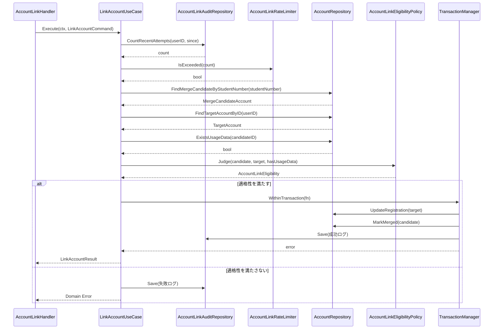
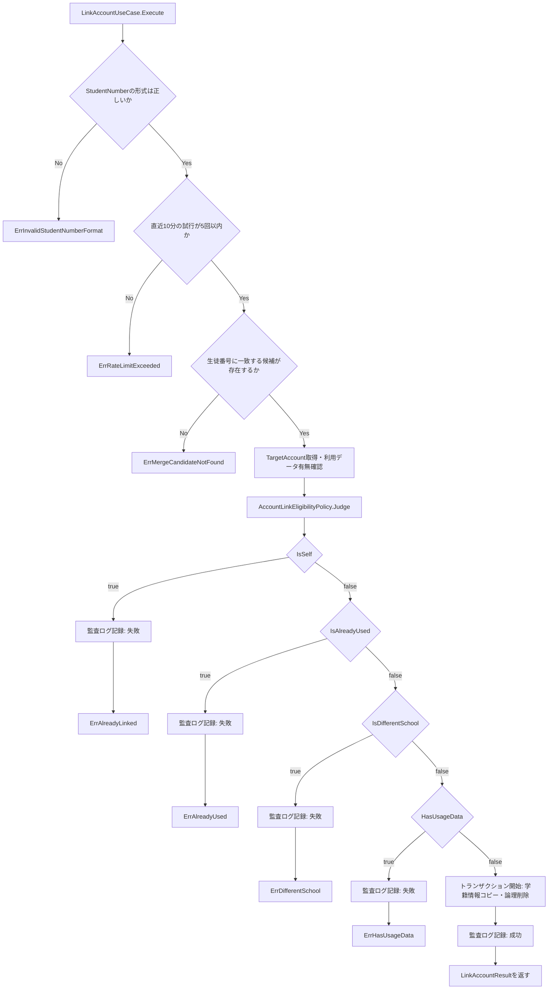

# アカウント連携機能 Go実装仕様書（2. Application・Presentation）

---

# 1. 本書の範囲

本書はApplication層・Presentation層（9ファイル、テスト込みで約16）を扱う。

## 担当するエンドポイント

|Method|Path|Handler|概要|
|-|-|-|-|
|POST|`/api/v1/student/account_link`|`AccountLinkHandler.LinkAccount`|生徒番号を指定してアカウント連携を実行する|
|POST|`/api/v1/student/account_link/preview`|`AccountLinkHandler.PreviewAccountLink`|統合を確定する前に、対象アカウントの学校・学年・学級名を取得する|

## 本書が前提とする文書

- `アカウント連携機能_Go実装仕様書_1_Domain・Infrastructure.md`: Domain層・Infrastructure層、およびTransaction・Validation・Authorization・Errorの実装方針
- 1_Domain・Infrastructureを実装・マージしたうえで本書の実装に着手する

本書では、1_Domain・Infrastructureに記載した実装方針を繰り返さない。担当ファイルの一覧は同文書「2. ディレクトリ構成」の「2_Application・Presentation の担当」を参照する。

---

# 2. Application層設計

## DTO（Command / Query）

|struct名|フィールドと型|区分|
|-|-|-|
|`LinkAccountCommand`|`TargetUserID uint`（current userのID）、`StudentNumber string`（生の入力値）|Command|
|`LinkAccountResult`|`Message string`（成功メッセージ）|出力|

Query DTOは設けない（本機能はLinkAccountというCommand操作のみを提供するため）。

## UseCase

### LinkAccountUseCase（`application/usecase/link_account_usecase.go`）

②「12. UseCase設計」LinkAccountに対応する。

- struct名: `LinkAccountUseCase`
- コンストラクタが受け取る依存: `repository.AccountRepository`, `repository.AccountLinkAuditRepository`, `*service.AccountLinkEligibilityPolicy`, `service.AccountLinkRateLimiter`, `TransactionManager`（アーキテクチャ規約「11. Transaction実装パターン」）
- 公開メソッド: `(u *LinkAccountUseCase) Execute(ctx context.Context, cmd command.LinkAccountCommand) (dto.LinkAccountResult, error)`
- 処理ステップ（②「13. シーケンス図・処理フロー図」に対応）:
  1. `valueobject.NewStudentNumber(cmd.StudentNumber)`で書式検証する。不正時は`domainerrors.ErrInvalidStudentNumberFormat`を返す（監査ログは記録しない。書式不正の時点では統合元候補が特定できないため）
  2. `AccountLinkAuditRepository.CountRecentAttempts(ctx, cmd.TargetUserID, 現在時刻-10分)`で直近の試行件数を取得する
  3. `AccountLinkRateLimiter.IsExceeded(件数)`で上限超過を判定する。超過時は`usecase.ErrRateLimitExceeded`を返す（監査ログは記録しない。トランザクションの外側で行う判定であるため）
  4. `AccountRepository.FindMergeCandidateByStudentNumber(ctx, studentNumber)`で統合元候補を検索する。該当なしは`domainerrors.ErrMergeCandidateNotFound`を返す（監査ログは記録しない）
  5. `AccountRepository.FindTargetAccountByID(ctx, cmd.TargetUserID)`で統合先（current user）のEntityを取得する
  6. `AccountRepository.ExistsUsageData(ctx, candidate.ID())`で統合元候補の利用データ有無を取得する
  7. `AccountLinkEligibilityPolicy.Judge(candidate, target, hasUsageData)`で適格性を判定する
  8. 適格性を満たさない場合: `AccountLinkEligibility`の各条件を`IsAlreadyLinked → IsAlreadyUsed → IsDifferentSchool → HasUsageData`の順に判定し、最初に該当した条件に対応するDomain Error（`ErrAlreadyLinked` / `ErrAlreadyUsed` / `ErrDifferentSchool` / `ErrHasUsageData`）を確定する。`entity.NewAccountLinkAudit`で失敗ログ（`valueobject.NewAccountLinkResultFailed()`）を生成し、`AccountLinkAuditRepository.Save`で記録したうえで、確定したDomain Errorを返す（トランザクションの外側で記録する。「11. Transaction実装方針」参照）
  9. 適格性を満たす場合: `TransactionManager.WithinTransaction`内で以下を実行する
     - `target.ApplyMergedRegistration(candidate)`
     - `AccountRepository.UpdateRegistration(ctx, target)`
     - `candidate.MarkMerged(現在時刻)`
     - `AccountRepository.MarkMerged(ctx, candidate)`
     - `entity.NewAccountLinkAudit`で成功ログ（`valueobject.NewAccountLinkResultSuccess()`）を生成し、`AccountLinkAuditRepository.Save`で記録する
  10. `LinkAccountResult`（成功メッセージ）を返す
- トランザクション境界: ステップ9（学籍情報コピー〜統合元論理削除〜成功ログ記録）のみをトランザクション内で実行する。詳細は「11. Transaction実装方針」参照
- 発生しうるApplication Error: `usecase.ErrRateLimitExceeded`。Domain Error（`ErrInvalidStudentNumberFormat` / `ErrMergeCandidateNotFound` / `ErrAlreadyLinked` / `ErrAlreadyUsed` / `ErrDifferentSchool` / `ErrHasUsageData`）はUseCaseで変換せずそのまま上位（Presentation）へ伝播させる

`application/usecase/errors.go`に、Application層のセンチネルエラーとして`ErrRateLimitExceeded`を定義する。

## PreviewAccountLinkUseCase（`application/usecase/preview_account_link.go`）

- 目的: 統合を確定する前に、対象アカウントの所属情報（高校名・学年の表示名・学級名）を返す（②「12. UseCase設計」）
- 関数シグネチャ: `func (u *PreviewAccountLinkUseCase) Execute(ctx context.Context, cmd PreviewAccountLinkCommand) (PreviewAccountLinkResult, error)`
- `PreviewAccountLinkCommand`のフィールド: `CurrentUserID uint` / `StudentNumber string`
- `PreviewAccountLinkResult`のフィールド: `HighSchoolName *string` / `GradeDisplayName *string` / `SchoolClassName *string`（いずれも対象アカウントに該当データが紐づいていない場合は`nil`）
- コンストラクタが受け取る依存: `AccountRepository`, `*service.AccountLinkEligibilityPolicy`, `AccountLinkRateLimiter`（`LinkAccountUseCase`と同一）
- 処理ステップ:
  1. `StudentNumber` Value Objectを生成する（書式検証）
  2. `AccountRepository.FindTargetAccountByID`で統合先（操作者）を取得する
  3. `AccountLinkRateLimiter.IsExceeded`で試行回数を確認する
  4. `AccountRepository.FindMergeCandidateByStudentNumber`で統合元候補を取得する
  5. `AccountLinkEligibilityPolicy.Judge`で適格性を判定する。判定順序・返すDomain Errorは`LinkAccountUseCase`と同一
  6. 適格性を満たす場合、統合元候補の高校名・学年の表示名・学級名を返す
- トランザクション境界: 使用しない（読み取りのみ）
- 監査ログ: 記録しない（データを変更しないため）
- 返さない情報: 氏名・メールアドレスなどの個人情報は含めない（②「12. UseCase設計」）

**②からの補足**: 適格性判定を`LinkAccountUseCase`と共有するため、`AccountLinkEligibilityPolicy`と`AccountRepository`の検索メソッドを両UseCaseが同じ形で呼ぶ構成とした。Rails現行は`Student::AccountLinkFinder`として検証・検索を共通化しており、同じ分担である。

---

---

# 3. シーケンス図・処理フロー図

## シーケンス図（LinkAccount）

## 処理フロー図（LinkAccount）

適格性判定の分岐が多いため、フローチャートで可視化する（②「13. シーケンス図・処理フロー図」の処理フロー図を実装単位に具体化）。

---

---

# 4. Presentation層設計

## Handler

### AccountLinkHandler（`presentation/handler/account_link_handler.go`）

- struct名: `AccountLinkHandler`
- 対応する呼び出し先: `*usecase.LinkAccountUseCase`
- メソッド一覧:

|メソッド|HTTPメソッド|パス|
|-|-|-|
|`(h *AccountLinkHandler) LinkAccount(c *gin.Context)`|POST|/api/v1/student/account_link|

- 処理順序（`LinkAccount`）:
  1. Middlewareで設定済みのcurrent user（student）をcontextから取得する
  2. `AccountLinkRequest`をJSONボディからバインドし、Presentation Validation（「12. Validation実装方針」）を行う
  3. `command.LinkAccountCommand{TargetUserID: current userのID, StudentNumber: request.StudentNumber}`を組み立てる（統合先を必ずcurrent userに固定し、クライアントからの指定を許容しない。②「16. Authorization設計」）
  4. `LinkAccountUseCase.Execute`を呼び出す
  5. 戻り値のエラーを「14. Error実装方針」に従いHTTPステータスへ変換する
  6. 成功時は`AccountLinkResponse`へ変換し200で返す

## Request / Response DTO

### Request（`presentation/request/account_link_request.go`）

|struct名|フィールドと型|バリデーションタグ／チェック内容|
|-|-|-|
|`AccountLinkRequest`|`StudentNumber string`|`json:"student_number" binding:"required"`（②「15. Validation設計」Presentation 型チェック・必須チェック。詳細な書式検証はDomain側の`StudentNumber` VOに委ねる）|

### Response（`presentation/response/account_link_response.go`）

|struct名|フィールドと型|
|-|-|
|`AccountLinkResponse`|`Message string`|

## Routing

`presentation/routes.go`

|Method|Path|Handler|
|-|-|-|
|POST|/api/v1/student/account_link|AccountLinkHandler.LinkAccount|

認証Middleware（本人確認）・認可Middleware（student roleチェック）を経由する（②「16. Authorization設計」Middleware、「13. Authorization実装方針」参照）。

---

---

# 5. API仕様

②「19. API仕様」に基づく実装対象Endpoint一覧。

|Method|Path|Handler|Request|Response|Status Code|
|-|-|-|-|-|-|
|POST|/api/v1/student/account_link|AccountLinkHandler.LinkAccount|`AccountLinkRequest`|`AccountLinkResponse`|200|
|POST|/api/v1/student/account_link/preview|AccountLinkHandler.PreviewAccountLink|`AccountLinkRequest`|`AccountLinkPreviewResponse`|200|

## Errorケース

|条件|Status Code|Error内容|
|-|-|-|
|`student_number`未入力|422（②「19. API仕様」には`400`のみ明記されており、Presentationバインドエラーの扱いは他機能のパターンに合わせて422とした。**推測**。「17. ②からの補足事項」参照）|Presentation Validationエラー|
|`StudentNumber`の書式が不正（`ErrInvalidStudentNumberFormat`）|400|②「17. Error設計」生徒番号の形式が不正|
|生徒番号に一致するアカウントが存在しない（`ErrMergeCandidateNotFound`）|404|②「17. Error設計」対象アカウントなし。存在の有無を推測されないよう、利用開始済みと同じ文言を返す|
|操作者アカウントが既に生徒番号を持っている（`ErrAlreadyLinked`）|400|②「17. Error設計」|
|統合対象アカウントが既に利用開始済み（`ErrAlreadyUsed`）|400|②「17. Error設計」|
|統合対象アカウントの所属高校が異なる（`ErrDifferentSchool`）|400|②「17. Error設計」|
|統合対象アカウントに利用データが存在する（`ErrHasUsageData`）|400|②「17. Error設計」|
|直近10分の試行回数が上限を超過（`ErrRateLimitExceeded`）|429|②「17. Error設計」|
|未認証|401|認証エラー（Middleware）|
|studentロールでない|403|認可エラー（Middleware）|
|DB接続失敗等のInfrastructure Error|500|内部エラー|

Errorケースは2つのエンドポイントで共通である。`PreviewAccountLink`は適格性判定を`LinkAccount`と共有するため、確認画面で通った入力が確定時に落ちることがない。

---

---

# 6. テストケース設計（本書の担当分）

## UseCase Test

|対象|テストケース|
|-|-|
|`LinkAccountUseCase`|適格性をすべて満たす場合、学籍情報がコピーされ候補が論理削除され成功ログが記録されること|
|`LinkAccountUseCase`|連携済み・利用開始済み・所属高校不一致・利用データありのそれぞれで対応するDomain Errorが返り、失敗ログが記録され、統合先・統合元のデータが変更されないこと|
|`LinkAccountUseCase`|生徒番号に一致するアカウントが存在しない場合、`ErrMergeCandidateNotFound`が返り監査ログが記録されないこと|
|`LinkAccountUseCase`|直近10分の試行回数が上限を超えている場合、`ErrRateLimitExceeded`が返り統合処理が実行されないこと|
|`LinkAccountUseCase`|トランザクション内の処理が途中で失敗した場合、ロールバックされ統合先・統合元のデータが変更されないこと|

## Handler Test

|対象|テストケース|
|-|-|
|`AccountLinkHandler.LinkAccount`|`student_number`未入力時に422が返ること|
|`AccountLinkHandler.LinkAccount`|正常時に200と成功メッセージが返ること|
|`AccountLinkHandler.LinkAccount`|未認証・非student roleでのアクセスが401/403となること|

## Integration Test

|対象|テストケース|
|-|-|
|アカウント連携成功|エンドポイント経由で統合が成功し、統合先の学籍情報が更新され、統合元が論理削除されること|
|アカウント連携失敗（各適格性違反）|エンドポイント経由で失敗パターンごとに正しいエラーが返り、データが変更されず、失敗ログのみが記録されること|
|レート制限|直近10分で6回目の試行が429となること|

---
