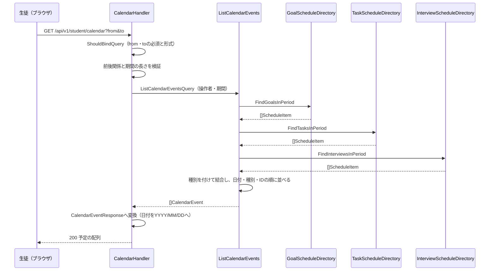

# カレンダー機能 Go実装仕様書

---

# 1. 機能概要

生徒が、指定した期間に含まれる目標・タスク・面談を1つの時系列として取得する機能である（②「1. 機能概要」）。

本書が定める実装範囲は次のとおりである。

|範囲|内容|
|-|-|
|エンドポイント|`GET /api/v1/student/calendar`（1つ）|
|業務操作|期間指定の予定取得（1つ。②「12. UseCase設計」）|
|他Contextへの依存|`goal-management`・`task-management`・`interview-request`の期間指定の参照（3つ）、`user`による操作者の識別|
|所有するテーブル|なし（②「20. DB設計方針」）|

本Contextは参照専用であり、書き込みを行わない。予定の作成・更新・状態遷移は所有Contextの責務である（②「3. Bounded Context」の「持たない責務」）。

---

# 2. ディレクトリ構成

## 対象Bounded Context名

- `calendar`（②「3. Bounded Context」）

## ディレクトリ・パッケージ名

アーキテクチャ規約「4. Bounded Context構成」の「Contextディレクトリの命名」に従い、Context名`calendar`から`-`を取り除いて連結した全小文字の名前とする。`-`を含まないため、ディレクトリ名は`internal/calendar/`、package名は同じ`calendar`となる。

Context名とディレクトリ名は規約から機械的に決まるため、②に明記がなくても推測にはならない。

ロール別のサブディレクトリは設けない。本Contextは生徒のみが利用し、同一Contextを複数のロールが共有しないためである（②「1. 機能概要」）。

## ②で採用した設計パターン

Transaction Script（②「4. 設計パターン」）

## 作成するディレクトリ一覧

```
internal/calendar/
internal/calendar/application/
internal/calendar/infrastructure/contextadapter/
internal/calendar/presentation/handler/
internal/calendar/presentation/request/
internal/calendar/presentation/response/
```

`domain/`は作成しない。②「6. Entity設計」のとおり独自のEntityを定義せず、②「7. Value Object設計」「8. Domain Service」のとおりValue Object・Domain Serviceも持たないためである（アーキテクチャ規約「3. 設計パターンごとの構造適用方針」Transaction Script節）。

`infrastructure/gormrepo/`は作成しない。**本Contextが所有するテーブルがなく、GORMでDBを読み書きする実装を持たない**ためである（②「21. DB操作仕様」）。`infrastructure/`配下は`contextadapter/`のみとなる。

`presentation/request/`は作成する。クエリパラメータ`from`・`to`を受け取り、Presentation層で検証するためである（②「15. Validation設計」）。ダッシュボード機能③がリクエストパラメータを持たず`request/`を作成しないのとはこの点で異なる。

規約「4. Bounded Context構成」の「機能で不要なディレクトリは作成しない。『層として必要だから』という理由で空のディレクトリを置かない」に従う。

## 作成するファイル一覧

```
internal/calendar/context.go                       # NewContext（依存関係の組み立て）
internal/calendar/dependency.go                    # 他Contextへの依存を宣言するインターフェースと受け渡し用の型

internal/calendar/application/list_calendar_events.go   # ListCalendarEvents（3つの参照をまとめる関数）

internal/calendar/infrastructure/contextadapter/goal_schedule_directory.go      # GoalScheduleDirectoryの実装
internal/calendar/infrastructure/contextadapter/task_schedule_directory.go      # TaskScheduleDirectoryの実装
internal/calendar/infrastructure/contextadapter/interview_schedule_directory.go # InterviewScheduleDirectoryの実装

internal/calendar/presentation/handler/calendar_handler.go
internal/calendar/presentation/request/calendar_request.go
internal/calendar/presentation/response/calendar_response.go
internal/calendar/presentation/routes.go
```

## 文書の分割

本書は分割しない。実装ファイルは上記の10であり、テストが付くもの（`ListCalendarEvents`・3つのアダプタ・`CalendarHandler`の5）を加えても15であるため、1文書あたり30〜35という範囲に収まる。

---

# 3. Domain層設計

**対象外。** 本機能はTransaction Script採用のため、domain層を作成しない（アーキテクチャ規約「3. 設計パターンごとの構造適用方針」Transaction Script節）。

|②の節|本書での扱い|
|-|-|
|②「5. Aggregate設計」（不要）|Aggregateを定義しない|
|②「6. Entity設計」（本Contextが管理するEntityなし）|Entityを定義しない。②が「予定（出力の要素）」として整理した概念は、`dependency.go`の受け渡し用の型と、application層の出力の型として表す（「6. Application層設計」）|
|②「7. Value Object設計」（不要）|Value Objectを定義しない。期間の検証はPresentation層のガード節で行う（「12. Validation実装方針」）|
|②「8. Domain Service」（不要）|Domain Serviceを定義しない|
|②「18. Domain Event」（不要）|Domain Eventを定義しない|

## 他Contextへの依存（`dependency.go`）

他Contextの公開操作を呼ぶためのインターフェースは、Contextディレクトリ直下の`dependency.go`に置く（アーキテクチャ規約「4. Bounded Context構成」）。実装は`infrastructure/contextadapter/`に置く（「8. Infrastructure層設計」）。

```go
type GoalScheduleDirectory interface {
    FindGoalsInPeriod(ctx context.Context, userID uint, period Period) ([]ScheduleItem, error)
}

type TaskScheduleDirectory interface {
    FindTasksInPeriod(ctx context.Context, userID uint, period Period) ([]ScheduleItem, error)
}

type InterviewScheduleDirectory interface {
    FindInterviewsInPeriod(ctx context.Context, userID uint, period Period) ([]ScheduleItem, error)
}

// Period は取得期間である。From・To はいずれも暦日（時刻を持たない）。
// 両端を含む（①「5. API / 処理詳細」）。
type Period struct {
    From time.Time
    To   time.Time
}

// ScheduleItem は3つの参照手段が返す、予定1件の共通の形である。
type ScheduleItem struct {
    ID     uint
    Date   time.Time // 暦日
    Title  string
    Status string
}
```

|インターフェース|委譲先|所有Context側の定義|
|-|-|-|
|`GoalScheduleDirectory`|`goal-management`の`FindGoalsInPeriod`|目標管理機能②「12. UseCase設計」|
|`TaskScheduleDirectory`|`task-management`の`FindTasksInPeriod`|タスク管理機能②「12. UseCase設計」|
|`InterviewScheduleDirectory`|`interview-request`の`FindInterviewsInPeriod`|面談機能②「12. UseCase設計」|

メソッド名は所有Context側の公開操作名に揃えた。取得経路を1つに保ち、どの操作を呼んでいるかが利用側の宣言から分かるようにするためである（②「3. Bounded Context」の「本Contextが利用する公開操作」）。

**②からの補足**: 引数・戻り値の型は②に明記がないため、コーディング規約「7. インターフェース」（利用側で定義する）・アーキテクチャ規約「5. Context間連携ルール」に従って実装のために補った。メソッド名は所有Context側の②が定める公開操作名と同じにしている。

**3つの参照手段が同じ`ScheduleItem`を返す形にした理由**: 3種類の予定はカレンダー上で同じ形に揃えられる（②「6. Entity設計」）。種別ごとに別の型で受け取ると、結合の前に3通りの変換を書くことになる。種別（`goal` / `task` / `interview_request`）は呼び出し側が参照手段ごとに決まるため、`ScheduleItem`には持たせない（**②からの補足**。②は出力の要素が種別を持つと定めるが、参照手段の戻り値の形までは定めていない）。

`Period`・`ScheduleItem`を`dependency.go`に置くのは、`dependency.go`のインターフェースの引数・戻り値の型であるためである。domain層を持たないため、教師お知らせ機能③_1が`ViewerScope`を`domain/repository/`に置いたのとは置き場所が異なる。

---

# 4. クラス図

省略する。

理由: ②「9. クラス図」が省略しており、本書でも可視化すべきEntity関係が存在しない（「3. Domain層設計」）。

---

# 5. 状態遷移図

省略する。

理由: ②「10. 状態遷移図」のとおり、本Contextは状態を持たず、状態を変更しない。返す状態は参照結果をそのまま載せたものである。

---

# 6. Application層設計

本機能はTransaction Script採用のため、UseCase structを設けない。②「12. UseCase設計」の「期間指定の予定取得」を、application層の関数として実装する（アーキテクチャ規約「3. 設計パターンごとの構造適用方針」Transaction Script節）。

## DTO（Command / Query）

|struct名|フィールド|区分|備考|
|-|-|-|-|
|`ListCalendarEventsQuery`|`UserID uint`・`Period Period`|Query|`Period`は`dependency.go`で定義した型をそのまま使う|
|`CalendarEvent`|`Type string`・`ID uint`・`Date time.Time`・`Title string`・`Status string`|出力|結合後の予定1件。`Date`は暦日のまま保持する|

出力の型をPresentation層のResponse DTOと分けるのは、application層の型がJSONのキー名や日付の表示形式といったHTTPの関心を持たないためである（アーキテクチャ規約「6. データフロー」）。`YYYY/MM/DD`への整形はResponse DTOで行う（「9. Presentation層設計」）。

`Type`を`string`とし独自型にしないのは、本機能が種別に対して業務ルールを持たないためである（**②からの補足**。②「6. Entity設計」は種別を表示上の区分としており、型までは定めていない）。種別の値は`goal` / `task` / `interview_request`の3つで、①「5. API / 処理詳細」Responseのとおりである。

## 関数

### ListCalendarEvents（`application/list_calendar_events.go`）

|項目|内容|
|-|-|
|関数|`ListCalendarEvents(ctx context.Context, q ListCalendarEventsQuery) ([]CalendarEvent, error)`|
|受け取る依存|`GoalScheduleDirectory`、`TaskScheduleDirectory`、`InterviewScheduleDirectory`（コンストラクタで注入する`struct`のメソッドとして実装してよい）|

処理ステップ:

1. `GoalScheduleDirectory.FindGoalsInPeriod`で期間内の目標を取得する。失敗した場合はエラーを返す
2. `TaskScheduleDirectory.FindTasksInPeriod`で期間内のタスクを取得する。失敗した場合はエラーを返す
3. `InterviewScheduleDirectory.FindInterviewsInPeriod`で期間内の面談を取得する。失敗した場合はエラーを返す
4. 手順1〜3の結果を、それぞれ種別`goal` / `task` / `interview_request`を付与して1つのスライスへ結合する
5. 日付の昇順、同じ日付では種別の文字列の昇順、同じ種別では識別子の昇順に並べる（②「12. UseCase設計」）
6. 並べ替えたスライスを返す

**3つの参照のいずれかが失敗した場合はエラーを返す。** 部分的な結果を返さない（②「17. Error設計」）。ダッシュボード機能③が当日の解答件数の失敗を`0`に吸収するのとは扱いが異なる。吸収する根拠（Rails現行がログを記録して既定値を返す）が本機能には存在せず、Rails現行は例外がそのまま500になるためである（①「5. API / 処理詳細」Errorケース）。

該当する予定が1件もない場合は、長さ0のスライスを返す。エラーにしない（②「12. UseCase設計」）。`nil`を返さないのは、`nil`スライスがJSONで`null`になり、Rails現行の`[]`と異なるためである（**②からの補足**。管理者高校学年参照機能③「6. Application層設計」が同じ扱いをしている）。

並べ替えの第2キーを種別の文字列の昇順とするのは、①「5. API / 処理詳細」処理内容の並び（`goal` → `interview_request` → `task`）がRails現行の種別名の文字列順と一致するためである。種別に独自の優先順位を持たせない。

3つの参照は互いに独立しており、順序が結果に影響しない。本書では手順1〜3を順に呼ぶ形とする。並行呼び出しは、失敗時の扱い（どの参照のエラーを返すか）とログの順序が複雑になるため採らない（**②からの補足**。②「12. UseCase設計」は実装上の判断として③に委ねている）。

トランザクションは使用しない（②「14. Transaction設計」、「11. Transaction実装方針」）。

---

# 7. シーケンス図・処理フロー図

## シーケンス図



## 処理フロー図

省略する。

理由: ②「13. シーケンス図・処理フロー図」が省略しており、業務ルールによる条件分岐を持たない。

---

# 8. Infrastructure層設計

## Infrastructure関数（Transaction Script採用時）

**対象外。** 本Contextが所有するテーブルがなく、DBへクエリを発行する関数を持たない（②「21. DB操作仕様」）。`infrastructure/`配下に置くのは、`dependency.go`のインターフェースの実装（`contextadapter/`）のみである。

## contextadapter（`dependency.go`のインターフェースの実装）

`dependency.go`で宣言した3つのインターフェースの実装を`infrastructure/contextadapter/`に置く（アーキテクチャ規約「4. Bounded Context構成」。`gormrepo/`には置かない）。相手Contextの公開操作へ委譲するだけであり、本Contextから相手のテーブルへクエリを発行しない（同「5. Context間連携ルール」）。

### GoalScheduleDirectory実装（`infrastructure/contextadapter/goal_schedule_directory.go`）

- 実装struct名: 非公開struct + コンストラクタ`NewGoalScheduleDirectory`
- 責務: `goal-management`の期間指定の目標参照へ委譲し、結果を`ScheduleItem`へ変換する
- 変換内容: 目標の識別子を`ID`、件名を`Title`、期限日を`Date`、状態を`Status`に対応させる（②「11. Repository設計」）
- 本アダプタはGORMに依存せず、`goals`へクエリを発行しない

### TaskScheduleDirectory実装（`infrastructure/contextadapter/task_schedule_directory.go`）

- 実装struct名: 非公開struct + コンストラクタ`NewTaskScheduleDirectory`
- 責務: `task-management`の期間指定のタスク参照へ委譲し、結果を`ScheduleItem`へ変換する
- 変換内容: タスクの識別子を`ID`、件名を`Title`、期限日を`Date`、状態を`Status`に対応させる

### InterviewScheduleDirectory実装（`infrastructure/contextadapter/interview_schedule_directory.go`）

- 実装struct名: 非公開struct + コンストラクタ`NewInterviewScheduleDirectory`
- 責務: `interview-request`の期間指定の面談参照へ委譲し、結果を`ScheduleItem`へ変換する
- 変換内容: 面談の識別子を`ID`、相談理由の詳細を`Title`、状態を`Status`に対応させる。`Date`には面談日時の暦日を入れる
- **暦日の決定は所有Context側に委ねる。** 面談日時は日時であり、暦日との突き合わせには時刻とタイムゾーンの解釈が必要になる。本アダプタは`Period`（暦日）を渡し、返ってきた暦日をそのまま使う（②「11. Repository設計」。分析機能②「11. Repository設計」が同じ扱いをしている）

**②からの補足**: 相手Contextの公開操作が返す型は、所有Context側の③で確定する。3つのアダプタはいずれも、受け取った値を`ScheduleItem`へ移す変換だけを持つ。

## 外部連携実装

対象外。本Contextから外部サービス・キャッシュ・キューへ直接アクセスしない。集計結果のキャッシュも設けない（②「24. 採用しなかった設計」）。

## 依存関係の組み立て（`context.go`）

規約「14. 依存関係の組み立て（DI配線）」に従い、`NewContext`を`context.go`に置く。

- 受け取る共通依存: ロガー、および3つの相手Contextの公開操作を呼ぶための値
- 組み立ての順序: 3つのアダプタ → application層の関数（またはそれを束ねるstruct） → `CalendarHandler`
- `*gorm.DB`を受け取らない。本Contextが所有するテーブルを持たず、GORMを使う実装がないためである（**②からの補足**。規約「14. 依存関係の組み立て（DI配線）」の例示は`*gorm.DB`を渡す形だが、ダッシュボード機能③「8. Infrastructure層設計」が同じ理由で取らない形としている）

---

# 9. Presentation層設計

## Handler

### CalendarHandler（`presentation/handler/calendar_handler.go`）

|項目|内容|
|-|-|
|struct名|`CalendarHandler`|
|対応する呼び出し先|application層の`ListCalendarEvents`|
|コンストラクタ|`NewCalendarHandler(listCalendarEvents *application.CalendarService) *CalendarHandler`。関数として注入する形でもよい|

メソッド一覧:

|メソッド|HTTPメソッド|パス|
|-|-|-|
|`ShowCalendar`|GET|/api/v1/student/calendar|

処理順序:

1. `c.ShouldBindQuery`で`CalendarRequest`へバインドする。`from`・`to`の必須と`YYYY-MM-DD`形式の検証はバリデーションタグで行う
2. バインドに失敗した場合は422のAppErrorへ変換して`c.Error(err)`で返す（「14. Error実装方針」）
3. `from`が`to`より後であれば422を返す
4. `to`と`from`の差が92日を超えていれば422を返す。両端を含めて92日までを許容する（①「5. API / 処理詳細」業務ルール）
5. `c.Request.Context()`からcurrent user（認証Middlewareが格納したstudentユーザー）を取得する（②「16. Authorization設計」）
6. `ListCalendarEventsQuery`を組み立てて`ListCalendarEvents`を呼ぶ
7. エラーが返った場合は500のAppErrorへ変換して`c.Error(err)`で返す
8. `[]CalendarEvent`を`[]CalendarEventResponse`へ変換し、200 OKで返す

**手順3・4をバリデーションタグではなくHandlerで行う理由**: 2つのフィールドの関係に対する検証であり、`binding`タグで表現できない。分析機能③「9. Presentation層設計」・教師面談機能③「9. Presentation層設計」が同じ期間の検証で同じ扱いをしている。日付の形式と実在の検証は`datetime=2006-01-02`タグで足りるため、そちらはタグに委ねる。

## Request / Response DTO

### Request（`presentation/request/calendar_request.go`）

|struct名|フィールドと型|バリデーションタグ／チェック内容|
|-|-|-|
|`CalendarRequest`|`From string `form:"from"``・`To string `form:"to"``|`From`・`To`はいずれも`binding:"required,datetime=2006-01-02"`（必須、`YYYY-MM-DD`形式の実在する日付）。前後関係と期間の長さはHandlerで検証する|

教師面談機能③の一覧が`required_with`で「一方を指定したら両方必須」としているのとは異なり、本機能は両方を無条件に必須とする。①「5. API / 処理詳細」Requestのとおり、期間を指定しない取得の形を持たないためである。

### Response（`presentation/response/calendar_response.go`）

|struct名|フィールド|型|JSONキー|
|-|-|-|-|
|`CalendarEventResponse`|Type|`string`|`type`|
||ID|`uint`|`id`|
||Date|`string`|`date`（`YYYY/MM/DD`形式）|
||Title|`string`|`title`|
||Status|`string`|`status`|

最上位はenvelopeで包まず、`[]CalendarEventResponse`をそのまま返す（②「19. API仕様」。規約「15. API規約（レスポンス形式・ページネーション・URL・クエリパラメータ）」の「一覧（ページネーションなし。マスタ参照等）」に該当する）。

`Date`を`string`とし、`YYYY/MM/DD`形式で整形するのは、Rails現行の形式を維持するためである（①「5. API / 処理詳細」Response）。他のAPIで使われる`YYYY-MM-DD`とは異なるが、フロントエンドがこの形式を前提にしているため変更しない（②「19. API仕様」のRailsとの差分）。

## Routing（`presentation/routes.go`）

- 登録するルート: `GET /api/v1/student/calendar`
- 登録方法: 生徒向けのルートグループ（認証Middleware・`student`ロールの認可Middlewareが適用されたグループ）に対して、本Contextの`RegisterRoutes`が1つのルートを登録する（Gin規約「1. ルーティング」「2. ルートグルーピング」）
- リソース名は単数形の`calendar`とする。1つしか存在しないリソースであるため（規約「15. API規約（レスポンス形式・ページネーション・URL・クエリパラメータ）」のURL）

---

# 10. API仕様

②「19. API仕様」に基づき、Rails現行仕様と同一のエンドポイントを維持する（②「19. API仕様」のRailsとの差分：なし）。

|Method|Path|Handler|Request|Response|Status Code|
|-|-|-|-|-|-|
|GET|/api/v1/student/calendar|CalendarHandler.ShowCalendar|`CalendarRequest`（`from`・`to`）|`[]CalendarEventResponse`|200 / 422 / 401 / 403 / 500|

## Errorケース

|条件|Status Code|Error内容|
|-|-|-|
|`from`・`to`が未指定|422|`From を入力してください` / `To を入力してください`（①「5. API / 処理詳細」Errorケース）|
|`from`・`to`が`YYYY-MM-DD`形式でない、または実在しない日付|422|`From は正しい日付を入力してください` / `To は正しい日付を入力してください`|
|`from`が`to`より後|422|`To はfrom以降の日付を指定してください`|
|期間が92日を超える|422|`取得期間は92日以内で指定してください`|
|未認証|401|認証エラー（Middleware）|
|`student`以外のロール|403|認可エラー（Middleware）|
|所有Contextの参照手段の呼び出しが失敗|500|内部エラー（②「17. Error設計」）|

エラー本文は`{"errors": ["メッセージ", ...]}`とする（Gin規約「8. エラーハンドリングミドルウェア」）。複数フィールドの検証に同時に失敗した場合は`fields`が加わる。

---

# 11. Transaction実装方針

トランザクションを使用しない（②「14. Transaction設計」）。

- Transaction開始箇所: なし
- Transaction終了箇所: なし
- 複数の参照にまたがる場合の扱い: 3つの参照は別Contextの公開操作であり、1つのトランザクションに束ねない。束ねるには本Contextが相手のトランザクション境界へ介入する必要があり、規約「5. Context間連携ルール」に反する（②「14. Transaction設計」）

`internal/shared/transaction`の`TransactionManager`を受け取らない。書き込みがなく、トランザクションの抽象を必要としないためである。

---

# 12. Validation実装方針

## Presentation

|検証|実装箇所|
|-|-|
|`from`・`to`の必須|`CalendarRequest`の`binding:"required"`|
|`YYYY-MM-DD`形式・実在する日付|同`binding:"datetime=2006-01-02"`|
|`from`が`to`以前|`ShowCalendar`のガード節|
|期間が92日以内|同|

Value Objectを作らず、関数内のガード節で検証する（アーキテクチャ規約「3. 設計パターンごとの構造適用方針」Transaction Script節、②「7. Value Object設計」）。

## 業務ルール検証

なし。②「15. Validation設計」のDomainの欄が「なし」であり、本機能に業務ルールの検証・状態チェック・整合性チェックは存在しない。

論理削除済みの目標・タスクの除外、取り消し済みの面談の除外は、いずれも所有Contextの参照手段が行う（②「11. Repository設計」）。本Contextで再度の絞り込みを行わない。

---

# 13. Authorization実装方針

|判定箇所|判定内容|
|-|-|
|Middleware|認証済みであること、`student`ロールであること（②「16. Authorization設計」）|
|Handler|判定しない。current userの識別子を取り出してQueryへ渡すのみ|
|application層|判定しない。操作者の識別子を参照手段へ渡し、絞り込み条件として使う|
|Domain|対象外（domain層を持たない）|

「自分の予定だけを見られること」は認可の判定ではなく絞り込み条件として表す。所有Context側が他人のデータを返さないため、本Contextで追加の判定を行わない（②「16. Authorization設計」）。

---

# 14. Error実装方針

②「17. Error設計」を、規約「12. Error変換パターン（AppError）」に従って実装レベルに落とし込む。

## Application Error → HTTPレスポンスへの変換方針（Status Code対応表）

|業務シナリオ|Error変数名／型|発生層|HTTP Status|
|-|-|-|-|
|Request DTOのバインド・バリデーションエラー|（Ginの`binding`エラー）|Presentation|422|
|`from`が`to`より後、期間が92日超過|Handlerのガード節が返すAppError|Presentation|422|
|所有Contextの参照手段の呼び出しが失敗|ラップしたエラー（AppErrorに該当しない）|Infrastructure|500|
|未認証|（Middleware）|Presentation|401|
|ロール不一致|（Middleware）|Presentation|403|

Domain Error・Application Errorのsentinel errorを定義しない。②「17. Error設計」のとおり、業務ルール違反と「対象が見つからない」が存在しないためである。参照対象が0件であることは正常系（空の配列）として扱う。

Presentation層（Gin規約「8. エラーハンドリングミドルウェア」）は、返されたエラーに対して`errors.As(err, &appErr)`を1回だけ呼び出し、`StatusCode()`でHTTPステータスを決定する。個々のエラーをHandler側で列挙して判定しない（規約「12. Error変換パターン（AppError）」）。

## Infrastructure Errorのハンドリング方針

アダプタが相手Contextの公開操作から受け取ったエラーは、`fmt.Errorf("...: %w", err)`でラップしてapplication層へ返す（コーディング規約「18. エラーハンドリング」）。application層・Handlerでは内容を区別せず、すべて500として扱う（共通のエラーハンドリングミドルウェアに委ねる）。

どの参照手段の呼び出しで失敗したかはラップしたメッセージに含める。3つの参照のいずれで失敗したかがレスポンスから分からないためである。

---

# 15. GORM / DBクエリ設計

**対象外。** 本Contextが所有するテーブルを持たず、GORMモデル・GORMを使うクエリを定義しない（②「20. DB設計方針」「21. DB操作仕様」）。

期間での絞り込み・論理削除済みの除外・取り消し済みの除外は、いずれも所有Context側のクエリで行われる。該当する実装方針は目標管理機能③・タスク管理機能③・面談機能③の「15. GORM / DBクエリ設計」に属する。

既存Schemaに対する変更も行わない（②「20. DB設計方針」）。

---

# 16. テストケース設計

②「22. テスト戦略」を、Transaction Script採用時の区分で具体化する。

## Domain Test

対象外。domain層を持たない（②「22. テスト戦略」）。

## UseCase Test

|対象|テストケース|
|-|-|
|`ListCalendarEvents`|3つの参照結果が1つのスライスへ結合され、種別が`goal` / `task` / `interview_request`として付与されること|
||日付の昇順に並ぶこと／同じ日付では種別の文字列の昇順（`goal` → `interview_request` → `task`）に並ぶこと／同じ種別では識別子の昇順に並ぶこと|
||3つの参照がいずれも0件のとき、`nil`ではなく長さ0のスライスを返すこと|
||目標の参照が失敗したときエラーを返すこと／タスクの参照が失敗したときエラーを返すこと／面談の参照が失敗したときエラーを返すこと（いずれも部分的な結果を返さないこと）|
||操作者の識別子と期間が、3つの参照手段へそのまま渡されること|

## Repository Test

対象外。本Contextがクエリを発行しない（②「22. テスト戦略」）。

3つのアダプタについては、相手Contextの公開操作の戻り値を`ScheduleItem`へ正しく移すこと（目標・タスクは件名、面談は相談理由の詳細を`Title`に入れること）を検証する。

## Handler Test

|対象|テストケース|
|-|-|
|`CalendarHandler.ShowCalendar`|正常系で200と予定の配列が返ること／`date`が`YYYY/MM/DD`形式であること／envelopeで包まれていないこと|
||`from`・`to`が未指定で422と`From を入力してください`・`To を入力してください`が返ること|
||`from`が`2026-03-99`のとき422と`From は正しい日付を入力してください`が返ること|
||`from`が`to`より後のとき422と`To はfrom以降の日付を指定してください`が返ること|
||期間が92日のとき200、93日のとき422と`取得期間は92日以内で指定してください`が返ること|
||未認証で401、`student`以外のロールで403になること|
||参照手段が失敗したとき500になること|

## Integration Test

|対象|テストケース|
|-|-|
|期間指定の予定取得|目標・タスク・面談を登録した状態でエンドポイントを呼び、3種類が1つの配列で日付順に返ること|
||期間の境界（開始日・終了日に該当する予定が含まれること、1日外のものが含まれないこと）|
||取り消し済みの面談が返らないこと／面談日時が未設定の面談が返らないこと|
||論理削除済みの目標・タスクが返らないこと|
||他の生徒の目標・タスク・面談が混ざらないこと|

---

# 17. ②からの補足事項

②に明記がなく、実装のために追加で判断した内容を以下に記載する。

|判断した内容|判断理由|推測か否か|
|-|-|-|
|内部ディレクトリ名・package名を`calendar`とし、`dependency.go`のインターフェースの実装を`infrastructure/contextadapter/`に置いた|アーキテクチャ規約「4. Bounded Context構成」の「Contextディレクトリの命名」および同章の`contextadapter/`の定めによる。`gormrepo/`は所有するテーブルがないため作成しない|規約に基づく（推測ではない）|
|3つの参照インターフェースを`GoalScheduleDirectory`等とし、メソッド名を所有Context側の公開操作名（`FindGoalsInPeriod`等）に揃えた|他Contextの参照には`Directory`を用いる既存③文書（ダッシュボード・分析・管理者高校学年参照）の形に合わせた。メソッド名を所有Context側と揃えるのは、どの公開操作を呼んでいるかを利用側の宣言から読み取れるようにするためである（教師生徒参照機能③・教師お知らせ機能③_1が`FindGradeRestriction`で同じ扱いをしている）|補足（引数・戻り値の型は②に明記がなく、実装のために補った）|
|3つの参照手段が共通の`ScheduleItem`を返す形にした|3種類の予定はカレンダー上で同じ形に揃えられる（②「6. Entity設計」）。種別ごとに別の型で受け取ると、結合の前に3通りの変換を書くことになる。種別は参照手段ごとに決まるため`ScheduleItem`には持たせない|補足（②は参照手段の戻り値の形を定めていない）|
|`Period`・`ScheduleItem`を`dependency.go`に置いた|`dependency.go`のインターフェースの引数・戻り値の型である。domain層を持たないため、`domain/repository/`に置く選択肢がない|補足（規約に定めがなく、本機能の構成から導いた）|
|該当0件のとき`nil`ではなく長さ0のスライスを返す|`nil`スライスはJSONで`null`になり、Rails現行の`[]`と異なる（①「5. API / 処理詳細」）。管理者高校学年参照機能③「6. Application層設計」が同じ扱いをしている|①に基づく（推測ではない）|
|並べ替えの第2キーを種別の文字列の昇順とした|①「5. API / 処理詳細」処理内容の並び（`goal` → `interview_request` → `task`）がRails現行の種別名の文字列順と一致する。種別に独自の優先順位を持たせない方が、種別が増えたときに規則が変わらない|①に基づく（推測ではない）|
|3つの参照を順に呼ぶ（並行呼び出しをしない）|②「12. UseCase設計」が実装上の判断として③に委ねている。並行にすると、どの参照のエラーを返すかとログの順序の扱いが増える。参照回数は3回で固定であり、順に呼んでも呼び出し回数は変わらない|補足|
|`NewContext`が`*gorm.DB`を取らない|本Contextが所有するテーブルを持たず、GORMを使う実装がない。ダッシュボード機能③「8. Infrastructure層設計」が同じ理由で同じ形としている|補足（規約「14. 依存関係の組み立て（DI配線）」の例示は`*gorm.DB`を渡す形だが、使う先がない）|
|期間の前後関係と長さの検証をHandlerのガード節に置いた|2つのフィールドの関係に対する検証であり、`binding`タグで表現できない。分析機能③「9. Presentation層設計」・教師面談機能③「9. Presentation層設計」が同じ扱いをしている|補足（規約適用に基づく実装上の判断）|
|`from`・`to`を無条件に必須とした|①「5. API / 処理詳細」Requestのとおり、期間を指定しない取得の形を持たない。教師面談機能③の一覧が`required_with`で「一方を指定したら両方必須」としているのとは、Rails現行の挙動が異なる|①に基づく（推測ではない）|
|予定の種別を`string`で保持し独自型にしない|本機能は種別に対して業務ルールを持たない（②「6. Entity設計」は表示上の区分としている）|補足|

## 未確定事項

- **3つの公開操作の引数・戻り値の型は所有Context側の③で確定する。** 操作そのものは3つの②が定めているが（②「3. Bounded Context」の「本Contextが利用する公開操作」）、Goのシグネチャは所有Contextの③に属する。本書のインターフェースは利用側の宣言であり、型が確定した時点で合わせる
- **面談の暦日の決定方法。** 面談日時はUTCで保存されており、暦日との突き合わせに時刻とタイムゾーンの解釈が必要になる。その解釈を所有Context側に閉じ込める方針は②「11. Repository設計」が定めているが、具体的な基準（日本時間の暦日として扱う）は`interview-request`の③で確定する
