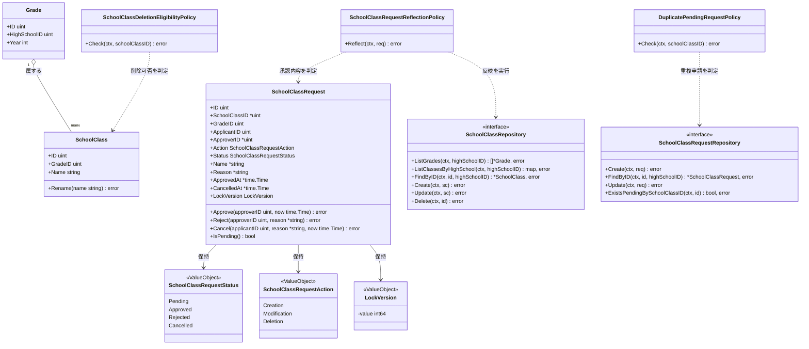
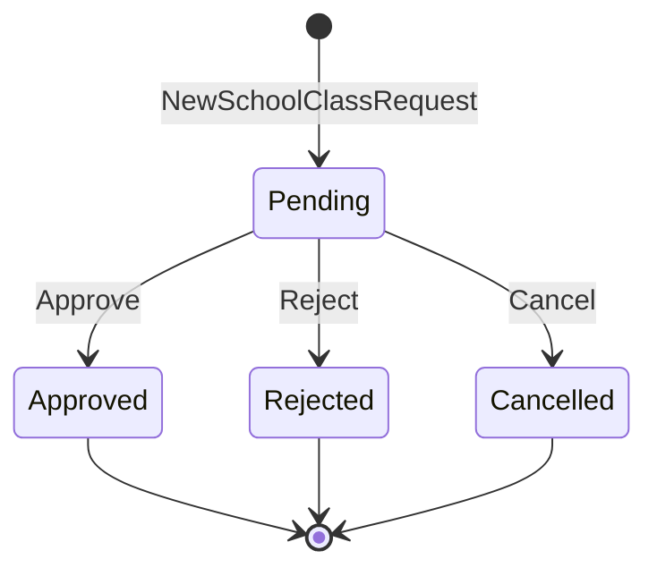

# クラス編成機能 Go実装仕様書 1 Domain

---

## 本書の位置づけ（分割）

本機能の実装ファイルは40であり、1つの③が扱う30〜35を超えるため、③自動生成プロンプト「2. ディレクトリ構成」の「文書の分割」に従って分割している。Handlerが`school_class_handler.go`の1つのみでスライスに割れないため、**レイヤーで割っている。**

|文書|担当|実装ファイル数|テスト込みの目安|
|-|-|-|-|
|`クラス編成機能_Go実装仕様書_1_Domain.md`|Domain層|14|約23|
|`クラス編成機能_Go実装仕様書_2_Infrastructure.md`|Infrastructure層|9|約14|
|`クラス編成機能_Go実装仕様書_3_Application・Presentation.md`|Application層・Presentation層|17|約25|

1つ目 → 2つ目 → 3つ目の順に実装すれば、各PRは単体でコンパイルが通る。Infrastructure層はDomain層のRepository Interfaceを実装し、Application層・Presentation層はその両方に依存するためである。

機能全体のファイル一覧と、どの文書がどのファイルを担当するかは「2. ディレクトリ構成」に記載する。

---

# 1. 機能概要

## 機能概要

学校の学年・クラス（組）の構成を管理する機能である。教師がクラスの新設・改名・削除を「申請」として提出し、他職員操作権限（`manage_other_teachers`）を持つ教師が承認・却下することでクラス構成（`school_classes`）へ反映する、承認ワークフロー型の機能である。承認された申請の内容は、申請レコードの更新と同一の処理単位でクラスデータへ反映される。削除申請は、対象クラスに在籍する生徒・所属する教員がいないことを条件とする。更新系操作（承認・却下・取消）は楽観ロック（`lock_version`）による競合検出を伴う。

## 採用設計パターンとその理由（②からの要約）

②「4. 設計パターン」により、本機能は **Domain Model** を採用する。

- `SchoolClassRequest`は「pending→approved/rejected/cancelled」という明示的な状態遷移ルールを持ち、承認・却下は他職員操作権限を持つ教師のみが行え、かつ申請者自身は自分の申請を承認・却下できないという当事者制約を持つ
- 承認時には、申請レコードの状態更新と、申請区分（新設・改名・削除）に応じたクラスデータへの反映を「一つの処理としてまとめて行い、途中で失敗した場合は両方とも反映されない」という、複数Entityにまたがる整合性ルールが存在する
- 削除申請は「対象クラスに在籍する生徒・所属する教員がいないこと」という、他Context（在籍・所属情報）を参照する業務ルールを満たさなければ受け付けられない
- 更新系操作には楽観ロックによる競合検出が必須である
- 申請区分ごとに必要な入力項目の組み合わせルールが異なる

以上の理由からTransaction Script・Active Record・Event Sourcingは不採用としている（②「4. 設計パターン」「24. 採用しなかった設計」）。本書はこの判断を変更しない。

## 本書が対象とする実装範囲

- Bounded Context: `school-class`
- 対象UseCase: `ListGradesUseCase` / `ListSchoolClassesUseCase` / `ShowSchoolClassUseCase` / `ListSchoolClassRequestsUseCase` / `ShowSchoolClassRequestUseCase` / `CreateSchoolClassRequestUseCase` / `ProcessSchoolClassRequestUseCase` / `CancelSchoolClassRequestUseCase`
- 規約「3. 設計パターンごとの構造適用方針」のDomain Model構造（`domain`/`application`/`infrastructure`/`presentation`のフルレイヤー構成）で実装する
- ①Rails現行仕様書（クラス編成機能_Rails現行仕様書）の記載を、各APIの入力項目・処理内容・業務ルール・レスポンス・Errorケースの根拠とする

---

---

# 2. ディレクトリ構成

## 対象Bounded Context名

- `school-class`（②「3. Bounded Context」）

## ②で採用した設計パターン

- Domain Model（②「4. 設計パターン」）

アーキテクチャ規約「4. Bounded Context構成」の「Contextディレクトリの命名」に従い、Context名`school-class`から`-`を取り除いて連結した全小文字の名前とし、短縮・省略はしない。したがってディレクトリ名は`internal/schoolclass/`、package名は同じ`schoolclass`となる。

## 作成するディレクトリ一覧

```
internal/schoolclass/
├── context.go                    # NewContext（依存関係の組み立て）
├── dependency.go                 # 他Contextへの依存を宣言するインターフェース
├── domain/
│   ├── entity/
│   ├── valueobject/
│   ├── repository/
│   ├── service/
│   ├── event/
│   └── errors/
├── application/
│   ├── dto/
│   └── usecase/
├── infrastructure/
│   ├── gormrepo/
│   ├── contextadapter/
│   └── queue/
└── presentation/
    ├── handler/
    ├── request/
    ├── response/
    └── routes.go
```

Domain Modelを採用するため、Contextディレクトリ直下には`context.go`と`dependency.go`のみを置き、他は`domain/`等のサブディレクトリに配置する（アーキテクチャ規約「4. Bounded Context構成」の「ディレクトリ構成」）。他Contextの公開操作を呼ぶためのインターフェース（`StudentOccupancyDirectory`・`TeacherPermissionRepository`・`SchoolClassRequestEventPublisher`）は`dependency.go`に置き、その実装は`infrastructure/contextadapter/`に置く（同章。`gormrepo/`には置かない）。本Contextが自らクエリを発行して読むデータのRepository Interfaceは`domain/repository/`に置き、実装とGORMモデルを`infrastructure/gormrepo/`に置く。`ClassOccupancyRepository`は後者であり、クラス詳細の表示用の在籍生徒一覧（`users`）と所属教員（`teacher_school_classes`）を自前の参照モデルとして読む（「3. Domain層設計」）。

- `domain/specification/`: 対象外（②に該当する複雑な仕様判定パターンの記載がなく、業務ルールはDomain Service（3種のPolicy）として②8章に明記されているため）
- `infrastructure/mail/`・`infrastructure/cache/`: 対象外（②に該当する外部連携要件の記載がないため）

## 作成するファイル一覧

```
internal/schoolclass/domain/entity/grade.go
internal/schoolclass/domain/entity/school_class.go
internal/schoolclass/domain/entity/school_class_request.go

internal/schoolclass/domain/valueobject/school_class_request_status.go
internal/schoolclass/domain/valueobject/school_class_request_action.go
internal/schoolclass/domain/valueobject/lock_version.go

internal/schoolclass/context.go
internal/schoolclass/dependency.go

internal/schoolclass/domain/repository/school_class_repository.go
internal/schoolclass/domain/repository/school_class_request_repository.go
internal/schoolclass/domain/repository/class_occupancy_repository.go

internal/schoolclass/domain/service/school_class_request_reflection_policy.go
internal/schoolclass/domain/service/school_class_deletion_eligibility_policy.go
internal/schoolclass/domain/service/duplicate_pending_request_policy.go

internal/schoolclass/domain/event/events.go

internal/schoolclass/domain/errors/errors.go

internal/schoolclass/application/dto/grade_dto.go
internal/schoolclass/application/dto/school_class_dto.go
internal/schoolclass/application/dto/school_class_request_dto.go

internal/schoolclass/application/usecase/list_grades_usecase.go
internal/schoolclass/application/usecase/list_school_classes_usecase.go
internal/schoolclass/application/usecase/show_school_class_usecase.go
internal/schoolclass/application/usecase/list_school_class_requests_usecase.go
internal/schoolclass/application/usecase/show_school_class_request_usecase.go
internal/schoolclass/application/usecase/create_school_class_request_usecase.go
internal/schoolclass/application/usecase/process_school_class_request_usecase.go
internal/schoolclass/application/usecase/cancel_school_class_request_usecase.go
internal/schoolclass/application/usecase/errors.go

internal/schoolclass/infrastructure/gormrepo/grade_model.go
internal/schoolclass/infrastructure/gormrepo/school_class_model.go
internal/schoolclass/infrastructure/gormrepo/teacher_school_class_model.go
internal/schoolclass/infrastructure/gormrepo/school_class_request_model.go

internal/schoolclass/infrastructure/gormrepo/school_class_repository.go
internal/schoolclass/infrastructure/gormrepo/school_class_request_repository.go
internal/schoolclass/infrastructure/gormrepo/class_occupancy_repository.go
internal/schoolclass/infrastructure/gormrepo/teacher_permission_repository.go

internal/schoolclass/infrastructure/contextadapter/student_occupancy_directory.go

internal/schoolclass/infrastructure/queue/school_class_request_event_publisher.go

internal/schoolclass/presentation/handler/school_class_handler.go
internal/schoolclass/presentation/request/school_class_request.go
internal/schoolclass/presentation/response/school_class_response.go
internal/schoolclass/presentation/routes.go
```

**②からの補足**: `StudentOccupancyDirectory`・`ClassOccupancyRepository`・`TeacherPermissionRepository`は、②「11. Repository設計」の「外部参照Repository（在籍する生徒・所属する教員）」および②「16. Authorization設計」の記載を、アーキテクチャ規約「5. Context間連携ルール」に従って具体化したものである。

在籍する生徒の人数の確認は`user` Contextの`CountUsers`へ委譲する（②「11. Repository設計」が「人数の確認は`user`の`CountUsers`を、クラス指定・無効化済みを含む指定で呼び出す」と定めている）。`dependency.go`に`StudentOccupancyDirectory`として宣言し、実装は`infrastructure/contextadapter/`に置く（規約「4. Bounded Context構成」）。

クラス詳細の表示用の在籍生徒一覧は、並び替えを伴う画面向けの一覧であるため、ユーザー基盤②「3. Bounded Context」の「画面向けの一覧は、一覧を必要とする各Contextが自前の参照モデルとして持つ」に従い、本Contextが`users`の必要列を読む（教師権限管理③「8. Infrastructure層設計」が一覧・詳細の氏名について同じ扱いをしている）。所属教員の確認・一覧は`users`ではなく`teacher_school_classes`が対象であり、このテーブルを所有・管理するContextは現行の②群に定義されていない（書き込む機能が現行の対象範囲に存在しない参照専用の依存。②「3. Bounded Context」）。

`TeacherPermissionRepository`は`teacher-permission` Contextが所有する`teacher_permissions`を対象とするが、同Contextの②「11. Repository設計」は他Contextへ向けた公開操作を定めていない（公開するのは本Contextの更新操作のみで、参照手段は`user`からの取得に限られる）。このため本Contextで参照専用のモデルを定義して読む形を取る（「17. ②からの補足事項」）。

---

---

## 本書が担当するファイル

|文書|担当するファイル|
|-|-|
|`_1_Domain.md`|`dependency.go`、`domain/`配下のすべて（entity 3・valueobject 3・repository 3・service 3・event 1・errors 1）|
|`_2_Infrastructure.md`|`infrastructure/`配下のすべて（gormrepo 8・contextadapter 1・queue 1）|
|`_3_Application・Presentation.md`|`context.go`、`application/`配下のすべて（dto 3・usecase 9）、`presentation/`配下のすべて（4）|

上の一覧は機能全体のファイルである。本書が担当するのは上記のうち該当する行のみで、他の文書が担当するファイルは本書では定義しない。

---

# 3. Domain層設計

## Entity

### Grade（`domain/entity/grade.go`）

- struct名: `Grade`
- フィールド:

|フィールド|型|意味|
|-|-|-|
|`ID`|`uint`|学年ID|
|`HighSchoolID`|`uint`|所属校ID|
|`Year`|`int`|学年度・学年区分を表す値（②9章クラス図の`year`）|

- 公開メソッド一覧:

|メソッド|引数|戻り値|責務|
|-|-|-|-|
|`(g Grade) DisplayName() string`|なし|`string`|`Year`に対応する学年の表示名を返す。`中３生`（0）/ `高１生`（1）/ `高２生`（2）/ `高３生`（3）/ `高卒生`（4）/ `新高１生`（5）/ `新高２生`（6）/ `新高３生`（7）。いずれにも該当しない場合は`不明`（①「5. API / 処理詳細」の学年一覧）|

- 不変条件: なし（`master-data` Contextが真正なデータを管理するため、本Contextでは取得結果をそのまま保持する）

> **②からの補足**: ②「6. Entity設計」は`Grade`を参照専用としており、表示名の導出に触れていない。しかしレスポンスの学年は`id`・`year`・表示名の3項目であり（①「5. API / 処理詳細」）、`year`から表示名への対応規則をどこかが持つ必要がある。Rails現行は`Grade#display_name`（モデルの定数配列）で導出しているため、同じ位置づけでEntityのメソッドとした（①に基づく。業務ルールの追加ではない）。学年そのものは`master-data` Contextが所有するため、将来`master-data`が表示名を公開参照として提供する場合は、そちらへ寄せる余地がある

### SchoolClass（`domain/entity/school_class.go`）

- struct名: `SchoolClass`
- フィールド:

|フィールド|型|意味|
|-|-|-|
|`ID`|`uint`|クラスID|
|`GradeID`|`uint`|所属学年ID|
|`Name`|`string`|クラス名|

- 公開メソッド一覧:

|メソッド|引数|戻り値|責務|
|-|-|-|-|
|`NewSchoolClass`|`(gradeID uint, name string) (*SchoolClass, error)`|`(*SchoolClass, error)`|新設時のクラスを生成するファクトリ（永続化前、IDは未採番）|
|`Rename`|`(name string)`|`error`|クラス名を変更する（改名申請の承認時に使用）|

- 不変条件: `Name`は空文字を許容しない、255文字以内であること（②15章「クラス名（255文字以内）の形式チェック」はPresentation層の責務だが、Entity側でも不変条件として二重に保証する。②「7. Value Object設計」の「Value Objectを採用しないもの」の方針どおりクラス名はValue Object化しない）

### SchoolClassRequest（`domain/entity/school_class_request.go`）

- struct名: `SchoolClassRequest`
- フィールド:

|フィールド|型|意味|
|-|-|-|
|`ID`|`uint`|申請ID|
|`SchoolClassID`|`*uint`|対象クラスID（改名・削除時のみ設定。新設時は`nil`）|
|`GradeID`|`uint`|対象学年ID|
|`ApplicantID`|`uint`|申請者（教師）ID|
|`ApproverID`|`*uint`|承認者ID（承認・却下されるまでは`nil`）|
|`Action`|`valueobject.SchoolClassRequestAction`|申請区分（creation/modification/deletion）|
|`Status`|`valueobject.SchoolClassRequestStatus`|申請状態|
|`Name`|`*string`|クラス名（新設・改名時のみ設定）|
|`Reason`|`*string`|理由（任意）|
|`ApprovedAt`|`*time.Time`|承認日時|
|`CancelledAt`|`*time.Time`|取消日時|
|`LockVersion`|`valueobject.LockVersion`|楽観ロック用バージョン|

- 公開メソッド一覧:

|メソッド|引数|戻り値|責務|
|-|-|-|-|
|`NewSchoolClassRequest`|`(applicantID uint, gradeID uint, action valueobject.SchoolClassRequestAction, name *string, schoolClassID *uint) (*SchoolClassRequest, error)`|`(*SchoolClassRequest, error)`|申請区分に応じた入力項目の整合性（②7章`SchoolClassRequestAction`のルール）を検証したうえで、`pending`状態の申請を生成するファクトリ|
|`Approve`|`(approverID uint, now time.Time) error`|`error`|`pending`から`approved`へ遷移させる。`pending`以外からの遷移、または`approverID == ApplicantID`（自己承認）の場合はエラーを返す|
|`Reject`|`(approverID uint, reason *string) error`|`error`|`pending`から`rejected`へ遷移させる。`pending`以外からの遷移、または`approverID == ApplicantID`の場合はエラーを返す|
|`Cancel`|`(applicantID uint, reason *string, now time.Time) error`|`error`|`pending`から`cancelled`へ遷移させる。`pending`以外からの遷移、または`applicantID != ApplicantID`（申請者本人でない）の場合はエラーを返す|
|`IsPending`|`()`|`bool`|`pending`状態かどうかを判定する|

- 不変条件（ファクトリで保証する内容）:
  - `Action`が`creation`の場合、`Name`は必須・`SchoolClassID`は`nil`であること
  - `Action`が`modification`の場合、`Name`・`SchoolClassID`ともに必須であること
  - `Action`が`deletion`の場合、`SchoolClassID`は必須・`Name`は`nil`であること
  - 生成直後の`Status`は常に`pending`

---

## Value Object

### SchoolClassRequestStatus（`domain/valueobject/school_class_request_status.go`）

- struct名: `SchoolClassRequestStatus`（`int`を基底としたenum型。コーディング規約「3. 命名規則」の`iota`・`stringer`方針に従う）
- フィールド: 内部的に`int`値を保持（`Pending` / `Approved` / `Rejected` / `Cancelled`の4定数）
- 生成時に検証するルール: 定義済み4値のいずれかであること
- 公開メソッド一覧: `NewSchoolClassRequestStatus(raw string) (SchoolClassRequestStatus, error)` / `(s SchoolClassRequestStatus) CanTransitionTo(target SchoolClassRequestStatus) bool`（`pending`からのみ他状態へ遷移可能というルールを判定） / `(s SchoolClassRequestStatus) String() string`（`stringer`生成）

### SchoolClassRequestAction（`domain/valueobject/school_class_request_action.go`）

- struct名: `SchoolClassRequestAction`（`int`を基底としたenum型。`Creation` / `Modification` / `Deletion`の3定数）
- 生成時に検証するルール: 定義済み3値のいずれかであること
- 公開メソッド一覧: `NewSchoolClassRequestAction(raw string) (SchoolClassRequestAction, error)` / `(a SchoolClassRequestAction) RequiresName() bool` / `(a SchoolClassRequestAction) RequiresTargetClass() bool` / `(a SchoolClassRequestAction) String() string`

### LockVersion（`domain/valueobject/lock_version.go`）

- struct名: `LockVersion`
- フィールド: `value int64`（非公開）
- 生成時に検証するルール: なし（クライアントから提示された値をそのまま保持する）
- 公開メソッド一覧: `NewLockVersion(v int64) LockVersion` / `(v LockVersion) Int64() int64`

## Value Objectを採用しないもの

- クラス名: ②「7. Value Object設計」の方針どおり、255文字以内という長さの制約はPresentation層の形式チェックとEntityの不変条件で十分に表現でき、独自の業務ルールを持たないためValue Object化しない

## Repository Interface

### SchoolClassRepository（`domain/repository/school_class_repository.go`）

|メソッド|引数|戻り値|責務|
|-|-|-|-|
|`ListGrades`|`(ctx context.Context, highSchoolID uint)`|`([]*entity.Grade, error)`|同校の学年一覧を取得する（②12章`ListGradesUseCase`）|
|`ListClassesByHighSchool`|`(ctx context.Context, highSchoolID uint)`|`(map[uint][]*entity.SchoolClass, error)`|学年IDをキーとした、同校の学年別クラス一覧を取得する（②12章`ListSchoolClassesUseCase`）|
|`FindByID`|`(ctx context.Context, schoolClassID uint, highSchoolID uint)`|`(*entity.SchoolClass, error)`|同校のクラス詳細を、学年とあわせて取得する。存在しない場合は`nil, nil`を返す|
|`FindGradeByID`|`(ctx context.Context, gradeID uint, highSchoolID uint)`|`(*entity.Grade, error)`|申請作成時、指定学年が同校に属するかを確認するために取得する。存在しない場合は`nil, nil`を返す|
|`Create`|`(ctx context.Context, sc *entity.SchoolClass)`|`error`|承認された新設申請の反映としてクラスを新規作成する|
|`Update`|`(ctx context.Context, sc *entity.SchoolClass)`|`error`|承認された改名申請の反映としてクラス名を更新する|
|`Delete`|`(ctx context.Context, schoolClassID uint)`|`error`|承認された削除申請の反映としてクラスを削除する。外部キー制約があるため、対象クラスの`teacher_school_classes`の行を先に削除し、同一トランザクションでクラスを削除する（Rails現行の`dependent: :destroy`に相当する連動削除。②「3. Bounded Context」）|

- 保持しない責務: 申請の状態遷移・承認可否の判定（②9章）

### SchoolClassRequestRepository（`domain/repository/school_class_request_repository.go`）

|メソッド|引数|戻り値|責務|
|-|-|-|-|
|`Create`|`(ctx context.Context, req *entity.SchoolClassRequest)`|`error`|申請を新規作成する|
|`FindByID`|`(ctx context.Context, id uint, highSchoolID uint)`|`(*entity.SchoolClassRequest, error)`|同校の申請を取得する（Gradeを介した間接的な絞り込み。②21章）。存在しない場合は`nil, nil`を返す|
|`Update`|`(ctx context.Context, req *entity.SchoolClassRequest)`|`error`|楽観ロック付きで申請の状態を更新する。`LockVersion`が一致しない場合は`domainerror.ErrOptimisticLockConflict`（Gorm規約12章の共有エラー）を返す|
|`ExistsPendingBySchoolClassID`|`(ctx context.Context, schoolClassID uint)`|`(bool, error)`|同一クラスに対する承認待ち（pending）の申請が存在するかを確認する|
|`Search`|`(ctx context.Context, cond SearchCondition)`|`([]*SchoolClassRequestRecord, int, error)`|条件に一致する申請の一覧と総件数を取得する。`created_at`降順・`id`降順で並べ、ページネーションを適用する（①「5. API / 処理詳細」）|

`SearchCondition`（同ファイル内で定義する）:

|フィールド|型|備考|
|-|-|-|
|`HighSchoolID`|`uint`|必須。`grades`を結合して絞り込む|
|`Status`|`*string`|任意。指定がある場合のみ絞り込む。存在しないステータスを指定した場合は該当0件となる|
|`ApplicantID`|`*uint`|任意。操作者が他職員操作権限を持たない場合に、操作者のIDを指定する|
|`Page`|`int`|ページ番号|
|`PerPage`|`int`|1ページあたりの件数|

`SchoolClassRequestRecord`（同ファイル内で定義する、Entity + 表示用の付帯情報の複合型）:

|フィールド|型|備考|
|-|-|-|
|`Request`|`*entity.SchoolClassRequest`|申請Entity本体|
|`Grade`|`*entity.Grade`|申請対象の学年|
|`SchoolClass`|`*IDName`|対象クラスの`id` / `name`。新設の申請、および承認後に削除されたクラスでは`nil`|
|`Applicant`|`*IDName`|申請者の`id` / `name`|
|`Approver`|`*IDName`|承認者の`id` / `name`。未処理の場合は`nil`|

> **②からの補足**: `SchoolClassRequestRecord`をEntityと別に定義したのは、申請の一覧・詳細が、申請Entityが保持しない情報（申請者・承認者・対象クラスの氏名／名称）を必要とするためである。氏名はいずれも`user` Contextが所有する情報だが、申請一覧は並び替えとページネーションを伴う画面向けの一覧であるため、`user`②「3. Bounded Context」の「画面向けの一覧は、一覧を必要とする各Contextが自前の参照モデルとして持つ」に従い、本Contextが参照モデルとして取得する（実装判断）。

`FindByID`も、一覧と同じ付帯情報を必要とするため`*SchoolClassRequestRecord`を返す（承認・却下・取消で使う`FindByID`はEntityのみで足りるが、戻り値を1つにそろえ、呼び出し側が`Request`を取り出す）。

- 保持しない責務: クラスデータへの反映そのもの（`SchoolClassRepository`の責務）

### ClassOccupancyRepository（`domain/repository/class_occupancy_repository.go`、在籍生徒・所属教員を自前の参照モデルとして読む参照専用）

|メソッド|引数|戻り値|責務|
|-|-|-|-|
|`ListEnrolledStudents`|`(ctx context.Context, schoolClassID uint)`|`([]StudentSummary, error)`|クラス詳細の表示用に、対象クラスに在籍する生徒の`id` / `name` / `name_kana`を氏名カナ昇順で取得する（①「5. API / 処理詳細」）|
|`ListAssignedTeachers`|`(ctx context.Context, schoolClassID uint)`|`([]AssignedTeacher, error)`|クラス詳細の表示用に、対象クラスの担当教員の`id` / `name` / `role`を`teacher_school_classes`の順で取得する（①「5. API / 処理詳細」）|
|`HasAssignedTeachers`|`(ctx context.Context, schoolClassID uint)`|`(bool, error)`|対象クラスに所属する教員が1人以上いるかを、`teacher_school_classes`に対象クラスの行があるかで確認する。担任・副担任（`role`）の別は問わず、教員の`users`が無効化済みであっても、行があれば所属するとみなす|

在籍生徒の一覧が`users`を直接読むのは、並び替えを伴う画面向けの一覧であり、ユーザー基盤②「3. Bounded Context」が「画面向けの一覧は、一覧を必要とする各Contextが自前の参照モデルとして持つ」と定めているためである。人数の確認は画面向けの一覧ではないため、次の`StudentOccupancyDirectory`で`user` Contextへ委譲する。

### StudentOccupancyDirectory（`dependency.go`、`user` Contextの`CountUsers`へ委譲）

|メソッド|引数|戻り値|責務|
|-|-|-|-|
|`HasEnrolledStudents`|`(ctx context.Context, schoolClassID uint)`|`(bool, error)`|対象クラスに在籍する生徒が1人以上いるかを確認する。無効化済み（`deleted_at`あり）のユーザーも含めて確認する（②「11. Repository設計」が「人数の確認は`user`の`CountUsers`を、クラス指定・無効化済みを含む指定で呼び出す」と定めている）|

### TeacherPermissionRepository（`dependency.go`、`teacher-permission` Context参照専用）

|メソッド|引数|戻り値|責務|
|-|-|-|-|
|`HasManageOtherTeachersPermission`|`(ctx context.Context, teacherID uint)`|`(bool, error)`|指定教師が「他職員操作権限（`manage_other_teachers`）」を保持しているかを確認する。権限レコードが存在しない場合は`false`を返す（権限なしとして扱う。①「8. 権限制御」）|

## Domain Service

### SchoolClassRequestReflectionPolicy（`domain/service/school_class_request_reflection_policy.go`）

- struct名: `SchoolClassRequestReflectionPolicy`
- コンストラクタ: `NewSchoolClassRequestReflectionPolicy(schoolClassRepo repository.SchoolClassRepository) *SchoolClassRequestReflectionPolicy`
- 公開メソッド: `(p *SchoolClassRequestReflectionPolicy) Reflect(ctx context.Context, req *entity.SchoolClassRequest) error`
- 責務: 承認された申請（`req.Action`・`req.Name`・`req.SchoolClassID`）から、`SchoolClassRepository`の`Create`/`Update`/`Delete`のいずれを呼び出すべきかを判定し、実行する（②8章）

### SchoolClassDeletionEligibilityPolicy（`domain/service/school_class_deletion_eligibility_policy.go`）

- struct名: `SchoolClassDeletionEligibilityPolicy`
- コンストラクタ: `NewSchoolClassDeletionEligibilityPolicy() *SchoolClassDeletionEligibilityPolicy`
- 公開メソッド: `(p *SchoolClassDeletionEligibilityPolicy) Check(hasEnrolledStudents bool, hasAssignedTeachers bool) error`
- 責務: 削除申請の対象クラスに、在籍する生徒または所属する教員が1人もいないことを判定する。いずれかが存在する場合は`domainerrors.ErrClassHasOccupants`を返す（②8章）

> **②からの補足**: 在籍・所属の事実確認は本Policyが行わず、UseCaseが`StudentOccupancyDirectory.HasEnrolledStudents`（`user`の`CountUsers`へ委譲）と`ClassOccupancyRepository.HasAssignedTeachers`を呼び、判定済みの事実を引数で渡す。Domain層がContextディレクトリ直下の`dependency.go`のpackageを参照しない形にするためである（アーキテクチャ規約「2. レイヤー責務と依存方向（Domain Model / Event Sourcing）」）。教師権限管理③「3. Domain層設計」の`TeacherPermissionUpdateGuard`が`hasOtherActiveTeacher bool`を引数で受け取るのと同じ扱いであり、②「8. Domain Service」の「独立したポリシーとして一箇所に集約する」という責務は変わらない。

### DuplicatePendingRequestPolicy（`domain/service/duplicate_pending_request_policy.go`）

- struct名: `DuplicatePendingRequestPolicy`
- コンストラクタ: `NewDuplicatePendingRequestPolicy(requestRepo repository.SchoolClassRequestRepository) *DuplicatePendingRequestPolicy`
- 公開メソッド: `(p *DuplicatePendingRequestPolicy) Check(ctx context.Context, schoolClassID uint) error`
- 責務: 同一クラスに対して承認待ち（pending）の申請が既に存在しないかを判定する。存在する場合は`domainerrors.ErrDuplicatePendingRequest`を返す（②8章）

## Domain Event

②「18. Domain Event」により採用する。

### SchoolClassRequestSubmitted（`domain/event/events.go`）

- イベントstruct名: `SchoolClassRequestSubmitted`
- 保持するフィールド: `RequestID uint` / `HighSchoolID uint` / `ApplicantID uint` / `GradeID uint` / `Action string` / `OccurredAt time.Time`
- 発火元: `CreateSchoolClassRequestUseCase`（申請がpending状態で作成された直後。②18章）

### SchoolClassRequestResolved（`domain/event/events.go`）

- イベントstruct名: `SchoolClassRequestResolved`
- 保持するフィールド: `RequestID uint` / `HighSchoolID uint` / `ApplicantID uint` / `ApproverID uint` / `Status string` / `OccurredAt time.Time`
- 発火元: `ProcessSchoolClassRequestUseCase`（申請がapproved/rejectedのいずれかに更新された直後。②18章）。`CancelSchoolClassRequestUseCase`（取消）からは発火しない（②18章「発火タイミング」に明記された対象操作に取消は含まれない）

## Domain Error（`domain/errors/errors.go`）

`errors.New`によるセンチネルエラー変数として定義する（②「17. Error設計」のDomain Errorに対応）。

|変数名|発生条件|
|-|-|
|`ErrInvalidStatusTransition`|`pending`以外の状態からの承認・却下・取消試行|
|`ErrSelfApprovalNotAllowed`|申請者自身が自分の申請を承認・却下しようとした|
|`ErrRequestActionMismatch`|申請区分に応じた入力項目（クラス名・対象クラス）が不整合|
|`ErrClassHasOccupants`|削除申請の対象クラスに在籍者・所属教員が存在する|
|`ErrDuplicatePendingRequest`|同一クラスへの承認待ち申請が既に存在する|

`domainerror.ErrOptimisticLockConflict`（Gorm規約「12. 楽観ロック（Optimistic Locking）」の共有エラー、配置場所`internal/shared/domainerror`）は本機能固有のエラーではないため上記一覧には含めない。

---

---

# 4. クラス図



---

---

# 5. 状態遷移図



禁止される遷移: `Pending`以外からの`Approve`/`Reject`/`Cancel`呼び出しはすべて`ErrInvalidStatusTransition`を返す（`SchoolClassRequestStatus.CanTransitionTo`で判定）。

---

---

# 6. Application層設計

本書はDomain層を担当する。Application層設計は`クラス編成機能_Go実装仕様書_3_Application・Presentation.md`「6. Application層設計」に記載する。

---

# 7. シーケンス図・処理フロー図

本書はDomain層を担当する。UseCaseの呼び出し関係を示す図であるため、`クラス編成機能_Go実装仕様書_3_Application・Presentation.md`「7. シーケンス図・処理フロー図」に記載する。

---

# 8. Infrastructure層設計

`クラス編成機能_Go実装仕様書_2_Infrastructure.md`「8. Infrastructure層設計」に記載する。

---

# 9. Presentation層設計

`クラス編成機能_Go実装仕様書_3_Application・Presentation.md`「9. Presentation層設計」に記載する。

---

# 10. API仕様

`クラス編成機能_Go実装仕様書_3_Application・Presentation.md`「10. API仕様」に記載する。

---

# 11. Transaction実装方針

機能全体で共通のため、`クラス編成機能_Go実装仕様書_3_Application・Presentation.md`「11. Transaction実装方針」に記載する（トランザクションを開始するのはUseCaseである）。

---

# 12. Validation実装方針

## Presentation

|フィールド|struct名|バリデーションタグ|エラーメッセージ|
|-|-|-|-|
|`action`|`CreateSchoolClassRequestRequest`|`required,oneof=creation modification deletion`|`errors`（申請区分不正）|
|`grade_id`|`CreateSchoolClassRequestRequest`|`required`|`errors`（学年未指定）|
|`name`|`CreateSchoolClassRequestRequest`|`omitempty,max=255`|`errors`（クラス名不正）|
|`school_class_id`|`CreateSchoolClassRequestRequest`|`omitempty`|`errors`（対象クラス未指定）|
|`status`|`ProcessSchoolClassRequestRequest`|`required,oneof=approved rejected`|「指定できないステータスです」|
|`lock_version`|`ProcessSchoolClassRequestRequest`|`required`|楽観ロック競合時「他のユーザーによってデータが更新されています。再読み込みしてください」|
|`reason`|各Request|`omitempty,max=10000`|`errors`（理由が長すぎる）|

## 業務ルール検証

Domain Model採用のため、Entity／Value Object生成時・UseCase内で以下を検証する。

- `valueobject.NewSchoolClassRequestAction`: 定義済み3値のいずれかであることの検証
- `entity.NewSchoolClassRequest`: 申請区分に応じた入力項目（クラス名・対象クラス）の整合性検証（②7章`SchoolClassRequestAction`のルール）
- `SchoolClassDeletionEligibilityPolicy.Check`: 削除申請の在籍者・所属教員不在チェック
- `DuplicatePendingRequestPolicy.Check`: 同一クラスへの重複申請チェック
- `entity.SchoolClassRequest.Approve` / `Reject` / `Cancel`: 状態遷移が許可された組み合わせかどうか（`pending`からのみ）、操作者が申請者本人でないこと（承認・却下）／申請者本人であること（取消）
- Repository実装（`Update`）: `lock_version`の一致チェック（楽観ロック）

---

---

# 13. Authorization実装方針

②「16. Authorization設計」をそのまま実装レベルに落とし込む。

## Middleware

- 認証済みユーザーを特定し、`teacher`ロールであることを確認する

## Handler

- ルーティングとHTTP入出力の変換のみを担当し、業務権限判定は持たせない

## UseCase

- 参照系（`ListGradesUseCase` / `ListSchoolClassesUseCase` / `ShowSchoolClassUseCase` / `ListSchoolClassRequestsUseCase` / `ShowSchoolClassRequestUseCase`）は、current teacherの所属校にスコープする
- 申請の一覧・詳細（`ListSchoolClassRequestsUseCase` / `ShowSchoolClassRequestUseCase`）は、他職員操作権限を参照の可否ではなく参照範囲の決定に用いる。権限がない操作者には、申請者が自身のものだけを返す
- 申請の作成（`CreateSchoolClassRequestUseCase`）は同校の教師であれば誰でも実行できる（追加の業務権限チェックは課さない）
- 承認・却下（`ProcessSchoolClassRequestUseCase`）は、`TeacherPermissionRepository.HasManageOtherTeachersPermission`で他職員操作権限を確認し、保持していない場合は処理を中断する（権限レコードが存在しない場合も`false`となり、権限なしとして扱う）
- 取消（`CancelSchoolClassRequestUseCase`）は、申請者自身（`applicant_id == current teacher`）による処理のみ許可する（`entity.Cancel`が判定）

## Domain

- `SchoolClassRequest.Approve`/`Reject`が、申請者自身による処理を拒否する
- `SchoolClassRequest.Approve`/`Reject`/`Cancel`が、`pending`以外からの状態遷移を拒否する
- `SchoolClassDeletionEligibilityPolicy`が、在籍者・所属教員が存在するクラスの削除申請を拒否する

## 判断理由

「他職員操作権限」の要否は、ロール（`teacher`であるか）のような粗い認可ではなく、教員個人が持つ業務権限に基づく判定であるため、Middlewareのロールチェックとは別に、UseCase内で確認する（アーキテクチャ規約「7. 横断的関心事の置き場所」が認可（所有権・業務権限）について定める配置方針）。申請者自身による自己承認の禁止・取消の本人限定も同様に、Entityの状態遷移メソッド内の当事者確認として扱う。

---

---

# 14. Error実装方針

## Domain Error → Application Errorへの変換方針

各UseCaseは、`domain/errors`のセンチネルエラー（および`domainerror.ErrOptimisticLockConflict`）を`errors.Is`で判定し、必要に応じてApplication層独自のラップを行った上でHandlerへ伝播させる。「対象申請未存在」「操作権限欠如」は②「17. Error設計」によりApplication Errorとして扱うため、`application/usecase/errors.go`に`ErrRequestNotFound`・`ErrRequestAlreadyProcessed`・`ErrApprovalPermissionRequired`・`ErrGradeNotFound`・`ErrSchoolClassNotFound`をセンチネルエラー変数として定義する。

## Application Error → HTTPレスポンスへの変換方針

アーキテクチャ規約「12. Error変換パターン（AppError）」に従い、`AppError`インターフェース（`StatusCode()` / `LogLevel()`）を実装した型へ変換し、Gin規約「8. エラーハンドリングミドルウェア」の集中エラーハンドリングミドルウェア1箇所でHTTPレスポンスへ変換する。

|業務シナリオ|Error変数名／型|発生層|HTTP Status|
|-|-|-|-|
|対象クラスが存在しない|`ErrSchoolClassNotFound`|Application|404|
|指定学年が同校でない|`ErrGradeNotFound`|Application|404|
|申請区分に応じた入力項目が不整合|`ErrRequestActionMismatch`|Domain|422|
|削除申請の対象クラスに在籍者・所属教員が存在する|`ErrClassHasOccupants`|Domain|422|
|同一クラスへの重複申請|`ErrDuplicatePendingRequest`|Domain|422|
|不正な状態遷移（pending以外からの承認・却下・取消試行）|`ErrInvalidStatusTransition`|Domain|422|
|操作者が他職員操作権限を持たない|`ErrApprovalPermissionRequired`|Application|403|
|申請者自身が自分の申請を承認・却下しようとした|`ErrSelfApprovalNotAllowed`|Domain|403|
|申請者本人でない取消試行|`ErrNotRequestOwner`|Domain|403（推測）|
|対象申請が存在しない、同校でない、または参照範囲外（他職員操作権限を持たない操作者が他人の申請を指定）|`ErrRequestNotFound`|Application|404|
|承認・却下の対象申請が承認待ちでない（既に処理済み・取消済み）|`ErrRequestAlreadyProcessed`|Application|409|
|lock_versionが最新値と不一致|`domainerror.ErrOptimisticLockConflict`|Infrastructure（Repository、Gorm規約12章）|409|
|Request DTOバリデーションエラー|-|Presentation|422|
|DB接続失敗・クエリ失敗|-|Infrastructure|500|

## Infrastructure Errorのハンドリング方針

Infrastructure層（Repository実装）で発生したエラーは、`fmt.Errorf`でラップしてApplication層へ伝播させ、Handler層で未分類のエラーとして500に変換する。`announcement` Contextへの通知失敗（ベストエフォート）はエラーとして伝播させず、Infrastructure層でログ出力のみ行う（②18章「ベストエフォートで良い処理」。アーキテクチャ規約13章）。

---

---

# 15. GORM / DBクエリ設計

`クラス編成機能_Go実装仕様書_2_Infrastructure.md`「15. GORM / DBクエリ設計」に記載する。

---

# 16. テストケース設計
本書が担当するレイヤーのテストのみを記載する。他の区分は各担当文書に記載する。

## Domain Test

|対象|テストケース|
|-|-|
|`Grade.DisplayName`|`Year`が0〜7のとき`中３生`〜`新高３生`に対応すること／範囲外のとき`不明`を返すこと（①「5. API / 処理詳細」のRails現行の対応と一致すること）|
|`entity.NewSchoolClassRequest`|新設時にクラス名のみ必須で作成できる／改名時にクラス名・対象クラスがともに必須である／削除時に対象クラスのみ必須で作成できる／入力項目が不整合な場合に`ErrRequestActionMismatch`を返す|
|`entity.SchoolClassRequest.Approve`|pending状態から承認できる／pending以外からの承認試行で`ErrInvalidStatusTransition`を返す／申請者自身による承認試行で`ErrSelfApprovalNotAllowed`を返す|
|`entity.SchoolClassRequest.Reject`|Approveと同様の状態遷移・当事者制約を検証する|
|`entity.SchoolClassRequest.Cancel`|pending状態かつ申請者本人であれば取消できる／pending以外からの取消試行でエラーを返す／申請者本人でない取消試行でエラーを返す|
|`SchoolClassRequestReflectionPolicy.Reflect`|新設申請の承認でSchoolClassが作成される／改名申請の承認でSchoolClassの名前が更新される／削除申請の承認でSchoolClassが削除される|
|`SchoolClassDeletionEligibilityPolicy.Check`|在籍者・所属教員がいずれもいない場合に成功する／在籍者または所属教員が存在する場合に`ErrClassHasOccupants`を返す|
|`DuplicatePendingRequestPolicy.Check`|承認待ちの申請が存在しない場合に成功する／存在する場合に`ErrDuplicatePendingRequest`を返す|

## UseCase Test

対象外（本書はDomain層を担当する）。UseCase Test は担当する文書に記載する。

## Repository Test

対象外（本書はDomain層を担当する）。Repository Test は担当する文書に記載する。

## Handler Test

対象外（本書はDomain層を担当する）。Handler Test は担当する文書に記載する。

## Integration Test

対象外（本書はDomain層を担当する）。Integration Test は担当する文書に記載する。

---

# 17. ②からの補足事項

②に明記がなく、実装のために追加で判断した内容を以下に列挙する。

|判断した内容|判断理由|推測かどうか|
|-|-|-|
|ディレクトリ名・package名を`schoolclass`とした|②のContext名は`school-class`のみで、ディレクトリ名の明記がない。アーキテクチャ規約「4. Bounded Context構成」の「Contextディレクトリの命名」（Context名から`-`を取り除いた連結形）に従って変換した|規約に基づく（推測ではない）|
|在籍する生徒の人数の確認を`dependency.go`の`StudentOccupancyDirectory`（`user`の`CountUsers`へ委譲）に分け、表示用の在籍生徒一覧・所属教員の参照を`domain/repository/`の`ClassOccupancyRepository`に残した|②「11. Repository設計」は人数の確認を`user`の`CountUsers`で行うと定める一方、表示用の一覧の取得元を定めていない。後者はユーザー基盤②「3. Bounded Context」の「画面向けの一覧は各Contextが自前の参照モデルとして持つ」に従った。インターフェースを分けたのは、規約「4. Bounded Context構成」が`dependency.go`の実装を`infrastructure/contextadapter/`に限り、アダプタがDBへクエリを発行することを禁じているためである|補足（取得元は②・規約に基づく。インターフェースの分割は配置規則から導いた判断）|
|`TeacherPermissionRepository`を本Contextで定義し、`teacher_permissions`を参照専用のモデルで読む形にした|②「16. Authorization設計」は他職員操作権限の確認を依存として明記しているが、`teacher-permission`②「11. Repository設計」は他Contextへ向けた公開操作を定めていない。所有Context側に公開操作が定まるまでの形である|推測（所有Contextの②に公開操作が加わった時点で、`dependency.go`＋`infrastructure/contextadapter/`の委譲へ改める必要がある）|
|`teacher_school_classes`を参照専用の依存として扱った|このテーブルを所有・管理するContextは現行の②群のいずれにも定義されていない（教員をクラスへ割り当てる機能が移行対象範囲にない）|推測|
|クラスの削除の承認時に、対象クラスの`teacher_school_classes`の行を、クラスの削除より前に同一トランザクションで削除する|Rails現行の`SchoolClass`が`has_many :teacher_school_classes, dependent: :destroy`でクラスの削除時に行を連動削除しており、DBの外部キー制約（`teacher_school_classes.school_class_id`→`school_classes`）もあるため。②「3. Bounded Context」に記載した|推測ではない（Rails現行の挙動に基づく）|
|`SchoolClassRequestEventPublisher`の`announcement` Context呼び出し先の正確なpackage path|②「3. Bounded Context」「18. Domain Event」は`announcement` Contextへの依存を明記するが、当該Contextの②/③文書（お知らせ機能）との具体的な接続方法は本タスクの対象外文書に依存する|推測|
|`SchoolClass.Delete`（Repository）を物理削除とするか論理削除とするかを確定していない|②20章はスキーマ変更なしとするのみで、削除方式（`deleted_at`利用の有無）を明記していない。Gorm規約「0. 本プロジェクトでの採用方針」は原則論理削除だが、クラス自体に削除申請というワークフローが既にあるため、物理削除の可能性も残る|推測（実装時に①または業務要件を確認する必要がある）|
|`CancelSchoolClassRequest`で申請者本人でない場合のHTTP Statusを403とした|②「17. Error設計」のエラー仕様表に本ケースの明示的なStatus Code記載がない（承認・却下の自己承認禁止と同様に扱った）|推測|
|`teacher_permissions`テーブルを本Context用に独立してモデル定義する構成とした（教師教員管理機能側と物理テーブルは共有するが、GORMモデル定義は別途持つ）|アーキテクチャ規約「5. Context間連携ルール」の「相手Contextの内部実装に直接依存しない」方針、および認証機能等の先例に倣った|推測|
|`school_class_requests`の`lock_version`列がGorm規約の`optimisticlock.Version`型でそのまま扱える前提とした|②「4. 設計パターン」「17. Validation設計」は楽観ロックの採用のみを明記し、具体的なカラム型までは規定していない。既存Rails実装（`lock_version`という命名自体がRailsの`optimistic_locking`慣習に由来）を踏まえた判断|推測|

上記以外の設計判断（Bounded Context・Aggregate・Entity・Value Object・Repository・UseCase・Transaction境界・Validation方針・Authorization方針・Error設計・Domain Event・API互換方針・DB方針・テスト戦略の基本方針）はすべて②の記載をそのまま踏襲しており、変更・追加した業務ルールはない。
