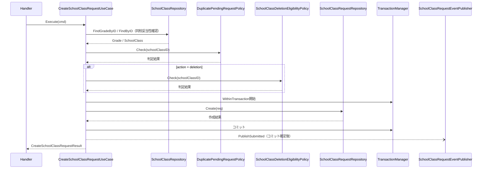
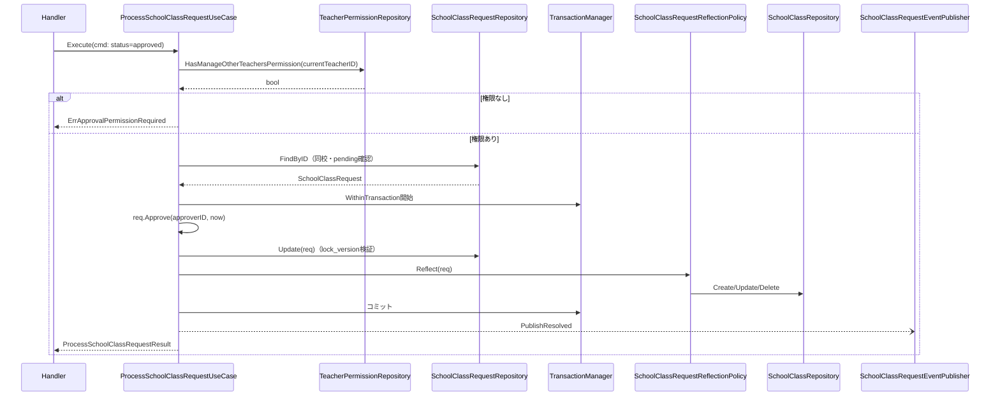
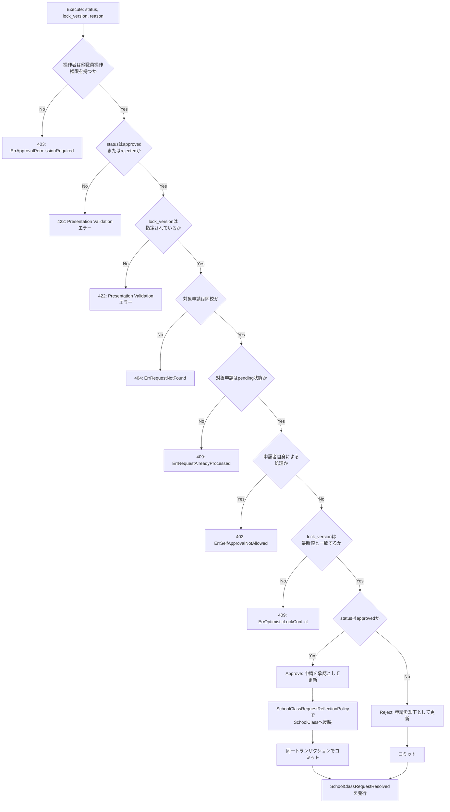

# クラス編成機能 Go実装仕様書 3 Application・Presentation

---

## 本書の位置づけ（分割）

本機能の実装ファイルは40であり、1つの③が扱う30〜35を超えるため、③自動生成プロンプト「2. ディレクトリ構成」の「文書の分割」に従って分割している。Handlerが`school_class_handler.go`の1つのみでスライスに割れないため、**レイヤーで割っている。**

|文書|担当|実装ファイル数|テスト込みの目安|
|-|-|-|-|
|`クラス編成機能_Go実装仕様書_1_Domain.md`|Domain層|14|約23|
|`クラス編成機能_Go実装仕様書_2_Infrastructure.md`|Infrastructure層|9|約14|
|`クラス編成機能_Go実装仕様書_3_Application・Presentation.md`|Application層・Presentation層|17|約25|

1つ目 → 2つ目 → 3つ目の順に実装すれば、各PRは単体でコンパイルが通る。Infrastructure層はDomain層のRepository Interfaceを実装し、Application層・Presentation層はその両方に依存するためである。

機能全体のファイル一覧と、どの文書がどのファイルを担当するかは「2. ディレクトリ構成」に記載する。

---

# 1. 機能概要

## 機能概要

学校の学年・クラス（組）の構成を管理する機能である。教師がクラスの新設・改名・削除を「申請」として提出し、他職員操作権限（`manage_other_teachers`）を持つ教師が承認・却下することでクラス構成（`school_classes`）へ反映する、承認ワークフロー型の機能である。承認された申請の内容は、申請レコードの更新と同一の処理単位でクラスデータへ反映される。削除申請は、対象クラスに在籍する生徒・所属する教員がいないことを条件とする。更新系操作（承認・却下・取消）は楽観ロック（`lock_version`）による競合検出を伴う。

## 採用設計パターンとその理由（②からの要約）

②「4. 設計パターン」により、本機能は **Domain Model** を採用する。

- `SchoolClassRequest`は「pending→approved/rejected/cancelled」という明示的な状態遷移ルールを持ち、承認・却下は他職員操作権限を持つ教師のみが行え、かつ申請者自身は自分の申請を承認・却下できないという当事者制約を持つ
- 承認時には、申請レコードの状態更新と、申請区分（新設・改名・削除）に応じたクラスデータへの反映を「一つの処理としてまとめて行い、途中で失敗した場合は両方とも反映されない」という、複数Entityにまたがる整合性ルールが存在する
- 削除申請は「対象クラスに在籍する生徒・所属する教員がいないこと」という、他Context（在籍・所属情報）を参照する業務ルールを満たさなければ受け付けられない
- 更新系操作には楽観ロックによる競合検出が必須である
- 申請区分ごとに必要な入力項目の組み合わせルールが異なる

以上の理由からTransaction Script・Active Record・Event Sourcingは不採用としている（②「4. 設計パターン」「24. 採用しなかった設計」）。本書はこの判断を変更しない。

## 本書が対象とする実装範囲

- Bounded Context: `school-class`
- 対象UseCase: `ListGradesUseCase` / `ListSchoolClassesUseCase` / `ShowSchoolClassUseCase` / `ListSchoolClassRequestsUseCase` / `ShowSchoolClassRequestUseCase` / `CreateSchoolClassRequestUseCase` / `ProcessSchoolClassRequestUseCase` / `CancelSchoolClassRequestUseCase`
- 規約「3. 設計パターンごとの構造適用方針」のDomain Model構造（`domain`/`application`/`infrastructure`/`presentation`のフルレイヤー構成）で実装する
- ①Rails現行仕様書（クラス編成機能_Rails現行仕様書）の記載を、各APIの入力項目・処理内容・業務ルール・レスポンス・Errorケースの根拠とする

---

---

# 2. ディレクトリ構成

## 対象Bounded Context名

- `school-class`（②「3. Bounded Context」）

## ②で採用した設計パターン

- Domain Model（②「4. 設計パターン」）

アーキテクチャ規約「4. Bounded Context構成」の「Contextディレクトリの命名」に従い、Context名`school-class`から`-`を取り除いて連結した全小文字の名前とし、短縮・省略はしない。したがってディレクトリ名は`internal/schoolclass/`、package名は同じ`schoolclass`となる。

## 作成するディレクトリ一覧

```
internal/schoolclass/
├── context.go                    # NewContext（依存関係の組み立て）
├── dependency.go                 # 他Contextへの依存を宣言するインターフェース
├── domain/
│   ├── entity/
│   ├── valueobject/
│   ├── repository/
│   ├── service/
│   ├── event/
│   └── errors/
├── application/
│   ├── dto/
│   └── usecase/
├── infrastructure/
│   ├── gormrepo/
│   ├── contextadapter/
│   └── queue/
└── presentation/
    ├── handler/
    ├── request/
    ├── response/
    └── routes.go
```

Domain Modelを採用するため、Contextディレクトリ直下には`context.go`と`dependency.go`のみを置き、他は`domain/`等のサブディレクトリに配置する（アーキテクチャ規約「4. Bounded Context構成」の「ディレクトリ構成」）。他Contextの公開操作を呼ぶためのインターフェース（`StudentOccupancyDirectory`・`TeacherPermissionRepository`・`SchoolClassRequestEventPublisher`）は`dependency.go`に置き、その実装は`infrastructure/contextadapter/`に置く（同章。`gormrepo/`には置かない）。本Contextが自らクエリを発行して読むデータのRepository Interfaceは`domain/repository/`に置き、実装とGORMモデルを`infrastructure/gormrepo/`に置く。`ClassOccupancyRepository`は後者であり、クラス詳細の表示用の在籍生徒一覧（`users`）と所属教員（`teacher_school_classes`）を自前の参照モデルとして読む（「3. Domain層設計」）。

- `domain/specification/`: 対象外（②に該当する複雑な仕様判定パターンの記載がなく、業務ルールはDomain Service（3種のPolicy）として②8章に明記されているため）
- `infrastructure/mail/`・`infrastructure/cache/`: 対象外（②に該当する外部連携要件の記載がないため）

## 作成するファイル一覧

```
internal/schoolclass/domain/entity/grade.go
internal/schoolclass/domain/entity/school_class.go
internal/schoolclass/domain/entity/school_class_request.go

internal/schoolclass/domain/valueobject/school_class_request_status.go
internal/schoolclass/domain/valueobject/school_class_request_action.go
internal/schoolclass/domain/valueobject/lock_version.go

internal/schoolclass/context.go
internal/schoolclass/dependency.go

internal/schoolclass/domain/repository/school_class_repository.go
internal/schoolclass/domain/repository/school_class_request_repository.go
internal/schoolclass/domain/repository/class_occupancy_repository.go

internal/schoolclass/domain/service/school_class_request_reflection_policy.go
internal/schoolclass/domain/service/school_class_deletion_eligibility_policy.go
internal/schoolclass/domain/service/duplicate_pending_request_policy.go

internal/schoolclass/domain/event/events.go

internal/schoolclass/domain/errors/errors.go

internal/schoolclass/application/dto/grade_dto.go
internal/schoolclass/application/dto/school_class_dto.go
internal/schoolclass/application/dto/school_class_request_dto.go

internal/schoolclass/application/usecase/list_grades_usecase.go
internal/schoolclass/application/usecase/list_school_classes_usecase.go
internal/schoolclass/application/usecase/show_school_class_usecase.go
internal/schoolclass/application/usecase/list_school_class_requests_usecase.go
internal/schoolclass/application/usecase/show_school_class_request_usecase.go
internal/schoolclass/application/usecase/create_school_class_request_usecase.go
internal/schoolclass/application/usecase/process_school_class_request_usecase.go
internal/schoolclass/application/usecase/cancel_school_class_request_usecase.go
internal/schoolclass/application/usecase/errors.go

internal/schoolclass/infrastructure/gormrepo/grade_model.go
internal/schoolclass/infrastructure/gormrepo/school_class_model.go
internal/schoolclass/infrastructure/gormrepo/teacher_school_class_model.go
internal/schoolclass/infrastructure/gormrepo/school_class_request_model.go

internal/schoolclass/infrastructure/gormrepo/school_class_repository.go
internal/schoolclass/infrastructure/gormrepo/school_class_request_repository.go
internal/schoolclass/infrastructure/gormrepo/class_occupancy_repository.go
internal/schoolclass/infrastructure/gormrepo/teacher_permission_repository.go

internal/schoolclass/infrastructure/contextadapter/student_occupancy_directory.go

internal/schoolclass/infrastructure/queue/school_class_request_event_publisher.go

internal/schoolclass/presentation/handler/school_class_handler.go
internal/schoolclass/presentation/request/school_class_request.go
internal/schoolclass/presentation/response/school_class_response.go
internal/schoolclass/presentation/routes.go
```

**②からの補足**: `StudentOccupancyDirectory`・`ClassOccupancyRepository`・`TeacherPermissionRepository`は、②「11. Repository設計」の「外部参照Repository（在籍する生徒・所属する教員）」および②「16. Authorization設計」の記載を、アーキテクチャ規約「5. Context間連携ルール」に従って具体化したものである。

在籍する生徒の人数の確認は`user` Contextの`CountUsers`へ委譲する（②「11. Repository設計」が「人数の確認は`user`の`CountUsers`を、クラス指定・無効化済みを含む指定で呼び出す」と定めている）。`dependency.go`に`StudentOccupancyDirectory`として宣言し、実装は`infrastructure/contextadapter/`に置く（規約「4. Bounded Context構成」）。

クラス詳細の表示用の在籍生徒一覧は、並び替えを伴う画面向けの一覧であるため、ユーザー基盤②「3. Bounded Context」の「画面向けの一覧は、一覧を必要とする各Contextが自前の参照モデルとして持つ」に従い、本Contextが`users`の必要列を読む（教師権限管理③「8. Infrastructure層設計」が一覧・詳細の氏名について同じ扱いをしている）。所属教員の確認・一覧は`users`ではなく`teacher_school_classes`が対象であり、このテーブルを所有・管理するContextは現行の②群に定義されていない（書き込む機能が現行の対象範囲に存在しない参照専用の依存。②「3. Bounded Context」）。

`TeacherPermissionRepository`は`teacher-permission` Contextが所有する`teacher_permissions`を対象とするが、同Contextの②「11. Repository設計」は他Contextへ向けた公開操作を定めていない（公開するのは本Contextの更新操作のみで、参照手段は`user`からの取得に限られる）。このため本Contextで参照専用のモデルを定義して読む形を取る（「17. ②からの補足事項」）。

---

---

## 本書が担当するファイル

|文書|担当するファイル|
|-|-|
|`_1_Domain.md`|`dependency.go`、`domain/`配下のすべて（entity 3・valueobject 3・repository 3・service 3・event 1・errors 1）|
|`_2_Infrastructure.md`|`infrastructure/`配下のすべて（gormrepo 8・contextadapter 1・queue 1）|
|`_3_Application・Presentation.md`|`context.go`、`application/`配下のすべて（dto 3・usecase 9）、`presentation/`配下のすべて（4）|

上の一覧は機能全体のファイルである。本書が担当するのは上記のうち該当する行のみで、他の文書が担当するファイルは本書では定義しない。

---

# 3. Domain層設計

`クラス編成機能_Go実装仕様書_1_Domain.md`「3. Domain層設計」に記載する。

---

# 4. クラス図

`クラス編成機能_Go実装仕様書_1_Domain.md`「4. クラス図」に記載する。

---

# 5. 状態遷移図

`クラス編成機能_Go実装仕様書_1_Domain.md`「5. 状態遷移図」に記載する。

---

# 6. Application層設計

## DTO（Command / Query）

|struct名|フィールドと型|区分|
|-|-|-|
|`ListGradesQuery`|`CurrentTeacherHighSchoolID uint`|Query|
|`GradeDTO`|`ID uint`, `Year int`|出力|
|`ListGradesResult`|`Grades []GradeDTO`|出力|
|`ListSchoolClassesQuery`|`CurrentTeacherHighSchoolID uint`|Query|
|`SchoolClassDTO`|`ID uint`, `Name string`|出力|
|`GradeWithClassesDTO`|`Grade GradeDTO`, `Classes []SchoolClassDTO`|出力|
|`ListSchoolClassesResult`|`Grades []GradeWithClassesDTO`|出力|
|`ShowSchoolClassQuery`|`CurrentTeacherHighSchoolID uint`, `SchoolClassID uint`|Query|
|`ShowSchoolClassResult`|`ID uint`, `Name string`, `Grade GradeDTO`, `Teachers []AssignedTeacherDTO`, `Students []StudentDTO`|出力|
|`AssignedTeacherDTO`|`ID uint`, `Name string`, `Role string`|出力|
|`StudentDTO`|`ID uint`, `Name string`, `NameKana string`|出力|
|`ListSchoolClassRequestsQuery`|`CurrentTeacherID uint`, `CurrentTeacherHighSchoolID uint`, `Status *string`, `Page int`, `PerPage int`|Query|
|`SchoolClassRequestDTO`|`ID uint`, `Action string`, `Status string`, `Name *string`, `Reason *string`, `LockVersion int64`, `ApprovedAt *time.Time`, `CancelledAt *time.Time`, `CreatedAt time.Time`, `Grade GradeDTO`, `SchoolClass *IDNameDTO`, `Applicant *IDNameDTO`, `Approver *IDNameDTO`, `CanProcess bool`, `CanCancel bool`|出力|
|`IDNameDTO`|`ID uint`, `Name string`|出力|
|`ListSchoolClassRequestsResult`|`Requests []SchoolClassRequestDTO`, `CurrentPage int`, `TotalPages int`, `TotalCount int`, `PerPage int`|出力|
|`ShowSchoolClassRequestQuery`|`CurrentTeacherID uint`, `CurrentTeacherHighSchoolID uint`, `RequestID uint`|Query|
|`ShowSchoolClassRequestResult`|`Request SchoolClassRequestDTO`|出力|
|`CreateSchoolClassRequestCommand`|`CurrentTeacherID uint`, `CurrentTeacherHighSchoolID uint`, `Action string`, `GradeID uint`, `Name *string`, `SchoolClassID *uint`|Command|
|`CreateSchoolClassRequestResult`|`ID uint`|出力|
|`ProcessSchoolClassRequestCommand`|`CurrentTeacherID uint`, `CurrentTeacherHighSchoolID uint`, `RequestID uint`, `Status string`, `LockVersion int64`, `Reason *string`|Command|
|`ProcessSchoolClassRequestResult`|`ID uint`, `Status string`|出力|
|`CancelSchoolClassRequestCommand`|`CurrentTeacherID uint`, `CurrentTeacherHighSchoolID uint`, `RequestID uint`, `Reason *string`|Command|
|`CancelSchoolClassRequestResult`|`ID uint`, `Status string`|出力|

## UseCase

### ListGradesUseCase（`application/usecase/list_grades_usecase.go`）

- struct名: `ListGradesUseCase`
- コンストラクタが受け取る依存: `SchoolClassRepository`
- 公開メソッド: `(u *ListGradesUseCase) Execute(ctx context.Context, query dto.ListGradesQuery) (dto.ListGradesResult, error)`
- 処理ステップ: 1. `SchoolClassRepository.ListGrades`を呼び出す 2. `ListGradesResult`を組み立てて返す
- トランザクション境界: なし（読み取りのみ）
- 発生しうるApplication Error: なし

### ListSchoolClassesUseCase（`application/usecase/list_school_classes_usecase.go`）

- struct名: `ListSchoolClassesUseCase`
- コンストラクタが受け取る依存: `SchoolClassRepository`
- 公開メソッド: `(u *ListSchoolClassesUseCase) Execute(ctx context.Context, query dto.ListSchoolClassesQuery) (dto.ListSchoolClassesResult, error)`
- 処理ステップ: 1. `SchoolClassRepository.ListGrades`で学年一覧を取得する 2. `SchoolClassRepository.ListClassesByHighSchool`で学年別クラス一覧を取得する 3. 両者を組み合わせて`ListSchoolClassesResult`を構築する
- トランザクション境界: なし
- 発生しうるApplication Error: なし

### ShowSchoolClassUseCase（`application/usecase/show_school_class_usecase.go`）

- struct名: `ShowSchoolClassUseCase`
- コンストラクタが受け取る依存: `SchoolClassRepository`, `ClassOccupancyRepository`
- 公開メソッド: `(u *ShowSchoolClassUseCase) Execute(ctx context.Context, query dto.ShowSchoolClassQuery) (dto.ShowSchoolClassResult, error)`
- 処理ステップ: 1. `SchoolClassRepository.FindByID`を呼び出す 2. 見つからない場合は`ErrSchoolClassNotFound`を返す 3. `ClassOccupancyRepository.ListAssignedTeachers`・`ListEnrolledStudents`を呼び出す 4. `ShowSchoolClassResult`へ変換して返す
- トランザクション境界: なし
- 発生しうるApplication Error: `ErrSchoolClassNotFound`

### ListSchoolClassRequestsUseCase（`application/usecase/list_school_class_requests_usecase.go`）

- struct名: `ListSchoolClassRequestsUseCase`
- コンストラクタが受け取る依存: `SchoolClassRequestRepository`, `TeacherPermissionRepository`
- 公開メソッド: `(u *ListSchoolClassRequestsUseCase) Execute(ctx context.Context, query dto.ListSchoolClassRequestsQuery) (dto.ListSchoolClassRequestsResult, error)`
- 処理ステップ:
  1. `TeacherPermissionRepository.HasManageOtherTeachersPermission(ctx, query.CurrentTeacherID)`で操作者の他職員操作権限を確認する（権限がなくても処理は続行する。参照範囲が変わるだけである）
  2. `SearchCondition`を組み立てる。`HighSchoolID`は操作者の所属校、`Status`は指定があればそのまま、`ApplicantID`は権限がない場合にのみ操作者のIDを設定する
  3. `SchoolClassRequestRepository.Search`を呼び出し、一覧と総件数を取得する
  4. 各申請について`CanProcess` / `CanCancel`を導出する（下記）
  5. 総件数からページ情報を組み立て、`ListSchoolClassRequestsResult`を返す
- 操作可否の導出: `CanProcess`は「申請が`pending`」かつ「`Applicant.ID != query.CurrentTeacherID`」かつ「操作者が他職員操作権限を持つ」。`CanCancel`は「申請が`pending`」かつ「`Applicant.ID == query.CurrentTeacherID`」（②「12. UseCase設計」）
- トランザクション境界: なし
- 発生しうるApplication Error: なし（該当0件の場合も正常系として空一覧を返す）

### ShowSchoolClassRequestUseCase（`application/usecase/show_school_class_request_usecase.go`）

- struct名: `ShowSchoolClassRequestUseCase`
- コンストラクタが受け取る依存: `SchoolClassRequestRepository`, `TeacherPermissionRepository`
- 公開メソッド: `(u *ShowSchoolClassRequestUseCase) Execute(ctx context.Context, query dto.ShowSchoolClassRequestQuery) (dto.ShowSchoolClassRequestResult, error)`
- 処理ステップ:
  1. `TeacherPermissionRepository.HasManageOtherTeachersPermission`で操作者の他職員操作権限を確認する
  2. `SchoolClassRequestRepository.FindByID(ctx, query.RequestID, query.CurrentTeacherHighSchoolID)`で取得する。見つからない場合は`ErrRequestNotFound`
  3. 操作者が他職員操作権限を持たず、かつ申請者が操作者自身でない場合も`ErrRequestNotFound`を返す（参照範囲外を「存在しない」として扱う。①「5. API / 処理詳細」）
  4. `CanProcess` / `CanCancel`を一覧と同じ規則で導出し、`ShowSchoolClassRequestResult`を返す
- トランザクション境界: なし
- 発生しうるApplication Error: `ErrRequestNotFound`

### CreateSchoolClassRequestUseCase（`application/usecase/create_school_class_request_usecase.go`）

- struct名: `CreateSchoolClassRequestUseCase`
- コンストラクタが受け取る依存: `SchoolClassRepository`, `SchoolClassRequestRepository`, `ClassOccupancyRepository`, `StudentOccupancyDirectory`, `*service.SchoolClassDeletionEligibilityPolicy`, `*service.DuplicatePendingRequestPolicy`, `TransactionManager`, `SchoolClassRequestEventPublisher`
- 公開メソッド: `(u *CreateSchoolClassRequestUseCase) Execute(ctx context.Context, cmd dto.CreateSchoolClassRequestCommand) (dto.CreateSchoolClassRequestResult, error)`
- 処理ステップ:
  1. `valueobject.NewSchoolClassRequestAction(cmd.Action)`で申請区分を検証する
  2. `SchoolClassRepository.FindGradeByID`で指定学年が同校に属するかを確認する。属さない、または存在しない場合は`ErrGradeNotFound`を返す
  3. `cmd.SchoolClassID`が指定されている場合（改名・削除）、`SchoolClassRepository.FindByID`で対象クラスが指定学年に属するかを確認する
  4. `DuplicatePendingRequestPolicy.Check`で同一クラスへの重複申請がないか判定する
  5. `Action`が`deletion`の場合、`StudentOccupancyDirectory.HasEnrolledStudents`と`ClassOccupancyRepository.HasAssignedTeachers`で在籍者・所属教員の有無を確認し、その結果を`SchoolClassDeletionEligibilityPolicy.Check`へ渡して不在を判定する
  6. `entity.NewSchoolClassRequest(...)`で`pending`状態の申請を生成する
  7. `TransactionManager.WithinTransaction`内で`SchoolClassRequestRepository.Create`を実行する
  8. コミット後、`SchoolClassRequestEventPublisher.PublishSubmitted`で`SchoolClassRequestSubmitted`を発行する
  9. `CreateSchoolClassRequestResult`を返す
- トランザクション境界: 申請の作成を1トランザクションとする（②14章）。イベント発行はコミット確定後に行う
- 発生しうるApplication Error: `ErrGradeNotFound`
- 発生しうるDomain Error: `ErrRequestActionMismatch`, `ErrClassHasOccupants`, `ErrDuplicatePendingRequest`

### ProcessSchoolClassRequestUseCase（`application/usecase/process_school_class_request_usecase.go`）

- struct名: `ProcessSchoolClassRequestUseCase`
- コンストラクタが受け取る依存: `SchoolClassRequestRepository`, `TeacherPermissionRepository`, `*service.SchoolClassRequestReflectionPolicy`, `TransactionManager`, `SchoolClassRequestEventPublisher`
- 公開メソッド: `(u *ProcessSchoolClassRequestUseCase) Execute(ctx context.Context, cmd dto.ProcessSchoolClassRequestCommand) (dto.ProcessSchoolClassRequestResult, error)`
- 処理ステップ:
  1. `TeacherPermissionRepository.HasManageOtherTeachersPermission(ctx, cmd.CurrentTeacherID)`を確認する。`false`の場合は`ErrApprovalPermissionRequired`を返す（②16章）
  2. `SchoolClassRequestRepository.FindByID`で対象申請（同校スコープ）を取得する。取得できない場合は`ErrRequestNotFound`を返す
  3. 対象申請が`pending`でない場合は`ErrRequestAlreadyProcessed`を返し、409に変換する。画面を開いた後に他の教員が処理した、または申請者が取り消した場合がこれにあたり、楽観ロックの競合と同じく再読み込みを促す（①「5. API / 処理詳細」）
  4. `req.LockVersion`が`cmd.LockVersion`と一致するかを事前確認する（一致しない場合、後続の`Update`で`ErrOptimisticLockConflict`として検出される。詳細は「11. Transaction実装方針」参照）
  5. `TransactionManager.WithinTransaction`内で以下を実行する:
     a. `cmd.Status`が`approved`の場合、`req.Approve(cmd.CurrentTeacherID, now)`を呼び出す。`rejected`の場合、`req.Reject(cmd.CurrentTeacherID, cmd.Reason)`を呼び出す
     b. `SchoolClassRequestRepository.Update(ctx, req)`で状態を永続化する（楽観ロック検証を含む）
     c. `approved`の場合のみ、`SchoolClassRequestReflectionPolicy.Reflect(ctx, req)`でクラスデータへ反映する
  6. コミット後、`SchoolClassRequestEventPublisher.PublishResolved`で`SchoolClassRequestResolved`を発行する（トランザクションの外。①「5. API / 処理詳細」）
  7. `ProcessSchoolClassRequestResult`を返す。Handlerが返すメッセージは`cmd.Status`から決まる（①「5. API / 処理詳細」）
- トランザクション境界: 申請の状態更新と（承認の場合の）クラスデータへの反映を1トランザクションとする。アーキテクチャ規約「11. Transaction実装パターン（TransactionManager）」の`TransactionManager`で`SchoolClassRequestRepository`と`SchoolClassRepository`にまたがる処理をまとめる（②14章）
- 発生しうるApplication Error: `ErrRequestNotFound`, `ErrRequestAlreadyProcessed`, `ErrApprovalPermissionRequired`, `domainerror.ErrOptimisticLockConflict`
- 発生しうるDomain Error: `ErrSelfApprovalNotAllowed`（`ErrInvalidStatusTransition`は、3.の事前確認で`ErrRequestAlreadyProcessed`として先に検出されるため、通常は発生しない）

### CancelSchoolClassRequestUseCase（`application/usecase/cancel_school_class_request_usecase.go`）

- struct名: `CancelSchoolClassRequestUseCase`
- コンストラクタが受け取る依存: `SchoolClassRequestRepository`, `TransactionManager`
- 公開メソッド: `(u *CancelSchoolClassRequestUseCase) Execute(ctx context.Context, cmd dto.CancelSchoolClassRequestCommand) (dto.CancelSchoolClassRequestResult, error)`
- 処理ステップ:
  1. `SchoolClassRequestRepository.FindByID`で対象申請（同校スコープ）を取得する。取得できない場合は`ErrRequestNotFound`を返す
  2. `TransactionManager.WithinTransaction`内で`req.Cancel(cmd.CurrentTeacherID, cmd.Reason, now)`を呼び出し、`SchoolClassRequestRepository.Update`で永続化する
  3. `CancelSchoolClassRequestResult`を返す
- トランザクション境界: 申請の状態更新を1トランザクションとする
- 発生しうるApplication Error: `ErrRequestNotFound`, `domainerror.ErrOptimisticLockConflict`
- 発生しうるDomain Error: `ErrInvalidStatusTransition`（`pending`以外の取消試行）、`ErrNotRequestOwner`（申請者本人でない取消試行。②「6. Entity設計」の`Cancel`が返す）

---

---

# 7. シーケンス図・処理フロー図

## シーケンス図

### CreateSchoolClassRequestUseCase



### ProcessSchoolClassRequestUseCase（承認）



## 処理フロー図

### ProcessSchoolClassRequestUseCase



---

---

# 8. Infrastructure層設計

`クラス編成機能_Go実装仕様書_2_Infrastructure.md`「8. Infrastructure層設計」に記載する。

---

# 9. Presentation層設計

## Handler

### SchoolClassHandler（`presentation/handler/school_class_handler.go`）

- struct名: `SchoolClassHandler`
- 対応する呼び出し先: `*usecase.ListGradesUseCase`, `*usecase.ListSchoolClassesUseCase`, `*usecase.ShowSchoolClassUseCase`, `*usecase.ListSchoolClassRequestsUseCase`, `*usecase.ShowSchoolClassRequestUseCase`, `*usecase.CreateSchoolClassRequestUseCase`, `*usecase.ProcessSchoolClassRequestUseCase`, `*usecase.CancelSchoolClassRequestUseCase`
- メソッド一覧:

|メソッド|HTTPメソッド|パス|
|-|-|-|
|`ListGrades`|GET|`/api/v1/teacher/grades`|
|`ListSchoolClasses`|GET|`/api/v1/teacher/school_classes`|
|`ShowSchoolClass`|GET|`/api/v1/teacher/school_classes/:id`|
|`ListSchoolClassRequests`|GET|`/api/v1/teacher/school_class_requests`|
|`ShowSchoolClassRequest`|GET|`/api/v1/teacher/school_class_requests/:id`|
|`CreateSchoolClassRequest`|POST|`/api/v1/teacher/school_class_requests`|
|`ProcessSchoolClassRequest`|PATCH|`/api/v1/teacher/school_class_requests/:id`|
|`CancelSchoolClassRequest`|DELETE|`/api/v1/teacher/school_class_requests/:id`|

- `ListGrades`/`ListSchoolClasses`処理順序: current teacherの所属校IDを取得 → 対応するUseCaseを呼び出す → Response DTOへ変換し200を返す
- `ShowSchoolClass`処理順序: パスパラメータ`id`バインド → `ShowSchoolClassUseCase.Execute`呼び出し → 存在しない場合404、成功時200
- `ListSchoolClassRequests`処理順序: クエリパラメータ`status`・`page`・`per_page`バインド（`per_page`は既定20・上限100とし、1以上の整数でない場合は既定値。`page`は1以上の整数でない場合は未指定として扱う） → current teacherの情報を付与し`ListSchoolClassRequestsUseCase.Execute`呼び出し → `SchoolClassRequestListResponse`へ変換し200を返す
- `ShowSchoolClassRequest`処理順序: パスパラメータ`id`バインド → `ShowSchoolClassRequestUseCase.Execute`呼び出し → `ErrRequestNotFound`の場合404、成功時`SchoolClassRequestResponse`を200で返す
- `CreateSchoolClassRequest`処理順序: リクエストバインド（`request.CreateSchoolClassRequestRequest`）→ Presentation Validation（action・grade_id必須、name/school_class_idの形式チェック）→ current teacherの情報を付与し`CreateSchoolClassRequestUseCase.Execute`呼び出し → 成功時`message`を201で返す（②19章）
- `ProcessSchoolClassRequest`処理順序: パスパラメータ`id`＋リクエストバインド（`request.ProcessSchoolClassRequestRequest`）→ Presentation Validation（status必須・approved/rejectedのいずれか、lock_version必須。未指定時のメッセージは`lock_versionは必須です`）→ `ProcessSchoolClassRequestUseCase.Execute`呼び出し → 指定された`status`に対応するmessage（`approved`なら`申請が承認されました`、`rejected`なら`申請が却下されました`）を200で返す。対象が承認待ちでない場合は409（`この申請はすでに処理されています。再読み込みしてください`）、楽観ロックの競合も409（①「5. API / 処理詳細」）
- `CancelSchoolClassRequest`処理順序: パスパラメータ`id`＋リクエストバインド（`request.CancelSchoolClassRequestRequest`）→ `CancelSchoolClassRequestUseCase.Execute`呼び出し → 成功時`message`を200で返す

## Request / Response DTO

### Request（`presentation/request/school_class_request.go`）

|struct名|フィールドと型|バリデーションタグ／チェック内容|
|-|-|-|
|`CreateSchoolClassRequestRequest`|`Action string`|`binding:"required,oneof=creation modification deletion"`|
| |`GradeID uint`|`binding:"required"`|
| |`Name *string`|`binding:"omitempty,max=255"`（②15章：新設・改名時必須は業務ルールとしてApplication/Domain側で検証。ここでは形式のみ）|
| |`SchoolClassID *uint`|`binding:"omitempty"`|
|`ListSchoolClassRequestsRequest`|`Status *string`|`form:"status" binding:"omitempty"`（存在しないステータスでもエラーとせず、該当0件として扱う）|
| |`Page int`|`form:"page"`（1以上の整数でない場合は未指定として扱う）|
| |`PerPage int`|`form:"per_page"`（既定20・上限100。1以上の整数でない場合は既定値）|
|`ProcessSchoolClassRequestRequest`|`Status string`|`binding:"required,oneof=approved rejected"`（違反時のメッセージは`指定できないステータスです`）|
| |`LockVersion int64`|`binding:"required"`（未指定時のメッセージは`lock_versionは必須です`）|
| |`Reason *string`|`binding:"omitempty,max=10000"`|
|`CancelSchoolClassRequestRequest`|`Reason *string`|`binding:"omitempty,max=10000"`|

### Response（`presentation/response/school_class_response.go`）

|struct名|フィールドと型|
|-|-|
|`GradeResponse`|`ID uint`（JSON: `id`）, `Year int`（`year`）, `DisplayName string`（`display_name`）|
|`SchoolClassResponse`|`ID uint`（`id`）, `Name string`（`name`）|
|`GradeWithClassesResponse`|`ID uint`（`id`）, `Year int`（`year`）, `DisplayName string`（`display_name`）, `SchoolClasses []SchoolClassResponse`（`school_classes`）|
|`SchoolClassDetailResponse`|`ID uint`（JSON: `id`）, `Name string`（`name`）, `Grade GradeResponse`（`grade`。`id`・`year`・`display_name`）, `Teachers []AssignedTeacherResponse`（`teachers`）, `Students []StudentResponse`（`students`）|
|`AssignedTeacherResponse`|`ID uint`（`id`）, `Name string`（`name`）, `Role string`（`role`）|
|`StudentResponse`|`ID uint`（`id`）, `Name string`（`name`）, `NameKana string`（`name_kana`）|
|`SchoolClassRequestResponse`|`ID uint`（`id`）, `Action string`（`action`）, `Status string`（`status`）, `Name *string`（`name`）, `Reason *string`（`reason`）, `LockVersion int64`（`lock_version`）, `ApprovedAt *time.Time`（`approved_at`）, `CancelledAt *time.Time`（`cancelled_at`）, `CreatedAt time.Time`（`created_at`）, `Grade GradeResponse`（`grade`）, `SchoolClass *IDNameResponse`（`school_class`）, `Applicant *IDNameResponse`（`applicant`）, `Approver *IDNameResponse`（`approver`）, `CanProcess bool`（`can_process`）, `CanCancel bool`（`can_cancel`）|
|`IDNameResponse`|`ID uint`（`id`）, `Name string`（`name`）|
|`SchoolClassRequestListResponse`|`SchoolClassRequests []SchoolClassRequestResponse`（`school_class_requests`）, `Meta MetaResponse`（`meta`）|
|`MetaResponse`|`CurrentPage int`（`current_page`）, `TotalPages int`（`total_pages`）, `TotalCount int`（`total_count`）, `PerPage int`（`per_page`）|
|`MessageResponse`|`Message string`（`message`）|

最上位の形は①「5. API / 処理詳細」の各Responseに合わせる。

- **学年一覧・クラス一覧**: 最上位を**配列**とし、キーでラップするstructを設けない。`[]GradeResponse` / `[]GradeWithClassesResponse`をそのまま返す。規約「15. API規約（レスポンス形式・ページネーション・URL・クエリパラメータ）」がページネーションのない一覧をJSON配列とする方針にも一致する
- **クラス一覧の各要素**: 学年の属性をフラットに持ち、所属クラス一覧を`school_classes`キーに持つ。学年の属性とクラス一覧を入れ子にしない（Rails現行の`Teacher::TeacherSchoolClassGradeSerializer`と同じ形）
- **クラス詳細・申請詳細**: 最上位をラップしないオブジェクトとして返す
- **申請一覧**: `school_class_requests`と`meta`の2キーを持つ`SchoolClassRequestListResponse`で返す
- **申請の作成・承認／却下・取消**: `MessageResponse`のみを返す
- `GradeResponse.DisplayName`は学年の表示名であり、`Grade` Entityが`year`から導出する（3章）。本Contextで表示名の文言を持つ
|`SchoolClassRequestListResponse`|`SchoolClassRequests []SchoolClassRequestResponse`（`school_class_requests`）, `Meta MetaResponse`（`meta`）|
|`MetaResponse`|`CurrentPage int`（`current_page`）, `TotalPages int`（`total_pages`）, `TotalCount int`（`total_count`）, `PerPage int`（`per_page`）|
|`MessageResponse`|`Message string`|

フィールド構成は①「5. API / 処理詳細」のResponseに合わせる。`school_class`・`approver`は`null`になりうる（新設の申請・承認後に削除されたクラス、未処理の承認者）。

## Routing（`presentation/routes.go`）

|Method|Path|Handler|
|-|-|-|
|GET|`/api/v1/teacher/grades`|`SchoolClassHandler.ListGrades`|
|GET|`/api/v1/teacher/school_classes`|`SchoolClassHandler.ListSchoolClasses`|
|GET|`/api/v1/teacher/school_classes/:id`|`SchoolClassHandler.ShowSchoolClass`|
|GET|`/api/v1/teacher/school_class_requests`|`SchoolClassHandler.ListSchoolClassRequests`|
|GET|`/api/v1/teacher/school_class_requests/:id`|`SchoolClassHandler.ShowSchoolClassRequest`|
|POST|`/api/v1/teacher/school_class_requests`|`SchoolClassHandler.CreateSchoolClassRequest`|
|PATCH|`/api/v1/teacher/school_class_requests/:id`|`SchoolClassHandler.ProcessSchoolClassRequest`|
|DELETE|`/api/v1/teacher/school_class_requests/:id`|`SchoolClassHandler.CancelSchoolClassRequest`|

全ルートに、teacherロールを要求する認証Middlewareを適用する（②16章）。

---

---

# 10. API仕様

|Method|Path|Handler|Request|Response|Status Code|
|-|-|-|-|-|-|
|GET|/api/v1/teacher/grades|SchoolClassHandler.ListGrades|-|`[]GradeResponse`（配列）|200|
|GET|/api/v1/teacher/school_classes|SchoolClassHandler.ListSchoolClasses|-|`[]GradeWithClassesResponse`（配列）|200|
|GET|/api/v1/teacher/school_classes/:id|SchoolClassHandler.ShowSchoolClass|id（path）|SchoolClassDetailResponse|200|
|GET|/api/v1/teacher/school_class_requests|SchoolClassHandler.ListSchoolClassRequests|status / page / per_page（query、いずれも任意）|SchoolClassRequestListResponse|200|
|GET|/api/v1/teacher/school_class_requests/:id|SchoolClassHandler.ShowSchoolClassRequest|id（path）|SchoolClassRequestResponse|200|
|POST|/api/v1/teacher/school_class_requests|SchoolClassHandler.CreateSchoolClassRequest|CreateSchoolClassRequestRequest|MessageResponse|201|
|PATCH|/api/v1/teacher/school_class_requests/:id|SchoolClassHandler.ProcessSchoolClassRequest|id（path）+ ProcessSchoolClassRequestRequest|MessageResponse|200|
|DELETE|/api/v1/teacher/school_class_requests/:id|SchoolClassHandler.CancelSchoolClassRequest|id（path）+ CancelSchoolClassRequestRequest|MessageResponse|200|

## Errorケース

|Endpoint|条件|Status Code|Error内容|
|-|-|-|-|
|ShowSchoolClass|対象クラスが存在しない、または同校でない|404|`ErrSchoolClassNotFound`|
|ListSchoolClassRequests|`status`に存在しない値を指定|200|エラーにせず該当0件として返す（①「5. API / 処理詳細」）|
|ListSchoolClassRequests|`page` / `per_page`が数値でない・0以下|200|エラーにせず既定値で処理する（`page`は未指定、`per_page`は20。100超は100に丸める）|
|ShowSchoolClassRequest|対象申請が存在しない、同校でない、または他職員操作権限を持たない操作者が他人の申請を指定|404|`ErrRequestNotFound`|
|CreateSchoolClassRequest|action/grade_id未指定、name/school_class_idの形式不正|422|Presentation Validationエラー|
|CreateSchoolClassRequest|指定学年が同校でない|404|`ErrGradeNotFound`|
|CreateSchoolClassRequest|申請区分に応じた入力項目が不整合|422|`ErrRequestActionMismatch`|
|CreateSchoolClassRequest|削除申請の対象クラスに在籍者・所属教員が存在する|422|`ErrClassHasOccupants`|
|CreateSchoolClassRequest|同一クラスへの重複申請|422|`ErrDuplicatePendingRequest`|
|ProcessSchoolClassRequest|statusが指定できない値|422|Presentation Validationエラー（`指定できないステータスです`）|
|ProcessSchoolClassRequest|lock_versionが未指定|422|Presentation Validationエラー（`lock_versionは必須です`）|
|ProcessSchoolClassRequest|操作者が他職員操作権限を持たない|403|`ErrApprovalPermissionRequired`|
|ProcessSchoolClassRequest|申請者自身による承認・却下|403|`ErrSelfApprovalNotAllowed`|
|ProcessSchoolClassRequest|対象申請が存在しない、または同校でない|404|`ErrRequestNotFound`|
|ProcessSchoolClassRequest|対象申請が承認待ちでない（既に処理済み・取消済み）|409|`ErrRequestAlreadyProcessed`（`この申請はすでに処理されています。再読み込みしてください`）|
|ProcessSchoolClassRequest|lock_versionが最新値と不一致|409|`domainerror.ErrOptimisticLockConflict`（`他のユーザーによってデータが更新されています。再読み込みしてください`）|
|CancelSchoolClassRequest|申請者本人でない取消試行|403（推測、17章参照）|`ErrNotRequestOwner`|
|CancelSchoolClassRequest|承認待ちでない申請の取消|422|`ErrInvalidStatusTransition`|
|CancelSchoolClassRequest|対象申請が存在しない、または同校でない|404|`ErrRequestNotFound`|
|全Endpoint共通|予期せぬDB接続失敗等|500|Infrastructure Error|

---

---

# 11. Transaction実装方針

## Transaction開始箇所

アーキテクチャ規約「11. Transaction実装パターン（TransactionManager）」に従い、書き込みを伴うUseCase（`CreateSchoolClassRequestUseCase` / `ProcessSchoolClassRequestUseCase` / `CancelSchoolClassRequestUseCase`）の開始時にトランザクションを開始する。

- interface: `internal/shared/transaction`の`TransactionManager`。本Contextでは定義しない（同規約が共通部品として定める）
- メソッドシグネチャ: `WithinTransaction(ctx context.Context, fn func(ctx context.Context) error) error`
- 実装: `internal/shared/transaction/gormtx`。本Contextでは実装しない。開始するか既に始まっているものに参加するかの判定は`gormtx.RunInTx`の1箇所に集約され、`WithinTransaction`もこれに委ねる
- `gormrepo`の各Repository実装は、`gormtx.DBFromContext(ctx, r.db)`で接続を取得する。トランザクション中であればその接続を、そうでなければ通常の接続を使う。`db.WithContext(ctx).Transaction(...)`を直接呼ばない（同規約）
- UseCaseは`internal/shared/transaction`のインターフェースのみに依存し、GORM実装（`gormtx`）には依存しない

## Transaction終了箇所（Commit / Rollback条件）

|UseCase|終了箇所|
|-|-|
|ListGradesUseCase / ListSchoolClassesUseCase / ShowSchoolClassUseCase|トランザクションを使用しない（読み取りのみ）|
|CreateSchoolClassRequestUseCase|`SchoolClassRequestRepository.Create`が完了した時点でコミット、失敗でロールバック。イベント発行はコミット確定後|
|ProcessSchoolClassRequestUseCase|`SchoolClassRequestRepository.Update`と（承認時の）`SchoolClassRequestReflectionPolicy.Reflect`（内部で`SchoolClassRepository`のCreate/Update/Deleteを呼ぶ）の両方が完了した時点でコミット。いずれかの失敗でロールバック|
|CancelSchoolClassRequestUseCase|`SchoolClassRequestRepository.Update`が完了した時点でコミット|

## 複数Repositoryにまたがる場合の扱い

`ProcessSchoolClassRequestUseCase`は`SchoolClassRequestRepository`と`SchoolClassRepository`の両方を、1つの`TransactionManager.WithinTransaction`スコープ内で呼び出し、「申請レコードの更新とクラスデータへの反映のいずれか一方のみが成功する」不整合を防ぐ（②14章）。`TeacherPermissionRepository`・`ClassOccupancyRepository`・`DuplicatePendingRequestPolicy`が参照するクエリは、いずれも書き込みトランザクションの外（事前確認）で読み取り専用として実行する。

---

---

# 12. Validation実装方針

## Presentation

|フィールド|struct名|バリデーションタグ|エラーメッセージ|
|-|-|-|-|
|`action`|`CreateSchoolClassRequestRequest`|`required,oneof=creation modification deletion`|`errors`（申請区分不正）|
|`grade_id`|`CreateSchoolClassRequestRequest`|`required`|`errors`（学年未指定）|
|`name`|`CreateSchoolClassRequestRequest`|`omitempty,max=255`|`errors`（クラス名不正）|
|`school_class_id`|`CreateSchoolClassRequestRequest`|`omitempty`|`errors`（対象クラス未指定）|
|`status`|`ProcessSchoolClassRequestRequest`|`required,oneof=approved rejected`|「指定できないステータスです」|
|`lock_version`|`ProcessSchoolClassRequestRequest`|`required`|楽観ロック競合時「他のユーザーによってデータが更新されています。再読み込みしてください」|
|`reason`|各Request|`omitempty,max=10000`|`errors`（理由が長すぎる）|

## 業務ルール検証

Domain Model採用のため、Entity／Value Object生成時・UseCase内で以下を検証する。

- `valueobject.NewSchoolClassRequestAction`: 定義済み3値のいずれかであることの検証
- `entity.NewSchoolClassRequest`: 申請区分に応じた入力項目（クラス名・対象クラス）の整合性検証（②7章`SchoolClassRequestAction`のルール）
- `SchoolClassDeletionEligibilityPolicy.Check`: 削除申請の在籍者・所属教員不在チェック
- `DuplicatePendingRequestPolicy.Check`: 同一クラスへの重複申請チェック
- `entity.SchoolClassRequest.Approve` / `Reject` / `Cancel`: 状態遷移が許可された組み合わせかどうか（`pending`からのみ）、操作者が申請者本人でないこと（承認・却下）／申請者本人であること（取消）
- Repository実装（`Update`）: `lock_version`の一致チェック（楽観ロック）

---

---

# 13. Authorization実装方針

②「16. Authorization設計」をそのまま実装レベルに落とし込む。

## Middleware

- 認証済みユーザーを特定し、`teacher`ロールであることを確認する

## Handler

- ルーティングとHTTP入出力の変換のみを担当し、業務権限判定は持たせない

## UseCase

- 参照系（`ListGradesUseCase` / `ListSchoolClassesUseCase` / `ShowSchoolClassUseCase` / `ListSchoolClassRequestsUseCase` / `ShowSchoolClassRequestUseCase`）は、current teacherの所属校にスコープする
- 申請の一覧・詳細（`ListSchoolClassRequestsUseCase` / `ShowSchoolClassRequestUseCase`）は、他職員操作権限を参照の可否ではなく参照範囲の決定に用いる。権限がない操作者には、申請者が自身のものだけを返す
- 申請の作成（`CreateSchoolClassRequestUseCase`）は同校の教師であれば誰でも実行できる（追加の業務権限チェックは課さない）
- 承認・却下（`ProcessSchoolClassRequestUseCase`）は、`TeacherPermissionRepository.HasManageOtherTeachersPermission`で他職員操作権限を確認し、保持していない場合は処理を中断する（権限レコードが存在しない場合も`false`となり、権限なしとして扱う）
- 取消（`CancelSchoolClassRequestUseCase`）は、申請者自身（`applicant_id == current teacher`）による処理のみ許可する（`entity.Cancel`が判定）

## Domain

- `SchoolClassRequest.Approve`/`Reject`が、申請者自身による処理を拒否する
- `SchoolClassRequest.Approve`/`Reject`/`Cancel`が、`pending`以外からの状態遷移を拒否する
- `SchoolClassDeletionEligibilityPolicy`が、在籍者・所属教員が存在するクラスの削除申請を拒否する

## 判断理由

「他職員操作権限」の要否は、ロール（`teacher`であるか）のような粗い認可ではなく、教員個人が持つ業務権限に基づく判定であるため、Middlewareのロールチェックとは別に、UseCase内で確認する（アーキテクチャ規約「7. 横断的関心事の置き場所」が認可（所有権・業務権限）について定める配置方針）。申請者自身による自己承認の禁止・取消の本人限定も同様に、Entityの状態遷移メソッド内の当事者確認として扱う。

---

---

# 14. Error実装方針

`クラス編成機能_Go実装仕様書_1_Domain.md`「14. Error実装方針」に記載する。

---

# 15. GORM / DBクエリ設計

`クラス編成機能_Go実装仕様書_2_Infrastructure.md`「15. GORM / DBクエリ設計」に記載する。

---

# 16. テストケース設計
本書が担当するレイヤーのテストのみを記載する。他の区分は各担当文書に記載する。

## Domain Test

対象外（本書はApplication層・Presentation層を担当する）。Domain Test は担当する文書に記載する。

## UseCase Test

|対象|テストケース|
|-|-|
|`ListGradesUseCase` / `ListSchoolClassesUseCase` / `ShowSchoolClassUseCase`|同校の学年・クラスのみ取得できること／存在しないクラスIDで`ErrSchoolClassNotFound`を返すこと／クラス詳細で在籍生徒が氏名カナ昇順になり、担当教員に`role`が含まれること|
|`ListSchoolClassRequestsUseCase`|他職員操作権限を持つ操作者には同校のすべての申請が返ること／持たない操作者には自分が申請したものだけが返ること／`status`指定で絞り込まれること／存在しない`status`で空一覧が返ること／`created_at`降順・`id`降順で並ぶこと／`CanProcess`が「pendingかつ申請者以外かつ権限あり」のときだけ真になること／`CanCancel`が「pendingかつ申請者本人」のときだけ真になること|
|`ShowSchoolClassRequestUseCase`|他職員操作権限を持たない操作者が他人の申請を指定した場合に`ErrRequestNotFound`を返すこと／自分の申請は取得できること／他校の申請で`ErrRequestNotFound`を返すこと|
|`CreateSchoolClassRequestUseCase`|申請区分ごとに正しく申請が作成されること／削除申請で在籍者が存在する場合に拒否されること／同一クラスへの重複申請が拒否されること／指定学年が同校でない場合に`ErrGradeNotFound`を返すこと|
|`ProcessSchoolClassRequestUseCase`|他職員操作権限を持たない操作者（権限レコードが存在しない操作者を含む）による承認・却下が拒否されること／申請者自身による承認・却下が拒否されること／対象がpendingでない場合に`ErrRequestAlreadyProcessed`（409相当）となること／lock_version不一致時に409相当のエラーとなること／承認時にクラスデータへ正しく反映されること（新設・改名・削除の3パターン）|
|`CancelSchoolClassRequestUseCase`|申請者本人によるpending申請の取消が成功すること／申請者以外による取消が拒否されること|

## Repository Test

対象外（本書はApplication層・Presentation層を担当する）。Repository Test は担当する文書に記載する。

## Handler Test

|対象|テストケース|
|-|-|
|`SchoolClassHandler.ListGrades` / `ListSchoolClasses` / `ShowSchoolClass`|正常系で200が返ること／存在しないクラスIDで404が返ること|
|`SchoolClassHandler.ListSchoolClassRequests`|正常系で200と`school_class_requests` / `meta`が返ること／`per_page`が未指定・0以下・整数でない場合に既定値20で処理されること／`per_page`が100を超える場合に100に丸められること／他職員操作権限がない教師でも200が返ること|
|`SchoolClassHandler.ShowSchoolClassRequest`|正常系で200が返ること／参照範囲外の申請で404が返ること|
|`SchoolClassHandler.CreateSchoolClassRequest`|正常系で201が返ること／必須項目欠落で422が返ること／削除申請で在籍者ありの場合に422が返ること|
|`SchoolClassHandler.ProcessSchoolClassRequest`|正常系で200と、指定した`status`に対応するメッセージが返ること／権限なしで403（`承認権限がないユーザーです`）が返ること／自己承認で403が返ること／`status`が許容外で422（`指定できないステータスです`）が返ること／`lock_version`未指定で422（`lock_versionは必須です`）が返ること／対象がpendingでない場合に409（`この申請はすでに処理されています。再読み込みしてください`）が返ること／lock_version不一致で409（`他のユーザーによってデータが更新されています。再読み込みしてください`）が返ること／存在しない申請IDで404が返ること|
|`SchoolClassHandler.CancelSchoolClassRequest`|正常系で200が返ること／申請者以外による取消で403が返ること|

## Integration Test

|対象|テストケース|
|-|-|
|申請〜承認の一連フロー|申請作成 → 承認 → クラスデータへの反映までがエンドポイント経由で正しく完了すること（新設・改名・削除の3パターン）|
|申請〜却下・取消の一連フロー|却下・取消がエンドポイント経由で正しく完了し、クラスデータへの反映が行われないこと|
|楽観ロック競合|同一申請に対する同時承認操作の一方が409で拒否されること|
|申請の参照範囲|他職員操作権限を持つ教師と持たない教師で、一覧に返る申請の範囲が変わること／権限を持たない教師が他人の申請の詳細を取得できないこと（404）|
|操作可否の整合|一覧が返す`can_process` / `can_cancel`が真である申請に対して、実際に承認・却下／取消が受け付けられること（偽である申請では拒否されること）|
|通知連携|申請提出・承認・却下時に`announcement` Contextへの通知依頼が行われること（②18章の重点検証項目）|

---

---

---

# 17. ②からの補足事項

②に明記がなく、実装のために追加で判断した内容を以下に列挙する。

|判断した内容|判断理由|推測かどうか|
|-|-|-|
|ディレクトリ名・package名を`schoolclass`とした|②のContext名は`school-class`のみで、ディレクトリ名の明記がない。アーキテクチャ規約「4. Bounded Context構成」の「Contextディレクトリの命名」（Context名から`-`を取り除いた連結形）に従って変換した|規約に基づく（推測ではない）|
|在籍する生徒の人数の確認を`dependency.go`の`StudentOccupancyDirectory`（`user`の`CountUsers`へ委譲）に分け、表示用の在籍生徒一覧・所属教員の参照を`domain/repository/`の`ClassOccupancyRepository`に残した|②「11. Repository設計」は人数の確認を`user`の`CountUsers`で行うと定める一方、表示用の一覧の取得元を定めていない。後者はユーザー基盤②「3. Bounded Context」の「画面向けの一覧は各Contextが自前の参照モデルとして持つ」に従った。インターフェースを分けたのは、規約「4. Bounded Context構成」が`dependency.go`の実装を`infrastructure/contextadapter/`に限り、アダプタがDBへクエリを発行することを禁じているためである|補足（取得元は②・規約に基づく。インターフェースの分割は配置規則から導いた判断）|
|`TeacherPermissionRepository`を本Contextで定義し、`teacher_permissions`を参照専用のモデルで読む形にした|②「16. Authorization設計」は他職員操作権限の確認を依存として明記しているが、`teacher-permission`②「11. Repository設計」は他Contextへ向けた公開操作を定めていない。所有Context側に公開操作が定まるまでの形である|推測（所有Contextの②に公開操作が加わった時点で、`dependency.go`＋`infrastructure/contextadapter/`の委譲へ改める必要がある）|
|`teacher_school_classes`を参照専用の依存として扱った|このテーブルを所有・管理するContextは現行の②群のいずれにも定義されていない（教員をクラスへ割り当てる機能が移行対象範囲にない）|推測|
|クラスの削除の承認時に、対象クラスの`teacher_school_classes`の行を、クラスの削除より前に同一トランザクションで削除する|Rails現行の`SchoolClass`が`has_many :teacher_school_classes, dependent: :destroy`でクラスの削除時に行を連動削除しており、DBの外部キー制約（`teacher_school_classes.school_class_id`→`school_classes`）もあるため。②「3. Bounded Context」に記載した|推測ではない（Rails現行の挙動に基づく）|
|`SchoolClassRequestEventPublisher`の`announcement` Context呼び出し先の正確なpackage path|②「3. Bounded Context」「18. Domain Event」は`announcement` Contextへの依存を明記するが、当該Contextの②/③文書（お知らせ機能）との具体的な接続方法は本タスクの対象外文書に依存する|推測|
|`SchoolClass.Delete`（Repository）を物理削除とするか論理削除とするかを確定していない|②20章はスキーマ変更なしとするのみで、削除方式（`deleted_at`利用の有無）を明記していない。Gorm規約「0. 本プロジェクトでの採用方針」は原則論理削除だが、クラス自体に削除申請というワークフローが既にあるため、物理削除の可能性も残る|推測（実装時に①または業務要件を確認する必要がある）|
|`CancelSchoolClassRequest`で申請者本人でない場合のHTTP Statusを403とした|②「17. Error設計」のエラー仕様表に本ケースの明示的なStatus Code記載がない（承認・却下の自己承認禁止と同様に扱った）|推測|
|`teacher_permissions`テーブルを本Context用に独立してモデル定義する構成とした（教師教員管理機能側と物理テーブルは共有するが、GORMモデル定義は別途持つ）|アーキテクチャ規約「5. Context間連携ルール」の「相手Contextの内部実装に直接依存しない」方針、および認証機能等の先例に倣った|推測|
|`school_class_requests`の`lock_version`列がGorm規約の`optimisticlock.Version`型でそのまま扱える前提とした|②「4. 設計パターン」「17. Validation設計」は楽観ロックの採用のみを明記し、具体的なカラム型までは規定していない。既存Rails実装（`lock_version`という命名自体がRailsの`optimistic_locking`慣習に由来）を踏まえた判断|推測|

上記以外の設計判断（Bounded Context・Aggregate・Entity・Value Object・Repository・UseCase・Transaction境界・Validation方針・Authorization方針・Error設計・Domain Event・API互換方針・DB方針・テスト戦略の基本方針）はすべて②の記載をそのまま踏襲しており、変更・追加した業務ルールはない。
