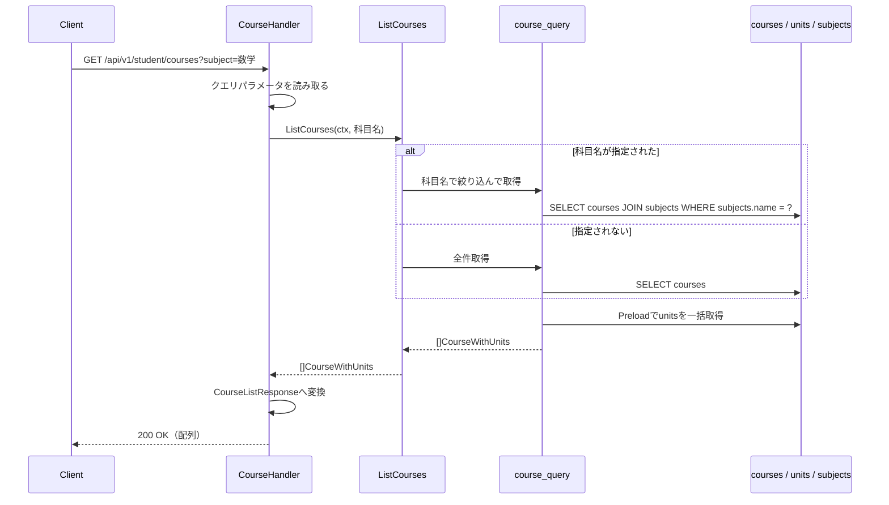
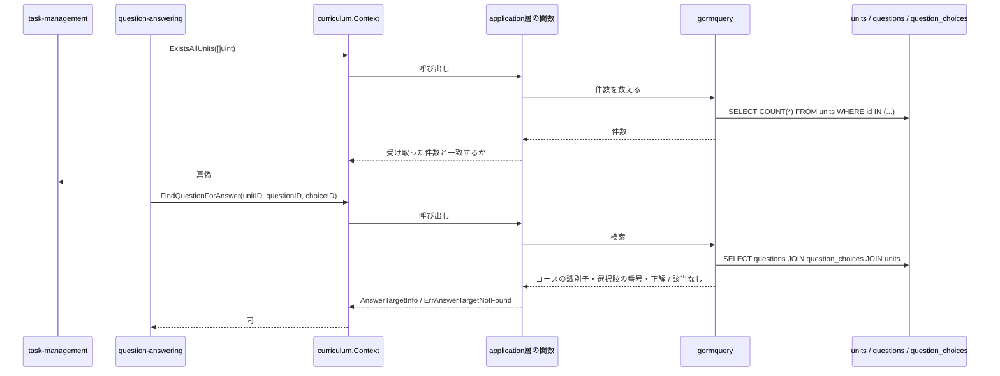

# コース参照機能 Go実装仕様書

---

# 1. 機能概要

## 機能概要

学習コースとそれに紐づく単元の一覧を取得する参照機能である。科目名による絞り込みに対応し、コースに含まれる単元情報をあわせて返す（①「5. API / 処理詳細」`#index`）。

**シリアライザを通さず`as_json`で返しているため、テーブルの全カラムがそのまま出る。** `deleted_at`・`created_at`・`updated_at`も含まれ、日付の整形も行わない（同）。

**論理削除済みのコース・単元も返る。** `Course`・`Unit`はいずれも`active`という絞り込みを持つが`default_scope`を持たず、この機能では`active`を使っていない（①「5. API / 処理詳細」`#index`）。

## 採用設計パターンとその理由（②からの要約）

- 採用パターン: **Transaction Script**（②「4. 設計パターン」）
- 判断根拠: 一覧取得のみで構成され、状態管理・業務ルールのいずれも存在しない。CourseとUnitは単純なマスタデータであり、Entityに振る舞いを持たせる余地がない
- 採用しなかったパターン: Active Record（作成・更新処理がないため）、Domain Model（状態も振る舞いも持たないマスタ参照データであるため）、Event Sourcing（履歴管理・監査要件がないため）

本書はアーキテクチャ規約「3. 設計パターンごとの構造適用方針」のTransaction Script節の構造（Entityを持たず、手続きをapplication層の関数として置く）に従って実装レベルへ落とし込む。

## 本書が対象とする実装範囲

②が設計した`curriculum` Bounded ContextのTransaction Script実装のうち、以下を対象とする。

- コース一覧のエンドポイント（GET /api/v1/student/courses）
- **`curriculum`が他Contextへ公開する5つの参照手段**（②「11. Repository設計」）
- `context.go`・`dependency.go`・`presentation/routes.go`

## Contextを共有する機能との分担

`curriculum` Contextは**2つの機能文書が共有する**（②「3. Bounded Context」）。

|文書|担当|
|-|-|
|`コース参照機能_Go実装仕様書.md`（本書）|コース一覧のエンドポイント、**他Contextへ公開する5つの参照手段**、`context.go`・`dependency.go`・`routes.go`|
|`単元参照機能_Go実装仕様書.md`|単元詳細のエンドポイント（GET /api/v1/student/tasks/:task_id/units/:id）|

**他Contextへ公開する参照手段の実装は本書に集約する。** 単元参照機能③では繰り返さない。②も同じ構成である（②「11. Repository設計」）。

実装ファイルは本書が14、単元参照機能が5であり、Context全体で19である。1文書あたり30〜35という範囲に収まるため、文書の分割は行わない（③自動生成プロンプト「文書の分割」）。

---

# 2. ディレクトリ構成

## 対象Bounded Context名

- `curriculum`（②「3. Bounded Context」）

## ディレクトリ・パッケージ名

アーキテクチャ規約「4. Bounded Context構成」の「Contextディレクトリの命名」に従い、Context名`curriculum`から`-`を取り除いて連結した全小文字の名前とする。`-`を含まないため、ディレクトリ名は`internal/curriculum/`、package名は同じ`curriculum`となる。

Context名とディレクトリ名は規約から機械的に決まるため、②に明記がなくても推測にはならない。

## ②で採用した設計パターン

Transaction Script（②「4. 設計パターン」）

## 作成するディレクトリ一覧

```
internal/curriculum/
├── application/
├── infrastructure/
│   └── gormquery/
└── presentation/
    ├── handler/
    └── response/
```

`domain/`は作成しない。②「6. Entity設計」のとおり独自のEntityを定義せず、業務ルールを持たないためである（アーキテクチャ規約「3. 設計パターンごとの構造適用方針」Transaction Script節）。

`infrastructure/contextadapter/`も作成しない。**本Contextから他Contextへの依存がない**ためである（②「3. Bounded Context」）。本Contextは参照される側であり、他Contextの公開操作を呼ばない。

ただし単元参照機能は`task-management`への依存を持つ。同機能のアダプタは`infrastructure/contextadapter/`に置く（単元参照機能③「2. ディレクトリ構成」）。本Contextのディレクトリツリーとしては、同機能が作成する形になる。

`presentation/request/`も作成しない。クエリパラメータ1つのみであり、バインド用のstructを設ける利点がないためである（下記）。

規約「4. Bounded Context構成」の「機能で不要なディレクトリは作成しない」に従う。

**②からの補足**: Repository実装の置き場所について、規約「4. Bounded Context構成」はDomain Model採用時の`infrastructure/gormrepo/`を定めているが、Transaction Script採用時の名前を定めていない。本書では`infrastructure/gormquery/`とする。Repository Interfaceの実装ではなく、検索条件を組み立てて結果を返す関数群であるため、`gormrepo`（Repositoryの実装）とは区別する（「17. ②からの補足事項」）。

## 作成するファイル一覧

本書が担当するものは以下の14である。

```
internal/curriculum/context.go                                 # NewContext（依存関係の組み立てと公開操作）
internal/curriculum/dependency.go                              # 他Contextへ渡す型（公開操作の戻り値）
internal/curriculum/application/list_courses.go                # ListCourses（コース一覧）
internal/curriculum/application/unit_directory.go              # 単元の存在確認・単元情報の取得（公開操作）
internal/curriculum/application/question_directory.go          # 単元の問題一覧・解答対象の確認（公開操作）
internal/curriculum/application/question_count.go              # 問題数の集計（公開操作）
internal/curriculum/infrastructure/gormquery/course_query.go   # コース一覧の検索
internal/curriculum/infrastructure/gormquery/unit_query.go     # 単元の検索（存在確認・単元情報・詳細）
internal/curriculum/infrastructure/gormquery/question_query.go # 問題の検索（一覧・解答対象・件数）
internal/curriculum/infrastructure/gormquery/course_model.go   # courses・subjectsのGORMモデル
internal/curriculum/infrastructure/gormquery/unit_model.go     # unitsのGORMモデル
internal/curriculum/infrastructure/gormquery/question_model.go # questions・question_choices・question_hintsのGORMモデル
internal/curriculum/presentation/handler/course_handler.go
internal/curriculum/presentation/response/course_response.go
internal/curriculum/presentation/routes.go
```

上の一覧は15行だが、`routes.go`は`curriculum` Context全体のルートを登録する。本書が担当するため、本書の実装ファイル数は14＋`routes.go`の15として数える。

単元参照機能が担当するものは以下の5である（同機能③「2. ディレクトリ構成」）。

```
internal/curriculum/application/show_unit_detail.go
internal/curriculum/infrastructure/contextadapter/task_unit_directory.go
internal/curriculum/presentation/handler/unit_handler.go
internal/curriculum/presentation/response/unit_response.go
（dependency.go に TaskUnitDirectory を追加）
```

`dependency.go`は本書が作成し、単元参照機能が`TaskUnitDirectory`のインターフェースを追加する。ファイルを共有するため、実装の順序は本書 → 単元参照機能とする。

## 文書の分割

行わない。Context全体の実装ファイルは19であり、テストが付くもの（application層の関数5つ・検索関数3つ・アダプタ1つ・Handler2つの11）を加えると30となる。1文書あたり30〜35という範囲に収まる（③自動生成プロンプト「ファイル数の見積り」）。

GORMモデル・Response DTO・`routes.go`・`dependency.go`にはテストを付けない（同）。

---

# 3. Domain層設計

対象外。

②「6. Entity設計」のとおり、Transaction Script採用であり独自のEntityを定義しない。業務ルールを持つEntity・Value Object・Domain Service・Domain Eventのいずれも存在しない（②「6」〜「8」「18」）。`domain/`ディレクトリを作成しない。

## Entity

対象外。

②「6. Entity設計」が参照用として挙げるCourse・Unit・Question・Subjectは、Domain層のEntityではなく、検索結果を表す型として扱う。定義場所は次のとおりである。

|型|定義場所|理由|
|-|-|-|
|GORMモデル（`courseModel`等）|`infrastructure/gormquery/`|GORMタグを持ち、テーブルの構造に対応する|
|application層が返す型|`application/`|検索結果をPresentation層・他Contextへ渡す形|
|他Contextへ渡す型|`dependency.go`|Context境界をまたぐ形（下記）|

## Value Object

対象外。②「7. Value Object設計」のとおり、属性はいずれも単純な値であり独自のルールを持たない。

**日付・日時を独自の型にしない。** `as_json`が整形を行わずそのまま返しており、表示形式のルールを持たない（②「7. Value Object設計」）。`time.Time`をそのまま扱う。目標管理機能③・タスク管理機能③の`DueDate`が`Scanner`／`driver.Valuer`を実装しているのとは異なる。

## Repository Interface

対象外。Transaction Script採用のため、Repository Interfaceを定義しない。検索は`infrastructure/gormquery/`の関数として実装する（②「11. Repository設計」）。

本Contextから他Contextへの依存がないため、`dependency.go`にインターフェースを置かない。**`dependency.go`には他Contextへ渡す型のみを置く**（下記）。

単元参照機能が`TaskUnitDirectory`のインターフェースを`dependency.go`に追加する（同機能③）。

## Domain Service

対象外。②「8. Domain Service」のとおり、複数Entityを横断する業務ルールの判定が存在しない。

解答対象の確認（問題が単元に属するか、選択肢が問題のものか）は検索条件として表現する。該当するレコードが取得できるかどうかで判定する（②「8. Domain Service」）。

## Domain Event

対象外。②「18. Domain Event」のとおり、参照のみの機能であり副作用が存在しない。

## Domain Error

対象外。②「17. Error設計」のとおり、業務ルール違反が発生しない。センチネルエラーを`domain/`に定義しない。

ただし**公開操作が返すエラーを1つ定義する**。`application/question_directory.go`に置く。

|エラー|発生条件|用途|
|-|-|-|
|`ErrAnswerTargetNotFound`|解答対象の確認で、指定の問題がその単元に属さない、または指定の選択肢がその問題のものでない|`question-answering`が受け取り、`ErrInvalidQuestion` / `ErrInvalidQuestionChoice`へ変換して422とする（問題解答機能③「14. Error実装方針」）|

**本Contextはステータスを決めない。** 「見つからない」という事実のみを返し、404とするか422とするかは呼び出し元が決める（②「17. Error設計」）。

---

# 4. クラス図

②「9. クラス図」のとおり省略する。

本Contextが持つのは、マスタデータを読む関数群と、それが返す読み取り専用の型のみである。Entityもstructの階層も持たないため、クラス図として図示する意味がない。

関係は「7. シーケンス図・処理フロー図」のシーケンス図で示す。

参考として、本書が定義する型と関数は次のとおりである。

|種類|名前|役割|
|-|-|-|
|application層の関数|`ListCourses`|コース一覧（本機能のエンドポイント）|
|同|`ExistsAllUnits`|単元の存在確認（公開操作）|
|同|`FindUnitsByIDs`|単元情報の取得（公開操作）|
|同|`FindUnitQuestions`|単元の問題一覧の取得（公開操作）|
|同|`FindQuestionForAnswer`|解答対象の確認（公開操作）|
|同|`CountQuestions`|問題数の集計（公開操作）|
|型|`CourseWithUnits`|コースと紐づく単元（`ListCourses`の戻り値）|
|型（`dependency.go`）|`UnitInfo`|他Contextへ渡す単元の情報|
|型（`dependency.go`）|`QuestionInfo`・`QuestionChoiceInfo`・`QuestionHintInfo`|他Contextへ渡す問題の情報|
|型（`dependency.go`）|`AnswerTargetInfo`|他Contextへ渡す解答対象の情報|

---

# 5. 状態遷移図

②「10. 状態遷移図」のとおり省略する。

本Contextが扱うデータに状態が存在しない。コース・単元・問題はいずれもマスタデータであり、状態を表すカラムを持たない（①「7. 状態管理」）。

論理削除日時を持つが、本機能に削除操作は存在せず、検索で除外もしない（①「5. API / 処理詳細」`#index`）。

---

# 6. Application層設計

Transaction Script採用のため、UseCase structを設けない。②「12. UseCase設計」の業務操作をapplication層の関数として実装する（アーキテクチャ規約「3. 設計パターンごとの構造適用方針」Transaction Script節）。

## DTO（Command / Query）

入力のDTOは設けない。いずれの関数も引数が少なく、structにまとめる利点がないためである。

出力の型は以下である。

### CourseWithUnits（`application/list_courses.go`）

|フィールド|型|意味|
|-|-|-|
|ID|uint|コースの識別子|
|SubjectID|`*uint`|科目の識別子。`courses.subject_id`はNULL可である（①「6. データモデル」）|
|LevelNumber|int|レベル番号|
|LevelName|string|レベル名|
|Description|`*string`|説明。NULL可|
|DeletedAt|`*time.Time`|論理削除日時。**レスポンスに含めるため保持する**|
|CreatedAt|time.Time|作成日時。同|
|UpdatedAt|time.Time|更新日時。同|
|Units|`[]UnitWithTimestamps`|紐づく単元|

### UnitWithTimestamps（同ファイル）

|フィールド|型|意味|
|-|-|-|
|ID|uint|単元の識別子|
|CourseID|uint|コースの識別子|
|UnitName|string|単元名|
|DeletedAt|`*time.Time`|論理削除日時。**レスポンスに含めるため保持する**|
|CreatedAt|time.Time|作成日時。同|
|UpdatedAt|time.Time|更新日時。同|

**`DeletedAt`・`CreatedAt`・`UpdatedAt`を保持するのは本機能固有である。** `as_json`がテーブルの全カラムを返すためである（①「5. API / 処理詳細」`#index`）。単元参照機能が返す単元の型はこの3項目を持たない（同機能③「6. Application層設計」）。同じテーブルを扱うが返す項目が違う。

## 関数

### ListCourses（`application/list_courses.go`）

|項目|内容|
|-|-|
|関数|`ListCourses(ctx context.Context, subject string) ([]CourseWithUnits, error)`|
|受け取る依存|コース一覧の検索関数（`infrastructure/gormquery/`）|

処理ステップ:

1. `subject`が空文字であれば、コースの全件を単元とあわせて取得する
2. 空文字でなければ、科目名で絞り込んで取得する
3. 取得結果を返す

操作者の識別子を引数に取らない。操作者による絞り込みを行わないためである（②「16. Authorization設計」）。

空文字の判定で空白のみの文字列も未指定として扱う。Rails現行の`params[:subject].present?`が空白のみを未指定とするためである（②「15. Validation設計」）。

コースが0件の場合、空のスライスを返す。エラーにしない（①「5. API / 処理詳細」`#index`）。

トランザクションは使用しない（②「14. Transaction設計」、「11. Transaction実装方針」）。

### 他Contextへ公開する操作

②「11. Repository設計」の5つである。いずれも検索関数を呼ぶだけであり、手続きを持たない。

|関数|シグネチャ|呼び出し元|
|-|-|-|
|`ExistsAllUnits`|`(ctx context.Context, unitIDs []uint) (bool, error)`|`task-management`・`draft-task`|
|`FindUnitsByIDs`|`(ctx context.Context, unitIDs []uint) ([]UnitInfo, error)`|同|
|`FindUnitQuestions`|`(ctx context.Context, unitID uint) ([]QuestionInfo, error)`|`question-answering`|
|`FindQuestionForAnswer`|`(ctx context.Context, unitID, questionID, questionChoiceID uint) (AnswerTargetInfo, error)`|同|
|`CountQuestions`|`(ctx context.Context, unitIDs []uint) (int, error)`|同|

**識別子の集合を`[]uint`で受け取る。** 呼び出し元が持つ集合型（`UnitIDSet`）をそのまま受け取らない。相手Contextの型を本Contextに持ち込まないためである（②「11. Repository設計」）。

### 呼び出し側の型との対応

呼び出し元の③は、自身の`dependency.go`で必要とする形を定めている。**型名は一致しないが、変換は呼び出し元のアダプタが行う**（コーディング規約「7. インターフェース」の「利用側でインターフェースを定義する」）。

|呼び出し元が定めた形|本Contextが公開する形|変換|
|-|-|-|
|`ExistsAll(ctx, UnitIDSet) (bool, error)`（タスク管理機能③・タスク下書き機能③）|`ExistsAllUnits(ctx, []uint) (bool, error)`|呼び出し元のアダプタが`UnitIDSet`→`[]uint`へ|
|`FindUnitsByIDs(ctx, UnitIDSet) ([]UnitRef, error)`（同）|`FindUnitsByIDs(ctx, []uint) ([]UnitInfo, error)`|同。戻り値は`UnitInfo`→`UnitRef`へ|
|`FindUnitQuestions(ctx, unitID uint) ([]QuestionRef, error)`（問題解答機能③）|`FindUnitQuestions(ctx, unitID uint) ([]QuestionInfo, error)`|戻り値を`QuestionInfo`→`QuestionRef`へ|
|`FindQuestionForAnswer(ctx, unitID, questionID, questionChoiceID uint) (AnswerTargetRef, error)`（同）|同じ引数。戻り値は`AnswerTargetInfo`|戻り値を`AnswerTargetInfo`→`AnswerTargetRef`へ|
|`CountQuestions(ctx, UnitIDSet) (int, error)`（同）|`CountQuestions(ctx, []uint) (int, error)`|呼び出し元のアダプタが`UnitIDSet`→`[]uint`へ|

引数・戻り値の項目は一致している。型名が異なるのはContext境界をまたぐためであり、設計上の食い違いではない。

**`ExistsAllUnits`のみ関数名が異なる**（呼び出し元は`ExistsAll`）。呼び出し元のインターフェース名が`UnitDirectory`であり`ExistsAll`で意味が通るが、本Contextでは単元以外の存在確認もありうるため`ExistsAllUnits`とした。アダプタが名前の違いを吸収する。

`ExistsAllUnits`は、受け取った識別子の件数と、該当するレコードの件数が一致するかで判定する。空の集合を受け取った場合は真を返す。「すべて存在する」が空集合に対して成り立つためである。Rails現行も`unit_ids.blank?`のとき検証をスキップしており、同じ結果になる（タスク管理機能①「5. API / 処理詳細」`#create`）。

`FindQuestionForAnswer`は、該当が見つからない場合に`ErrAnswerTargetNotFound`を返す。問題が単元に属さない場合と選択肢が問題のものでない場合を区別しない。呼び出し元が両者を別のエラーへ変換するが、**区別の材料は呼び出し元が持っている**（指定した識別子そのもの）ためである。

**②からの補足（要確認）**: 呼び出し元の問題解答機能③は`ErrInvalidQuestion`と`ErrInvalidQuestionChoice`を区別して返す（同③「14. Error実装方針」）。本Contextが区別しないため、呼び出し元のアダプタがどちらかを選べない。本書では「問題の不存在」として扱うことを想定するが、Rails現行は`@unit.questions.find_by(id:)`で問題を先に確認し、選択肢は別の検証（`validate_question_choice_relation`）で確認している（問題解答機能①「5. API / 処理詳細」`#create`）。**2つの操作に分ける方がRails現行に近い**（「17. ②からの補足事項」）。

`CountQuestions`は、受け取った単元の識別子に属する問題の件数を返す。**論理削除を除外しない**（②「11. Repository設計」の「公開操作における論理削除の扱い」）。

---

# 7. シーケンス図・処理フロー図

## シーケンス図

### ListCourses



### 他Contextへの公開操作



## 処理フロー図

②「13. シーケンス図・処理フロー図」のとおり省略する。

`ListCourses`の分岐は科目名が指定されたかどうかの1つだけであり、シーケンス図で十分に表現できる。公開操作はいずれも検索を呼ぶだけで分岐を持たない。

`ExistsAllUnits`のみ「受け取った件数と一致するか」という判定を持つが、分岐としては単純である。

---

# 8. Infrastructure層設計

**実装上の位置づけ**: Transaction Script採用のため、Repository実装・Store実装のいずれも持たない。検索条件を組み立てて結果を返す関数群を`infrastructure/gormquery/`に置く（②「11. Repository設計」）。

## Repository実装（Domain Model / Event Sourcing採用時）

対象外。

## Store実装（Active Record採用時）

対象外。

## Infrastructure関数（Transaction Script採用時）

### course_query.go

|関数|引数|戻り値|発行するクエリ内容|
|-|-|-|-|
|`FindAllCourses`|`ctx context.Context`|`([]courseModel, error)`|`courses`の全件取得。`units`を`Preload`で一括取得する（N+1を避ける）。**`deleted_at`を条件に含めない**|
|`FindCoursesBySubjectName`|`ctx context.Context, name string`|`([]courseModel, error)`|`subjects`と結合し、`subjects.name`の完全一致で絞り込む。同じく`units`を一括取得し、`deleted_at`を条件に含めない|

ソートは行わない。並び順を指定しない（①「5. API / 処理詳細」`#index`）。ページネーションも行わない。

### unit_query.go

|関数|引数|戻り値|発行するクエリ内容|
|-|-|-|-|
|`CountUnitsByIDs`|`ctx context.Context, unitIDs []uint`|`(int64, error)`|`id IN (...)`で件数を数える。`deleted_at`を条件に含めない|
|`FindUnitsByIDs`|`ctx context.Context, unitIDs []uint`|`([]unitWithCourseModel, error)`|`id IN (...)`で取得し、`courses`と結合してレベル番号・レベル名を得る。`deleted_at`を条件に含めない|
|`FindUnitByID`|`ctx context.Context, unitID uint`|`(*unitWithCourseModel, error)`|`id`で1件取得し、`courses`と結合する。**単元参照機能が用いる**（同機能③「8. Infrastructure層設計」）|

`FindUnitsByIDs`と`FindUnitByID`は返す項目が同じである。1件取得と集合取得で分けるのは、呼び出し元の形が異なるためである。`FindUnitByID`は`FindUnitsByIDs`に単一要素の集合を渡す形でも実現できるが、戻り値の扱い（0件か1件か）を呼び出し元で判定することになる。1件取得専用の関数を設ける方が呼び出し側が単純になる。

### question_query.go

|関数|引数|戻り値|発行するクエリ内容|
|-|-|-|-|
|`FindQuestionsByUnitID`|`ctx context.Context, unitID uint`|`([]questionModel, error)`|`unit_id`で取得。`question_choices`・`question_hints`を`Preload`で一括取得する。`deleted_at`を条件に含めない|
|`FindAnswerTarget`|`ctx context.Context, unitID, questionID, questionChoiceID uint`|`(*answerTargetModel, error)`|`questions`を`id`・`unit_id`で絞り、`question_choices`を`question_id`・`id`で結合し、`units`と結合してコースの識別子を得る。該当がなければ該当なしを返す。`deleted_at`を条件に含めない|
|`CountQuestionsByUnitIDs`|`ctx context.Context, unitIDs []uint`|`(int64, error)`|`unit_id IN (...)`で件数を数える。**`deleted_at`を条件に含めない**（②「11. Repository設計」）|

`FindAnswerTarget`が3つのテーブルを結合するのは、1回のクエリで「問題が単元に属するか」「選択肢が問題のものか」「コースの識別子」をまとめて得るためである。確認と取得を分けると往復が増える（問題解答機能②「11. Repository設計」）。

各関数は`gormtx.DBFromContext(ctx, db)`で接続を取得する。本Contextはトランザクションを開始しないが、他Contextが開始したトランザクションの内側から呼ばれた場合に同じ接続を使う（②「14. Transaction設計」、「11. Transaction実装方針」）。

### GORMモデル

|モデル|テーブル|備考|
|-|-|-|
|`courseModel`|`courses`|Gorm規約「2. 複数形のテーブル名」の既定命名規則で一致する|
|`subjectModel`|`subjects`|同。絞り込みの結合にのみ用いる|
|`unitModel`|`units`|同|
|`questionModel`|`questions`|同|
|`questionChoiceModel`|`question_choices`|同|
|`questionHintModel`|`question_hints`|同|

いずれも`DeletedAt`に**`gorm.DeletedAt`を使わず`*time.Time`とする**。詳細は「15. GORM / DBクエリ設計」に記載する。

`unitWithCourseModel`・`answerTargetModel`は結合結果を受け取る型である。テーブルに対応しないため`TableName()`を持たない。

## 外部連携実装

対象外。本Contextから外部サービスへアクセスしない。

## 他Contextの参照手段の実装

**本書では対象外。** 本Contextから他Contextへの依存がないためである（②「3. Bounded Context」）。

単元参照機能が`task-management`への依存を持ち、`infrastructure/contextadapter/task_unit_directory.go`を作成する（同機能③「8. Infrastructure層設計」）。

## context.go と dependency.go

### context.go

`NewContext`が本Contextの依存関係を組み立てる（アーキテクチャ規約「14. 依存関係の組み立て（DI配線）」）。

受け取るもの: `*gorm.DB`、`task-management` Contextへの参照（単元参照機能のアダプタの生成に用いる）。

組み立てるもの: 検索関数3ファイル分、application層の関数6つ（本書の5つ＋単元参照機能の1つ）、Handler2つ（同）。

返す`Context`は、ルート登録に必要なHandler2つと、**他Contextへ公開する5つの操作**を持つ。

公開する操作は`Context`のメソッドとして定める。

|メソッド|委譲先|
|-|-|
|`ExistsAllUnits(ctx, unitIDs []uint) (bool, error)`|`application.ExistsAllUnits`|
|`FindUnitsByIDs(ctx, unitIDs []uint) ([]UnitInfo, error)`|`application.FindUnitsByIDs`|
|`FindUnitQuestions(ctx, unitID uint) ([]QuestionInfo, error)`|`application.FindUnitQuestions`|
|`FindQuestionForAnswer(ctx, unitID, questionID, questionChoiceID uint) (AnswerTargetInfo, error)`|`application.FindQuestionForAnswer`|
|`CountQuestions(ctx, unitIDs []uint) (int, error)`|`application.CountQuestions`|

いずれも委譲するだけである。業務ルールを持たない。

### dependency.go

**本Contextから他Contextへ依存しないため、インターフェースを置かない。** 他Contextへ渡す型のみを置く。

|型|フィールド|渡す先|
|-|-|-|
|`UnitInfo`|ID・CourseID・UnitName・CourseLevelNumber・CourseLevelName|`task-management`・`draft-task`|
|`QuestionInfo`|ID・UnitID・CourseID・QuestionText・CorrectAnswer・Choices（`[]QuestionChoiceInfo`）・Hints（`[]QuestionHintInfo`）|`question-answering`|
|`QuestionChoiceInfo`|ID・QuestionID・ChoiceNumber・ChoiceText|同|
|`QuestionHintInfo`|ID・QuestionID・StepNumber・HintText|同|
|`AnswerTargetInfo`|CourseID・SelectedChoiceNumber・CorrectAnswer|同|

`UnitInfo`がコースのレベル番号・レベル名を含むのは、呼び出し元がレスポンスに含めるためである（タスク管理機能③「8. Infrastructure層設計」の`UnitRef`）。

`QuestionInfo`に`CorrectAnswer`を含めるのは、確認表示が解答履歴のある問題について正解を返すためである（問題解答機能③「6. Application層設計」）。問題一覧では呼び出し元が落とす。

`AnswerTargetInfo.CorrectAnswer`は`string`である。`questions.correct_answer`がtext型であり、整数への変換は呼び出し元の`AnswerJudgePolicy`が行う（問題解答機能③「3. Domain層設計」）。本Contextは解釈しない。

**②からの補足**: `dependency.go`を他Contextへ渡す型の置き場所として使う形は、規約「4. Bounded Context構成」の「他Contextの参照手段を利用するためにContext側で定義するインターフェースは`dependency.go`に置く」という定めから外れる。同規約は「利用する側」の置き場所を定めており、「公開する側」の型の置き場所を定めていない（「17. ②からの補足事項」）。

---

# 9. Presentation層設計

## Handler

### CourseHandler（`presentation/handler/course_handler.go`）

|項目|内容|
|-|-|
|struct名|`CourseHandler`|
|受け取る依存|`ListCourses`を実行する関数または`struct`|
|コンストラクタ|`NewCourseHandler(listCourses *application.ListCoursesService) *CourseHandler`|

|メソッド|HTTPメソッド|パス|
|-|-|-|
|`ListCourses`|GET|/api/v1/student/courses|

処理順序:

1. クエリパラメータ`subject`を文字列として読み取る。未指定なら空文字として扱う
2. `ListCourses(ctx, subject)`を呼ぶ
3. エラーが返った場合は500のAppErrorへ変換して`c.Error(err)`で返す（「14. Error実装方針」）
4. `[]CourseWithUnits`を`CourseListResponse`へ変換する
5. 200 OKで返す

current userを取得しない。操作者による絞り込みを行わないためである（②「16. Authorization設計」）。認証・ロールの確認はMiddlewareが済ませている。

パスパラメータ・リクエストボディを扱わない。

## Request / Response DTO

### Request

対象外。クエリパラメータ1つのみであり、バインド用のstructを設けない。`c.Query("subject")`で直接読み取る。

`presentation/request/`ディレクトリを作成しない（「2. ディレクトリ構成」）。

### Response（`presentation/response/course_response.go`）

最上位は**配列**である。キーでラップしない（①「5. API / 処理詳細」`#index`）。

|struct名|フィールド|型|JSONキー|
|-|-|-|-|
|`CourseResponse`|ID|`uint`|`id`|
||SubjectID|`*uint`|`subject_id`|
||LevelNumber|`int`|`level_number`|
||LevelName|`string`|`level_name`|
||Description|`*string`|`description`|
||**DeletedAt**|`*time.Time`|`deleted_at`|
||**CreatedAt**|`time.Time`|`created_at`|
||**UpdatedAt**|`time.Time`|`updated_at`|
||Units|`[]UnitResponse`|`units`|
|`UnitResponse`|ID|`uint`|`id`|
||CourseID|`uint`|`course_id`|
||UnitName|`string`|`unit_name`|
||**DeletedAt**|`*time.Time`|`deleted_at`|
||**CreatedAt**|`time.Time`|`created_at`|
||**UpdatedAt**|`time.Time`|`updated_at`|

Handlerは`[]CourseResponse`をそのまま返す。

**`deleted_at`・`created_at`・`updated_at`を含める。** Rails現行が`as_json`でテーブルの全カラムを返しているためである（①「5. API / 処理詳細」`#index`）。他機能のシリアライザを通したレスポンスとは異なる。

**日時を`time.Time`のまま返し、整形しない。** `as_json`が整形を行わないためである（②「7. Value Object設計」）。

科目の情報を含めない。絞り込みに使うのみである（①「5. API / 処理詳細」`#index`）。

`meta`を返さない。ページングを行わない（同）。

**②からの補足（要確認）**: 日時を`time.Time`のままJSONへ出すと、Goの既定はRFC3339（小数部の桁数は値に依存）、RailsのActiveSupportの既定は小数部3桁であり**表現が異なる**。学習ログ機能③も同じ論点を抱えている（同③「9. Presentation層設計」）。フロントエンドが文字列として扱っている場合は影響しないが、桁数に依存した処理があると差が出る（「17. ②からの補足事項」）。

### 単元参照機能のResponse DTO

`presentation/response/unit_response.go`は単元参照機能が担当する（同機能③「9. Presentation層設計」）。

**本機能の`UnitResponse`とは項目が異なる。** 本機能は`deleted_at`・`created_at`・`updated_at`を含むが、単元参照機能は含まない。同じ`presentation/response/`に置くため、**struct名を分ける必要がある**。本機能を`UnitResponse`、単元参照機能を`UnitDetailResponse`とする（単元参照機能③「9. Presentation層設計」）。

## Routing（`presentation/routes.go`）

**本ファイルは`curriculum` Context全体のルートを登録する。** 単元参照機能が担当するルートも含む。

|Method|Path|Handler|担当文書|
|-|-|-|-|
|GET|/api/v1/student/courses|`CourseHandler.ListCourses`|本書|
|GET|/api/v1/student/tasks/:task_id/units/:id|`UnitHandler.ShowUnitDetail`|単元参照機能|

いずれも認証Middleware・`student`ロール確認Middlewareを経由する。**GETのみのためCSRF検証Middlewareの対象外である**（②「16. Authorization設計」、Gin規約「5. CSRF対策」の「適用範囲」）。

単元詳細のパスの前半（`/tasks/:task_id`）は`task-management`が所有するリソースの下にある。本Contextは`units/:id`以下のみを登録する。学習ログ機能③・問題解答機能③も同じ扱いである（各③「9. Presentation層設計」）。

---

# 10. API仕様

|Method|Path|Handler|Request|Response|Status Code|
|-|-|-|-|-|-|
|GET|/api/v1/student/courses|ListCourses|クエリ: `subject`|`[]CourseResponse`|200|

リクエストボディ・パスパラメータを持たない。レスポンスは最上位が配列である。

エラーレスポンスの本文は「14. Error実装方針」のとおり`{"errors": [...]}`である。本機能には404を返す経路がない。

## Errorケース

|条件|Status Code|Error内容|
|-|-|-|
|未認証|401|認証Middlewareが返す（②「16. Authorization設計」）|
|`student`ロールでない|403|ロール確認Middlewareが返す。本文は`{"errors": ["この操作を行う権限がありません"]}`|
|検索に失敗した|500|`{"errors": [...]}`|

認証・認可のステータスコードは本機能で定めるものではなく、該当Middlewareの仕様に従う。

**固有の404・422は存在しない。** 対象が一意に定まるパラメータを持たず、入力検証の対象もないためである（②「17. Error設計」）。

コースが0件の場合は空配列を返す。`subject`に存在しない科目名を指定した場合も空配列になり、エラーにしない（①「5. API / 処理詳細」`#index`）。

`subject`に不正な形式の値を指定してもエラーにしない。文字列として受け取り、一致するものがなければ空配列になる。

## 他Contextへ公開する操作のAPI仕様

HTTPを経由しないため、API仕様としては記載しない。シグネチャは「6. Application層設計」「8. Infrastructure層設計」のとおりである。

---

# 11. Transaction実装方針

## Transaction開始位置

なし。②「14. Transaction設計」のとおり、状態を変更する処理が存在しないためである。

`gormtx.RunInTx`を呼ぶ箇所はない。

## Transaction終了位置

なし（上記のとおり）。

## 呼び出し側トランザクションの引き継ぎ

**他Contextが開始したトランザクションの内側から呼ばれる場合がある。** 公開する5つの操作は他Contextから呼ばれるため、呼び出し元がトランザクションを開始している可能性がある。

各検索関数は`gormtx.DBFromContext(ctx, db)`で接続を取得する。トランザクション中であればその接続を、そうでなければ通常の接続を使う（アーキテクチャ規約「11. Transaction実装パターン（TransactionManager）」）。

現時点で参加する経路はない。問題解答機能③は提出の判定で`CountQuestions`を呼ぶが、トランザクションの外で行う（同③「11. Transaction実装方針」）。タスク管理機能③・タスク下書き機能③も単元の確認をトランザクションの外で行う（各③「11. Transaction実装方針」）。

それでも`gormtx.DBFromContext`を使う。将来トランザクションの内側から呼ばれた場合に備えるためであり、使わない理由がない。

## 複数Storeにまたがる場合の扱い

本ContextはStoreを持たないため該当しない。

読み取りのみであり、複数のテーブルにまたがる整合性を求めない。コース一覧の取得中に単元が変更されても、表示用の一覧であり業務上の問題にならない。

---

# 12. Validation実装方針

## Presentation

- クエリパラメータ`subject`を文字列として読み取る。任意であり、未指定なら空文字として扱う
- パスパラメータ・リクエストボディを扱わないため、バインドと必須チェックを行わない

`subject`の形式を検証しない。不正な値を指定しても一致するものがなく、空配列になるだけである（「10. API仕様」）。

## 業務ルール検証

対象外。②「15. Validation設計」のとおり、本Contextに業務ルールが存在しない。

科目名の空文字・空白のみの判定は`ListCourses`で行う。Rails現行の`params[:subject].present?`が空白のみを未指定とするためである（②「15. Validation設計」）。これは検証ではなく、検索条件の選択である。

## 公開操作の入力の検証

公開する5つの操作は、受け取った識別子の形式を検証しない。**呼び出し元が検証を済ませている前提である**（②「16. Authorization設計」）。

`ExistsAllUnits`が空の集合を受け取った場合は真を返す。「すべて存在する」が空集合に対して成り立つためである（「6. Application層設計」）。これも検証ではなく、判定の定義である。

---

# 13. Authorization実装方針

- Middlewareで行う処理: 認証済みユーザーの特定と`context.Context`への格納、役割（`student`）であることの確認（②「16. Authorization設計」）
- Handlerで行う処理: なし。**current userを取得しない**
- Applicationで行う処理: なし。操作者の識別子を検索条件に渡さない
- Domainで行う処理: なし。本ContextにDomain層が存在しない
- CSRF: **対象外。** GETのみであり状態を変更しない（Gin規約「5. CSRF対策」の「適用範囲」）

コースは全生徒に共通のマスタデータであり、どの生徒も同じ一覧を取得する（①「8. 権限制御」）。操作者による絞り込みを行わない。

**単元参照機能とは認可の効き方が異なる。** 同機能はタスクを経由するため操作者のスコープが効く（②「16. Authorization設計」）。同じContextだが、エンドポイントによって違う。

## 公開操作の認可

公開する5つの操作は**認可を行わない**（②「16. Authorization設計」）。

いずれもマスタデータの参照であり、操作者によって結果が変わらない。呼び出し元Contextが自身の認可を済ませている前提である。

操作者の識別子を引数に取らない。受け取っても使う先がないためである。

---

# 14. Error実装方針

## Domain Error → Application Errorへの変換方針

本ContextにDomain Errorが存在しない（②「17. Error設計」）。`domain/`ディレクトリも作成しない。

`ErrAnswerTargetNotFound`のみ`application/question_directory.go`に定義する。これは公開操作が呼び出し元へ返すエラーであり、本Contextのエンドポイントでは使わない（「3. Domain層設計」）。

## Application Error → HTTPレスポンスへの変換方針

Gin規約「8. エラーハンドリングミドルウェア」の集中エラーハンドリングミドルウェアに変換を集約する。Handlerは`c.Error(err)`でエラーを登録するのみとし、個々のHandlerでステータスコードを判定しない。

レスポンスのボディは`{"errors": ["メッセージ", ...]}`とする（アーキテクチャ規約「15. API規約（レスポンス形式・ページネーション・URL・クエリパラメータ）」の「エラーレスポンス」）。

|条件|HTTP Status|ボディ|
|-|-|-|
|検索に失敗した|500|`{"errors": [...]}`|
|認証・認可|401 / 403|`{"errors": [...]}`。該当Middlewareが組み立てる|

**本機能には404を返す経路がない。** 他機能の③が記載している「404のみ`message`キーの本文を組み立てる分岐」は、本機能では使われない（目標管理機能③・タスク管理機能③・学習ログ機能③「14. Error実装方針」）。

単元参照機能には404を返す経路がある（同機能③「14. Error実装方針」）。同じContextだが、エンドポイントによって返すステータスが違う。

## 公開操作のエラーの扱い

公開操作が返すエラーに**ステータスを持たせない**（②「17. Error設計」）。

|エラー|呼び出し元での扱い|
|-|-|
|`ErrAnswerTargetNotFound`|`question-answering`が`ErrInvalidQuestion` / `ErrInvalidQuestionChoice`へ変換し422とする（問題解答機能③「14. Error実装方針」）|
|検索の失敗（DB接続等）|呼び出し元がラップして500とする|

本Contextは`AppError`を実装した型を返さない。ステータスを決めるのは呼び出し元である。同じ「見つからない」が、呼び出し元によって404になる場合と422になる場合があるためである（問題解答機能②「17. Error設計」）。

## Infrastructure Errorのハンドリング方針

GORMが返すエラーは`fmt.Errorf`でラップして返す（コーディング規約「18. エラーハンドリング」）。

`FindAnswerTarget`が該当なしを返す場合は、`gorm.ErrRecordNotFound`をそのまま返さず`ErrAnswerTargetNotFound`へ変換する。GORMのエラー型を`application/`より上へ漏らさないためである（同規約）。

|Error種別|発生層|HTTP Status|
|-|-|-|
|検索の失敗（本機能のエンドポイント）|Infrastructure → Application（変換）|500|
|認証エラー|Middleware|401|
|認可エラー（役割不一致）|Middleware|403|
|`ErrAnswerTargetNotFound`（公開操作）|Application|—（呼び出し元が決める）|

---

# 15. GORM / DBクエリ設計

②「20. DB設計方針」のとおり、既存Rails DBを継続利用し、スキーマ変更は行わない。

## 利用するGORMモデルとテーブルの対応

|Goモデル|テーブル名|備考|
|-|-|-|
|`courseModel`|`courses`|Gorm規約「2. 複数形のテーブル名」の既定命名規則で一致するため、`TableName()`のオーバーライドは不要|
|`subjectModel`|`subjects`|同|
|`unitModel`|`units`|同|
|`questionModel`|`questions`|同|
|`questionChoiceModel`|`question_choices`|同|
|`questionHintModel`|`question_hints`|同|

カラム対応はGorm規約の既定命名規則（フィールド名のsnake_case）に従う。`SubjectID`→`subject_id`、`LevelNumber`→`level_number`、`UnitName`→`unit_name`、`CorrectAnswer`→`correct_answer`、`ChoiceNumber`→`choice_number`、`StepNumber`→`step_number`等。

**いずれのモデルも`DeletedAt`に`gorm.DeletedAt`を使わず`*time.Time`とする。** Gorm規約「0. 本プロジェクトでの採用方針」の論理削除は`gorm.DeletedAt`の使用を定めているが、これは削除操作を実装する場合の規定である。本Contextに削除操作は存在せず、`gorm.DeletedAt`を使うと`Find`系が`deleted_at IS NULL`を自動付与する。

`Course`・`Unit`・`Question`はいずれも`default_scope`を持たず、**本Contextのすべての検索で論理削除を除外しない**（②「11. Repository設計」）。自動付与が入ると外部仕様が変わる。フロントエンドを変更しない方針により、絞り込みが入らない型を選ぶ。

タスク下書き機能③・学習ログ機能③・問題解答機能③も同じ判断をしている（各③「15. GORM / DBクエリ設計」）。

`SubjectID`を`*uint`とするのは`courses.subject_id`がNULL可であるためである。`Description`・`HintText`・`ChoiceText`も該当カラムがNULL可であるためポインタとする（①「6. データモデル」、問題解答機能①「6. データモデル」）。

`StepNumber`・`ChoiceNumber`も`question_hints`・`question_choices`の該当カラムがNULL可であるため`*int`とする（問題解答機能③「9. Presentation層設計」）。

## 主要クエリの条件・ソート・ページネーション方針

「8. Infrastructure層設計」の各関数の表のとおり。要点を再掲する。

- **すべての検索で`deleted_at`を条件に含めない**（②「11. Repository設計」）
- コース一覧は`units`を`Preload`で一括取得する。N+1を避ける（①「5. API / 処理詳細」`#index`）
- 問題一覧は`question_choices`・`question_hints`を`Preload`で一括取得する
- ソートを行わない。並び順を指定しない（①「5. API / 処理詳細」`#index`）
- ページネーションを行わない。いずれの検索も全件または1件である

`subjects`は絞り込みの結合にのみ用いる。レスポンスに含めないため、項目を取得しない。

`tasks`・`task_units`・`question_histories`へは本Contextからクエリを発行しない。いずれも他Contextが所有する（②「21. DB操作仕様」）。

## 既存Schemaへの変更

②「20. DB設計方針」のとおり、変更なし。

---

# 16. テストケース設計

②「22. テスト戦略」のうち、本書が担当する範囲のテストケースを記載する。単元参照機能のテストは同機能③に記載する。

## Model Test

対象外。②「22. テスト戦略」のとおり、本Contextに業務ルールを持つModel・Value Objectが存在しない。

## UseCase Test

application層の関数のテストである。検索関数を差し替えて検証する。

### ListCourses

|テストケース|
|-|
|正常系: 科目名が未指定のとき全件取得の検索を呼ぶこと|
|正常系: 科目名が指定されたとき絞り込みの検索を呼ぶこと|
|正常系: **空文字・空白のみの科目名を未指定として扱うこと**|
|正常系: コースが0件のとき空のスライスを返すこと|
|正常系: 単元が入れ子で返ること|
|正常系: `DeletedAt`・`CreatedAt`・`UpdatedAt`が保持されること|
|異常系: 検索が失敗した場合にエラーを返すこと|

### 公開操作

|対象|テストケース|
|-|-|
|`ExistsAllUnits`|正常系: 受け取った件数と該当件数が一致すれば真を返すこと|
|`ExistsAllUnits`|正常系: 一致しなければ偽を返すこと|
|`ExistsAllUnits`|正常系: **空の集合で真を返すこと**|
|`FindUnitsByIDs`|正常系: 単元の情報にコースのレベル番号・レベル名が含まれること|
|`FindUnitsByIDs`|正常系: 存在しない識別子を含む場合、存在するものだけが返ること|
|`FindUnitQuestions`|正常系: 問題に選択肢・ヒント・正解が含まれること|
|`FindUnitQuestions`|正常系: 問題が0件のとき空のスライスを返すこと|
|`FindQuestionForAnswer`|正常系: コースの識別子・選択肢の番号・正解が返ること|
|`FindQuestionForAnswer`|異常系: 問題が指定の単元に属さない場合に`ErrAnswerTargetNotFound`を返すこと|
|`FindQuestionForAnswer`|異常系: 選択肢が指定の問題のものでない場合に`ErrAnswerTargetNotFound`を返すこと|
|`CountQuestions`|正常系: 指定された単元に属する問題の件数が返ること|
|`CountQuestions`|正常系: **論理削除された問題も数えること**（②「11. Repository設計」）|
|`CountQuestions`|正常系: 空の集合で0を返すこと|

## Store Test

検索関数のテストである。本Contextが所有するテーブルへのクエリを検証する。

|対象|テストケース|
|-|-|
|`FindAllCourses`|全件が返ること、単元が一括取得されること（コースが複数件でも単元のクエリが1回であること）|
|`FindAllCourses`|**論理削除済みのコース・単元も返ること**|
|`FindCoursesBySubjectName`|科目名の完全一致で絞られること、部分一致では絞られないこと|
|`FindCoursesBySubjectName`|存在しない科目名で0件が返ること|
|`CountUnitsByIDs`|件数が返ること、**論理削除済みの単元も数えること**|
|`FindUnitsByIDs`|コースと結合してレベル番号・レベル名が取得できること|
|`FindUnitByID`|1件取得できること、存在しない識別子で該当なしが返ること|
|`FindQuestionsByUnitID`|選択肢・ヒントが一括取得されること、**論理削除済みの問題も返ること**|
|`FindAnswerTarget`|3つのテーブルの結合で必要な値が取得できること|
|`FindAnswerTarget`|問題が単元に属さない組み合わせで該当なしが返ること|
|`FindAnswerTarget`|選択肢が問題のものでない組み合わせで該当なしが返ること|
|`CountQuestionsByUnitIDs`|件数が返ること、**論理削除済みの問題も数えること**|
|全検索関数|`gormtx.DBFromContext`で接続を取得すること（トランザクションの内側から呼ばれた場合に同じ接続を使うこと）|

## Handler Test

|対象|テストケース|
|-|-|
|`CourseHandler.ListCourses`|正常系: 最上位が配列で200が返ること|
|`CourseHandler.ListCourses`|正常系: **`deleted_at`・`created_at`・`updated_at`が含まれること**|
|`CourseHandler.ListCourses`|正常系: 単元にも同3項目が含まれること|
|`CourseHandler.ListCourses`|正常系: **`meta`を返さないこと**|
|`CourseHandler.ListCourses`|正常系: 科目の情報を含まないこと|
|`CourseHandler.ListCourses`|正常系: `subject`が未指定でも成功すること|
|`CourseHandler.ListCourses`|正常系: 存在しない科目名で空配列が返ること|
|`CourseHandler.ListCourses`|正常系: 日時が整形されずそのまま返ること|
|`CourseHandler.ListCourses`|正常系: current userを取得しないこと（取得できない状態でも動作すること）|
|`CourseHandler.ListCourses`|異常系: 検索が失敗した場合に500と`{"errors": [...]}`が返ること|

## Integration Test

|対象|テストケース|
|-|-|
|コース一覧|エンドポイント経由でコースと単元が取得できること（②「22. テスト戦略」Integration Test）|
|コース一覧|科目名で絞り込めること|
|コース一覧|**論理削除済みのコースが含まれること**|
|認可|未認証・`student`ロール以外のユーザーがアクセスした場合に拒否されること|
|CSRF|GETのためCSRFトークンなしでも成功すること|
|公開操作|`task-management`から単元の存在確認が呼ばれて正しい結果を返すこと|
|公開操作|`question-answering`から問題の一覧・解答対象の確認・問題数の集計が呼ばれて正しい結果を返すこと|
|ルート|コース一覧と単元詳細の2つのエンドポイントが登録されていること|

---

# 17. ②からの補足事項

②に明記がなく、実装のために追加で判断した内容を記載する。単元参照機能に固有のものは同機能③「17. ②からの補足事項」を参照。

|判断した内容|判断理由|推測かどうか|
|-|-|-|
|他Contextへ公開する参照手段の実装を本書に集約した|②も公開操作の定義をコース参照機能②「11. Repository設計」に集約している。Contextを共有する2機能のうち、どちらかに寄せる必要がある|補足（②の構成に合わせた）|
|Repository実装の置き場所を`infrastructure/gormquery/`とした|規約「4. Bounded Context構成」はDomain Model採用時の`infrastructure/gormrepo/`を定めているが、Transaction Script採用時の名前を定めていない。Repository Interfaceの実装ではなく検索条件を組み立てる関数群であるため`gormrepo`と区別した|要確認（規約に定めるべきか）|
|`dependency.go`を他Contextへ渡す型の置き場所として使った|規約「4. Bounded Context構成」は「他Contextの参照手段を利用するためにContext側で定義するインターフェース」の置き場所を定めているが、**「公開する側」の型の置き場所を定めていない**。本Contextは他Contextへ依存しないためインターフェースを持たず、型のみを置く形になる|要確認（規約に定めるべきか。公開する側の型の置き場所は全Contextに共通する論点）|
|`domain/`・`infrastructure/contextadapter/`・`presentation/request/`を作成しないことにした|②「6. Entity設計」が独自Entityを定義せず、本Contextから他Contextへの依存がなく、クエリパラメータ1つのみである。規約「4. Bounded Context構成」の「機能で不要なディレクトリは作成しない」に従う|補足（②と①の記載から機械的に決まる）|
|`CourseWithUnits`・`UnitWithTimestamps`が`DeletedAt`・`CreatedAt`・`UpdatedAt`を保持する形にした|`as_json`がテーブルの全カラムを返すため、レスポンスに含める必要がある（①「5. API / 処理詳細」`#index`）。単元参照機能が返す単元の型はこの3項目を持たない|補足（①の実体に基づく）|
|`UnitResponse`（本機能）と`UnitDetailResponse`（単元参照機能）でstruct名を分けた|同じ`presentation/response/`に置くため名前が衝突する。返す項目も異なる（本機能は3項目を含み、単元参照機能は含まない）|補足（実装レベルの整理）|
|日時を`time.Time`のままJSONへ出す形にした|`as_json`が整形を行わないため（②「7. Value Object設計」）。ただしGoの既定はRFC3339、RailsのActiveSupportの既定は小数部3桁であり**表現が異なる**。学習ログ機能③も同じ論点を抱えている|**要確認**（フロントエンドが桁数に依存した処理をしているかの確認が必要）|
|`FindQuestionForAnswer`が問題の不存在と選択肢の不一致を区別しない形にした|1回のクエリで3つのテーブルを結合して確認するため、どちらで外れたかを区別できない。**呼び出し元の問題解答機能③は`ErrInvalidQuestion`と`ErrInvalidQuestionChoice`を区別して返す**ため、アダプタがどちらかを選べない|**要確認**（Rails現行は問題を先に確認し選択肢を別の検証で確認している。2つの操作に分ける方が現行に近い）|
|`FindUnitByID`（1件取得）と`FindUnitsByIDs`（集合取得）を分けた|返す項目は同じだが、1件取得専用の関数を設ける方が呼び出し側が単純になる。集合取得で実現すると0件か1件かの判定を呼び出し元が行うことになる|補足（実装レベルの整理）|
|`ExistsAllUnits`が空の集合で真を返す形にした|「すべて存在する」が空集合に対して成り立つ。Rails現行も`unit_ids.blank?`のとき検証をスキップしており同じ結果になる（タスク管理機能①「5. API / 処理詳細」`#create`）|補足（①の実体に基づく）|
|公開操作が`AppError`を実装した型を返さない形にした|同じ「見つからない」が呼び出し元によって404になる場合と422になる場合がある（問題解答機能②「17. Error設計」）。ステータスを決めるのは呼び出し元である|補足（②の方針の具体化）|
|`DeletedAt`に`gorm.DeletedAt`を使わず`*time.Time`とした|本Contextに削除操作がなく、**すべての検索で論理削除を除外しない**（②「11. Repository設計」）。自動付与が入ると外部仕様が変わる|補足（①②の実体に基づく。タスク下書き機能③・学習ログ機能③・問題解答機能③と同じ判断）|
|`routes.go`を本書の担当とし、単元参照機能のルートも登録する形にした|Context全体のルートを1ファイルで登録するため。`dependency.go`も同様に本書が作成し、単元参照機能が追加する|補足（実装の順序に基づく整理。本書 → 単元参照機能の順に実装する）|
|`gormtx.DBFromContext`を使う形にした|現時点でトランザクションの内側から呼ばれる経路はないが、将来に備える。使わない理由がない（「11. Transaction実装方針」）|補足|

ディレクトリ名・package名（`internal/curriculum/`）、レスポンスの形状（最上位が配列・全カラムを含む・`meta`なし・科目を含まない）、ステータスコード、論理削除を除外しない扱い、公開する5つの操作のシグネチャは、いずれも規約・①・②に根拠があるため推測ではない。根拠はそれぞれ該当節に記載した。
