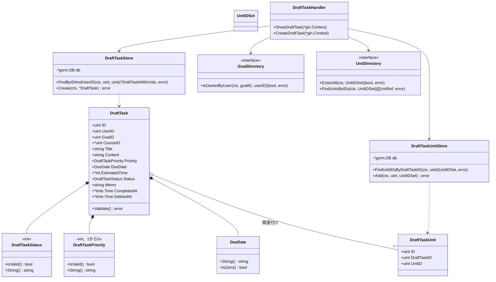
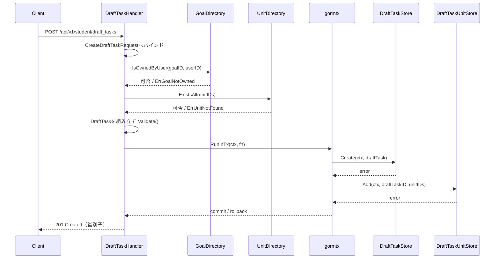
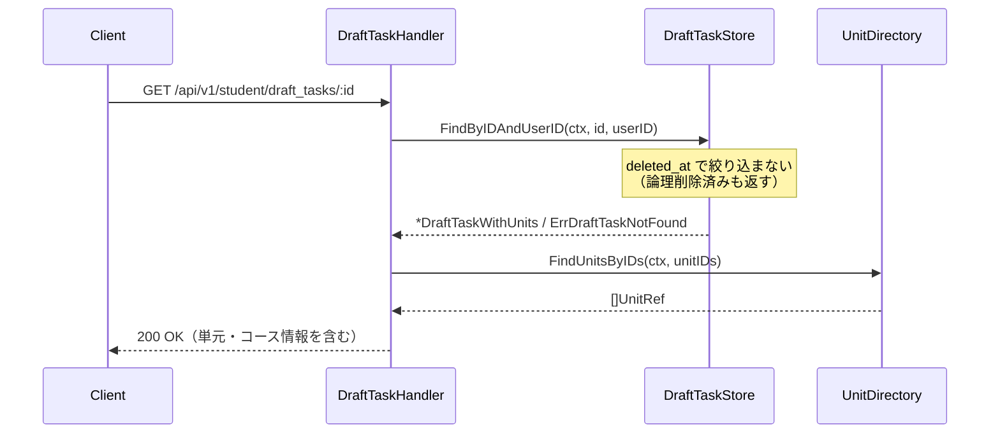
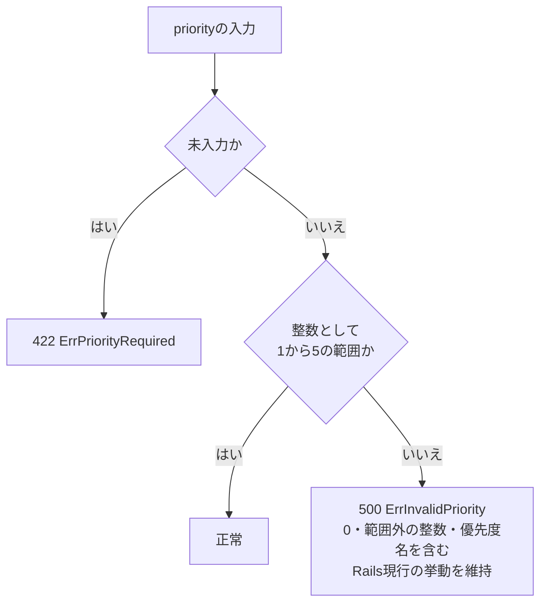
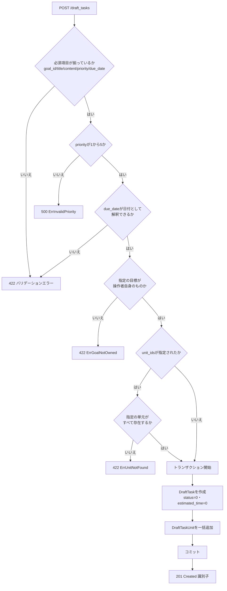

# タスク下書き機能 Go実装仕様書

---

# 1. 機能概要

## 機能概要

生徒が学習タスクを正式に登録する前段階として、内容を下書きの状態で保存できるようにする機能である。提供するAPIは詳細取得と新規作成の2つで、一覧取得・更新・削除は提供しない（①「4. API一覧」のとおりRails現行もルーティング上は定義されているが実装されていない）。

下書きタスクは目標に紐づけて作成し、対象の単元を関連付ける。詳細取得では紐づく単元とその所属コースの情報を含めて返す（①「5. API / 処理詳細」`#show`）。

`status`・`completed_at`は項目として保持するが、本機能に値を変える操作は存在しない。作成時の初期値のまま保たれる（①「7. 状態管理」）。

## 採用設計パターンとその理由（②からの要約）

- 採用パターン: **Active Record**（②「4. 設計パターン」）
- 判断根拠: 詳細取得と新規作成というCRUD中心の業務であり、`status`に本機能スコープ内の遷移ルールが存在しないため
- 採用しなかったパターン: Transaction Script（単元の関連付けの整合をStoreに寄せた方がタスク管理機能と一貫するため）、Domain Model（遷移ルールがなくDomain Model採用基準を満たさないため）、Event Sourcing（変更履歴の再構築・監査要件がないため）

本書はアーキテクチャ規約「3. 設計パターンごとの構造適用方針」のActive Record節の構造（Entity相当のstructとStoreを同一packageに置く、usecase層なし、Repository Interfaceの分離なし）に従って実装レベルへ落とし込む。

## 本書が対象とする実装範囲

②が設計した`draft-task` Bounded ContextのActive Record実装である。Model（Entity相当のstruct定義）、Store（永続化処理）、他Contextへの参照（`dependency.go`のインターフェースとそのアダプタ）、Presentation層（Handler / Request / Response / Routing）を対象とする。

対象外は、目標・単元・コースそのものの管理（他Contextの責務。②「3. Bounded Context」）と、現行Railsに実装されていない一覧取得・更新・削除である。

---

# 2. ディレクトリ構成

## 対象Bounded Context名

- `draft-task`（②「3. Bounded Context」）

## ディレクトリ・パッケージ名

アーキテクチャ規約「4. Bounded Context構成」の「Contextディレクトリの命名」に従い、Context名`draft-task`から`-`を取り除いて連結した全小文字の名前とする。したがってディレクトリ名は`internal/drafttask/`、package名は同じ`drafttask`となる。同規約は`internal/draft_task/`のようにアンダースコアで区切ることを禁じている（package名にアンダースコアを使わないため、ディレクトリ名とpackage名が一致しなくなる）。

Context名とディレクトリ名は規約から機械的に決まるため、②に明記がなくても推測にはならない。

## ②で採用した設計パターン

Active Record（②「4. 設計パターン」）

## 作成するディレクトリ一覧

```
internal/drafttask/
internal/drafttask/infrastructure/contextadapter/
internal/drafttask/presentation/handler/
internal/drafttask/presentation/request/
internal/drafttask/presentation/response/
```

`domain/`・`application/`・`infrastructure/gormrepo/`は作成しない。Active Record採用のためレイヤー分離を行わず、Model・Storeをpackage直下に置く（アーキテクチャ規約「3. 設計パターンごとの構造適用方針」）。`infrastructure/contextadapter/`のみ、他Contextの公開操作へ委譲するアダプタの置き場所として設ける（同「4. Bounded Context構成」）。

## 作成するファイル一覧

```
internal/drafttask/context.go                      # NewContext（依存関係の組み立て）
internal/drafttask/dependency.go                   # 他Contextへの依存を宣言するインターフェースと受け渡し用の型
internal/drafttask/draft_task.go                   # DraftTask struct（Model）+ Validate()
internal/drafttask/draft_task_status.go            # DraftTaskStatus型（整数の列挙型）
internal/drafttask/draft_task_priority.go          # DraftTaskPriority型（整数の列挙型）
internal/drafttask/due_date.go                     # DueDate型（未設定を許容。保存値/表示フォーマットの一元化）
internal/drafttask/draft_task_unit.go              # DraftTaskUnit struct（draft_task_unitsのGORMモデル）
internal/drafttask/errors.go                       # struct/Storeが返すエラー定義
internal/drafttask/draft_task_store.go             # DraftTaskStore（永続化・検索）
internal/drafttask/draft_task_unit_store.go        # DraftTaskUnitStore（関連付けの一括追加・取得）
internal/drafttask/infrastructure/contextadapter/goal_directory.go  # GoalDirectoryの実装
internal/drafttask/infrastructure/contextadapter/unit_directory.go  # UnitDirectoryの実装
internal/drafttask/presentation/handler/draft_task_handler.go
internal/drafttask/presentation/request/draft_task_request.go
internal/drafttask/presentation/response/draft_task_response.go
internal/drafttask/presentation/routes.go
```

## 文書の分割

本書は分割しない。実装ファイルは上記の16であり、テストが付くもの（DraftTask・DraftTaskStatus・DraftTaskPriority・DueDate・DraftTaskStore・DraftTaskUnitStore・2つのアダプタ・DraftTaskHandlerの9）を加えると25となるため、1文書あたり30〜35という範囲に収まる。

---

# 3. Domain層設計

**実装上の位置づけ**: 本機能はActive Record採用のため、domain層・infrastructure層のレイヤー分離を行わない。以下は「Entity」の代わりに「Model（Entity相当）」として、`drafttask`パッケージ直下のstructとして扱う（アーキテクチャ規約「3. 設計パターンごとの構造適用方針」Active Record節）。

## Model（Entity相当）

### DraftTask（`draft_task.go`）

②「6. Entity設計」「7. Value Object設計」に基づくDraftTaskのGoフィールド定義。

|フィールド名|型|意味|
|-|-|-|
|ID|uint|下書きタスクの識別子|
|UserID|uint|所有者（生徒）のユーザーID。②「16. Authorization設計」の所有権確認の材料|
|GoalID|uint|紐づく目標の識別子。`draft_tasks.goal_id`はNULL可だが、Railsの`belongs_to :goal`により登録時は必須である（①「6. データモデル」）。本書でも必須として扱い、`*uint`にしない|
|CourseID|`*uint`|コースの識別子。APIからは入力を受け取らず、現行実装に値を設定する処理が存在しない。カラムがNULL可であるためポインタとする（①「6. データモデル」）|
|Title|string|タイトル。必須項目。`draft_tasks.title`は`string(100)`である|
|Content|string|内容。必須項目。`draft_tasks.content`はNOT NULLである|
|Priority|DraftTaskPriority|優先度。②「7. Value Object設計」のDraftTaskPriorityを型として保持|
|DueDate|DueDate|期限日。②「7. Value Object設計」のDueDateを型として保持|
|EstimatedTime|`*int`|見積時間。APIからは入力を受け取らず、作成時に`0`を設定する（①「5. API / 処理詳細」`#create`）。カラムはNULL可であり既存データにNULLが存在し得るためポインタとする|
|Status|DraftTaskStatus|状態。APIの入力では受け取らず、作成時の`not_started`のまま保たれる（①「7. 状態管理」）|
|Memo|string|メモ。任意項目。**レスポンスには含まれない**（①「6. データモデル」）|
|CompletedAt|`*time.Time`|完了日時。現行実装に値を設定する操作が存在しないため、常に`nil`である（①「7. 状態管理」）|
|DeletedAt|`*time.Time`|論理削除日時。下記のとおり`gorm.DeletedAt`を使わない|
|CreatedAt|time.Time|作成日時（Gorm規約「4. タイムスタンプのトラッキング」によりGORMが設定する）|
|UpdatedAt|time.Time|更新日時（同）|

公開メソッド:

|メソッド|引数|戻り値|責務|
|-|-|-|-|
|`(d *DraftTask) Validate() error`|なし|`error`|Title・Contentの必須チェック、DueDateの設定有無と妥当性、Priority・Statusの許容値チェックを行う（②「15. Validation設計」）。ロジックの実装内容は本書では規定しない|

不変条件: Title・Contentが空でないこと、DueDateが設定済みかつ妥当な値であること、Priority・Statusが許容値の範囲内であること。

`Status`・`CompletedAt`・`EstimatedTime`・`CourseID`はAPIの入力に含めない。作成時は`Status`を`not_started`（①「6. データモデル」のとおりカラムの既定値が`0`）、`CompletedAt`を`nil`、`EstimatedTime`を`0`、`CourseID`を`nil`とする。状態を変える操作は本機能に存在しないため、状態を反映するメソッドも設けない。

`DeletedAt`は`gorm.DeletedAt`ではなく`*time.Time`としてマッピングする。Gorm規約「0. 本プロジェクトでの採用方針」の論理削除は`gorm.DeletedAt`の使用を定めているが、これは**削除操作を実装する場合の規定**である。本機能には削除操作が存在せず、`gorm.DeletedAt`を使うと`Find`系が`deleted_at IS NULL`を自動付与してしまう。`DraftTask`は`default_scope`を持たず、Rails現行は論理削除済みのレコードも返すため（①「6. データモデル」）、自動付与が入ると外部仕様が変わる。フロントエンドを変更しない方針により、絞り込みが入らない型を選ぶ（「15. GORM / DBクエリ設計」）。

### DraftTaskStatus（`draft_task_status.go`）

②「7. Value Object設計」のDraftTaskStatusに対応する型。Active Record方針上、独立したValue Object層は設けず、DraftTaskの構成要素としてpackage内の付随型として扱う。

|項目|内容|
|-|-|
|型定義|`type DraftTaskStatus int`|
|許容値|`DraftTaskStatusNotStarted`（0）/ `DraftTaskStatusInProgress`（1）/ `DraftTaskStatusCompleted`（2）を`iota`で宣言する（コーディング規約「3. 命名規則」の「定数のグループ化と`iota`」）|
|公開メソッド|`IsValid() bool`、`String() string`（`not_started` / `in_progress` / `completed`を返す。`stringer`で生成する）|

`draft_tasks.status`はRailsの`enum`として**整数**で保持される（`not_started`=0 / `in_progress`=1 / `completed`=2。①「6. データモデル」）。そのため型を`int`とし、整数カラムへそのまま対応させる。APIの出力は文字列であるため、Response DTOへ入れる際に`String()`で変換する（コーディング規約「3. 命名規則」）。

文字列から変換する関数は設けない。APIの入力として状態を受け取らないためである。

### DraftTaskPriority（`draft_task_priority.go`）

②「7. Value Object設計」のDraftTaskPriorityに対応する型。

|項目|内容|
|-|-|
|型定義|`type DraftTaskPriority int`|
|許容値|`DraftTaskPriorityVeryLow`（1）/ `Low`（2）/ `Normal`（3）/ `High`（4）/ `VeryHigh`（5）。`iota + 1`で宣言する|
|公開メソッド|`IsValid() bool`、`String() string`（`very_low` / `low` / `normal` / `high` / `very_high`を返す）、`NewDraftTaskPriority(raw int) (DraftTaskPriority, error)`|

`draft_tasks.priority`はRailsの`enum`として**整数**で保持される（`very_low`=1 〜 `very_high`=5。既定値は3。**0は使っていない**。①「6. データモデル」）。`iota`をそのまま使うと0から始まり既存データと食い違うため、`iota + 1`で宣言する。

入力は**整数のみ**を受け取る。Rails現行の`Student::CreateDraftTaskForm`は、タスク管理機能の`PriorityCastable`に相当する優先度名から整数への変換を持たない（①「10. Rails実装対応表」）。入力の扱いは次のとおり。

|入力|Rails現行|本書|
|-|-|-|
|`1`〜`5`|正常|正常|
|未入力|必須チェックで**422**|同じ（`ErrPriorityRequired`を返し422へ変換する）|
|`0`|Form属性のinteger型変換を経ても`0`。`0`は未入力として扱われないため必須チェックを通過し、保存時に優先度として解釈できず**500**|同じ（`ErrInvalidPriority`を返し500へ変換する）|
|`9`等の範囲外の整数|同じく**500**|同じ|
|`normal`等の優先度名|Form属性のinteger型変換で`0`になり、同じく**500**|同じ（Request DTOで整数として受け取り、変換できない文字列は`0`として扱う）|

許容値外を422ではなく500とするのは、Rails現行の挙動を維持する方針によるものである。フロントエンドを変更しないため、ステータスコードを変えない（②「17. Error設計」の「Rails現行の挙動を維持するもの」）。

**タスク管理機能との違い**: タスク管理機能は優先度名も受け取り、定義されていない数値は422、定義されていない優先度名は500という使い分けになる。本機能は整数のみを受け取るため、未入力が422、それ以外の許容値外はすべて500である。同じ「優先度」でも入力の扱いが異なるため、型を共有しない。

### DueDate（`due_date.go`）

②「7. Value Object設計」のDueDateに対応する型。

|項目|内容|
|-|-|
|保持するフィールド|内部に`*time.Time`相当の値を1つ保持する（保存値。未設定を`nil`で表す）|
|生成方法|文字列から生成するコンストラクタ相当の関数（引数・戻り値のみ規定し、パース処理の実装内容は本書では規定しない）|
|公開メソッド|`String() string`（`YYYY/MM/DD`形式の表示用文字列を返す。未設定なら空文字列）、`IsZero() bool`|

入力はRailsと同じく**文字列**で受け取り、日付として解釈できるかを検証する。Rails現行は`Date.parse`で検証しており、特定のフォーマットに限定していない（①「5. API / 処理詳細」`#create`）。したがって本書でも単一のフォーマットに固定せず、日付として解釈できることを条件とする。解釈できない場合は`ErrInvalidDueDate`を返し、メッセージは`Due date は正しい日付を入力してください`を踏襲する。

型としては未設定（`nil`）を許容する。`draft_tasks.due_date`がNULL可で既存データに未設定の下書きタスクが存在しうるためである。一方、作成のRequest DTOでは必須とする（①「5. API / 処理詳細」`#create`）。

比較用のメソッドは設けない。本機能に期限の前後を比較する業務要件がないためである（タスク管理機能・目標管理機能とは異なる）。

### DraftTaskUnit（`draft_task_unit.go`）

下書きタスクと単元の関連付けを表すGORMモデルである（①「6. データモデル」の`draft_task_units`）。

|フィールド名|型|意味|
|-|-|-|
|ID|uint|識別子|
|DraftTaskID|uint|下書きタスクの識別子|
|UnitID|uint|単元の識別子|
|CreatedAt|time.Time|作成日時|
|UpdatedAt|time.Time|更新日時|

`draft_task_units`は`draft_task_id`と`unit_id`の組に一意インデックスを持つため、同じ単元を同じ下書きタスクに重複して関連付けられない（①「6. データモデル」）。

テーブル名は`draft_task_units`であり、struct名`DraftTaskUnit`の既定の複数形と一致するため、`TableName()`のオーバーライドは不要である。

`draft_task_courses`に対応するモデルは定義しない。現行実装に書き込む処理が存在せず、本Contextで扱う必要がないためである（①「6. データモデル」、②「21. DB操作仕様」）。

## Value Object

対象外（Active Record採用のため独立したValue Object層は設けない）。②が設計したDraftTaskPriority・DueDate・DraftTaskStatusは、上記のとおりDraftTaskと同一package内の付随型として扱う。②「7. Value Object設計」の「Value Objectを採用しないもの」（タイトル・内容・メモ）は単純な`string`フィールドとする。

## Repository Interface

対象外（Active Record採用のため、domain層にRepository Interfaceを定義しない。永続化・検索はEntity相当のstructと同一package内のStoreとして「8. Infrastructure層設計」に記載する）。

他Contextへの参照のみ、インターフェースとして`dependency.go`に宣言する。②「11. Repository設計」の「他Contextの参照手段」に対応する（規約「5. Context間連携ルール」）。詳細は「8. Infrastructure層設計」に記載する。

## Domain Service

対象外。②「8. Domain Service」のとおり、複数Entityを横断する業務ルールは本機能のスコープに存在しないため不要と判断されている。

## Domain Event

対象外。②「18. Domain Event」のとおり、非同期の副作用が現行仕様に存在しないため採用しない。

## Domain Error（struct/Storeが返すエラー）

②「17. Error設計」に対応する内容を、`errors.go`内のセンチネルエラー（`error`型の変数）として定義する。

|エラー|発生条件|メッセージ|
|-|-|-|
|`ErrGoalRequired`|`goal_id`が未入力の場合|`Goal を入力してください`|
|`ErrGoalNotOwned`|指定された目標が操作者自身のものでない（存在しない場合を含む）|`Goal が不正です`|
|`ErrTitleRequired`|`Validate()`時にTitleが空の場合|`Title を入力してください`|
|`ErrContentRequired`|`Validate()`時にContentが空の場合|`Content を入力してください`|
|`ErrPriorityRequired`|優先度が未入力の場合|`Priority を入力してください`|
|`ErrInvalidPriority`|優先度が`1`〜`5`以外の場合（`0`・範囲外の整数・優先度名を渡した場合を含む）|—（500へ変換する。「14. Error実装方針」）|
|`ErrDueDateRequired`|`Validate()`時にDueDateが未設定の場合|`Due date を入力してください`|
|`ErrInvalidDueDate`|DueDateの生成・`Validate()`時に、日付として解釈できない値が渡された場合|`Due date は正しい日付を入力してください`|
|`ErrUnitNotFound`|指定された単元のいずれかが存在しない|`Unit ids に不正な値が含まれています`（**1件**。タスク管理機能では2件返る）|
|`ErrInvalidDraftTaskStatus`|`Validate()`時に状態が許容値外の場合|—（内部エラー。APIの入力で状態を受け取らないため、通常は発生しない）|
|`ErrDraftTaskNotFound`|`DraftTaskStore`が指定ID・所有者に一致する下書きタスクを取得できなかった場合（他の生徒のものを指定した場合を含む）|—（「14. Error実装方針」で404へ変換する）|

メッセージの文言は①のとおり項目名が英語のまま出る形を維持する。フロントエンドを変更しない方針のためである（②「17. Error設計」の「エラーレスポンスの本文」）。

`ErrUnitNotFound`は、Rails現行と同じく**1件のみ**返す。タスク管理機能は検証が2回登録されているため2件返るが、本機能のFormは1回のみである（①「5. API / 処理詳細」`#create`）。

---

# 4. クラス図



Active Record採用のためRepository Interfaceは存在せず、`DraftTaskStore`・`DraftTaskUnitStore`が`DraftTask`と同一package内で永続化を担う。他Contextへの依存のみ、インターフェースとして本Contextに置く（コーディング規約「7. インターフェース」）。実装は`infrastructure/contextadapter/`に閉じ込める。

`DraftTask`に状態を変えるメソッドがないのは、本機能に状態を変える操作が存在しないためである（①「7. 状態管理」）。

---

# 5. 状態遷移図

省略する。

②「10. 状態遷移図」のとおり、本機能のスコープ内で`DraftTaskStatus`が遷移することはない。`status`は作成時の`not_started`を保持するのみであり、値を変える操作が現行実装に存在しない（①「7. 状態管理」）。図示すべき遷移が存在しないため省略する。

将来的に下書きから正式タスクへの変換操作等が実装され、状態を変える処理が加わった場合は、あらためて状態遷移図を作成する。

論理削除（`deleted_at`）についても、値を設定する操作が存在しないため遷移として扱わない。

---

# 6. Application層設計

対象外（Active Record採用のため、usecase層を設けない。②「12. UseCase設計」に記載されたShowDraftTask / CreateDraftTaskの業務操作は、HandlerがStoreと他Contextの参照手段を直接呼び出す処理として実装する。処理順序は「9. Presentation層設計」のHandler処理順序に統合して記載する）。

---

# 7. シーケンス図・処理フロー図

## シーケンス図

### CreateDraftTask



### ShowDraftTask



## 処理フロー図

### 優先度の入力の扱い

分岐が多く、かつタスク管理機能と扱いが異なるため図示する。



### CreateDraftTask



詳細取得は分岐が所有権の確認のみであるため、処理フロー図は省略する。処理順序は「9. Presentation層設計」のHandler処理順序に記載したとおりである。

---

# 8. Infrastructure層設計

**実装上の位置づけ**: 本機能はActive Record採用のため、Repository Interfaceの実装という形は取らない。②「11. Repository設計」で定義された責務を、Model（DraftTask / DraftTaskUnit）と同一package内のStoreとして実装する。

## Store実装

### DraftTaskStore（`draft_task_store.go`）

|項目|内容|
|-|-|
|struct名|`DraftTaskStore`|
|対応するGORMモデル|`DraftTask`struct自体をGORMモデルとして扱う（詳細は「15. GORM / DBクエリ設計」参照）|
|保持するフィールド|`db *gorm.DB`|
|コンストラクタ|`NewDraftTaskStore(db *gorm.DB) *DraftTaskStore`|

メソッド一覧:

|メソッド|引数|戻り値|発行するクエリ内容|
|-|-|-|-|
|`FindByIDAndUserID`|`ctx context.Context, id, userID uint`|`(*DraftTaskWithUnits, error)`|id・user_idの両方に一致する1件取得。紐づく単元の識別子も一括取得する。一致しない場合は`ErrDraftTaskNotFound`（他の生徒のものを含む404相当。②「16. Authorization設計」の所有権確認をクエリ条件として実現する）|
|`Create`|`ctx context.Context, draftTask *DraftTask`|`error`|DraftTaskレコードの新規作成。`status`は`DraftTaskStatusNotStarted`（0）、`estimated_time`は`0`、`completed_at`・`course_id`は未設定で作成する（①「5. API / 処理詳細」`#create`）|

**`deleted_at`による絞り込みを行わない。** `DraftTask`は`default_scope`を持たず、Rails現行は論理削除済みのレコードも返すためである（①「6. データモデル」、②「11. Repository設計」）。`Goal`・`Task`のStoreとは異なる点であり、実装時に他機能のStoreから条件をコピーしないよう注意する。

一覧取得・更新・削除のメソッドは設けない。現行Railsに実装がなく、②「11. Repository設計」の「保持しない責務」に明記されているためである。

各メソッドは`gormtx.DBFromContext(ctx, s.db)`で接続を取得する。トランザクション中であればその接続を、そうでなければ通常の接続を使う（「11. Transaction実装方針」）。

`DraftTaskWithUnits`（`draft_task.go`で定義する）は、下書きタスクとその紐づく単元の識別子を一括取得した結果を表す型である。単元を個別に問い合わせるN+1を避けるために設ける（Gorm規約「0. 本プロジェクトでの採用方針」の「リレーションの取得とN+1対策」）。フィールドは`DraftTask *DraftTask`と`UnitIDs UnitIDSet`である。

単元の表示用の情報（単元名・所属コース）は`draft_tasks`との結合では取得しない。`units`・`courses`は他Contextが所有するため、`UnitDirectory`経由で取得する（②「11. Repository設計」）。

②「11. Repository設計」に明記のとおり、業務ルール判定・認可判定はStoreに持たせない。所有権の確認は「idとuser_idが一致するレコードを取得できるか」というクエリ条件として表現し、判定ロジック自体はHandler側の処理順序で扱う。

### DraftTaskUnitStore（`draft_task_unit_store.go`）

|項目|内容|
|-|-|
|struct名|`DraftTaskUnitStore`|
|対応するGORMモデル|`DraftTaskUnit`（テーブル名`draft_task_units`）|
|保持するフィールド|`db *gorm.DB`|
|コンストラクタ|`NewDraftTaskUnitStore(db *gorm.DB) *DraftTaskUnitStore`|

メソッド一覧:

|メソッド|引数|戻り値|発行するクエリ内容|
|-|-|-|-|
|`FindUnitIDsByDraftTaskID`|`ctx context.Context, draftTaskID uint`|`(UnitIDSet, error)`|draft_task_id一致で紐づくunit_idの集合を取得する|
|`Add`|`ctx context.Context, draftTaskID uint, unitIDs UnitIDSet`|`error`|指定された単元分のレコードを一括作成する。空の集合が渡された場合はクエリを発行しない|

関連付けの更新・削除のメソッドは設けない。現行Railsに実装がなく、②「11. Repository設計」の「保持しない責務」に明記されているためである。

`Add`も`gormtx.DBFromContext`で接続を取得する。これにより、Handlerが開始したトランザクションに`DraftTaskStore`と同じ接続で参加する。`NewDraftTaskUnitStore(tx)`のようにトランザクション用の`*gorm.DB`を渡してStoreを再生成する方式は採らない（アーキテクチャ規約「11. Transaction実装パターン（TransactionManager）」）。

## 他Contextの参照手段の実装

`dependency.go`で宣言したインターフェースの実装である。相手Contextが公開する操作へ委譲し、本Contextから相手のテーブルへクエリを発行しない（アーキテクチャ規約「5. Context間連携ルール」、②「11. Repository設計」）。いずれもGORMに依存せず相手Contextの公開操作を呼ぶアダプタであるため`infrastructure/contextadapter/`に置く（同「4. Bounded Context構成」）。

|インターフェース|相手Context|メソッド|責務|
|-|-|-|-|
|`GoalDirectory`|`goal-management`|`IsOwnedByUser(ctx context.Context, goalID, userID uint) (bool, error)`|指定の目標が操作者自身のものかを返す。作成時の`goal_id`の検証に用いる（①「5. API / 処理詳細」`#create`）|
|`UnitDirectory`|`curriculum`|`ExistsAll(ctx context.Context, unitIDs UnitIDSet) (bool, error)`|指定された単元がすべて存在するかを返す|
||`curriculum`|`FindUnitsByIDs(ctx context.Context, unitIDs UnitIDSet) ([]UnitRef, error)`|レスポンスに含める単元の情報を返す|

`UnitIDSet`・`UnitRef`（`dependency.go`で定義する）は、それぞれ単元の識別子の集合と、レスポンスに含める単元の情報を表す型である。`UnitRef`のフィールドは識別子・所属コースの識別子・単元名と、所属コースの情報（識別子・レベル番号・レベル名）である（①「5. API / 処理詳細」`#show`）。相手Contextの内部structをそのまま受け取らず、本Contextが必要とする項目だけを持つ型で受け取る（アーキテクチャ規約「5. Context間連携ルール」の「相手Contextの内部Entity・Value Object・Infrastructure実装に直接依存しない」）。

**②からの補足**: 相手Contextが公開する操作の具体的なシグネチャは、各機能の③で確定する。本書では消費者側のインターフェースをコーディング規約「7. インターフェース」の方針に従って本Contextに置き、実装をアダプタに閉じ込める。

タスク管理機能の③も同じ2つの参照手段を必要とする。インターフェースは各Contextが自身の`dependency.go`に持つため共有しないが、相手Contextが公開する操作は同一のものを呼ぶ。シグネチャを合わせる（同機能③「8. Infrastructure層設計」）。

## 外部連携実装

対象外。②にMail・Cache・Queue等の外部連携は記載されていない。

---

# 9. Presentation層設計

## Handler

### DraftTaskHandler（`presentation/handler/draft_task_handler.go`）

|項目|内容|
|-|-|
|struct名|`DraftTaskHandler`|
|対応する呼び出し先|`DraftTaskStore`、`DraftTaskUnitStore`、`GoalDirectory`、`UnitDirectory`（Active Record採用のためUseCaseを経由せず直接呼び出す）|
|コンストラクタ|`NewDraftTaskHandler(store *DraftTaskStore, unitStore *DraftTaskUnitStore, goals GoalDirectory, units UnitDirectory) *DraftTaskHandler`|

メソッド一覧（HTTPメソッド・パス対応）:

|メソッド|HTTPメソッド|パス|
|-|-|-|
|`ShowDraftTask`|GET|/api/v1/student/draft_tasks/:id|
|`CreateDraftTask`|POST|/api/v1/student/draft_tasks|

処理順序（UseCase層を経由しない分、本来UseCaseが担う手順をここに明記する）:

### ShowDraftTask

1. `c.Request.Context()`からcurrent user（認証Middlewareが格納したstudentユーザー）を取得する（②「16. Authorization設計」）
2. パスパラメータ`id`を読み取る
3. `store.FindByIDAndUserID`をid・current userのIDで呼び出す。一致しなければ`ErrDraftTaskNotFound`
4. `ErrDraftTaskNotFound`を404のAppErrorへ変換して`c.Error(err)`で返す（「14. Error実装方針」）
5. `unitDirectory.FindUnitsByIDs`で単元の情報を取得する
6. `DraftTaskResponse`へ変換する。`memo`は含めない（①「6. データモデル」）
7. 200 OKで返す

### CreateDraftTask

1. current userを取得する
2. `CreateDraftTaskRequest`へバインドする（`draft_task`キーでネストした本文。②「15. Validation設計」）
3. `NewDraftTaskPriority`で優先度を変換する。未入力なら`ErrPriorityRequired`（422）、`1`〜`5`以外なら`ErrInvalidPriority`（500）
4. `goalDirectory.IsOwnedByUser`で指定された目標が操作者自身のものか確認する。偽なら`ErrGoalNotOwned`（①「5. API / 処理詳細」`#create`）
5. `unit_ids`が指定されている場合、`unitDirectory.ExistsAll`で存在確認する。偽なら`ErrUnitNotFound`（1件）
6. Request DTOからDraftTaskを組み立てる。`UserID`はcurrent userのID、`Status`は`DraftTaskStatusNotStarted`、`EstimatedTime`は`0`、`CompletedAt`・`CourseID`は未設定とする
7. `draftTask.Validate()`で業務ルール検証を行う。エラーは422のAppErrorへ変換する
8. `gormtx.RunInTx`でトランザクションを開始し、`store.Create`と`unitStore.Add`を順に呼ぶ（②「14. Transaction設計」）
9. 作成された下書きタスクの識別子を**201 Created**で返す（①「5. API / 処理詳細」`#create`）

## Request / Response DTO

### Request（`presentation/request/draft_task_request.go`）

|struct名|フィールド|型|検証|
|-|-|-|-|
|`CreateDraftTaskRequest`|DraftTask|`CreateDraftTaskBody`|`binding:"required"`。リクエストボディは`draft_task`キーでネストする（①「5. API / 処理詳細」`#create`の`params.require(:draft_task)`）|
|`CreateDraftTaskBody`|GoalID|uint|`json:"goal_id" binding:"required"`|
||Title|string|`json:"title" binding:"required"`|
||Content|string|`json:"content" binding:"required"`|
||Priority|`*int`|`json:"priority" binding:"required"`。**整数**として受け取る。`0`と未入力を区別する必要があるためポインタとする|
||DueDate|string|`json:"due_date" binding:"required"`。日付として解釈できることを検証する。フォーマットは固定しない|
||Memo|string|`json:"memo"`。任意|
||UnitIDs|`[]uint`|`json:"unit_ids"`。任意。空文字を除いて整数として扱う（①「5. API / 処理詳細」`#create`）|

`status`・`completed_at`・`estimated_time`・`course_id`は入力として受け取らない。

`Priority`を`*int`とするのは、`0`が渡された場合（500）と未入力の場合（422）を区別する必要があるためである。`binding:"required"`は`0`を未入力と見なすため、タグだけでは区別できない。優先度名のような整数として解釈できない文字列が渡された場合は`0`として扱い、500とする（Rails現行がForm属性のinteger型変換で同じ結果になるため。「3. Domain層設計」）。

パスパラメータ`id`（詳細）は必須・整数として検証する。

### Response（`presentation/response/draft_task_response.go`）

|struct名|フィールド|型|JSONキー|
|-|-|-|-|
|`DraftTaskResponse`|ID|`uint`|`id`|
||UserID|`uint`|`user_id`|
||GoalID|`*uint`|`goal_id`|
||Title|`string`|`title`|
||Content|`string`|`content`|
||DueDate|`*string`|`due_date`（`YYYY/MM/DD`形式。未設定なら`null`）|
||Priority|`string`|`priority`|
||Status|`string`|`status`|
||CompletedAt|`*string`|`completed_at`（`YYYY/MM/DD`形式。未設定なら`null`）|
||Units|`[]UnitResponse`|`units`|
|`UnitResponse`|ID|`uint`|`id`|
||CourseID|`uint`|`course_id`|
||UnitName|`string`|`unit_name`|
||Course|`CourseResponse`|`course`|
|`CourseResponse`|ID|`uint`|`id`|
||LevelNumber|`int`|`level_number`|
||LevelName|`string`|`level_name`|

- **詳細**: 最上位をラップせず`DraftTaskResponse`をそのまま返す（①「5. API / 処理詳細」`#show`）
- **作成**: 作成された下書きタスクの識別子のみを返す。ラップしたstructを設けず識別子をそのまま返す（①「5. API / 処理詳細」`#create`）
- `memo`はレスポンスに含めない。Rails現行の`DraftTaskSerializer`が返していないためである（①「6. データモデル」）
- `DraftTaskResponse.Status`・`Priority`は整数ではなく文字列を入れる。Modelの型は整数の列挙型であるため、`String()`で変換してから設定する（「3. Domain層設計」）
- `GoalID`を`*uint`とするのは、`draft_tasks.goal_id`がNULL可であり既存データにNULLが存在し得るためである。入力では必須だが出力では`null`を返しうる（①「6. データモデル」）
- タスク管理機能の詳細が単元ごとに持つ`started`（学習開始済みか）は、本機能のレスポンスには含めない（①「5. API / 処理詳細」`#show`）
- エラーレスポンスは専用structを本書で定義しない。形式は「14. Error実装方針」のとおりであり、集中エラーハンドリングミドルウェアが組み立てる

## Routing（`presentation/routes.go`）

|Method|Path|Handler|
|-|-|-|
|GET|/api/v1/student/draft_tasks/:id|DraftTaskHandler.ShowDraftTask|
|POST|/api/v1/student/draft_tasks|DraftTaskHandler.CreateDraftTask|

いずれのルートも認証Middleware・`student`ロール確認Middlewareを経由する（②「16. Authorization設計」）。`POST`はCookieで認可される状態変更であるため、CSRF検証Middlewareの対象にも含める（Gin規約「5. CSRF対策」の「適用範囲」）。詳細取得はGETのため対象外である。

一覧取得・更新・削除の経路は定義しない。Rails現行は`resources :draft_tasks`により経路だけが存在するが、対応するアクションが実装されていないため（①「4. API一覧」）。

---

# 10. API仕様

|Method|Path|Handler|Request|Response|Status Code|
|-|-|-|-|-|-|
|GET|/api/v1/student/draft_tasks/:id|ShowDraftTask|パス: `id`|`DraftTaskResponse`|200|
|POST|/api/v1/student/draft_tasks|CreateDraftTask|`CreateDraftTaskRequest`|作成した下書きタスクの識別子|201|

作成が201であるのは、①「5. API / 処理詳細」のとおり`#create`が`status: :created`を返しているためである。

エラーレスポンスの本文は「14. Error実装方針」のとおり、422が`{"errors": [...]}`、404のみ`{"message": "Draft taskが見つかりません"}`である。

各Endpointのエラーケース:

## 全Endpoint共通

|条件|Status Code|Error内容|
|-|-|-|
|未認証|401|認証Middlewareが返す（②「16. Authorization設計」）|
|`student`ロールでない|403|ロール確認Middlewareが返す|
|`POST`でCSRFトークンが不正|403|CSRF検証Middlewareが返す（Gin規約「5. CSRF対策」）|

認証・認可・CSRFのステータスコードは本機能で定めるものではなく、該当Middlewareの仕様に従う。

## GET /api/v1/student/draft_tasks/:id

|条件|Status Code|Error内容|
|-|-|-|
|対象が存在しない、または他の生徒の下書きタスクである|404|`ErrDraftTaskNotFound`（①「5. API / 処理詳細」`#show`）|

論理削除済みの下書きタスクは404にならず、200で返る（①「5. API / 処理詳細」`#show`の業務ルール）。

## POST /api/v1/student/draft_tasks

|条件|Status Code|Error内容|
|-|-|-|
|`goal_id` / `title` / `content` / `priority` / `due_date`の未入力|422|バリデーションエラー|
|`due_date`が日付として解釈できない|422|`ErrInvalidDueDate`|
|指定された目標が操作者自身のものでない（存在しない場合を含む）|422|`ErrGoalNotOwned`|
|指定された単元のいずれかが存在しない|422|`ErrUnitNotFound`（**1件**）|
|`priority`が`1`〜`5`以外（`0`・範囲外の整数・優先度名を渡した場合を含む）|**500**|`ErrInvalidPriority`。Rails現行の挙動を維持する（②「17. Error設計」）|
|`title`が100文字を超えた|**500**|DBの制約違反。Rails現行の挙動を維持する（②「17. Error設計」）|

---

# 11. Transaction実装方針

## Transaction開始位置

②「14. Transaction設計」のとおり、`CreateDraftTask`はHandlerの処理単位でトランザクションを開始する。`DraftTaskStore`と`DraftTaskUnitStore`の2つのStore操作にまたがるため、Storeメソッド内では境界を取れない。

`gormtx.RunInTx(ctx, db, func(ctx context.Context, tx *gorm.DB) error { ... })`を用いる。`db.WithContext(ctx).Transaction(...)`を直接呼ばない。呼び出し側が既に開始したトランザクションに参加せず、独立した2つ目を開始してしまうためである（アーキテクチャ規約「11. Transaction実装パターン（TransactionManager）」）。

他Contextの参照（`GoalDirectory` / `UnitDirectory`）は読み取りであり、トランザクションの外で行う（②「14. Transaction設計」）。

## Transaction終了位置

- `CreateDraftTask`: DraftTaskの作成と単元の関連付けの追加が完了した時点でコミットする。いずれかが失敗した場合はロールバックする
- `ShowDraftTask`: 読み取りのみのためトランザクションを使用しない（②「14. Transaction設計」）

## 呼び出し側トランザクションの引き継ぎ

本Contextには他Contextから呼ばれる公開操作が存在しないため、呼び出し側のトランザクションを引き継ぐ経路はない。ただし各Storeメソッドは`gormtx.DBFromContext(ctx, s.db)`で接続を取得するため、将来他Contextから呼ばれる操作が追加された場合も引き継ぎが成立する。

## 複数Storeにまたがる場合の扱い

`CreateDraftTask`は`DraftTaskStore`と`DraftTaskUnitStore`にまたがる。両Storeが`gormtx.DBFromContext`で接続を取得するため、Handlerが`RunInTx`で開始したトランザクションに同じ接続で参加する。トランザクション用の`*gorm.DB`を渡してStoreを再生成しない。

---

# 12. Validation実装方針

## Presentation

- `CreateDraftTaskRequest`のバインド時に、Ginのbindingタグで型チェック・必須チェックを行う（②「15. Validation設計」）
- `priority`は整数として受け取る。`0`と未入力を区別するためポインタで受け取り、`binding:"required"`だけに委ねない
- `due_date`は文字列で受け取り、日付として解釈できるかはDomain側（`DueDate`の生成）で検証する。Presentation層ではフォーマットを固定しない（①「5. API / 処理詳細」`#create`）
- `unit_ids`は配列として受け取り、空文字を除いて整数として扱う
- パスパラメータ`id`は整数として読み取り、解釈できない場合は422とする

## 業務ルール検証

Active Record採用のため、DraftTask（Model）の`Validate()`メソッドで検証する。

- Title・Contentが空でないこと（長さは検証しない。下記）
- DueDateが設定済みであり、かつ日付として妥当な値であること
- Priority・Statusが許容値の範囲内であること

Titleの長さは検証しない。`draft_tasks.title`は`string(100)`であり超過するとDBの制約で失敗して500になるが、Rails現行も長さを検証しておらず同じく500になる（①「6. データモデル」）。検証を加えると同じ入力に対するステータスコードが500から422へ変わり、フロントエンドから見える挙動が変わる。フロントエンドを変更しない方針を優先する（②「17. Error設計」の「Rails現行の挙動を維持するもの」）。

Model単体では完結しない検証は、Handlerが他Contextの参照手段を呼び出して行う。

|検証|呼び出す先|
|-|-|
|指定された目標が操作者自身のものか|`GoalDirectory.IsOwnedByUser`|
|指定された単元がすべて存在するか|`UnitDirectory.ExistsAll`|

所有権の確認（他の生徒の下書きタスクへのアクセスの禁止）は、`Validate()`ではなくStoreの検索条件（`FindByIDAndUserID`）として実現する。②「11. Repository設計」で「業務ルール判定をStoreに持たせない」とされているため、判定そのものはHandler側の処理順序に含め、Storeはその判定に必要なクエリ条件のみを提供する。

---

# 13. Authorization実装方針

- Middlewareで行う処理: 認証済みユーザーの特定と`context.Context`への格納、役割（`student`）であることの確認（②「16. Authorization設計」Middleware節）
- Handlerで行う処理: `context.Context`からcurrent userを取り出し、Store呼び出し時の`user_id`として使用する。具体的な業務権限判定はHandler自体には持たせず、Store呼び出しの条件として委譲する
- Store／Modelで行う処理: `DraftTaskStore.FindByIDAndUserID`がid・user_idの両方一致を検索条件とすることで所有権の確認を実現する。DraftTask（Model）自体は`UserID`フィールドを保持し、所有権確認の材料を提供するのみで、判定ロジックは持たない（②「16. Authorization設計」）
- 作成時の目標の確認: `GoalDirectory.IsOwnedByUser`に「その目標が操作者自身のものか」を問う形で確認する。他の生徒の目標に下書きタスクを紐づけられない（①「8. 権限制御」）
- CSRF: `POST`はCookieで認可される状態変更であるため、CSRF検証Middlewareの対象に含める（Gin規約「5. CSRF対策」の「適用範囲」）。GETの詳細取得は対象外である

本Contextには他Contextから呼ばれる公開操作が存在しないため、認可を行わない経路はない。

---

# 14. Error実装方針

## Domain Error → Application Errorへの変換方針

Active Record採用のためDomain Errorに相当する層がなく、`errors.go`のセンチネルエラーをそのままApplication Error相当として扱う（アーキテクチャ規約「12. Error変換パターン（AppError）」の「Transaction Script / Active Record採用時の変換」）。センチネルエラーから`internal/shared/apperror`の`AppError`を実装した型への変換は、Storeまたは呼び出し元のHandlerで`errors.Is`により判別して行う。

## Application Error → HTTPレスポンスへの変換方針

Gin規約「8. エラーハンドリングミドルウェア」の集中エラーハンドリングミドルウェアに変換を集約する。Handlerは`c.Error(err)`でエラーを登録するのみとし、個々のHandlerでステータスコードを判定しない。ミドルウェアが`errors.As`で`AppError`を1回だけ判定し、`StatusCode()`でステータス、`LogLevel()`でログレベルを決める。

レスポンスのボディは、②「17. Error設計」の「エラーレスポンスの本文」のとおりRails現行の形を維持する。

|条件|HTTP Status|ボディ|
|-|-|-|
|入力・業務検証の失敗|422|`{"errors": ["メッセージ", ...]}`。エラーが1件でも配列で返す（アーキテクチャ規約「15. API規約（レスポンス形式・ページネーション・URL・クエリパラメータ）」の「エラーレスポンス」）|
|`ErrDraftTaskNotFound`|404|`{"message": "Draft taskが見つかりません"}`。`message`の単一文字列であり、`errors`の配列ではない|
|`ErrInvalidPriority`・その他の未分類のエラー|500|`{"errors": [...]}`|
|認証・認可・CSRF|401 / 403|`{"errors": [...]}`。該当Middlewareが組み立てる|

404のみ本文の形が異なるため、ミドルウェアは`AppError`から得たステータスが404の場合に`message`キーの本文を組み立てる。この分岐は`internal/shared/middleware`のエラーハンドラに1箇所だけ置き、Handler側に持たせない。

**②からの補足**: 404の本文の形はRails現行の`ApplicationController#not_found`が決めており、全機能に共通する。ミドルウェア側の分岐も全機能で共通になるため、実装時は本機能に固有の処理として書かない。

一方、**本文に入る名称が`Draft task`と英語になるのは本機能固有である**。Railsは`DraftTask`のモデル名の日本語訳を持たないため、`〇〇が見つかりません`の`〇〇`が英語のまま出る（①「5. API / 処理詳細」`#show`）。目標管理機能（`目標が見つかりません`）・タスク管理機能（`タスクが見つかりません`）とは異なる。ミドルウェアが共通であっても、本機能が渡す名称は`Draft task`である必要がある。

## Infrastructure Errorのハンドリング方針

DB接続失敗・永続化失敗（GORMが返すその他のエラー）は、`fmt.Errorf`でラップして返す（コーディング規約「18. エラーハンドリング」）。`AppError`へ変換されずにミドルウェアへ到達した場合も、未分類のエラーとして500で扱う。

|Error種別|発生層|HTTP Status|
|-|-|-|
|`ErrDraftTaskNotFound`（他の生徒のものを含む）|Store → Application（変換）|404|
|バリデーションエラー（Presentation: 型・必須）|Presentation（Request DTOバインド）|422|
|`ErrGoalRequired` / `ErrTitleRequired` / `ErrContentRequired` / `ErrPriorityRequired` / `ErrDueDateRequired`|Presentation / Model|422|
|`ErrInvalidDueDate`|Model|422|
|`ErrGoalNotOwned`|Handler（`GoalDirectory`経由）|422|
|`ErrUnitNotFound`|Handler（`UnitDirectory`経由）|422（1件）|
|`ErrInvalidPriority`（`0`・範囲外の整数・優先度名）|Model|**500**（Rails現行の挙動を維持する）|
|`ErrInvalidDraftTaskStatus`|Model|500（APIの入力で状態を受け取らないため、通常は発生しない）|
|`title`が100文字を超えた（DBの制約違反）|Store（Infrastructure相当）|**500**（Rails現行の挙動を維持する）|
|認証エラー|Middleware|401|
|認可エラー（役割不一致）|Middleware|403|
|CSRFトークン不正（`POST`）|Middleware|403|
|DB接続失敗・永続化失敗|Store（Infrastructure相当）|500|

`ErrInvalidPriority`を500とするのは、Rails現行が許容値外の優先度を必須チェックで弾かず、保存時の例外がそのまま500になるためである（①「5. API / 処理詳細」`#create`、②「17. Error設計」の「Rails現行の挙動を維持するもの」）。業務ルール違反としては422が自然だが、フロントエンドを変更しない方針を優先する。

---

# 15. GORM / DBクエリ設計

②「20. DB設計方針」のとおり、既存Rails DBを継続利用し、スキーマ変更は行わない。既存の`draft_tasks`・`draft_task_units`テーブルを利用する。

## 利用するGORMモデルとテーブルの対応

|Goモデル|テーブル名|備考|
|-|-|-|
|`DraftTask`|`draft_tasks`|Gorm規約「2. 複数形のテーブル名」の既定命名規則で一致するため、`TableName()`のオーバーライドは不要|
|`DraftTaskUnit`|`draft_task_units`|同じく既定命名規則で一致するため、オーバーライドは不要|

- `DraftTask`struct自体をGORMモデルとして扱う（Active Record方針上、Entity相当のstructとGORMモデルを分離しない）
- カラム対応はGorm規約の既定命名規則（フィールド名のsnake_case）に従う。`ID`→`id`、`UserID`→`user_id`、`GoalID`→`goal_id`、`CourseID`→`course_id`、`EstimatedTime`→`estimated_time`、`CompletedAt`→`completed_at`等
- **`DeletedAt`は`*time.Time`としてマッピングし、`gorm.DeletedAt`を使わない。** Gorm規約「0. 本プロジェクトでの採用方針」の論理削除は`gorm.DeletedAt`の使用を定めているが、これは削除操作を実装する場合の規定である。本機能に削除操作は存在せず、`gorm.DeletedAt`を使うと`Find`系が`deleted_at IS NULL`を自動付与する。`DraftTask`は`default_scope`を持たず、Rails現行は論理削除済みのレコードも返すため（①「6. データモデル」）、自動付与が入ると外部仕様が変わる。フロントエンドを変更しない方針により、絞り込みが入らない型を選ぶ
- `DraftTaskStatus`・`DraftTaskPriority`は`int`を基底型とする型であるため、GORMは追加実装なしに整数カラムとして扱える（①「6. データモデル」のとおり`draft_tasks.status`・`draft_tasks.priority`は整数）
- `DueDate`は内部に`*time.Time`を保持する独自structであるため、`database/sql`の`Scanner`／`driver.Valuer`を実装して`date`カラムに対応させる。`Scan`はカラムの値（NULLを含む）を受け取って内部値に設定し、`Value`は内部値（または`nil`）を返す
- `draft_task_courses`に対応するモデルは定義しない（①「6. データモデル」）

**②からの補足**: Value Objectを独自の型のままGORMで永続化する方式について、②にもGorm規約にも定めがない。本書では`Scanner`／`driver.Valuer`の実装を採る。Storeの各メソッドに`time.Time`⇔`DueDate`の変換を書く方式では、列を読み書きするすべての箇所に同じ変換が散るためである。この方式はValue Objectを持つ他機能にも共通して必要になるため、規約側に定めるべき事項と考えられる（「17. ②からの補足事項」参照）。

## 主要クエリの条件・ソート・ページネーション方針

- `DraftTaskStore.FindByIDAndUserID`: `id`・`user_id`に一致する1件を取得する。**`deleted_at`を条件に含めない**（上記）
- 紐づく単元の識別子は`Preload`で一括取得する。単元を個別に問い合わせるN+1を避けるためである（Railsも`includes(units: :course)`で一括取得している。①「5. API / 処理詳細」`#show`）
- `DraftTaskStore.Create`: 全列を挿入する。`status`は0、`estimated_time`は0、`completed_at`・`course_id`・`deleted_at`はNULLで作成する
- `DraftTaskUnitStore.Add`: `draft_task_id`と`unit_id`の組で一括作成する。空の集合ではクエリを発行しない
- ページネーション・ソートは不要である。取得は単一の下書きタスク単位であり、一覧取得が存在しない（②「21. DB操作仕様」）
- 単元の表示用の情報（単元名・所属コース）は`units`・`courses`への直接クエリではなく`UnitDirectory`経由で取得する（②「21. DB操作仕様」）

## 既存Schemaへの変更

②「20. DB設計方針」のとおり、スキーマ変更は提案されていない。本書でも既存`draft_tasks`・`draft_task_units`テーブルをそのまま利用する前提とする。`draft_task_courses`は現行実装で書き込まれないが、スキーマとしては残す。

---

# 16. テストケース設計

②「22. テスト戦略」を、Active Record採用に合わせて読み替える（アーキテクチャ規約「3. 設計パターンごとの構造適用方針」の読み替えルールに従い、Domain Test→Model Test、UseCase Test→対象外、Repository Test→Store Test）。

## Model Test

|対象|テストケース|
|-|-|
|`DraftTaskStatus.IsValid`|宣言済みの値（0 / 1 / 2）でtrueを返し、範囲外でfalseを返すこと|
|`DraftTaskStatus.String`|各値が`not_started` / `in_progress` / `completed`を返すこと|
|`DraftTaskPriority.IsValid`|1〜5でtrueを返し、**0**と6でfalseを返すこと|
|`DraftTaskPriority.String`|各値が`very_low` / `low` / `normal` / `high` / `very_high`を返すこと|
|`NewDraftTaskPriority`|1〜5から変換できること|
|`NewDraftTaskPriority`|`0`で`ErrInvalidPriority`を返すこと（未入力ではなく許容値外として扱う）|
|`NewDraftTaskPriority`|`9`で`ErrInvalidPriority`を返すこと|
|DueDateの生成|日付として解釈できる入力から生成でき、解釈できない入力で`ErrInvalidDueDate`を返すこと|
|`DueDate.String`|`YYYY/MM/DD`形式を返し、未設定で空文字列を返すこと|
|`DraftTask.Validate`|Title・Contentが空の場合にそれぞれのエラーを返すこと|
|`DraftTask.Validate`|Titleが101文字でもエラーにならないこと（長さを検証しない）|
|`DraftTask.Validate`|DueDateが未設定の場合に`ErrDueDateRequired`を返すこと|
|`DraftTask.Validate`|すべての項目が妥当な場合にエラーにならないこと|

## UseCase Test

対象外（Active Record採用のため、usecase層を設けない）。

## Store Test

|対象|テストケース|
|-|-|
|`DraftTaskStore.FindByIDAndUserID`|所有者本人の下書きタスクが紐づく単元の識別子とともに取得できること|
|`DraftTaskStore.FindByIDAndUserID`|他の生徒の下書きタスクを指定した場合に`ErrDraftTaskNotFound`が返ること|
|`DraftTaskStore.FindByIDAndUserID`|**論理削除済み（`deleted_at`が設定済み）の下書きタスクも取得できること**（`Goal`・`Task`と異なる点）|
|`DraftTaskStore.FindByIDAndUserID`|紐づく単元の識別子が一括取得されること（単元が複数件でも関連付けのクエリが1回であること）|
|`DraftTaskStore.Create`|レコードが作成され、`status`が0、`estimated_time`が0、`completed_at`・`course_id`がNULLで保存されること|
|`DraftTaskStore.Create`|`priority`が指定した整数で保存されること|
|`DraftTaskUnitStore.Add`|指定された単元分のレコードが作成されること|
|`DraftTaskUnitStore.Add`|空の集合でクエリを発行しないこと|
|`DraftTaskUnitStore.FindUnitIDsByDraftTaskID`|指定`draft_task_id`に紐づく単元の識別子が取得でき、関連付けがない場合に空の集合が返ること|

## Handler Test

|対象|テストケース|
|-|-|
|`DraftTaskHandler.ShowDraftTask`|正常系: 単元と所属コースの情報を含めて200が返ること|
|`DraftTaskHandler.ShowDraftTask`|正常系: `memo`がレスポンスに含まれないこと|
|`DraftTaskHandler.ShowDraftTask`|正常系: `status`・`priority`が文字列で返ること|
|`DraftTaskHandler.ShowDraftTask`|正常系: 単元に`started`が含まれないこと（タスク管理機能との違い）|
|`DraftTaskHandler.ShowDraftTask`|正常系: 論理削除済みの下書きタスクが200で返ること|
|`DraftTaskHandler.ShowDraftTask`|異常系: 存在しない・他の生徒のものを指定した場合に404と`{"message": "Draft taskが見つかりません"}`が返ること|
|`DraftTaskHandler.CreateDraftTask`|正常系: 201で識別子が返ること|
|`DraftTaskHandler.CreateDraftTask`|正常系: `unit_ids`を指定しない場合も作成できること|
|`DraftTaskHandler.CreateDraftTask`|異常系: 必須項目の未入力時に422と`{"errors": [...]}`が返ること|
|`DraftTaskHandler.CreateDraftTask`|異常系: `priority`未入力で422、`0`・`9`・優先度名で500が返ること|
|`DraftTaskHandler.CreateDraftTask`|異常系: 他の生徒の目標を指定した場合に422が返ること|
|`DraftTaskHandler.CreateDraftTask`|異常系: 存在しない単元を指定した場合に422が返り、メッセージが**1件**であること|
|`DraftTaskHandler.CreateDraftTask`|異常系: `title`が100文字を超えた場合に500が返ること|
|エラーハンドラ|404のみ`message`キー、それ以外は`errors`キーの本文になること|

## Integration Test

|対象|テストケース|
|-|-|
|作成〜詳細取得の一連の流れ|エンドポイント経由で作成と詳細取得が正常に動作すること（②「22. テスト戦略」Integration Test）|
|認可|未認証・`student`ロール以外のユーザーがアクセスした場合に拒否されること|
|認可|他の生徒の下書きタスクの詳細取得が404になること|
|認可|他の生徒の目標を指定した作成が422になること|
|CSRF|`POST`でCSRFトークンが不正な場合に拒否されること（Gin規約「5. CSRF対策」）|
|経路|一覧取得・更新・削除の経路が存在しないこと|

---

# 17. ②からの補足事項

②に明記がなく、実装のために追加で判断した内容は以下のとおりである。

|判断した内容|判断理由|推測かどうか|
|-|-|-|
|Active Record構造を`draft_task.go` / `draft_task_status.go` / `draft_task_priority.go` / `due_date.go` / `draft_task_unit.go` / `errors.go` / `draft_task_store.go` / `draft_task_unit_store.go`に分割した|②が扱う対象（DraftTask本体・状態・優先度・期限・関連付け）が複数あり、責務ごとにファイルを分けた方が可読性が高いと判断したため。Active Record構造（レイヤー分離をしない、同一package内に置く）という設計方針自体は変更していない|実装レベルの整理（②の設計判断と矛盾しない）|
|`DeletedAt`に`gorm.DeletedAt`を使わず`*time.Time`とした|Gorm規約「0. 本プロジェクトでの採用方針」の論理削除は`gorm.DeletedAt`の使用を定めているが、これは削除操作を実装する場合の規定である。本機能に削除操作はなく、`gorm.DeletedAt`を使うと`deleted_at IS NULL`が自動付与され、論理削除済みも返すRails現行の挙動（①「6. データモデル」）が変わる|補足（規約の趣旨に沿った判断。ただし規約に「削除操作を持たないContextでの扱い」の記載はないため、規約側に明記すべきか要確認）|
|`UnitIDSet`（単元の識別子の集合）という型を本Contextに定義した|存在確認と関連付けの対象が識別子の集合であり、単元の実体を扱う必要がないため。タスク管理機能③と同じ型名を用いるが、Contextごとに定義する（規約「5. Context間連携ルール」）|補足|
|`UnitRef`（レスポンスに含める単元の情報）という型を本Contextに定義した|相手Contextの内部structをそのまま受け取らないため（アーキテクチャ規約「5. Context間連携ルール」）。項目は①「5. API / 処理詳細」`#show`のレスポンスに合わせた|補足|
|`GoalDirectory` / `UnitDirectory`の具体的なシグネチャ|②「11. Repository設計」は他Contextの参照手段の存在を示すのみで、相手側が公開する操作の形は各機能の③で確定する。タスク管理機能③と同じ操作を呼ぶため、シグネチャを合わせた|要確認（`goal-management`・`curriculum`の③の追随時にシグネチャを合わせる）|
|`CreateDraftTaskBody.Priority`を`*int`とした|`0`が渡された場合（500）と未入力の場合（422）を区別する必要があるため。`binding:"required"`は`0`を未入力と見なすため、タグだけでは区別できない|補足（①の実体に基づく）|
|Titleの長さをドメインで検証しないことにした|`draft_tasks.title`が`string(100)`であり超過するとDBの制約で失敗して500になるが、Rails現行も長さを検証しておらず同じく500になる（①「6. データモデル」）。検証を加えるとステータスコードが422へ変わる|補足（②「17. Error設計」の決定に従う）|
|Value Object（`DueDate`）のGORM永続化方式として`Scanner`／`driver.Valuer`の実装を採った|②にもGorm規約にもValue Objectの永続化方式の定めがないため。Value Objectを持つ他機能にも共通して必要になる事項であり、規約側に定めるべきと考えられる|補足（規約未定。規約への反映はユーザー確認が必要）|
|`DraftTaskPriority`を`iota + 1`で宣言した|`draft_tasks.priority`の整数値が1から始まり0を使っていないため（①「6. データモデル」）。`iota`をそのまま使うと既存データと食い違う|補足（①の実体に基づく）|
|`EstimatedTime`を`*int`、`CourseID`を`*uint`とした|いずれもカラムがNULL可であり既存データにNULLが存在し得るため。`EstimatedTime`は作成時に`0`を設定し、`CourseID`は設定しない（①「5. API / 処理詳細」`#create`）|補足（①の実体に基づく）|
|`GoalID`を`uint`（非ポインタ）とし、Response DTOでは`*uint`とした|カラムはNULL可だがRailsの`belongs_to :goal`により登録時は必須である。一方、既存データにNULLが存在し得るため出力では`null`を返しうる（①「6. データモデル」）|補足（①の実体に基づく）|
|`DueDate`に比較用のメソッドを設けない|本機能に期限の前後を比較する業務要件がないため。目標管理機能・タスク管理機能の`DueDate`は比較用メソッドを持つが、本機能では不要である|補足|
|`draft_task_courses`に対応するモデルを定義しない|現行実装に書き込む処理が存在せず、本Contextで扱う必要がないため（①「6. データモデル」、②「21. DB操作仕様」）|補足（①の実体に基づく）|
|一覧取得・更新・削除の経路・Storeメソッドを設けない|Rails現行は`resources :draft_tasks`により経路だけが存在するが、対応するアクションが実装されていない（①「4. API一覧」）。使えない経路を移植する理由がない|補足（②「19. API仕様」の「Railsとの差分」に従う）|
|404の本文に入る名称が`Draft task`と英語になる点|Railsは`DraftTask`のモデル名の日本語訳を持たないため（①「5. API / 処理詳細」`#show`）。目標管理機能・タスク管理機能とは異なり、本機能固有の事象である|補足（①の実体に基づく）|

ディレクトリ名・package名（`internal/drafttask/`）、レスポンスの形状、HTTPステータス、`due_date`の入力の扱い、`draft_tasks.status`・`draft_tasks.priority`の整数での保持は、いずれも規約または①に根拠があるため推測ではない。根拠はそれぞれ該当節に記載した。
