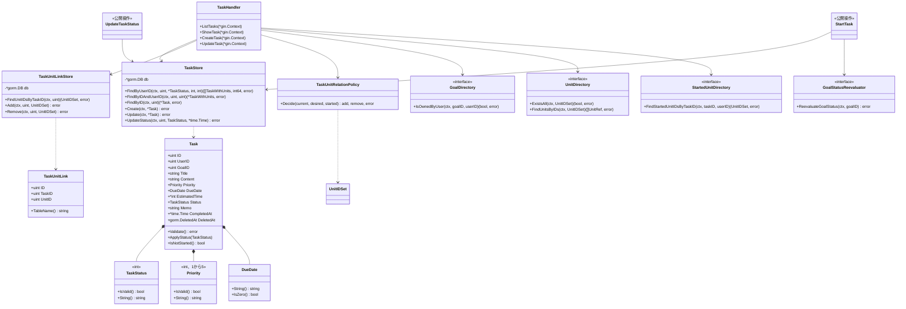
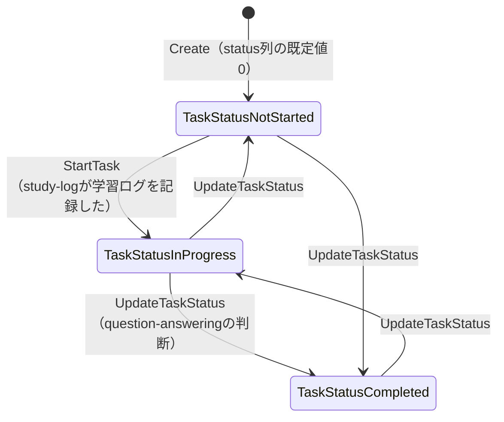
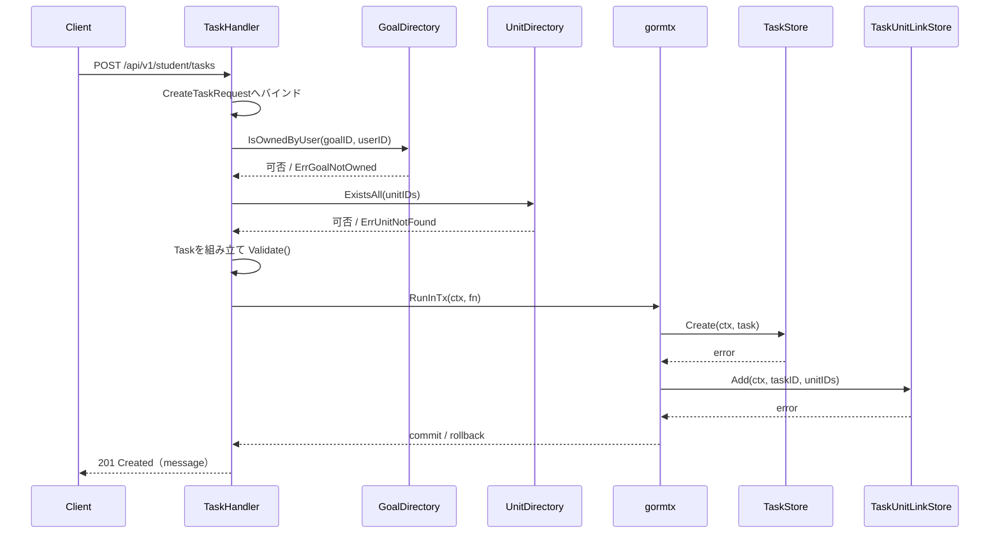
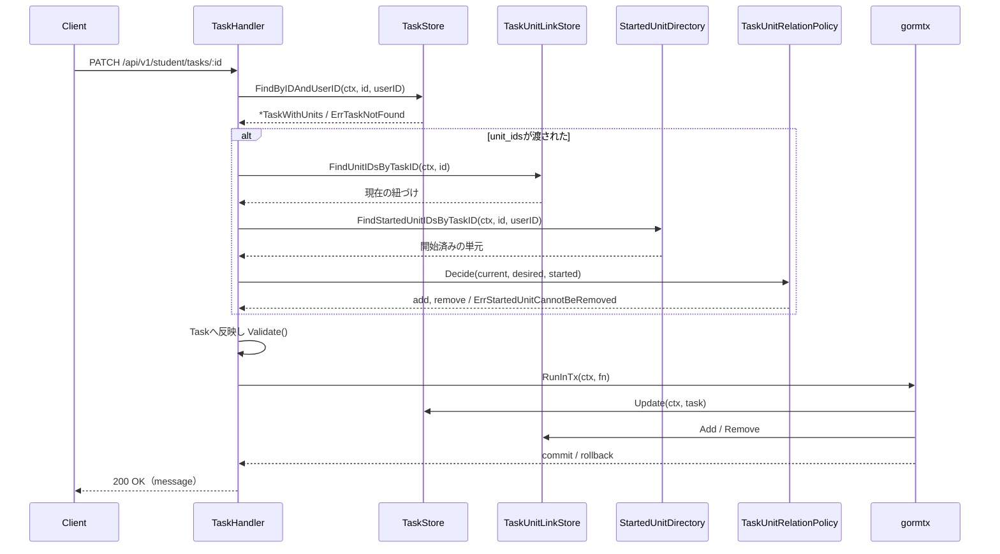
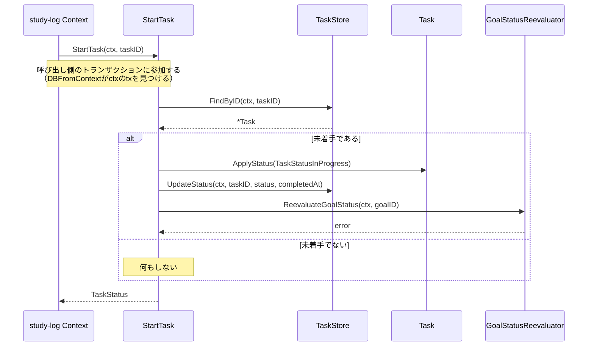
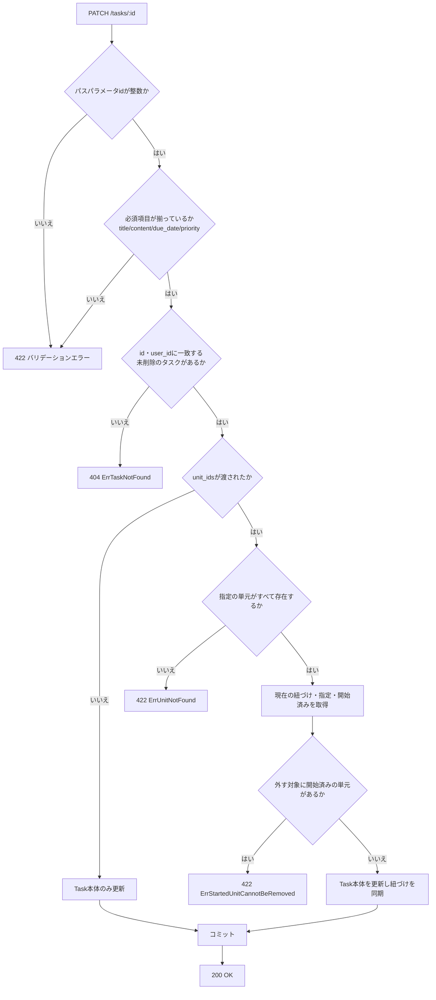
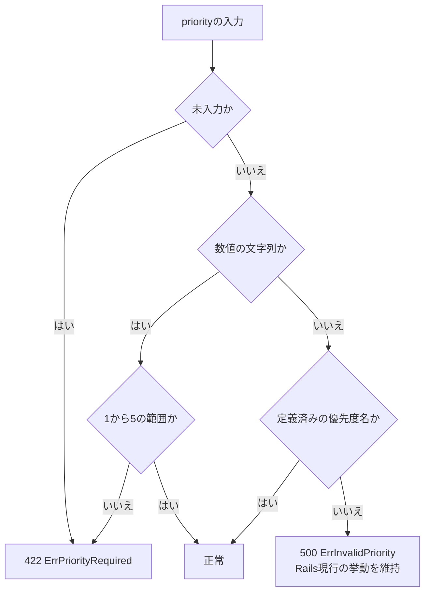

# タスク管理機能 Go実装仕様書

---

# 1. 機能概要

## 機能概要

生徒が自分の学習タスクを登録・参照・更新する機能である。提供するAPIは一覧・詳細・作成・更新の4つで、削除は提供しない（①「4. API一覧」のとおりRails現行にも`destroy`は実装されていない）。

タスクは`status`（`not_started` / `in_progress` / `completed`）を保持するが、本機能のAPIの入力では`status`を受け取らない。状態は他Contextの操作を契機に変わり、その経路は本Contextが公開する2つの操作（タスクの着手・タスクの状態の更新）に限られる（②「12. UseCase設計」、①「7. 状態管理」）。

タスクに紐づく単元は、詳細では単元ごとに学習を開始済みかどうかを示す（①「5. API / 処理詳細」`#show`）。

## 採用設計パターンとその理由（②からの要約）

- 採用パターン: **Active Record**（②「4. 設計パターン」）
- 判断根拠: 主要操作がCRUD中心であり、状態と完了日時の整合という不変条件をTask側に置けるため。業務ルールは状態と完了日時の整合、単元の紐づけ制約、入力値の妥当性に限られ、Entityへ振る舞いを集約するためのレイヤー分離に見合う複雑さがない
- 採用しなかったパターン: Transaction Script（状態と完了日時の整合を関数側へ出すと作成・更新・状態変更の3経路に重複するため）、Domain Model（レイヤー分離に見合う複雑さがないため）、Event Sourcing（イベント履歴の再構築要件がないため）

本書はアーキテクチャ規約「3. 設計パターンごとの構造適用方針」のActive Record節の構造（Entity相当のstructとStoreを同一packageに置く、usecase層なし、Repository Interfaceの分離なし）に従って実装レベルへ落とし込む。

## 本書が対象とする実装範囲

②が設計した`task-management` Bounded ContextのActive Record実装である。Model（Entity相当のstruct定義）、Store（永続化処理）、`TaskUnitRelationPolicy`（紐づけの差分と可否の判定）、他Contextへの参照（`dependency.go`のインターフェースとそのアダプタ）、他Contextから呼ばれる公開操作（`StartTask` / `UpdateTaskStatus`）、Presentation層（Handler / Request / Response / Routing）を対象とする。

対象外は、目標・単元・解答履歴・ユーザーそのものの管理である（他Contextの責務。②「3. Bounded Context」）。

---

# 2. ディレクトリ構成

## 対象Bounded Context名

- `task-management`（②「3. Bounded Context」）

## ディレクトリ・パッケージ名

アーキテクチャ規約「4. Bounded Context構成」の「Contextディレクトリの命名」に従い、Context名`task-management`から`-`を取り除いて連結した全小文字の名前とする。したがってディレクトリ名は`internal/taskmanagement/`、package名は同じ`taskmanagement`となる。同規約は`internal/task_management/`のようにアンダースコアで区切ることも、`internal/task/`のように短縮することも禁じている（短縮するとContextごとに衝突の判断が必要になるため）。

Context名とディレクトリ名は規約から機械的に決まるため、②に明記がなくても推測にはならない。

## ②で採用した設計パターン

Active Record（②「4. 設計パターン」）

## 作成するディレクトリ一覧

```
internal/taskmanagement/
internal/taskmanagement/infrastructure/contextadapter/
internal/taskmanagement/presentation/handler/
internal/taskmanagement/presentation/request/
internal/taskmanagement/presentation/response/
```

`domain/`・`application/`・`infrastructure/gormrepo/`は作成しない。Active Record採用のためレイヤー分離を行わず、Model・Store・Policyをpackage直下に置く（アーキテクチャ規約「3. 設計パターンごとの構造適用方針」）。`infrastructure/contextadapter/`のみ、他Contextの公開操作へ委譲するアダプタの置き場所として設ける（同「4. Bounded Context構成」）。

## 作成するファイル一覧

```
internal/taskmanagement/context.go                      # NewContext（依存関係の組み立て）
internal/taskmanagement/dependency.go                   # 他Contextへの依存を宣言するインターフェースと受け渡し用の型
internal/taskmanagement/task.go                         # Task struct（Model）+ Validate() + ApplyStatus()
internal/taskmanagement/task_status.go                  # TaskStatus型（整数の列挙型）
internal/taskmanagement/priority.go                     # Priority型（整数の列挙型）
internal/taskmanagement/due_date.go                     # DueDate型（未設定を許容。保存値/表示フォーマットの一元化）
internal/taskmanagement/task_unit_link.go               # TaskUnitLink struct（task_unitsのGORMモデル）
internal/taskmanagement/task_unit_relation_policy.go    # TaskUnitRelationPolicy（紐づけの差分と可否の判定）
internal/taskmanagement/errors.go                       # struct/Storeが返すエラー定義
internal/taskmanagement/task_store.go                   # TaskStore（永続化・検索・状態更新）
internal/taskmanagement/task_unit_link_store.go         # TaskUnitLinkStore（紐づけの一括追加・一括削除）
internal/taskmanagement/start_task.go                   # StartTask（他Contextから呼ばれる公開操作）
internal/taskmanagement/update_task_status.go           # UpdateTaskStatus（他Contextから呼ばれる公開操作）
internal/taskmanagement/find_tasks_in_period.go         # FindTasksInPeriod（他Contextから呼ばれる公開操作）
internal/taskmanagement/count_task_stats.go             # CountTasks / CountTasksByDueDate / CountTasksForUsers（他Contextから呼ばれる公開操作）
internal/taskmanagement/infrastructure/contextadapter/goal_directory.go          # GoalDirectoryの実装
internal/taskmanagement/infrastructure/contextadapter/unit_directory.go          # UnitDirectoryの実装
internal/taskmanagement/infrastructure/contextadapter/started_unit_directory.go  # StartedUnitDirectoryの実装
internal/taskmanagement/infrastructure/contextadapter/goal_status_reevaluator.go # GoalStatusReevaluatorの実装
internal/taskmanagement/presentation/handler/task_handler.go
internal/taskmanagement/presentation/request/task_request.go
internal/taskmanagement/presentation/response/task_response.go
internal/taskmanagement/presentation/routes.go
```

## 文書の分割

実装ファイルは上記の23であり、テストが付くもの（Task・TaskStatus・Priority・DueDate・TaskUnitRelationPolicy・TaskStore・TaskUnitLinkStore・StartTask・UpdateTaskStatus・FindTasksInPeriod・CountTaskStats・4つのアダプタ・TaskHandlerの16）を加えると39となる。**1文書あたり30〜35という範囲を超えている。**

分割の単位は、公開操作が増えた経緯から Domain・Infrastructure・Presentation の3文書が候補になる（③自動生成プロンプト「文書の分割（1文書あたり30〜35ファイル）」。本Contextに属するHandlerは`TaskHandler`の1つのみであり、スライス分割ができない）。分割は本書の構成を作り直す作業であるため、着手の判断を別に行う。

---

# 3. Domain層設計

**実装上の位置づけ**: 本機能はActive Record採用のため、domain層・infrastructure層のレイヤー分離を行わない。以下は「Entity」の代わりに「Model（Entity相当）」として、`taskmanagement`パッケージ直下のstructとして扱う（アーキテクチャ規約「3. 設計パターンごとの構造適用方針」Active Record節）。

## Model（Entity相当）

### Task（`task.go`）

②「6. Entity設計」「7. Value Object設計」に基づくTaskのGoフィールド定義。

|フィールド名|型|意味|
|-|-|-|
|ID|uint|タスクの識別子|
|UserID|uint|所有者（生徒）のユーザーID。②「16. Authorization設計」の所有権確認の材料|
|GoalID|uint|紐づく目標の識別子。`tasks.goal_id`はNULL可だが、Railsの`belongs_to :goal`により登録・更新時は必須である（①「6. データモデル」）。本書でも必須として扱い、`*uint`にしない|
|Title|string|タイトル。必須項目。`tasks.title`は`string(100)`である（①「6. データモデル」）|
|Content|string|内容。必須項目。`tasks.content`はNOT NULLである|
|Priority|Priority|優先度。②「7. Value Object設計」のPriorityを型として保持|
|DueDate|DueDate|期限。②「7. Value Object設計」のDueDateを型として保持|
|EstimatedTime|`*int`|見積時間。APIからは入力を受け取らず、作成時に`0`を設定する（①「5. API / 処理詳細」`#create`）。カラムはNULL可であり既存データにNULLが存在し得るため、ポインタとする|
|Status|TaskStatus|状態。APIの入力では変更せず、公開操作（`StartTask` / `UpdateTaskStatus`）でのみ変化する|
|Memo|string|メモ。任意項目|
|CompletedAt|`*time.Time`|完了日時。完了以外では`nil`（①「7. 状態管理」）|
|DeletedAt|`gorm.DeletedAt`|論理削除日時。Gorm規約「0. 本プロジェクトでの採用方針」の論理削除のとおりGORM標準の型を用いる。これにより`Find`系が`deleted_at IS NULL`を自動付与し、①「6. データモデル」の`default_scope`と同じ絞り込みになる|
|CreatedAt|time.Time|作成日時（Gorm規約「4. タイムスタンプのトラッキング」によりGORMが設定する）|
|UpdatedAt|time.Time|更新日時（同）|

公開メソッド:

|メソッド|引数|戻り値|責務|
|-|-|-|-|
|`(t *Task) Validate() error`|なし|`error`|Title・Contentの必須チェック、DueDateの設定有無と妥当性、Priority・Statusの許容値チェックを行う（②「15. Validation設計」）。Titleの長さは検証しない（下記）。ロジックの実装内容は本書では規定しない|
|`(t *Task) ApplyStatus(s TaskStatus)`|`s TaskStatus`|なし|状態を反映し、同時に完了日時を整合させる。`TaskStatusCompleted`なら現在時刻を設定し、それ以外なら`nil`にする（①「7. 状態管理」の`sync_completed_at`と`TaskStatusUpdaterService`の双方に対応）|
|`(t Task) IsNotStarted() bool`|なし|`bool`|未着手かを判定する。`StartTask`が「未着手のときだけ進行中にする」を判断するために用いる（①「5. API / 処理詳細」の「タスクの着手」）|

不変条件: Title・Contentが空でないこと、DueDateが設定済みかつ妥当な値であること、Priority・Statusが許容値の範囲内であること。

Titleの長さは`Validate()`で検証しない。`tasks.title`は`string(100)`であり超過するとDBの制約で失敗して500になるが、Rails現行も長さを検証しておらず同じく500になる（①「6. データモデル」）。ここで検証を加えると同じ入力に対するステータスコードが500から422へ変わり、フロントエンドから見える挙動が変わる。フロントエンドを変更しない方針を優先する（②「17. Error設計」の「Rails現行の挙動を維持するもの」）。

状態と完了日時の整合は`ApplyStatus`の1箇所に閉じ込める。Railsは`before_validation`のコールバックと`TaskStatusUpdaterService`の両方で同じ整合を行っているが（①「7. 状態管理」）、本書ではTask側の1箇所に集約する。状態を変える経路は`ApplyStatus`のみとし、`Status`フィールドへの直接代入を行わない。

`Status`はAPIの作成・更新リクエストの入力には含めない。作成時は`not_started`（①「6. データモデル」のとおりカラムの既定値が`0`）とし、以後は公開操作でのみ変化する。

### TaskStatus（`task_status.go`）

②「7. Value Object設計」のTaskStatusに対応する型。Active Record方針上、独立したValue Object層は設けず、Taskの構成要素としてpackage内の付随型として扱う。

|項目|内容|
|-|-|
|型定義|`type TaskStatus int`|
|許容値|`TaskStatusNotStarted`（0）/ `TaskStatusInProgress`（1）/ `TaskStatusCompleted`（2）を`iota`で宣言する（コーディング規約「3. 命名規則」の「定数のグループ化と`iota`」）|
|公開メソッド|`IsValid() bool`、`String() string`（`not_started` / `in_progress` / `completed`を返す。`stringer`で生成する）、`ParseTaskStatus(raw string) (TaskStatus, error)`|

`tasks.status`はRailsの`enum`として**整数**で保持される（`not_started`=0 / `in_progress`=1 / `completed`=2。①「6. データモデル」）。そのため型を`int`とし、整数カラムへそのまま対応させる。APIの出力は文字列であるため、Response DTOへ入れる際に`String()`で変換する（コーディング規約「3. 命名規則」）。

一覧の絞り込みで受け取る`status`クエリパラメータは、`ParseTaskStatus`で変換する。変換に失敗した場合はエラーとせず、絞り込みを「未着手または進行中」として扱う（①「5. API / 処理詳細」`#index`の`by_status`）。

### Priority（`priority.go`）

②「7. Value Object設計」のPriorityに対応する型。

|項目|内容|
|-|-|
|型定義|`type Priority int`|
|許容値|`PriorityVeryLow`（1）/ `PriorityLow`（2）/ `PriorityNormal`（3）/ `PriorityHigh`（4）/ `PriorityVeryHigh`（5）。`iota + 1`で宣言する|
|公開メソッド|`IsValid() bool`、`String() string`（`very_low` / `low` / `normal` / `high` / `very_high`を返す）、`ParsePriority(raw string) (Priority, error)`（優先度名と数値の両方を受け取る）|

`tasks.priority`はRailsの`enum`として**整数**で保持される（`very_low`=1 〜 `very_high`=5。既定値は3。**0は使っていない**。①「6. データモデル」）。`iota`をそのまま使うと0から始まり既存データと食い違うため、`iota + 1`で宣言する。

`ParsePriority`は、優先度名（`normal`等）と数値の文字列（`3`等）のどちらも受け取る。Rails現行の`PriorityCastable`が同じ入力を扱っているためである（①「10. Rails実装対応表」）。入力の扱いは次のとおり。

|入力|Rails現行|本書|
|-|-|-|
|定義済みの優先度名（`normal`）|正常|正常|
|定義済みの数値（`3`）|優先度名へ変換して正常|正常|
|定義されていない数値（`9`）|変換結果が空になり必須チェックで**422**|同じ（`ErrPriorityRequired`を返し422へ変換する）|
|定義されていない優先度名（`urgent`）|必須チェックを通過し永続化時に失敗して**500**|同じ（`ErrInvalidPriority`を返し500へ変換する。②「17. Error設計」の「Rails現行の挙動を維持するもの」）|

定義されていない優先度名を422ではなく500とするのは、Rails現行の挙動を維持する方針によるものである。フロントエンドを変更しないため、ステータスコードを変えない（②「19. API仕様」の「Railsとの差分」）。

### DueDate（`due_date.go`）

②「7. Value Object設計」のDueDateに対応する型。

|項目|内容|
|-|-|
|保持するフィールド|内部に`*time.Time`相当の値を1つ保持する（保存値。未設定を`nil`で表す）|
|生成方法|文字列から生成するコンストラクタ相当の関数（引数・戻り値のみ規定し、パース処理の実装内容は本書では規定しない）|
|公開メソッド|`String() string`（`YYYY/MM/DD`形式の表示用文字列を返す。未設定なら空文字列）、`IsZero() bool`、比較用メソッド（Before/After等）|

入力はRailsと同じく**文字列**で受け取り、日付として解釈できるかを検証する。Rails現行は`Date.parse`で検証しており、特定のフォーマットに限定していない（①「10. Rails実装対応表」）。したがって本書でも単一のフォーマットに固定せず、日付として解釈できることを条件とする。解釈できない場合は`ErrInvalidDueDate`を返し、メッセージは`は正しい日付を入力してください`を踏襲する（①「5. API / 処理詳細」）。

型としては未設定（`nil`）を許容する。`tasks.due_date`がNULL可で既存データに未設定のタスクが存在しうるためである。一方、作成・更新のRequest DTOでは必須とする（①のFormが`presence: true`であるため）。

### TaskUnitLink（`task_unit_link.go`）

タスクと単元の紐づきを表すGORMモデルである（①「6. データモデル」の`task_units`）。

|フィールド名|型|意味|
|-|-|-|
|ID|uint|識別子|
|TaskID|uint|タスクの識別子|
|UnitID|uint|単元の識別子|
|CreatedAt|time.Time|作成日時|
|UpdatedAt|time.Time|更新日時|

`task_units`は`task_id`と`unit_id`の組に一意インデックスを持つため、同じ単元を同じタスクに重複して紐づけられない（①「6. データモデル」）。紐づけの追加は冪等ではないため、追加対象は差分として算出したものに限る（「3. Domain層設計」の`TaskUnitRelationPolicy`）。

テーブル名は`task_units`であり、struct名`TaskUnitLink`の既定の複数形（`task_unit_links`）と一致しない。`TableName()`で明示的に上書きする（Gorm規約「2. 複数形のテーブル名」）。

## Value Object

対象外（Active Record採用のため独立したValue Object層は設けない）。②が設計したTaskStatus・Priority・DueDateは、上記のとおりTaskと同一package内の付随型として扱う。②「7. Value Object設計」の「Value Objectを採用しないもの」（タイトル・内容・メモ）は単純な`string`フィールドとする。

## Repository Interface

対象外（Active Record採用のため、domain層にRepository Interfaceを定義しない。永続化・検索はEntity相当のstructと同一package内のStoreとして「8. Infrastructure層設計」に記載する）。

## Domain Service

### TaskUnitRelationPolicy（`task_unit_relation_policy.go`）

②「8. Domain Service」の`TaskUnitRelationPolicy`に対応する。タスクに紐づく単元を指定された集合へ同期してよいかを判定し、追加する単元と外す単元の差分を算出する。

|項目|内容|
|-|-|
|struct名|`TaskUnitRelationPolicy`|
|保持するフィールド|なし（状態を持たない）|
|コンストラクタ|`NewTaskUnitRelationPolicy() *TaskUnitRelationPolicy`|

|メソッド|引数|戻り値|責務|
|-|-|-|-|
|`Decide`|`current, desired, started UnitIDSet`|`(add, remove UnitIDSet, err error)`|外す対象（`current`にあって`desired`にないもの）に`started`の単元が含まれていれば`ErrStartedUnitCannotBeRemoved`を返す。問題なければ追加対象（`desired`にあって`current`にないもの）と外す対象を返す（①「5. API / 処理詳細」`#update`）|

DBにも他Contextの呼び出しにも依存せず、与えられた3つの集合のみから判定する。単元の実体やタスクの識別子を持ち込まないことで、ルール単体を検証できる（②「8. Domain Service」）。

`UnitIDSet`（`dependency.go`で定義する）は単元の識別子の集合を表す型である。順序を持たず、重複を許さない。Rails現行は`unit_ids`を配列として扱い空文字を除いて整数化しているが（①「10. Rails実装対応表」の`UnitIdsValidatable`）、判定に必要なのは集合としての差分のみであるため集合型で受け取る。

## Domain Event

対象外。②「18. Domain Event」のとおり、非同期の副作用が現行仕様に存在しないため採用しない。

## Domain Error（struct/Storeが返すエラー）

②「17. Error設計」に対応する内容を、`errors.go`内のセンチネルエラー（`error`型の変数）として定義する。

|エラー|発生条件|メッセージ|
|-|-|-|
|`ErrTitleRequired`|`Validate()`時にTitleが空の場合|`Title を入力してください`|
|`ErrContentRequired`|`Validate()`時にContentが空の場合|`Content を入力してください`|
|`ErrDueDateRequired`|`Validate()`時にDueDateが未設定の場合|`Due date を入力してください`|
|`ErrInvalidDueDate`|DueDateの生成・`Validate()`時に、日付として解釈できない値が渡された場合|`Due date は正しい日付を入力してください`|
|`ErrPriorityRequired`|`ParsePriority`に定義されていない数値が渡された場合、または未入力の場合|`Priority を入力してください`|
|`ErrInvalidPriority`|`ParsePriority`に定義されていない優先度名が渡された場合|—（500へ変換する。「14. Error実装方針」）|
|`ErrInvalidTaskStatus`|`ParseTaskStatus`・`Validate()`時に許容値外の場合|—（内部エラー。APIの入力でStatusを受け取らないため、通常は発生しない）|
|`ErrGoalNotOwned`|指定された目標が操作者自身のものでない（存在しない場合を含む）|`Goal が不正です`|
|`ErrUnitNotFound`|指定された単元のいずれかが存在しない|`Unit ids に不正な値が含まれています`|
|`ErrStartedUnitCannotBeRemoved`|`Decide`時に、外す対象に学習開始済みの単元が含まれていた場合|`Unit ids 学習開始済みの単元は削除できません`|
|`ErrTaskNotFound`|`TaskStore`が指定ID・所有者に一致するTaskを取得できなかった場合（他の生徒のタスクを指定した場合を含む）|—（「14. Error実装方針」で404へ変換する）|

メッセージの文言は①のとおり項目名が英語のまま出る形を維持する。フロントエンドを変更しない方針のためである（②「17. Error設計」の「エラーレスポンスの本文」）。

`ErrUnitNotFound`は、Rails現行と同じく**同じメッセージを2件返す**。検証が2回登録されていることによる重複であるが、`errors`配列の要素数が変わるとフロントエンドの表示が変わるため維持する（②「17. Error設計」の「Rails現行の挙動を維持するもの」）。実装では、作成時にこのエラーを2件分としてレスポンスへ積む。

---

# 4. クラス図



Active Record採用のためRepository Interfaceは存在せず、`TaskStore`・`TaskUnitLinkStore`が`Task`と同一package内で永続化を担う。他Contextへの依存のみ、インターフェースとして本Contextに置く（コーディング規約「7. インターフェース」）。実装は`infrastructure/contextadapter/`に閉じ込める。

---

# 5. 状態遷移図



状態を変えるのは公開操作（`StartTask` / `UpdateTaskStatus`）のみである。`CreateTask` / `UpdateTask`は`status`を受け取らず変更しない（①「7. 状態管理」）。

- `StartTask`は**未着手のときだけ**進行中へ移す。既に進行中・完了であれば何もしない（①「5. API / 処理詳細」の「タスクの着手」）
- `UpdateTaskStatus`は呼び出し側が決めた状態をそのまま反映する。遷移元による可否は判定しない（②「10. 状態遷移図」）
- どちらの経路でも、状態の反映は`Task.ApplyStatus`を通す。完了なら完了日時を現在時刻に、それ以外なら`nil`にする

論理削除（`deleted_at`）は`status`とは独立した軸であり、上図には含めない。本機能に論理削除を行う操作はなく、既存の削除済みデータを検索の対象外とするだけである（①「6. データモデル」）。

---

# 6. Application層設計

対象外（Active Record採用のため、usecase層を設けない。②「12. UseCase設計」に記載されたListTasks / ShowTask / CreateTask / UpdateTaskの業務操作は、HandlerがStoreと他Contextの参照手段を直接呼び出す処理として実装する。処理順序は「9. Presentation層設計」のHandler処理順序に統合して記載する。他Contextから呼ばれる公開操作`StartTask` / `UpdateTaskStatus`は「8. Infrastructure層設計」に記載する）。

---

# 7. シーケンス図・処理フロー図

## シーケンス図

### CreateTask



### UpdateTask



### StartTask（他Contextから呼ばれる公開操作）



## 処理フロー図

### UpdateTask



### Priorityの入力の扱い



一覧・詳細は分岐が所有権の確認と絞り込みのみであるため、処理フロー図は省略する。処理順序は「9. Presentation層設計」のHandler処理順序に記載したとおりである。

---

# 8. Infrastructure層設計

**実装上の位置づけ**: 本機能はActive Record採用のため、Repository Interfaceの実装という形は取らない。②「11. Repository設計」で定義された責務を、Model（Task / TaskUnitLink）と同一package内のStoreとして実装する。

## Store実装

### TaskStore（`task_store.go`）

|項目|内容|
|-|-|
|struct名|`TaskStore`|
|対応するGORMモデル|`Task`struct自体をGORMモデルとして扱う（詳細は「15. GORM / DBクエリ設計」参照）|
|保持するフィールド|`db *gorm.DB`|
|コンストラクタ|`NewTaskStore(db *gorm.DB) *TaskStore`|

メソッド一覧:

|メソッド|引数|戻り値|発行するクエリ内容|
|-|-|-|-|
|`FindByUserID`|`ctx context.Context, userID uint, status *TaskStatus, page, perPage int`|`([]TaskWithUnits, int64, error)`|user_idによる絞り込み、状態による絞り込み、due_date昇順（同値はid昇順）ソート、ページネーション、総件数取得。紐づく単元を`Preload`で一括取得する（②「11. Repository設計」「21. DB操作仕様」）。`deleted_at IS NULL`は`gorm.DeletedAt`によりGORMが自動付与する|
|`FindByIDAndUserID`|`ctx context.Context, id, userID uint`|`(*TaskWithUnits, error)`|id・user_idの両方に一致する1件取得。紐づく単元も一括取得する。一致しない場合は`ErrTaskNotFound`（他の生徒のタスクを含む404相当。②「16. Authorization設計」の所有権確認をクエリ条件として実現する）|
|`FindByID`|`ctx context.Context, id uint`|`(*Task, error)`|所有者を条件に含めず1件取得する。公開操作（`StartTask` / `UpdateTaskStatus`）が用いる。同操作は認可を行わないため所有者でスコープしない（②「16. Authorization設計」）|
|`Create`|`ctx context.Context, task *Task`|`error`|Taskレコードの新規作成。`status`は`TaskStatusNotStarted`（0）、`estimated_time`は`0`で作成する（①「5. API / 処理詳細」`#create`）|
|`Update`|`ctx context.Context, task *Task`|`error`|idに一致するTaskレコードの`title`・`content`・`priority`・`due_date`・`memo`列を更新する。`goal_id`・`status`・`completed_at`は更新しない（①「5. API / 処理詳細」`#update`）|
|`UpdateStatus`|`ctx context.Context, id uint, status TaskStatus, completedAt *time.Time`|`error`|対象レコードの`status`・`completed_at`列のみを更新する（公開操作が用いる）|
|`FindByUserIDAndDueDateRange`|`ctx context.Context, userID uint, from, to time.Time`|`([]Task, error)`|user_idと`due_date`の範囲（両端を含む）による絞り込み。`FindTasksInPeriod`が用いる。**状態による絞り込みを行わない**。紐づく単元は取得しない。並び順は指定しない（②「12. UseCase設計」）|
|`CountStats`|`ctx context.Context, cond TaskCountCondition`|`(TaskCountStats, error)`|総件数と完了件数を1回のクエリで集計する。`cond`は`UserID *uint`・`UserIDs []uint`・`DueDateFrom *time.Time`・`DueDateTo *time.Time`を持ち、指定されたものだけを条件に加える。`CountTasks` / `CountTasksByDueDate` / `CountTasksForUsers`が用いる|

`status`の絞り込みは、`status`が`nil`のとき「未着手または進行中」を条件とする。Handlerが`ParseTaskStatus`に失敗した場合も`nil`を渡すため、未定義の値が指定されたときもこの条件になる（①「5. API / 処理詳細」`#index`の`by_status`）。

各メソッドは`gormtx.DBFromContext(ctx, s.db)`で接続を取得する。トランザクション中であればその接続を、そうでなければ通常の接続を使う（「11. Transaction実装方針」）。

`TaskWithUnits`（`task.go`で定義する）は、タスクとその紐づく単元を一括取得した結果を表す型である。タスクごとに単元を個別に問い合わせるN+1を避けるために設ける（Gorm規約「0. 本プロジェクトでの採用方針」の「リレーションの取得とN+1対策」、②「21. DB操作仕様」）。フィールドは`Task *Task`と`UnitIDs UnitIDSet`である。

単元の表示用の情報（単元名・所属コース）は`tasks`との結合では取得しない。`units`は他Contextが所有するため、`UnitDirectory`経由で取得する（②「11. Repository設計」）。`TaskWithUnits`が持つのは識別子の集合までとする。

②「11. Repository設計」に明記のとおり、業務ルール判定・認可判定はStoreに持たせない。所有権の確認は「idとuser_idが一致するレコードを取得できるか」というクエリ条件として表現し、判定ロジック自体はHandler側の処理順序で扱う。

### TaskUnitLinkStore（`task_unit_link_store.go`）

|項目|内容|
|-|-|
|struct名|`TaskUnitLinkStore`|
|対応するGORMモデル|`TaskUnitLink`（テーブル名`task_units`）|
|保持するフィールド|`db *gorm.DB`|
|コンストラクタ|`NewTaskUnitLinkStore(db *gorm.DB) *TaskUnitLinkStore`|

メソッド一覧:

|メソッド|引数|戻り値|発行するクエリ内容|
|-|-|-|-|
|`FindUnitIDsByTaskID`|`ctx context.Context, taskID uint`|`(UnitIDSet, error)`|task_id一致で紐づくunit_idの集合を取得する|
|`Add`|`ctx context.Context, taskID uint, unitIDs UnitIDSet`|`error`|指定された単元分のレコードを一括作成する。空の集合が渡された場合はクエリを発行しない|
|`Remove`|`ctx context.Context, taskID uint, unitIDs UnitIDSet`|`error`|task_id一致かつunit_idが集合に含まれるレコードを削除する。`task_units`に論理削除のカラムはないため物理削除である（①「6. データモデル」）。空の集合が渡された場合はクエリを発行しない|

`Add`・`Remove`も`gormtx.DBFromContext`で接続を取得する。これにより、Handlerが開始したトランザクションに`TaskStore`と同じ接続で参加する。`NewTaskUnitLinkStore(tx)`のようにトランザクション用の`*gorm.DB`を渡してStoreを再生成する方式は採らない（アーキテクチャ規約「11. Transaction実装パターン（TransactionManager）」）。

## 他Contextの参照手段と公開操作の実装

`dependency.go`で宣言したインターフェースの実装である。相手Contextが公開する操作へ委譲し、本Contextから相手のテーブルへクエリを発行しない（アーキテクチャ規約「5. Context間連携ルール」、②「11. Repository設計」）。いずれもGORMに依存せず相手Contextの公開操作を呼ぶアダプタであるため`infrastructure/contextadapter/`に置く（同「4. Bounded Context構成」）。

|インターフェース|相手Context|メソッド|責務|
|-|-|-|-|
|`GoalDirectory`|`goal-management`|`IsOwnedByUser(ctx context.Context, goalID, userID uint) (bool, error)`|指定の目標が操作者自身のものかを返す。作成時の`goal_id`の検証に用いる（①「5. API / 処理詳細」`#create`）|
|`UnitDirectory`|`curriculum`|`ExistsAll(ctx context.Context, unitIDs UnitIDSet) (bool, error)`|指定された単元がすべて存在するかを返す|
||`curriculum`|`FindUnitsByIDs(ctx context.Context, unitIDs UnitIDSet) ([]UnitRef, error)`|レスポンスに含める単元の情報を返す|
|`StartedUnitDirectory`|`question-answering`|`FindStartedUnitIDsByTaskID(ctx context.Context, taskID, userID uint) (UnitIDSet, error)`|そのタスクで学習を開始済みの単元の識別子の集合を返す。詳細の`started`と、更新時の「学習開始済みの単元は外せない」判定に用いる（①「5. API / 処理詳細」`#show`・`#update`）|
|`GoalStatusReevaluator`|`goal-management`|`ReevaluateGoalStatus(ctx context.Context, goalID uint) error`|目標の状態を再評価する。`StartTask`が状態を変えたときに呼ぶ（①「7. 状態管理」）|

`UnitRef`（`dependency.go`で定義する）は、レスポンスに含める単元の情報を受け取る型である。フィールドは識別子・所属コースの識別子・単元名と、所属コースの情報（識別子・レベル番号・レベル名）である（①「5. API / 処理詳細」`#index`）。相手Contextの内部structをそのまま受け取らず、本Contextが必要とする項目だけを持つ型で受け取る（アーキテクチャ規約「5. Context間連携ルール」の「相手Contextの内部Entity・Value Object・Infrastructure実装に直接依存しない」）。

**②からの補足**: 相手Contextが公開する操作の具体的なシグネチャは、各機能の③で確定する。本書では消費者側のインターフェースをコーディング規約「7. インターフェース」の方針に従って本Contextに置き、実装をアダプタに閉じ込める。

Rails現行は開始済みの単元を`Task#started_unit_ids`として`question_histories`から直接求めているが（①「6. データモデル」）、本書では`question-answering` Contextの参照手段に委ねる。解答履歴の解釈（どの記録があれば「開始済み」と見なすか）はその所有者側に置くべき判断であるためである。

## StartTask（`start_task.go`）

他Contextから呼ばれる公開操作である（②「12. UseCase設計」）。

|項目|内容|
|-|-|
|関数|`StartTask(ctx context.Context, taskID uint) (TaskStatus, error)`|
|受け取る依存|`*TaskStore`、`GoalStatusReevaluator`（コンストラクタで注入する`struct`のメソッドとして実装してよい）|

処理ステップ:

1. `TaskStore.FindByID`で対象タスクを取得する（所有者でスコープしない。②「16. Authorization設計」）
2. `Task.IsNotStarted()`が偽であれば、何もせず現在の状態を返す（①「5. API / 処理詳細」の「タスクの着手」）
3. `Task.ApplyStatus(TaskStatusInProgress)`で状態と完了日時を整合させる
4. `TaskStore.UpdateStatus`で`status`・`completed_at`を更新する
5. `GoalStatusReevaluator.ReevaluateGoalStatus`で紐づく目標の状態を再評価する（①「7. 状態管理」）
6. 変更後の状態を返す

呼び出し側（`study-log`の学習ログの記録）が既にトランザクションを開始している場合はそれに参加する。`gormtx.DBFromContext`が`ctx`のトランザクションを見つけるため、本操作側で新しいトランザクションを開始しない（「11. Transaction実装方針」）。目標の状態の再評価も同じトランザクションの中で実行される。

## UpdateTaskStatus（`update_task_status.go`）

|項目|内容|
|-|-|
|関数|`UpdateTaskStatus(ctx context.Context, taskID uint, status TaskStatus) error`|
|受け取る依存|`*TaskStore`|

処理ステップ:

1. `TaskStore.FindByID`で対象タスクを取得する
2. `Task.ApplyStatus(status)`で状態と完了日時を整合させる。遷移元による可否は判定しない（②「10. 状態遷移図」）
3. `TaskStore.UpdateStatus`で`status`・`completed_at`を更新する

`goal-management`の再評価は呼ばない。Rails現行では問題の提出の経路（`Student::SubmissionService`）が目標の状態の再評価を自ら呼んでおり、`Student::TaskStatusUpdaterService`は呼んでいないためである（②「12. UseCase設計」の補足）。この分担を変えるかは問題解答機能の②で決める。

## FindTasksInPeriod（`find_tasks_in_period.go`）

他Contextから呼ばれる公開操作である（②「12. UseCase設計」）。

|項目|内容|
|-|-|
|関数|`FindTasksInPeriod(ctx context.Context, userID uint, from, to time.Time) ([]TaskSchedule, error)`|
|受け取る依存|`*TaskStore`|

処理ステップ:

1. `TaskStore.FindByUserIDAndDueDateRange`で対象のタスクを取得する
2. 各タスクを`TaskSchedule`へ変換して返す

`TaskSchedule`（`task.go`で定義する）は`ID uint`・`Title string`・`DueDate time.Time`・`Status string`を持つ。`Task`structそのものを返さないのは、呼び出し側（`calendar`）に本Contextの内部モデルを渡さないためである（規約「5. Context間連携ルール」）。

**②からの補足**: `TaskSchedule`の名前とフィールドは②に明記がない。②「12. UseCase設計」`FindTasksInPeriod`の出力（識別子・件名・期限日・状態）をGoの型に落としたものである。`DueDate`をポインタにしないのは、期限日の範囲で絞り込んだ結果であり未設定のタスクが含まれないためである。

## CountTasks / CountTasksByDueDate / CountTasksForUsers（`count_task_stats.go`）

他Contextから呼ばれる公開操作である（②「12. UseCase設計」）。3つを同じファイルに置くのは、いずれも`TaskStore.CountStats`へ条件を組み立てて渡すだけの薄い関数であり、集計の意味が1つにまとまっているためである。

|関数|条件の組み立て|
|-|-|
|`CountTasks(ctx context.Context, userID uint) (TaskCountStats, error)`|`UserID`のみを設定する。期限日の条件を付けないため、期限日が未設定のタスクも総件数に含まれる|
|`CountTasksByDueDate(ctx context.Context, userID uint, from, to time.Time) (TaskCountStats, error)`|`UserID`と`DueDateFrom`・`DueDateTo`を設定する。期限日が`NULL`のタスクは範囲の条件を満たさず除外される|
|`CountTasksForUsers(ctx context.Context, userIDs []uint) (TaskCountStats, error)`|`UserIDs`を設定する。空のスライスを渡された場合は問い合わせずに0件を返す|

|項目|内容|
|-|-|
|受け取る依存|`*TaskStore`|
|戻り値|`TaskCountStats`（`task.go`で定義する。`Total int64`・`Completed int64`）|

空のスライスで問い合わせないのは、条件が空になって全ユーザーを数える結果になることを防ぐためである（**②からの補足**。管理者高校学年参照機能③「6. Application層設計」が同じ扱いをしている）。

## 外部連携実装

対象外。②にMail・Cache・Queue等の外部連携は記載されていない。

---

# 9. Presentation層設計

## Handler

### TaskHandler（`presentation/handler/task_handler.go`）

|項目|内容|
|-|-|
|struct名|`TaskHandler`|
|対応する呼び出し先|`TaskStore`、`TaskUnitLinkStore`、`TaskUnitRelationPolicy`、`GoalDirectory`、`UnitDirectory`、`StartedUnitDirectory`（Active Record採用のためUseCaseを経由せず直接呼び出す）|
|コンストラクタ|`NewTaskHandler(taskStore *TaskStore, linkStore *TaskUnitLinkStore, policy *TaskUnitRelationPolicy, goals GoalDirectory, units UnitDirectory, startedUnits StartedUnitDirectory) *TaskHandler`|

メソッド一覧（HTTPメソッド・パス対応）:

|メソッド|HTTPメソッド|パス|
|-|-|-|
|`ListTasks`|GET|/api/v1/student/tasks|
|`ShowTask`|GET|/api/v1/student/tasks/:id|
|`CreateTask`|POST|/api/v1/student/tasks|
|`UpdateTask`|PATCH|/api/v1/student/tasks/:id|

処理順序（UseCase層を経由しない分、本来UseCaseが担う手順をここに明記する）:

### ListTasks

1. `c.Request.Context()`からcurrent user（認証Middlewareが格納したstudentユーザー）を取得する（②「16. Authorization設計」）
2. クエリパラメータ`status` / `page` / `per_page`を読み取る。`status`は`ParseTaskStatus`で変換し、失敗した場合は`nil`として扱う（エラーにしない）。`per_page`の既定値は5、上限は100（①「5. API / 処理詳細」`#index`）
3. `taskStore.FindByUserID`をcurrent userのID・状態・ページ指定で呼び出し、`[]TaskWithUnits`と総件数を受け取る
4. 取得結果に含まれる単元の識別子をまとめ、`unitDirectory.FindUnitsByIDs`で単元の情報を一度に取得する。タスクごとに問い合わせない
5. `TaskListResponse`へ変換する。`meta`は総件数・`per_page`から算出する
6. 200 OKで返す

### ShowTask

1. current userを取得する
2. パスパラメータ`id`を読み取る
3. `taskStore.FindByIDAndUserID`をid・current userのIDで呼び出す。一致しなければ`ErrTaskNotFound`
4. `ErrTaskNotFound`を404のAppErrorへ変換して`c.Error(err)`で返す（「14. Error実装方針」）
5. `unitDirectory.FindUnitsByIDs`で単元の情報を取得する
6. `startedUnitDirectory.FindStartedUnitIDsByTaskID`で学習開始済みの単元の集合を取得する
7. 単元ごとに開始済みかを判定して`TaskDetailResponse`へ変換する（①「5. API / 処理詳細」`#show`）
8. 200 OKで返す

### CreateTask

1. current userを取得する
2. `CreateTaskRequest`へバインドする（`task`キーでネストした本文。②「15. Validation設計」）
3. `goalDirectory.IsOwnedByUser`で指定された目標が操作者自身のものか確認する。偽なら`ErrGoalNotOwned`（①「5. API / 処理詳細」`#create`）
4. `unitDirectory.ExistsAll`で指定された単元がすべて存在するか確認する。偽なら`ErrUnitNotFound`を**2件分**としてレスポンスへ積む（「3. Domain層設計」のDomain Error）
5. `ParsePriority`で優先度を変換する
6. Request DTOからTaskを組み立てる。`UserID`はcurrent userのID、`Status`は`TaskStatusNotStarted`、`EstimatedTime`は`0`とする
7. `task.Validate()`で業務ルール検証を行う。エラーは422のAppErrorへ変換する
8. `gormtx.RunInTx`でトランザクションを開始し、`taskStore.Create`と`linkStore.Add`を順に呼ぶ（②「14. Transaction設計」）
9. `{"message": "タスクが作成されました。"}`を**201 Created**で返す（①「5. API / 処理詳細」`#create`）

### UpdateTask

1. current userを取得する
2. パスパラメータ`id`と`UpdateTaskRequest`へバインドする
3. `taskStore.FindByIDAndUserID`で対象Taskを取得する（所有権の確認。一致しなければ`ErrTaskNotFound`→404）
4. `unit_ids`が渡されている場合:
   1. `unitDirectory.ExistsAll`で存在確認する。偽なら`ErrUnitNotFound`
   2. `linkStore.FindUnitIDsByTaskID`で現在の紐づけを取得する
   3. `startedUnitDirectory.FindStartedUnitIDsByTaskID`で開始済みの単元を取得する
   4. `policy.Decide`で追加・削除の差分と可否を判定する。`ErrStartedUnitCannotBeRemoved`なら422へ変換する
5. `ParsePriority`で優先度を変換する
6. 取得したTaskに`title`・`content`・`priority`・`due_date`・`memo`を反映する。`goal_id`・`status`・`completed_at`は変更しない
7. `task.Validate()`で業務ルール検証を行う
8. `gormtx.RunInTx`でトランザクションを開始し、`taskStore.Update`と、差分があれば`linkStore.Add` / `linkStore.Remove`を呼ぶ
9. `{"message": "タスクが更新されました。"}`を200 OKで返す

`unit_ids`が渡されなかった場合は、4の各手順と`linkStore`の呼び出しを行わない。現在の紐づけを変更しない（①「5. API / 処理詳細」`#update`）。

`task.Validate()`が返すエラーのうち、更新時のモデル検証の失敗にあたるものは200で返す。Rails現行の挙動を維持するためである（②「17. Error設計」の「Rails現行の挙動を維持するもの」）。ただしTaskの検証のうち更新で到達しうるのは必須項目・長さ・期限・優先度であり、これらはPresentation層とDomain層で422として扱う。Rails現行で飲み込まれるのは`status`の必須検証の失敗のみであり、更新では`status`を変更しないため、この経路には到達しない。

## Request / Response DTO

### Request（`presentation/request/task_request.go`）

|struct名|フィールド|型|検証|
|-|-|-|-|
|`ListTasksQuery`|Status|string|`form:"status"`。任意。定義されていない値もエラーとせず、絞り込みを「未着手または進行中」として扱う|
||Page|int|`form:"page"`。0以下・数値以外は1ページ目として扱う|
||PerPage|int|`form:"per_page"`。既定値5、上限100|
|`CreateTaskRequest`|Task|`CreateTaskBody`|`binding:"required"`。リクエストボディは`task`キーでネストする（①「5. API / 処理詳細」`#create`の`params.require(:task)`）|
|`CreateTaskBody`|GoalID|uint|`json:"goal_id" binding:"required"`|
||Title|string|`json:"title" binding:"required"`|
||Content|string|`json:"content" binding:"required"`|
||Priority|string|`json:"priority" binding:"required"`。優先度名と数値の文字列のどちらも受け取る|
||DueDate|string|`json:"due_date" binding:"required"`。日付として解釈できることを検証する。フォーマットは固定しない|
||Memo|string|`json:"memo"`。任意|
||UnitIDs|`[]uint`|`json:"unit_ids"`。任意。空文字を除いて整数として扱う（①「10. Rails実装対応表」の`UnitIdsValidatable`）|
|`UpdateTaskRequest`|Task|`UpdateTaskBody`|`binding:"required"`。同じく`task`キーでネストする|
|`UpdateTaskBody`|Title|string|`json:"title" binding:"required"`|
||Content|string|`json:"content" binding:"required"`|
||Priority|string|`json:"priority" binding:"required"`|
||DueDate|string|`json:"due_date" binding:"required"`|
||Memo|string|`json:"memo"`|
||UnitIDs|`*[]uint`|`json:"unit_ids"`。**渡されたかどうかを区別する必要があるためポインタとする**。`nil`なら紐づけを変更しない（①「5. API / 処理詳細」`#update`）|

更新では`goal_id`・`status`を受け取らない（①「5. API / 処理詳細」`#update`）。作成でも`status`・`estimated_time`・`completed_at`を受け取らない。

パスパラメータ`id`（詳細・更新）は必須・整数として検証する。

### Response（`presentation/response/task_response.go`）

|struct名|フィールド|型|JSONキー|
|-|-|-|-|
|`TaskResponse`|ID|`uint`|`id`|
||UserID|`uint`|`user_id`|
||GoalID|`*uint`|`goal_id`|
||Title|`string`|`title`|
||Content|`string`|`content`|
||DueDate|`*string`|`due_date`（`YYYY/MM/DD`形式。未設定なら`null`）|
||Priority|`string`|`priority`|
||Status|`string`|`status`|
||CompletedAt|`*string`|`completed_at`（`YYYY/MM/DD`形式。未設定なら`null`）|
||Units|`[]UnitResponse`|`units`|
|`TaskDetailResponse`|（`TaskResponse`と同じ項目。`Units`のみ`[]UnitDetailResponse`）|||
|`UnitResponse`|ID|`uint`|`id`|
||CourseID|`uint`|`course_id`|
||UnitName|`string`|`unit_name`|
||Course|`CourseResponse`|`course`|
|`UnitDetailResponse`|（`UnitResponse`と同じ項目に加えて）|||
||Started|`bool`|`started`|
|`CourseResponse`|ID|`uint`|`id`|
||LevelNumber|`int`|`level_number`|
||LevelName|`string`|`level_name`|
|`TaskListResponse`|Tasks|`[]TaskResponse`|`tasks`|
||Meta|`MetaResponse`|`meta`|
|`MetaResponse`|CurrentPage|`int`|`current_page`|
||TotalPages|`int`|`total_pages`|
||TotalCount|`int`|`total_count`|
||PerPage|`int`|`per_page`（実際に適用された件数。①「5. API / 処理詳細」`#index`の`limit_value`）|
|`MessageResponse`|Message|`string`|`message`|

- **一覧**: 最上位は`tasks`と`meta`の2キーである（①「5. API / 処理詳細」`#index`）。単元に`started`を含めない（同）
- **詳細**: 最上位をラップせず`TaskDetailResponse`をそのまま返す。単元ごとに`started`を含める（①「5. API / 処理詳細」`#show`）
- **作成・更新**: `MessageResponse`を返す。本文はメッセージのみである（①「5. API / 処理詳細」`#create`・`#update`）
- `TaskResponse.Status`・`Priority`は整数ではなく文字列を入れる。Modelの`TaskStatus`・`Priority`は整数の列挙型であるため、`String()`で変換してから設定する（「3. Domain層設計」）
- `GoalID`を`*uint`とするのは、`tasks.goal_id`がNULL可であり既存データにNULLが存在し得るためである。入力では必須だが出力では`null`を返しうる（①「6. データモデル」）
- エラーレスポンスは専用structを本書で定義しない。形式は「14. Error実装方針」のとおりであり、集中エラーハンドリングミドルウェアが組み立てる

## Routing（`presentation/routes.go`）

|Method|Path|Handler|
|-|-|-|
|GET|/api/v1/student/tasks|TaskHandler.ListTasks|
|GET|/api/v1/student/tasks/:id|TaskHandler.ShowTask|
|POST|/api/v1/student/tasks|TaskHandler.CreateTask|
|PATCH|/api/v1/student/tasks/:id|TaskHandler.UpdateTask|

いずれのルートも認証Middleware・`student`ロール確認Middlewareを経由する（②「16. Authorization設計」）。`POST` / `PATCH`はCookieで認可される状態変更であるため、CSRF検証Middlewareの対象にも含める（Gin規約「5. CSRF対策」の「適用範囲」）。一覧・詳細はGETのため対象外である。

`DELETE /api/v1/student/tasks/:id`は定義しない。Rails現行は`resources :tasks`により経路だけが存在するが`destroy`が実装されていないため、経路自体を設けない（①「4. API一覧」）。

---

# 10. API仕様

|Method|Path|Handler|Request|Response|Status Code|
|-|-|-|-|-|-|
|GET|/api/v1/student/tasks|ListTasks|クエリ: `status` / `page` / `per_page`|`TaskListResponse`|200|
|GET|/api/v1/student/tasks/:id|ShowTask|パス: `id`|`TaskDetailResponse`|200|
|POST|/api/v1/student/tasks|CreateTask|`CreateTaskRequest`|`MessageResponse`|201|
|PATCH|/api/v1/student/tasks/:id|UpdateTask|パス: `id`、Body: `UpdateTaskRequest`|`MessageResponse`|200|

作成が201、更新が200であるのは、①「5. API / 処理詳細」のとおり`#create`が`status: :created`、`#update`が`status: :ok`を返しているためである。

エラーレスポンスの本文は「14. Error実装方針」のとおり、422等が`{"errors": [...]}`、404のみ`{"message": "タスクが見つかりません"}`である。

各Endpointのエラーケース:

### 全Endpoint共通

|条件|Status Code|Error内容|
|-|-|-|
|未認証|401|認証Middlewareが返す（②「16. Authorization設計」）|
|`student`ロールでない|403|ロール確認Middlewareが返す|
|`POST` / `PATCH`でCSRFトークンが不正|403|CSRF検証Middlewareが返す（Gin規約「5. CSRF対策」）|

認証・認可・CSRFのステータスコードは本機能で定めるものではなく、該当Middlewareの仕様に従う。

### GET /api/v1/student/tasks

|条件|Status Code|Error内容|
|-|-|-|
|固有のエラーケースなし|—|タスクが0件の場合も`tasks`を空配列として200を返す。`status`に定義されていない値を指定した場合もエラーとせず、未着手または進行中で絞り込む（①「5. API / 処理詳細」`#index`）|

### GET /api/v1/student/tasks/:id

|条件|Status Code|Error内容|
|-|-|-|
|対象Taskが存在しない、または他の生徒のTaskである|404|`ErrTaskNotFound`（①「5. API / 処理詳細」`#show`）|

### POST /api/v1/student/tasks

|条件|Status Code|Error内容|
|-|-|-|
|`goal_id` / `title` / `content` / `due_date` / `priority`の未入力|422|バリデーションエラー|
|`due_date`が日付として解釈できない|422|`ErrInvalidDueDate`|
|`priority`に定義されていない数値（例: `9`）|422|`ErrPriorityRequired`|
|`priority`に定義されていない優先度名（例: `urgent`）|**500**|`ErrInvalidPriority`。Rails現行の挙動を維持する（②「17. Error設計」）|
|指定された目標が操作者自身のものでない（存在しない場合を含む）|422|`ErrGoalNotOwned`|
|指定された単元のいずれかが存在しない|422|`ErrUnitNotFound`。同じメッセージを2件返す（Rails現行の挙動を維持する）|

### PATCH /api/v1/student/tasks/:id

|条件|Status Code|Error内容|
|-|-|-|
|対象Taskが存在しない、または他の生徒のTaskである|404|`ErrTaskNotFound`|
|`title` / `content` / `due_date` / `priority`の未入力、`due_date`が日付として解釈できない|422|バリデーションエラー|
|`priority`に定義されていない優先度名|500|`ErrInvalidPriority`|
|指定された単元のいずれかが存在しない|422|`ErrUnitNotFound`|
|学習開始済みの単元を紐づけから外そうとした|422|`ErrStartedUnitCannotBeRemoved`|

---

# 11. Transaction実装方針

## Transaction開始位置

②「14. Transaction設計」のとおり、`CreateTask` / `UpdateTask`はHandlerの処理単位でトランザクションを開始する。`TaskStore`と`TaskUnitLinkStore`の2つのStore操作にまたがるため、Storeメソッド内では境界を取れない。

`gormtx.RunInTx(ctx, db, func(ctx context.Context, tx *gorm.DB) error { ... })`を用いる。`db.WithContext(ctx).Transaction(...)`を直接呼ばない。呼び出し側が既に開始したトランザクションに参加せず、独立した2つ目を開始してしまうためである（アーキテクチャ規約「11. Transaction実装パターン（TransactionManager）」）。

他Contextの参照（`GoalDirectory` / `UnitDirectory` / `StartedUnitDirectory`）は読み取りであり、トランザクションの外で行う（②「14. Transaction設計」）。

## Transaction終了位置

- `CreateTask`: Taskの作成と紐づけの追加が完了した時点でコミットする。いずれかが失敗した場合はロールバックする
- `UpdateTask`: Taskの更新と紐づけの同期が完了した時点でコミットする
- `ListTasks` / `ShowTask`: 読み取りのみのためトランザクションを使用しない（②「14. Transaction設計」）

## 呼び出し側トランザクションの引き継ぎ

`StartTask`は`study-log`（学習ログの記録）から、`UpdateTaskStatus`は`question-answering`（問題の提出）から呼ばれる。呼び出し側が既にトランザクションを開始している場合はそれに参加し、なければ`TaskStore.UpdateStatus`内の接続取得がそのまま通常の接続を使う。本操作側で`RunInTx`を呼ばない（②「14. Transaction設計」）。

トランザクションは`context.Context`で引き継ぐ。`*gorm.DB`を引数で渡し回さない。各Storeメソッドは`gormtx.DBFromContext(ctx, s.db)`で接続を取得する。

`StartTask`が呼ぶ`GoalStatusReevaluator.ReevaluateGoalStatus`も同じ`ctx`を渡すため、同じトランザクションの中で実行される。タスクが進行中になったのに目標の状態が古いまま残ることを防ぐためである（②「14. Transaction設計」）。

## 複数Storeにまたがる場合の扱い

`CreateTask` / `UpdateTask`は`TaskStore`と`TaskUnitLinkStore`にまたがる。両Storeが`gormtx.DBFromContext`で接続を取得するため、Handlerが`RunInTx`で開始したトランザクションに同じ接続で参加する。トランザクション用の`*gorm.DB`を渡してStoreを再生成しない。

---

# 12. Validation実装方針

## Presentation

- `CreateTaskRequest` / `UpdateTaskRequest`のバインド時に、Ginのbindingタグで型チェック・必須チェックを行う（②「15. Validation設計」）
- `due_date`は文字列で受け取り、日付として解釈できるかはDomain側（`DueDate`の生成）で検証する。Presentation層ではフォーマットを固定しない（①「10. Rails実装対応表」の`DueDateValidatable`）
- `priority`は文字列で受け取り、許容値の判定はDomain側（`ParsePriority`）で行う
- `unit_ids`は配列として受け取り、空文字を除いて整数として扱う。渡されたかどうかの区別はポインタで表現する
- パスパラメータ`id`は整数として読み取り、解釈できない場合は422とする
- クエリパラメータ`status` / `page` / `per_page`は不正な形式をエラーとせず、既定の扱いに置き換える（①「5. API / 処理詳細」`#index`、アーキテクチャ規約「15. API規約（レスポンス形式・ページネーション・URL・クエリパラメータ）」の「ページネーション」）

## 業務ルール検証

Active Record採用のため、Task（Model）の`Validate()`メソッドで検証する。

- Title・Contentが空でないこと（長さは検証しない。「3. Domain層設計」のとおりRails現行の挙動を維持する）
- DueDateが設定済みであり、かつ日付として妥当な値であること
- Priority・Statusが許容値の範囲内であること

Model単体では完結しない検証は、Handlerが他Contextの参照手段を呼び出して行う。

|検証|呼び出す先|
|-|-|
|指定された目標が操作者自身のものか|`GoalDirectory.IsOwnedByUser`|
|指定された単元がすべて存在するか|`UnitDirectory.ExistsAll`|
|学習開始済みの単元を外していないか|`StartedUnitDirectory.FindStartedUnitIDsByTaskID` + `TaskUnitRelationPolicy.Decide`|

所有権の確認（他の生徒のタスクへのアクセス・更新の禁止）は、`Validate()`ではなくStoreの検索条件（`FindByIDAndUserID`）として実現する。②「11. Repository設計」で「業務ルール判定をStoreに持たせない」とされているため、判定そのものはHandler側の処理順序に含め、Storeはその判定に必要なクエリ条件のみを提供する。

---

# 13. Authorization実装方針

- Middlewareで行う処理: 認証済みユーザーの特定と`context.Context`への格納、役割（`student`）であることの確認（②「16. Authorization設計」Middleware節）
- Handlerで行う処理: `context.Context`からcurrent userを取り出し、Store呼び出し時の`user_id`として使用する。具体的な業務権限判定はHandler自体には持たせず、Store呼び出しの条件として委譲する
- Store／Modelで行う処理: `TaskStore.FindByIDAndUserID`がid・user_idの両方一致を検索条件とすることで所有権の確認を実現する。Task（Model）自体は`UserID`フィールドを保持し、所有権確認の材料を提供するのみで、判定ロジックは持たない（②「16. Authorization設計」）
- 作成時の目標の確認: `GoalDirectory.IsOwnedByUser`に「その目標が操作者自身のものか」を問う形で確認する。他の生徒の目標にタスクを紐づけられない（①「8. 権限制御」）
- CSRF: `POST` / `PATCH`はCookieで認可される状態変更であるため、CSRF検証Middlewareの対象に含める（Gin規約「5. CSRF対策」の「適用範囲」）。GETの一覧・詳細は対象外である
- `StartTask` / `UpdateTaskStatus`は他Contextから直接呼ばれる公開操作であり、HTTPリクエストを経由しない。認可は呼び出し側Contextが行い、本操作では所有者でスコープしない（②「16. Authorization設計」）

---

# 14. Error実装方針

## Domain Error → Application Errorへの変換方針

Active Record採用のためDomain Errorに相当する層がなく、`errors.go`のセンチネルエラーをそのままApplication Error相当として扱う（アーキテクチャ規約「12. Error変換パターン（AppError）」の「Transaction Script / Active Record採用時の変換」）。センチネルエラーから`internal/shared/apperror`の`AppError`を実装した型への変換は、Storeまたは呼び出し元のHandlerで`errors.Is`により判別して行う。

## Application Error → HTTPレスポンスへの変換方針

Gin規約「8. エラーハンドリングミドルウェア」の集中エラーハンドリングミドルウェアに変換を集約する。Handlerは`c.Error(err)`でエラーを登録するのみとし、個々のHandlerでステータスコードを判定しない。ミドルウェアが`errors.As`で`AppError`を1回だけ判定し、`StatusCode()`でステータス、`LogLevel()`でログレベルを決める。

レスポンスのボディは、②「17. Error設計」の「エラーレスポンスの本文」のとおりRails現行の形を維持する。

|条件|HTTP Status|ボディ|
|-|-|-|
|入力・業務検証の失敗|422|`{"errors": ["メッセージ", ...]}`。エラーが1件でも配列で返す（アーキテクチャ規約「15. API規約（レスポンス形式・ページネーション・URL・クエリパラメータ）」の「エラーレスポンス」）|
|`ErrTaskNotFound`|404|`{"message": "タスクが見つかりません"}`。`message`の単一文字列であり、`errors`の配列ではない|
|`ErrInvalidPriority`・その他の未分類のエラー|500|`{"errors": [...]}`|
|認証・認可・CSRF|401 / 403|`{"errors": [...]}`。該当Middlewareが組み立てる|

404のみ本文の形が異なるため、ミドルウェアは`AppError`から得たステータスが404の場合に`message`キーの本文を組み立てる。この分岐は`internal/shared/middleware`のエラーハンドラに1箇所だけ置き、Handler側に持たせない。

**②からの補足**: 404の本文の形はRails現行の`ApplicationController#not_found`が決めており、全機能に共通する。ミドルウェア側の分岐も全機能で共通になるため、実装時は本機能に固有の処理として書かない。

## Infrastructure Errorのハンドリング方針

DB接続失敗・永続化失敗（GORMが返すその他のエラー）は、`fmt.Errorf`でラップして返す（コーディング規約「18. エラーハンドリング」）。`AppError`へ変換されずにミドルウェアへ到達した場合も、未分類のエラーとして500で扱う。

|Error種別|発生層|HTTP Status|
|-|-|-|
|`ErrTaskNotFound`（他の生徒のTaskを含む）|Store → Application（変換）|404|
|バリデーションエラー（Presentation: 型・必須）|Presentation（Request DTOバインド）|422|
|`ErrTitleRequired` / `ErrContentRequired` / `ErrDueDateRequired` / `ErrPriorityRequired`|Model|422|
|`ErrInvalidDueDate`|Model|422|
|`ErrInvalidPriority`（定義されていない優先度名）|Model|**500**（Rails現行の挙動を維持する）|
|`ErrGoalNotOwned`|Handler（`GoalDirectory`経由）|422|
|`ErrUnitNotFound`|Handler（`UnitDirectory`経由）|422（同じメッセージを2件返す）|
|`ErrStartedUnitCannotBeRemoved`|Domain（`TaskUnitRelationPolicy`）|422|
|`ErrInvalidTaskStatus`|Model|500（APIの入力でStatusを受け取らないため、通常は発生しない）|
|認証エラー|Middleware|401|
|認可エラー（役割不一致）|Middleware|403|
|CSRFトークン不正（`POST` / `PATCH`）|Middleware|403|
|Titleが100文字を超えた（DBの制約違反）|Store（Infrastructure相当）|500（Rails現行の挙動を維持する。「3. Domain層設計」）|
|DB接続失敗・永続化失敗|Store（Infrastructure相当）|500|

`ErrInvalidPriority`を500とするのは、Rails現行が許容値外の優先度名を必須チェックで弾かず、永続化時の例外がそのまま500になるためである（①「5. API / 処理詳細」`#create`、②「17. Error設計」の「Rails現行の挙動を維持するもの」）。業務ルール違反としては422が自然だが、フロントエンドを変更しない方針を優先する。

---

# 15. GORM / DBクエリ設計

②「20. DB設計方針」のとおり、既存Rails DBを継続利用し、スキーマ変更は行わない。既存の`tasks`・`task_units`テーブルを利用する。

## 利用するGORMモデルとテーブルの対応

|Goモデル|テーブル名|備考|
|-|-|-|
|`Task`|`tasks`|Gorm規約「2. 複数形のテーブル名」の既定命名規則で一致するため、`TableName()`のオーバーライドは不要|
|`TaskUnitLink`|`task_units`|struct名の既定の複数形は`task_unit_links`であり実際のテーブル名と一致しないため、`func (TaskUnitLink) TableName() string { return "task_units" }`で明示的に上書きする（Gorm規約「2. 複数形のテーブル名」の「テーブル名」）|

- `Task`struct自体をGORMモデルとして扱う（Active Record方針上、Entity相当のstructとGORMモデルを分離しない）
- カラム対応はGorm規約の既定命名規則（フィールド名のsnake_case）に従う。`ID`→`id`、`UserID`→`user_id`、`GoalID`→`goal_id`、`EstimatedTime`→`estimated_time`、`CompletedAt`→`completed_at`等
- `DeletedAt`は`gorm.DeletedAt`型でマッピングする（Gorm規約「0. 本プロジェクトでの採用方針」の論理削除）。`Find`系が`deleted_at IS NULL`を自動付与するため、Storeの各検索メソッドでこの条件を明示しない。Railsの`default_scope`と同じ絞り込みになる（①「6. データモデル」）
- `TaskUnitLink`には論理削除のカラムがないため、`gorm.DeletedAt`のフィールドを持たせない。紐づけの解除は物理削除である（①「6. データモデル」）
- `TaskStatus`・`Priority`は`int`を基底型とする型であるため、GORMは追加実装なしに整数カラムとして扱える（①「6. データモデル」のとおり`tasks.status`・`tasks.priority`は整数）
- `DueDate`は内部に`*time.Time`を保持する独自structであるため、`database/sql`の`Scanner`／`driver.Valuer`を実装して`date`カラムに対応させる。`Scan`はカラムの値（NULLを含む）を受け取って内部値に設定し、`Value`は内部値（または`nil`）を返す

**②からの補足**: Value Objectを独自の型のままGORMで永続化する方式について、②にもGorm規約にも定めがない。本書では`Scanner`／`driver.Valuer`の実装を採る。Storeの各メソッドに`time.Time`⇔`DueDate`の変換を書く方式では、列を読み書きするすべての箇所に同じ変換が散るためである。この方式はValue Objectを持つ他機能にも共通して必要になるため、規約側に定めるべき事項と考えられる（「17. ②からの補足事項」参照）。

## 主要クエリの条件・ソート・ページネーション方針

- `TaskStore.FindByUserIDAndDueDateRange`: `user_id`と`due_date BETWEEN ? AND ?`で絞り込む（両端を含む）。状態の条件を付けず、`ORDER BY`も付けない。単元の`Preload`も行わない（②「12. UseCase設計」`FindTasksInPeriod`）
- `TaskStore.CountStats`: `COUNT(*)`と`SUM(CASE WHEN status = completed THEN 1 ELSE 0 END)`相当を1回のクエリで取得する。条件は`user_id`単独・`user_id IN (?)`・`user_id`＋`due_date`の範囲のいずれかであり、指定のないものは条件に加えない。`deleted_at IS NULL`はGORMが自動付与する（②「12. UseCase設計」の3つの集計操作）
- `TaskStore.FindByUserID`: `user_id`で絞り込み（`deleted_at IS NULL`はGORMが自動付与する）、状態で絞り込み、`due_date`昇順（同値は`id`昇順）でソートし、`page`・`per_page`に基づくページネーションを行う。総件数は同じ絞り込み条件で`COUNT`を発行する
- 状態の絞り込みは、指定がある場合はその値、ない場合は「未着手または進行中」（`status IN (0, 1)`）を条件とする（①「5. API / 処理詳細」`#index`の`by_status`）
- 期日が同じタスクの第2ソートキーに`id`を置く。Rails現行は第2の並び順を指定しておらず順序が保証されていないが、ページネーションを行う以上、順序が決定的でないとページ間で重複・欠落が起きるためである（②「21. DB操作仕様」）
- `TaskStore.FindByIDAndUserID`: `id`・`user_id`に一致する1件を取得する
- 紐づく単元の識別子は`Preload`で一括取得する。タスクごとに問い合わせるN+1を避けるためである（Railsは`includes(units: :course)`で同じことを行っている。①「5. API / 処理詳細」`#index`）
- `TaskStore.Update`: `title`・`content`・`priority`・`due_date`・`memo`列のみを更新する
- `TaskStore.UpdateStatus`: `status`・`completed_at`列のみを更新する
- `TaskUnitLinkStore.Add` / `Remove`: `task_id`と`unit_id`の組で一括作成・一括削除する。空の集合ではクエリを発行しない
- 単元の表示用の情報（単元名・所属コース）と学習開始済みの判定は、`units`・`question_histories`への直接クエリではなく他Contextの参照手段経由で取得する（②「21. DB操作仕様」）

## 既存Schemaへの変更

②「20. DB設計方針」のとおり、スキーマ変更は提案されていない。本書でも既存`tasks`・`task_units`テーブルをそのまま利用する前提とする。

---

# 16. テストケース設計

②「22. テスト戦略」を、Active Record採用に合わせて読み替える（アーキテクチャ規約「3. 設計パターンごとの構造適用方針」の読み替えルールに従い、Domain Test→Model Test、UseCase Test→対象外、Repository Test→Store Test）。

## Model Test

|対象|テストケース|
|-|-|
|`TaskStatus.IsValid`|宣言済みの値（0 / 1 / 2）でtrueを返すこと|
|`TaskStatus.String`|各値が`not_started` / `in_progress` / `completed`を返すこと|
|`ParseTaskStatus`|上記3つの文字列から対応する値へ変換でき、未知の文字列で`ErrInvalidTaskStatus`を返すこと|
|`Priority.IsValid`|1〜5でtrueを返し、0と6でfalseを返すこと|
|`Priority.String`|各値が`very_low` / `low` / `normal` / `high` / `very_high`を返すこと|
|`ParsePriority`|定義済みの優先度名から変換できること|
|`ParsePriority`|数値の文字列（`1`〜`5`）から変換できること|
|`ParsePriority`|定義されていない数値（`0` / `9`）で`ErrPriorityRequired`を返すこと|
|`ParsePriority`|定義されていない優先度名（`urgent`）で`ErrInvalidPriority`を返すこと|
|DueDateの生成|日付として解釈できる入力から生成でき、解釈できない入力で`ErrInvalidDueDate`を返すこと|
|`DueDate.String`|`YYYY/MM/DD`形式を返し、未設定で空文字列を返すこと|
|`Task.Validate`|Title・Contentが空の場合にそれぞれのエラーを返すこと|
|`Task.Validate`|DueDateが未設定の場合に`ErrDueDateRequired`を返すこと|
|`Task.Validate`|すべての項目が妥当な場合にエラーにならないこと|
|`Task.ApplyStatus`|`TaskStatusCompleted`を渡すと`CompletedAt`が設定されること|
|`Task.ApplyStatus`|`TaskStatusCompleted`以外を渡すと`CompletedAt`が`nil`になること|
|`Task.IsNotStarted`|未着手でtrue、進行中・完了でfalseを返すこと|
|`TaskUnitRelationPolicy.Decide`|追加・削除の差分が正しく算出されること|
|`TaskUnitRelationPolicy.Decide`|外す対象に開始済みの単元が含まれる場合に`ErrStartedUnitCannotBeRemoved`を返すこと|
|`TaskUnitRelationPolicy.Decide`|開始済みの単元を残したまま他を外す場合はエラーにならないこと|
|`TaskUnitRelationPolicy.Decide`|現在と指定が同じ場合に差分が空になること|

## UseCase Test

対象外（Active Record採用のため、usecase層を設けない）。他Contextから呼ばれる公開操作（`StartTask` / `UpdateTaskStatus`）は、Storeと他Contextの参照手段を差し替えたテストで検証する（下記「Store Test」に含める）。

## Store Test

|対象|テストケース|
|-|-|
|`TaskStore.FindByUserIDAndDueDateRange`|期限日が範囲の境界にある タスクが含まれ、範囲外が含まれないこと／状態で絞り込まれないこと（完了済みも含まれること）／他の生徒のタスクが含まれないこと／論理削除済みが含まれないこと|
|`TaskStore.CountStats`|`user_id`のみの条件で期限日が未設定のタスクも総件数に含まれること／期限日の範囲を指定すると未設定のタスクが除外されること／`user_id`の集合で合計されること／完了件数が状態`completed`のものだけを数えること／論理削除済みが含まれないこと|
|`TaskStore.FindByUserID`|指定`user_id`のTaskのみ取得できること|
|`TaskStore.FindByUserID`|状態の指定がない場合に未着手と進行中のみが返り、完了が含まれないこと|
|`TaskStore.FindByUserID`|状態を指定した場合にその状態のみが返ること|
|`TaskStore.FindByUserID`|`due_date`昇順、同値は`id`昇順でソートされること|
|`TaskStore.FindByUserID`|論理削除済みのTaskが含まれないこと|
|`TaskStore.FindByUserID`|ページネーションが正しく機能すること（件数・ページ境界）と、総件数が絞り込み後の件数であること|
|`TaskStore.FindByUserID`|紐づく単元の識別子が一括取得されること（タスクが複数件でも紐づけのクエリが1回であること）|
|`TaskStore.FindByIDAndUserID`|所有者本人のTaskが取得できること|
|`TaskStore.FindByIDAndUserID`|他の生徒のTaskを指定した場合に`ErrTaskNotFound`が返ること|
|`TaskStore.FindByID`|所有者を問わず取得できること|
|`TaskStore.Create`|Taskが作成され、`status`が0、`estimated_time`が0で保存されること|
|`TaskStore.Update`|`title`・`content`・`priority`・`due_date`・`memo`が更新され、`goal_id`・`status`・`completed_at`が変わらないこと|
|`TaskStore.UpdateStatus`|`status`・`completed_at`のみが更新されること|
|`TaskUnitLinkStore.Add`|指定された単元分のレコードが作成されること|
|`TaskUnitLinkStore.Add`|空の集合でクエリを発行しないこと|
|`TaskUnitLinkStore.Remove`|指定された単元のレコードのみが削除されること|
|`TaskUnitLinkStore.FindUnitIDsByTaskID`|指定`task_id`に紐づく単元の識別子が取得でき、紐づきがない場合に空の集合が返ること|
|`StartTask`|未着手のタスクが進行中になり、目標の状態の再評価が呼ばれること|
|`StartTask`|進行中・完了のタスクでは何も更新されず、再評価も呼ばれないこと|
|`StartTask`|呼び出し側が開始したトランザクションに参加すること（ロールバックで更新が巻き戻ること）|
|`FindTasksInPeriod`|`TaskSchedule`へ変換して返すこと／該当0件のとき空のスライスを返すこと|
|`CountTasks` / `CountTasksByDueDate` / `CountTasksForUsers`|それぞれ`TaskCountCondition`の該当フィールドだけを設定して`CountStats`を呼ぶこと／`CountTasksForUsers`に空のスライスを渡した場合に問い合わせず0件を返すこと|
|`UpdateTaskStatus`|指定した状態が反映され、完了なら`completed_at`が設定されること|
|`UpdateTaskStatus`|目標の状態の再評価を呼ばないこと|

## Handler Test

|対象|テストケース|
|-|-|
|`TaskHandler.ListTasks`|正常系: `tasks`と`meta`の2キーで200が返ること|
|`TaskHandler.ListTasks`|正常系: `per_page`未指定時に1ページ5件で返ること|
|`TaskHandler.ListTasks`|正常系: `per_page`に100を超える値を指定したとき100件を上限とすること|
|`TaskHandler.ListTasks`|正常系: `status`に定義されていない値を指定したとき、未着手と進行中が返ること|
|`TaskHandler.ListTasks`|正常系: 各要素の`status`・`priority`が文字列で返ること|
|`TaskHandler.ListTasks`|正常系: 単元に`started`が含まれないこと|
|`TaskHandler.ListTasks`|正常系: タスクが0件のとき`tasks`が空配列で200が返ること|
|`TaskHandler.ShowTask`|正常系: 単元ごとに`started`が含まれて200が返ること|
|`TaskHandler.ShowTask`|異常系: 存在しない・他の生徒のTaskを指定した場合に404と`{"message": "タスクが見つかりません"}`が返ること|
|`TaskHandler.CreateTask`|正常系: 201と`{"message": "タスクが作成されました。"}`が返ること|
|`TaskHandler.CreateTask`|正常系: 作成されたタスクの`status`が`not_started`、`estimated_time`が0であること|
|`TaskHandler.CreateTask`|異常系: 必須項目の未入力時に422と`{"errors": [...]}`が返ること|
|`TaskHandler.CreateTask`|異常系: 他の生徒の目標を指定した場合に422が返ること|
|`TaskHandler.CreateTask`|異常系: 存在しない単元を指定した場合に422が返り、同じメッセージが2件入ること|
|`TaskHandler.CreateTask`|異常系: `priority`に定義されていない数値で422、定義されていない優先度名で500が返ること|
|`TaskHandler.CreateTask`|異常系: `title`が100文字を超えた場合に500が返ること（Rails現行の挙動を維持する）|
|`TaskHandler.UpdateTask`|正常系: 200と`{"message": "タスクが更新されました。"}`が返ること|
|`TaskHandler.UpdateTask`|正常系: `goal_id`・`status`が変更されないこと|
|`TaskHandler.UpdateTask`|正常系: `unit_ids`を渡さない場合に紐づけが変わらないこと|
|`TaskHandler.UpdateTask`|正常系: `unit_ids`を空配列で渡した場合に紐づけがすべて外れること（開始済みの単元がない場合）|
|`TaskHandler.UpdateTask`|異常系: 存在しない・他の生徒のTaskを指定した場合に404が返ること|
|`TaskHandler.UpdateTask`|異常系: 学習開始済みの単元を外そうとした場合に422が返ること|
|エラーハンドラ|404のみ`message`キー、それ以外は`errors`キーの本文になること|

## Integration Test

|対象|テストケース|
|-|-|
|作成〜一覧〜詳細〜更新の一連の流れ|エンドポイント経由で一連の操作が正常に動作すること（②「22. テスト戦略」Integration Test）|
|認可|未認証・`student`ロール以外のユーザーがアクセスした場合に拒否されること|
|認可|他の生徒のタスクの詳細・更新が404になること|
|CSRF|`POST` / `PATCH`でCSRFトークンが不正な場合に拒否されること（Gin規約「5. CSRF対策」）|
|状態の変化|`StartTask`の呼び出しによってタスクが進行中になり、一覧・詳細のレスポンスに反映されること|
|状態の変化|`StartTask`の呼び出しによって紐づく目標の状態も再評価されること|

---

# 17. ②からの補足事項

②に明記がなく、実装のために追加で判断した内容は以下のとおりである。

|判断した内容|判断理由|推測かどうか|
|-|-|-|
|Active Record構造を`task.go` / `task_status.go` / `priority.go` / `due_date.go` / `task_unit_link.go` / `task_unit_relation_policy.go` / `errors.go` / `task_store.go` / `task_unit_link_store.go`等に分割した|②が扱う対象（Task本体・状態・優先度・期限・紐づけ・判定）が複数あり、責務ごとにファイルを分けた方が可読性が高いと判断したため。Active Record構造（レイヤー分離をしない、同一package内に置く）という設計方針自体は変更していない|実装レベルの整理（②の設計判断と矛盾しない）|
|`UnitIDSet`（単元の識別子の集合）という型を本Contextに定義した|`TaskUnitRelationPolicy.Decide`が判定に必要とするのは識別子の集合だけであり、単元の実体を受け取る必要がないため。判定をDBや他Contextの呼び出しから切り離してテストできる形にした|補足（②「8. Domain Service」の責務分担を型として表したもの）|
|`UnitRef`（レスポンスに含める単元の情報）という型を本Contextに定義した|相手Contextの内部structをそのまま受け取らないため（アーキテクチャ規約「5. Context間連携ルール」）。項目は①「5. API / 処理詳細」`#index`のレスポンスに合わせた|補足|
|`GoalDirectory` / `UnitDirectory` / `GoalStatusReevaluator`の具体的なシグネチャ|②「11. Repository設計」は他Contextの参照手段の存在を示すのみで、相手側が公開する操作の形は各機能の③で確定する。コーディング規約「7. インターフェース」のとおり利用側で定め、相手側が別の形を公開している場合はアダプタが差を吸収する|補足（`goal-management`の③は確定済み。`curriculum`の③はバッチ4で作成する）|
|`StartedUnitDirectory`のシグネチャに`userID`を含めた|解答履歴は生徒ごとに記録されるため、タスクの識別子だけでは対象が決まらない。`question-answering`が公開する`FindStartedUnitIDs(ctx, userID, taskID)`に対応する（問題解答機能③「8. Infrastructure層設計」）|補足（相手Contextの③で確定した形に合わせた）|
|Titleの長さをドメインで検証しないことにした|`tasks.title`が`string(100)`であり超過するとDBの制約で失敗して500になるが、Rails現行も長さを検証しておらず同じく500になる（①「6. データモデル」）。検証を加えるとステータスコードが500から422へ変わり、フロントエンドから見える挙動が変わるため、フロントエンドを変更しない方針を優先した|補足（②「17. Error設計」の決定に従う。検証を加えるかは別途の判断）|
|Value Object（`DueDate`）のGORM永続化方式として`Scanner`／`driver.Valuer`の実装を採った|②にもGorm規約にもValue Objectの永続化方式の定めがないため。Store側に変換を書く方式では列を読み書きする全箇所に同じ変換が散る。Value Objectを持つ他機能にも共通して必要になる事項であり、規約側に定めるべきと考えられる|補足（規約未定。規約への反映はユーザー確認が必要）|
|`Priority`を`iota + 1`で宣言した|`tasks.priority`の整数値が1から始まり0を使っていないため（①「6. データモデル」）。`iota`をそのまま使うと既存データと食い違う|補足（①の実体に基づく）|
|`EstimatedTime`を`*int`とした|カラムがNULL可であり既存データにNULLが存在し得るため。作成時は`0`を設定する（①「5. API / 処理詳細」`#create`）|補足（①の実体に基づく）|
|`GoalID`を`uint`（非ポインタ）とし、Response DTOでは`*uint`とした|カラムはNULL可だがRailsの`belongs_to :goal`により登録・更新時は必須である。一方、既存データにNULLが存在し得るため出力では`null`を返しうる（①「6. データモデル」）|補足（①の実体に基づく）|
|`UpdateTaskBody.UnitIDs`をポインタ型（`*[]uint`）とした|「渡されなかった」と「空配列で渡された」を区別する必要があるため。Rails現行も`attributes.key?(:unit_ids)`で区別している（①「5. API / 処理詳細」`#update`）|補足（①の実体に基づく）|
|`ErrUnitNotFound`を同じメッセージ2件としてレスポンスへ積む|Rails現行が検証を2回登録しているため（①「5. API / 処理詳細」`#create`）。フロントエンドを変更しない方針により維持する（②「17. Error設計」）|補足（②の決定に従う）|
|`DELETE /api/v1/student/tasks/:id`の経路を設けない|Rails現行は`resources :tasks`により経路だけが存在するが`destroy`が実装されておらず、呼ぶと例外になる（①「4. API一覧」）。使えない経路を移植する理由がない|補足（①の実体に基づく）|

ディレクトリ名・package名（`internal/taskmanagement/`）、レスポンスの形状（`tasks`＋`meta`、`message`、404の`message`）、HTTPステータス、`due_date`の入力の扱い、`tasks.status`・`tasks.priority`の整数での保持は、いずれも規約または①に根拠があるため推測ではない。根拠はそれぞれ該当節に記載した。
