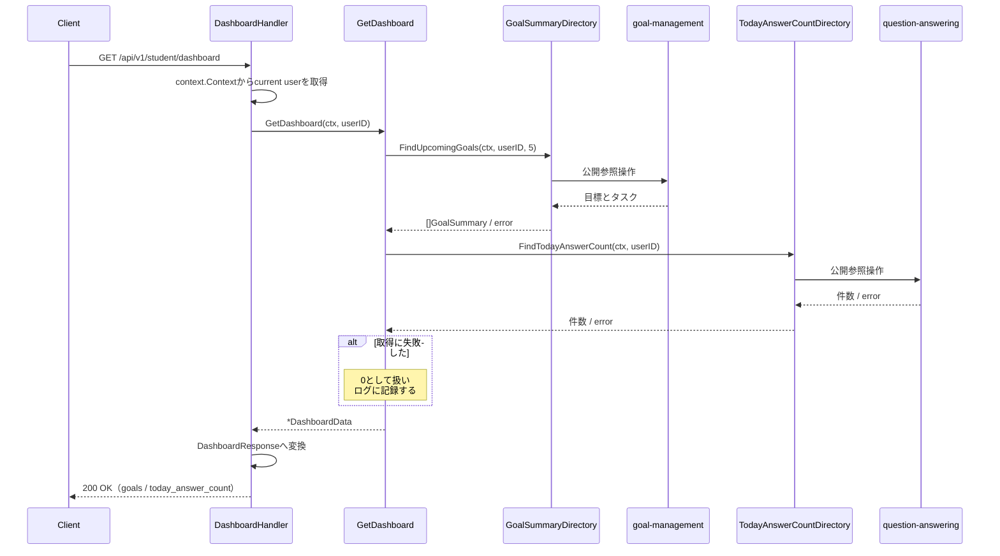
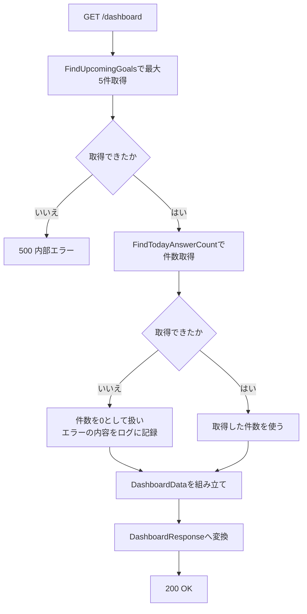

# ダッシュボード機能 Go実装仕様書

---

# 1. 機能概要

## 機能概要

生徒のホーム画面に表示する情報を、1回のリクエストでまとめて取得する参照機能である。提供するAPIは1つで、取得するのは次の2つである（①「5. API / 処理詳細」`#show`）。

- 期限が近い目標を最大5件。紐づくタスクも含む
- その生徒の当日の解答件数

いずれもこの機能が作成・更新するデータではない。**本Contextが所有するテーブルは存在しない。** 他Contextが公開する参照手段を呼び、結果を1つのレスポンスへまとめるだけである（②「3. Bounded Context」）。

## 採用設計パターンとその理由（②からの要約）

- 採用パターン: **Transaction Script**（②「4. 設計パターン」）
- 判断根拠: 2つの参照を呼んでまとめるだけで、Entityに振る舞いを持たせる余地も永続化の責務もないため
- 採用しなかったパターン: Active Record（作成・更新処理がなく所有するテーブルもないため）、Domain Model（業務ルールが所有者側のContextの責務であるため）、Event Sourcing（履歴の再構築・監査要件がないため）

本書はアーキテクチャ規約「3. 設計パターンごとの構造適用方針」のTransaction Script節の構造（Entityを持たず、手続きをapplication層の関数として置く）に従って実装レベルへ落とし込む。

## 本書が対象とする実装範囲

②が設計した`dashboard` Bounded ContextのTransaction Script実装である。application層の関数（`GetDashboard`）、他Contextへの参照（`dependency.go`のインターフェースとそのアダプタ）、Presentation層（Handler / Response / Routing）を対象とする。

対象外は、目標・タスク・単元そのものの管理と、当日の解答件数の加算である（いずれも他Contextの責務。②「3. Bounded Context」）。

---

# 2. ディレクトリ構成

## 対象Bounded Context名

- `dashboard`（②「3. Bounded Context」）

## ディレクトリ・パッケージ名

アーキテクチャ規約「4. Bounded Context構成」の「Contextディレクトリの命名」に従い、Context名`dashboard`から`-`を取り除いて連結した全小文字の名前とする。`-`を含まないため、ディレクトリ名は`internal/dashboard/`、package名は同じ`dashboard`となる。

Context名とディレクトリ名は規約から機械的に決まるため、②に明記がなくても推測にはならない。

教師向け・管理者向けのダッシュボードは別Contextであり、それぞれ別のディレクトリになる（②「3. Bounded Context」）。本Contextのディレクトリに`student/`のようなロール別のサブディレクトリを設けない。同一Contextを複数のロールが共有する場合の分割（規約「4. Bounded Context構成」の末尾）には当たらないためである。

## ②で採用した設計パターン

Transaction Script（②「4. 設計パターン」）

## 作成するディレクトリ一覧

```
internal/dashboard/
internal/dashboard/application/
internal/dashboard/infrastructure/contextadapter/
internal/dashboard/presentation/handler/
internal/dashboard/presentation/response/
```

`domain/`は作成しない。②「6. Entity設計」のとおり独自のEntityを定義せず、業務ルールを持たないためである（アーキテクチャ規約「3. 設計パターンごとの構造適用方針」Transaction Script節）。

`infrastructure/gormrepo/`も作成しない。**本Contextが所有するテーブルがなく、GORMでDBを読み書きする実装を持たない**ためである（②「21. DB操作仕様」）。`infrastructure/`配下は`contextadapter/`のみとなる。

`presentation/request/`も作成しない。リクエストパラメータを一切受け取らないためである（①「5. API / 処理詳細」`#show`）。

規約「4. Bounded Context構成」の「機能で不要なディレクトリは作成しない。『層として必要だから』という理由で空のディレクトリを置かない」に従う。

## 作成するファイル一覧

```
internal/dashboard/context.go                      # NewContext（依存関係の組み立て）
internal/dashboard/dependency.go                   # 他Contextへの依存を宣言するインターフェースと受け渡し用の型
internal/dashboard/application/get_dashboard.go    # GetDashboard（2つの参照をまとめる関数）
internal/dashboard/infrastructure/contextadapter/goal_summary_directory.go       # GoalSummaryDirectoryの実装
internal/dashboard/infrastructure/contextadapter/today_answer_count_directory.go # TodayAnswerCountDirectoryの実装
internal/dashboard/presentation/handler/dashboard_handler.go
internal/dashboard/presentation/response/dashboard_response.go
internal/dashboard/presentation/routes.go
```

## 文書の分割

本書は分割しない。実装ファイルは上記の8であり、テストが付くもの（`GetDashboard`・2つのアダプタ・DashboardHandlerの4）を加えても12であるため、1文書あたり30〜35という範囲に十分収まる。

---

# 3. Domain層設計

対象外。

②「6. Entity設計」のとおり、本Contextは独自のEntityを定義しない。所有するデータがなく、業務ルールも持たないためである（②「3. Bounded Context」の「持たない責務」）。`domain/`ディレクトリを作成しない。

他Contextから受け取る値は、本Contextが必要とする項目だけを持つ参照用の型として`dependency.go`に定義する。相手Contextの内部Entityをそのまま持ち込まない（アーキテクチャ規約「5. Context間連携ルール」）。

## Model（Entity相当）

対象外（上記のとおり）。

他Contextから受け取る型は「8. Infrastructure層設計」に記載する。

## Value Object

対象外。②「7. Value Object設計」のとおり、並び順・件数は参照手段に渡す条件であり、独自の業務ルールを持つ値ではない。

目標の期限の表示形式（`YYYY/MM/DD`）は`goal-management`が定める表現であり、本Contextは受け取った文字列をそのまま返す。本Contextで日付型として受け取って整形し直さない。同じ目標が機能によって別の形で返ることを避けるためである（②「7. Value Object設計」）。

## Repository Interface

対象外。本Contextが所有するテーブルがないため、Repository Interfaceもその実装も持たない（②「11. Repository設計」）。

他Contextの参照手段を宣言するインターフェースは`dependency.go`に置く。詳細は「8. Infrastructure層設計」に記載する。

## Domain Service

対象外。②「8. Domain Service」のとおり、複数Entityにまたがる業務ルールの判定が存在しない。

2つの参照結果を1つのレスポンスへまとめる処理は業務ルールではなく、application層の関数が担う（「6. Application層設計」）。

## Domain Event

対象外。②「18. Domain Event」のとおり、参照のみの機能であり表示に伴う副作用が存在しない。

## Domain Error（struct/Storeが返すエラー）

対象外。本Contextに業務ルール違反を表すエラーが存在しない（②「17. Error設計」）。

他Contextの参照手段が返すエラーの扱いは「14. Error実装方針」に記載する。センチネルエラーを本Contextで定義せず、`errors.go`も作成しない。

---

# 4. クラス図

②「9. クラス図」のとおり省略する。

本Contextが持つのは、他Contextの参照手段を宣言するインターフェースと、それを呼んで結果をまとめる関数のみである。Entityもstructの階層も持たないため、クラス図として図示する意味がない。

関係は「7. シーケンス図・処理フロー図」のシーケンス図で示す。

参考として、本Contextに定義する型とインターフェースは次のとおりである（詳細は「8. Infrastructure層設計」）。

|種類|名前|役割|
|-|-|-|
|インターフェース|`GoalSummaryDirectory`|`goal-management`への参照手段|
|インターフェース|`TodayAnswerCountDirectory`|`question-answering`への参照手段|
|型|`GoalSummary`|受け取る目標の情報|
|型|`TaskSummary`|目標に紐づくタスクの情報|
|型|`UnitSummary`|タスクに紐づく単元の情報|
|型|`CourseSummary`|単元の所属コースの情報|
|型|`DashboardData`|`GetDashboard`が返す集約結果|

---

# 5. 状態遷移図

②「10. 状態遷移図」のとおり省略する。

本機能に状態を持つデータが存在しない。目標・タスクの状態は参照して返すのみで変更せず、当日の解答件数も単調増加する整数であって状態として扱うものではない（①「7. 状態管理」）。

---

# 6. Application層設計

本機能はTransaction Script採用のため、UseCase structを設けない。②「12. UseCase設計」の`GetDashboard`を、application層の関数として実装する（アーキテクチャ規約「3. 設計パターンごとの構造適用方針」Transaction Script節）。

## DTO（Command / Query）

入力のDTOは設けない。リクエストパラメータを一切受け取らず、操作者の識別子のみを引数に取るためである（①「5. API / 処理詳細」`#show`）。

出力は`DashboardData`（`dependency.go`で定義する）とする。フィールドは次のとおりである。

|フィールド|型|意味|
|-|-|-|
|Goals|`[]GoalSummary`|期限が近い目標（最大5件）|
|TodayAnswerCount|`int`|当日の解答件数|

Presentation層のResponse DTOと分けるのは、`DashboardData`が他Contextから受け取った値の集約であり、JSONのキー名や表示形式といったHTTPの関心を持たないためである（アーキテクチャ規約「6. データフロー」）。

## 関数

### GetDashboard（`application/get_dashboard.go`）

|項目|内容|
|-|-|
|関数|`GetDashboard(ctx context.Context, userID uint) (*DashboardData, error)`|
|受け取る依存|`GoalSummaryDirectory`、`TodayAnswerCountDirectory`（コンストラクタで注入する`struct`のメソッドとして実装してよい）|

処理ステップ:

1. `GoalSummaryDirectory.FindUpcomingGoals`で期限が近い目標を最大5件取得する。失敗した場合はエラーを返す
2. `TodayAnswerCountDirectory.FindTodayAnswerCount`で当日の解答件数を取得する
3. 2が失敗した場合は**エラーを返さず、件数を`0`として扱う**。失敗の内容をログに記録する（②「12. UseCase設計」）
4. `DashboardData`を組み立てて返す

目標が0件の場合も、空のスライスを持つ`DashboardData`を返す。エラーにしない（①「5. API / 処理詳細」`#show`）。

**当日の解答件数の失敗を吸収する理由**: Rails現行がRedisの障害時にログを記録して`0`を返しており、目標の取得が成功していればダッシュボード全体が200で応答する（①「5. API / 処理詳細」`#show`のErrorケース）。フロントエンドを変更しない方針により、この挙動を維持する。

吸収をこの関数に置き、参照手段の側に置かないのは、吸収するかどうかが集約側の判断であるためである。参照手段の側で`0`を返す形にすると、他の利用者にも同じ吸収が強制される（②「12. UseCase設計」）。

ログの記録にはエラーの内容を含める。`0`を返して200で応答するため、障害が起きていることがレスポンスから分からない。ログだけが手がかりになる（コーディング規約「18. エラーハンドリング」）。

トランザクションは使用しない（②「14. Transaction設計」、「11. Transaction実装方針」）。

---

# 7. シーケンス図・処理フロー図

## シーケンス図

### GetDashboard



## 処理フロー図

### GetDashboard

当日の解答件数の失敗を吸収する分岐があるため図示する。



目標が0件の場合も`goals`を空配列として200を返す（①「5. API / 処理詳細」`#show`）。

---

# 8. Infrastructure層設計

**実装上の位置づけ**: 本Contextが所有するテーブルは存在しない。したがってRepository実装・Store実装・Infrastructure関数のいずれも持たない（②「11. Repository設計」「21. DB操作仕様」）。`infrastructure/`配下に置くのは、他Contextの公開操作へ委譲するアダプタのみである。

## Repository実装（Domain Model / Event Sourcing採用時）

対象外（Transaction Script採用のため、かつ所有するテーブルがないため）。

## Store実装（Active Record採用時）

対象外（同上）。

## Infrastructure関数（Transaction Script採用時）

対象外。Transaction Script採用Contextは通常、永続化処理をinfrastructure層の関数として持つが、本Contextには永続化の対象がない（②「21. DB操作仕様」の「本Contextから発行するクエリはない」）。

GORMを用いる実装を一切持たないため、`*gorm.DB`を受け取る構造も存在しない。`context.go`の`NewContext`も`*gorm.DB`を引数に取らない（**②からの補足**。詳細は「17. ②からの補足事項」参照）。

## 他Contextの参照手段の実装

`dependency.go`で宣言したインターフェースの実装である。相手Contextが公開する操作へ委譲し、本Contextから相手のテーブル・Redisへアクセスしない（アーキテクチャ規約「5. Context間連携ルール」、②「11. Repository設計」）。いずれもGORMに依存せず相手Contextの公開操作を呼ぶアダプタであるため`infrastructure/contextadapter/`に置く（同「4. Bounded Context構成」）。

|インターフェース|相手Context|メソッド|責務|
|-|-|-|-|
|`GoalSummaryDirectory`|`goal-management`|`FindUpcomingGoals(ctx context.Context, userID uint, limit int) ([]GoalSummary, error)`|期限が近い目標を`limit`件まで返す。期限の昇順（同値は識別子の昇順）で並べ、紐づくタスクを含む。論理削除済みを除く（①「5. API / 処理詳細」`#show`）|
|`TodayAnswerCountDirectory`|`question-answering`|`FindTodayAnswerCount(ctx context.Context, userID uint) (int, error)`|指定の生徒の当日の解答件数を返す（同）|

`limit`を引数に取るのは、件数が本機能の表示仕様（5件）であり、相手Contextが決める値ではないためである。呼び出し側が渡す形にする。

`dependency.go`に定義する受け渡し用の型:

|型|フィールド|備考|
|-|-|-|
|`GoalSummary`|ID（`uint`）・Title（`string`）・Description（`string`）・Status（`string`）・DueDate（`*string`）・Tasks（`[]TaskSummary`）|`Status`・`DueDate`は`goal-management`が整形した**文字列**で受け取る。`DueDate`は`YYYY/MM/DD`形式で、未設定なら`nil`|
|`TaskSummary`|ID・UserID・GoalID・Title・Content・DueDate・Priority・Status・CompletedAt・Units（`[]UnitSummary`）|項目は①「5. API / 処理詳細」`#show`のレスポンスに合わせる。`Status`・`Priority`・日付はいずれも文字列|
|`UnitSummary`|ID・CourseID・UnitName・Course（`CourseSummary`）|同|
|`CourseSummary`|ID・LevelNumber・LevelName|同|

状態と日付を文字列で受け取るのは、表示形式を`goal-management`・`task-management`が定める表現に委ねるためである（②「7. Value Object設計」）。整数の列挙型や`time.Time`で受け取って本Contextで整形し直すと、同じ目標・タスクが機能によって別の形で返る余地が生まれる。

**②からの補足**: 相手Contextが公開する操作の具体的なシグネチャは、各機能の③で確定する。本書では消費者側のインターフェースをコーディング規約「7. インターフェース」の方針に従って本Contextに置き、実装をアダプタに閉じ込める。

目標管理機能③の`GoalStore`は`FindByUserID(ctx, userID, page, perPage)`としてページネーション付きの一覧取得を持つ（同③「8. Infrastructure層設計」）。本機能が必要とするのは「最大5件・ページングなし」であり、`page=1, perPage=5`を渡せば同じ結果が得られる。ただし総件数の`COUNT`が不要であるため、件数制限専用の参照手段を設けるかは目標管理機能の③で確定する（②「25. 設計判断サマリー」、「17. ②からの補足事項」）。

`TodayAnswerCountDirectory`は、保持先がRedisであることを本Contextに漏らさない。キーの構成（`student:today_answer_count:{ユーザーID}:{日付}`）も有効期限の扱いも、所有者である`question-answering`に閉じ込める（①「6. データモデル」）。`question-answering`の②③がまだ作成されていないため、シグネチャは同機能の③で確定する。

## 外部連携実装

対象外。本Contextから外部サービスへ直接アクセスしない。Redisへのアクセスも`question-answering`に委ねる（②「24. 採用しなかった設計」の「本Contextから直接Redisを読む案」）。

---

# 9. Presentation層設計

## Handler

### DashboardHandler（`presentation/handler/dashboard_handler.go`）

|項目|内容|
|-|-|
|struct名|`DashboardHandler`|
|対応する呼び出し先|application層の`GetDashboard`|
|コンストラクタ|`NewDashboardHandler(getDashboard *application.GetDashboardService) *DashboardHandler`。`GetDashboard`を関数として注入する形でもよい|

メソッド一覧（HTTPメソッド・パス対応）:

|メソッド|HTTPメソッド|パス|
|-|-|-|
|`ShowDashboard`|GET|/api/v1/student/dashboard|

処理順序:

### ShowDashboard

1. `c.Request.Context()`からcurrent user（認証Middlewareが格納したstudentユーザー）を取得する（②「16. Authorization設計」）
2. `GetDashboard(ctx, userID)`を呼ぶ
3. エラーが返った場合は500のAppErrorへ変換して`c.Error(err)`で返す（「14. Error実装方針」）
4. `DashboardData`を`DashboardResponse`へ変換する
5. 200 OKで返す

リクエストパラメータのバインドと検証は行わない。パスパラメータ・クエリパラメータ・リクエストボディのいずれも受け取らないためである（①「5. API / 処理詳細」`#show`、②「15. Validation設計」）。

当日の解答件数の取得が失敗していても、Handlerには成功として返る。`GetDashboard`が`0`に吸収するためである（「6. Application層設計」）。Handlerにこの吸収の判断を持たせない。

## Request / Response DTO

### Request

対象外。リクエストパラメータを一切受け取らないため、Request DTOを定義せず`presentation/request/`も作成しない（①「5. API / 処理詳細」`#show`）。

### Response（`presentation/response/dashboard_response.go`）

|struct名|フィールド|型|JSONキー|
|-|-|-|-|
|`DashboardResponse`|Goals|`[]GoalResponse`|`goals`|
||TodayAnswerCount|`int`|`today_answer_count`|
|`GoalResponse`|ID|`uint`|`id`|
||Title|`string`|`title`|
||Description|`string`|`description`|
||Status|`string`|`status`|
||DueDate|`*string`|`due_date`（`YYYY/MM/DD`形式。未設定なら`null`）|
||Tasks|`[]TaskResponse`|`tasks`|
|`TaskResponse`|ID|`uint`|`id`|
||UserID|`uint`|`user_id`|
||GoalID|`*uint`|`goal_id`|
||Title|`string`|`title`|
||Content|`string`|`content`|
||DueDate|`*string`|`due_date`|
||Priority|`string`|`priority`|
||Status|`string`|`status`|
||CompletedAt|`*string`|`completed_at`|
||Units|`[]UnitResponse`|`units`|
|`UnitResponse`|ID|`uint`|`id`|
||CourseID|`uint`|`course_id`|
||UnitName|`string`|`unit_name`|
||Course|`CourseResponse`|`course`|
|`CourseResponse`|ID|`uint`|`id`|
||LevelNumber|`int`|`level_number`|
||LevelName|`string`|`level_name`|

- 最上位は`goals`と`today_answer_count`の2キーである（①「5. API / 処理詳細」`#show`）
- **`meta`を返さない。** 最大5件に固定されておりページングを行わないためである（同）。目標管理機能の一覧（`goals`＋`meta`）とは異なる
- `goals`の各要素の項目は、目標管理機能の一覧の各要素と同一である。Rails現行も同じシリアライザ（`Student::GoalSerializer`）を使っている（①「10. Rails実装対応表」）
- タスクに含まれる単元には、タスク管理機能の詳細が持つ`started`（学習開始済みか）を含めない。Rails現行の`UnitSerializer`が返していないためである（①「5. API / 処理詳細」`#show`）
- `Status`・`Priority`・日付はいずれも`dependency.go`の型が持つ文字列をそのまま入れる。本Contextで変換しない（「8. Infrastructure層設計」）
- エラーレスポンスは専用structを本書で定義しない。形式は「14. Error実装方針」のとおりであり、集中エラーハンドリングミドルウェアが組み立てる

`GoalResponse`以下の構造は`dependency.go`の`GoalSummary`以下と項目が一致する。それでもResponse DTOを別に定義するのは、JSONのキー名という表現上の関心をPresentation層に置くためである（アーキテクチャ規約「6. データフロー」）。`GoalSummary`にJSONタグを付けてそのまま返す形にはしない。

## Routing（`presentation/routes.go`）

|Method|Path|Handler|
|-|-|-|
|GET|/api/v1/student/dashboard|DashboardHandler.ShowDashboard|

パスは単数形（`dashboard`）である。Rails現行の`resource :dashboard, only: :show`に対応する（①「4. API一覧」）。複数形（`dashboards`）にしない。

認証Middleware・`student`ロール確認Middlewareを経由する（②「16. Authorization設計」）。**CSRF検証Middlewareの対象外である。** GETのみであり、状態を変更しないためである（Gin規約「5. CSRF対策」の「適用範囲」）。

一覧取得・作成・更新・削除の経路は定義しない。Rails現行にも存在しないためである（①「4. API一覧」）。

---

# 10. API仕様

|Method|Path|Handler|Request|Response|Status Code|
|-|-|-|-|-|-|
|GET|/api/v1/student/dashboard|ShowDashboard|なし|`DashboardResponse`|200|

リクエストパラメータを一切受け取らない。

エラーレスポンスの本文は「14. Error実装方針」のとおり`{"errors": [...]}`である。本機能には404を返す経路がないため、他機能にある`message`キーの本文は現れない。

## Errorケース

|条件|Status Code|Error内容|
|-|-|-|
|未認証|401|認証Middlewareが返す（②「16. Authorization設計」）|
|`student`ロールでない|403|ロール確認Middlewareが返す。本文は`{"errors": ["この操作を行う権限がありません"]}`|
|目標の取得に失敗した|500|`{"errors": [...]}`|
|当日の解答件数の取得に失敗した|—|**エラーにしない。** `today_answer_count`を`0`として200で応答する（①「5. API / 処理詳細」`#show`のErrorケース、②「17. Error設計」）|

認証・認可のステータスコードは本機能で定めるものではなく、該当Middlewareの仕様に従う。

固有の404・422は存在しない。対象が一意に定まるリクエストパラメータを持たず、入力検証の対象もないためである（②「17. Error設計」）。

目標が0件の場合も`goals`を空配列として200を返す。

---

# 11. Transaction実装方針

## Transaction開始位置

なし。②「14. Transaction設計」のとおり、状態を変更する処理が存在しないためである。

`gormtx.RunInTx`を呼ぶ箇所はない。`*gorm.DB`を保持する構造も持たない（「8. Infrastructure層設計」）。

## Transaction終了位置

なし（上記のとおり）。

## 呼び出し側トランザクションの引き継ぎ

本Contextには他Contextから呼ばれる公開操作が存在しないため、呼び出し側のトランザクションを引き継ぐ経路はない。

他Contextの参照手段を呼ぶ際は`context.Context`をそのまま渡す。相手Contextのアダプタ・Storeが`gormtx.DBFromContext`で接続を取得するため、本Contextが`ctx`に手を加える必要はない（アーキテクチャ規約「11. Transaction実装パターン（TransactionManager）」）。

## 複数Storeにまたがる場合の扱い

本ContextはStoreを持たないため、該当しない。

2つの参照手段が返す値の間に整合性を求めない。目標の取得と解答件数の取得の間に別のリクエストで解答が記録された場合、件数のみが新しい値になりうるが、表示用の集約であり業務上の問題にならない。Rails現行も2つの取得をトランザクションで囲んでいない（②「14. Transaction設計」）。

当日の解答件数はRedisに保持されており、RDBのトランザクションに含めることはできない（①「6. データモデル」）。整合性を求めない方針はこの制約とも一致する。

---

# 12. Validation実装方針

## Presentation

検証項目はない。パスパラメータ・クエリパラメータ・リクエストボディのいずれも受け取らないためである（①「5. API / 処理詳細」`#show`、②「15. Validation設計」）。

Request DTOを定義せず、バインド処理も行わない。

## 業務ルール検証

対象外。②「15. Validation設計」のとおり、本Contextに業務ルールが存在しない。

表示件数（5件）と並び順（期限の昇順、同値は識別子の昇順）は検証の対象ではなく、参照手段に渡す条件である。件数は`FindUpcomingGoals`の`limit`引数として渡し、並び順は相手Contextが保証する（「8. Infrastructure層設計」）。

参照手段が5件を超える件数を返した場合の切り詰めは行わない。`limit`を渡した以上、件数を守るのは相手Contextの責務である。守られていなければ相手Contextの不具合であり、本Contextで隠蔽すると発見が遅れる。

---

# 13. Authorization実装方針

- Middlewareで行う処理: 認証済みユーザーの特定と`context.Context`への格納、役割（`student`）であることの確認（②「16. Authorization設計」Middleware節）
- Handlerで行う処理: `context.Context`からcurrent userを取り出し、application層の関数へ渡す。業務権限判定は持たせない
- Applicationで行う処理: current userの識別子を2つの参照手段に渡すことで、操作者自身のデータのみ取得できるようにする
- Domainで行う処理: なし。本ContextにDomain層が存在しない
- CSRF: **対象外。** GETのみであり状態を変更しないためである（Gin規約「5. CSRF対策」の「適用範囲」）

所有権のスコープは、参照手段に渡す識別子で担保する。本Contextに検索条件を持たないため、Storeの検索条件による担保（他機能の方式）は取れない。相手Contextが識別子で正しく絞ることに依存する（②「16. Authorization設計」）。

本Contextには他Contextから呼ばれる公開操作が存在しないため、認可を行わない経路はない。

---

# 14. Error実装方針

## Domain Error → Application Errorへの変換方針

本ContextにDomain Errorが存在しないため、変換は行わない（②「17. Error設計」）。センチネルエラーを定義せず、`errors.go`も作成しない。

他Contextの参照手段が返すエラーは、アダプタの中でラップして返す。相手Contextのエラー型を本Contextのハンドリングに持ち込まない（アーキテクチャ規約「5. Context間連携ルール」）。本Contextはエラーの種類で分岐せず、成否のみを見る。

- 目標の取得が失敗した場合: `GetDashboard`がエラーを返し、Handlerが500のAppErrorへ変換する
- 当日の解答件数の取得が失敗した場合: `GetDashboard`が`0`へ吸収し、エラーを返さない（「6. Application層設計」）

## Application Error → HTTPレスポンスへの変換方針

Gin規約「8. エラーハンドリングミドルウェア」の集中エラーハンドリングミドルウェアに変換を集約する。Handlerは`c.Error(err)`でエラーを登録するのみとし、個々のHandlerでステータスコードを判定しない。ミドルウェアが`errors.As`で`AppError`を1回だけ判定し、`StatusCode()`でステータス、`LogLevel()`でログレベルを決める。

レスポンスのボディは`{"errors": ["メッセージ", ...]}`とする。エラーが1件でも配列で返す（アーキテクチャ規約「15. API規約（レスポンス形式・ページネーション・URL・クエリパラメータ）」の「エラーレスポンス」）。

|条件|HTTP Status|ボディ|
|-|-|-|
|目標の取得に失敗した|500|`{"errors": [...]}`|
|認証・認可|401 / 403|`{"errors": [...]}`。該当Middlewareが組み立てる|

**本機能には404を返す経路がない。** 他機能の③が記載している「404のみ`message`キーの本文を組み立てる分岐」は、本機能では使われない（目標管理機能③・タスク管理機能③・学習ログ機能③「14. Error実装方針」）。ミドルウェア自体は共通であり、本機能のために分岐を減らす必要はない。

## Infrastructure Errorのハンドリング方針

本ContextにDBアクセスがないため、GORMが返すエラーを扱う箇所はない。

他Contextの参照手段の内部で発生した障害（DB接続失敗・Redisの障害等）は、アダプタ経由でエラーとして伝わる。`fmt.Errorf`でラップして返す（コーディング規約「18. エラーハンドリング」）。

|Error種別|発生層|HTTP Status|
|-|-|-|
|目標の取得の失敗（相手Contextの障害を含む）|Application（`GetDashboard`）|500|
|当日の解答件数の取得の失敗|—|—（`0`へ吸収し200で応答する。ログに記録する）|
|認証エラー|Middleware|401|
|認可エラー（役割不一致）|Middleware|403|

当日の解答件数の失敗を`0`へ吸収する際は、エラーの内容を必ずログに記録する。`0`を返して200で応答するため、障害が起きていることがレスポンスから分からない。ログだけが手がかりになる（「6. Application層設計」）。

ログレベルは、業務上の失敗ではなく技術的な障害であるためエラーレベルとする。Rails現行も`Rails.logger.error`で記録している（①「6. データモデル」の「当日の解答件数（Redis）」）。

---

# 15. GORM / DBクエリ設計

**本Contextから発行するクエリはない。**

②「21. DB操作仕様」のとおり、本Contextが所有するテーブルは存在しない。GORMモデルを定義せず、`*gorm.DB`を受け取る構造も持たない（「8. Infrastructure層設計」）。

## 利用するGORMモデルとテーブルの対応

なし。

## 主要クエリの条件・ソート・ページネーション方針

本Contextでは定めない。参照手段に渡す条件として相手Contextへ伝える。本機能が必要とする条件は次のとおりである（②「21. DB操作仕様」）。

|要求|内容|伝え方|
|-|-|-|
|目標の絞り込み|操作者自身の目標のみ。論理削除済みを除く|`FindUpcomingGoals`の`userID`引数。論理削除の除外は`goal-management`が保証する|
|目標の並び順|期限の昇順。同値は識別子の昇順|`goal-management`が保証する（同機能③「15. GORM / DBクエリ設計」）|
|目標の件数|最大5件。ページングなし|`FindUpcomingGoals`の`limit`引数|
|紐づくタスク|目標ごとに個別に問い合わせず一括で取得する（N+1を避ける）|`goal-management`が保証する（同）|
|当日の解答件数|操作者自身の、サーバの現在時刻の日付における件数|`FindTodayAnswerCount`の`userID`引数。日付の基準は`question-answering`が決める|

## 既存Schemaに対する変更

②「20. DB設計方針」のとおり、変更なし。本Contextはスキーマに関わらない。

---

# 16. テストケース設計

②「22. テスト戦略」を、Transaction Script採用に合わせて読み替える。Entityを持たないためDomain Testに相当するものがなく、所有するテーブルがないためStore Testもない。

## Model Test

対象外。本Contextに業務ルールを持つModel・Value Objectが存在しない（②「22. テスト戦略」）。

## UseCase Test

`GetDashboard`のテストである。2つの参照手段を差し替えて検証する。

|対象|テストケース|
|-|-|
|`GetDashboard`|正常系: 2つの参照結果が`DashboardData`にまとめられること|
|`GetDashboard`|正常系: 目標が0件のとき、空のスライスと取得した件数を返すこと|
|`GetDashboard`|正常系: `FindUpcomingGoals`に`limit`として5が渡されること|
|`GetDashboard`|正常系: `FindUpcomingGoals`・`FindTodayAnswerCount`の双方に操作者の識別子が渡されること|
|`GetDashboard`|異常系: 当日の解答件数の取得が失敗した場合、エラーを返さず件数を`0`とすること|
|`GetDashboard`|異常系: 当日の解答件数の取得が失敗した場合、エラーの内容がログに記録されること|
|`GetDashboard`|異常系: 当日の解答件数の取得が失敗しても、目標の取得結果はそのまま返ること|
|`GetDashboard`|異常系: 目標の取得が失敗した場合、エラーを返すこと（`0`へ吸収しないこと）|
|`GetDashboard`|異常系: 目標の取得が失敗した場合、当日の解答件数の取得を呼ばないこと|

## Store Test

対象外。本Contextが所有するテーブルがなく、Store・Repositoryに相当する実装を持たない（②「22. テスト戦略」）。

アダプタ（`infrastructure/contextadapter/`）については、相手Contextの公開操作を呼び出して`dependency.go`の型へ変換することを検証する。

|対象|テストケース|
|-|-|
|`GoalSummaryDirectory`の実装|相手Contextの戻り値が`[]GoalSummary`へ変換されること（状態・日付が文字列のまま渡ること）|
|`GoalSummaryDirectory`の実装|紐づくタスクと単元・コースが入れ子の型へ変換されること|
|`GoalSummaryDirectory`の実装|相手Contextがエラーを返した場合、ラップして返すこと|
|`TodayAnswerCountDirectory`の実装|相手Contextの戻り値が整数として返ること|
|`TodayAnswerCountDirectory`の実装|相手Contextがエラーを返した場合、`0`へ吸収せずエラーを返すこと（吸収は`GetDashboard`の責務）|

## Handler Test

|対象|テストケース|
|-|-|
|`DashboardHandler.ShowDashboard`|正常系: 最上位が`goals`と`today_answer_count`の2キーで200が返ること|
|`DashboardHandler.ShowDashboard`|正常系: **`meta`を返さないこと**（目標管理機能の一覧との違い）|
|`DashboardHandler.ShowDashboard`|正常系: `goals`の各要素が紐づくタスクを含むこと|
|`DashboardHandler.ShowDashboard`|正常系: タスクに含まれる単元に`started`が含まれないこと|
|`DashboardHandler.ShowDashboard`|正常系: `status`・`priority`・日付が文字列で返ること|
|`DashboardHandler.ShowDashboard`|正常系: 目標が0件のとき`goals`が空配列で返ること|
|`DashboardHandler.ShowDashboard`|正常系: 当日の解答件数の取得が失敗したとき`today_answer_count`が`0`で200が返ること|
|`DashboardHandler.ShowDashboard`|異常系: 目標の取得が失敗したとき500と`{"errors": [...]}`が返ること|
|`DashboardHandler.ShowDashboard`|正常系: リクエストパラメータを付けても無視されること（検証でエラーにしないこと）|

## Integration Test

|対象|テストケース|
|-|-|
|ダッシュボードの取得|エンドポイント経由で目標と当日の解答件数がまとめて取得できること（②「22. テスト戦略」Integration Test）|
|件数の制限|目標が6件以上あるとき、期限の近い5件のみ返ること|
|並び順|期限の昇順で返り、期限が同じ場合は識別子の昇順になること|
|論理削除|論理削除済みの目標が含まれないこと|
|認可|未認証・`student`ロール以外のユーザーがアクセスした場合に拒否されること|
|認可|他の生徒の目標が含まれないこと|
|解答件数の反映|解答を記録したあとに`today_answer_count`が増えて反映されること|
|CSRF|GETのためCSRFトークンなしでも成功すること|

---

# 17. ②からの補足事項

②に明記がなく、実装のために追加で判断した内容は以下のとおりである。

|判断した内容|判断理由|推測かどうか|
|-|-|-|
|`domain/`・`infrastructure/gormrepo/`・`presentation/request/`を作成しないことにした|②「6. Entity設計」が独自Entityを定義せず、②「21. DB操作仕様」が発行するクエリなしとし、①「5. API / 処理詳細」`#show`がリクエストパラメータを持たないため。規約「4. Bounded Context構成」の「機能で不要なディレクトリは作成しない」に従う|補足（②と①の記載から機械的に決まる）|
|`context.go`の`NewContext`が`*gorm.DB`を引数に取らない形にした|本ContextにGORMを用いる実装が一切なく、受け取っても使う先がないため。規約「14. 依存関係の組み立て（DI配線）」の例示は`*gorm.DB`を渡す形だが、所有するテーブルがないContextは対象外と解釈した|要確認（DI配線の例示から外れるため、`cmd/server/main.go`での組み立て方とあわせて確認が必要）|
|`GoalSummary`・`TaskSummary`等の受け渡し用の型を本Contextに定義した|相手Contextの内部structをそのまま受け取らないため（規約「5. Context間連携ルール」）。項目は①「5. API / 処理詳細」`#show`のレスポンスに合わせた|補足|
|状態・優先度・日付を**文字列**で受け取る形にした|表示形式を所有者側のContextが定める表現に委ねるため（②「7. Value Object設計」）。整数の列挙型や`time.Time`で受け取って本Contextで整形し直すと、同じ目標・タスクが機能によって別の形で返る余地が生まれる|補足（②の方針の具体化）|
|`FindUpcomingGoals`が`limit`を引数に取る形にした|件数（5件）は本機能の表示仕様であり、相手Contextが決める値ではないため|補足|
|`DashboardData`（application層の出力）とResponse DTOを別に定義した|`DashboardData`はJSONのキー名や表示形式といったHTTPの関心を持たないため（規約「6. データフロー」）。項目は一致するが、`GoalSummary`にJSONタグを付けてそのまま返す形にはしない|補足（規約の適用）|
|参照手段が5件を超える件数を返した場合の切り詰めを行わないことにした|`limit`を渡した以上、件数を守るのは相手Contextの責務である。本Contextで隠蔽すると相手Contextの不具合の発見が遅れる|補足|
|当日の解答件数の失敗を`0`へ吸収する際、エラーの内容をログに記録することにした|`0`を返して200で応答するため、障害が起きていることがレスポンスから分からない。ログだけが手がかりになる（コーディング規約「18. エラーハンドリング」）。Rails現行も`Rails.logger.error`で記録している（①「6. データモデル」）|補足（①の実体に基づく）|
|吸収を`GetDashboard`に置き、アダプタの側に置かないことにした|吸収するかどうかは集約側の判断である。参照手段の側で`0`を返す形にすると、他の利用者にも同じ吸収が強制される（②「12. UseCase設計」）|補足（②の方針の具体化）|
|目標の取得が失敗した場合、当日の解答件数の取得を呼ばないことにした|ダッシュボードを組み立てられないことが確定しているため、不要な呼び出しを行わない。②「12. UseCase設計」は処理の順序のみを示しており、早期に返すかは明記していない|補足|
|`GoalSummaryDirectory`の具体的なシグネチャ|目標管理機能③の`GoalStore.FindByUserID`はページネーション付きであり、`page=1, perPage=5`を渡せば同じ結果が得られる。ただし総件数の`COUNT`が不要であるため、件数制限専用の参照手段を設けるかは所有者側で決める|要確認（目標管理機能の③の追随時に確定する）|
|`TodayAnswerCountDirectory`の具体的なシグネチャと、「当日」の基準となるタイムゾーン|`question-answering`の②③がまだ作成されていない。Rails現行は`Time.current.to_date`で判定しており、アプリケーションのタイムゾーン設定に依存する（①「6. データモデル」）|要確認（問題解答機能の②③で確定する）|

ディレクトリ名・package名（`internal/dashboard/`）、レスポンスの形状（`goals`＋`today_answer_count`、`meta`なし）、HTTPステータス（200・500）、当日の解答件数の失敗を`0`へ吸収する挙動、CSRFの対象外であることは、いずれも規約または①に根拠があるため推測ではない。根拠はそれぞれ該当節に記載した。
