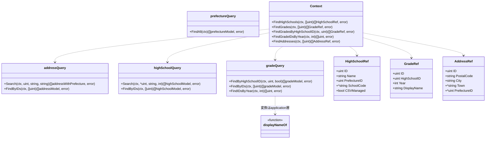
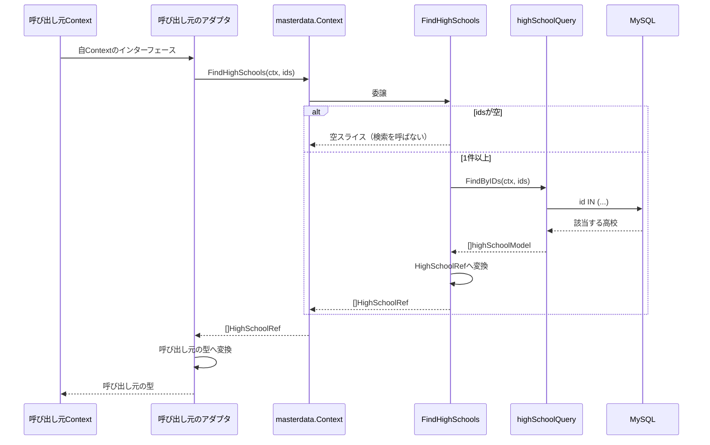
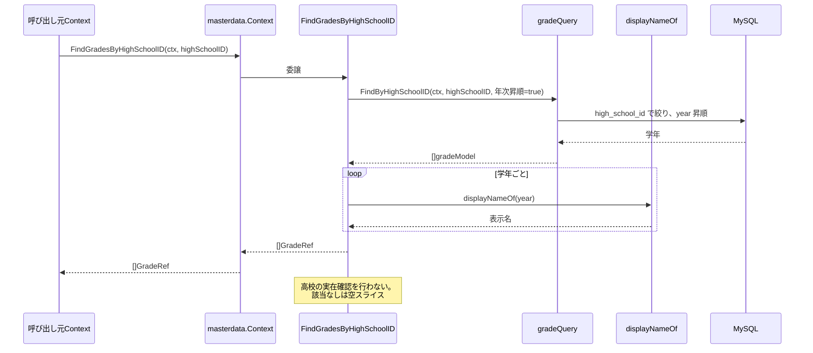
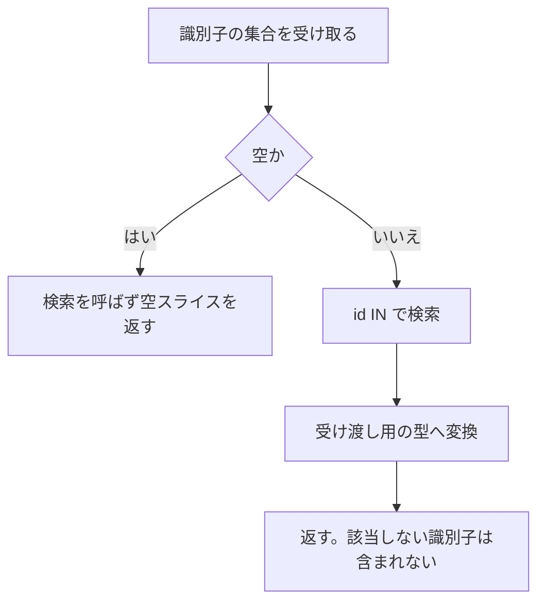
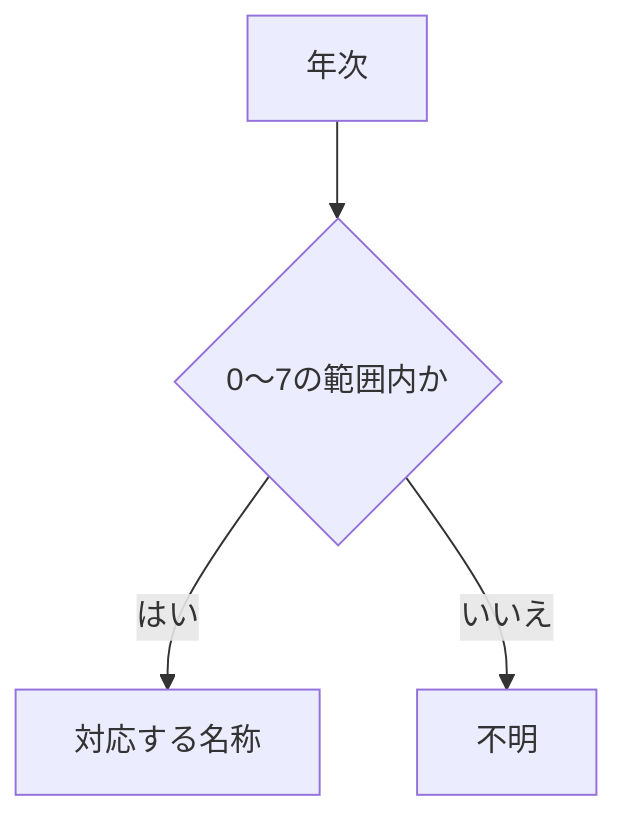

# 共通マスタ参照機能 Go実装仕様書（1. 基盤）

---

# 1. 機能概要

## 機能概要

会員登録・プロフィール編集・生徒登録などの入力フォームが選択肢として必要とする共通マスタ（都道府県・住所・在籍高校・学年）を参照できるようにする機能である（②「1. 機能概要」）。エンドポイントは4つで、いずれも参照のみである。

加えて、**他Contextが高校・学年・住所の実在確認や属性の取得に使う窓口**でもある。公開する参照手段は5つで、11のContextから呼ばれる（②「3. Bounded Context」の依存集約表）。

## 採用設計パターンとその理由（②からの要約）

**Transaction Script**（②「4. 設計パターン」）

アーキテクチャ規約「3. 設計パターンごとの構造適用方針」のTransaction Script節が対象とする「単純な一覧参照」に該当する。状態・書き込み・業務ルールを持たないため、domain層・usecase層・Repository Interfaceを設けない。

## 本書が対象とする実装範囲

機能全体で共通して使うものと、他Contextへ公開する参照手段を対象とする。

- `context.go`（依存関係の組み立てと公開操作）・`dependency.go`（他Contextへ渡す型）
- `infrastructure/gormquery/`配下のGORMモデルと4つの検索
- application層のうち、エンドポイントと公開操作の両方が使う学年の表示名の変換
- **他Contextへ公開する5つの参照手段**

エンドポイントごとのapplication関数・Handler・Request / Response DTO・ルーティングは`共通マスタ参照機能_Go実装仕様書_2_エンドポイント.md`で扱う。

---

# 2. ディレクトリ構成

## 対象Bounded Context名

- `master-data`（②「3. Bounded Context」）

## ディレクトリ・パッケージ名

アーキテクチャ規約「4. Bounded Context構成」の「Contextディレクトリの命名」に従い、Context名`master-data`から`-`を取り除いて連結した全小文字の名前とする。ディレクトリ名は`internal/masterdata/`、package名は同じ`masterdata`となる。

Context名とディレクトリ名は規約から機械的に決まるため、②に明記がなくても推測にはならない。

4つのマスタ（都道府県・住所・高校・学年）ごとのサブディレクトリを設けない。1つのContextとして扱うと②「3. Bounded Context」が決めており、ファイル単位で分ければ足りる。

## ②で採用した設計パターン

Transaction Script（②「4. 設計パターン」）

## 作成するディレクトリ一覧

```
internal/masterdata/
internal/masterdata/application/
internal/masterdata/infrastructure/gormquery/
internal/masterdata/presentation/handler/
internal/masterdata/presentation/request/
internal/masterdata/presentation/response/
```

`domain/`は作成しない。②「6. Entity設計」「7. Value Object設計」「8. Domain Service」のとおりEntity・Value Object・Domain Serviceをいずれも定義しないためである（アーキテクチャ規約「3. 設計パターンごとの構造適用方針」Transaction Script節）。

`infrastructure/gormrepo/`は作成しない。Repository Interfaceを持たないため、その実装を置くディレクトリも不要である。GORMを使うDBアクセスは`infrastructure/gormquery/`に置く。コース参照機能③「2. ディレクトリ構成」が同じ判断をしており、それに揃える。

`infrastructure/contextadapter/`は作成しない。**本Contextから他Contextへの依存が存在しない**ためである（②「3. Bounded Context」の「他Contextとの依存関係（本Contextが依存する側）」）。本Contextは参照される側のみである。

規約「4. Bounded Context構成」の「機能で不要なディレクトリは作成しない。『層として必要だから』という理由で空のディレクトリを置かない」に従う。

## 機能全体のファイル一覧と担当文書

|パス|担当文書|役割|
|-|-|-|
|`internal/masterdata/context.go`|1（本書）|`NewContext`と、他Contextへ公開する5つの操作|
|`internal/masterdata/dependency.go`|1（本書）|他Contextへ渡す型|
|`internal/masterdata/application/grade_display_name.go`|1（本書）|年次から表示名への変換|
|`internal/masterdata/application/high_school_directory.go`|1（本書）|高校の属性の取得（公開）|
|`internal/masterdata/application/grade_directory.go`|1（本書）|学年の属性の取得・高校配下の学年一覧・年次による検索（公開）|
|`internal/masterdata/application/address_directory.go`|1（本書）|住所の属性の取得（公開）|
|`internal/masterdata/infrastructure/gormquery/models.go`|1（本書）|4テーブルのGORMモデルと結合結果の型|
|`internal/masterdata/infrastructure/gormquery/prefecture_query.go`|1（本書）|都道府県の検索|
|`internal/masterdata/infrastructure/gormquery/address_query.go`|1（本書）|住所の検索|
|`internal/masterdata/infrastructure/gormquery/high_school_query.go`|1（本書）|高校の検索|
|`internal/masterdata/infrastructure/gormquery/grade_query.go`|1（本書）|学年の検索|
|`internal/masterdata/application/list_prefectures.go`|2|`ListPrefectures`|
|`internal/masterdata/application/search_addresses.go`|2|`SearchAddresses`|
|`internal/masterdata/application/search_high_schools.go`|2|`SearchHighSchools`|
|`internal/masterdata/application/list_grades.go`|2|`ListGradesByHighSchool`|
|`internal/masterdata/presentation/handler/prefecture_handler.go`|2|`GET /prefectures`|
|`internal/masterdata/presentation/handler/address_handler.go`|2|`GET /addresses`|
|`internal/masterdata/presentation/handler/high_school_handler.go`|2|`GET /high_schools`と`GET /high_schools/:id/grades`|
|`internal/masterdata/presentation/request/address_request.go`|2|住所検索のRequest DTO|
|`internal/masterdata/presentation/request/high_school_request.go`|2|高校検索のRequest DTO|
|`internal/masterdata/presentation/response/prefecture_response.go`|2|都道府県のResponse DTO|
|`internal/masterdata/presentation/response/address_response.go`|2|住所のResponse DTO|
|`internal/masterdata/presentation/response/high_school_response.go`|2|高校のResponse DTO|
|`internal/masterdata/presentation/response/grade_response.go`|2|学年のResponse DTO|
|`internal/masterdata/presentation/routes.go`|2|ルーティング登録|

`errors.go`を作成しない。②「17. Error設計」のとおり、本Contextに意味を持つエラーが1つも存在しないためである。該当する行がないことはエラーにせず、空の結果として返す。

## 文書の分割

実装ファイルは25である。テストが付くもの（Transaction Scriptの関数11・検索4・Handler3の合計18）を加えると43となり、1文書あたり30〜35という範囲を超えるため分割する（③自動生成プロンプト「文書の分割（1文書あたり30〜35ファイル）」）。

|文書|担当|実装|テスト込みの目安|
|-|-|-|-|
|`共通マスタ参照機能_Go実装仕様書_1_基盤.md`|GORMモデル・4つの検索・表示名の変換・公開する5操作・`context.go`・`dependency.go`・実装方針|11|19|
|`共通マスタ参照機能_Go実装仕様書_2_エンドポイント.md`|4つのエンドポイントのapplication関数・Presentation層・ルーティング|14|21|

Handlerは3つになるが、スライスに割るといずれもテスト込みで6〜9にとどまり小さすぎるため、1つの文書にまとめる（同プロンプト「スライスの切り方」の「小さすぎる場合は複数のHandlerを1つのスライス編にまとめてください」）。

基盤編 → エンドポイント編の順に実装すれば、各PRは単体でコンパイルが通る。エンドポイント編のapplication関数は基盤編の検索と表示名の変換に依存するためである。`routes.go`はHandlerを参照するためエンドポイント編に置く。

**基盤編だけで`master-data`の公開参照手段が揃う。** 他Contextの実装（認証・ユーザー基盤・教員管理・分析等）が本Contextの公開操作を必要とするため、エンドポイント編より先に基盤編を実装できることに意味がある。

---

# 3. Domain層設計

対象外（Transaction Script採用のため、Domain層を設けない）。

②「6. Entity設計」「7. Value Object設計」「8. Domain Service」「18. Domain Event」のとおり、Entity・Value Object・Domain Service・Domain Eventをいずれも定義しない。`domain/`ディレクトリを作成しない。

関数の入出力・処理ステップは「6. Application層設計」（本書の表示名の変換と公開操作）および文書2の同節（エンドポイントの操作）に記載する。

## Domain Error

対象外。②「17. Error設計」のとおり、本Contextに業務ルール違反を表すエラーが存在しない。Application Errorも存在しない。

該当する行がないことはエラーとして扱わず、空の結果を返す。エンドポイントでも公開参照手段でも同じとする（②「17. Error設計」）。センチネルエラーを定義せず、`errors.go`も作成しない。

---

# 4. クラス図

Entityもstructの階層も持たないため、Domain Model相当のクラス図は存在しない。本Contextが持つのは、マスタを読む検索関数、公開操作、および他Contextへ渡す型である。その関係を示す。



本Contextはインターフェースを1つも定義しない。他Contextへ依存しないため、依存を差し替えるためのインターフェースが必要にならない（②「3. Bounded Context」）。コーディング規約「7. インターフェース」は「インターフェースは利用するパッケージ側で定義する」と定めており、本Contextを利用する側が自身の`dependency.go`に定義する。

`Context`が5つの公開操作を直接持つのは、委譲するだけで手続きを持たないためである。公開操作ごとにstructを設けない。

---

# 5. 状態遷移図

省略する。

理由: ②「10. 状態遷移図」のとおり、本Contextが扱う4つのマスタはいずれも状態を表すカラムを持たない。図示すべき遷移が存在しない。

---

# 6. Application層設計

本機能はTransaction Script採用のため、UseCase structを設けない（アーキテクチャ規約「3. 設計パターンごとの構造適用方針」）。

本書では、エンドポイントと公開操作の両方が使う表示名の変換と、他Contextへ公開する5つの参照手段を扱う。エンドポイントの操作は文書2で扱う。

## DTO（Command / Query）

本書で定義する入力DTOはない。公開操作はいずれも識別子の集合または単一の値を引数に取る。

出力の型（`dependency.go`に置く）は「8. Infrastructure層設計」に記載する。

## 学年の表示名の変換（`application/grade_display_name.go`）

|項目|内容|
|-|-|
|関数|`displayNameOf(year int) string`|
|定数|年次0〜7に対応する8つの名称を、インデックスで引けるスライスとして宣言する|

|年次|名称|
|-|-|
|0|中３生|
|1|高１生|
|2|高２生|
|3|高３生|
|4|高卒生|
|5|新高１生|
|6|新高２生|
|7|新高３生|
|範囲外|不明|

処理上の注意:

- 負数・8以上の年次では「不明」を返す。Rails現行がスライスの範囲外アクセスで`nil`になり、既定値として「不明」を返している（①「5. API / 処理詳細」`Api::V1::GradesController#index`）
- 名称のスライスをパッケージレベルの変数にしない。コーディング規約「4. パッケージ設計」の「パッケージレベルの可変変数（グローバル変数）を避ける」に従い、変更されない配列として宣言するか関数内に置く
- 非公開関数とする。本Contextの外から年次だけを渡して変換させない。公開操作が返す型に表示名を含めるため、外部から変換を呼ぶ必要がない（②「3. Bounded Context」の「持たない責務」）

**この変換をエンドポイントと公開操作の両方から使う。** 年次と名称の対応が2か所に分かれないようにするためである（②「7. Value Object設計」）。

## 他Contextへ公開する参照手段

②「11. Repository設計」の「他Contextへ公開する参照手段」の5つである。いずれも検索を呼び、表示名の変換を添えるだけである。

### 高校の属性の取得（`application/high_school_directory.go`）

|項目|内容|
|-|-|
|関数|`FindHighSchools(ctx context.Context, ids []uint) ([]HighSchoolRef, error)`|
|受け取る依存|高校の検索|

処理ステップ:

1. `ids`が空の場合、検索を呼ばずに空スライスを返す（ガード節）
2. 高校の検索で、識別子の集合に一致する高校を取得する
3. `HighSchoolRef`へ変換して返す。該当しない識別子は結果に含まれない

`ids`が空のとき検索を呼ばないのは、空の集合での`IN`が意図せず全件として解釈される実装を避けるためである。

該当しない識別子をエラーにしない。属性の取得が実在確認を兼ねるため、呼び出し元が件数や内容で判断する（②「17. Error設計」）。

### 学年の属性の取得・高校配下の学年一覧・年次による検索（`application/grade_directory.go`）

|項目|内容|
|-|-|
|関数|`FindGrades(ctx context.Context, ids []uint) ([]GradeRef, error)`|
||`FindGradesByHighSchoolID(ctx context.Context, highSchoolID uint) ([]GradeRef, error)`|
||`FindGradeIDsByYear(ctx context.Context, year int) ([]uint, error)`|
|受け取る依存|学年の検索|

`FindGrades`の処理ステップ:

1. `ids`が空の場合、検索を呼ばずに空スライスを返す（ガード節）
2. 学年の検索で、識別子の集合に一致する学年を取得する
3. `displayNameOf`で表示名を付け、`GradeRef`へ変換して返す

`FindGradesByHighSchoolID`の処理ステップ:

1. 学年の検索で、指定された高校に属する学年を**年次の昇順**で取得する
2. `displayNameOf`で表示名を付け、`GradeRef`へ変換して返す
3. 該当がない場合は空スライスを返す

**高校の実在確認を行わない。** 存在しない高校の識別子では空スライスを返す（②「11. Repository設計」の「公開操作が持たない責務」）。実在確認が必要な呼び出し元（`school-directory`）は自身で確認する（管理者高校学年参照機能③「6. Application層設計」の`ListGrades`）。

`FindGradeIDsByYear`の処理ステップ:

1. 学年の検索で、指定された年次を持つ学年の識別子を取得する。**学校で絞り込まない**
2. 識別子のスライスをそのまま返す

学校で絞り込まない理由は②「11. Repository設計」の「年次による学年の検索が学校で絞り込まない理由」に記載のとおりである。

`GradeRef`に所属高校の識別子を含めるのは、呼び出し元が「この学年はこの高校に属するか」を突き合わせで判定するためである（②「3. Bounded Context」）。

### 住所の属性の取得（`application/address_directory.go`）

|項目|内容|
|-|-|
|関数|`FindAddresses(ctx context.Context, ids []uint) ([]AddressRef, error)`|
|受け取る依存|住所の検索|

処理ステップ:

1. `ids`が空の場合、検索を呼ばずに空スライスを返す（ガード節）
2. 住所の検索で、識別子の集合に一致する住所を取得する。**論理削除済みを除外しない**
3. `AddressRef`へ変換して返す

論理削除済みを除外しない理由は②「11. Repository設計」の「公開操作における論理削除の扱い」に記載のとおりである。実在確認の用途で除外すると、論理削除済みの住所を既に参照しているユーザーのプロフィール更新が通らなくなる。

都道府県との結合を行わない。呼び出し元（`profile`）が都道府県名を必要としないため、都道府県の識別子までを返す（②「21. DB操作仕様」）。

トランザクションは使用しない（②「14. Transaction設計」、「11. Transaction実装方針」）。

---

# 7. シーケンス図・処理フロー図

## シーケンス図

### 公開操作（高校の属性の取得）



### 公開操作（高校配下の学年一覧の取得）



## 処理フロー図

### 識別子の集合を受け取る公開操作



`FindHighSchools`・`FindGrades`・`FindAddresses`に共通の流れである。該当しない識別子をエラーにせず、結果に含めないことで表す。

### 学年の表示名の決定



---

# 8. Infrastructure層設計

## Repository実装（Domain Model / Event Sourcing採用時）

対象外（Transaction Script採用のため）。

## Store実装（Active Record採用時）

対象外（同上）。

## Infrastructure関数（Transaction Script採用時）

`infrastructure/gormquery/`に置く。各検索は非公開structとそのコンストラクタで構成し、`db *gorm.DB`を保持する。

各関数は`gormtx.DBFromContext(ctx, q.db)`で接続を取得する。本Contextはトランザクションを開始しないが、**他Contextが開始したトランザクションの内側から呼ばれる場合がある**（②「14. Transaction設計」）。`db.WithContext(ctx)`を直接使わない。

### prefecture_query.go

|関数|引数|戻り値|発行するクエリ内容|
|-|-|-|-|
|`FindAll`|`ctx context.Context`|`([]prefectureModel, error)`|`prefectures`の全件取得。絞り込み・並び替え・ページネーションを行わない（①「5. API / 処理詳細」`Api::V1::PrefecturesController#index`）|

### address_query.go

|関数|引数|戻り値|発行するクエリ内容|
|-|-|-|-|
|`Search`|`ctx context.Context, prefectureID uint, city, town string`|`([]addressWithPrefecture, error)`|`prefecture_id`で絞り込む。`city`が空でなければ`city`に対する部分一致、`town`が空でなければ`town`に対する部分一致を加える。`prefectures`と`LEFT JOIN`して都道府県名を取得する。並び替え・ページネーションを行わない|
|`FindByIDs`|`ctx context.Context, ids []uint`|`([]addressModel, error)`|`id IN (...)`で取得する。`prefectures`と結合しない|

**`deleted_at`を条件に含めない。** `addresses`は論理削除の列を持つが、Rails現行は既定の絞り込みを定義しておらず論理削除済みの行も返す（①「5. API / 処理詳細」`Api::V1::AddressesController#index`）。

`prefectures`との結合に`LEFT JOIN`を使う。`addresses.prefecture_id`が未設定を許すためである（①「6. データモデル」）。内部結合にすると都道府県が未設定の住所が結果から落ちる。ただし`Search`は`prefecture_id`で絞り込むため、実際には未設定の行が対象になることはない。それでも`LEFT JOIN`とするのは、絞り込みの条件が将来変わったときに行が静かに落ちないようにするためである。

部分一致は検索語の前後にワイルドカードを置く形になる。検索語に含まれるワイルドカード文字（`%`・`_`）をそのまま渡すと、利用者の入力が意図しないパターンとして解釈される。**検索語をエスケープしてから渡す**（**②からの補足**。「17. ②からの補足事項」参照）。

### high_school_query.go

|関数|引数|戻り値|発行するクエリ内容|
|-|-|-|-|
|`Search`|`ctx context.Context, prefectureID *uint, keyword string, limit int`|`([]highSchoolModel, error)`|`prefecture_id`で絞り込む。**`prefectureID`が`nil`の場合も`prefecture_id IS NULL`として条件を適用する。** `keyword`が空でなければ`name`に対する部分一致を加える。`name`昇順、`limit`件に制限する|
|`FindByIDs`|`ctx context.Context, ids []uint`|`([]highSchoolModel, error)`|`id IN (...)`で取得する|

**`prefectureID`が`nil`のときも条件を適用する点が本検索の要である。** `high_schools.prefecture_id`は未設定を許さないカラムであるため、条件が`prefecture_id IS NULL`となり結果が0件になる。Rails現行の`HighSchoolsQuery#filter_prefecture`が引数の有無を問わず`where(prefecture_id: id)`を適用しているためである（①「5. API / 処理詳細」`Api::V1::HighSchoolsController#index`）。

`HighSchool.by_prefecture`（未指定なら絞り込まないモデルのスコープ）は本機能のエンドポイントが使っていない。同じ振る舞いの検索を本Contextに持たない（②「23. Railsとの責務対応」）。`school-directory`は未指定なら絞り込まない参照を自前で持つ（管理者高校学年参照機能③「8. Infrastructure層設計」）。

`limit`を引数に取るのは、件数が本機能の表示仕様（20件）であり検索の性質ではないためである。呼び出し側が渡す。

`deleted_at`を条件に含めない。`high_schools`は論理削除の列を持たない（①「6. データモデル」）。

### grade_query.go

|関数|引数|戻り値|発行するクエリ内容|
|-|-|-|-|
|`FindByHighSchoolID`|`ctx context.Context, highSchoolID uint, orderByYear bool`|`([]gradeModel, error)`|`high_school_id`で絞り込む。`orderByYear`が真なら`year`昇順、偽なら並び替えを行わない|
|`FindByIDs`|`ctx context.Context, ids []uint`|`([]gradeModel, error)`|`id IN (...)`で取得する|
|`FindIDsByYear`|`ctx context.Context, year int`|`([]uint, error)`|`year`で絞り込み、`id`のみを取得する。**学校で絞り込まない**|

`orderByYear`で並び順を切り替えるのは、エンドポイントと公開操作で並び順が異なるためである。エンドポイントはRails現行に合わせて並び替えを行わず、公開操作は年次の昇順とする（②「19. API仕様」の「Railsとの差分」1）。

真偽値の引数で振る舞いを切り替える形を採るのは、クエリの組み立てが`ORDER BY`の有無だけしか違わないためである。関数を2つに分けると同じ絞り込みが2か所に書かれる（**②からの補足**。「17. ②からの補足事項」参照）。

`FindIDsByYear`が識別子のみを取得するのは、呼び出し元（`learning-analytics`）が識別子しか使わないためである（分析機能③基盤編「8. Infrastructure層設計」の`GradeDirectory`）。

`deleted_at`を条件に含めない。`grades`は論理削除の列を持たない。

### GORMモデル（`infrastructure/gormquery/models.go`）

|モデル|テーブル|備考|
|-|-|-|
|`prefectureModel`|`prefectures`|Gorm規約「2. 複数形のテーブル名」の既定命名規則で一致するため、`TableName()`のオーバーライドは不要|
|`addressModel`|`addresses`|同|
|`highSchoolModel`|`high_schools`|同|
|`gradeModel`|`grades`|同|

`addressWithPrefecture`は結合結果を受け取る型である。テーブルに対応しないため`TableName()`を持たない。住所の項目に加えて都道府県の識別子と名称を持つ。

カラム対応はGorm規約の既定命名規則（フィールド名のsnake_case）に従う。`PostalCode`→`postal_code`、`StreetAddress`→`street_address`、`SchoolCode`→`school_code`、`CSVManaged`→`csv_managed`、`HighSchoolID`→`high_school_id`等。

`CSVManaged`は`csv_managed`へ対応させる必要がある。Goの命名として`CSVManaged`が正しい（コーディング規約「3. 命名規則」の頭字語の扱い）が、既定の変換規則では`csv_managed`になるため一致する。一致しない場合はカラム名をタグで明示する。

**`addressModel`の`DeletedAt`は`*time.Time`とし、`gorm.DeletedAt`を使わない。** Gorm規約「0. 本プロジェクトでの採用方針」の論理削除は`gorm.DeletedAt`の使用を定めているが、これは削除操作を実装する場合の規定である。本Contextに削除操作は存在せず、`gorm.DeletedAt`を使うと`Find`系が`deleted_at IS NULL`を自動付与する。`Address`は既定の絞り込みを持たず、Rails現行の住所検索も論理削除済みを返すため（①「5. API / 処理詳細」）、自動付与が入ると外部仕様が変わる。フロントエンドを変更しない方針により、絞り込みが入らない型を選ぶ。タスク下書き機能③・学習ログ機能③・問題解答機能③・コース参照機能③も同じ判断をしている。

`prefectureModel`・`highSchoolModel`・`gradeModel`は`DeletedAt`を持たない。対象テーブルに列が存在しない。

NULL可のカラムはポインタとする。

|フィールド|型|理由|
|-|-|-|
|`addressModel.Town`|`*string`|`addresses.town`がNULL可（①「6. データモデル」）|
|`addressModel.StreetAddress`|`*string`|同。ただしレスポンス・公開操作のいずれにも含めないため、モデルに持たせるかは任意|
|`addressModel.PrefectureID`|`*uint`|`addresses.prefecture_id`がNULL可|
|`highSchoolModel.SchoolCode`|`*string`|`high_schools.school_code`がNULL可。一意制約があるが未設定を許す|

`highSchoolModel.PrefectureID`は`uint`（非ポインタ）とする。`high_schools.prefecture_id`が未設定を許さないためである。`gradeModel.HighSchoolID`・`gradeModel.Year`も同様に非ポインタとする。

## 外部連携実装

対象外。本Contextから外部サービス・キャッシュ・キューへ直接アクセスしない。マスタのキャッシュも設けない（②「20. DB設計方針」）。

## `dependency.go`に定義する型

他Contextへ渡す型のみを置く。**インターフェースは置かない。** 本Contextから他Contextへの依存が存在しないためである（②「3. Bounded Context」）。

|型|フィールド|渡す先|
|-|-|-|
|`HighSchoolRef`|`ID uint`・`Name string`・`PrefectureID uint`・`SchoolCode *string`・`CSVManaged bool`|`authentication`・`user`・`account-linking`・`teacher-management`|
|`GradeRef`|`ID uint`・`HighSchoolID uint`・`Year int`・`DisplayName string`|`authentication`・`teacher-management`・`student-directory`・`student-import`・`school-class`・`learning-analytics`・`school-directory`|
|`AddressRef`|`ID uint`・`PostalCode string`・`City string`・`Town *string`・`PrefectureID *uint`|`profile`|

`HighSchoolRef`に`SchoolCode`を含めるのは、`user`が生徒番号の発行に必要とするためである（ユーザー基盤機能②「10. master-dataの公開参照における学校コードの取得（決定済み）」）。本機能のエンドポイントのレスポンスには含めない（②「2. 設計方針」）。

`GradeRef`に`HighSchoolID`を含めるのは、呼び出し元が所属の判定を突き合わせで行うためである（②「3. Bounded Context」）。`school-directory`はこの項目を使わないが、型を呼び出し元ごとに分けない。

`GradeRef`に`DisplayName`を含めるのは、年次と名称の対応規則を本Contextに閉じ込めるためである（②「7. Value Object設計」）。

`AddressRef`に`StreetAddress`を含めない。呼び出し元（`profile`の住所IDの実在確認）が必要としないためである。公開範囲を最小に保つ（②「2. 設計方針」）。

いずれの型も`DeletedAt`を含めない。論理削除の状態を呼び出し元に判断させないためである。住所については論理削除済みも返す仕様であり、呼び出し元は区別せずに扱う（②「11. Repository設計」）。

## 依存関係の組み立てと公開操作（`context.go`）

アーキテクチャ規約「14. 依存関係の組み立て（DI配線）」の「Context単位の組み立て関数」に従う。

|項目|内容|
|-|-|
|関数|`NewContext(db *gorm.DB) *Context`|
|組み立てる内容|4つの検索を生成し、application層の関数（表示名の変換・公開操作・エンドポイントの操作）へ注入する。3つのHandlerへ注入する|
|公開するもの|ルーティング登録に必要な3つのHandlerと、他Contextへ公開する5つの操作|

`*gorm.DB`のみを受け取る。**他Contextへの依存を引数に取らない。** 本Contextが他Contextへ依存しないためである（②「3. Bounded Context」）。そのため`main.go`での組み立て順は、本Contextを参照する11のContextより**先**になる。

公開する操作は`Context`のメソッドとして定める。

|メソッド|委譲先|
|-|-|
|`FindHighSchools(ctx context.Context, ids []uint) ([]HighSchoolRef, error)`|`application.FindHighSchools`|
|`FindGrades(ctx context.Context, ids []uint) ([]GradeRef, error)`|`application.FindGrades`|
|`FindGradesByHighSchoolID(ctx context.Context, highSchoolID uint) ([]GradeRef, error)`|`application.FindGradesByHighSchoolID`|
|`FindGradeIDsByYear(ctx context.Context, year int) ([]uint, error)`|`application.FindGradeIDsByYear`|
|`FindAddresses(ctx context.Context, ids []uint) ([]AddressRef, error)`|`application.FindAddresses`|

いずれも委譲するだけである。業務ルールを持たない。認可も行わない。HTTPを経由せず他Contextから呼ばれ、どの対象を取得するかは呼び出し元が決めている（②「16. Authorization設計」）。

---

# 9. Presentation層設計

Handler・Request / Response DTO・ルーティングは文書2で扱う。

本書が担当するPresentation層の実装はない。公開操作はHTTPを経由せず呼ばれるため、Presentation層を持たない。

---

# 10. API仕様

本書ではエンドポイントの一覧のみ示す。Request / Response・Errorケースの詳細は文書2に記載する。

|Method|Path|認証|担当文書|
|-|-|-|-|
|GET|`/api/v1/prefectures`|不要|2|
|GET|`/api/v1/addresses`|必要|2|
|GET|`/api/v1/high_schools`|不要|2|
|GET|`/api/v1/high_schools/:id/grades`|不要|2|

他Contextへ公開する5つの操作はHTTPエンドポイントを持たない。Goのパッケージとして直接呼ばれる（「8. Infrastructure層設計」）。

---

# 11. Transaction実装方針

トランザクションを開始しない。

- **Transaction開始箇所**: なし
- **Transaction終了箇所**: なし

②「14. Transaction設計」のとおり、本機能は1件のデータも作成・更新・削除せず、原子性を保証する対象が存在しない。アーキテクチャ規約「11. Transaction実装パターン（TransactionManager）」の`TransactionManager`を注入しない。`gormtx.RunInTx`も呼ばない。

**他Contextが開始したトランザクションの内側から呼ばれる場合がある。** 公開する5つの操作は他Contextから呼ばれるため、呼び出し元がトランザクションを開始している可能性がある。たとえば認証の登録処理が、高校・学年の実在確認とユーザーの作成を1つのトランザクションで行う（認証機能②「14. Transaction設計」）。

そのため検索関数は`gormtx.DBFromContext(ctx, q.db)`で接続を取得する。トランザクション中であればその接続を、そうでなければ通常の接続を使う（規約「11. Transaction実装パターン（TransactionManager）」の「呼び出し側トランザクションの引き継ぎ」）。`db.WithContext(ctx)`を直接使わない。

---

# 12. Validation実装方針

## Presentation

Request DTOでのチェック内容は文書2に記載する。

## 業務ルール検証

Transaction Script採用のため、application関数内のガード節で検証する（アーキテクチャ規約「3. 設計パターンごとの構造適用方針」）。本書が担当する関数のガード節は以下である。

|関数|ガード節|
|-|-|
|`FindHighSchools` / `FindGrades` / `FindAddresses`|識別子の集合が空の場合、検索を呼ばずに空スライスを返す|
|`displayNameOf`|年次が0〜7の範囲外の場合、「不明」を返す|

公開操作に入力検証を設けない。識別子の妥当性は呼び出し元が判断し、該当しない識別子は結果に含めないことで表す（②「17. Error設計」）。

**公開操作で認可を行わない。** 呼び出し元が操作者を特定しており、本Contextは渡された識別子の属性を返すだけである（②「16. Authorization設計」）。

---

# 13. Authorization実装方針

②「16. Authorization設計」を実装に落とし込む。

|層|処理|
|-|-|
|Middleware|**操作ごとに認証の要否が分かれる。** 住所検索のみ認証を要求し、都道府県一覧・高校検索・学年一覧は認証を通さない。いずれもロールによる制限を行わない。ルートのグループ分けで表現する（文書2「9. Presentation層設計」のRouting）|
|Handler|操作者を参照しない|
|application関数|判定しない。参照対象が操作者に依存しない|
|Domain|存在しない（Domain層を設けない）|

公開する5つの操作は認可を行わない。HTTPを経由せず他Contextから呼ばれ、どの対象を取得するかは呼び出し元が決めている。

**`SchoolCode`を公開操作が返すことについて**: 学校コードは生徒番号の発行に使われる値であり、本機能のエンドポイントのレスポンスには含めない。公開操作でのみ返す。呼び出し元が必要とするためであり、本Contextが公開の可否を判定するものではない（②「16. Authorization設計」）。エンドポイントのResponse DTOに含めないことで、HTTP経由で外部へ出ないようにする（文書2「9. Presentation層設計」）。

---

# 14. Error実装方針

## Domain Error → Application Errorへの変換方針

対象外。②「17. Error設計」のとおり、Domain ErrorもApplication Errorも存在しない。

## Application Error → HTTPレスポンスへの変換方針

本Contextが定義するApplication Errorはない。

|業務シナリオ|Error変数名／型|発生層|HTTP Status|
|-|-|-|-|
|住所検索で都道府県が未指定|Request DTOのバリデーションエラー（文書2）|Presentation|400|
|クエリ・パスパラメータが整数として解釈できない|同|Presentation|422|
|住所検索で未認証|認証ミドルウェアが返す|Middleware|401|
|DBアクセスの失敗|包まずそのまま返す|Infrastructure|500|
|該当する行がない|エラーにしない|-|200（空の配列）|

住所検索の必須条件違反が`422`ではなく`400`である点の根拠は②「17. Error設計」に記載のとおりである。規約「15. API規約（レスポンス形式・ページネーション・URL・クエリパラメータ）」が本機能をその例として挙げている。

`errors.go`を作成しない。センチネルエラーが1つも存在しない（「3. Domain層設計」）。

## Infrastructure Errorのハンドリング方針

検索関数が返したエラーを、application層・公開操作のいずれも包み直さずそのまま返す。本Contextで意味づけし直す余地がないためである（②「17. Error設計」）。

**該当する行がないことをエラーにしない。** エンドポイントでも公開操作でも同じとする。公開操作では、識別子を渡しても該当しない行があり得るが、これを「存在しない」というエラーにせず、結果に含めないことで表す（②「17. Error設計」）。

公開操作が空の結果を返した場合の解釈は呼び出し元に委ねる。たとえば`school-directory`は高校の実在確認を自前の参照で行い、`authentication`は`FindHighSchools`の件数で実在を判断する。

---

# 15. GORM / DBクエリ設計

②「20. DB設計方針」のとおり、既存Rails DBを継続利用し、スキーマ変更は行わない。

## 利用するGORMモデルとテーブルの対応

|Goモデル|テーブル名|備考|
|-|-|-|
|`prefectureModel`|`prefectures`|Gorm規約「2. 複数形のテーブル名」の既定命名規則で一致するため、`TableName()`のオーバーライドは不要|
|`addressModel`|`addresses`|同|
|`highSchoolModel`|`high_schools`|同|
|`gradeModel`|`grades`|同|

詳細は「8. Infrastructure層設計」のGORMモデルに記載する。要点を再掲する。

- `addressModel.DeletedAt`は`*time.Time`とし、`gorm.DeletedAt`を使わない（自動付与を避ける）
- 他の3モデルは`DeletedAt`を持たない（列が存在しない）
- NULL可のカラムはポインタとする

## 主要クエリの条件・ソート・ページネーション方針

- **すべての検索で`deleted_at`を条件に含めない**（②「11. Repository設計」）
- `prefectureQuery.FindAll`: 条件・並び替え・ページネーションなし
- `addressQuery.Search`: `prefecture_id`で絞り、`city`・`town`を部分一致で加える。`prefectures`と`LEFT JOIN`。並び替え・ページネーションなし
- `addressQuery.FindByIDs`: `id IN (...)`。結合しない
- `highSchoolQuery.Search`: `prefecture_id`を**常に**条件に加える（`nil`なら`IS NULL`）。`keyword`を部分一致で加える。`name`昇順、`LIMIT`で件数を制限
- `highSchoolQuery.FindByIDs`: `id IN (...)`
- `gradeQuery.FindByHighSchoolID`: `high_school_id`で絞る。`orderByYear`に応じて`year`昇順を付ける
- `gradeQuery.FindByIDs`: `id IN (...)`
- `gradeQuery.FindIDsByYear`: `year`で絞り、`id`のみを`Pluck`相当で取得
- 部分一致の検索語は、ワイルドカード文字をエスケープしてから渡す（「8. Infrastructure層設計」）
- 各関数は`gormtx.DBFromContext`で接続を取得する（「11. Transaction実装方針」）

インデックスについて: 部分一致の検索（`addresses.city`・`addresses.town`・`high_schools.name`）は前後にワイルドカードを置くためB-treeインデックスを利用できない。②「20. DB設計方針」のとおり、全文検索インデックスの導入は検索の挙動が変わるため本移行の範囲としない。走査範囲は、住所検索が都道府県で必ず絞られること、高校検索が20件に制限されることで限定される。

## 既存Schemaへの変更

②「20. DB設計方針」のとおり、変更なし。

---

# 16. テストケース設計

区分は②が採用した設計パターンに応じて読み替える（③自動生成プロンプト「16. テストケース設計」）。

## Domain Test

対象外（Transaction Script採用のため）。

## Application関数 Test

本書が担当する表示名の変換と公開操作を対象とする。

|対象|テストケース|
|-|-|
|`displayNameOf`|年次0〜7がそれぞれ「中３生」「高１生」「高２生」「高３生」「高卒生」「新高１生」「新高２生」「新高３生」になること|
||年次8で「不明」になること|
||年次が負数（-1）で「不明」になること|
|`FindHighSchools`|識別子の集合に一致する高校の属性が返ること|
||`SchoolCode`が含まれること、未設定の高校で`nil`になること|
||該当しない識別子が結果に含まれないこと（エラーにしないこと）|
||空の集合で検索を呼ばずに空スライスを返すこと|
||検索が失敗した場合にエラーを包み直さず返すこと|
|`FindGrades`|識別子の集合に一致する学年の属性が返ること|
||`DisplayName`が年次から導出されること|
||`HighSchoolID`が含まれること|
||該当しない識別子が結果に含まれないこと|
||空の集合で検索を呼ばずに空スライスを返すこと|
|`FindGradesByHighSchoolID`|**年次の昇順で返ること**（検索へ`orderByYear`に真を渡すこと）|
||`DisplayName`が付くこと|
||存在しない高校の識別子で空スライスを返すこと（エラーにしないこと）|
||高校の実在確認を行わないこと|
|`FindGradeIDsByYear`|指定された年次の学年の識別子が返ること|
||**学校をまたいで同じ年次の学年がすべて返ること**|
||該当がないとき空スライスを返すこと|
|`FindAddresses`|識別子の集合に一致する住所の属性が返ること|
||**論理削除済みの住所も返ること**|
||`PrefectureID`が未設定の住所で`nil`になること|
||`StreetAddress`を返さないこと|
||空の集合で検索を呼ばずに空スライスを返すこと|

## Repository Test

本Contextが所有するテーブルへの検索のテストである。

|対象|テストケース|
|-|-|
|`prefectureQuery.FindAll`|全件が返ること|
|`addressQuery.Search`|都道府県で絞られること|
||`city`が**部分一致**であること（前方一致でないこと）|
||`town`が部分一致であること|
||`city`・`town`が同時に効くこと|
||空文字の`city`・`town`で絞り込まれないこと|
||**論理削除済みの住所も返ること**|
||都道府県名が取得できること|
||該当なしのとき空のスライスが返ること|
||検索語に`%`・`_`が含まれてもパターンとして解釈されないこと|
|`addressQuery.FindByIDs`|`id IN`で絞られること、**論理削除済みも返ること**、`prefectures`と結合しないこと|
|`highSchoolQuery.Search`|都道府県で絞られること|
||**`prefectureID`が`nil`のとき0件になること**（`prefecture_id IS NULL`として適用されること）|
||`keyword`が部分一致であること|
||空文字の`keyword`で絞り込まれないこと|
||`name`昇順で返ること|
||**`limit`を超える件数が返らないこと**（21件登録して20件が返ること）|
||検索語に`%`・`_`が含まれてもパターンとして解釈されないこと|
|`highSchoolQuery.FindByIDs`|`id IN`で絞られること、`school_code`・`csv_managed`が取得できること|
|`gradeQuery.FindByHighSchoolID`|`high_school_id`で絞られること|
||`orderByYear`が真のとき`year`昇順になること|
||`orderByYear`が偽のとき`ORDER BY`を付けないこと|
||他の高校の学年が含まれないこと|
||存在しない高校の識別子で空になること|
|`gradeQuery.FindByIDs`|`id IN`で絞られること|
|`gradeQuery.FindIDsByYear`|`year`で絞られること、**学校をまたいで返ること**、識別子のみを取得すること|
|全検索関数|`gormtx.DBFromContext`で接続を取得すること（他Contextが開始したトランザクションの内側から呼ばれた場合に同じ接続を使うこと）|

## Handler Test

文書2に記載する。

## Integration Test

本書では公開操作に関するものを挙げる。エンドポイントに関するものは文書2に記載する。

|対象|テストケース|
|-|-|
|公開操作|`authentication`から高校・学年の属性の取得が呼ばれて正しい結果を返すこと|
|公開操作|`user`から高校の属性の取得（学校コードを含む）が呼ばれて正しい結果を返すこと|
|公開操作|`profile`から住所の属性の取得が呼ばれて正しい結果を返すこと|
|公開操作|`learning-analytics`から学年の属性の取得と年次による検索が呼ばれて正しい結果を返すこと|
|公開操作|`school-directory`から高校配下の学年一覧が呼ばれ、年次の昇順で返ること|
|公開操作|**呼び出し元が開始したトランザクションの内側で動作すること**（呼び出し元がロールバックしたときに本Contextの参照も同じ接続で行われていたこと）|

公開操作がトランザクションの内側で動作することは、認証の登録処理のように実在確認と書き込みを同一トランザクションで行う経路で必要になる。単体テストでは検出しにくいため、Integration Testで確認する。

---

# 17. ②からの補足事項

## 1. 部分一致の検索語をエスケープする

- 判断した内容: `city`・`town`・`keyword`の値に含まれるワイルドカード文字（`%`・`_`）とエスケープ文字を、`LIKE`のパターンへ渡す前にエスケープする
- 判断理由: Rails現行は`where('city LIKE ?', "%#{@city}%")`としており、利用者の入力に含まれる`%`がワイルドカードとして解釈される。そのまま再現すると、`%`を含む検索で意図しない広い範囲が返る。これは検索結果の件数が変わるため外部仕様に関わるが、利用者が`%`を検索語として入力する場面は想定されず、エスケープした方が入力どおりの結果になる。SQLインジェクションの問題ではない（プレースホルダは使われている）
- 推測かどうか: **②からの補足**。②「15. Validation設計」は検索語に制限を設けないとしているが、ワイルドカードの扱いまでは定めていない。Rails現行の振る舞いを変える点であり、「19. API仕様」の差分には挙げていない。**`%`を含む検索語での結果が変わるため、Rails側の扱いとあわせて確認が必要である**

## 2. 学年の検索で並び順を真偽値の引数で切り替える

- 判断した内容: `gradeQuery.FindByHighSchoolID`に`orderByYear bool`を取らせ、エンドポイントと公開操作で並び順を切り替える
- 判断理由: ②「19. API仕様」の「Railsとの差分」1のとおり、エンドポイントは並び替えを行わず、公開操作は年次の昇順とする。クエリの違いが`ORDER BY`の有無だけであり、関数を2つに分けると同じ絞り込みが2か所に書かれる。真偽値の引数は呼び出し箇所で意図が読みにくくなるが、呼び出し箇所が2つに限られ、いずれもapplication層の関数内であるため影響が小さい
- 推測かどうか: 推測ではない。②の方針を実装手段に落としたものである

## 3. `Context`が公開操作を直接持つ

- 判断した内容: 公開する5つの操作を`Context`のメソッドとし、操作ごとのstructを設けない
- 判断理由: いずれも委譲するだけで手続きを持たない。アーキテクチャ規約「14. 依存関係の組み立て（DI配線）」の「Context単位の組み立て関数」が返す`Context`に公開操作を持たせる形は、コース参照機能③「8. Infrastructure層設計」・問題解答機能③基盤編「8. Infrastructure層設計」が既に採っている
- 推測かどうか: 推測ではない。既存の③と同じ扱いである

## 4. 本Contextがインターフェースを1つも定義しない

- 判断した内容: `dependency.go`に他Contextへ渡す型のみを置き、インターフェースを置かない
- 判断理由: 本Contextから他Contextへの依存が存在しないため、依存を差し替えるためのインターフェースが必要にならない（②「3. Bounded Context」）。コーディング規約「7. インターフェース」は「インターフェースは利用するパッケージ側で定義する」と定めており、本Contextを利用する側が自身の`dependency.go`に定義する。コース参照機能③「8. Infrastructure層設計」の`dependency.go`も同じ扱いである
- 推測かどうか: 推測ではない。規約の適用である

## 5. `StreetAddress`を公開操作の戻り値に含めない

- 判断した内容: `AddressRef`に番地（`street_address`）を含めない
- 判断理由: 呼び出し元（`profile`の住所IDの実在確認）が必要としない。②「2. 設計方針」の「公開範囲を絞る」に従い、他の②が実際に必要としている項目に限る
- 推測かどうか: **②からの補足**。②「11. Repository設計」は住所の属性として「識別子・郵便番号・市区町村・町域・所属都道府県の識別子」を挙げており、番地を含めていない。本書はそれに従う。`profile`が住所の表示に番地を必要とする場合は、同機能の③で追加の要求として挙がる

## 6. 表示名の変換を非公開関数とする

- 判断した内容: `displayNameOf`を本Contextの外から呼べない形にする
- 判断理由: 公開操作が返す型に表示名を含めるため、外部から年次だけを渡して変換させる必要がない。公開すると、呼び出し元が学年を自前で保持して後から変換する使い方が可能になり、規則の適用箇所が広がる（②「3. Bounded Context」の「持たない責務」）
- 推測かどうか: 推測ではない。②の責務分担に従う

## 7. 高校の作成時の学校コードの発行を実装しない

- 判断した内容: Rails現行の`HighSchool#generate_school_code`（作成前に学校コードを自動発行する処理）を移行対象に含めない
- 判断理由: 高校の作成経路がAPIとして存在しない（①「5. API / 処理詳細」の「実装のないアクションへの経路」）。移行対象の振る舞いがない。②「23. Railsとの責務対応」も移行対象外としている
- 推測かどうか: 推測ではない。①②に従う。マスタの管理画面が必要になった時点で、②「24. 採用しなかった設計」の「マスタの更新操作を本Contextに設ける」の判断から見直す
