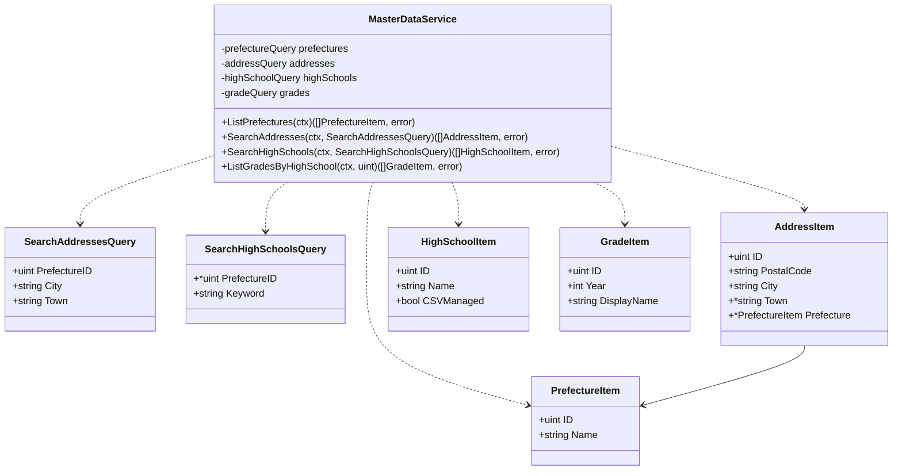
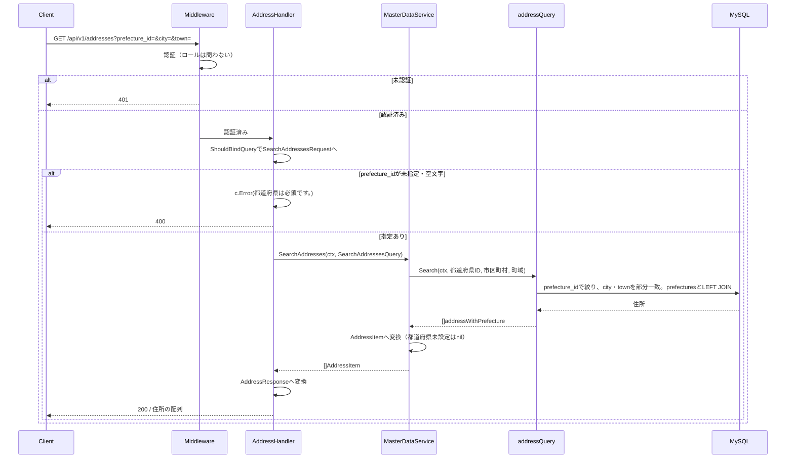
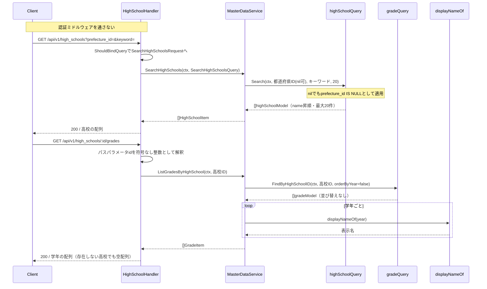
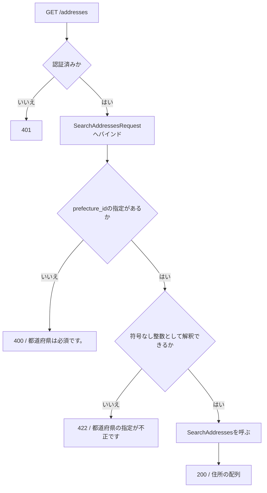
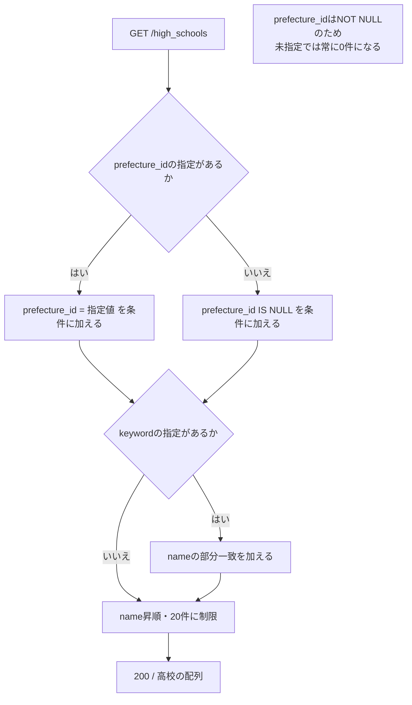

# 共通マスタ参照機能 Go実装仕様書（2. エンドポイント）

---

# 1. 機能概要

## 機能概要

本書は共通マスタ参照機能の4つのエンドポイントを担当する（②「19. API仕様」）。

|エンドポイント|認証|概要|
|-|-|-|
|`GET /api/v1/prefectures`|不要|都道府県を全件取得|
|`GET /api/v1/addresses`|**必要**|住所を検索（都道府県が必須条件）|
|`GET /api/v1/high_schools`|不要|在籍高校を検索（名前順・最大20件）|
|`GET /api/v1/high_schools/:id/grades`|不要|指定高校の学年を取得|

**認証の要否が操作によって分かれる点が本機能の特徴である。** 会員登録フォームが登録前に呼ぶ3操作は認証を通さず、住所検索のみ認証を要求する（①「8. 権限制御」）。

## 採用設計パターンとその理由（②からの要約）

**Transaction Script**（②「4. 設計パターン」）。理由は`共通マスタ参照機能_Go実装仕様書_1_基盤.md`「1. 機能概要」に記載のとおりである。

## 本書が対象とする実装範囲

- application層の4つの業務操作
- Presentation層（Handler 3つ・Request DTO 2つ・Response DTO 4ファイル・Routing）
- 上記に対するAPI仕様とテストケース

GORMモデル・4つの検索・学年の表示名の変換・他Contextへ公開する5つの参照手段・`context.go`・`dependency.go`・Transaction / Validation / Authorization / Errorの実装方針は基盤編に記載する。本書では繰り返さず参照する。

---

# 2. ディレクトリ構成

## 対象Bounded Context名

- `master-data`（②「3. Bounded Context」）。ディレクトリは`internal/masterdata/`、package名は`masterdata`

機能全体のファイル一覧と担当文書の対応は基盤編「2. ディレクトリ構成」に記載する。

## ②で採用した設計パターン

Transaction Script（②「4. 設計パターン」）

## 本書が担当するファイル一覧

```
internal/masterdata/application/list_prefectures.go                      # ListPrefectures
internal/masterdata/application/search_addresses.go                       # SearchAddresses
internal/masterdata/application/search_high_schools.go                    # SearchHighSchools
internal/masterdata/application/list_grades.go                            # ListGradesByHighSchool
internal/masterdata/presentation/handler/prefecture_handler.go
internal/masterdata/presentation/handler/address_handler.go
internal/masterdata/presentation/handler/high_school_handler.go           # 高校検索と学年一覧
internal/masterdata/presentation/request/address_request.go
internal/masterdata/presentation/request/high_school_request.go
internal/masterdata/presentation/response/prefecture_response.go
internal/masterdata/presentation/response/address_response.go
internal/masterdata/presentation/response/high_school_response.go
internal/masterdata/presentation/response/grade_response.go
internal/masterdata/presentation/routes.go
```

実装14ファイル、テストが付くもの（application関数4・Handler3の7）を加えて21であり、1文書あたり30〜35という範囲に収まる。

Handlerを3つにし、高校検索と学年一覧を1つの`high_school_handler.go`にまとめるのは、学年一覧が高校のURLの下にあり（`/high_schools/:id/grades`）、ルートの登録もまとまるためである。Rails現行はControllerが4つに分かれているが（①「10. Rails実装対応表」）、Goでは資源の階層に合わせる。

Handlerは3つあるが、スライスに割るといずれもテスト込みで6〜9にとどまり小さすぎるため1つの文書にまとめている（基盤編「2. ディレクトリ構成」の「文書の分割」）。

---

# 3. Domain層設計

対象外（Transaction Script採用のため、Domain層を設けない）。詳細は基盤編「3. Domain層設計」に記載する。

本書で定義するセンチネルエラーはない。本Contextに意味を持つエラーが1つも存在しない（基盤編「3. Domain層設計」）。

---

# 4. クラス図

本Contextの検索関数・公開操作・`Context`の関係は基盤編「4. クラス図」に記載する。本書ではapplication層の4つの関数と出力用の型の関係を示す。



`MasterDataService`は、依存をコンストラクタで受け取るための入れ物である。業務ルールを持つstructではなく、Transaction Scriptの関数をメソッドとして束ねたものである（基盤編「17. ②からの補足事項」3と同じ扱い）。

**出力の型を`dependency.go`の受け渡し用の型（`HighSchoolRef`等）と分ける。** エンドポイントは画面に出す項目だけを返し、公開操作は他Contextが判定に使う項目も返す（②「12. UseCase設計」）。`HighSchoolItem`に`SchoolCode`・`PrefectureID`を含めないのは、レスポンスに含めないためである（②「2. 設計方針」）。`GradeItem`に`HighSchoolID`を含めないのも同じ理由である。

`SearchAddressesQuery.PrefectureID`が`uint`（非ポインタ）であるのは、Presentation層で必須チェックを通過した値のみが渡るためである。`SearchHighSchoolsQuery.PrefectureID`が`*uint`であるのは、未指定でも処理を続ける必要があるためである（②「15. Validation設計」）。

---

# 5. 状態遷移図

省略する。理由は基盤編「5. 状態遷移図」に記載する。

---

# 6. Application層設計

本機能はTransaction Script採用のため、UseCase structを設けない。②「12. UseCase設計」の4つの業務操作を、依存を保持するstructのメソッドとして実装する。

## DTO（Command / Query）

|struct名|フィールド|区分|備考|
|-|-|-|-|
|`SearchAddressesQuery`|`PrefectureID uint`・`City string`・`Town string`|Query|`PrefectureID`は必須チェック済みの値を受け取る。`City`・`Town`は空文字を未指定として扱う|
|`SearchHighSchoolsQuery`|`PrefectureID *uint`・`Keyword string`|Query|`PrefectureID`は未指定を`nil`で表す|
|`PrefectureItem`|`ID uint`・`Name string`|出力||
|`AddressItem`|`ID uint`・`PostalCode string`・`City string`・`Town *string`・`Prefecture *PrefectureItem`|出力|`Prefecture`は住所に都道府県が紐づいていない場合に`nil`|
|`HighSchoolItem`|`ID uint`・`Name string`・`CSVManaged bool`|出力||
|`GradeItem`|`ID uint`・`Year int`・`DisplayName string`|出力||

`ListPrefectures`・`ListGradesByHighSchool`に入力DTOを設けない。前者は引数を取らず、後者は高校の識別子1つのみであるため、structにする利点がない。

出力の型をPresentation層のResponse DTOと分けるのは、application層の型がJSONのキー名や最上位の構造といったHTTPの関心を持たないためである（アーキテクチャ規約「6. データフロー」）。

## 関数

### ListPrefectures（`application/list_prefectures.go`）

|項目|内容|
|-|-|
|メソッド|`(s *MasterDataService) ListPrefectures(ctx context.Context) ([]PrefectureItem, error)`|
|受け取る依存|都道府県の検索|

処理ステップ:

1. 都道府県の検索で全件を取得する
2. `PrefectureItem`へ変換して返す。`nil`の場合は空スライスにする

操作者を引数に取らない。未認証でも呼ばれるためである（②「16. Authorization設計」）。

並び替え・絞り込みを行わない。Rails現行がいずれも行っていない（①「5. API / 処理詳細」`Api::V1::PrefecturesController#index`）。

トランザクションは使用しない（②「14. Transaction設計」、基盤編「11. Transaction実装方針」）。

### SearchAddresses（`application/search_addresses.go`）

|項目|内容|
|-|-|
|メソッド|`(s *MasterDataService) SearchAddresses(ctx context.Context, q SearchAddressesQuery) ([]AddressItem, error)`|
|受け取る依存|住所の検索|

処理ステップ:

1. 住所の検索で、都道府県・市区町村・町域の条件に一致する住所を取得する。`City`・`Town`が空文字の場合は絞り込みに使わない（検索側で判定する）
2. `AddressItem`へ変換する。都道府県が未設定の住所では`Prefecture`を`nil`とする
3. `nil`の場合は空スライスにして返す

都道府県が未指定の場合はPresentation層で弾くため、本関数には必ず指定された状態で渡る（②「15. Validation設計」）。ガード節を設けない。

該当する住所がない場合は空スライスを返す。エラーにしない（②「12. UseCase設計」）。

**論理削除済みの住所も結果に含まれる。** 検索が除外しないためである（基盤編「8. Infrastructure層設計」）。本関数で除外し直さない。

`StreetAddress`を出力に含めない。Rails現行のレスポンスに含まれない（①「5. API / 処理詳細」`Api::V1::AddressesController#index`）。

### SearchHighSchools（`application/search_high_schools.go`）

|項目|内容|
|-|-|
|メソッド|`(s *MasterDataService) SearchHighSchools(ctx context.Context, q SearchHighSchoolsQuery) ([]HighSchoolItem, error)`|
|受け取る依存|高校の検索|
|定数|`searchHighSchoolsLimit = 20`|

処理ステップ:

1. 高校の検索で、都道府県の条件（`nil`でも適用する）・名称の部分一致・名前順・`searchHighSchoolsLimit`件の制限を指定して取得する
2. `HighSchoolItem`へ変換して返す。`nil`の場合は空スライスにする

**`PrefectureID`が`nil`の場合も検索へそのまま渡す。** 検索側が`prefecture_id IS NULL`として条件を適用し、結果が0件になる。Rails現行と同じ振る舞いである（②「12. UseCase設計」）。本関数で`nil`を弾いたり、絞り込みを省いたりしない。

件数の上限を本関数の定数として持つ。件数は本機能の表示仕様であり検索の性質ではないため、検索へ引数で渡す（基盤編「8. Infrastructure層設計」）。

`Keyword`が空文字の場合は絞り込みに使わない（検索側で判定する）。

`SchoolCode`・`PrefectureID`を出力に含めない。Rails現行のレスポンスに含まれない（①「5. API / 処理詳細」`Api::V1::HighSchoolsController#index`）。

### ListGradesByHighSchool（`application/list_grades.go`）

|項目|内容|
|-|-|
|メソッド|`(s *MasterDataService) ListGradesByHighSchool(ctx context.Context, highSchoolID uint) ([]GradeItem, error)`|
|受け取る依存|学年の検索、学年の表示名の変換|

処理ステップ:

1. 学年の検索で、指定された高校に属する学年を取得する。**並び替えを行わない**（`orderByYear`に偽を渡す）
2. 表示名の変換で年次から表示名を導出し、`GradeItem`へ変換する
3. `nil`の場合は空スライスにして返す

**高校の実在確認を行わない。** 存在しない識別子では空スライスを返す。`404`にしない。Rails現行と同じ振る舞いである（②「12. UseCase設計」）。

**並び替えを行わない点が、公開操作との違いである。** 公開操作（`FindGradesByHighSchoolID`）は年次の昇順で返す（②「19. API仕様」の「Railsとの差分」1）。同じ検索に`orderByYear`で切り替えを渡す（基盤編「8. Infrastructure層設計」）。

`HighSchoolID`を出力に含めない。Rails現行のレスポンスに含まれない（①「5. API / 処理詳細」`Api::V1::GradesController#index`）。

---

# 7. シーケンス図・処理フロー図

## シーケンス図

### SearchAddresses（認証が必要な唯一の操作）



### SearchHighSchools と ListGradesByHighSchool



## 処理フロー図

### 住所検索の必須条件



### 高校検索の都道府県の扱い



`prefecture_id`を指定しないと必ず0件になる。Rails現行の振る舞いであり、変更しない（②「19. API仕様」の「変更しないもの」）。フロントエンドは常に指定して呼ぶ。

都道府県一覧は分岐がないため処理フロー図を省略する。学年一覧は分岐がなく、表示名の変換の分岐は基盤編「7. シーケンス図・処理フロー図」に示している。

---

# 8. Infrastructure層設計

対象外。本書が担当するInfrastructure層の実装はない。

GORMモデル・4つの検索・`context.go`・`dependency.go`は、いずれも基盤編「8. Infrastructure層設計」に記載する。

---

# 9. Presentation層設計

## Handler

### PrefectureHandler（`presentation/handler/prefecture_handler.go`）

|項目|内容|
|-|-|
|struct名|`PrefectureHandler`|
|対応する呼び出し先|`*application.MasterDataService`（Transaction Script採用のためUseCaseを経由しない）|
|保持するフィールド|`masterDataService *application.MasterDataService`|
|コンストラクタ|`NewPrefectureHandler(masterDataService *application.MasterDataService) *PrefectureHandler`|
|メソッド|`Index(c *gin.Context)`（GET `/api/v1/prefectures`）|

`Index`の処理順序:

1. 入力を受け取らない。バインドを行わない
2. 操作者を取得しない。未認証でも呼ばれる（②「16. Authorization設計」）
3. `masterDataService.ListPrefectures`を呼ぶ
4. エラーの場合は`c.Error(err)`を呼んで戻る。ステータスとレスポンス本文への変換は`ErrorHandler`が行う（Gin規約「8. エラーハンドリングミドルウェア」）
5. `[]PrefectureResponse`へ変換する。`nil`なら空スライスを入れる
6. `200`で返す。**最上位はJSON配列とし、キーで包まない**（①「5. API / 処理詳細」`Api::V1::PrefecturesController#index`）

### AddressHandler（`presentation/handler/address_handler.go`）

|項目|内容|
|-|-|
|struct名|`AddressHandler`|
|対応する呼び出し先|`*application.MasterDataService`|
|保持するフィールド|`masterDataService *application.MasterDataService`|
|コンストラクタ|`NewAddressHandler(masterDataService *application.MasterDataService) *AddressHandler`|
|メソッド|`Index(c *gin.Context)`（GET `/api/v1/addresses`）|

`Index`の処理順序:

1. `SearchAddressesRequest`へ`ShouldBindQuery`でバインドする。失敗した場合は`c.Error`にバリデーションエラーを積んで戻る（`422`）
2. `PrefectureID`が`nil`の場合、**`400`**のバリデーションエラーを`c.Error`に積んで戻る。メッセージはRails現行の文言（「都道府県は必須です。」）とする
3. 操作者を取得しない。認証済みであることはMiddlewareが保証する
4. `SearchAddressesQuery`を組み立て、`masterDataService.SearchAddresses`を呼ぶ
5. エラーの場合は`c.Error(err)`を呼んで戻る
6. `[]AddressResponse`へ変換する。`nil`なら空スライスを入れる
7. `200`で返す。最上位はJSON配列

**手順2のエラーが`422`ではなく`400`である点が本Handlerの要である。** 必須チェックの失敗としては`422`が自然だが、Rails現行が`400`を返しており、規約「15. API規約（レスポンス形式・ページネーション・URL・クエリパラメータ）」も本機能を互換優先の例として挙げている（②「17. Error設計」）。`AppError`の`StatusCode`に`400`を持たせる専用のバリデーションエラーを用いる。

手順1と手順2で`c.Error`を2回呼ばない。バインドに失敗した時点で戻る（Gin規約「8. エラーハンドリングミドルウェア」の「`c.Errors`に複数のエラーが蓄積される場合」）。

### HighSchoolHandler（`presentation/handler/high_school_handler.go`）

|項目|内容|
|-|-|
|struct名|`HighSchoolHandler`|
|対応する呼び出し先|`*application.MasterDataService`|
|保持するフィールド|`masterDataService *application.MasterDataService`|
|コンストラクタ|`NewHighSchoolHandler(masterDataService *application.MasterDataService) *HighSchoolHandler`|
|メソッド|`Index(c *gin.Context)`（GET `/api/v1/high_schools`）、`ListGrades(c *gin.Context)`（GET `/api/v1/high_schools/:id/grades`）|

`Index`の処理順序:

1. `SearchHighSchoolsRequest`へ`ShouldBindQuery`でバインドする。失敗した場合は`c.Error`にバリデーションエラーを積んで戻る（`422`）
2. **`PrefectureID`が`nil`でも処理を続ける。** `400`にしない（②「15. Validation設計」）
3. 操作者を取得しない
4. `SearchHighSchoolsQuery`を組み立て、`masterDataService.SearchHighSchools`を呼ぶ
5. エラーの場合は`c.Error(err)`を呼んで戻る
6. `[]HighSchoolResponse`へ変換する。`nil`なら空スライスを入れる
7. `200`で返す。最上位はJSON配列

`ListGrades`の処理順序:

1. パスパラメータ`id`を符号なし整数として解釈する。失敗した場合は`c.Error`にバリデーションエラーを積んで戻る（`422`）
2. 操作者を取得しない
3. `masterDataService.ListGradesByHighSchool`を呼ぶ
4. エラーの場合は`c.Error(err)`を呼んで戻る
5. `[]GradeResponse`へ変換する。`nil`なら空スライスを入れる
6. `200`で返す。最上位はJSON配列

**存在しない高校の識別子でも`404`にしない。** 空の配列を`200`で返す（②「12. UseCase設計」）。

高校検索と学年一覧を同じHandlerに置くのは、URLの階層が同じであり、ルートの登録もまとまるためである。

## Request / Response DTO

### SearchAddressesRequest（`presentation/request/address_request.go`）

|フィールド|型|タグ|チェック内容|
|-|-|-|-|
|`PrefectureID`|`*uint`|`form:"prefecture_id"`|未指定・空文字は`nil`。`nil`のときHandlerで`400`にする。指定された場合は符号なし整数として解釈できること|
|`City`|`string`|`form:"city"`|任意。検証しない|
|`Town`|`string`|`form:"town"`|任意。検証しない|

`PrefectureID`を`*uint`にして`binding:"required"`を使わないのは、必須チェックの失敗を`422`ではなく`400`で返す必要があるためである。`binding:"required"`に失敗すると、Gin規約「6. Model BindingとValidation」の変換を通して`422`になる。`nil`判定をHandlerで行い、`400`の`AppError`を積む。

`City`・`Town`を`string`にして`*string`にしないのは、空文字と未指定を区別する必要がないためである。Rails現行も空文字を未指定として扱う（①「5. API / 処理詳細」`Api::V1::AddressesController#index`）。

空文字の判定は検索側で行う（基盤編「8. Infrastructure層設計」）。Handlerで空文字を落として詰め替えない。

### SearchHighSchoolsRequest（`presentation/request/high_school_request.go`）

|フィールド|型|タグ|チェック内容|
|-|-|-|-|
|`PrefectureID`|`*uint`|`form:"prefecture_id"`|未指定・空文字は`nil`。`nil`でも処理を続ける|
|`Keyword`|`string`|`form:"keyword"`|任意。検証しない|

`PrefectureID`を`*uint`にするのは、未指定と`0`の指定を区別するためである。`0`を指定した場合は`prefecture_id = 0`として扱い、未指定の場合は`prefecture_id IS NULL`として扱う。Rails現行では`params[:prefecture_id]`が`"0"`なら`where(prefecture_id: "0")`、`nil`なら`where(prefecture_id: nil)`となり、いずれも0件になるが条件が異なる（①「5. API / 処理詳細」`Api::V1::HighSchoolsController#index`）。

パスパラメータ（`id`）はRequest DTOにせず、Handlerで直接解釈する。1つの値のみであり、structにする利点がない。

### PrefectureResponse（`presentation/response/prefecture_response.go`）

|struct名|フィールド|JSONキー|型|
|-|-|-|-|
|`PrefectureResponse`|`ID`|`id`|`uint`|
||`Name`|`name`|`string`|

最上位はJSON配列であり、envelopeを持たない。規約「15. API規約（レスポンス形式・ページネーション・URL・クエリパラメータ）」の「一覧（ページネーションなし。マスタ参照等）」はJSON配列とすると定めており、本機能はこれに該当する。

### AddressResponse（`presentation/response/address_response.go`）

|struct名|フィールド|JSONキー|型|
|-|-|-|-|
|`AddressResponse`|`ID`|`id`|`uint`|
||`PostalCode`|`postal_code`|`string`|
||`City`|`city`|`string`|
||`Town`|`town`|`*string`|
||`Prefecture`|`prefecture`|`*AddressPrefectureResponse`|
|`AddressPrefectureResponse`|`ID`|`id`|`uint`|
||`Name`|`name`|`string`|

`Town`を`*string`にするのは、`addresses.town`がNULL可であり`null`を返す必要があるためである（①「6. データモデル」）。

`Prefecture`を`*AddressPrefectureResponse`にするのは、住所に都道府県が紐づいていない場合に`null`を返す必要があるためである（①「5. API / 処理詳細」`Api::V1::AddressesController#index`）。`omitempty`を付けない。キー自体を省略するのではなく`null`を返す。

`street_address`を含めない（同）。

`AddressPrefectureResponse`を`PrefectureResponse`と別に定義するか共用するかは、項目が同一であるため共用してよい。本書では`PrefectureResponse`を共用し、`AddressPrefectureResponse`という別名を設けない。

### HighSchoolResponse（`presentation/response/high_school_response.go`）

|struct名|フィールド|JSONキー|型|
|-|-|-|-|
|`HighSchoolResponse`|`ID`|`id`|`uint`|
||`Name`|`name`|`string`|
||`CSVManaged`|`csv_managed`|`bool`|

`prefecture_id`・`school_code`を含めない（①「5. API / 処理詳細」`Api::V1::HighSchoolsController#index`）。**特に`school_code`は公開操作でのみ返す値であり、HTTP経由で外部へ出さない**（基盤編「13. Authorization実装方針」）。

JSONキーが`csv_managed`である点に注意する。Goのフィールド名`CSVManaged`から既定で導出される名前ではないため、`json`タグで明示する。

### GradeResponse（`presentation/response/grade_response.go`）

|struct名|フィールド|JSONキー|型|
|-|-|-|-|
|`GradeResponse`|`ID`|`id`|`uint`|
||`Year`|`year`|`int`|
||`DisplayName`|`display_name`|`string`|

`high_school_id`を含めない（①「5. API / 処理詳細」`Api::V1::GradesController#index`）。

## Routing

`presentation/routes.go`に登録する。Gin規約「1. ルーティング」「2. ルートグルーピング」に従う。

**認証の要否が操作によって分かれるため、2つのグループに分けて登録する。**

|グループ|Middleware|Method|Path|Handler|
|-|-|-|-|-|
|認証なし|なし|GET|`/api/v1/prefectures`|`PrefectureHandler.Index`|
|認証なし|なし|GET|`/api/v1/high_schools`|`HighSchoolHandler.Index`|
|認証なし|なし|GET|`/api/v1/high_schools/:id/grades`|`HighSchoolHandler.ListGrades`|
|認証あり|認証ミドルウェア|GET|`/api/v1/addresses`|`AddressHandler.Index`|

いずれも`/api/v1`直下であり、ロール別の名前空間（`/student`・`/teacher`・`/admin`）に属さない。規約「15. API規約（レスポンス形式・ページネーション・URL・クエリパラメータ）」の「ロールを問わないAPIはロール名を含めず`/api/v1/...`とする」に従う。

**認可ミドルウェア（Casbin RBAC）をいずれにも適用しない。** ロールによる制限を行わないためである（②「16. Authorization設計」）。認証ありのグループでも、認証のみを要求しロールは問わない。

`/api/v1/admin/addresses`は本Contextのルートではない。管理者管理者ユーザー機能が同じ検索を自機能として扱っている（②「3. Bounded Context」の依存集約表の確認範囲外。「17. ②からの補足事項」参照）。本Contextは`/api/v1/addresses`のみを登録する。

パスパラメータを`:id`とする。Rails現行は`:high_school_id`（ネストしたリソースのため）だが、`/api/v1/high_schools/:id`を登録する予定がないため衝突は起きない。それでも`:id`に揃えるのは、`school-directory`が同じ`high_schools`配下で`:id`に揃えており（管理者高校学年参照機能③「17. ②からの補足事項」2）、名前の付け方を機能間で合わせるためである。URLの文字列は変わらない。

**`GET /api/v1/high_schools/:id`・`POST /api/v1/high_schools`等を登録しない。** Rails現行はルーティングがアクションを絞っておらず経路が存在するが、アクションが実装されておらず呼ぶと例外になる（①「5. API / 処理詳細」の「実装のないアクションへの経路」）。Goでは登録しないことで、呼ばれた場合に`404`となる。例外より適切な応答であり、フロントエンドが使っていない経路であるため差分として扱わない（「17. ②からの補足事項」参照）。

本機能にCSRF対策の適用は不要である。いずれもGETであり、Gin規約「5. CSRF対策」の適用範囲（状態を変更するメソッド）に含まれない。

---

# 10. API仕様

|Method|Path|Handler|Request|Response|Status Code|
|-|-|-|-|-|-|
|GET|`/api/v1/prefectures`|`PrefectureHandler.Index`|なし|`[]PrefectureResponse`|200 / 500|
|GET|`/api/v1/addresses`|`AddressHandler.Index`|`prefecture_id`（必須）・`city`・`town`|`[]AddressResponse`|200 / 400 / 422 / 401 / 500|
|GET|`/api/v1/high_schools`|`HighSchoolHandler.Index`|`prefecture_id`・`keyword`（いずれも任意）|`[]HighSchoolResponse`|200 / 422 / 500|
|GET|`/api/v1/high_schools/:id/grades`|`HighSchoolHandler.ListGrades`|パスパラメータ`id`|`[]GradeResponse`|200 / 422 / 500|

## Errorケース

|条件|Status Code|Error内容|
|-|-|-|
|住所検索で`prefecture_id`が未指定・空文字|**400**|`{"errors": ["都道府県は必須です。"]}`|
|`prefecture_id`が符号なし整数として解釈できない|422|`{"errors": ["都道府県の指定が不正です"]}`|
|パスパラメータ`id`が符号なし整数として解釈できない|422|`{"errors": ["高校の指定が不正です"]}`|
|住所検索で未認証|401|認証ミドルウェアの応答|
|DBアクセスの失敗|500|`{"errors": ["internal server error"]}`|
|高校検索で`prefecture_id`が未指定|200|エラーにしない。空の配列を返す|
|学年一覧で存在しない高校の識別子|200|エラーにしない。空の配列を返す|
|該当する行がない|200|空の配列を返す|

**都道府県一覧・高校検索・学年一覧は`401`・`403`を返さない。** 認証ミドルウェアを通さないためである（「9. Presentation層設計」のRouting）。

住所検索は`403`を返さない。ロールによる制限を行わないためである。

---

# 11. Transaction実装方針

基盤編「11. Transaction実装方針」に記載する。本書の関数はいずれもトランザクションを開始しない。

エンドポイントから呼ばれる経路では、呼び出し元にトランザクションが存在しない。それでも検索関数は`gormtx.DBFromContext`で接続を取得する形に揃える（同節）。

---

# 12. Validation実装方針

方針は基盤編「12. Validation実装方針」に記載する。本書では本書が担当する検証内容を示す。

## Presentation

|フィールド|struct名|バリデーションタグ|エラーメッセージ|Status|
|-|-|-|-|-|
|`PrefectureID`|`SearchAddressesRequest`|なし（`nil`判定をHandlerで行う）|都道府県は必須です。|**400**|
|`PrefectureID`|`SearchAddressesRequest`|なし（`*uint`へのバインド失敗で検出）|都道府県の指定が不正です|422|
|`City`・`Town`|`SearchAddressesRequest`|なし|-|-|
|`PrefectureID`|`SearchHighSchoolsRequest`|なし（`*uint`へのバインド失敗で検出）|都道府県の指定が不正です|422|
|`Keyword`|`SearchHighSchoolsRequest`|なし|-|-|
|`id`（パスパラメータ）|-|Handlerで符号なし整数として解釈|高校の指定が不正です|422|

`binding:"required"`を使わない理由は「9. Presentation層設計」に記載のとおりである。必須チェックの失敗を`400`で返す必要があるためである。

`City`・`Town`・`Keyword`に長さの上限や記号の制限を設けない。Rails現行も設けていない（②「15. Validation設計」）。ただし検索語のワイルドカード文字は検索側でエスケープする（基盤編「8. Infrastructure層設計」）。

バインド失敗時のGinのエラーから上表のメッセージへ変換する処理は、Request DTOごとに持つ。Gin規約「6. Model BindingとValidation」の`toValidationError`相当の変換をフィールド名で分岐させる。

## 業務ルール検証

Transaction Script採用のため、application関数内のガード節で検証する（アーキテクチャ規約「3. 設計パターンごとの構造適用方針」）。

|関数|ガード節|
|-|-|
|`ListPrefectures`|なし。入力を取らない|
|`SearchAddresses`|なし。都道府県が必須であることはPresentation層で確認済み|
|`SearchHighSchools`|なし。`PrefectureID`が`nil`でも処理を続ける|
|`ListGradesByHighSchool`|なし。高校の実在確認を行わない|

**本書が担当する4つの関数にガード節がない。** 入力の前提確認はPresentation層で済み、業務ルールによる検証が存在しないためである（②「15. Validation設計」）。公開操作のガード節は基盤編「12. Validation実装方針」に記載する。

---

# 13. Authorization実装方針

基盤編「13. Authorization実装方針」に記載する。

本書のHandlerはいずれも操作者を取得しない。`context.Context`からcurrent userを読まない。

**認証の要否はルートのグループ分けで表現する。** Handlerの中で認証の有無を判定しない（「9. Presentation層設計」のRouting）。

Response DTOに`school_code`を含めない。公開操作でのみ返す値であり、HTTP経由で外部へ出さない（「9. Presentation層設計」の`HighSchoolResponse`）。

---

# 14. Error実装方針

方針は基盤編「14. Error実装方針」に記載する。本書では`400`を返すバリデーションエラーの扱いを示す。

## 住所検索の必須条件違反を`400`で返す

アーキテクチャ規約「12. Error変換パターン（AppError）」の`AppError`は`StatusCode()`を持つため、`400`を返すバリデーションエラーの型を定義すれば表現できる。

|項目|内容|
|-|-|
|型|`AppError`を実装するバリデーションエラー。`StatusCode()`は`400`、`LogLevel()`は情報レベル|
|メッセージ|「都道府県は必須です。」（Rails現行の文言。末尾の句点を含む）|
|置き場所|`presentation/request/address_request.go`、またはPresentation層の共通のエラー型|

`422`を返す通常のバリデーションエラーとは別の型になる。`StatusCode()`が異なるためである。

**`FieldErrorer`を実装するかは任意とする。** 失敗するフィールドが`prefecture_id`の1つに限られ、`fields`に入れる情報が`errors`と重複するためである。実装しない場合、レスポンスは`{"errors": ["都道府県は必須です。"]}`となり、Rails現行と一致する（①「5. API / 処理詳細」`Api::V1::AddressesController#index`）。

この扱いが規約「15. API規約（レスポンス形式・ページネーション・URL・クエリパラメータ）」の「Rails現行が上記と異なるステータスを返す機能（例：住所検索の`prefecture_id`未指定は400）は、互換を優先し、②で明記した上で維持する」に対応する。②「17. Error設計」で明記している。

## 本書で定義するセンチネルエラー

なし。②「17. Error設計」のとおり、本Contextに意味を持つApplication Errorが存在しない（基盤編「3. Domain層設計」）。

---

# 15. GORM / DBクエリ設計

対象外。基盤編「15. GORM / DBクエリ設計」に記載する。

本書が担当するapplication関数は、基盤編の検索を呼ぶだけであり、自らクエリを組み立てない。

---

# 16. テストケース設計

区分は②が採用した設計パターンに応じて読み替える。

## Domain Test

対象外（Transaction Script採用のため）。

## Application関数 Test

検索をテストダブルに差し替えて検証する。公開操作と表示名の変換のテストは基盤編に記載する。

|対象|テストケース|
|-|-|
|`ListPrefectures`|全件が`PrefectureItem`へ変換されること|
||0件のとき空スライス（`nil`ではない）を返すこと|
||検索が失敗した場合にエラーを返すこと|
|`SearchAddresses`|都道府県・市区町村・町域が検索へそのまま渡ること|
||`City`・`Town`が空文字のときもそのまま渡ること（Handlerで落とさないこと）|
||都道府県が未設定の住所で`Prefecture`が`nil`になること|
||`Town`が未設定の住所で`nil`になること|
||`StreetAddress`を出力に含めないこと|
||0件のとき空スライスを返すこと（エラーにしないこと）|
||論理削除済みの住所が結果に含まれること|
|`SearchHighSchools`|検索へ`limit`に`20`を渡すこと|
||**`PrefectureID`が`nil`のまま検索へ渡ること**（`nil`を弾かず、絞り込みを省かないこと）|
||`Keyword`が空文字のときもそのまま渡ること|
||`SchoolCode`・`PrefectureID`を出力に含めないこと|
||0件のとき空スライスを返すこと|
|`ListGradesByHighSchool`|検索へ`orderByYear`に**偽**を渡すこと（並び替えを行わないこと）|
||表示名の変換が呼ばれ、`DisplayName`が設定されること|
||`HighSchoolID`を出力に含めないこと|
||存在しない高校の識別子で空スライスを返すこと（エラーにしないこと）|

## Repository Test

基盤編「16. テストケース設計」に記載する。

## Handler Test

|対象|テストケース|
|-|-|
|`PrefectureHandler.Index`|最上位がJSON配列で`200`が返ること（キーで包まないこと）|
||0件のとき`[]`で返ること（`null`にしないこと）|
||`id`・`name`のみを含むこと|
||操作者を取得しないこと（current userが取得できない状態でも動作すること）|
||application層のエラーを`c.Error`へ渡し、自身で`c.JSON`しないこと|
|`AddressHandler.Index`|`prefecture_id`が未指定のとき**`400`**と`{"errors": ["都道府県は必須です。"]}`が返ること|
||`prefecture_id`が空文字のときも`400`が返ること|
||`prefecture_id`が符号なし整数でないとき`422`が返ること|
||`city`・`town`が空文字でも`200`が返り、絞り込まれないこと|
||`prefecture`が、都道府県が未設定の住所で`null`になること|
||`town`が未設定の住所で`null`になること|
||`street_address`を含めないこと|
||0件のとき`[]`で返ること|
||`c.Error`を1回だけ呼ぶこと|
|`HighSchoolHandler.Index`|`prefecture_id`が未指定のとき`400`にせず`200`と空の配列が返ること|
||`prefecture_id`が符号なし整数でないとき`422`が返ること|
||`keyword`が空文字でも`200`が返ること|
||`id`・`name`・`csv_managed`のみを含むこと|
||**`school_code`・`prefecture_id`を含めないこと**|
||`csv_managed`というJSONキーで返ること|
||0件のとき`[]`で返ること|
|`HighSchoolHandler.ListGrades`|`id`・`year`・`display_name`のみを含むこと|
||`high_school_id`を含めないこと|
||存在しない高校の識別子で`200`と空の配列が返ること（`404`にしないこと）|
||パスパラメータが符号なし整数でないとき`422`が返ること|
||パスパラメータを`:id`から読むこと|

## Integration Test

公開操作に関するものは基盤編「16. テストケース設計」に記載する。

|対象|テストケース|
|-|-|
|認証|**`GET /prefectures`が未認証で`200`を返すこと**|
|認証|**`GET /high_schools`が未認証で`200`を返すこと**|
|認証|**`GET /high_schools/:id/grades`が未認証で`200`を返すこと**|
|認証|**`GET /addresses`が未認証で`401`を返すこと**|
|認証|`GET /addresses`が認証済みなら生徒・教員・管理者のいずれのロールでも`200`を返すこと|
|認証|都道府県一覧・高校検索・学年一覧が、ロールによって結果が変わらないこと|
|都道府県一覧|全件が取得できること|
|住所検索|都道府県で絞り込めること、市区町村・町域が部分一致で絞り込めること|
|住所検索|**論理削除済みの住所が結果に含まれること**|
|住所検索|都道府県が未設定の住所で`prefecture`が`null`になること|
|高校検索|都道府県で絞り込めること、キーワードが部分一致で絞り込めること|
|高校検索|**`prefecture_id`を指定しないと空の配列が返ること**|
|高校検索|名前順で返ること|
|高校検索|**21件該当する場合に20件しか返らないこと**|
|学年一覧|学年が取得でき、`display_name`が年次に対応すること|
|学年一覧|年次が範囲外（8以上・負数）の学年で`display_name`が「不明」になること|
|学年一覧|存在しない高校の識別子で空の配列が返ること|
|ルート|4つのエンドポイントが登録されていること|
|ルート|**`GET /api/v1/high_schools/:id`・`POST /api/v1/high_schools`が`404`になること**（Rails現行は例外になる経路）|
|CSRF|GETのためCSRFトークンなしでも成功すること|

認証の要否が操作によって分かれる点は、ルートのグループ分けの誤りで壊れやすい。4つすべてについて未認証でのアクセスを確認する（②「22. テスト戦略」）。

---

# 17. ②からの補足事項

基盤編「17. ②からの補足事項」に記載した7件に加え、本書で判断した内容を示す。

## 1. 実装のないアクションへの経路を登録しない

- 判断した内容: `GET /api/v1/high_schools/:id`・`POST /api/v1/high_schools`・`PATCH` / `PUT` / `DELETE /api/v1/high_schools/:id`を登録しない。呼ばれた場合は`404`になる
- 判断理由: Rails現行はルーティングがアクションを絞っておらず経路が存在するが、アクションが実装されておらず呼ぶと例外になる（①「5. API / 処理詳細」の「実装のないアクションへの経路」）。Goのルーティングは登録したものだけが解決されるため、登録しなければ`404`になる。例外（`500`相当）より適切な応答である
- 推測かどうか: **②からの補足**。②「19. API仕様」の「変更しないもの」はこの経路の存在を挙げているが、Goで登録するかは定めていない。フロントエンドがこれらの経路を使っていないため（①「5. API / 処理詳細」）、差分として扱わない。Rails側で`only:`を付けて経路を閉じる修正（残タスクのA8と同種）が入れば、両者が一致する

## 2. `/api/v1/admin/addresses`を本Contextのルートとしない

- 判断した内容: 管理者向けの住所検索（`/api/v1/admin/addresses`）を本Contextに登録しない
- 判断理由: 同じ`AddressesQuery`・同じSerializer・同じ`400`を使う処理だが、Rails現行は`Api::V1::Admin::AddressesController`として別のControllerに実装されており、管理者管理者ユーザー機能②が自機能のAPIとして扱っている。本Contextに登録すると、同じURLを2つのContextが主張することになる
- 推測かどうか: **②からの補足**。②「3. Bounded Context」の依存集約表は管理者管理者ユーザー機能を`master-data`の依存元として挙げていない。同機能の②が`/api/v1/admin/addresses`を自機能のAPIとしているため、本Contextの公開参照手段（住所の属性の取得）とは別に、同機能が住所の検索を必要とする可能性がある。**同機能の追随時に、住所検索を本Contextの公開操作として追加するか、同機能が自前の参照モデルを持つかを決める必要がある**

## 3. パスパラメータ名を`:id`とする

- 判断した内容: `/api/v1/high_schools/:id/grades`として登録し、Handlerも`:id`から読む
- 判断理由: Rails現行は`:high_school_id`（ネストしたリソースのため）だが、`/api/v1/high_schools/:id`を登録する予定がないため衝突は起きない。それでも`:id`に揃えるのは、`school-directory`が同じ`high_schools`配下で`:id`に揃えており（管理者高校学年参照機能③「17. ②からの補足事項」2）、名前の付け方を機能間で合わせるためである
- 推測かどうか: **②からの補足**。②「19. API仕様」はURLを変更しないとしているが、パスパラメータの内部的な名前までは定めていない。URLの文字列は変わらないため、フロントエンドから見た差分は生じない

## 4. `400`を返すバリデーションエラーの型を設ける

- 判断した内容: 住所検索の必須条件違反のために、`StatusCode()`が`400`のバリデーションエラーの型を用いる
- 判断理由: アーキテクチャ規約「12. Error変換パターン（AppError）」の`AppError`は`StatusCode()`を持つため、`400`を返す型を定義すれば表現できる。通常のバリデーションエラー（`422`）とは別の型になる
- 推測かどうか: 推測ではない。規約の範囲内での実装手段の選択である。②「17. Error設計」と規約「15. API規約（レスポンス形式・ページネーション・URL・クエリパラメータ）」がこの`400`を互換優先の例として明記している

## 5. `AddressPrefectureResponse`を`PrefectureResponse`と共用する

- 判断した内容: 住所に含まれる都道府県のResponse DTOを別に定義せず、`PrefectureResponse`を使う
- 判断理由: 項目（`id`・`name`）が同一である（①「5. API / 処理詳細」）。同じ項目を持つstructを2つ定義すると、項目の追加時に片方だけ変更される
- 推測かどうか: 推測ではない。①の実体に基づく実装上の整理である

## 6. `City`・`Town`・`Keyword`を`string`で受け取る

- 判断した内容: 空文字と未指定を区別せず、`string`で受け取る
- 判断理由: Rails現行が空文字を未指定として扱っており（①「5. API / 処理詳細」）、区別する必要がない。`*string`にすると、`nil`と空文字の両方を未指定として扱う分岐が増える
- 推測かどうか: 推測ではない。①の実体に基づく

## 7. 空文字の判定を検索側で行う

- 判断した内容: `City`・`Town`・`Keyword`が空文字かどうかの判定を、Handlerやapplication関数ではなく検索関数の中で行う
- 判断理由: 絞り込みの条件を組み立てるのが検索関数であり、条件を加えるかどうかの判定も同じ場所にある方が追いやすい。Rails現行の`AddressesQuery`も同じ場所で判定している（①「10. Rails実装対応表」）
- 推測かどうか: 推測ではない。②「23. Railsとの責務対応」が`AddressesQuery`を検索関数へ対応させており、それに従う
