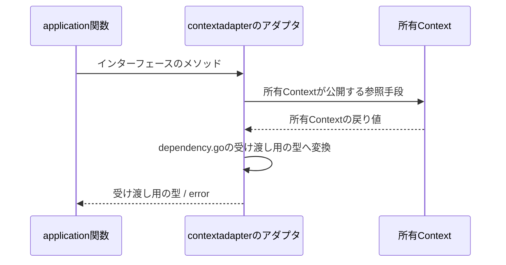
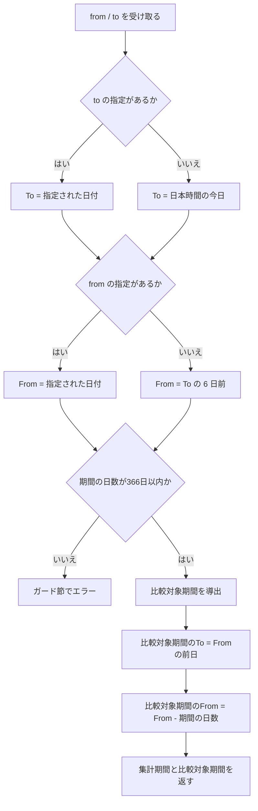

# 分析機能 Go実装仕様書（1. 基盤）

---

# 1. 機能概要

## 機能概要

生徒自身の学習実績（タスクの達成状況・問題の正答率・学習時間・学習の継続日数）を集計して返す機能である。エンドポイントは2つで、分析タイプを指定して1つの指標を取得するものと、指定期間とその直前期間を比較できる形でサマリを取得するものがある（②「1. 機能概要」「19. API仕様」）。

本機能はデータを作成・更新しない。必要なデータはすべて所有Contextが公開する参照手段から取得する（②「3. Bounded Context」）。

## 採用設計パターンとその理由

**Transaction Script**（②「4. 設計パターン」）

アーキテクチャ規約「3. 設計パターンごとの構造適用方針」のTransaction Script節が対象とする「集計・レポート生成」に該当する。状態・状態遷移・永続化を持たず、業務ルールによる失敗も存在しないため、domain層・usecase層・Repository Interfaceを設けない。

## 本書が対象とする実装範囲

機能全体で共通して使うものを対象とする。

- `context.go`（依存関係の組み立て）・`dependency.go`（他Contextへの依存を宣言するインターフェースと受け渡し用の型）
- `infrastructure/contextadapter/`配下の6つのアダプタ（`task-management`・`study-log`・`question-answering`・`curriculum`・`user`・`master-data`への参照）
- application層のうち、両エンドポイントが共有する算出関数（集計期間の確定・率の算出）
- `presentation/routes.go`
- Transaction・Validation・Authorization・Errorの実装方針（機能全体で共通）

エンドポイントごとのapplication関数・Handler・Request / Response DTOは`分析機能_Go実装仕様書_2_分析取得・期間サマリ.md`で扱う。

---

# 2. ディレクトリ構成

## 対象Bounded Context名

- `learning-analytics`（②「3. Bounded Context」）

## ディレクトリ・パッケージ名

アーキテクチャ規約「4. Bounded Context構成」の「Contextディレクトリの命名」に従い、Context名`learning-analytics`から`-`を取り除いて連結した全小文字の名前とする。ディレクトリ名は`internal/learninganalytics/`、package名は同じ`learninganalytics`となる。

Context名とディレクトリ名は規約から機械的に決まるため、②に明記がなくても推測にはならない。

教師向け・管理者向けの分析は利用者と指標が異なり、別Contextである。本Contextのディレクトリに`student/`のようなロール別のサブディレクトリを設けない。

## ②で採用した設計パターン

Transaction Script（②「4. 設計パターン」）

## 作成するディレクトリ一覧

```
internal/learninganalytics/
internal/learninganalytics/application/
internal/learninganalytics/infrastructure/contextadapter/
internal/learninganalytics/presentation/handler/
internal/learninganalytics/presentation/request/
internal/learninganalytics/presentation/response/
```

`domain/`は作成しない。②「6. Entity設計」「7. Value Object設計」のとおりEntityもValue Objectも定義せず、業務ルールを持たないためである（アーキテクチャ規約「3. 設計パターンごとの構造適用方針」Transaction Script節）。

`infrastructure/gormrepo/`も作成しない。本Contextが所有するテーブルがなく、GORMでDBを読み書きする実装を持たないためである（②「20. DB設計方針」「21. DB操作仕様」）。`infrastructure/`配下は`contextadapter/`のみとなる。アーキテクチャ規約同節のTransaction Scriptのツリーは`infrastructure/`直下にDBアクセス関数を置く形を示しているが、本Contextにはその対象がない。

`presentation/request/`は作成する。分析タイプ・コースID・単元ID・期間をクエリパラメータで受け取るためである（②「19. API仕様」）。

規約「4. Bounded Context構成」の「機能で不要なディレクトリは作成しない。『層として必要だから』という理由で空のディレクトリを置かない」に従う。

## 機能全体のファイル一覧と担当文書

|パス|担当文書|役割|
|-|-|-|
|`internal/learninganalytics/context.go`|1（本書）|`NewContext`（依存関係の組み立て）|
|`internal/learninganalytics/dependency.go`|1（本書）|他Contextへの依存を宣言するインターフェースと受け渡し用の型|
|`internal/learninganalytics/application/period.go`|1（本書）|集計期間の確定と比較対象期間の導出|
|`internal/learninganalytics/application/rate.go`|1（本書）|率の算出と丸め|
|`internal/learninganalytics/infrastructure/contextadapter/task_stats_directory.go`|1（本書）|`task-management`への参照アダプタ|
|`internal/learninganalytics/infrastructure/contextadapter/study_log_directory.go`|1（本書）|`study-log`への参照アダプタ|
|`internal/learninganalytics/infrastructure/contextadapter/answer_stats_directory.go`|1（本書）|`question-answering`への参照アダプタ|
|`internal/learninganalytics/infrastructure/contextadapter/curriculum_directory.go`|1（本書）|`curriculum`への参照アダプタ|
|`internal/learninganalytics/infrastructure/contextadapter/user_directory.go`|1（本書）|`user`への参照アダプタ|
|`internal/learninganalytics/infrastructure/contextadapter/grade_directory.go`|1（本書）|`master-data`への参照アダプタ|
|`internal/learninganalytics/presentation/routes.go`|1（本書）|ルーティング登録|
|`internal/learninganalytics/application/get_analytics.go`|2|分析タイプの判定と算出への分岐|
|`internal/learninganalytics/application/task_completion.go`|2|`task_completion`の算出|
|`internal/learninganalytics/application/understanding_score.go`|2|`understanding_score`の算出|
|`internal/learninganalytics/application/grade_average.go`|2|`grade_average`の算出|
|`internal/learninganalytics/application/rank.go`|2|`course_rank` / `unit_rank`の算出|
|`internal/learninganalytics/application/get_summary.go`|2|期間サマリの取りまとめ|
|`internal/learninganalytics/application/streak.go`|2|連続学習日数の算出|
|`internal/learninganalytics/application/study_minutes.go`|2|学習時間の推移と合計の算出|
|`internal/learninganalytics/application/subject_progress.go`|2|教科別正答率の算出|
|`internal/learninganalytics/presentation/handler/analytics_handler.go`|2|`GET /analytics`のHandler|
|`internal/learninganalytics/presentation/handler/summary_handler.go`|2|`GET /analytics/summary`のHandler|
|`internal/learninganalytics/presentation/request/analytics_request.go`|2|`GET /analytics`のRequest DTO|
|`internal/learninganalytics/presentation/request/summary_request.go`|2|`GET /analytics/summary`のRequest DTO|
|`internal/learninganalytics/presentation/response/analytics_response.go`|2|`GET /analytics`のResponse DTO（4種）|
|`internal/learninganalytics/presentation/response/summary_response.go`|2|`GET /analytics/summary`のResponse DTO|

## 文書の分割

実装ファイルは26である。テストが付くもの（Transaction Scriptの関数11・アダプタ6・Handler2の合計19）を加えると45となり、1文書あたり30〜35という範囲を超えるため分割する。

|文書|担当|実装|テスト込みの目安|
|-|-|-|-|
|`分析機能_Go実装仕様書_1_基盤.md`|共通の算出関数・アダプタ・ルーティング・実装方針|11|19|
|`分析機能_Go実装仕様書_2_分析取得・期間サマリ.md`|両エンドポイントのapplication関数・Presentation層|15|26|

Handlerは2つあるが、スライスに割るといずれもテスト込みで12〜14にとどまり小さすぎるため、1つのスライス編にまとめる（③自動生成プロンプト「2. ディレクトリ構成」の「スライスの切り方」）。

基盤編 → スライス編の順に実装すれば、各PRは単体でコンパイルが通る。スライス編のapplication関数は基盤編の`dependency.go`のインターフェースと共通の算出関数に依存するためである。

---

# 3. Domain層設計

対象外（Transaction Script採用のため、Domain層を設けない）。

②「6. Entity設計」「7. Value Object設計」「8. Domain Service」「18. Domain Event」のとおり、Entity・Value Object・Domain Service・Domain Eventをいずれも定義しない。`domain/`ディレクトリを作成しない。

関数の入出力・処理ステップは「6. Application層設計」（本書の共通関数）および文書2の同節（業務操作の関数）に記載する。

他Contextから受け取る値は、本Contextが必要とする項目だけを持つ受け渡し用の型として`dependency.go`に定義する。相手Contextの内部Entityをそのまま持ち込まない（アーキテクチャ規約「5. Context間連携ルール」）。

## Domain Error

対象外。②「17. Error設計」のとおり、本Contextに業務ルール違反を表すエラーが存在しない。

意味を持つエラーは「分析タイプが既知の5つのいずれでもない」「学年が設定されていない」の2つであり、いずれもapplication層で検知するApplication Errorとして扱う（「14. Error実装方針」）。センチネルエラーは`application/`配下に置き、`domain/errors`は作成しない。

---

# 4. クラス図

Entityもstructの階層も持たないため、Domain Model相当のクラス図は存在しない。本Contextが持つのは、他Contextの参照手段を宣言するインターフェース群と、それを受け取って指標を組み立てる関数群である。その関係を示す。

```mermaid
classDiagram
    class TaskStatsDirectory {
        <<interface>>
        +CountTasks(ctx, uint) (TaskCountStats, error)
        +CountTasksByDueDate(ctx, uint, DateRange) (TaskCountStats, error)
        +CountTasksForUsers(ctx, []uint) (TaskCountStats, error)
    }
    class StudyLogDirectory {
        <<interface>>
        +FindStudiedDates(ctx, uint) ([]time.Time, error)
        +SumStudyMinutesByDate(ctx, uint, DateRange) ([]DailyStudyMinutes, error)
    }
    class AnswerRateDirectory {
        <<interface>>
        +CountAnswers(ctx, uint) (AnswerCountStats, error)
        +CountAnswersForUsers(ctx, []uint) (AnswerCountStats, error)
    }
    class UnitAnswerStatsDirectory {
        <<interface>>
        +AggregateAnswersByUnit(ctx, uint) ([]UnitAnswerStats, error)
    }
    class CourseAnswerStatsDirectory {
        <<interface>>
        +AggregateAnswersByCourse(ctx, uint, DateRange) ([]CourseAnswerStats, error)
    }
    class RankAnswerStatsDirectory {
        <<interface>>
        +AggregateAnswersByUserForCourse(ctx, uint) ([]UserAnswerStats, error)
        +AggregateAnswersByUserForUnit(ctx, uint) ([]UserAnswerStats, error)
    }
    class CurriculumDirectory {
        <<interface>>
        +FindUnitHierarchies(ctx, []uint) ([]UnitHierarchy, error)
        +FindCourseSubjects(ctx, []uint) ([]CourseSubject, error)
    }
    class UserGradeDirectory {
        <<interface>>
        +FindGradeID(ctx, uint) (*uint, error)
        +FindUserIDsByGradeIDs(ctx, []uint) ([]uint, error)
    }
    class ActiveUserDirectory {
        <<interface>>
        +FilterActiveUserIDs(ctx, []uint) ([]uint, error)
    }
    class GradeDirectory {
        <<interface>>
        +FindGradeYear(ctx, uint) (*int, error)
        +FindGradeIDsByYear(ctx, int) ([]uint, error)
    }

    class taskStatsDirectory
    class studyLogDirectory
    class answerStatsDirectory
    class curriculumDirectory
    class userDirectory
    class gradeDirectory

    TaskStatsDirectory <|.. taskStatsDirectory
    StudyLogDirectory <|.. studyLogDirectory
    AnswerRateDirectory <|.. answerStatsDirectory
    UnitAnswerStatsDirectory <|.. answerStatsDirectory
    CourseAnswerStatsDirectory <|.. answerStatsDirectory
    RankAnswerStatsDirectory <|.. answerStatsDirectory
    CurriculumDirectory <|.. curriculumDirectory
    UserGradeDirectory <|.. userDirectory
    ActiveUserDirectory <|.. userDirectory
    GradeDirectory <|.. gradeDirectory

    class AnalyticsService {
        -TaskStatsDirectory taskStats
        -AnswerRateDirectory answerRate
        -UnitAnswerStatsDirectory unitAnswerStats
        -RankAnswerStatsDirectory rankAnswerStats
        -CurriculumDirectory curriculum
        -UserGradeDirectory userGrade
        -ActiveUserDirectory activeUser
        -GradeDirectory grade
        +GetAnalytics(ctx, uint, AnalyticsQuery) (any, error)
    }
    class SummaryService {
        -StudyLogDirectory studyLog
        -TaskStatsDirectory taskStats
        -CourseAnswerStatsDirectory courseAnswerStats
        -CurriculumDirectory curriculum
        +GetSummary(ctx, uint, PeriodQuery) (*SummaryData, error)
    }

    AnalyticsService ..> TaskStatsDirectory
    AnalyticsService ..> AnswerRateDirectory
    AnalyticsService ..> UnitAnswerStatsDirectory
    AnalyticsService ..> RankAnswerStatsDirectory
    AnalyticsService ..> CurriculumDirectory
    AnalyticsService ..> UserGradeDirectory
    AnalyticsService ..> ActiveUserDirectory
    AnalyticsService ..> GradeDirectory
    SummaryService ..> StudyLogDirectory
    SummaryService ..> TaskStatsDirectory
    SummaryService ..> CourseAnswerStatsDirectory
    SummaryService ..> CurriculumDirectory
```



`AnalyticsService`・`SummaryService`は、依存をコンストラクタで受け取るための入れ物である。業務ルールを持つstructではなく、Transaction Scriptの関数をメソッドとして束ねたものである（アーキテクチャ規約「3. 設計パターンごとの構造適用方針」のTransaction Script節が「1つの業務操作を1つの関数として`application/`直下に置く」と定めるのに対し、依存の受け渡し手段としてstructを使う。ダッシュボード機能③と同じ扱い）。

インターフェースを機能ごとに小さく分けているのは、コーディング規約「6. 構造体・インターフェース設計」の「インターフェースのメソッド数は3メソッド以内を目安にする。それを超える場合は、利用側が実際に必要とするメソッドだけを持つ小さなインターフェースに分割する」に従うためである。`question-answering`への参照は切り口が5つあるため、利用する算出処理ごとに3つのインターフェースへ分け、実装は1つのアダプタが満たす。`user`への参照も、所属の参照（`UserGradeDirectory`）と在籍の絞り込み（`ActiveUserDirectory`）で関心が異なるため分ける。

---

# 5. 状態遷移図

省略する。

理由: ②「10. 状態遷移図」のとおり、本機能に状態を持つデータが存在しない。参照するタスクの進行状態は完了かどうかの判定に使うだけで、本Contextが遷移させない。

---

# 6. Application層設計

本機能はTransaction Script採用のため、UseCase structを設けない（アーキテクチャ規約「3. 設計パターンごとの構造適用方針」）。

本書では、両エンドポイントが共有する算出関数（集計期間の確定・率の算出）を扱う。業務操作の関数（`GetAnalytics`・`GetSummary`とその配下の算出）は文書2で扱う。

## DTO（Command / Query）

本書で定義するDTOはない。`dependency.go`に置く受け渡し用の型は「8. Infrastructure層設計」に記載する。

エンドポイントの入出力DTOは文書2で定義する。

## 共通の算出関数

### 集計期間の確定（`application/period.go`）

集計期間は「両端を含む日本時間の日付の範囲」である（②「7. Value Object設計」）。

|項目|内容|
|-|-|
|型|`DateRange`（`dependency.go`で定義。`From`・`To`はいずれも日本時間の暦日を表す`time.Time`）|
|定数|`DefaultRangeDays = 7`（既定の期間の日数）、`MaxRangeDays = 366`（期間の日数の上限）|

関数一覧:

|関数|引数|戻り値|責務|
|-|-|-|-|
|`ResolveDateRange`|`from, to *time.Time`|`DateRange`|省略された端を既定値で補って集計期間を確定する。`to`が`nil`なら日本時間の今日、`from`が`nil`なら確定後の`To`から`DefaultRangeDays - 1`日前とする|
|`PreviousDateRange`|`r DateRange`|`DateRange`|比較対象期間を導出する。`To`は`r.From`の前日、`From`は`r.From`から`PeriodDays(r)`日前とする|
|`PeriodDays`|`r DateRange`|`int`|期間の日数（両端を含む）を返す|
|`EachDate`|`r DateRange`|`[]time.Time`|期間内の各日を日本時間の日付として昇順で返す|

処理上の注意:

- 「今日」は日本時間で判定する。`time.Now()`をそのまま使わず、日本時間のロケーションへ変換してから日付部分を取る。日本時間のロケーションはプロセス起動時に一度解決した値を共有する（コーディング規約「17. `time.Time` とタイムゾーン」）
- `MaxRangeDays`の判定はPresentation層のRequest DTOで行う（②「15. Validation設計」）。本関数は上限を超えた期間を渡されない前提とするが、`EachDate`が巨大なスライスを返さないよう、`PeriodDays`が`MaxRangeDays`を超える場合はガード節でエラーを返す（Transaction Script採用時の入力検証はガード節で行う。規約「3. 設計パターンごとの構造適用方針」）
- 日付は「日本時間の暦日」を表す値として扱う。`time.Time`のロケーションを`time.UTC`、時刻を0時0分0秒に揃え、年月日に日本時間での暦日を入れる。コーディング規約「17. `time.Time` とタイムゾーン」は内部で保持する時刻をUTCに統一するよう定めており、また`time.Time`をマップのキーや比較に使う場合は正規化が必要であるとしている。ロケーションと時刻を固定することで、日付の比較・マップのキーとしての利用が安全になる
- 日本時間の瞬間と暦日の相互変換（UTC保存の日時がどの暦日に属するか）は所有Contextの参照手段が担う。本Contextは暦日だけを扱う

**テストを独立させる理由**: 期間の既定値補完と比較対象期間の導出は、両エンドポイントが共有し、かつ境界条件（片方のみ指定、1日だけの期間、月や年をまたぐ期間、うるう年）が多い。算出処理の中に埋め込むとこれらを個別に検証できない。

### 率の算出（`application/rate.go`）

|関数|引数|戻り値|責務|
|-|-|-|-|
|`Percentage`|`numerator, denominator int`|`float64`|`numerator / denominator * 100`を小数第1位で丸めて返す。`denominator`が0のときは`0`を返す|

処理上の注意:

- 丸めは小数第1位。`50.0`・`66.7`のように返る（①「5. API / 処理詳細」）
- 分母が0のときは除算せず`0`を返す。Rails現行も整数の`0`を返しており、JSONとしては`0`になる
- すべての率（タスク達成率・正答率・単元スコア・教科別正答率・学年平均）がこの1つの関数を通る。指標ごとに丸め方がぶれないようにするためである（②「7. Value Object設計」）

**JSONでの表現**: Goの`float64`を`encoding/json`で出力すると、`50.0`は`50`、`66.7`は`66.7`となる。Rails現行は`50.0`と出力する。JSONの数値として`50`と`50.0`は同じ値であり、JavaScriptでのパース結果も一致するため、フロントエンドから見た差分は生じない（**②からの補足**。「17. ②からの補足事項」参照）。

---

# 7. シーケンス図・処理フロー図

## シーケンス図

本書が担当するのは共通の算出関数とアダプタであり、エンドポイント単位の呼び出し関係は文書2で示す。アダプタの呼び出し関係は下図のとおり、いずれも同じ形になる。



## 処理フロー図

### 集計期間の確定



`to`のみ指定された場合、`From`は指定された`To`の6日前になる。Rails現行では`from`の既定値が「今日の6日前」であり、`to`の指定と対応しない期間になる（①「5. API / 処理詳細」`#show`）。本実装は`To`を確定させた後に`From`を補うため、この点でRails現行と結果が異なる（**②からの補足**。「17. ②からの補足事項」参照）。

---

# 8. Infrastructure層設計

**実装上の位置づけ**: 本Contextが所有するテーブルは存在しない。したがってRepository実装・Store実装・Infrastructure関数のいずれも持たない（②「20. DB設計方針」「21. DB操作仕様」）。`infrastructure/`配下に置くのは、他Contextの公開参照手段へ委譲するアダプタのみである。

## Repository実装（Domain Model / Event Sourcing採用時）

対象外（Transaction Script採用のため、かつ所有するテーブルがないため）。

## Store実装（Active Record採用時）

対象外（同上）。

## Infrastructure関数（Transaction Script採用時）

対象外。Transaction Script採用Contextは通常、DBアクセスをinfrastructure層の関数として持つが、本Contextには対象がない。

GORMを用いる実装を一切持たないため、`*gorm.DB`を受け取る構造も存在しない。`context.go`の`NewContext`も`*gorm.DB`を引数に取らない。

## `dependency.go`に定義する受け渡し用の型

いずれも他Contextから受け取る値のうち、本Contextが必要とする項目だけを持つ。相手Contextの内部Entityを持ち込まない（アーキテクチャ規約「5. Context間連携ルール」）。

|型|フィールド|備考|
|-|-|-|
|`DateRange`|`From time.Time`・`To time.Time`|両端を含む日本時間の暦日の範囲。ロケーションは`time.UTC`、時刻は0時0分0秒に揃え、年月日に日本時間での暦日を入れる（コーディング規約「17. `time.Time` とタイムゾーン」）|
|`TaskCountStats`|`Total int`・`Completed int`|タスクの総件数と完了件数。率は含まない|
|`DailyStudyMinutes`|`Date time.Time`・`Minutes int`|日本時間の日付と、その日の学習時間合計（分）|
|`AnswerCountStats`|`Total int`・`Correct int`|解答数と正答数。率は含まない|
|`UnitAnswerStats`|`CourseID uint`・`UnitID uint`・`Total int`・`Correct int`・`FirstAnsweredAt time.Time`|コースと単元の組ごとの解答数・正答数と、その組で最初に解答した日時|
|`CourseAnswerStats`|`CourseID uint`・`Total int`・`Correct int`|コースごとの解答数・正答数|
|`UserAnswerStats`|`UserID uint`・`Total int`・`Correct int`|ユーザーごとの解答数・正答数|
|`UnitHierarchy`|`UnitID uint`・`UnitName string`・`CourseID uint`・`LevelName string`・`LevelNumber int`・`SubjectID uint`・`SubjectName string`|単元から教科までの階層と名称|
|`CourseSubject`|`CourseID uint`・`SubjectID uint`・`SubjectName string`|コースが属する教科|

率を含めず件数で受け取るのは、百分率にするか小数第何位で丸めるかが分析の表現の問題であり、所有Contextの関心ではないためである（②「3. Bounded Context」「24. 採用しなかった設計」）。

`FirstAnsweredAt`を受け取るのは、`understanding_score`の並び順を「最初に解答した順」として定めたためである（②「19. API仕様」の「Railsとの差分」1）。

ユーザーIDの型は`uint`とする。他機能の③（目標管理機能③「3. Domain層設計」等）と揃える。

## 他Contextへの依存を宣言するインターフェース

`dependency.go`に置く。実装は`infrastructure/contextadapter/`のアダプタが担う。コーディング規約「7. インターフェース」の「インターフェースは、実装するパッケージではなく、利用するパッケージ側で定義する」に従い、利用側である本Contextに置く。

### `task-management`への参照

|インターフェース|メソッド|責務|
|-|-|-|
|`TaskStatsDirectory`|`CountTasks(ctx context.Context, userID uint) (TaskCountStats, error)`|その生徒の全期間のタスクの総件数と完了件数を返す。期限日が未設定のタスクも総件数に含む。論理削除済みを除く（①「5. API / 処理詳細」`task_completion`）|
||`CountTasksByDueDate(ctx context.Context, userID uint, r DateRange) (TaskCountStats, error)`|その生徒のタスクのうち、期限日が`r`の範囲内にあるものの総件数と完了件数を返す。期限日が未設定のタスクは含まない（同 `#show`のタスク達成率）|
||`CountTasksForUsers(ctx context.Context, userIDs []uint) (TaskCountStats, error)`|指定されたユーザーに属するタスクの総件数と完了件数の合計を返す。学年平均の算出に使う（同 `grade_average`）|

### `study-log`への参照

|インターフェース|メソッド|責務|
|-|-|-|
|`StudyLogDirectory`|`FindStudiedDates(ctx context.Context, userID uint) ([]time.Time, error)`|その生徒が学習した日（日本時間の日付）を重複なく返す。論理削除済みのログを除く（同 `#show`の継続日数）|
||`SumStudyMinutesByDate(ctx context.Context, userID uint, r DateRange) ([]DailyStudyMinutes, error)`|`r`の範囲内で、日本時間の日付ごとの学習時間合計（分）を返す。学習ログのない日は要素に含めない。学習時間が未記録のログは0分として扱う（同 `#show`の学習時間）|

`FindStudiedDates`が期間を取らないのは、継続日数が当日を起点に過去へさかのぼって数えるもので、さかのぼる範囲を事前に決められないためである（①「5. API / 処理詳細」`streak_days`）。

### `question-answering`への参照

|インターフェース|メソッド|責務|
|-|-|-|
|`AnswerRateDirectory`|`CountAnswers(ctx context.Context, userID uint) (AnswerCountStats, error)`|その生徒の全期間の解答数と正答数を返す（同 `grade_average`）|
||`CountAnswersForUsers(ctx context.Context, userIDs []uint) (AnswerCountStats, error)`|指定されたユーザーの解答数と正答数の合計を返す（同）|
|`UnitAnswerStatsDirectory`|`AggregateAnswersByUnit(ctx context.Context, userID uint) ([]UnitAnswerStats, error)`|その生徒の全期間の解答数・正答数を、コースIDと単元IDの組ごとに返す。組ごとに最初に解答した日時も返す（同 `understanding_score`）|
|`CourseAnswerStatsDirectory`|`AggregateAnswersByCourse(ctx context.Context, userID uint, r DateRange) ([]CourseAnswerStats, error)`|その生徒の`r`の範囲内の解答数・正答数を、コースIDごとに返す（同 `#show`の教科別正答率）|
|`RankAnswerStatsDirectory`|`AggregateAnswersByUserForCourse(ctx context.Context, courseID uint) ([]UserAnswerStats, error)`|指定コースに解答履歴を持つユーザーごとの、そのコースでの解答数・正答数を返す（同 `course_rank`）|
||`AggregateAnswersByUserForUnit(ctx context.Context, unitID uint) ([]UserAnswerStats, error)`|指定単元に解答履歴を持つユーザーごとの、その単元での解答数・正答数を返す（同 `unit_rank`）|

いずれも**論理削除済みの解答履歴を含む**。分析は論理削除済みの履歴も集計対象とするのがRails現行の振る舞いであり、フロントエンドを変更しない方針のため維持する（②「19. API仕様」の「変更しないもの」）。他機能が同じテーブルを参照する際に論理削除済みを除いていることとは扱いが異なるため、`question-answering`側の参照手段は分析向けであることが分かる形で公開する必要がある。

`AggregateAnswersByUserForCourse` / `ForUnit`は在籍中かどうかで絞り込まない。絞り込みは`ActiveUserDirectory`へ委ねる（②「3. Bounded Context」の「依存する理由」）。

### `curriculum`への参照

|インターフェース|メソッド|責務|
|-|-|-|
|`CurriculumDirectory`|`FindUnitHierarchies(ctx context.Context, unitIDs []uint) ([]UnitHierarchy, error)`|単元IDから、単元名・所属コース（コース名・レベル番号）・所属教科（教科ID・教科名）を返す（同 `understanding_score`）|
||`FindCourseSubjects(ctx context.Context, courseIDs []uint) ([]CourseSubject, error)`|コースIDから、所属教科（教科ID・教科名）を返す（同 `#show`の教科別正答率）|

渡したIDに対応する行が存在しない場合（論理削除済みの単元・コース等）は、その要素を戻り値に含めない。エラーにしない。解答履歴は論理削除済みの教材に紐づくものも含むため、階層が引けない組み合わせが生じうる。その場合は結果から落ちる（**②からの補足**。「17. ②からの補足事項」参照）。

並び順は保証しない。並べ替えは本Contextで行う（②「21. DB操作仕様」）。

### `user`への参照

|インターフェース|メソッド|責務|
|-|-|-|
|`UserGradeDirectory`|`FindGradeID(ctx context.Context, userID uint) (*uint, error)`|その生徒が属する学年の識別子を返す。学年が設定されていない場合は`nil`を返す（同 `grade_average`）|
||`FindUserIDsByGradeIDs(ctx context.Context, gradeIDs []uint) ([]uint, error)`|指定された学年に属するユーザーIDを返す。在籍中かどうかで絞り込まない（同）|
|`ActiveUserDirectory`|`FilterActiveUserIDs(ctx context.Context, userIDs []uint) ([]uint, error)`|渡されたユーザーIDのうち、在籍中（論理削除されていない）のものを返す（同 `course_rank` / `unit_rank`）|

`FindUserIDsByGradeIDs`が在籍中で絞り込まず、`FilterActiveUserIDs`を別のインターフェースにしているのは、学年平均の母集団が論理削除済みユーザーを含み、順位の母集団は含まないというRails現行の非対称を、呼び出し側で明示できるようにするためである（②「11. Repository設計」`user`への参照）。

学年の識別子の集合を受け取る形にしているのは、学年が学校ごとに独立しており、同じ年次の学年が学校の数だけ存在するためである。学校をまたいで年次だけで集めるのがRails現行の振る舞いである（②「19. API仕様」の「変更しないもの」）。

### `master-data`への参照

|インターフェース|メソッド|責務|
|-|-|-|
|`GradeDirectory`|`FindGradeYear(ctx context.Context, gradeID uint) (*int, error)`|指定された学年の年次を返す。学年が存在しない場合は`nil`を返す（同 `grade_average`）|
||`FindGradeIDsByYear(ctx context.Context, year int) ([]uint, error)`|指定された年次を持つ学年の識別子を返す。学校で絞り込まない（同）|

`user`ではなく`master-data`へ問うのは、`grades`テーブルを所有しているのが同Contextであり、`user`が公開するユーザーの基本属性に含まれるのは学年の識別子までであるためである（②「3. Bounded Context」の「依存する理由」）。

`master-data`が公開する操作との対応は次のとおりである（共通マスタ参照機能③基盤編「8. Infrastructure層設計」）。

|本Contextのメソッド|`master-data`の公開操作|
|-|-|
|`FindGradeYear(ctx, gradeID)`|`FindGrades(ctx, []uint{gradeID})`を呼び、返った`GradeRef`の年次を取り出す。結果が空なら`nil`を返す|
|`FindGradeIDsByYear(ctx, year)`|同名の`FindGradeIDsByYear`をそのまま呼ぶ|

`FindGradeYear`に対応する専用の公開操作を`master-data`に設けない。同Contextは「学年の属性の取得」（識別子の集合を受け取り、年次・表示名・所属高校の識別子を含む属性を返す）を公開しており、年次だけを返す操作を重ねて持たないためである（共通マスタ参照機能②「3. Bounded Context」の「実在確認のための専用操作を設けない」と同じ考え方）。1件分の集合を渡して1件を取り出す変換はアダプタが担う。

## 他Contextの参照手段の実装（アダプタ）

`dependency.go`で宣言したインターフェースの実装である。相手Contextが公開する参照手段へ委譲し、本Contextから相手のテーブルへクエリを発行しない（アーキテクチャ規約「5. Context間連携ルール」）。GORMに依存せず相手Contextの公開操作を呼ぶアダプタであるため`infrastructure/contextadapter/`に置く（同「4. Bounded Context構成」）。

|ファイル|struct / コンストラクタ|満たすインターフェース|
|-|-|-|
|`task_stats_directory.go`|非公開struct（例: `taskStatsDirectory`）＋`NewTaskStatsDirectory(taskContext *taskmanagement.Context) learninganalytics.TaskStatsDirectory`|`TaskStatsDirectory`|
|`study_log_directory.go`|`studyLogDirectory`＋`NewStudyLogDirectory(studyLogContext *studylog.Context) learninganalytics.StudyLogDirectory`|`StudyLogDirectory`|
|`answer_stats_directory.go`|`answerStatsDirectory`＋`NewAnswerStatsDirectory(qaContext *questionanswering.Context) *answerStatsDirectory`|`AnswerRateDirectory`・`UnitAnswerStatsDirectory`・`CourseAnswerStatsDirectory`・`RankAnswerStatsDirectory`|
|`curriculum_directory.go`|`curriculumDirectory`＋`NewCurriculumDirectory(curriculumContext *curriculum.Context) learninganalytics.CurriculumDirectory`|`CurriculumDirectory`|

`curriculumDirectory.FindUnitHierarchies`は、`curriculum`が公開する`FindUnitsByIDs`（単元名・コースの識別子・レベル番号・レベル名）と`FindCourseSubjects`（コースの識別子からの教科）の2つを呼び、コースの識別子で突き合わせて`UnitHierarchy`を組み立てる。`curriculum`側に単元から教科までを一度に返す専用の操作を設けないのは、`FindUnitsByIDs`が既に公開されており、同じ項目を返す操作を重ねて持たないためである（コース参照機能③「6. Application層設計」の「呼び出し側の型との対応」）。

これは例外的に、アダプタが委譲と型変換に加えて2つの結果の突き合わせを行う。`curriculum`側の操作をこの1件のために増やすより、消費者側で組み立てる方が影響が小さいためである。`FindCourseSubjects`で教科が引けなかったコースに属する単元は、結果に含めない。
|`user_directory.go`|`userDirectory`＋`NewUserDirectory(userContext *user.Context) *userDirectory`|`UserGradeDirectory`・`ActiveUserDirectory`|
|`grade_directory.go`|`gradeDirectory`＋`NewGradeDirectory(masterDataContext *masterdata.Context) learninganalytics.GradeDirectory`|`GradeDirectory`|

1つのstructが複数のインターフェースを満たす場合（`answer_stats_directory.go`・`user_directory.go`）は、コンストラクタの戻り値をインターフェースにできないため具象型を返す。コーディング規約「7. インターフェース」の「実装側は可能な限り具象型を返す」に沿う。インターフェースを満たすことはブランク識別子への代入でコンパイル時に検証する（同「コンパイル時のインターフェース充足チェック」）。

```
var _ learninganalytics.AnswerRateDirectory = (*answerStatsDirectory)(nil)
```

アダプタの責務は委譲と型変換のみである。件数の合算・率の算出・並べ替え・在籍の絞り込みをアダプタで行わない。

**日本時間への変換の置き場所**: `DateRange`は日本時間の日付として渡し、UTC保存された`started_at`・`answered_at`との突き合わせは所有Context側で行う（②「7. Value Object設計」）。アダプタは日付をそのまま渡し、時刻の範囲へ変換しない。保存形式の知識を所有Contextに閉じ込めるためである。

**②からの補足**: 相手Contextが公開する参照手段の具体的なシグネチャは、各機能の③で確定する。本書では消費者側のインターフェースを本Contextに置き、実装をアダプタに閉じ込める。本機能が必要とする参照手段は所有Context側の文書に反映する必要がある（「17. ②からの補足事項」参照）。

## 外部連携実装

対象外。本Contextから外部サービス・キャッシュ・キューへ直接アクセスしない。集計結果のキャッシュも設けない（②「20. DB設計方針」）。

## 依存関係の組み立て（`context.go`）

アーキテクチャ規約「14. 依存関係の組み立て（DI配線）」の「Context単位の組み立て関数」に従う。

|項目|内容|
|-|-|
|関数|`NewContext(taskContext *taskmanagement.Context, studyLogContext *studylog.Context, qaContext *questionanswering.Context, curriculumContext *curriculum.Context, userContext *user.Context, masterDataContext *masterdata.Context) *Context`|
|組み立てる内容|6つのアダプタを生成し、`AnalyticsService`・`SummaryService`へ注入する。Handlerへ両Serviceを注入する|
|公開するもの|ルーティング登録に必要なHandlerのみ|

`*gorm.DB`を引数に取らない。本Contextに永続化の対象がないためである（「Infrastructure関数」節）。

本Contextから他Contextへの参照依存のみであり、他Contextから本Contextへの依存は存在しない（②「3. Bounded Context」）。そのため`main.go`での組み立て順は、依存する6つのContextより後になる。

---

# 9. Presentation層設計

Handler・Request / Response DTOは文書2で扱う。本書ではルーティングのみ扱う。

## Routing

`presentation/routes.go`に登録する。Gin規約「1. ルーティング」「2. ルートグルーピング」に従う。

|Method|Path|Handler|
|-|-|-|
|GET|`/api/v1/student/analytics`|`AnalyticsHandler.Index`|
|GET|`/api/v1/student/analytics/summary`|`SummaryHandler.Show`|

`/api/v1/student`グループに登録する。同グループには認証ミドルウェアと`student`ロールの認可ミドルウェアが適用される（Gin規約「3. ミドルウェア」「4. 認可（Casbin RBAC）」）。

URLはRails現行と同一である（②「19. API仕様」）。`/analytics`と`/analytics/summary`は前者が`resources`、後者が`namespace`配下の単数リソースとしてRailsで定義されているが、Ginでは単純に2つのパスとして登録する。パスが衝突しないよう、`/analytics/summary`を`/analytics/:id`のようなパラメータ付きルートより先に登録する必要はない（`:id`を取るルートが存在しないため）。

本機能にCSRF対策の適用は不要である。いずれもGETであり、Gin規約「5. CSRF対策」の適用範囲（状態を変更するメソッド）に含まれない。

---

# 10. API仕様

本書ではエンドポイントの一覧のみ示す。Request / Response・Errorケースの詳細は文書2に記載する。

|Method|Path|Handler|担当文書|
|-|-|-|-|
|GET|`/api/v1/student/analytics`|`AnalyticsHandler.Index`|2|
|GET|`/api/v1/student/analytics/summary`|`SummaryHandler.Show`|2|

---

# 11. Transaction実装方針

トランザクションを使用しない。

- **Transaction開始箇所**: なし
- **Transaction終了箇所**: なし

②「14. Transaction設計」のとおり、本機能は1件のデータも作成・更新・削除せず、原子性を保証する対象が存在しない。アーキテクチャ規約「11. Transaction実装パターン（TransactionManager）」の`TransactionManager`を注入しない。`gormtx.RunInTx`も呼ばない。

複数の参照手段にまたがる読み取りを1つのトランザクションで束ねることもしない。理由は②「14. Transaction設計」に記載のとおりである。

所有Context側の参照手段がトランザクションを張るかどうかは所有Contextの判断であり、本Contextは関与しない。本Contextから`context.Context`を渡すだけであり、`gormtx.DBFromContext`が返すトランザクションを持ち込まない。

---

# 12. Validation実装方針

## Presentation

Request DTOでのチェック内容は文書2に記載する。本書では方針のみ示す。

- クエリパラメータのみを受け取るため、バインドには`ShouldBindQuery`を使用する。クエリタグには`form`を使う（Gin規約「6. Model BindingとValidation」の「一覧取得（クエリパラメータ）のバインド」）
- 検証の失敗はHandlerで`c.Error`に積み、Gin規約「8. エラーハンドリングミドルウェア」の集約ハンドラがHTTPレスポンスへ変換する。Handlerが直接`c.JSON`でエラーを返さない
- 期間の形式・前後関係・上限の検証をPresentation層に置くのは、Rails現行がFormで担い`422`とフィールド単位のメッセージで返る形を維持するためである（②「15. Validation設計」）

## 業務ルール検証

Transaction Script採用のため、application関数内のガード節で検証する（アーキテクチャ規約「3. 設計パターンごとの構造適用方針」）。本書が担当する関数のガード節は以下である。

|関数|ガード節|
|-|-|
|`ResolveDateRange`|確定した期間の日数が`MaxRangeDays`を超える場合はエラーを返す|
|`Percentage`|分母が0の場合は除算せず`0`を返す（エラーにしない）|

文書2が担当する関数（分析タイプの判定・学年未設定の判定）のガード節は文書2に記載する。

---

# 13. Authorization実装方針

②「16. Authorization設計」を実装に落とし込む。

|層|処理|
|-|-|
|Middleware|認証（ログイン済みであること）と`student`ロールの判定。Casbin RBACで行う（Gin規約「4. 認可（Casbin RBAC）」）。認証済みユーザーを`context.Context`へ格納する（コーディング規約「20. `context.Context`」）|
|Handler|`context.Context`から操作者のユーザーIDを取り出し、application関数へ渡す。リクエストからユーザーIDを受け取らない|
|application関数|所有権の判定を行わない。集計対象は渡されたユーザーIDに限られ、他人のデータを指定する経路が存在しない|
|Domain|存在しない（Domain層を設けない）|

リクエストにユーザーIDを含めないことで、所有権チェックを書く必要自体をなくす。`course_id`・`unit_id`は集計範囲の指定であり、他人のデータへの参照にはならない。

順位・学年平均では他の生徒の集計値を扱うが、Response DTOへは出さない。`UserAnswerStats`・`FindUserIDsByGradeIDs`の戻り値は順位と平均の算出にのみ使い、レスポンスに含めない（②「16. Authorization設計」）。

---

# 14. Error実装方針

## Domain Error → Application Errorへの変換方針

対象外。②「17. Error設計」のとおり、Domain Errorが存在しない。

## Application Error → HTTPレスポンスへの変換方針

アーキテクチャ規約「12. Error変換パターン（AppError）」に従う。application層のセンチネルエラーを`apperror.AppError`へ包み、Handlerは`c.Error(err)`を呼ぶだけとする。HTTPステータスとレスポンス本文への変換は、Gin規約「8. エラーハンドリングミドルウェア」の集約ハンドラが行う。

|業務シナリオ|Error変数名／型|発生層|HTTP Status|
|-|-|-|-|
|分析タイプの指定（`analytics`オブジェクト）がない|Request DTOのバインド失敗をバリデーションエラーへ変換したもの|Presentation|400|
|既知でない分析タイプを指定した|`ErrInvalidAnalyticsType`（指定値を含むメッセージを持つ）|Application|400|
|`from`・`to`の形式が不正、前後が逆、期間が上限超過|Request DTOのバリデーションエラー|Presentation|422|
|`course_id`・`unit_id`が整数として解釈できない|Request DTOのバリデーションエラー|Presentation|422|
|`grade_average`で生徒に学年が設定されていない|`ErrGradeNotSet`|Application|500|
|他Contextの参照手段の呼び出しに失敗|包まずそのまま返す|Infrastructure|500|
|未認証|認証ミドルウェアが返す|Middleware|401|
|`student`ロール以外|認可ミドルウェアが返す|Middleware|403|

`ErrInvalidAnalyticsType`のメッセージはRails現行の文言を維持する（①「5. API / 処理詳細」`#index`のErrorケース）。指定値を埋め込むため、センチネルエラーをそのまま返さず、`errors.Is`で判定できる形で包んでメッセージを持たせる（コーディング規約「18. エラーハンドリング」）。

`ErrGradeNotSet`の`StatusCode`は500、`LogLevel`はエラーとする。Rails現行で`500`になる振る舞いを維持するが、生徒の学年が未設定というデータ上の不備であり、気づけるようログに残す必要がある（②「17. Error設計」）。

本文の形式はいずれも`{"errors": [...]}`とする（アーキテクチャ規約「15. API規約（レスポンス形式・ページネーション・URL・クエリパラメータ）」）。

## Infrastructure Errorのハンドリング方針

アダプタは所有Contextが返したエラーを包み直さず、そのまま返す。本Contextで意味づけし直す余地がないためである（②「17. Error設計」）。

application関数も同様に、参照手段のエラーをそのまま呼び出し元へ返す。ダッシュボード機能③のように一部の失敗を吸収して`0`として扱う扱いは、本機能では行わない。Rails現行に吸収の仕組みがなく、集計値が欠けたまま`200`で返るとどの数値が欠けたのか分からないためである。

参照手段が0件を返すことはエラーとして扱わない。解答履歴のない生徒には空の結果が返り、順位は該当なしで返るのが正常な応答である（②「17. Error設計」）。

---

# 15. GORM / DBクエリ設計

対象外。

本Contextが所有するテーブルはなく、GORMモデルもクエリも持たない（②「20. DB設計方針」「21. DB操作仕様」）。`*gorm.DB`を受け取る構造が存在しない。

集計対象のテーブル（`tasks`・`study_logs`・`question_histories`・`units`・`courses`・`subjects`・`users`・`grades`）へのクエリは、いずれも所有Contextの参照手段の実装が発行する。クエリの条件・結合・インデックスの検討は所有Context側の文書で扱う。

本Contextが所有Contextへ渡す条件と期待する結果の粒度は「8. Infrastructure層設計」のインターフェース定義のとおりである。

既存Schemaへの変更は②で提案されていない。

---

# 16. テストケース設計

区分は②が採用した設計パターンに応じて読み替える（③自動生成プロンプト「16. テストケース設計」）。

## Domain Test

対象外（Transaction Script採用のため）。

## Application関数 Test

本書が担当する共通の算出関数を対象とする。

|対象|テストケース|
|-|-|
|`ResolveDateRange`|`from`・`to`の両方を指定した場合、指定どおりの期間になる|
||`to`を省略した場合、`To`が日本時間の今日になる|
||`from`を省略した場合、`From`が`To`の6日前になる（期間の日数が7になる）|
||両方を省略した場合、今日を終了日とする7日間になる|
||`to`のみを指定した場合、`From`が指定した`To`の6日前になる|
||`from`と`to`が同日の場合、期間の日数が1になる|
||期間の日数が366日の場合はエラーにならない|
||期間の日数が367日の場合はガード節でエラーを返す|
||確定した`From`・`To`のロケーションが`time.UTC`、時刻が0時0分0秒に揃う|
||日本時間で日付が変わる直前（23時台）に呼ばれても、`To`が日本時間の当日になる|
|`PreviousDateRange`|比較対象期間の`To`が集計期間の`From`の前日になる|
||比較対象期間の日数が集計期間の日数と一致する|
||月をまたぐ期間で正しくさかのぼる|
||うるう年の2月をまたぐ期間で正しくさかのぼる|
|`PeriodDays`|両端を含めた日数を返す（同日なら1）|
|`EachDate`|期間内の各日を昇順で返し、件数が`PeriodDays`と一致する|
||月をまたぐ期間で日付が連続する|
|`Percentage`|分母が0のとき`0`を返す（除算しない）|
||1/2のとき`50`を返す|
||2/3のとき`66.7`を返す（小数第1位で丸める）|
||1/3のとき`33.3`を返す|
||分子と分母が等しいとき`100`を返す|
||分子が0のとき`0`を返す|

## Repository Test

対象外（本Contextが所有するテーブルがなく、DBアクセス実装を持たないため）。

## アダプタ Test

`dependency.go`のインターフェースの実装を対象とする。所有Contextの公開参照手段をテストダブルに差し替え、委譲と型変換のみを検証する。

|対象|テストケース|
|-|-|
|`taskStatsDirectory`|3つのメソッドが対応する所有Contextの参照手段を呼び、`TaskCountStats`へ変換して返す|
||所有Contextがエラーを返した場合、包み直さずそのまま返す|
|`studyLogDirectory`|`FindStudiedDates`が日本時間の日付のスライスへ変換して返す|
||`SumStudyMinutesByDate`が`DailyStudyMinutes`のスライスへ変換して返す。学習ログのない日は要素に含まれない|
||`DateRange`を時刻の範囲へ変換せず、日付のまま所有Contextへ渡す|
|`answerStatsDirectory`|5つのメソッドが対応する所有Contextの参照手段を呼び、それぞれの受け渡し用の型へ変換して返す|
||`AggregateAnswersByUnit`が`FirstAnsweredAt`を含めて返す|
||`AggregateAnswersByUserForCourse` / `ForUnit`が在籍の絞り込みを行わない|
||4つのインターフェースをすべて満たす|
|`curriculumDirectory`|渡したIDに対応しない要素が戻り値に含まれない（エラーにしない）|
||空のIDスライスを渡した場合、所有Contextを呼ばずに空を返す|
|`userDirectory`|`FindGradeID`が学年未設定のとき`nil`を返す|
||`FindUserIDsByGradeIDs`が在籍の絞り込みを行わない（`user`の`SearchUsers`へ「無効化済みを含む」を渡す）|
||`FilterActiveUserIDs`が在籍中のIDのみを返す（同「有効のみ」を渡す）|
||空の学年ID・ユーザーIDの集合で`user`を呼ばずに空を返す|
||2つのインターフェースをすべて満たす|
|`gradeDirectory`|`FindGradeYear`が学年の年次を返す。学年が存在しないとき`nil`を返す|
||`FindGradeIDsByYear`が学校で絞り込まず、同じ年次の学年の識別子をすべて返す|

空のIDスライスを渡した場合に所有Contextを呼ばない扱いは、`curriculumDirectory`・`userDirectory`・`gradeDirectory`・`CountTasksForUsers`・`CountAnswersForUsers`に共通して適用する。解答履歴やタスクが0件の生徒では、後続の問い合わせに渡すIDが空になるためである（**②からの補足**。「17. ②からの補足事項」参照）。

## Handler Test

文書2に記載する。

## Integration Test

文書2に記載する。認証・認可を含むエンドポイントの振る舞いと、日本時間の境界の確認は、エンドポイント単位で検証する方が条件を組み立てやすいためである。

---

# 17. ②からの補足事項

## 1. `AnalyticsService`・`SummaryService`というstructで依存を受け取る

- 判断した内容: Transaction Scriptの関数を、依存を保持するstructのメソッドとして実装する
- 判断理由: アーキテクチャ規約「3. 設計パターンごとの構造適用方針」は「1つの業務操作を1つの関数として`application/`直下に置く」と定めるが、依存の受け渡し方法は定めていない。パッケージレベルの可変変数で依存を保持することはコーディング規約「4. パッケージ設計」の「パッケージレベルの可変変数（グローバル変数）を避ける」に反する。ダッシュボード機能③も同じ扱いとしている
- 推測かどうか: 推測ではない。規約に定めのない範囲での実装手段の選択である

## 2. `float64`のJSON出力がRailsと表記上異なる

- 判断した内容: 率を`float64`で返し、`50.0`がJSONで`50`と出力されることを許容する
- 判断理由: JSONの数値として`50`と`50.0`は同じ値であり、JavaScriptでのパース結果も一致する。表記を合わせるために文字列で返すと、フロントエンドでの数値比較・計算が壊れる
- 推測かどうか: 推測ではない。JSONの仕様による

## 3. `to`のみ指定した場合の期間がRails現行と異なる

- 判断した内容: `To`を確定させた後に`From`を補うため、`to`のみ指定した場合の`From`は「指定した`To`の6日前」になる。Rails現行は「今日の6日前」になる
- 判断理由: Rails現行の振る舞いは、`from`の既定値が`to`の確定値を参照していないことによるものである（①「5. API / 処理詳細」`#show`）。指定した`to`と対応しない期間が返るため、そのまま再現すると「指定した終了日より後の日付が集計期間に含まれない一方、開始日が終了日より後になりうる」という状態が生じる。②「19. API仕様」の「変更しないもの」にはこの項目を挙げているが、そこで維持すると述べているのは「指定した期間と実際の集計期間が一致しない組み合わせが生じうる」という性質であり、`from`の既定値が`to`を参照するかどうかまでは定めていない。本実装は`To`を基準に`From`を補う形とする
- 推測かどうか: **②からの補足**。②に`from`の既定値が`to`を参照するかの明記がないため、実装のために判断した。`from`・`to`の両方を指定する呼び出しでは差分が生じない。フロントエンドは`from`・`to`を常に両方そろえて送信するか、両方とも送信しないかのいずれかであり（`periodToSearchParams`）、`to`のみを指定する経路は存在しない

## 4. `curriculum`の参照で引けない階層を結果から落とす

- 判断した内容: `FindUnitHierarchies`・`FindCourseSubjects`に渡したIDに対応する行がない場合、その要素を結果に含めず、エラーにしない
- 判断理由: 分析は論理削除済みの解答履歴を含めて集計するため、論理削除済みの単元・コースに紐づく履歴が混ざりうる。エラーにすると、過去に削除された教材の履歴を持つ生徒が分析を取得できなくなる。Rails現行は`belongs_to`の関連をたどっており、教材側に論理削除による絞り込みがないため削除済みでも引けるが、行自体が物理削除されている場合の振る舞いは定義されていない
- 推測かどうか: **②からの補足**。②に記載がないため、実装のために判断した

## 5. 空のIDスライスを渡す場合に所有Contextを呼ばない

- 判断した内容: 後続の問い合わせに渡すIDが空になった場合、所有Contextの参照手段を呼ばずに空の結果として扱う
- 判断理由: 解答履歴やタスクが0件の生徒では、単元ID・コースID・ユーザーIDの集合が空になる。空の集合での問い合わせは意味がなく、所有Context側の実装によっては「条件なし＝全件」として解釈される危険がある
- 推測かどうか: 推測ではない。空集合に対する動作を明示する実装上の判断である

## 6. 所有Contextに追加が必要な公開参照手段

- 判断した内容: 本Contextが必要とする14の参照手段（「8. Infrastructure層設計」のインターフェース定義）は、所有Context側の②③にも公開参照手段として反映する必要がある
- 判断理由: アーキテクチャ規約「5. Context間連携ルール」により、他Contextのデータは相手が公開する参照手段を通じて取得する。消費者側のインターフェースを本書で定めても、所有Context側に対応する公開操作がなければアダプタを実装できない
- 推測かどうか: 推測ではない。規約から導かれる帰結である

反映が必要な所有Contextと参照手段:

|所有Context|追加が必要な公開参照手段|
|-|-|
|`task-management`|全期間のタスク件数・完了件数、期限日の範囲によるタスク件数・完了件数、ユーザー集合のタスク件数・完了件数|
|`study-log`|学習した日（日本時間の日付）の一覧、期間内の日別学習時間合計|
|`question-answering`|全期間の解答数・正答数、ユーザー集合の解答数・正答数、コースと単元の組ごとの解答数・正答数（最初の解答日時を含む）、期間内のコースごとの解答数・正答数、指定コース／単元のユーザーごとの解答数・正答数|
|`curriculum`|コースIDからの教科（`FindCourseSubjects`）。単元名・コース名・レベル番号は既存の`FindUnitsByIDs`で得られるため、単元の階層専用の操作は設けない|
|`user`|学年の識別子の取得、指定した学年に属するユーザーID、在籍中ユーザーへの絞り込み。いずれも既存の`GetUserAttributes`・`SearchUsers`で満たせる（ユーザー基盤機能②「3. Bounded Context」）|
|`master-data`|学年の属性の取得（年次を含む）・年次による学年の検索。いずれも共通マスタ参照機能②「11. Repository設計」の公開参照手段として定義済み|

いずれも**参照のみ**であり、所有Contextの状態を変更しない。分析が論理削除済みの解答履歴を含めて集計する点（他機能と扱いが異なる）は、`question-answering`側の参照手段に明記する必要がある。

**6つの所有Contextすべてで公開参照手段が定義済みである。** `master-data`はバッチ5（共通マスタ参照機能）で、他の5つはバッチ3・バッチ4でそれぞれ定義した。

所有Context側で確定した公開操作名は次のとおりである。アダプタはこれらを呼ぶ。

|本Contextのインターフェース|所有Contextの公開操作|
|-|-|
|`TaskStatsDirectory.CountTasks` / `CountTasksByDueDate` / `CountTasksForUsers`|`task-management`の同名の3操作（タスク管理機能③「8. Infrastructure層設計」）|
|`StudyLogDirectory.FindStudiedDates` / `SumStudyMinutesByDate`|`study-log`の同名の2操作（学習ログ機能③「8. Infrastructure層設計」）|
|`AnswerRateDirectory.CountAnswers` / `CountAnswersForUsers`|`question-answering`の同名の2操作（問題解答機能③基盤編「8. Infrastructure層設計」）|
|`UnitAnswerStatsDirectory.AggregateAnswersByUnit`|`question-answering`の`AggregateAnswersByUnit`（同）|
|`CourseAnswerStatsDirectory.AggregateAnswersByCourse`|`question-answering`の`AggregateAnswersByCourse`（同）|
|`RankAnswerStatsDirectory.AggregateAnswersByUserForCourse` / `ForUnit`|`question-answering`の同名の2操作（同）|
|`CurriculumDirectory.FindCourseSubjects`|`curriculum`の`FindCourseSubjects`（コース参照機能③「6. Application層設計」）|
|`CurriculumDirectory.FindUnitHierarchies`|`curriculum`の`FindUnitsByIDs`と`FindCourseSubjects`をアダプタが組み合わせる（上記「他Contextの参照手段の実装（アダプタ）」）|
|`UserGradeDirectory` / `ActiveUserDirectory`の3操作|`user`の`GetUserAttributes`（学年の識別子）と`SearchUsers`（学年IDの集合で絞り込み／ID指定・有効のみ）。新しい公開操作は不要（ユーザー基盤機能③「3. 公開操作の定義」）|
|`GradeDirectory.FindGradeYear`|`master-data`の`FindGrades`に1件分の集合を渡し、返った属性の年次を取り出す（共通マスタ参照機能③基盤編「8. Infrastructure層設計」）|
|`GradeDirectory.FindGradeIDsByYear`|`master-data`の同名の操作（同）|
