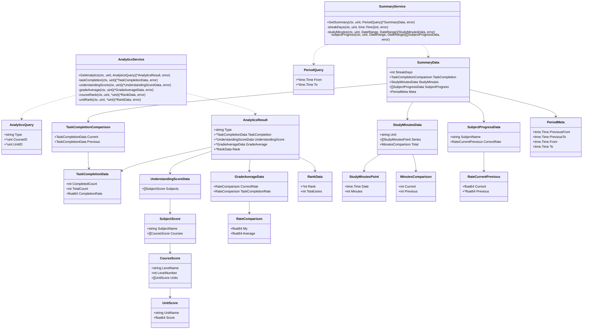
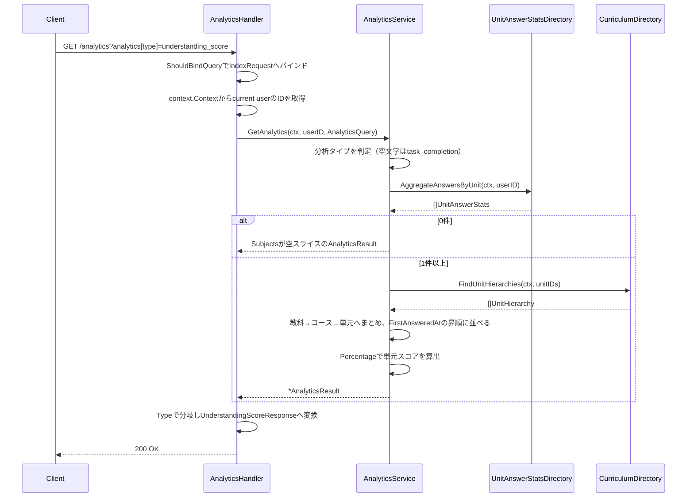
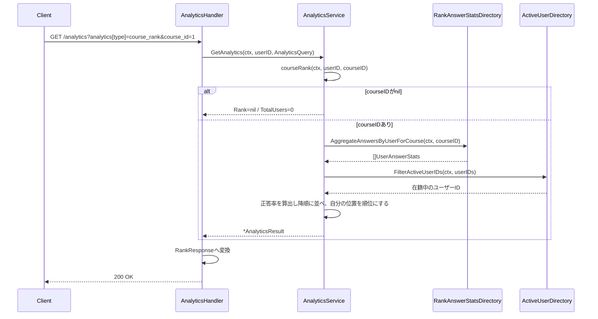
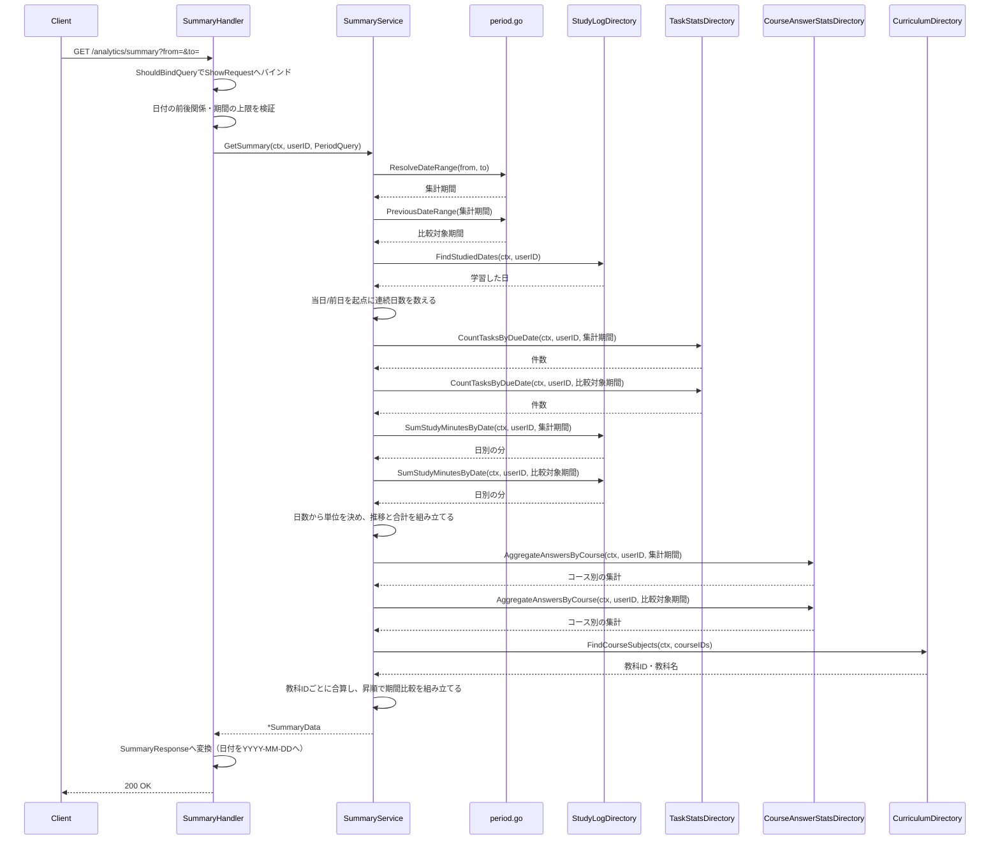
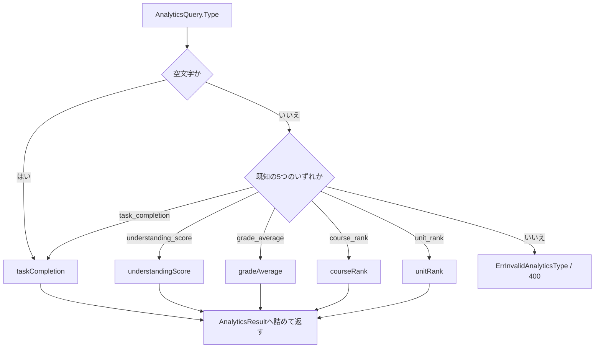
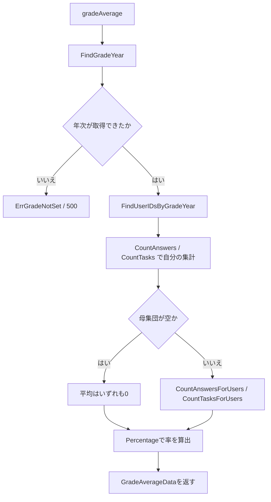
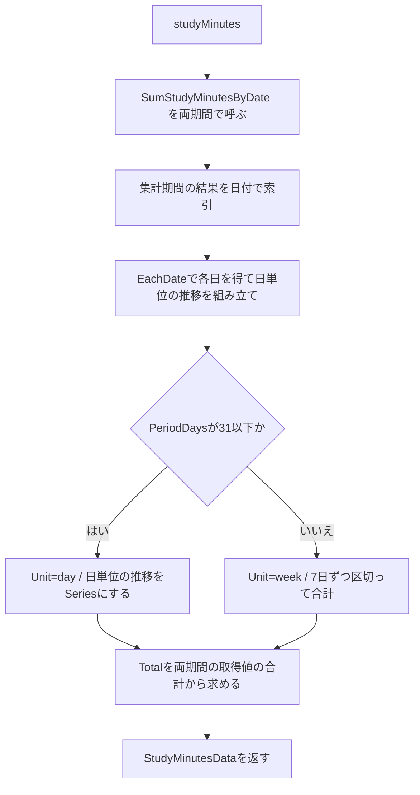

# 分析機能 Go実装仕様書（2. 分析取得・期間サマリ）

---

# 1. 機能概要

## 機能概要

本書は分析機能の2つのエンドポイントを担当する（②「19. API仕様」）。

- `GET /api/v1/student/analytics`: 分析タイプを1つ指定し、その指標を生徒の全期間の実績から集計して返す
- `GET /api/v1/student/analytics/summary`: 指定期間とその直前の同じ長さの期間を比較できる形で、継続日数・タスク達成率・学習時間・教科別正答率をまとめて返す

## 採用設計パターンとその理由

**Transaction Script**（②「4. 設計パターン」）。理由は`分析機能_Go実装仕様書_1_基盤.md`「1. 機能概要」に記載のとおりである。

## 本書が対象とする実装範囲

- application層の業務操作の関数（分析タイプの判定と5つの算出、期間サマリの取りまとめと3つの算出）
- Presentation層（Handler 2つ・Request DTO 2つ・Response DTO 2ファイル）
- 上記に対するAPI仕様とテストケース

`dependency.go`のインターフェース・`infrastructure/contextadapter/`のアダプタ・共通の算出関数（`period.go`・`rate.go`）・ルーティング・Transaction / Validation / Authorization / Errorの実装方針は基盤編に記載する。本書では繰り返さず参照する。

---

# 2. ディレクトリ構成

## 対象Bounded Context名

- `learning-analytics`（②「3. Bounded Context」）。ディレクトリは`internal/learninganalytics/`、package名は`learninganalytics`

機能全体のファイル一覧と担当文書の対応は基盤編「2. ディレクトリ構成」に記載する。

## ②で採用した設計パターン

Transaction Script（②「4. 設計パターン」）

## 本書が担当するファイル一覧

```
internal/learninganalytics/application/get_analytics.go               # 分析タイプの判定と算出への分岐
internal/learninganalytics/application/task_completion.go             # task_completionの算出
internal/learninganalytics/application/understanding_score.go         # understanding_scoreの算出
internal/learninganalytics/application/grade_average.go               # grade_averageの算出
internal/learninganalytics/application/rank.go                        # course_rank / unit_rankの算出
internal/learninganalytics/application/get_summary.go                 # 期間サマリの取りまとめ
internal/learninganalytics/application/streak.go                      # 連続学習日数の算出
internal/learninganalytics/application/study_minutes.go               # 学習時間の推移と合計の算出
internal/learninganalytics/application/subject_progress.go            # 教科別正答率の算出
internal/learninganalytics/presentation/handler/analytics_handler.go
internal/learninganalytics/presentation/handler/summary_handler.go
internal/learninganalytics/presentation/request/analytics_request.go
internal/learninganalytics/presentation/request/summary_request.go
internal/learninganalytics/presentation/response/analytics_response.go
internal/learninganalytics/presentation/response/summary_response.go
```

実装15ファイル、テストが付くもの（application関数9・Handler2の11）を加えて26であり、1文書あたり30〜35という範囲に収まる。

Handlerは2つあるが、スライスに割るといずれもテスト込みで12〜14にとどまり小さすぎるため1つの文書にまとめている（基盤編「2. ディレクトリ構成」の「文書の分割」）。

---

# 3. Domain層設計

対象外（Transaction Script採用のため、Domain層を設けない）。詳細は基盤編「3. Domain層設計」に記載する。

本書で定義するセンチネルエラーは「14. Error実装方針」に記載する。

---

# 4. クラス図

本Contextのインターフェースと`AnalyticsService`・`SummaryService`の関係は基盤編「4. クラス図」に記載する。本書では両Serviceのメソッドと、application層で定義する出力用の型の関係を示す。



`AnalyticsResult`が4つのポインタと`Type`を持つ形にしているのは、分析タイプごとに出力の構造が異なるためである。`any`で返して呼び出し側で型アサーションする形（コーディング規約「14. `any`」）にしない。`Type`で分岐先が決まるため、Handlerが型アサーションの失敗を扱う必要がなくなる。

`TaskCompletionData`は`AnalyticsResult`と`TaskCompletionComparison`の両方から使う。`task_completion`の算出と期間サマリのタスク達成率が同じ構造を返すためである（①「5. API / 処理詳細」）。

---

# 5. 状態遷移図

省略する。理由は基盤編「5. 状態遷移図」に記載する。

---

# 6. Application層設計

本機能はTransaction Script採用のため、UseCase structを設けない。業務操作を関数として実装し、他Contextへの依存はコンストラクタで注入する`struct`のメソッドとして受け取る（基盤編「17. ②からの補足事項」1）。

## DTO（Command / Query）

|struct名|フィールド|区分|備考|
|-|-|-|-|
|`AnalyticsQuery`|`Type string`・`CourseID *uint`・`UnitID *uint`|Query|`Type`は空文字を許す（`task_completion`として扱う）。`CourseID`・`UnitID`は未指定を`nil`で表す|
|`PeriodQuery`|`From *time.Time`・`To *time.Time`|Query|未指定を`nil`で表す。値は日本時間の暦日（基盤編「8. Infrastructure層設計」の`DateRange`と同じ表現）|
|`AnalyticsResult`|`Type string`・`TaskCompletion *TaskCompletionData`・`UnderstandingScore *UnderstandingScoreData`・`GradeAverage *GradeAverageData`・`Rank *RankData`|出力|`Type`に対応する1つのフィールドのみが非`nil`になる|
|`SummaryData`|「4. クラス図」のとおり|出力||

出力の型をPresentation層のResponse DTOと分けるのは、application層の型がJSONのキー名・日付の表現形式といったHTTPの関心を持たないためである（アーキテクチャ規約「6. データフロー」）。

## 関数

### GetAnalytics（`application/get_analytics.go`）

|項目|内容|
|-|-|
|メソッド|`(s *AnalyticsService) GetAnalytics(ctx context.Context, userID uint, q AnalyticsQuery) (*AnalyticsResult, error)`|
|受け取る依存|`TaskStatsDirectory`・`AnswerRateDirectory`・`UnitAnswerStatsDirectory`・`RankAnswerStatsDirectory`・`CurriculumDirectory`・`GradeDirectory`・`ActiveUserDirectory`|

分析タイプの定数:

```
AnalyticsTypeTaskCompletion     = "task_completion"
AnalyticsTypeUnderstandingScore = "understanding_score"
AnalyticsTypeGradeAverage       = "grade_average"
AnalyticsTypeCourseRank         = "course_rank"
AnalyticsTypeUnitRank           = "unit_rank"
```

コーディング規約「3. 命名規則」の「定数のグループ化と `iota`」に従い、文字列定数をグループ化して宣言する。`iota`は使わない。値がAPIのクエリパラメータとして外部に露出する文字列であり、順序に意味がないためである。

処理ステップ:

1. `q.Type`が空文字の場合は`AnalyticsTypeTaskCompletion`として扱う（①「5. API / 処理詳細」`#index`）
2. 分析タイプで分岐し、対応する非公開メソッドを呼ぶ
3. 既知の5つのいずれでもない場合は、指定値を含めた`ErrInvalidAnalyticsType`を返す（ガード節）
4. 算出結果を`AnalyticsResult`へ詰め、`Type`に確定した分析タイプを入れて返す

トランザクションは使用しない（基盤編「11. Transaction実装方針」）。

### taskCompletion（`application/task_completion.go`）

|項目|内容|
|-|-|
|メソッド|`(s *AnalyticsService) taskCompletion(ctx context.Context, userID uint) (*TaskCompletionData, error)`|
|共通関数|`newTaskCompletionData(stats learninganalytics.TaskCountStats) TaskCompletionData`|

処理ステップ:

1. `TaskStatsDirectory.CountTasks`で全期間のタスクの総件数と完了件数を取得する
2. `newTaskCompletionData`で`TaskCompletionData`を組み立てて返す

`newTaskCompletionData`は`CompletionRate`を`Percentage(stats.Completed, stats.Total)`で求める。期間サマリのタスク達成率も同じ関数を使う。率の算出式と丸めを1箇所に保つためである（②「7. Value Object設計」）。

タスクが0件の場合、件数は`0`、達成率は`0`となる。エラーにしない（①「5. API / 処理詳細」`task_completion`）。

### understandingScore（`application/understanding_score.go`）

|項目|内容|
|-|-|
|メソッド|`(s *AnalyticsService) understandingScore(ctx context.Context, userID uint) (*UnderstandingScoreData, error)`|

処理ステップ:

1. `UnitAnswerStatsDirectory.AggregateAnswersByUnit`で、コースIDと単元IDの組ごとの解答数・正答数と、その組で最初に解答した日時を取得する
2. 結果が空の場合、`Subjects`が空スライス（`nil`ではない）の`UnderstandingScoreData`を返す。`nil`スライスはJSONで`null`になり、Rails現行の`[]`と異なるため（①「5. API / 処理詳細」`understanding_score`）
3. 取得した組から単元IDを重複なく集め、`CurriculumDirectory.FindUnitHierarchies`で階層と名称を取得する
4. 階層を単元IDで索引する。階層が引けなかった単元の集計は結果に含めない（基盤編「17. ②からの補足事項」4）
5. 教科 → コース → 単元の3階層へまとめる。各階層には、その階層に属する集計の`FirstAnsweredAt`の最小値を並び順の鍵として保持する
6. 各階層を並び順の鍵の昇順で並べる。鍵が同値の場合は教科ID・コースID・単元IDの昇順で並べる（②「19. API仕様」の「Railsとの差分」1）
7. 単元の`Score`を`Percentage(Correct, Total)`で求める
8. `UnderstandingScoreData`を組み立てて返す

同値の場合にIDの昇順で並べるのは、同じ入力に対して常に同じ順序を返すためである。Rails現行は並び順を保証していない（②「19. API仕様」）。

### gradeAverage（`application/grade_average.go`）

|項目|内容|
|-|-|
|メソッド|`(s *AnalyticsService) gradeAverage(ctx context.Context, userID uint) (*GradeAverageData, error)`|

処理ステップ:

1. `GradeDirectory.FindGradeYear`で生徒の学年の年次を取得する
2. `nil`の場合は`ErrGradeNotSet`を返す（ガード節）
3. `GradeDirectory.FindUserIDsByGradeYear`で同じ年次に属するユーザーIDを取得する
4. `AnswerRateDirectory.CountAnswers`で生徒自身の解答数・正答数を取得する
5. `TaskStatsDirectory.CountTasks`で生徒自身のタスク件数・完了件数を取得する
6. ユーザーIDが空の場合、平均はいずれも`0`とし、7・8を呼ばない（基盤編「17. ②からの補足事項」5）
7. `AnswerRateDirectory.CountAnswersForUsers`で母集団の解答数・正答数の合計を取得する
8. `TaskStatsDirectory.CountTasksForUsers`で母集団のタスク件数・完了件数の合計を取得する
9. それぞれ`Percentage`で率を求め、`GradeAverageData`を組み立てて返す

母集団の平均を、集団全体の合計から求めている点に注意する。生徒ごとの率を平均したものではない（①「5. API / 処理詳細」`grade_average`）。手順7・8で合計を受け取ってから率にすることでこの定義を満たす。

母集団には生徒自身も含まれる。`FindUserIDsByGradeYear`の結果から自分を除外しない（同）。

### courseRank / unitRank（`application/rank.go`）

|項目|内容|
|-|-|
|メソッド|`(s *AnalyticsService) courseRank(ctx context.Context, userID uint, courseID *uint) (*RankData, error)`|
||`(s *AnalyticsService) unitRank(ctx context.Context, userID uint, unitID *uint) (*RankData, error)`|
||`(s *AnalyticsService) rankFrom(ctx context.Context, userID uint, stats []learninganalytics.UserAnswerStats) (*RankData, error)`|

`courseRank`の処理ステップ:

1. `courseID`が`nil`の場合、`Rank`が`nil`・`TotalUsers`が`0`の`RankData`を返す。参照手段を呼ばない（ガード節）
2. `RankAnswerStatsDirectory.AggregateAnswersByUserForCourse`でユーザーごとの解答数・正答数を取得する
3. `rankFrom`へ渡す

`unitRank`は手順2で`AggregateAnswersByUserForUnit`を呼ぶ点だけが異なる。

`rankFrom`の処理ステップ:

1. `stats`が空の場合、`Rank`が`nil`・`TotalUsers`が`0`の`RankData`を返す
2. `stats`からユーザーIDを集め、`ActiveUserDirectory.FilterActiveUserIDs`で在籍中のものへ絞り込む
3. 在籍中のユーザーの集計のみを残す
4. 残った集計それぞれについて`Percentage(Correct, Total)`で正答率を求める
5. 正答率の降順に並べる。同値の場合はユーザーIDの昇順で並べる
6. 操作者のユーザーIDが並びの中にあれば、その位置（0起点）に1を足した値を`Rank`とする。なければ`Rank`は`nil`
7. `TotalUsers`は残った集計の件数とする

`courseID`が`nil`のときに参照手段を呼ばないのは、Rails現行が「対象が指定されていなければ母集団0人」として振る舞うためである（①「5. API / 処理詳細」`course_rank` / `unit_rank`）。条件なしで問い合わせると全コースの集計になってしまう。

同値の場合にユーザーIDの昇順で並べるのは、同じ入力に対して常に同じ順位を返すためである。Rails現行は同率を同順位として扱わず、並べた結果の位置がそのまま順位になるが、同値の順序は保証されていない（②「19. API仕様」の「変更しないもの」）。同率を同順位にする変更は行わない。

### GetSummary（`application/get_summary.go`）

|項目|内容|
|-|-|
|メソッド|`(s *SummaryService) GetSummary(ctx context.Context, userID uint, q PeriodQuery) (*SummaryData, error)`|
|受け取る依存|`StudyLogDirectory`・`TaskStatsDirectory`・`CourseAnswerStatsDirectory`・`CurriculumDirectory`|

処理ステップ:

1. `ResolveDateRange(q.From, q.To)`で集計期間を確定する（基盤編「6. Application層設計」）
2. `PreviousDateRange`で比較対象期間を導出する
3. `streakDays`で連続学習日数を求める。起点となる「今日」は日本時間の今日を渡す
4. `TaskStatsDirectory.CountTasksByDueDate`を集計期間・比較対象期間の順に呼び、それぞれ`newTaskCompletionData`で`TaskCompletionData`へ変換する
5. `studyMinutes`で学習時間の単位・推移・合計を求める
6. `subjectProgress`で教科別正答率を求める
7. `PeriodMeta`に集計期間・比較対象期間を詰め、`SummaryData`を組み立てて返す

連続学習日数に集計期間を渡さないのは、Rails現行が期間を無視して常に当日基準で算出するためである（②「19. API仕様」の「変更しないもの」）。

トランザクションは使用しない（基盤編「11. Transaction実装方針」）。

### streakDays（`application/streak.go`）

|項目|内容|
|-|-|
|メソッド|`(s *SummaryService) streakDays(ctx context.Context, userID uint, today time.Time) (int, error)`|

処理ステップ:

1. `StudyLogDirectory.FindStudiedDates`で学習した日を取得する
2. 日付を集合（`map[string]struct{}`）へ入れる。キーは日本時間の暦日を`2006-01-02`で整形した文字列とする
3. `today`が集合にあれば`today`、なければ`today`の前日が集合にあれば前日を起点とする。どちらにもなければ`0`を返す
4. 起点から1日ずつ過去へさかのぼり、集合に含まれる限り日数を数える
5. 数えた日数を返す

`today`を引数で受け取るのは、当日起点・前日起点・途切れる位置といった境界条件をテストで固定するためである。関数内で`time.Now()`を呼ばない。

集合のキーに`time.Time`を直接使わない。`time.Time`はロケーション等の内部状態を含む構造体であり、同じ暦日でも内部表現が異なればマップのキーとして一致しない（コーディング規約「17. `time.Time` とタイムゾーン」の「時刻の比較」）。`2006-01-02`で整形した文字列をキーにすることで、アダプタが返す値の内部状態に依存せず判定できる。さかのぼる際の前日の算出は`AddDate(0, 0, -1)`で行い、整形してから集合を引く。

### studyMinutes（`application/study_minutes.go`）

|項目|内容|
|-|-|
|メソッド|`(s *SummaryService) studyMinutes(ctx context.Context, userID uint, current, previous learninganalytics.DateRange) (StudyMinutesData, error)`|
|定数|`StudyMinutesUnitDay = "day"`・`StudyMinutesUnitWeek = "week"`・`DailyMaxDays = 31`・`WeekDays = 7`|

処理ステップ:

1. `StudyLogDirectory.SumStudyMinutesByDate`を集計期間・比較対象期間の順に呼ぶ
2. 集計期間の結果を日付で索引する。キーは`streakDays`と同じく暦日を`2006-01-02`で整形した文字列とする（コーディング規約「17. `time.Time` とタイムゾーン」）
3. `EachDate(current)`で集計期間の各日を得て、索引にない日は0分として日単位の推移を組み立てる
4. `PeriodDays(current)`が`DailyMaxDays`以下なら`Unit`を`StudyMinutesUnitDay`とし、日単位の推移をそのまま`Series`とする
5. 超える場合は`Unit`を`StudyMinutesUnitWeek`とし、日単位の推移を先頭から`WeekDays`日ずつ区切って合計する。各区切りの`Date`は区切りの先頭日とする。最後の区切りは`WeekDays`日未満になりうる
6. `Total.Current`は集計期間に取得した分の合計、`Total.Previous`は比較対象期間に取得した分の合計とする
7. `StudyMinutesData`を返す

`Series`は常に非`nil`のスライスとする。学習ログが1件もない期間でも、各日が0分の要素として並ぶ（①「5. API / 処理詳細」`study_minutes`）。

`Total`は推移の合計ではなく、参照手段が返した値の合計から求める。集計期間については両者が一致するが、比較対象期間については推移を組み立てないため、参照手段の結果から直接合計する必要がある。

### subjectProgress（`application/subject_progress.go`）

|項目|内容|
|-|-|
|メソッド|`(s *SummaryService) subjectProgress(ctx context.Context, userID uint, current, previous learninganalytics.DateRange) ([]SubjectProgressData, error)`|

処理ステップ:

1. `CourseAnswerStatsDirectory.AggregateAnswersByCourse`を集計期間・比較対象期間の順に呼ぶ
2. 集計期間の結果が空の場合、空スライス（`nil`ではない）を返す。比較対象期間の問い合わせは手順1で済んでいるが、結果は使わない
3. 両期間の結果からコースIDを重複なく集め、`CurriculumDirectory.FindCourseSubjects`で所属教科を取得する
4. 教科をコースIDで索引する。教科が引けなかったコースの集計は結果に含めない（基盤編「17. ②からの補足事項」4）
5. 両期間について、教科IDごとに解答数・正答数を合算する
6. 集計期間に解答履歴のある教科のみを、教科IDの昇順で並べる
7. 各教科の`CorrectRate.Current`を`Percentage`で求める。比較対象期間に同じ教科の解答履歴があれば`CorrectRate.Previous`にその率へのポインタを入れ、なければ`nil`とする
8. `[]SubjectProgressData`を返す

比較対象期間の突き合わせを教科IDで行う。Rails現行は教科名で突き合わせているため、同名の教科が複数存在すると比較値が取り違えられる。教科IDで突き合わせても、教科名が一意である通常のデータでは結果が変わらない（**②からの補足**。「17. ②からの補足事項」参照）。

`CorrectRate.Previous`を`*float64`にしているのは、比較対象期間に履歴のない教科で`null`を返す必要があるためである（①「5. API / 処理詳細」`subject_progress`）。`0`を返すと「正答率0%」と区別できない。

---

# 7. シーケンス図・処理フロー図

## シーケンス図

### GetAnalytics（`understanding_score`）



### GetAnalytics（`course_rank`）



### GetSummary



## 処理フロー図

### 分析タイプの判定



### gradeAverage



### studyMinutes



---

# 8. Infrastructure層設計

対象外。本書が担当するInfrastructure層の実装はない。

`dependency.go`のインターフェース・受け渡し用の型・`infrastructure/contextadapter/`の5つのアダプタ・`context.go`は、いずれも基盤編「8. Infrastructure層設計」に記載する。

---

# 9. Presentation層設計

## Handler

### AnalyticsHandler（`presentation/handler/analytics_handler.go`）

|項目|内容|
|-|-|
|struct名|`AnalyticsHandler`|
|対応する呼び出し先|`*application.AnalyticsService`（Transaction Script採用のためUseCaseを経由しない）|
|保持するフィールド|`analyticsService *application.AnalyticsService`|
|コンストラクタ|`NewAnalyticsHandler(analyticsService *application.AnalyticsService) *AnalyticsHandler`|
|メソッド|`Index(c *gin.Context)`（GET `/api/v1/student/analytics`）|

`Index`の処理順序:

1. `IndexRequest`へ`ShouldBindQuery`でバインドする。失敗した場合は`c.Error`にバリデーションエラーを積んで戻る（Gin規約「6. Model BindingとValidation」）
2. `Type`が`nil`の場合は「分析タイプを指定してください」のバリデーションエラーを`c.Error`に積んで戻る（400）
3. `context.Context`から操作者のユーザーIDを取り出す。リクエストから受け取らない（②「16. Authorization設計」）
4. `AnalyticsQuery`を組み立て、`analyticsService.GetAnalytics`を呼ぶ
5. エラーの場合は`c.Error(err)`を呼んで戻る。ステータスとレスポンス本文への変換は`ErrorHandler`が行う（Gin規約「8. エラーハンドリングミドルウェア」）
6. `AnalyticsResult.Type`で分岐し、対応するResponse DTOへ変換する
7. `200`で返す

手順6で`Type`による分岐を行い、型アサーションを使わない。`AnalyticsResult`が`Type`と4つのポインタを持つ形にしているためである（「4. クラス図」）。`Type`に対応するポインタが`nil`だった場合は、実装の不整合であり`500`とする（起こりえない経路だが、`nil`参照でpanicさせない）。

### SummaryHandler（`presentation/handler/summary_handler.go`）

|項目|内容|
|-|-|
|struct名|`SummaryHandler`|
|対応する呼び出し先|`*application.SummaryService`|
|保持するフィールド|`summaryService *application.SummaryService`|
|コンストラクタ|`NewSummaryHandler(summaryService *application.SummaryService) *SummaryHandler`|
|メソッド|`Show(c *gin.Context)`（GET `/api/v1/student/analytics/summary`）|

`Show`の処理順序:

1. `ShowRequest`へ`ShouldBindQuery`でバインドする。日付の形式はバリデーションタグで検証する
2. バインドに失敗した場合は`c.Error`にバリデーションエラーを積んで戻る（422）
3. 指定された`from`・`to`を日本時間の日付へ解釈する
4. 両方が指定されている場合、`from`が`to`より後であればバリデーションエラーを積んで戻る（422）
5. 両方が指定されている場合、期間の日数（両端を含む）が`MaxRangeDays`を超えればバリデーションエラーを積んで戻る（422）
6. `context.Context`から操作者のユーザーIDを取り出す
7. `PeriodQuery`を組み立て、`summaryService.GetSummary`を呼ぶ
8. エラーの場合は`c.Error(err)`を呼んで戻る
9. `SummaryResponse`へ変換する。日付は`YYYY-MM-DD`形式の文字列にする
10. `200`で返す

手順4・5をバリデーションタグではなくHandlerで行うのは、複数フィールドにまたがる判定であり`binding`タグで表せないためである。`c.Error`は1回だけ呼ぶ（Gin規約「8. エラーハンドリングミドルウェア」の「`c.Errors`に複数のエラーが蓄積される場合」）。複数の検証に失敗した場合の扱いは「14. Error実装方針」に記載する。

既定値の補完（`from`・`to`の省略）はHandlerで行わず、application層の`ResolveDateRange`に任せる。既定値は検証ではなく業務上の既定であり、「今日」の判定を含むためである（②「23. Railsとの責務対応」）。

## Request / Response DTO

### IndexRequest（`presentation/request/analytics_request.go`）

|フィールド|型|タグ|チェック内容|
|-|-|-|-|
|`Type`|`*string`|`form:"analytics[type]"`|未指定（`nil`）はHandlerで400にする。空文字は許す|
|`CourseID`|`*uint`|`form:"course_id"`|指定された場合は符号なし整数として解釈できること|
|`UnitID`|`*uint`|`form:"unit_id"`|指定された場合は符号なし整数として解釈できること|

`Type`を`*string`にしているのは、クエリキーが存在しない場合（`nil`）と、存在して空文字の場合を区別するためである。Rails現行は`analytics`オブジェクト自体がなければ必須パラメータ不足として`400`、あって`type`が空文字なら`task_completion`として扱う（①「5. API / 処理詳細」`#index`）。

クエリタグに`analytics[type]`という角括弧付きのキーをそのまま指定する。Ginのクエリバインドはクエリ文字列のキーをそのまま照合するため、Railsの入れ子パラメータの形式を変えずに受け取れる（**②からの補足**。「17. ②からの補足事項」参照）。

`CourseID`・`UnitID`を`*uint`にしているのは、未指定を`nil`で表すためである。`0`を既定値にすると「コースID 0を指定した」と区別できない。

### ShowRequest（`presentation/request/summary_request.go`）

|フィールド|型|タグ|チェック内容|
|-|-|-|-|
|`From`|`string`|`form:"from" binding:"omitempty,datetime=2006-01-02"`|指定された場合は`YYYY-MM-DD`形式かつ実在する日付|
|`To`|`string`|`form:"to" binding:"omitempty,datetime=2006-01-02"`|同|

`datetime`タグは形式と実在性の両方を検証する。`2026-09-99`のような実在しない日付も弾かれる（①「5. API / 処理詳細」`#show`のErrorケース）。

`*time.Time`ではなく`string`で受け取るのは、不正な日付に対してバインドの段階でエラーメッセージを制御するためである。`time.Time`へのバインドが失敗した場合、Ginが返すエラーからフィールド名とRails現行の文言を組み立てづらい。

### AnalyticsIndexResponse（`presentation/response/analytics_response.go`）

分析タイプごとに4つのResponse DTOを定義する。いずれもenvelopeを持たず、JSONオブジェクトをそのまま返す（アーキテクチャ規約「15. API規約（レスポンス形式・ページネーション・URL・クエリパラメータ）」の「単体」）。

|struct名|フィールド|JSONキー|型|
|-|-|-|-|
|`TaskCompletionResponse`|`CompletedCount`|`completed_count`|`int`|
||`TotalCount`|`total_count`|`int`|
||`CompletionRate`|`completion_rate`|`float64`|
|`UnderstandingScoreResponse`|`Subjects`|`subjects`|`[]SubjectResponse`|
|`SubjectResponse`|`SubjectName`|`subject_name`|`string`|
||`Courses`|`courses`|`[]CourseResponse`|
|`CourseResponse`|`LevelName`|`level_name`|`string`|
||`LevelNumber`|`level_number`|`int`|
||`Units`|`units`|`[]UnitResponse`|
|`UnitResponse`|`UnitName`|`unit_name`|`string`|
||`Score`|`score`|`float64`|
|`GradeAverageResponse`|`CorrectRate`|`correct_rate`|`RateComparisonResponse`|
||`TaskCompletionRate`|`task_completion_rate`|`RateComparisonResponse`|
|`RateComparisonResponse`|`My`|`my`|`float64`|
||`Average`|`average`|`float64`|
|`RankResponse`|`Rank`|`rank`|`*int`|
||`TotalUsers`|`total_users`|`int`|

`RankResponse.Rank`を`*int`にしているのは、順位が該当なしのとき`null`を返す必要があるためである（①「5. API / 処理詳細」`course_rank` / `unit_rank`）。

スライスのフィールドは`nil`のままJSON化すると`null`になる。`subjects`・`courses`・`units`はいずれも空配列`[]`で返す必要があるため、変換時に`nil`なら空スライスを入れる。

### SummaryResponse（`presentation/response/summary_response.go`）

|struct名|フィールド|JSONキー|型|
|-|-|-|-|
|`SummaryResponse`|`StreakDays`|`streak_days`|`int`|
||`TaskCompletion`|`task_completion`|`TaskCompletionComparisonResponse`|
||`StudyMinutes`|`study_minutes`|`StudyMinutesResponse`|
||`SubjectProgress`|`subject_progress`|`[]SubjectProgressResponse`|
||`Meta`|`meta`|`PeriodMetaResponse`|
|`TaskCompletionComparisonResponse`|`Current`|`current`|`TaskCompletionResponse`|
||`Previous`|`previous`|`TaskCompletionResponse`|
|`StudyMinutesResponse`|`Unit`|`unit`|`string`|
||`Series`|`series`|`[]StudyMinutesPointResponse`|
||`Total`|`total`|`MinutesComparisonResponse`|
|`StudyMinutesPointResponse`|`Date`|`date`|`string`（`YYYY-MM-DD`）|
||`Minutes`|`minutes`|`int`|
|`MinutesComparisonResponse`|`Current`|`current`|`int`|
||`Previous`|`previous`|`int`|
|`SubjectProgressResponse`|`SubjectName`|`subject_name`|`string`|
||`CorrectRate`|`correct_rate`|`RateCurrentPreviousResponse`|
|`RateCurrentPreviousResponse`|`Current`|`current`|`float64`|
||`Previous`|`previous`|`*float64`|
|`PeriodMetaResponse`|`PreviousFrom`|`previous_from`|`string`（`YYYY-MM-DD`）|
||`PreviousTo`|`previous_to`|`string`|
||`From`|`from`|`string`|
||`To`|`to`|`string`|

`TaskCompletionResponse`は`GET /analytics`の`task_completion`と共用する。同じ構造を返すためである。

日付はいずれも`YYYY-MM-DD`形式の文字列として返す。`time.Time`をそのままJSON化するとRFC3339形式になり、Rails現行と異なる（①「5. API / 処理詳細」`#show`）。変換はResponse DTOへの変換時に行う。

`series`・`subject_progress`は`nil`のままJSON化すると`null`になるため、変換時に`nil`なら空スライスを入れる。

`meta`のフィールド順を`previous_from` → `previous_to` → `from` → `to`としているのは、Rails現行の順序に合わせたものである。JSONオブジェクトのキー順に意味はないが、差分を比較しやすくするために揃える。

## Routing

基盤編「9. Presentation層設計」に記載する。

---

# 10. API仕様

|Method|Path|Handler|Request|Response|Status Code|
|-|-|-|-|-|-|
|GET|`/api/v1/student/analytics`|`AnalyticsHandler.Index`|`analytics[type]`（必須）・`course_id`・`unit_id`|分析タイプごとに4種（`TaskCompletionResponse` / `UnderstandingScoreResponse` / `GradeAverageResponse` / `RankResponse`）|200 / 400 / 422 / 500 / 401 / 403|
|GET|`/api/v1/student/analytics/summary`|`SummaryHandler.Show`|`from`・`to`（いずれも任意）|`SummaryResponse`|200 / 422 / 500 / 401 / 403|

## `GET /api/v1/student/analytics` のErrorケース

|条件|Status Code|Error内容|
|-|-|-|
|`analytics[type]`のキーが存在しない|400|`{"errors": ["分析タイプを指定してください"]}`|
|既知でない分析タイプを指定した|400|`{"errors": ["指定された分析タイプ（{指定値}）は存在しません。"]}`|
|`course_id`・`unit_id`が符号なし整数として解釈できない|422|`{"errors": ["コースの指定が不正です"]}` / `{"errors": ["単元の指定が不正です"]}`|
|`grade_average`で生徒に学年が設定されていない|500|`{"errors": ["internal server error"]}`|
|他Contextの参照手段の呼び出しに失敗|500|同|
|未認証|401|認証ミドルウェアの応答|
|`student`ロール以外|403|`{"errors": ["この操作を行う権限がありません"]}`|

## `GET /api/v1/student/analytics/summary` のErrorケース

|条件|Status Code|Error内容|
|-|-|-|
|`from`が`YYYY-MM-DD`形式でない、または実在しない日付|422|`{"errors": ["From は正しい日付を入力してください"], "fields": [...]}`|
|`to`が`YYYY-MM-DD`形式でない、または実在しない日付|422|`{"errors": ["To は正しい日付を入力してください"], "fields": [...]}`|
|`from`が`to`より後|422|`{"errors": ["To はfrom以降の日付を指定してください"], "fields": [...]}`|
|期間が366日を超える|422|`{"errors": ["取得期間は366日以内で指定してください"], "fields": [...]}`|
|他Contextの参照手段の呼び出しに失敗|500|`{"errors": ["internal server error"]}`|
|未認証|401|認証ミドルウェアの応答|
|`student`ロール以外|403|`{"errors": ["この操作を行う権限がありません"]}`|

メッセージの文言はRails現行を維持する（②「15. Validation設計」）。`From` / `To`が英語表記のままである点も維持する。

複数の検証に同時に失敗した場合の`errors`の扱いは「14. Error実装方針」に記載する。

---

# 11. Transaction実装方針

基盤編「11. Transaction実装方針」に記載する。本書の関数はいずれもトランザクションを使用しない。

---

# 12. Validation実装方針

方針は基盤編「12. Validation実装方針」に記載する。本書では本書が担当する検証内容を示す。

## Presentation

|フィールド|struct名|バリデーションタグ|エラーメッセージ|
|-|-|-|-|
|`Type`|`IndexRequest`|なし（`nil`判定をHandlerで行う）|分析タイプを指定してください|
|`CourseID`|`IndexRequest`|なし（`*uint`へのバインド失敗で検出）|コースの指定が不正です|
|`UnitID`|`IndexRequest`|なし（`*uint`へのバインド失敗で検出）|単元の指定が不正です|
|`From`|`ShowRequest`|`omitempty,datetime=2006-01-02`|From は正しい日付を入力してください|
|`To`|`ShowRequest`|`omitempty,datetime=2006-01-02`|To は正しい日付を入力してください|

`from`・`to`の前後関係と期間の上限は、複数フィールドにまたがるためタグで表せない。Handlerの処理順序4・5で判定する（「9. Presentation層設計」）。

バインド失敗時のGinのエラーから上表のメッセージへ変換する処理は、Request DTOごとに持つ。Gin規約「6. Model BindingとValidation」の`toValidationError`相当の変換をフィールド名で分岐させる。

## 業務ルール検証

Transaction Script採用のため、application関数内のガード節で検証する（アーキテクチャ規約「3. 設計パターンごとの構造適用方針」）。

|関数|ガード節|
|-|-|
|`GetAnalytics`|分析タイプが既知の5つのいずれでもない場合、`ErrInvalidAnalyticsType`を返す|
|`gradeAverage`|学年の年次が取得できない場合、`ErrGradeNotSet`を返す|
|`courseRank` / `unitRank`|対象IDが`nil`の場合、参照手段を呼ばず該当なしを返す（エラーにしない）|
|`understandingScore` / `subjectProgress`|集計結果が空の場合、参照手段の追加呼び出しを行わず空の結果を返す|

共通の算出関数（`ResolveDateRange`・`Percentage`）のガード節は基盤編「12. Validation実装方針」に記載する。

---

# 13. Authorization実装方針

基盤編「13. Authorization実装方針」に記載する。

本書のHandlerはいずれも、操作者のユーザーIDを`context.Context`から取り出してapplication層へ渡す。リクエストからユーザーIDを受け取らない。

`UserAnswerStats`・`FindUserIDsByGradeYear`の戻り値はResponse DTOへ出さない。順位と平均の算出にのみ使う（②「16. Authorization設計」）。

---

# 14. Error実装方針

方針は基盤編「14. Error実装方針」に記載する。本書で定義するセンチネルエラーと、複数メッセージの扱いを示す。

## 本書で定義するセンチネルエラー

|変数名|置き場所|意味|HTTP Status|
|-|-|-|-|
|`ErrInvalidAnalyticsType`|`application/get_analytics.go`|分析タイプが既知の5つのいずれでもない|400|
|`ErrGradeNotSet`|`application/grade_average.go`|生徒に学年が設定されていない|500|

`ErrInvalidAnalyticsType`は指定値をメッセージに含める必要があるため、センチネルエラーをそのまま返さず`fmt.Errorf`で包んで返す。`errors.Is`で判定できるよう`%w`を使う（コーディング規約「18. エラーハンドリング」）。`AppError`への変換時に、包んだ側のメッセージ（指定値を含む文言）をレスポンスの`errors`に載せる。

`ErrGradeNotSet`の`StatusCode`は500、`LogLevel`はエラーとする。Rails現行の振る舞いを維持しつつ、データ上の不備に気づけるようログへ残す（②「17. Error設計」）。

## 複数の検証に同時に失敗した場合

アーキテクチャ規約「12. Error変換パターン（AppError）」の「複数フィールドのバリデーションエラー」に従い、`ValidationError`（`AppError`と`FieldErrorer`を実装する型）を1つ作り、`Fields()`に失敗したフィールドすべてのメッセージを入れる。`c.Error`は1回だけ呼ぶ。

レスポンスの`errors`には、Gin規約「8. エラーハンドリングミドルウェア」の`ErrorHandler`が`appErr.Error()`の結果を1要素だけ入れる。そのため`ValidationError.Error()`は、最初に失敗した検証のメッセージを返すものとする。`fields`には全件が入る。

**Rails現行との差分**: Rails現行は`errors`に失敗したメッセージを全件並べる（①「5. API / 処理詳細」`#show`のErrorケース）。Go設計では`errors`が1要素、`fields`が全件となる。フロントエンドは422のとき`errors`を文字列の配列として受け取り、各要素をそのまま画面に表示する実装である（`useFetchAnalyticsSummary`）。そのため、複数の検証に同時に失敗したときに表示されるメッセージが1件に減る。1件のみ失敗した場合は表示が一致する。

この差分を解消するには、`errors`へ複数のメッセージを載せられるようGin規約「8. エラーハンドリングミドルウェア」の`ErrorHandler`と`apperror`を拡張する必要がある。規約に定めのない事項を本書で新設しないため、ここでは現行の規約どおりに実装し、拡張の是非は規約側で判断する（**②からの補足**。「17. ②からの補足事項」参照）。

なお、フロントエンドは不正な日付をクエリに含めずに送信する（`periodFromSearchParams`が形式を検証し、不正なら期間を既定値に戻す）。また`from`・`to`は常に両方そろえて送信するか、両方とも送信しない（`periodToSearchParams`）。そのため画面操作からこの差分に到達する経路は現時点では存在しない。

---

# 15. GORM / DBクエリ設計

対象外。基盤編「15. GORM / DBクエリ設計」に記載のとおり、本Contextが所有するテーブルはなく、GORMモデルもクエリも持たない。

---

# 16. テストケース設計

区分は②が採用した設計パターンに応じて読み替える。

## Domain Test

対象外（Transaction Script採用のため）。

## Application関数 Test

他Contextへの依存をテストダブルに差し替えて検証する。共通の算出関数（`ResolveDateRange`・`Percentage`）のテストは基盤編に記載する。

|対象|テストケース|
|-|-|
|`GetAnalytics`|`task_completion`・`understanding_score`・`grade_average`・`course_rank`・`unit_rank`がそれぞれ対応する算出へ分岐し、`AnalyticsResult.Type`に分析タイプが入る|
||`Type`が空文字のとき`task_completion`として扱われる|
||既知でない分析タイプのとき`ErrInvalidAnalyticsType`を返し、メッセージに指定値が含まれる|
||`errors.Is`で`ErrInvalidAnalyticsType`と判定できる|
||`AnalyticsResult`は`Type`に対応するフィールドのみが非`nil`になる|
|`taskCompletion`|件数と達成率を返す（1/2で50）|
||タスクが0件のとき件数0・達成率0を返す|
||`CountTasks`（期間指定なし）を呼ぶ。`CountTasksByDueDate`を呼ばない|
|`understandingScore`|教科 → コース → 単元の3階層にまとめる|
||単元スコアが正答率になる|
||解答履歴が0件のとき`Subjects`が空スライスになる（`nil`ではない）|
||階層が引けない単元の集計が結果に含まれない|
||各階層が最初に解答した順（`FirstAnsweredAt`の昇順）に並ぶ|
||`FirstAnsweredAt`が同値のとき教科ID・コースID・単元IDの昇順に並ぶ|
||同じコースに複数の単元があるとき、1つのコースの下にまとまる|
||同じ教科に複数のコースがあるとき、1つの教科の下にまとまる|
|`gradeAverage`|自分の正答率・タスク達成率を返す|
||学年平均が集団全体の合計から求められる（生徒ごとの率の平均ではない）|
||母集団が空のとき平均が0になり、`CountAnswersForUsers`・`CountTasksForUsers`を呼ばない|
||学年が未設定のとき`ErrGradeNotSet`を返す|
||母集団に自分が含まれる（`FindUserIDsByGradeYear`の結果から自分を除外しない）|
|`courseRank`|正答率の降順に並び、自分の位置が順位になる|
||自分が母集団にいないとき`Rank`が`nil`、`TotalUsers`が母集団の人数になる|
||`courseID`が`nil`のとき参照手段を呼ばず、`Rank`が`nil`・`TotalUsers`が0になる|
||母集団が0件のとき`Rank`が`nil`・`TotalUsers`が0になる|
||在籍していないユーザーが母集団と人数から除かれる|
||在籍の絞り込みで自分が除かれたとき`Rank`が`nil`になる|
||正答率が同率でも別の順位になる（同順位にしない）|
||同率のときユーザーIDの昇順に並ぶ|
|`unitRank`|`AggregateAnswersByUserForUnit`を呼ぶ。それ以外は`courseRank`と同じ|
|`GetSummary`|集計期間と比較対象期間が`meta`に入る|
||`CountTasksByDueDate`が集計期間・比較対象期間の2回呼ばれる|
||連続日数に集計期間を渡さない（期間を指定しても当日基準で算出される）|
||いずれかの参照手段が失敗した場合、エラーをそのまま返す（0として吸収しない）|
|`streakDays`|当日に学習があるとき当日を起点に数える|
||当日になく前日にあるとき前日を起点に数える|
||当日・前日のいずれにもないとき0を返す|
||連続が途切れた時点で止まる|
||同じ日に複数の学習ログがあっても1日として数える|
||ロケーションや時刻部分がそろっていない値が混ざっても連続が途切れない（暦日の文字列で突き合わせる）|
|`studyMinutes`|学習ログのない日が0分として推移に含まれる|
||期間の日数が31日のとき`Unit`が`day`になる|
||期間の日数が32日のとき`Unit`が`week`になる|
||週単位のとき7日ずつ区切られ、各区切りの`Date`が先頭日になる|
||期間の日数が7の倍数でないとき、最後の区切りが7日未満になる|
||`Total.Current`・`Total.Previous`がそれぞれの期間の合計になる|
||`Series`が`nil`にならない|
|`subjectProgress`|教科IDの昇順に並ぶ|
||同じ教科に属する複数のコースの集計が合算される|
||比較対象期間に履歴のない教科の`Previous`が`nil`になる|
||比較対象期間にしか履歴のない教科が結果に現れない|
||集計期間の履歴が0件のとき空スライスを返す（`nil`ではない）|
||教科が引けないコースの集計が結果に含まれない|
||比較対象期間の突き合わせが教科IDで行われる（同名の教科があっても取り違えない）|

## Repository Test

対象外（本Contextが所有するテーブルがないため）。

## アダプタ Test

基盤編「16. テストケース設計」に記載する。

## Handler Test

|対象|テストケース|
|-|-|
|`AnalyticsHandler.Index`|`analytics[type]`をクエリから受け取り、`AnalyticsQuery.Type`へ渡す|
||`analytics[type]`のキーがないとき400と「分析タイプを指定してください」を返す|
||`analytics[type]`が空文字のとき400にせず、application層へ空文字を渡す|
||`course_id`・`unit_id`を`*uint`として受け取り、未指定のとき`nil`を渡す|
||`course_id`が整数として解釈できないとき422を返す|
||操作者のユーザーIDを`context.Context`から取り出し、クエリから受け取らない|
||`Type`ごとに対応するResponse DTOへ変換する（4種すべて）|
||`rank`が該当なしのとき`null`で返る|
||`subjects`・`courses`・`units`が0件のとき`[]`で返る（`null`にしない）|
||application層のエラーを`c.Error`へ渡し、自身で`c.JSON`しない|
|`SummaryHandler.Show`|`from`・`to`をクエリから受け取り、`PeriodQuery`へ渡す|
||`from`・`to`を省略したとき`PeriodQuery`が`nil`を持つ（Handlerで既定値を補わない）|
||`from`が`2026-09-99`のとき422と「From は正しい日付を入力してください」を返す|
||`to`が`from`より前のとき422と「To はfrom以降の日付を指定してください」を返す|
||期間が367日のとき422と「取得期間は366日以内で指定してください」を返す|
||複数の検証に失敗したとき`c.Error`を1回だけ呼び、`fields`に全件が入る|
||日付が`YYYY-MM-DD`形式の文字列で返る（`series[].date`・`meta`の4項目）|
||`series`・`subject_progress`が0件のとき`[]`で返る|
||`subject_progress[].correct_rate.previous`が該当なしのとき`null`で返る|

## Integration Test

|対象|テストケース|
|-|-|
|`GET /analytics`|未認証のとき401|
||`teacher`ロールのとき403|
||5つの分析タイプがそれぞれ正しい構造で200を返す|
||既知でない分析タイプのとき400とRails現行の文言を返す|
||学年未設定の生徒が`grade_average`を要求したとき500|
||論理削除済みのタスクが`task_completion`の件数から除かれる|
||論理削除済みの解答履歴が`understanding_score`・`grade_average`・順位の集計に含まれる|
||順位の母集団から論理削除済みのユーザーが除かれる|
||学年平均の母集団に論理削除済みのユーザーが含まれる|
||学年平均の母集団に他校の同じ年次の生徒が含まれる|
|`GET /analytics/summary`|未認証のとき401|
||`teacher`ロールのとき403|
||`from`・`to`を省略したとき今日を終了日とする7日間になる|
||`from`・`to`を指定したとき`meta`が指定どおりになり、`previous_from`・`previous_to`が直前の同じ長さの期間になる|
||日本時間の0時台に開始した学習ログが、その日の学習として集計される|
||日本時間の23時台に開始した学習ログが、その日の学習として集計される|
||日本時間の0時台に解答した履歴が、その日の教科別正答率に集計される|
||日本時間の23時台に解答した履歴が、その日の教科別正答率に集計される|
||論理削除済みの学習ログが継続日数と学習時間から除かれる|
||期限日が未設定のタスクがタスク達成率の分母に含まれない|
||過去の期間を指定しても継続日数が当日基準で算出される|

日本時間の境界を結合テストで必ず確認するのは、UTC保存された日時と日本時間の日付の突き合わせが所有Context側の実装に委ねられており、テストダブルを使う単体テストでは検出できないためである（②「22. テスト戦略」）。

---

# 17. ②からの補足事項

基盤編「17. ②からの補足事項」に記載した6件に加え、本書で判断した内容を示す。

## 1. `analytics[type]`を角括弧付きのクエリタグで受け取る

- 判断した内容: `IndexRequest.Type`のタグを`form:"analytics[type]"`とし、Railsの入れ子パラメータの形式をそのまま受け取る
- 判断理由: Ginのクエリバインドはクエリ文字列のキーをそのまま照合するため、角括弧を含むキーも`form`タグに書けば受け取れる。URLを変えずにフロントエンドの送信内容（`analytics[type]=...`）を受け取れる。入れ子のstructとして表現する必要はない
- 推測かどうか: 推測ではない。Gin規約「6. Model BindingとValidation」の`form`タグの仕様の範囲である

## 2. `analytics`キーがあって`type`がない場合の扱い

- 判断した内容: `analytics[type]`のキーが存在しない場合は400とする。`analytics[other]=1`のように`analytics`配下の別のキーだけが送られた場合も400になる
- 判断理由: Rails現行は`analytics`オブジェクトの存在だけを必須とし、`type`がなければ`task_completion`として扱う（①「5. API / 処理詳細」`#index`）。Goでは`analytics`オブジェクトという単位を受け取らず`analytics[type]`というキーで受け取るため、この区別ができない。フロントエンドは常に`analytics[type]`を付けて送信するため（`app/api/student/analytics/route.ts`が`type`の既定値を`task_completion`として必ず設定する）、画面操作からこの差分に到達する経路は存在しない
- 推測かどうか: **②からの補足**。②に記載がないため、実装のために判断した

## 3. 比較対象期間の突き合わせを教科IDで行う

- 判断した内容: `subjectProgress`で、集計期間と比較対象期間の教科を教科IDで突き合わせる
- 判断理由: Rails現行は教科名で突き合わせており、同名の教科が複数存在すると比較値を取り違える。教科名が一意である通常のデータでは結果が変わらない。教科IDは参照手段から受け取っているため、追加の問い合わせも不要である
- 推測かどうか: **②からの補足**。②「19. API仕様」の「Railsとの差分」に挙げていないが、同名の教科が存在しない限りレスポンスは変わらないため、差分としては記載していない

## 4. 複数の検証に同時に失敗したときの`errors`が1要素になる

- 判断した内容: アーキテクチャ規約「12. Error変換パターン（AppError）」とGin規約「8. エラーハンドリングミドルウェア」のとおりに実装し、`errors`には最初に失敗した検証のメッセージのみを入れる。全件は`fields`に入れる
- 判断理由: 現行の規約の`ErrorHandler`は`appErr.Error()`の結果を`errors`の1要素として返す形であり、複数のメッセージを並べる仕組みがない。規約に定めのない事項を本書で新設しない（CLAUDE.md「規約が正本」）
- 推測かどうか: **②からの補足**。②「19. API仕様」はエラー本文の形式がRails現行と同じであるとしているが、複数メッセージの扱いまでは検討されていない。Rails現行は全件を`errors`に並べ、フロントエンドは各要素を画面に表示する。解消には規約側の拡張が必要であり、その是非は規約で判断する

## 5. `AnalyticsResult`で分析タイプごとの出力を表す

- 判断した内容: `GetAnalytics`の戻り値を`any`にせず、`Type`と4つのポインタを持つ`AnalyticsResult`とする
- 判断理由: `any`で返すとHandler側で型アサーションが必要になり、型が一致しない場合の扱いを書くことになる（コーディング規約「14. `any`」）。`Type`で分岐先が決まる形にすれば、分岐の網羅をコンパイラではなくテストで担保するだけで済む
- 推測かどうか: 推測ではない。規約に定めのない範囲での実装手段の選択である

## 6. 日本時間のロケーションの扱い

- 判断した内容: 日本時間のロケーションをプロセス起動時に一度解決し、「今日」の判定・日付の正規化で共有する
- 判断理由: 日付の判定を日本時間で行う必要がある（①「5. API / 処理詳細」`#show`）。`time.LoadLocation`を呼ぶたびに失敗の扱いを書くことになるため、起動時に一度解決する。パッケージレベルの可変変数は避ける（コーディング規約「4. パッケージ設計」）ため、設定値として読み込んで注入する形にする
- 推測かどうか: **②からの補足**。②にロケーションの解決方法の記載がないため、実装のために判断した。アプリケーション全体で共通の関心事であり、本機能固有の仕組みを設けない
