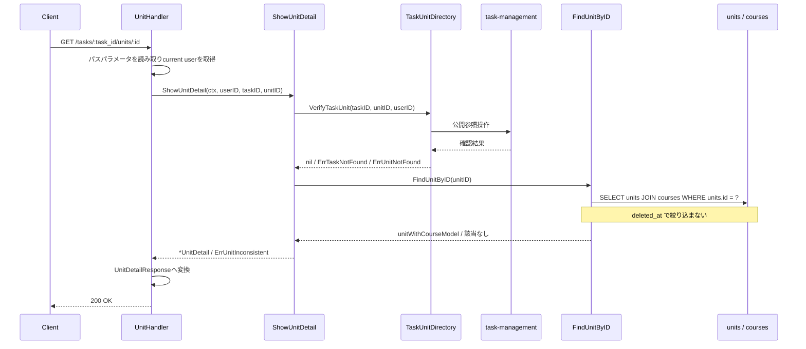

# 単元参照機能 Go実装仕様書

---

# 1. 機能概要

## 機能概要

生徒のタスクに紐づく単元の詳細を取得する参照機能である。単元の情報と、その所属コースの情報をあわせて返す（①「5. API / 処理詳細」`#show`）。

単元の詳細は**タスク配下でのみ取得できる**。タスクに属さない単元を単体で取得するエンドポイントは存在しない（同）。

**論理削除済みの単元・コースも取得できる。** `Unit`・`Course`はいずれも`active`という絞り込みを持つが`default_scope`を持たず、この機能では`active`を使っていない（同）。

## 採用設計パターンとその理由（②からの要約）

- 採用パターン: **Transaction Script**（②「4. 設計パターン」）
- 判断根拠: 単一の詳細取得のみで構成され、状態管理・業務ルールのいずれも存在しない。コース参照機能と`curriculum` Contextを共有する以上、採用パターンも揃える必要がある（規約「4. Bounded Context構成」の「1つのContextに複数の設計パターンが混在する場合」）
- 採用しなかったパターン: Active Record（作成・更新処理がないため）、Domain Model（状態も振る舞いも持たないマスタ参照データであるため）、Event Sourcing（履歴管理・監査要件がないため）

## 本書の位置づけ

`curriculum` Contextは**2つの機能文書が共有する**（②「3. Bounded Context」）。

|文書|担当|
|-|-|
|`コース参照機能_Go実装仕様書.md`|コース一覧のエンドポイント、**他Contextへ公開する5つの参照手段**、`context.go`・`dependency.go`・`routes.go`|
|`単元参照機能_Go実装仕様書.md`（本書）|単元詳細のエンドポイント（GET /api/v1/student/tasks/:task_id/units/:id）|

コース参照機能③が定めるもの（本書では繰り返さない）:

- ディレクトリ構成とContext全体のファイル一覧
- GORMモデルと検索関数（`infrastructure/gormquery/`）
- 他Contextへ公開する5つの参照手段
- `context.go`・`dependency.go`・`presentation/routes.go`

**実装の順序はコース参照機能③ → 本書とする。** 本書が使う検索関数（`FindUnitByID`）と、`dependency.go`・`routes.go`を同機能③が作成するためである。

## 本書が対象とする実装範囲

- 単元詳細のエンドポイントのApplication層（関数）
- `task-management`への参照（`dependency.go`へのインターフェースの追加と、そのアダプタ）
- 同Presentation層（Handler・Response DTO）
- 同API仕様・テストケース設計

---

# 2. ディレクトリ構成

## 対象Bounded Context名

- `curriculum`（②「3. Bounded Context」）

ディレクトリ名・package名はコース参照機能③「2. ディレクトリ構成」のとおり`internal/curriculum/`である。

## ②で採用した設計パターン

Transaction Script（②「4. 設計パターン」）

## 作成するディレクトリ一覧

本書が追加するのは`infrastructure/contextadapter/`のみである。

```
internal/curriculum/infrastructure/contextadapter/
```

**コース参照機能③は`infrastructure/contextadapter/`を作成しない。** 同機能は他Contextへの依存を持たないためである（同③「2. ディレクトリ構成」）。本機能は`task-management`への依存を持つため、本書が作成する。

その他のディレクトリはコース参照機能③が作成する。

## 作成するファイル一覧

本書が担当するものは以下の4である。

```
internal/curriculum/application/show_unit_detail.go                          # ShowUnitDetail
internal/curriculum/infrastructure/contextadapter/task_unit_directory.go     # TaskUnitDirectoryの実装
internal/curriculum/presentation/handler/unit_handler.go
internal/curriculum/presentation/response/unit_response.go
```

加えて、コース参照機能③が作成する`dependency.go`に`TaskUnitDirectory`のインターフェースを追加する。ファイルを共有するため、同機能③を先に実装する。

テストが付くのは`ShowUnitDetail`・アダプタ・Handlerの3であり、テスト込みで7となる。

**使うが本書では定義しない実装**:

|使う実装|定義元|
|-|-|
|`FindUnitByID`（単元と所属コースの1件取得）|コース参照機能③「8. Infrastructure層設計」|
|`unitModel`・`courseModel`（GORMモデル）|同「8. Infrastructure層設計」|
|`routes.go`（ルート登録）|同「9. Presentation層設計」|
|`context.go`（依存関係の組み立て）|同「8. Infrastructure層設計」|

## 文書の分割

行わない。Context全体の実装ファイルは19（コース参照機能③が15、本書が4）であり、テスト込みで30である。1文書あたり30〜35という範囲に収まる（コース参照機能③「2. ディレクトリ構成」）。

---

# 3. Domain層設計

対象外。

②「6. Entity設計」のとおり、Transaction Script採用であり独自のEntityを定義しない。コース参照機能③「3. Domain層設計」を参照。

## Entity

対象外。

②「6. Entity設計」が参照用として挙げるUnit・Courseは、検索結果を表す型として扱う。**項目はコース参照機能のものとは異なる。**

|型|項目|定義場所|
|-|-|-|
|本機能が返す単元|識別子・コースの識別子・単元名|`application/show_unit_detail.go`|
|本機能が返すコース|識別子・レベル番号・レベル名|同|

**`deleted_at`・`created_at`・`updated_at`を含めない。** `UnitSerializer`が返していないためである（①「5. API / 処理詳細」`#show`）。コース参照機能は`as_json`で全カラムを返すため3項目を含むが、本機能は含まない（②「6. Entity設計」）。

コースも3項目のみである。`subject_id`・`description`等を含めない（同）。

## Value Object

対象外。②「7. Value Object設計」のとおり、属性はいずれも単純な値である。

日付・日時はレスポンスに含まれないため、表示形式のルールも持たない。

## Repository Interface

対象外。Transaction Script採用のため、Repository Interfaceを定義しない。

**本書は`dependency.go`にインターフェースを1つ追加する。**

|インターフェース|相手Context|理由|
|-|-|-|
|`TaskUnitDirectory`|`task-management`|タスクと単元の紐づきの確認を委ねる（②「11. Repository設計」）|

コース参照機能③は`dependency.go`に他Contextへ渡す型のみを置き、インターフェースを持たない（同③「8. Infrastructure層設計」）。本書が初めてインターフェースを追加する形になる。

## Domain Service

対象外。②「8. Domain Service」のとおり、複数Entityを横断する業務ルールの判定が存在しない。

「タスクに紐づく単元か」の判定は`task-management`が行う。本Contextは判定しない。

## Domain Event

対象外。②「18. Domain Event」のとおり。

## Domain Error

対象外。`domain/`ディレクトリを作成しない（コース参照機能③「2. ディレクトリ構成」）。

本書が使うエラーは`application/show_unit_detail.go`に定義する。

|エラー|発生条件|HTTP Status|
|-|-|-|
|`ErrTaskNotFound`|対象のタスクが存在しない、または他の生徒のタスク|404（本文の名称は`タスク`）|
|`ErrUnitNotFound`|対象の単元がそのタスクに紐づかない|404（本文の名称は`Unit`）|
|`ErrUnitInconsistent`|紐づきの確認が済んだあとに単元が取得できない|500|

**タスクと単元を区別する。** 404の本文に入るモデル名が異なるためである（①「5. API / 処理詳細」`#show`）。`Task`は`タスク`と日本語になるが、`Unit`は訳が定義されていないため英語のまま出る。

`ErrUnitInconsistent`は他Contextとの不整合を示す。`task-management`が「紐づいている」と答えた単元が本Contextに存在しないことは、データの不整合であり利用者の入力の誤りではない（②「17. Error設計」）。

---

# 4. クラス図

②「9. クラス図」のとおり省略する。

本Contextが持つのは、マスタデータを読む関数群と読み取り専用の型のみである。Context全体の構成はコース参照機能③「4. クラス図」を参照。

参考として、本書が定義する型と関数は次のとおりである。

|種類|名前|役割|
|-|-|-|
|application層の関数|`ShowUnitDetail`|単元詳細の取得|
|型|`UnitDetail`|単元とコースの情報（`ShowUnitDetail`の戻り値）|
|インターフェース（`dependency.go`）|`TaskUnitDirectory`|`task-management`への参照手段|
|アダプタ|`taskUnitDirectory`|同インターフェースの実装|

---

# 5. 状態遷移図

②「10. 状態遷移図」のとおり省略する。

本Contextが扱うデータに状態が存在しない（①「7. 状態管理」）。

---

# 6. Application層設計

Transaction Script採用のため、UseCase structを設けない。②「12. UseCase設計」の業務操作をapplication層の関数として実装する。

## DTO（Command / Query）

入力のDTOは設けない。引数が3つであり、structにまとめる利点がない。

出力の型は以下である。

### UnitDetail（`application/show_unit_detail.go`）

|フィールド|型|意味|
|-|-|-|
|ID|uint|単元の識別子|
|CourseID|uint|コースの識別子|
|UnitName|string|単元名|
|Course|`CourseSummary`|所属コースの情報|

### CourseSummary（同ファイル）

|フィールド|型|意味|
|-|-|-|
|ID|uint|コースの識別子|
|LevelNumber|int|レベル番号|
|LevelName|string|レベル名|

**コース参照機能の`CourseWithUnits`・`UnitWithTimestamps`とは別の型である。** 同機能は`deleted_at`・`created_at`・`updated_at`を保持するが、本機能は保持しない（同③「6. Application層設計」）。同じテーブルを扱うが返す項目が違うため、型を共有しない。

`CourseSummary`という名前は、コース参照機能の型と衝突しないよう選んだ。同機能は`CourseWithUnits`である。

## 関数

### ShowUnitDetail（`application/show_unit_detail.go`）

|項目|内容|
|-|-|
|関数|`ShowUnitDetail(ctx context.Context, userID, taskID, unitID uint) (*UnitDetail, error)`|
|受け取る依存|`TaskUnitDirectory`、単元の1件取得の検索関数（`FindUnitByID`。コース参照機能③が定義する）|

処理ステップ:

1. `tasks.VerifyTaskUnit(ctx, taskID, unitID, userID)`で、タスクが操作者自身のものであり単元がそのタスクに紐づいているかを確認する
2. 失敗した場合、アダプタが返したエラーを`ErrTaskNotFound`または`ErrUnitNotFound`として返す（いずれも404。「14. Error実装方針」）
3. `FindUnitByID(ctx, unitID)`で単元と所属コースを取得する
4. 取得できなかった場合は`ErrUnitInconsistent`を返す（500）
5. `UnitDetail`へ変換して返す

**1を先に行う。** 確認が済むまで単元を読まない。他の生徒のタスクに紐づく単元を読むことを防ぐためである（②「12. UseCase設計」）。

4は通常起きない。1の確認が済んでいる以上、単元は存在するはずである。起きた場合は他Contextとの不整合であり、500として扱う（②「17. Error設計」）。

トランザクションは使用しない（②「14. Transaction設計」、「11. Transaction実装方針」）。

**論理削除を除外しない。** `FindUnitByID`がそのように実装されている（コース参照機能③「8. Infrastructure層設計」）。Rails現行も除外していない（①「5. API / 処理詳細」`#show`）。

---

# 7. シーケンス図・処理フロー図

## シーケンス図（ShowUnitDetail）



## 処理フロー図

②「13. シーケンス図・処理フロー図」のとおり省略する。

分岐は対象の確認の成否と、確認後に単元が取得できたかの2つのみであり、シーケンス図で十分に表現できる。

---

# 8. Infrastructure層設計

**実装上の位置づけ**: Transaction Script採用のため、Repository実装・Store実装のいずれも持たない。

## Repository実装（Domain Model / Event Sourcing採用時）

対象外。

## Store実装（Active Record採用時）

対象外。

## Infrastructure関数（Transaction Script採用時）

**本書では追加しない。** 本機能が使う`FindUnitByID`はコース参照機能③が定義する（同③「8. Infrastructure層設計」）。

|使う関数|引数|戻り値|発行するクエリ内容|
|-|-|-|-|
|`FindUnitByID`|`ctx context.Context, unitID uint`|`(*unitWithCourseModel, error)`|`id`で1件取得し、`courses`と結合してレベル番号・レベル名を得る。**`deleted_at`を条件に含めない**|

**タスクに紐づくかの条件を検索に含めない。** Rails現行は`task.units.find(id)`と1つのクエリで紐づきの確認と取得を同時に行っているが、`task_units`は`task-management`が所有するため本Contextからは結合できない（②「11. Repository設計」）。確認と取得を2段階に分ける。

## 他Contextの参照手段の実装

`dependency.go`で宣言したインターフェースの実装である。相手Contextが公開する操作へ委譲し、本Contextから`tasks`・`task_units`へクエリを発行しない（アーキテクチャ規約「5. Context間連携ルール」、②「11. Repository設計」）。

GORMに依存せず相手Contextの公開操作を呼ぶアダプタであるため`infrastructure/contextadapter/`に置く（同「4. Bounded Context構成」）。

|インターフェース|相手Context|メソッド|責務|
|-|-|-|-|
|`TaskUnitDirectory`|`task-management`|`VerifyTaskUnit(ctx context.Context, taskID, unitID, userID uint) error`|タスクが操作者自身のものであり、単元がそのタスクに紐づいているかを確認する。タスクが見つからなければ`ErrTaskNotFound`、単元が紐づいていなければ`ErrUnitNotFound`を返す（①「5. API / 処理詳細」`#show`）|

`VerifyTaskUnit`が2種類のエラーを返し分けるのは、404の本文に入る名称が`タスク`と`Unit`で異なるためである（「3. Domain層設計」）。相手Contextが返すエラーを、本Contextのエラーへアダプタの中で変換する。

**同じ参照手段を学習ログ機能③・問題解答機能③も使う。** いずれも`VerifyTaskUnit(ctx, taskID, unitID, userID) error`という同じシグネチャである（学習ログ機能③「8. Infrastructure層設計」、問題解答機能③「8. Infrastructure層設計」）。3つのContextが同じ操作を呼ぶ形になる。

インターフェースは各Contextが自身の`dependency.go`に持つため共有しない（コーディング規約「7. インターフェース」の「利用側でインターフェースを定義する」）。相手Contextが公開する操作は同一のものである。

**②からの補足**: 相手Contextが公開する操作の具体的なシグネチャは`task-management`の③で確定する。本書では消費者側のインターフェースを本Contextに置き、実装をアダプタに閉じ込める。相手側が別の形を公開している場合はアダプタが差を吸収する。

## 外部連携実装

対象外。

## context.go と dependency.go

### context.go

コース参照機能③が作成する（同③「8. Infrastructure層設計」）。本書が追加するのは、`NewContext`が組み立てる対象である。

|追加するもの|
|-|
|`TaskUnitDirectory`の実装（アダプタ）|
|`ShowUnitDetail`を実行する関数または`struct`|
|`UnitHandler`|

`NewContext`は`task-management` Contextへの参照を受け取る。アダプタの生成に用いる（同③「8. Infrastructure層設計」）。

返す`Context`は`UnitHandler`を持つ。`routes.go`が登録に用いる。

### dependency.go

コース参照機能③が作成したファイルに、`TaskUnitDirectory`のインターフェースを追加する。

同機能③は他Contextへ渡す型のみを置いている（同③「8. Infrastructure層設計」）。本書がインターフェースを追加することで、`dependency.go`が「他Contextへの依存を宣言するインターフェース」と「他Contextへ渡す型」の両方を持つ形になる。

**②からの補足**: 規約「4. Bounded Context構成」は`dependency.go`を「他Contextの参照手段を利用するためにContext側で定義するインターフェース」の置き場所と定めている。本機能のインターフェースはその定めに合う。一方、コース参照機能③が置く「公開する側の型」は定めの外である（同③「17. ②からの補足事項」の要確認事項）。

---

# 9. Presentation層設計

## Handler

### UnitHandler（`presentation/handler/unit_handler.go`）

|項目|内容|
|-|-|
|struct名|`UnitHandler`|
|受け取る依存|`ShowUnitDetail`を実行する関数または`struct`|
|コンストラクタ|`NewUnitHandler(showUnitDetail *application.ShowUnitDetailService) *UnitHandler`|

|メソッド|HTTPメソッド|パス|
|-|-|-|
|`ShowUnitDetail`|GET|/api/v1/student/tasks/:task_id/units/:id|

処理順序:

1. `c.Request.Context()`からcurrent user（認証Middlewareが格納したstudentユーザー）を取得する
2. パスパラメータ`task_id`・`id`を整数として読み取る。解釈できない場合は422のAppErrorへ変換して`c.Error(err)`で返す
3. `ShowUnitDetail(ctx, userID, taskID, unitID)`を呼ぶ
4. エラーが返った場合は`c.Error(err)`で返す。ステータスへの変換はミドルウェアが行う（「14. Error実装方針」）
5. `*UnitDetail`を`UnitDetailResponse`へ変換する
6. 200 OKで返す

リクエストボディ・クエリパラメータを扱わない（①「5. API / 処理詳細」`#show`）。

**コース参照機能のHandlerとはcurrent userの扱いが異なる。** 同機能はcurrent userを取得しないが（同③「9. Presentation層設計」）、本機能は取得して`ShowUnitDetail`へ渡す。タスクを経由するため操作者のスコープが効く（②「16. Authorization設計」）。

## Request / Response DTO

### Request

対象外。パスパラメータのみであり、バインド用のstructを設けない。`c.Param("task_id")`・`c.Param("id")`で直接読み取る。

`presentation/request/`ディレクトリを作成しない（コース参照機能③「2. ディレクトリ構成」）。

### Response（`presentation/response/unit_response.go`）

最上位をラップしないオブジェクトである（①「5. API / 処理詳細」`#show`）。

|struct名|フィールド|型|JSONキー|
|-|-|-|-|
|`UnitDetailResponse`|ID|`uint`|`id`|
||CourseID|`uint`|`course_id`|
||UnitName|`string`|`unit_name`|
||Course|`CourseInUnitResponse`|`course`|
|`CourseInUnitResponse`|ID|`uint`|`id`|
||LevelNumber|`int`|`level_number`|
||LevelName|`string`|`level_name`|

**`deleted_at`・`created_at`・`updated_at`を含めない。** `UnitSerializer`が返していないためである（①「5. API / 処理詳細」`#show`）。

`course`は3項目のみである。`subject_id`・`description`等を含めない（同）。

**struct名をコース参照機能と分ける。** 同じ`presentation/response/`に置くため名前が衝突する（コース参照機能③「9. Presentation層設計」）。

|機能|単元のstruct名|コースのstruct名|
|-|-|-|
|コース参照機能|`UnitResponse`（`deleted_at`等を含む）|`CourseResponse`（全カラム）|
|本機能|`UnitDetailResponse`（3項目＋`course`）|`CourseInUnitResponse`（3項目）|

同じテーブルを扱うが返す項目が違うため、struct を共有しない。

### 日時の扱い

本機能のレスポンスに日時は含まれない。コース参照機能③が抱える「日時の表現形式」の要確認事項（同③「9. Presentation層設計」）は、本機能には関係しない。

## Routing

本書が担当するルートの定義は以下である。登録はコース参照機能③が担当する`presentation/routes.go`で行う（同③「9. Presentation層設計」）。

|Method|Path|Handler|
|-|-|-|
|GET|/api/v1/student/tasks/:task_id/units/:id|`UnitHandler.ShowUnitDetail`|

認証Middleware・`student`ロール確認Middlewareを経由する。**GETのためCSRF検証Middlewareの対象外である**（②「16. Authorization設計」、Gin規約「5. CSRF対策」の「適用範囲」）。

パスの前半（`/tasks/:task_id`）は`task-management`が所有するリソースの下にある。本Contextは`units/:id`以下のみを登録する。学習ログ機能③・問題解答機能③も同じ扱いである（各③「9. Presentation層設計」）。

---

# 10. API仕様

|Method|Path|Handler|Request|Response|Status Code|
|-|-|-|-|-|-|
|GET|/api/v1/student/tasks/:task_id/units/:id|ShowUnitDetail|パス: `task_id`・`id`|`UnitDetailResponse`|200|

リクエストボディ・クエリパラメータを持たない。

エラーレスポンスの本文は「14. Error実装方針」のとおり、404が`{"message": "〇〇が見つかりません"}`、それ以外が`{"errors": [...]}`である。

## Errorケース

|条件|Status Code|Error内容|
|-|-|-|
|未認証|401|認証Middlewareが返す|
|`student`ロールでない|403|ロール確認Middlewareが返す。本文は`{"errors": ["この操作を行う権限がありません"]}`|
|パスパラメータが整数でない|422|`{"errors": [...]}`|
|対象のタスクが存在しない、または他の生徒のタスク|404|`ErrTaskNotFound`。本文は`{"message": "タスクが見つかりません"}`|
|対象の単元がそのタスクに紐づかない|404|`ErrUnitNotFound`。本文は`{"message": "Unitが見つかりません"}`。**モデル名の日本語訳がないため名称が英語になる**|
|紐づきの確認後に単元が取得できない|500|`ErrUnitInconsistent`。他Contextとの不整合|

論理削除済みの単元・コースは404にならず、200で返る（①「5. API / 処理詳細」`#show`）。

**コース参照機能には404を返す経路がない**（同③「10. API仕様」）。同じContextだが、エンドポイントによって返すステータスが違う。

---

# 11. Transaction実装方針

本書の担当範囲ではトランザクションを使用しない。読み取りのみである（②「14. Transaction設計」）。

`gormtx.RunInTx`を呼ぶ箇所はない。

`FindUnitByID`は`gormtx.DBFromContext`で接続を取得する（コース参照機能③「11. Transaction実装方針」）。本機能は他Contextから呼ばれないため、トランザクションの内側から実行される経路はない。

対象の確認と単元の取得の間に整合性を求めない。確認が済んだあとに単元が論理削除されても、本機能は論理削除を除外しないため結果は変わらない（②「14. Transaction設計」）。

---

# 12. Validation実装方針

## Presentation

|検証|対象|扱い|
|-|-|-|
|パスパラメータが整数か|`task_id`・`id`|整数でなければ422|

リクエストボディ・クエリパラメータを扱わないため、バインドと必須チェックを行わない。

## 業務ルール検証

対象外。②「15. Validation設計」のとおり、本Contextに業務ルールが存在しない。

## 他Contextへ問う検証

|検証|呼び出す先|エラー|
|-|-|-|
|タスクが操作者自身のものか|`TaskUnitDirectory.VerifyTaskUnit`|`ErrTaskNotFound`（404）|
|単元がそのタスクに紐づくか|同|`ErrUnitNotFound`（404）|

いずれも`task-management`が判定する。本Contextは判定しない（②「15. Validation設計」）。

単元そのものの存在は検索で確認する。確認後に取得できない場合は`ErrUnitInconsistent`（500）とする（「6. Application層設計」）。

---

# 13. Authorization実装方針

- Middlewareで行う処理: 認証済みユーザーの特定と`context.Context`への格納、役割（`student`）であることの確認（②「16. Authorization設計」）
- Handlerで行う処理: `context.Context`からcurrent userを取り出し、application層の関数へ渡す。業務権限判定は持たせない
- Applicationで行う処理: current userの識別子を`TaskUnitDirectory`に渡すことで、操作者自身のタスクに紐づく単元のみ取得できるようにする
- Domainで行う処理: なし。本ContextにDomain層が存在しない
- CSRF: **対象外。** GETのみであり状態を変更しない（Gin規約「5. CSRF対策」の「適用範囲」）

所有権のスコープはタスクに対して効く。**単元そのものに所有者はいない**（②「16. Authorization設計」）。

**コース参照機能とは認可の効き方が異なる。** 同機能は操作者による絞り込みを一切行わず、current userも取得しない（同③「13. Authorization実装方針」）。本機能はタスクを経由するためスコープが効く。同じContextだが、エンドポイントによって違う。

「存在しない」と「他の生徒のもの」を区別しない。いずれも404として扱う（①「5. API / 処理詳細」`#show`）。

---

# 14. Error実装方針

## Domain Error → Application Errorへの変換方針

本ContextにDomain層が存在しない。エラーは`application/show_unit_detail.go`に定義する（「3. Domain層設計」）。

`TaskUnitDirectory`のアダプタが返すエラーを、本Contextのエラーへ変換する。相手Contextのエラー型を本Contextのハンドリングに持ち込まない（規約「5. Context間連携ルール」）。

変換はアダプタの中で行う。アダプタが`ErrTaskNotFound`・`ErrUnitNotFound`のいずれかを返し、`ShowUnitDetail`はそのまま呼び出し元へ返す。

## Application Error → HTTPレスポンスへの変換方針

Gin規約「8. エラーハンドリングミドルウェア」の集中エラーハンドリングミドルウェアに変換を集約する。Handlerは`c.Error(err)`でエラーを登録するのみとし、個々のHandlerでステータスコードを判定しない。

レスポンスのボディはRails現行の形を維持する（②「17. Error設計」）。

|条件|HTTP Status|ボディ|
|-|-|-|
|`ErrTaskNotFound`|404|`{"message": "タスクが見つかりません"}`|
|`ErrUnitNotFound`|404|`{"message": "Unitが見つかりません"}`|
|パスパラメータの形式不正|422|`{"errors": [...]}`|
|`ErrUnitInconsistent`・その他の未分類のエラー|500|`{"errors": [...]}`|
|認証・認可|401 / 403|`{"errors": [...]}`。該当Middlewareが組み立てる|

404のみ本文の形が異なるため、ミドルウェアは`AppError`から得たステータスが404の場合に`message`キーの本文を組み立てる。この分岐は`internal/shared/middleware`のエラーハンドラに1箇所だけ置き、Handler側に持たせない。

**404の本文に入る名称が対象ごとに異なる。** `タスク`と`Unit`の2通りがある。`Task`はモデル名の日本語訳があるが、`Unit`は訳が定義されていないため英語のまま出る（①「5. API / 処理詳細」`#show`）。そのため404のAppErrorは名称を値として保持し、ミドルウェアがその名称を本文に差し込む形にする。

学習ログ機能③・問題解答機能③も同じ仕組みを必要とする（各③「14. Error実装方針」）。いずれも404の名称が複数通りある。

**②からの補足**: 404の本文の形はRails現行の`ApplicationController#not_found`が決めており、全機能に共通する。ミドルウェア側の分岐も全機能で共通になる。

コース参照機能には404を返す経路がないため、同機能③はこの分岐に触れない（同③「14. Error実装方針」）。

## Infrastructure Errorのハンドリング方針

`FindUnitByID`が返すエラーは`fmt.Errorf`でラップして返す（コーディング規約「18. エラーハンドリング」）。

該当なしの場合は`ErrUnitInconsistent`へ変換する。`gorm.ErrRecordNotFound`をそのまま上へ漏らさない（同規約）。

|Error種別|発生層|HTTP Status|
|-|-|-|
|`ErrTaskNotFound`|Application（アダプタ経由）|404（名称: `タスク`）|
|`ErrUnitNotFound`|Application（同）|404（名称: `Unit`）|
|`ErrUnitInconsistent`|Application（検索の該当なし）|500|
|パスパラメータの形式不正|Presentation|422|
|DB接続失敗|Infrastructure → Application（変換）|500|

---

# 15. GORM / DBクエリ設計

本書で追加するGORMモデル・クエリはない。コース参照機能③「15. GORM / DBクエリ設計」を参照。

本機能が使うクエリ:

|関数|クエリ内容|論理削除の扱い|
|-|-|-|
|`FindUnitByID`|`units`を`id`で1件取得し、`courses`と結合してレベル番号・レベル名を得る|**除外しない**|

`unitModel`・`courseModel`はコース参照機能③が定義する。いずれも`DeletedAt`に`gorm.DeletedAt`を使わず`*time.Time`とする（同③「15. GORM / DBクエリ設計」）。

本機能のレスポンスに`deleted_at`を含めないが、**モデルはカラムを保持する**。コース参照機能が同じモデルを使ってレスポンスに含めるためである。Response DTOへ変換する際に落とす（「9. Presentation層設計」）。

`tasks`・`task_units`へは本Contextからクエリを発行しない。`task-management`の参照手段に委ねる（②「21. DB操作仕様」）。**Rails現行が`task.units.find(id)`で結合していた部分が、Go設計では別Contextへの問い合わせになる。**

ソート・ページネーションは行わない。1件取得である。

---

# 16. テストケース設計

②「22. テスト戦略」のうち、本書の担当範囲のテストケースを記載する。検索関数（`FindUnitByID`）のテストはコース参照機能③に記載する。

## Model Test

対象外。本Contextに業務ルールを持つModel・Value Objectが存在しない（②「22. テスト戦略」）。

## UseCase Test

### ShowUnitDetail

|テストケース|
|-|
|正常系: 単元とコースの情報が返ること|
|正常系: `course`がレベル番号・レベル名を含むこと|
|正常系: **論理削除済みの単元・コースでも取得できること**|
|正常系: `VerifyTaskUnit`に操作者・タスク・単元の識別子が渡されること|
|異常系: `VerifyTaskUnit`がタスクの不存在を返した場合に`ErrTaskNotFound`を返すこと|
|異常系: `VerifyTaskUnit`が単元の不存在を返した場合に`ErrUnitNotFound`を返すこと|
|異常系: **確認が失敗した場合、単元の取得を呼ばないこと**|
|異常系: 確認が済んだあとに単元が取得できない場合に`ErrUnitInconsistent`を返すこと|

## Store Test

本書では追加しない。`FindUnitByID`のテストはコース参照機能③「16. テストケース設計」に記載する。

アダプタのテストは以下である。

|対象|テストケース|
|-|-|
|`taskUnitDirectory`|相手Contextがタスクの不存在を返した場合に`ErrTaskNotFound`へ変換すること|
|`taskUnitDirectory`|相手Contextが単元の不存在を返した場合に`ErrUnitNotFound`へ変換すること|
|`taskUnitDirectory`|相手Contextが成功を返した場合に`nil`を返すこと|
|`taskUnitDirectory`|相手Contextのエラー型を本Contextへ漏らさないこと|

## Handler Test

|対象|テストケース|
|-|-|
|`UnitHandler.ShowUnitDetail`|正常系: 最上位をラップせず200が返ること|
|`UnitHandler.ShowUnitDetail`|正常系: `id`・`course_id`・`unit_name`・`course`の4項目が返ること|
|`UnitHandler.ShowUnitDetail`|正常系: **`deleted_at`・`created_at`・`updated_at`が含まれないこと**|
|`UnitHandler.ShowUnitDetail`|正常系: `course`が`id`・`level_number`・`level_name`の3項目のみであること|
|`UnitHandler.ShowUnitDetail`|正常系: current userを取得して関数へ渡すこと|
|`UnitHandler.ShowUnitDetail`|異常系: `task_id`が整数でない場合に422が返ること|
|`UnitHandler.ShowUnitDetail`|異常系: `id`が整数でない場合に422が返ること|
|`UnitHandler.ShowUnitDetail`|異常系: タスクの不存在で404と`{"message": "タスクが見つかりません"}`が返ること|
|`UnitHandler.ShowUnitDetail`|異常系: 単元の不存在で404と`{"message": "Unitが見つかりません"}`が返ること|
|`UnitHandler.ShowUnitDetail`|異常系: 不整合で500が返ること|
|エラーハンドラ|404の名称が対象ごとに`タスク`・`Unit`になること|

## Integration Test

|テストケース|
|-|
|単元詳細: エンドポイント経由で単元とコースの情報が取得できること（②「22. テスト戦略」Integration Test）|
|単元詳細: **論理削除済みの単元が取得できること**|
|認可: 未認証・`student`ロール以外のユーザーがアクセスした場合に拒否されること|
|認可: 他の生徒のタスクを指定した場合に404になること|
|認可: タスクに紐づかない単元を指定した場合に404になること|
|CSRF: GETのためCSRFトークンなしでも成功すること|
|レスポンスの違い: 同じ単元について、コース一覧のレスポンスには`deleted_at`等が含まれ、単元詳細のレスポンスには含まれないこと|
|ルート: コース一覧と単元詳細の2つのエンドポイントが登録されていること|

最後の2つはコース参照機能とまたがる確認である。Contextを共有するため、両機能のレスポンスの違いを1箇所で確かめられるようにする。

---

# 17. ②からの補足事項

②に明記がなく、実装のために追加で判断した内容のうち、本書の担当範囲のものを記載する。コース参照機能③に固有のものは同機能③「17. ②からの補足事項」を参照。

|判断した内容|判断理由|推測かどうか|
|-|-|-|
|`infrastructure/contextadapter/`を本書が作成することにした|コース参照機能③は他Contextへの依存を持たないため同ディレクトリを作成しない（同③「2. ディレクトリ構成」）。本機能が`task-management`への依存を持つため、本書が作成する|補足（②の依存関係から決まる）|
|`dependency.go`に`TaskUnitDirectory`のインターフェースを追加する形にした|コース参照機能③は他Contextへ渡す型のみを置いている。ファイルを共有するため、本書が追加する形になる。実装の順序は同機能③ → 本書とする|補足（ファイルの共有に基づく整理）|
|`UnitDetail`・`CourseSummary`をコース参照機能の型と別に定義した|返す項目が異なる（本機能は`deleted_at`等を含まず、`course`は3項目）。同じテーブルを扱うが、型を共有すると一方に不要なフィールドが混ざる|補足（①の実体に基づく）|
|Response DTOのstruct名を`UnitDetailResponse`・`CourseInUnitResponse`とした|同じ`presentation/response/`にコース参照機能の`UnitResponse`・`CourseResponse`があり、名前が衝突する（コース参照機能③「9. Presentation層設計」）|補足（実装レベルの整理）|
|`ErrUnitInconsistent`（確認後に単元が取得できない場合）を500とした|`task-management`が「紐づいている」と答えた単元が本Contextに存在しないことは、データの不整合であり利用者の入力の誤りではない（②「17. Error設計」）|補足（②の方針の具体化）|
|404のAppErrorに名称を値として保持させ、ミドルウェアが差し込む形にした|本機能は404の名称が`タスク`・`Unit`の2通りある。ミドルウェアは全機能で共通であり、機能ごとの名称表を持たせない。学習ログ機能③・問題解答機能③も同じ仕組みを必要とする|補足（他機能③と揃えた判断）|
|Request DTOのstructを設けず、Handlerがパスパラメータを直接読むことにした|項目が2つであり、`uri`タグのstructを設ける利点がない。リクエストボディ・クエリパラメータも持たない|補足（実装レベルの整理）|
|`task-management`が公開する`VerifyTaskUnit`のシグネチャを学習ログ機能③・問題解答機能③と揃えた|3つのContextが同じ操作を呼ぶ。コーディング規約「7. インターフェース」のとおり利用側で定めるが、同じ操作を別の形で呼ぶ理由がない|補足（他機能③と揃えた判断）|
|モデルが`deleted_at`のカラムを保持し、Response DTOへの変換で落とす形にした|コース参照機能が同じモデルを使ってレスポンスに含めるためである（コース参照機能③「15. GORM / DBクエリ設計」）。モデルから外すと同機能が困る|補足（Contextの共有に基づく整理）|

レスポンスの形状（最上位をラップしない・3項目＋`course`・`deleted_at`等を含まない）、ステータスコード、404の本文の形と名称、論理削除を除外しない扱い、確認と取得を2段階に分けることは、いずれも規約・①・②に根拠があるため推測ではない。根拠はそれぞれ該当節に記載した。
