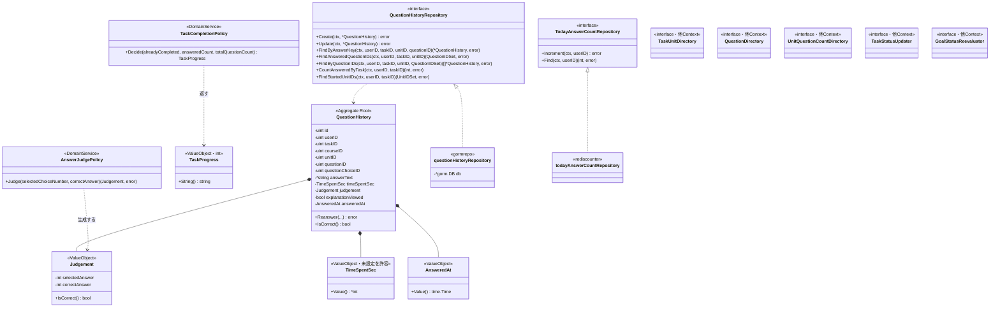
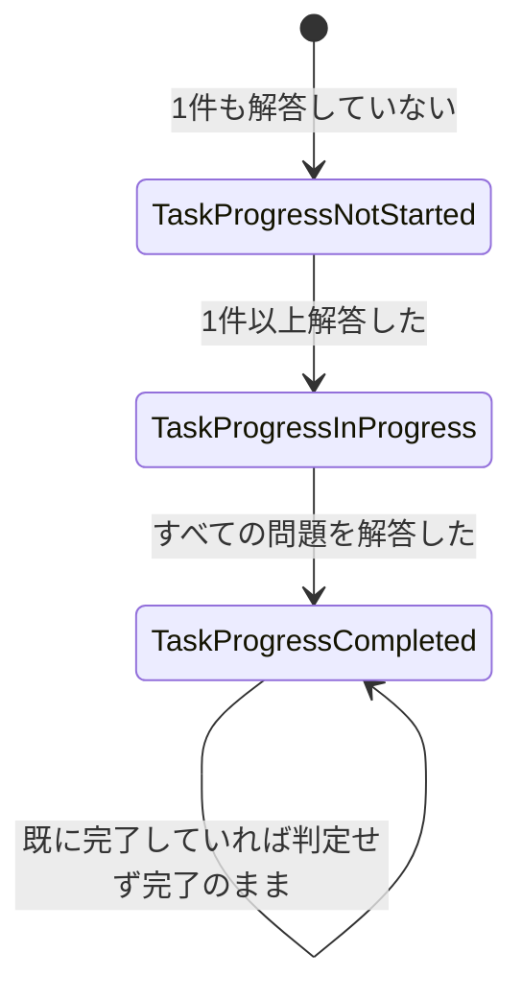

# 問題解答機能 Go実装仕様書 1 基盤

---

# 1. 機能概要

## 機能概要

生徒がタスク内の単元に対して問題を解答し、解答履歴を記録・更新する機能である。提供するAPIは問題一覧取得・解答の登録・解答の更新・確認表示・提出の5つである（①「4. API一覧」）。

この機能は他機能の状態に波及する。

- **解答の登録**を契機に、当日の解答件数（Redis のカウンタ）を1加算する。この値は「ダッシュボード機能」が表示に用いる（①「9. 非同期処理」）
- **タスクの提出**を契機に、タスクの状態と、タスクが属する目標の状態を更新する（①「5. API / 処理詳細」`#update`（提出））

また、他Contextへ2つの参照手段を公開する。当日の解答件数（`dashboard`向け）と、タスクの単元ごとに学習を開始済みかどうか（`task-management`向け）である（②「11. Repository設計」）。

## 採用設計パターンとその理由（②からの要約）

- 採用パターン: **Domain Model**（②「4. 設計パターン」）
- 判断根拠: 中核業務であり、正誤判定・解答履歴・タスクのあるべき状態の判定という業務ルールをドメインとして扱うため
- 採用しなかったパターン: Transaction Script（ルールが散在しやすく、状態の判定を明示しにくいため）、Active Record（判定と状態更新が分散しやすいため）、Event Sourcing（履歴の再構築・監査要件がないため）

本書はアーキテクチャ規約「2. レイヤー責務と依存方向（Domain Model / Event Sourcing）」「3. 設計パターンごとの構造適用方針」のDomain Model構成に従って実装レベルへ落とし込む。

## 本書の位置づけ

本機能の実装ファイルは43であり、1文書あたり30〜35という範囲を超える。そのためスライス編への分割を行う（③自動生成プロンプト「文書の分割」）。

|文書|担当|実装|テスト込みの目安|
|-|-|-|-|
|`問題解答機能_Go実装仕様書_1_基盤.md`（本書）|なし（Domain層・共通Infrastructure・実装方針）|20|約34|
|`問題解答機能_Go実装仕様書_2_問題参照.md`|GET questions・GET confirmation|10|約14|
|`問題解答機能_Go実装仕様書_3_解答と提出.md`|POST answers・PATCH answers/update・PATCH submission|13|約18|

スライスはHandlerファイル単位で切っている。提出は単独では4ファイルと小さいため、解答と同じスライス編にまとめた（同プロンプト「1スライスが35を超える場合はHandler内のアクションでさらに分け、小さすぎる場合は複数のHandlerを1つのスライス編にまとめてください」）。

**本書にはエンドポイントの設計を含まない。** Transaction・Validation・Authorization・Errorの実装方針は機能全体で共通であるため本書に置き、スライス編では繰り返さず本書を参照する。

## 本書が対象とする実装範囲

- Domain層のすべて（Entity・Value Object・Repository Interface・Domain Service・Domain Error）
- Infrastructure層のうち、複数のスライスが使うもの（GORMモデル・`QuestionHistoryRepository`の実装・当日の解答件数の実装・他Contextへのアダプタ）
- `context.go`・`dependency.go`・`presentation/routes.go`
- Transaction・Validation・Authorization・Errorの実装方針

---

# 2. ディレクトリ構成

## 対象Bounded Context名

- `question-answering`（②「3. Bounded Context」）

## ディレクトリ・パッケージ名

アーキテクチャ規約「4. Bounded Context構成」の「Contextディレクトリの命名」に従い、Context名`question-answering`から`-`を取り除いて連結した全小文字の名前とする。したがってディレクトリ名は`internal/questionanswering/`、package名は同じ`questionanswering`となる。同規約は`internal/question_answering/`のようにアンダースコアで区切ることを禁じている（package名にアンダースコアを使わないため、ディレクトリ名とpackage名が一致しなくなる）。

Context名とディレクトリ名は規約から機械的に決まるため、②に明記がなくても推測にはならない。

## ②で採用した設計パターン

Domain Model（②「4. 設計パターン」）

## 作成するディレクトリ一覧

```
internal/questionanswering/
├── domain/
│   ├── entity/
│   ├── valueobject/
│   ├── repository/
│   └── service/
├── application/
│   ├── dto/
│   └── usecase/
├── infrastructure/
│   ├── gormrepo/
│   ├── rediscounter/
│   └── contextadapter/
└── presentation/
    ├── handler/
    ├── request/
    ├── response/
    └── routes.go
```

アーキテクチャ規約「4. Bounded Context構成」の代表例に従い、Repository実装は`infrastructure/gormrepo/`に置く（`infrastructure/persistence/gorm/`ではない）。他Contextの公開操作へ委譲するアダプタは`infrastructure/contextadapter/`に置く（同章）。

`infrastructure/rediscounter/`は当日の解答件数の実装の置き場所である。GORMを使わずRedisへアクセスするため`gormrepo/`に混ぜない。`gormrepo/`は「GORMでDBを読み書きする実装の置き場所」という区別を保つ（同章）。

`domain/event/`・`infrastructure/mail/`・`infrastructure/cache/`・`infrastructure/queue/`は作成しない（②「18. Domain Event」のとおりDomain Eventを採用せず、メール・キュー・キャッシュの要件も②に記載されていない）。規約「4. Bounded Context構成」の「機能で不要なディレクトリは作成しない」に従う。

`domain/errors/`も作成しない。Domain Errorは`domain/`直下の1ファイルに置く（下記）。層として1ファイルのためにディレクトリを設けない。

## 機能全体のファイル一覧と担当文書

```
# --- 本書（基盤編）が担当 ---
internal/questionanswering/context.go                                      # NewContext（依存関係の組み立て）
internal/questionanswering/dependency.go                                   # 他Contextへの依存を宣言するインターフェースと受け渡し用の型
internal/questionanswering/domain/errors.go                                # Domain Error
internal/questionanswering/domain/entity/question_history.go               # QuestionHistory（Aggregate Root）
internal/questionanswering/domain/valueobject/judgement.go                 # Judgement（正誤判定の結果）
internal/questionanswering/domain/valueobject/time_spent_sec.go            # TimeSpentSec
internal/questionanswering/domain/valueobject/answered_at.go               # AnsweredAt
internal/questionanswering/domain/valueobject/task_progress.go             # TaskProgress（タスクのあるべき状態）
internal/questionanswering/domain/repository/question_history_repository.go
internal/questionanswering/domain/repository/today_answer_count_repository.go
internal/questionanswering/domain/service/answer_judge_policy.go           # 正誤判定
internal/questionanswering/domain/service/task_completion_policy.go        # タスクのあるべき状態の判定
internal/questionanswering/infrastructure/gormrepo/question_history_model.go
internal/questionanswering/infrastructure/gormrepo/question_history_repository.go
internal/questionanswering/infrastructure/rediscounter/today_answer_count_repository.go
internal/questionanswering/infrastructure/contextadapter/task_unit_directory.go
internal/questionanswering/infrastructure/contextadapter/question_directory.go
internal/questionanswering/infrastructure/contextadapter/unit_question_count_directory.go
internal/questionanswering/infrastructure/contextadapter/task_status_updater.go
internal/questionanswering/infrastructure/contextadapter/goal_status_reevaluator.go

# --- 2_問題参照 が担当 ---
internal/questionanswering/application/dto/list_questions_query.go
internal/questionanswering/application/dto/show_confirmation_query.go
internal/questionanswering/application/dto/question_list_item.go
internal/questionanswering/application/dto/confirmation_item.go
internal/questionanswering/application/usecase/list_questions_usecase.go
internal/questionanswering/application/usecase/show_confirmation_usecase.go
internal/questionanswering/presentation/handler/question_handler.go
internal/questionanswering/presentation/handler/confirmation_handler.go
internal/questionanswering/presentation/response/question_list_response.go
internal/questionanswering/presentation/response/confirmation_response.go

# --- 3_解答と提出 が担当 ---
internal/questionanswering/application/dto/create_answer_command.go
internal/questionanswering/application/dto/update_answer_command.go
internal/questionanswering/application/dto/submit_task_command.go
internal/questionanswering/application/dto/answer_result.go
internal/questionanswering/application/dto/submission_result.go
internal/questionanswering/application/usecase/create_answer_usecase.go
internal/questionanswering/application/usecase/update_answer_usecase.go
internal/questionanswering/application/usecase/submit_task_usecase.go
internal/questionanswering/presentation/handler/answer_handler.go
internal/questionanswering/presentation/handler/submission_handler.go
internal/questionanswering/presentation/request/answer_request.go
internal/questionanswering/presentation/response/answer_response.go
internal/questionanswering/presentation/response/submission_response.go
internal/questionanswering/presentation/routes.go
```

`routes.go`は`3_解答と提出`が担当する。全エンドポイントのルートを1ファイルで登録するため、最後に実装するスライス編に置く。ただし各スライス編は自身が担当するルートの定義を記載する。

実装の順序は本書 → `2_問題参照` → `3_解答と提出`とする。本書がRepository Interfaceとその実装を定めるため、スライス編はそれに依存する。`2_問題参照`と`3_解答と提出`の間に依存はないが、`routes.go`が後者にあるため順序を固定する。

---

# 3. Domain層設計

## Entity

### QuestionHistory（`domain/entity/question_history.go`。Aggregate Root）

②「5. Aggregate設計」「6. Entity設計」のとおり、本機能唯一のAggregate Rootである。

|フィールド|型|意味|
|-|-|-|
|id|uint|識別子|
|userID|uint|解答した生徒のユーザーID|
|taskID|uint|対象タスクの識別子|
|courseID|uint|コースの識別子。`question_histories.course_id`は**NOT NULL**であり、作成時に単元の所属コースを設定する（①「6. データモデル」）|
|unitID|uint|対象単元の識別子|
|questionID|uint|対象問題の識別子|
|questionChoiceID|uint|選択した選択肢の識別子。`question_histories.question_choice_id`は**NOT NULL**であるためポインタにしない（同）|
|answerText|`*string`|テキスト解答。NULL可|
|timeSpentSec|TimeSpentSec|解答時間。未設定を許容する（同）|
|judgement|Judgement|正誤判定の結果（Value Object）|
|explanationViewed|bool|解説を閲覧したか。既定値は`false`|
|answeredAt|AnsweredAt|解答日時|

公開メソッド:

|メソッド|引数|戻り値|責務|
|-|-|-|-|
|`NewQuestionHistory`|`userID, taskID, courseID, unitID, questionID, questionChoiceID uint, answerText *string, timeSpentSec TimeSpentSec, judgement Judgement, explanationViewed bool, answeredAt AnsweredAt`|`(*QuestionHistory, error)`|新規登録時のファクトリ。必須の識別子が0でないことを検証する|
|`(h *QuestionHistory) Reanswer(questionChoiceID uint, answerText *string, timeSpentSec TimeSpentSec, judgement Judgement, explanationViewed bool, answeredAt AnsweredAt) error`|同上|`error`|再解答時に内容と判定結果を差し替える。解答日時も上書きする（①「5. API / 処理詳細」`#update`（解答））|
|`(h QuestionHistory) ID() uint` ほか参照系|なし|各値|識別子・所有者・判定結果等の参照|

不変条件: `userID`・`taskID`・`courseID`・`unitID`・`questionID`・`questionChoiceID`がいずれも0でないこと。

**選択肢は常に必須である。** `question_histories.question_choice_id`がNOT NULLであるため、選択肢を選ばない解答（テキストのみ）は記録できない（①「6. データモデル」）。`answerText`は任意の補足であり、選択肢の代替ではない。

`Reanswer`は解答日時を上書きする。初回の解答日時は保持しない。Rails現行の挙動を維持する（①「5. API / 処理詳細」`#update`（解答））。

### 他Contextのデータの扱い

②「6. Entity設計」はTask・Question・QuestionChoiceをEntityとして挙げているが、いずれも他Contextが所有するデータである（②「3. Bounded Context」）。本書ではこれらをEntityとして定義せず、**他Contextから受け取る参照用の型**として`dependency.go`に定義する（アーキテクチャ規約「5. Context間連携ルール」の「相手Contextの内部Entity・Value Object・Infrastructure実装に直接依存しない」）。

詳細は「8. Infrastructure層設計」の「他Contextの参照手段」に記載する。

②「6. Entity設計」が`AnswerResult`をEntityとしている点は、本書では`Judgement`というValue Objectとして扱う（下記）。判定結果は識別子を持たず、`question_histories`の`is_correct`列として履歴に埋め込まれるためである（①「6. データモデル」）。独立したテーブルを持たない以上、Entityとして扱う根拠がない。

## Value Object

### Judgement（`domain/valueobject/judgement.go`）

正誤判定の結果を表す。②「6. Entity設計」の`AnswerResult`・②「7. Value Object設計」の`AnswerStatus`に対応する。

|項目|内容|
|-|-|
|保持するフィールド|`selectedAnswer int`（選択した選択肢の番号）、`correctAnswer int`（正解の番号）|
|生成方法|`NewJudgement(selectedAnswer, correctAnswer int) Judgement`|
|公開メソッド|`SelectedAnswer() int`、`CorrectAnswer() int`、`IsCorrect() bool`（2つの値が一致するか）|

Rails現行の`Student::QuestionAnswerJudgeService`は、選択した選択肢の`choice_number`と、問題の`correct_answer`を整数に変換した値を比較している（①「5. API / 処理詳細」`#create`）。本VOはその3つの値（選択した番号・正解の番号・正誤）をそのまま保持する。APIのレスポンスもこの3項目である。

`correct`/`incorrect`という文字列の状態値は設けない。Rails現行が真偽値（`is_correct`）で保持・返却しており、文字列の状態として扱っていないためである（①「6. データモデル」）。

永続化されるのは`IsCorrect()`の結果のみである（`question_histories.is_correct`）。選択した番号は`question_choice_id`から、正解の番号は問題から辿れるため列を持たない。

### TimeSpentSec（`domain/valueobject/time_spent_sec.go`）

|項目|内容|
|-|-|
|保持するフィールド|内部に`*int`相当の値を1つ保持する（未設定を`nil`で表す）|
|生成方法|`NewTimeSpentSec(raw *int) (TimeSpentSec, error)`。`nil`は許容する。値がある場合は**0以上3600以下**であることを検証する|
|公開メソッド|`Value() *int`、`IsZero() bool`|

上限の3600は、Rails現行の`TimeSpentSecValidatable`の`MAX_TIME_SPENT_SEC`（1時間）に対応する（①「5. API / 処理詳細」`#create`）。範囲外は`ErrInvalidTimeSpentSec`を返す。

`question_histories.time_spent_sec`はNULL可であるため未設定を許容する（①「6. データモデル」）。

### AnsweredAt（`domain/valueobject/answered_at.go`）

|項目|内容|
|-|-|
|保持するフィールド|内部に`time.Time`を1つ保持する|
|生成方法|`NewAnsweredAt(t time.Time) (AnsweredAt, error)`。ゼロ値を拒否する|
|公開メソッド|`Value() time.Time`|

`question_histories.answered_at`はNOT NULLであるため、未設定を許容しない（①「6. データモデル」）。登録・更新のいずれでも現在時刻が設定される。

### TaskProgress（`domain/valueobject/task_progress.go`）

タスクのあるべき状態を表す。②「12. UseCase設計」の判定結果に対応する。

|項目|内容|
|-|-|
|型定義|`type TaskProgress int`|
|許容値|`TaskProgressNotStarted`（0）/ `TaskProgressInProgress`（1）/ `TaskProgressCompleted`（2）を`iota`で宣言する（コーディング規約「3. 命名規則」）|
|公開メソッド|`IsValid() bool`、`String() string`（`not_started` / `in_progress` / `completed`を返す）|

`tasks.status`はRailsの`enum`として整数で保持される（タスク管理機能①「6. データモデル」）。本Contextは`tasks`を所有しないが、判定結果を`task-management`の「タスクの状態の更新」へ渡すため、同じ値の並びを持つ型として定義する。

**この型を`task-management`と共有しない。** Contextごとに定義する（アーキテクチャ規約「5. Context間連携ルール」）。受け渡しの際は`dependency.go`のインターフェースが要求する型へ変換する。

APIのレスポンスは文字列であるため、`String()`で変換してから返す（①「5. API / 処理詳細」`#update`（提出））。

## Repository Interface

Domain Model採用のため、`domain/repository/`にインターフェースを定義する。実装は`infrastructure/`に置く（アーキテクチャ規約「2. レイヤー責務と依存方向（Domain Model / Event Sourcing）」）。

### QuestionHistoryRepository（`domain/repository/question_history_repository.go`）

|メソッド|引数|戻り値|責務|
|-|-|-|-|
|`Create`|`ctx context.Context, h *entity.QuestionHistory`|`error`|解答履歴を保存する|
|`Update`|`ctx context.Context, h *entity.QuestionHistory`|`error`|解答履歴を更新する|
|`FindByAnswerKey`|`ctx context.Context, userID, taskID, unitID, questionID uint`|`(*entity.QuestionHistory, error)`|操作者・タスク・単元・問題の4条件に一致する1件を取得する。見つからなければ`ErrQuestionHistoryNotFound`|
|`FindAnsweredQuestionIDs`|`ctx context.Context, userID, taskID, unitID uint`|`(QuestionIDSet, error)`|指定のタスク・単元で解答済みの問題の識別子の集合を返す。問題一覧の`answered`に用いる|
|`FindByQuestionIDs`|`ctx context.Context, userID, taskID, unitID uint, questionIDs QuestionIDSet`|`([]*entity.QuestionHistory, error)`|指定の問題の解答履歴を取得する。確認表示に用いる|
|`CountAnsweredByTask`|`ctx context.Context, userID, taskID uint`|`(int, error)`|指定のタスクで解答済みの件数を返す。提出の判定に用いる|
|`FindStartedUnitIDs`|`ctx context.Context, userID, taskID uint`|`(UnitIDSet, error)`|指定のタスクで解答履歴のある単元の識別子の集合を返す。`task-management`へ公開する参照手段が用いる|

**論理削除の扱いがメソッドによって異なる。** `QuestionHistory`は`default_scope`に相当する既定の絞り込みを持たないため、用途ごとに明示する（①「6. データモデル」、②「21. DB操作仕様」）。

|メソッド|論理削除の扱い|
|-|-|
|`CountAnsweredByTask`|論理削除されていない履歴のうち、論理削除されていない問題に対するものに限る|
|`FindAnsweredQuestionIDs` / `FindByQuestionIDs` / `FindByAnswerKey` / `FindStartedUnitIDs`|除外しない|

`CountAnsweredByTask`だけ除外するのは、提出の判定が教員画面の進捗率と一致する必要があり、Rails現行が同じ集計（`on_active_questions`）を使っているためである（①「10. Rails実装対応表」）。

`QuestionIDSet`・`UnitIDSet`は識別子の集合を表す型である。`domain/repository/`と`dependency.go`の双方から参照するため、`dependency.go`に定義する（「8. Infrastructure層設計」）。

### TodayAnswerCountRepository（`domain/repository/today_answer_count_repository.go`）

当日の解答件数を扱う。**本Contextが所有するデータである**（②「11. Repository設計」）。

|メソッド|引数|戻り値|責務|
|-|-|-|-|
|`Increment`|`ctx context.Context, userID uint`|`error`|指定の生徒の当日の解答件数を1加算する|
|`Find`|`ctx context.Context, userID uint`|`(int, error)`|指定の生徒の当日の解答件数を返す。`dashboard`へ公開する参照手段が用いる|

保持先がRedisであることをインターフェースに表さない。Domain層は保持先を知らない（アーキテクチャ規約「2. レイヤー責務と依存方向（Domain Model / Event Sourcing）」）。

`Increment`の失敗の扱いは呼び出し元が決める。インターフェースは失敗を`error`として返し、吸収しない（「14. Error実装方針」）。

## Domain Service

### AnswerJudgePolicy（`domain/service/answer_judge_policy.go`）

②「8. Domain Service」の正誤判定に対応する。Rails現行の`Student::QuestionAnswerJudgeService`に相当する。

|項目|内容|
|-|-|
|struct名|`AnswerJudgePolicy`|
|保持するフィールド|なし（状態を持たない）|
|コンストラクタ|`NewAnswerJudgePolicy() *AnswerJudgePolicy`|

|メソッド|引数|戻り値|責務|
|-|-|-|-|
|`Judge`|`selectedChoiceNumber int, correctAnswer string`|`(valueobject.Judgement, error)`|正解の文字列を整数に変換し、選択した番号と比較して`Judgement`を返す。変換できない場合は`ErrInvalidCorrectAnswer`|

`questions.correct_answer`はtext型であり、整数に変換して比較する（①「6. データモデル」）。変換は本Policyの内側で行う。`curriculum`から受け取るのは文字列のままとし、解釈を本Contextに置く。正解の表現をどう解釈するかは解答の判定の関心であり、問題を所有するContextの関心ではないためである。

DBにも他Contextの呼び出しにも依存せず、与えられた2つの値のみから判定する。

### TaskCompletionPolicy（`domain/service/task_completion_policy.go`）

タスクのあるべき状態を判定する。Rails現行の`Student::TaskCompletionService`に相当する（②「12. UseCase設計」の「あるべき状態の判定を本Contextに置く理由」）。

|項目|内容|
|-|-|
|struct名|`TaskCompletionPolicy`|
|保持するフィールド|なし（状態を持たない）|
|コンストラクタ|`NewTaskCompletionPolicy() *TaskCompletionPolicy`|

|メソッド|引数|戻り値|責務|
|-|-|-|-|
|`Decide`|`alreadyCompleted bool, answeredCount, totalQuestionCount int`|`valueobject.TaskProgress`|既に完了していれば`TaskProgressCompleted`。そうでなければ、解答済み件数と対象の問題数が一致すれば`TaskProgressCompleted`、解答済み件数が1以上なら`TaskProgressInProgress`、それ以外は`TaskProgressNotStarted`|

**対象の問題数が0の場合、解答済み件数（0）と一致するため完了と判定される。** Rails現行の挙動を維持する（①「5. API / 処理詳細」`#update`（提出）、②「17. Error設計」の「Rails現行の挙動を維持するもの」）。

既に完了しているかの判定を引数で受け取るのは、タスクの状態を本Contextが所有しないためである。`task-management`の参照手段から受け取った値を渡す。

DBにも他Contextの呼び出しにも依存せず、与えられた3つの値のみから判定する。

## Domain Event

対象外。②「18. Domain Event」のとおり、非同期の副作用が現行仕様に存在しないため採用しない。

当日の解答件数の加算も、タスク・目標の状態の更新も、いずれも同期的に呼ぶ（②「14. Transaction設計」）。Domain Eventとして扱わない。

## Domain Error（`domain/errors.go`）

②「17. Error設計」に対応する内容を、センチネルエラー（`error`型の変数）として定義する。

|エラー|発生条件|メッセージ|
|-|-|-|
|`ErrTaskIDRequired`|`task_id`が未入力|`Task を入力してください`|
|`ErrUnitIDRequired`|`unit_id`が未入力|`Unit を入力してください`|
|`ErrQuestionIDRequired`|`question_id`が未入力|`Question を入力してください`|
|`ErrQuestionChoiceIDRequired`|`question_choice_id`が未入力|`Question choice を入力してください`|
|`ErrInvalidTask`|指定のタスクが操作者自身のものでない（存在しない場合を含む）。**解答の登録で用いる**|`Task が不正です`|
|`ErrInvalidUnit`|指定の単元がそのタスクに紐づかない。**解答の登録で用いる**|`Unit が不正です`|
|`ErrInvalidQuestion`|指定の問題がその単元に紐づかない。**解答の登録で用いる**|`Question が不正です`|
|`ErrInvalidQuestionChoice`|指定の選択肢が対象問題のものでない|`Question choice はこの問題の選択肢ではありません`|
|`ErrInvalidTimeSpentSec`|解答時間が0未満または3600超|`Time spent sec は0から3600の範囲で入力してください`|
|`ErrQuestionHistoryNotFound`|解答の更新で対象の解答履歴が見つからない|`解答履歴が見つかりません`（`base`に積まれるため項目名が付かない）|
|`ErrTaskNotFound`|問題一覧・確認表示・提出で対象のタスクが見つからない|—（「14. Error実装方針」で404へ変換する。本文の名称は`タスク`）|
|`ErrUnitNotFound`|問題一覧・確認表示で対象の単元が見つからない|—（同。本文の名称は`Unit`）|
|`ErrTaskOrUnitNotFound`|**確認表示で**対象のタスクまたは単元が見つからない|`対象データが見つかりません`（確認表示だけ404の本文が`errors`形式であるため、専用のエラーとする）|
|`ErrGoalNotFound`|提出で、タスクに目標が紐づいていない|—（404へ変換する。本文の名称は`目標`）|
|`ErrInvalidCorrectAnswer`|問題の正解を整数に変換できない|—（500へ変換する。データ不整合）|

メッセージの文言は①のとおり項目名が英語のまま出る形を維持する。フロントエンドを変更しない方針のためである（②「17. Error設計」の「エラーレスポンスの本文」）。

**「対象が見つからない」ためのエラーを用途ごとに分けている。** ステータスと本文の形が経路によって異なるためである（②「17. Error設計」）。

|エラー|ステータス|本文|
|-|-|-|
|`ErrInvalidTask` / `ErrInvalidUnit` / `ErrInvalidQuestion`|422|`{"errors": [...]}`|
|`ErrTaskNotFound` / `ErrUnitNotFound` / `ErrGoalNotFound`|404|`{"message": "〇〇が見つかりません"}`|
|`ErrTaskOrUnitNotFound`|404|`{"errors": ["対象データが見つかりません"]}`|

1つのエラーにまとめると、同じ「タスクが見つからない」が解答の登録では422、提出では404という違いを表せない。

---

# 4. クラス図



`QuestionHistory`が唯一のAggregate Rootである。`Judgement`・`TimeSpentSec`・`AnsweredAt`はその構成要素であり、`TaskProgress`は`TaskCompletionPolicy`の出力として独立している。

他Contextへのインターフェース5つは`dependency.go`に置く。Repository Interfaceが`domain/repository/`、他Contextへの依存が`dependency.go`という使い分けである（アーキテクチャ規約「4. Bounded Context構成」）。

UseCaseとHandlerはスライス編で定義するため、本図には含めない。

---

# 5. 状態遷移図

本Contextが所有するデータに状態はない。解答履歴は正誤と解答日時を記録するのみで、状態を持たない（①「7. 状態管理」）。

そのため解答履歴についての状態遷移図は省略する。

一方、提出が判定する**タスクのあるべき状態**には遷移がある。状態を所有するのは`task-management`だが、判定を本Contextが行うため、判定結果の取り得る値として示す。



- 判定は提出のたびに現在の解答状況から行う。遷移元による可否は判定しない
- 既に完了しているタスクは、判定せず完了のままとする（①「5. API / 処理詳細」`#update`（提出））
- 対象の問題が0件の場合は完了と判定される（同）
- 解答を取り消す操作が存在しないため、完了から戻ることは通常起きない

当日の解答件数も単調増加する整数であり、状態として扱わない。

---

# 6. Application層設計

本書では扱わない。UseCaseとDTOはスライス編で定義する。

|UseCase|担当文書|
|-|-|
|ListQuestions|`2_問題参照`|
|ShowConfirmation|`2_問題参照`|
|CreateAnswer|`3_解答と提出`|
|UpdateAnswer|`3_解答と提出`|
|SubmitTask|`3_解答と提出`|

---

# 7. シーケンス図・処理フロー図

本書では扱わない。エンドポイントごとのシーケンス図・処理フロー図はスライス編に記載する。

本書が定めるDomain層・Infrastructure層が、スライス編のUseCaseからどう呼ばれるかは各スライス編を参照する。

---

# 8. Infrastructure層設計

## Repository実装

### questionHistoryRepository（`infrastructure/gormrepo/question_history_repository.go`）

`domain/repository`の`QuestionHistoryRepository`の実装である。

|項目|内容|
|-|-|
|struct名|非公開struct（例: `questionHistoryRepository`）|
|コンストラクタ|`NewQuestionHistoryRepository(db *gorm.DB) repository.QuestionHistoryRepository`|
|保持するフィールド|`db *gorm.DB`|

各メソッドは`gormtx.DBFromContext(ctx, r.db)`で接続を取得する。トランザクション中であればその接続を、そうでなければ通常の接続を使う（「11. Transaction実装方針」）。

Entity ⇔ GORMモデルの変換はこのpackage内で行う。Entityは非公開フィールドを持つため、変換用のコンストラクタ（`entity.ReconstructQuestionHistory(...)`）を用いて組み立てる。Domain層のEntityにGORMタグを付けない（アーキテクチャ規約「2. レイヤー責務と依存方向（Domain Model / Event Sourcing）」、Gorm規約「12. 楽観ロック（Optimistic Locking）」の「Domain EntityとGORMモデルの分離」）。

発行するクエリ:

|メソッド|クエリ内容|
|-|-|
|`Create`|`question_histories`への挿入。`is_correct`は`Judgement.IsCorrect()`、`answered_at`は`AnsweredAt.Value()`を入れる|
|`Update`|`question_choice_id`・`answer_text`・`time_spent_sec`・`is_correct`・`explanation_viewed`・`answered_at`の6列を更新する（①「5. API / 処理詳細」`#update`（解答））|
|`FindByAnswerKey`|`user_id`・`task_id`・`unit_id`・`question_id`の4条件で1件取得。**`deleted_at`で絞り込まない**|
|`FindAnsweredQuestionIDs`|`user_id`・`task_id`・`unit_id`で絞り込み、`question_id`を重複なく取得。絞り込まない|
|`FindByQuestionIDs`|上記に加えて`question_id IN (...)`。絞り込まない|
|`CountAnsweredByTask`|`user_id`・`task_id`で絞り込み、**`deleted_at IS NULL`かつ`questions`と結合して問題の`deleted_at IS NULL`**を条件に件数を数える|
|`FindStartedUnitIDs`|`user_id`・`task_id`で絞り込み、`unit_id`を重複なく取得。絞り込まない|

`CountAnsweredByTask`だけ`questions`と結合する。論理削除された問題に対する解答を進捗から除くためである（①「6. データモデル」の`on_active_questions`）。この結合は`questions`テーブルへのアクセスだが、**件数を数えるための絞り込みであり、問題の内容を読むものではない**。`curriculum`の参照手段に委ねると、解答履歴側の条件と問題側の条件を別のクエリに分けることになり、集計が2段階になる。

**②からの補足（要確認）**: 上記の結合は規約「5. Context間連携ルール」の「相手Contextのデータを利用する場合は、相手Contextが公開する参照手段を呼び出す」に対する例外にあたる。集計の条件として他Contextのテーブルを結合してよいかは規約に定めがない。結合を避ける場合は、`curriculum`から「論理削除されていない問題の識別子の集合」を受け取り、それを条件に数える形になる（「17. ②からの補足事項」）。

### todayAnswerCountRepository（`infrastructure/rediscounter/today_answer_count_repository.go`）

`domain/repository`の`TodayAnswerCountRepository`の実装である。当日の解答件数を**Redis**で保持する（①「6. データモデル」）。

|項目|内容|
|-|-|
|struct名|非公開struct（例: `todayAnswerCountRepository`）|
|コンストラクタ|`NewTodayAnswerCountRepository(client <Redisクライアント>, clock <現在時刻の取得>) repository.TodayAnswerCountRepository`|
|保持するフィールド|Redisクライアント、現在時刻の取得手段|

|メソッド|処理内容|
|-|-|
|`Increment`|キーを組み立て、`INCR`と`EXPIREAT`をパイプラインでまとめて実行する。`EXPIREAT`は`NX`（既に有効期限が付いていれば設定しない）を付ける|
|`Find`|キーを組み立て、値を取得する。キーが存在しない場合は`0`を返す|

キーの構成: `student:today_answer_count:{ユーザーID}:{日付}`。日付はISO 8601形式（`YYYY-MM-DD`）である（①「6. データモデル」）。Rails現行と同じキーを使う。移行期間中に両系統が同じカウンタを読み書きできるようにするためである。

有効期限: キーが新規作成された時点で「当日の終わり + 5分」に設定する。`NX`を付けるのは、既に有効期限が付いているキーへの再設定（無駄な通信と日付境界のずれ）を避けるためである（①「9. 非同期処理」）。

**「当日」の基準**: 現在時刻の日付を用いる。Rails現行は`Time.current.to_date`で判定しており、アプリケーションのタイムゾーン設定に依存する（①「6. データモデル」）。Go側も同じタイムゾーンで日付を求める必要がある。現在時刻の取得手段をコンストラクタで受け取るのは、テストで日付境界を再現できるようにするためである。

**②からの補足（要確認）**: Redisクライアントの型と、接続の管理をどこに置くかは②に定めがない。規約「4. Bounded Context構成」も`internal/shared/`配下にRedisのディレクトリを定めていない。本書では`internal/shared/`に置くことを前提とせず、コンストラクタでクライアントを受け取る形にとどめる（「17. ②からの補足事項」）。

`Increment`の失敗はこのメソッドから`error`として返す。吸収しない。吸収するかどうかは呼び出し元のUseCaseが決める（「14. Error実装方針」）。

## 他Contextの参照手段と公開操作の実装

`dependency.go`で宣言したインターフェースの実装である。相手Contextが公開する操作へ委譲し、本Contextから相手のテーブルへクエリを発行しない（アーキテクチャ規約「5. Context間連携ルール」、②「11. Repository設計」）。いずれも`infrastructure/contextadapter/`に置く（同「4. Bounded Context構成」）。

|インターフェース|相手Context|メソッド|責務|
|-|-|-|-|
|`TaskUnitDirectory`|`task-management`|`VerifyTaskUnit(ctx context.Context, taskID, unitID, userID uint) error`|タスクが操作者自身のものであり、単元がそのタスクに紐づいているかを確認する|
||`task-management`|`FindTask(ctx context.Context, taskID, userID uint) (TaskRef, error)`|提出の判定に必要なタスクの情報（既に完了しているか、属する目標の識別子）を返す|
||`task-management`|`FindTaskUnitIDs(ctx context.Context, taskID uint) (UnitIDSet, error)`|タスクに紐づく単元の識別子の集合を返す。対象の問題数の集計に用いる|
|`QuestionDirectory`|`curriculum`|`FindUnitQuestions(ctx context.Context, unitID uint) ([]QuestionRef, error)`|単元に属する問題の一覧（選択肢・ヒントを含む）を返す|
||`curriculum`|`FindQuestionForAnswer(ctx context.Context, unitID, questionID, questionChoiceID uint) (AnswerTargetRef, error)`|指定の問題がその単元に属し、指定の選択肢がその問題のものであることを確認し、判定に必要な値（選択肢の番号・問題の正解）を返す|
|`UnitQuestionCountDirectory`|`curriculum`|`CountQuestions(ctx context.Context, unitIDs UnitIDSet) (int, error)`|指定の単元群に属する問題の件数を返す|
|`TaskStatusUpdater`|`task-management`|`UpdateTaskStatus(ctx context.Context, taskID uint, progress valueobject.TaskProgress) error`|タスクの状態を指定した値へ更新する|
|`GoalStatusReevaluator`|`goal-management`|`ReevaluateGoalStatus(ctx context.Context, goalID uint) error`|目標の状態を再評価する|

`dependency.go`に定義する受け渡し用の型:

|型|フィールド|備考|
|-|-|-|
|`QuestionIDSet`|問題の識別子の集合|順序を持たず重複を許さない|
|`UnitIDSet`|単元の識別子の集合|同|
|`TaskRef`|AlreadyCompleted（`bool`）・GoalID（`*uint`）|提出の判定に必要な最小限。タスクのタイトル等は受け取らない|
|`QuestionRef`|ID・UnitID・CourseID・QuestionText・Hints（`[]QuestionHintRef`）・Choices（`[]QuestionChoiceRef`）|問題一覧・確認表示のレスポンスに必要な項目。**`CorrectAnswer`を含める**|
|`QuestionHintRef`|ID・QuestionID・StepNumber・HintText||
|`QuestionChoiceRef`|ID・QuestionID・ChoiceNumber・ChoiceText||
|`AnswerTargetRef`|CourseID・SelectedChoiceNumber・CorrectAnswer（`string`）|解答の登録・更新の判定に必要な値。`CourseID`は解答履歴の`course_id`に入れる|

`QuestionRef`に`CorrectAnswer`を含めるのは、確認表示が解答履歴のある問題について正解を返すためである（①「5. API / 処理詳細」`#show`（確認表示））。問題一覧のレスポンスには含めないが、受け取る型としては同じものを使う。**レスポンスへ入れるかの判断はスライス編のUseCaseが行う。**

`FindQuestionForAnswer`が確認と値の取得を同時に行うのは、Rails現行が「単元に属する問題か」「その問題の選択肢か」を確認したうえで判定に進んでいるためである（①「5. API / 処理詳細」`#create`）。確認と取得を分けると往復が増える。

`TaskRef.GoalID`を`*uint`とするのは、`tasks.goal_id`がNULL可であるためである（タスク管理機能①「6. データモデル」）。`nil`の場合、提出は`ErrGoalNotFound`となる（①「5. API / 処理詳細」`#update`（提出））。

`UpdateTaskStatus`が受け取るのは本Contextの`TaskProgress`である。相手Contextの型をそのまま使わず、アダプタの中で相手が要求する型へ変換する（アーキテクチャ規約「5. Context間連携ルール」）。

**②からの補足**: 相手Contextが公開する操作の具体的なシグネチャは、各機能の③で確定する。本書では消費者側のインターフェースをコーディング規約「7. インターフェース」の方針に従って本Contextに置き、実装をアダプタに閉じ込める。

`TaskUnitDirectory.VerifyTaskUnit`は学習ログ機能③も同じ参照手段を必要とする（同③「8. Infrastructure層設計」）。シグネチャを合わせる。

## 本Contextが他Contextへ公開する参照手段

本Contextの`context.go`が返す`Context`のメソッドとして公開する（アーキテクチャ規約「14. 依存関係の組み立て（DI配線）」）。

|公開する操作|呼び出し元|内容|
|-|-|-|
|`FindTodayAnswerCount(ctx context.Context, userID uint) (int, error)`|`dashboard`|当日の解答件数を返す（ダッシュボード機能③「8. Infrastructure層設計」の`TodayAnswerCountDirectory`）|
|`FindStartedUnitIDs(ctx context.Context, userID, taskID uint) ([]uint, error)`|`task-management`|指定のタスクで解答履歴のある単元の識別子を返す（タスク管理機能③「8. Infrastructure層設計」の`StartedUnitDirectory`）|

いずれも`TodayAnswerCountRepository`・`QuestionHistoryRepository`へ委譲するだけである。業務ルールを持たない。

`FindStartedUnitIDs`が返すのは識別子のスライスである。呼び出し元の`task-management`が自身の集合型へ変換する。本Contextの`UnitIDSet`を公開の型に使わない。相手Contextに本Contextの型を持ち込ませないためである。

## 外部連携実装

Redis以外の外部連携はない。②にMail・Cache・Queue等の記載はない。

Redisは当日の解答件数の保持先であり、`infrastructure/rediscounter/`が扱う（上記）。

## context.go と dependency.go

### context.go

`NewContext`が本Contextの依存関係を組み立てる（アーキテクチャ規約「14. 依存関係の組み立て（DI配線）」）。

受け取るもの: `*gorm.DB`、Redisクライアント、現在時刻の取得手段、`task-management`・`curriculum`・`goal-management`の各Contextへの参照（アダプタの生成に用いる）。

組み立てるもの: Repository実装2つ、アダプタ5つ、Domain Service2つ、UseCase5つ、Handler4つ。

返す`Context`は、ルート登録に必要なHandlerと、他Contextへ公開する2つの参照手段を持つ。

### dependency.go

他Contextへの依存を宣言するインターフェース5つと、受け渡し用の型を置く（上記）。`QuestionIDSet`・`UnitIDSet`は`domain/repository/`からも参照するため、ここに置く。

**②からの補足**: `dependency.go`はContextディレクトリ直下に置くという規約（アーキテクチャ規約「4. Bounded Context構成」）に従うが、そこに定義した型を`domain/repository/`が参照すると、Domain層がContextディレクトリ直下のpackageに依存する。依存の向きとしては`domain/` → 直下となり、規約「2. レイヤー責務と依存方向」が定める「DomainはInfrastructureに依存しない」には反しないが、Domain層が他Contextへの依存を宣言するpackageを参照する形になる。`QuestionIDSet`・`UnitIDSet`を`domain/valueobject/`に置く案もある（「17. ②からの補足事項」）。

---

# 9. Presentation層設計

本書では扱わない。Handler・Request / Response DTOはスライス編で定義する。

|Handler|担当文書|担当するエンドポイント|
|-|-|-|
|`question_handler.go`|`2_問題参照`|GET /tasks/:task_id/units/:unit_id/questions|
|`confirmation_handler.go`|`2_問題参照`|GET /tasks/:task_id/units/:unit_id/confirmation|
|`answer_handler.go`|`3_解答と提出`|POST /tasks/:task_id/units/:unit_id/answers・PATCH /tasks/:task_id/units/:unit_id/answers/update|
|`submission_handler.go`|`3_解答と提出`|PATCH /tasks/:task_id/submission|

`presentation/routes.go`は`3_解答と提出`が担当する。全エンドポイントのルートを1ファイルで登録する。

すべてのルートは認証Middleware・`student`ロール確認Middlewareを経由する。`POST`・`PATCH`はCSRF検証Middlewareの対象にも含める（「13. Authorization実装方針」）。

---

# 10. API仕様

本書では扱わない。エンドポイントごとのAPI仕様はスライス編に記載する。

エンドポイントとステータスコードの一覧（詳細は各スライス編）:

|Method|Path|正常系|担当文書|
|-|-|-|-|
|GET|/api/v1/student/tasks/:task_id/units/:unit_id/questions|200|`2_問題参照`|
|GET|/api/v1/student/tasks/:task_id/units/:unit_id/confirmation|200|`2_問題参照`|
|POST|/api/v1/student/tasks/:task_id/units/:unit_id/answers|**201**|`3_解答と提出`|
|PATCH|/api/v1/student/tasks/:task_id/units/:unit_id/answers/update|200|`3_解答と提出`|
|PATCH|/api/v1/student/tasks/:task_id/submission|200|`3_解答と提出`|

---

# 11. Transaction実装方針

②「14. Transaction設計」のとおり、操作によって境界の位置が異なる。機能全体で共通の方針を本書に置く。

## Transaction開始位置

|操作|境界|
|-|-|
|CreateAnswer|解答履歴の保存のみを囲む。書き込みは1件|
|UpdateAnswer|解答履歴の更新のみを囲む。書き込みは1件|
|SubmitTask|**UseCaseの処理単位で開始する。** `task-management`の状態更新と`goal-management`の再評価という2つの書き込みにまたがる|
|ListQuestions / ShowConfirmation|使用しない（読み取りのみ）|

`gormtx.RunInTx(ctx, db, func(ctx context.Context, tx *gorm.DB) error { ... })`を用いる。`db.WithContext(ctx).Transaction(...)`を直接呼ばない。呼び出し側が既に開始したトランザクションに参加せず、独立した2つ目を開始してしまうためである（アーキテクチャ規約「11. Transaction実装パターン（TransactionManager）」）。

Domain Model採用のため、トランザクションの開始はUseCaseが行う。Repository実装の中で開始しない（同章）。

他Contextの参照（`TaskUnitDirectory`・`QuestionDirectory`・`UnitQuestionCountDirectory`）は読み取りであり、トランザクションの外で行う（②「14. Transaction設計」）。

## Transaction終了位置

- CreateAnswer: 解答履歴の保存が完了した時点でコミットする
- UpdateAnswer: 解答履歴の更新が完了した時点でコミットする
- SubmitTask: タスクの状態の更新と目標の状態の再評価が完了した時点でコミットする。いずれかが失敗した場合はロールバックする

## 当日の解答件数の加算をトランザクションに含めない

当日の解答件数は**Redis**に保持されており、RDBのトランザクションに含めることはできない（①「6. データモデル」）。

`CreateAnswer`では、解答履歴の保存をコミットした**あと**に加算する。加算が失敗しても解答履歴は残る。

逆の順序にしない。保存が失敗したときに件数だけが増える状態になるためである。件数が実際の解答より少なくなる方が、多くなるより望ましい（②「14. Transaction設計」）。

## 他Contextの操作をトランザクションに含める

`SubmitTask`では、`TaskStatusUpdater`・`GoalStatusReevaluator`にトランザクションの`ctx`をそのまま渡す。相手Contextの操作は自らトランザクションを開始せず、`gormtx.DBFromContext`が`ctx`のトランザクションを見つけて参加する（タスク管理機能③「11. Transaction実装方針」）。

この連鎖により、1つのトランザクションが`tasks`・`goals`の2テーブルにまたがる。タスクだけが完了になって目標の状態が古いまま残る状態を防ぐためである。

## 複数Repositoryにまたがる場合の扱い

本Contextが所有するのは`question_histories`と当日の解答件数のみである。RDBの書き込みが複数のRepositoryにまたがることはない。

---

# 12. Validation実装方針

②「15. Validation設計」を実装レベルに落とし込む。機能全体で共通の方針を本書に置く。

## Presentation

- Request DTOのバインド時に、Ginのbindingタグで型チェック・必須チェックを行う
- パスパラメータ`task_id`・`unit_id`は整数として読み取り、解釈できない場合は422とする
- 解答の登録・更新では`question_id`・`question_choice_id`を必須とする。`answer_text`・`time_spent_sec`・`explanation_viewed`は任意とする
- `explanation_viewed`は真偽値として受け取る。未指定の場合は`false`として扱う（①「5. API / 処理詳細」`#create`）
- 確認表示のクエリパラメータ`answered_question_ids`は文字列として受け取り、カンマ区切りの分解はUseCaseが行う。不正な形式をエラーとしない（①「5. API / 処理詳細」`#show`（確認表示））

リクエストボディを持つのは解答の登録・更新のみである。問題一覧・確認表示・提出はパスパラメータとクエリパラメータのみで動作する。

## Domain

Value Objectの生成時に検証する。

|検証|置き場所|
|-|-|
|解答時間が0以上3600以下|`TimeSpentSec`の生成|
|解答日時がゼロ値でない|`AnsweredAt`の生成|
|必須の識別子が0でない|`QuestionHistory`のファクトリ|
|正解が整数に変換できる|`AnswerJudgePolicy.Judge`|

## 他Contextへ問う検証

Entity・Value Object単体では完結しない検証は、UseCaseが参照手段を呼び出して行う。

|検証|呼び出す先|エラー|
|-|-|-|
|タスクが操作者自身のものか（問題一覧・確認表示・提出）|`TaskUnitDirectory.VerifyTaskUnit` / `FindTask`|`ErrTaskNotFound`（404）|
|単元がそのタスクに紐づくか（問題一覧・確認表示）|`TaskUnitDirectory.VerifyTaskUnit`|`ErrUnitNotFound`（404）|
|タスク・単元・問題の紐づき（解答の登録）|`TaskUnitDirectory.VerifyTaskUnit` / `QuestionDirectory.FindQuestionForAnswer`|`ErrInvalidTask` / `ErrInvalidUnit` / `ErrInvalidQuestion`（**422**）|
|選択肢が対象問題のものか|`QuestionDirectory.FindQuestionForAnswer`|`ErrInvalidQuestionChoice`（422）|

**同じ紐づきの検証でも、経路によってエラーとステータスが異なる。** 問題一覧・確認表示・提出は404、解答の登録は422である。Rails現行が、前者はControllerの検索で例外を投げ、後者はFormの検証エラーとして扱っているためである（②「17. Error設計」）。UseCaseごとにどのエラーを返すかを決める。

## 責務分離

- Presentationは「入力の形が正しいか」を担当する
- Domainは「値が業務的に妥当か」を担当する
- 他Contextのデータとの整合は、UseCaseが参照手段を呼んで確認する

所有権の確認（他の生徒のタスク・解答履歴へのアクセスの禁止）は、Repositoryの検索条件として実現する。`FindByAnswerKey`が操作者の識別子を条件に含めるため、他の生徒の解答履歴は取得できない。

---

# 13. Authorization実装方針

②「16. Authorization設計」を実装レベルに落とし込む。機能全体で共通の方針を本書に置く。

- Middlewareで行う処理: 認証済みユーザーの特定と`context.Context`への格納、役割（`student`）であることの確認
- CSRF: `POST`・`PATCH`はCookieで認可される状態変更であるため、CSRF検証Middlewareの対象に含める（Gin規約「5. CSRF対策」の「適用範囲」）。GETの問題一覧・確認表示は対象外
- Handlerで行う処理: `context.Context`からcurrent userを取り出し、UseCaseの入力に含める。業務権限判定は持たせない
- UseCaseで行う処理: 操作者の識別子をRepositoryの検索条件と参照手段の引数に渡す
- Domainで行う処理: `QuestionHistory`が`userID`を保持し、所有権確認の材料を提供するのみで、判定ロジックは持たない

**「存在しない」と「他の生徒のもの」を区別しない。** いずれも同じエラーとして扱う（①「8. 権限制御」）。他人のタスク・解答履歴が存在することを漏らさないためでもある。

本Contextが他Contextへ公開する2つの参照手段（当日の解答件数・学習開始済みの単元）は、HTTPを経由せず直接呼ばれる。認可は呼び出し元Contextが行い、本操作では行わない。

---

# 14. Error実装方針

②「17. Error設計」を実装レベルに落とし込む。機能全体で共通の方針を本書に置く。

## Domain Error → Application Errorへの変換方針

Domain Model採用のため、`domain/errors.go`のセンチネルエラーをUseCaseで`internal/shared/apperror`の`AppError`を実装した型へ変換する（アーキテクチャ規約「12. Error変換パターン（AppError）」の「Domain Model採用時の変換」）。変換は`errors.Is`による判別で行う。

他Contextのアダプタが返すエラーも、アダプタの中で本Contextのセンチネルエラーへ変換する。相手Contextのエラー型を本Contextのハンドリングに持ち込まない（規約「5. Context間連携ルール」）。

**同じ原因のエラーを、UseCaseによって別のセンチネルエラーへ変換する。** アダプタは「タスクが見つからない」という事実のみを返し、それを`ErrTaskNotFound`（404）とするか`ErrInvalidTask`（422）とするかはUseCaseが決める（「12. Validation実装方針」）。アダプタにステータスの判断を持たせない。

## Application Error → HTTPレスポンスへの変換方針

Gin規約「8. エラーハンドリングミドルウェア」の集中エラーハンドリングミドルウェアに変換を集約する。Handlerは`c.Error(err)`でエラーを登録するのみとし、個々のHandlerでステータスコードを判定しない。ミドルウェアが`errors.As`で`AppError`を1回だけ判定し、`StatusCode()`でステータス、`LogLevel()`でログレベルを決める。

レスポンスのボディは、②「17. Error設計」の「エラーレスポンスの本文」のとおりRails現行の形を維持する。**この機能は404の本文の形が2通りある。**

|条件|HTTP Status|ボディ|
|-|-|-|
|入力・業務検証の失敗|422|`{"errors": ["メッセージ", ...]}`|
|`ErrTaskOrUnitNotFound`（確認表示）|404|`{"errors": ["対象データが見つかりません"]}`|
|`ErrTaskNotFound` / `ErrUnitNotFound` / `ErrGoalNotFound`|404|`{"message": "〇〇が見つかりません"}`。`〇〇`は`タスク`・`Unit`・`目標`|
|`ErrInvalidCorrectAnswer`・その他の未分類のエラー|500|`{"errors": [...]}`|
|認証・認可・CSRF|401 / 403|`{"errors": [...]}`。該当Middlewareが組み立てる|

404の本文の形が2通りあるため、**ミドルウェアは`AppError`が指定した本文の形に従う**。ステータスが404なら必ず`message`キー、という分岐にしない。`AppError`に「本文の形」と「名称」を持たせ、ミドルウェアがそれに従って組み立てる。

他機能の③は「ステータスが404なら`message`キー」という分岐を記載しているが（目標管理機能③・タスク管理機能③・学習ログ機能③「14. Error実装方針」）、本機能には`errors`形式の404があるためその分岐では足りない。

**②からの補足（要確認）**: ミドルウェアの共通部分に「404でも`errors`形式を選べる」仕組みが必要になる。全機能に共通する部分の設計であるため、本機能だけで決められない（「17. ②からの補足事項」）。

## Infrastructure Errorのハンドリング方針

DB接続失敗・永続化失敗（GORMが返すその他のエラー）は、`fmt.Errorf`でラップして返す（コーディング規約「18. エラーハンドリング」）。`AppError`へ変換されずにミドルウェアへ到達した場合も、未分類のエラーとして500で扱う。

**当日の解答件数の加算の失敗は例外的に扱う。** `TodayAnswerCountRepository.Increment`が返したエラーを、`CreateAnswer`のUseCaseが吸収する。エラーを呼び出し元へ返さず、内容をログに記録して処理を続ける（①「9. 非同期処理」）。

加算の失敗で解答の記録が失敗してはならない。解答は既にコミットされており、巻き戻すこともできない（「11. Transaction実装方針」）。

ログレベルは、業務上の失敗ではなく技術的な障害であるためエラーレベルとする。Rails現行も`Rails.logger.error`で記録している（①「9. 非同期処理」）。

---

# 15. GORM / DBクエリ設計

②「20. DB設計方針」のとおり、既存Rails DBを継続利用し、スキーマ変更は行わない。本Contextが所有するテーブルは`question_histories`のみである。

## 利用するGORMモデルとテーブルの対応

|Goモデル|テーブル名|備考|
|-|-|-|
|`questionHistoryModel`（`infrastructure/gormrepo/question_history_model.go`）|`question_histories`|Gorm規約「2. 複数形のテーブル名」の既定命名規則で一致するため、`TableName()`のオーバーライドは不要|

Domain Model採用のため、EntityとGORMモデルを分離する（Gorm規約「12. 楽観ロック（Optimistic Locking）」の「Domain EntityとGORMモデルの分離」）。GORMタグはモデル側にのみ付ける。

|モデルのフィールド|カラム|備考|
|-|-|-|
|ID|`id`||
|UserID|`user_id`||
|TaskID|`task_id`||
|CourseID|`course_id`|NOT NULL|
|UnitID|`unit_id`||
|QuestionID|`question_id`||
|QuestionChoiceID|`question_choice_id`|NOT NULL|
|AnswerText|`answer_text`|`*string`|
|TimeSpentSec|`time_spent_sec`|`*int`|
|IsCorrect|`is_correct`|`bool`。`Judgement.IsCorrect()`の結果を入れる|
|ExplanationViewed|`explanation_viewed`|`bool`|
|AnsweredAt|`answered_at`|`time.Time`。NOT NULL|
|DeletedAt|`deleted_at`|**`gorm.DeletedAt`を使わず`*time.Time`とする**（下記）|
|CreatedAt / UpdatedAt|`created_at` / `updated_at`|GORMが設定する|

**`DeletedAt`に`gorm.DeletedAt`を使わない。** Gorm規約「0. 本プロジェクトでの採用方針」の論理削除は`gorm.DeletedAt`の使用を定めているが、これは削除操作を実装する場合の規定である。本機能に削除操作は存在せず、`gorm.DeletedAt`を使うと`Find`系が`deleted_at IS NULL`を自動付与する。

`QuestionHistory`は`default_scope`を持たず、**用途によって論理削除の扱いが異なる**（①「6. データモデル」）。自動付与が入ると、除外してはいけない経路（`answered`の判定・確認表示・解答の更新）でも除外されてしまい、外部仕様が変わる。フロントエンドを変更しない方針により、絞り込みが入らない型を選ぶ。

タスク下書き機能③・学習ログ機能③も同じ判断をしている（各③「15. GORM / DBクエリ設計」）が、本機能はさらに「同じテーブルで用途ごとに扱いが分かれる」点が異なる。

## 主要クエリの条件・ソート・ページネーション方針

「8. Infrastructure層設計」のRepository実装の表のとおり。要点を再掲する。

- `CountAnsweredByTask`のみ`deleted_at IS NULL`と`questions`との結合を条件に含める
- それ以外のメソッドは`deleted_at`を条件に含めない
- ソートは行わない。問題一覧の並び順は`curriculum`が決める（本Contextは`answered`の付与のみ）
- ページネーションは行わない。いずれのエンドポイントもページングを持たない（①「5. API / 処理詳細」）

`tasks`・`task_units`・`units`・`question_choices`・`question_hints`・`goals`へは本Contextからクエリを発行しない。相手Contextが公開する参照手段を呼び出す（②「21. DB操作仕様」）。`questions`は`CountAnsweredByTask`の結合のみで触れる（上記の要確認事項）。

## 当日の解答件数（RDBではない）

Redisで保持する。キーの構成・有効期限・「当日」の基準は「8. Infrastructure層設計」の`todayAnswerCountRepository`に記載した。

RDBのトランザクションに含めることはできない（「11. Transaction実装方針」）。

## 既存Schemaへの変更

②「20. DB設計方針」のとおり、変更なし。

同一のタスク・単元・問題の組に対する一意制約はない。重複した履歴が作られうる（①「6. データモデル」）。本設計でも制約を追加しない。Rails現行の挙動を維持する（②「17. Error設計」の「Rails現行の挙動を維持するもの」）。

---

# 16. テストケース設計

②「22. テスト戦略」のうち、本書が担当する範囲（Domain層・共通Infrastructure）のテストケースを記載する。UseCase Test・Handler Testはスライス編に記載する。

## Domain Test

|対象|テストケース|
|-|-|
|`NewJudgement` / `Judgement.IsCorrect`|選択した番号と正解の番号が一致すれば真、異なれば偽を返すこと|
|`Judgement`|選択した番号・正解の番号がそのまま参照できること|
|`NewTimeSpentSec`|`nil`を許容すること|
|`NewTimeSpentSec`|0と3600で生成できること（境界）|
|`NewTimeSpentSec`|-1と3601で`ErrInvalidTimeSpentSec`を返すこと（境界）|
|`NewAnsweredAt`|ゼロ値で拒否されること|
|`TaskProgress.IsValid` / `String`|0/1/2で真を返し、それぞれ`not_started` / `in_progress` / `completed`を返すこと|
|`NewQuestionHistory`|必須の識別子が0のときエラーになること|
|`NewQuestionHistory`|`answerText`が`nil`でも生成できること|
|`QuestionHistory.Reanswer`|選択肢・テキスト・解答時間・判定結果・解説閲覧・解答日時が差し替わること|
|`QuestionHistory.Reanswer`|解答日時が上書きされ、初回の値が保持されないこと|
|`AnswerJudgePolicy.Judge`|正解の文字列を整数に変換して比較すること|
|`AnswerJudgePolicy.Judge`|整数に変換できない正解で`ErrInvalidCorrectAnswer`を返すこと|
|`TaskCompletionPolicy.Decide`|既に完了していれば、件数に関わらず完了を返すこと|
|`TaskCompletionPolicy.Decide`|解答済み件数と対象の問題数が一致すれば完了を返すこと|
|`TaskCompletionPolicy.Decide`|解答済み件数が1以上で対象の問題数に届かなければ進行中を返すこと|
|`TaskCompletionPolicy.Decide`|解答済み件数が0で対象の問題数が1以上なら未着手を返すこと|
|`TaskCompletionPolicy.Decide`|**対象の問題数が0なら完了を返すこと**（Rails現行の挙動）|

## Repository Test

|対象|テストケース|
|-|-|
|`questionHistoryRepository.Create`|レコードが作成され、`is_correct`が判定結果、`answered_at`が指定の日時で保存されること|
|`questionHistoryRepository.Create`|同一のタスク・単元・問題に対して複数の履歴を作成できること|
|`questionHistoryRepository.Update`|6列が更新され、`course_id`・`user_id`等が変わらないこと|
|`questionHistoryRepository.FindByAnswerKey`|4条件すべてに一致する履歴が取得できること|
|`questionHistoryRepository.FindByAnswerKey`|操作者が異なる場合に`ErrQuestionHistoryNotFound`が返ること|
|`questionHistoryRepository.FindByAnswerKey`|**論理削除済みの履歴も取得できること**|
|`questionHistoryRepository.FindAnsweredQuestionIDs`|重複なく問題の識別子が返ること|
|`questionHistoryRepository.FindAnsweredQuestionIDs`|**論理削除済みの履歴も含まれること**|
|`questionHistoryRepository.FindByQuestionIDs`|指定の問題の履歴のみ返ること、空の集合で空の結果が返ること|
|`questionHistoryRepository.CountAnsweredByTask`|**論理削除済みの履歴が除かれること**|
|`questionHistoryRepository.CountAnsweredByTask`|**論理削除済みの問題に対する履歴が除かれること**|
|`questionHistoryRepository.FindStartedUnitIDs`|重複なく単元の識別子が返ること、論理削除済みの履歴も含まれること|
|`todayAnswerCountRepository.Increment`|値が1増えること|
|`todayAnswerCountRepository.Increment`|キーが新規作成されたときのみ有効期限が設定されること（2回目の加算で有効期限が再設定されないこと）|
|`todayAnswerCountRepository.Increment`|日付が変わると別のキーになること|
|`todayAnswerCountRepository.Find`|キーが存在しない場合に`0`を返すこと|
|`todayAnswerCountRepository.Find` / `Increment`|Redisの障害時にエラーを返すこと（吸収はUseCaseの責務）|
|アダプタ5つ|相手Contextの戻り値が`dependency.go`の型へ変換されること、相手がエラーを返した場合に本Contextのセンチネルエラーへ変換されること|

## 他Contextへ公開する参照手段のテスト

|対象|テストケース|
|-|-|
|`Context.FindTodayAnswerCount`|`TodayAnswerCountRepository.Find`へ委譲し、値をそのまま返すこと|
|`Context.FindStartedUnitIDs`|`QuestionHistoryRepository.FindStartedUnitIDs`へ委譲し、識別子のスライスを返すこと|

## UseCase Test / Handler Test / Integration Test

スライス編に記載する。

ただし機能横断で確認すべきものは本書に挙げる。

|対象|テストケース|
|-|-|
|エラーハンドラ|404のうち確認表示だけ`errors`キー、他は`message`キーの本文になること|
|エラーハンドラ|404の名称が対象ごとに`タスク`・`Unit`・`目標`になること|
|トランザクション|提出でタスクの状態の更新が失敗した場合、目標の状態も巻き戻ること|
|トランザクション|解答の登録で当日の解答件数の加算が失敗しても、解答履歴が残ること|

---

# 17. ②からの補足事項

②に明記がなく、実装のために追加で判断した内容のうち、本書が担当する範囲のものを記載する。スライス編に固有のものは各スライス編に記載する。

|判断した内容|判断理由|推測かどうか|
|-|-|-|
|`internal/questionanswering/`（連結形）をディレクトリ名・package名とした|アーキテクチャ規約「4. Bounded Context構成」の「Contextディレクトリの命名」から機械的に決まる。復元時の③は`internal/question_answering/`としていたが、同規約はアンダースコア区切りを禁じている|補足（規約から決まるため推測ではない）|
|②「6. Entity設計」の`AnswerResult`をEntityではなくValue Object（`Judgement`）として扱った|判定結果は識別子を持たず、`question_histories.is_correct`として履歴に埋め込まれる（①「6. データモデル」）。独立したテーブルを持たない以上、Entityとして扱う根拠がない|補足（①の実体に基づく）|
|`Judgement`が`correct`/`incorrect`の文字列ではなく、選択した番号・正解の番号・正誤を保持する形にした|Rails現行の`Student::QuestionAnswerJudgeService`が3つの値を返し、APIのレスポンスもその3項目である（①「5. API / 処理詳細」`#create`）。文字列の状態値を設ける根拠がない|補足（①の実体に基づく）|
|`questionChoiceID`をポインタにせず必須とした|`question_histories.question_choice_id`がNOT NULLである（①「6. データモデル」）。復元時の③は「選択式かテキスト解答か」の排他関係を推測していたが、選択肢は常に必須である|補足（①の実体に基づく）|
|`courseID`をEntityのフィールドに加えた|`question_histories.course_id`がNOT NULLであり、作成時に単元の所属コースを設定する（同）。復元時の③にはこのフィールドがなかった|補足（①の実体に基づく）|
|Task・Question・QuestionChoiceをEntityとして定義せず、`dependency.go`の参照用の型とした|いずれも他Contextが所有するデータである（②「3. Bounded Context」）。規約「5. Context間連携ルール」の「相手Contextの内部Entityに直接依存しない」に従う|補足（規約の適用）|
|「対象が見つからない」ためのエラーを用途ごとに分けた（`ErrTaskNotFound` / `ErrInvalidTask` / `ErrTaskOrUnitNotFound`）|同じ原因でも経路によってステータス（404 / 422）と本文の形（`message` / `errors`）が異なる（②「17. Error設計」）。1つにまとめると表せない|補足（①②の実体に基づく）|
|`DeletedAt`に`gorm.DeletedAt`を使わず`*time.Time`とした|`QuestionHistory`は`default_scope`を持たず、**用途によって論理削除の扱いが異なる**（①「6. データモデル」）。自動付与が入ると、除外してはいけない経路でも除外され外部仕様が変わる|補足（①の実体に基づく。規約側に「削除操作を持たないContextでの扱い」の記載はないため、規約側に明記すべきか要確認）|
|`CountAnsweredByTask`で`questions`テーブルと結合することにした|論理削除された問題に対する解答を進捗から除くため（①「6. データモデル」の`on_active_questions`）。**規約「5. Context間連携ルール」に対する例外にあたる。** 集計の条件として他Contextのテーブルを結合してよいかは規約に定めがない|**要確認**（結合を避ける場合は`curriculum`から論理削除されていない問題の識別子の集合を受け取る形になる）|
|404の本文の形を`AppError`に持たせ、ミドルウェアがそれに従う形にした|本機能は404のうち確認表示だけ`errors`形式である（②「17. Error設計」）。他機能③の「404なら`message`キー」という分岐では足りない|**要確認**（ミドルウェアの共通部分の設計であり、全機能に影響する）|
|Redisクライアントの型と接続の管理の置き場所を確定しなかった|②に定めがなく、規約「4. Bounded Context構成」も`internal/shared/`配下にRedisのディレクトリを定めていない。本書ではコンストラクタでクライアントを受け取る形にとどめた|**要確認**（規約に定めるべきか）|
|`infrastructure/rediscounter/`を`gormrepo/`とは別のディレクトリにした|GORMを使わずRedisへアクセスするため。規約「4. Bounded Context構成」は`gormrepo/`を「GORMでDBを読み書きする実装の置き場所」としており、混ぜると区別が崩れる|補足（規約の趣旨に沿った判断）|
|`QuestionIDSet`・`UnitIDSet`を`dependency.go`に置いた|`domain/repository/`と`dependency.go`の双方から参照するため。ただしDomain層がContextディレクトリ直下のpackageを参照する形になる。`domain/valueobject/`に置く案もある|要確認（依存の向きとしては規約「2. レイヤー責務と依存方向」に反しないが、置き場所の判断は③の裁量に委ねられている）|
|キーの構成をRails現行と同じにした|移行期間中に両系統が同じカウンタを読み書きできるようにするため|補足|
|現在時刻の取得手段をコンストラクタで受け取る形にした|テストで日付境界を再現できるようにするため|補足|
|「当日」の基準となるタイムゾーンを確定しなかった|Rails現行は`Time.current.to_date`で判定しており、アプリケーションのタイムゾーン設定に依存する（①「6. データモデル」）|要確認（設定値の決め方は本機能で決められない）|
|`task-management`・`curriculum`・`goal-management`が公開する操作の具体的なシグネチャ|各機能の③で確定する|要確認（`curriculum`は本バッチ、`task-management`・`goal-management`は確定済みのものに合わせる）|

`question_histories`の全カラムの型・NULL可否、エンドポイントとステータスコード、レスポンスの形状、トランザクション境界、当日の解答件数のキーと有効期限は、いずれも規約または①に根拠があるため推測ではない。根拠はそれぞれ該当節に記載した。
