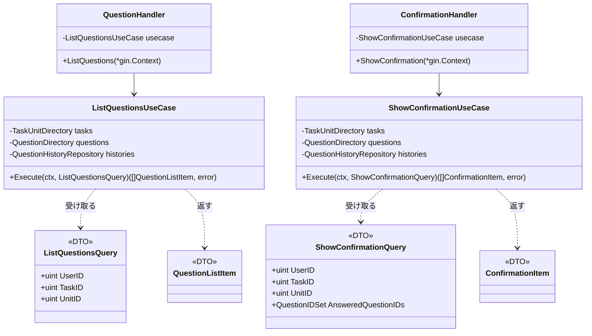
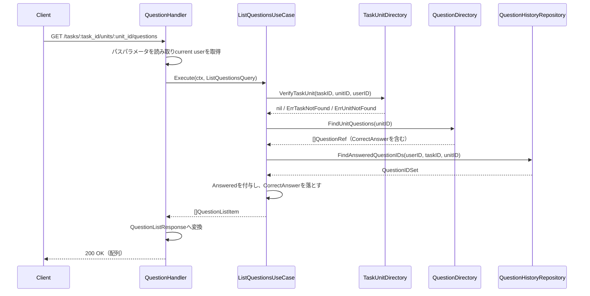
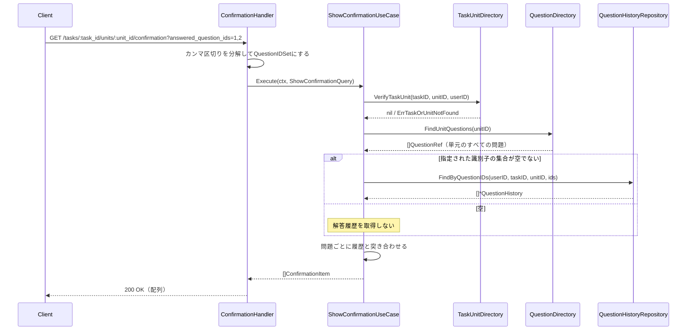
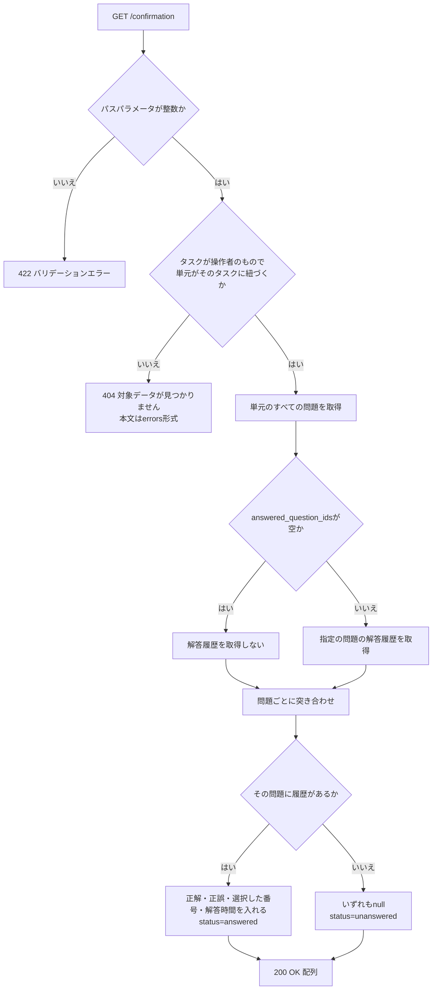

# 問題解答機能 Go実装仕様書 2 問題参照

---

# 1. 機能概要

## 本書が担当するエンドポイント

|Method|Path|Handler|概要|
|-|-|-|-|
|GET|/api/v1/student/tasks/:task_id/units/:unit_id/questions|`question_handler.go`|タスクの単元に紐づく問題一覧を、問題ごとの解答済みかどうかとあわせて取得する|
|GET|/api/v1/student/tasks/:task_id/units/:unit_id/confirmation|`confirmation_handler.go`|解答確認用のデータを取得する|

いずれも参照のみで、状態を変更しない。

## 本書の位置づけ

本書は`問題解答機能_Go実装仕様書_1_基盤.md`（以下「基盤編」）のスライス編である。

基盤編が定めるもの（本書では繰り返さない）:

- Domain層のすべて（Entity・Value Object・Repository Interface・Domain Service・Domain Error）
- Infrastructure層のうち複数のスライスが使うもの（GORMモデル・`QuestionHistoryRepository`の実装・当日の解答件数の実装・他Contextへのアダプタ）
- Transaction・Validation・Authorization・Errorの実装方針
- ディレクトリ構成と機能全体のファイル一覧

本書が定めるもの:

- 上記2エンドポイントのApplication層（UseCase・DTO）
- 同Presentation層（Handler・Response DTO）
- 同API仕様・テストケース設計

## 採用設計パターン

Domain Model（②「4. 設計パターン」）。基盤編「1. 機能概要」を参照。

## 2つのエンドポイントを1つのスライスにまとめた理由

いずれも「タスクの単元に紐づく問題を、解答履歴と突き合わせて返す」という同じ形の参照である。使う参照手段（`TaskUnitDirectory`・`QuestionDirectory`・`QuestionHistoryRepository`）も同じであり、片方だけを見て仕様どおりか確認することに意味がない。

Rails現行ではControllerが分かれているため（`QuestionsController`・`ConfirmationsController`）Handlerは2つに分けるが、文書としては1つにまとめる（③自動生成プロンプト「小さすぎる場合は複数のHandlerを1つのスライス編にまとめてください」）。

---

# 2. ディレクトリ構成

基盤編「2. ディレクトリ構成」の機能全体のファイル一覧のうち、本書が担当するものは以下の10である。

```
internal/questionanswering/application/dto/list_questions_query.go
internal/questionanswering/application/dto/show_confirmation_query.go
internal/questionanswering/application/dto/question_list_item.go
internal/questionanswering/application/dto/confirmation_item.go
internal/questionanswering/application/usecase/list_questions_usecase.go
internal/questionanswering/application/usecase/show_confirmation_usecase.go
internal/questionanswering/presentation/handler/question_handler.go
internal/questionanswering/presentation/handler/confirmation_handler.go
internal/questionanswering/presentation/response/question_list_response.go
internal/questionanswering/presentation/response/confirmation_response.go
```

テストが付くのはUseCase2つとHandler2つの4であり、テスト込みで14となる。

`presentation/request/`配下のファイルを作成しない。いずれのエンドポイントもリクエストボディを持たず、パスパラメータとクエリパラメータのみで動作するためである（①「5. API / 処理詳細」）。

`presentation/routes.go`は`3_解答と提出`が担当する。本書は「9. Presentation層設計」で自身が担当するルートの定義を記載する。

---

# 3. Domain層設計

本書では定義しない。基盤編「3. Domain層設計」を参照。

本書のUseCaseが使うDomain層の要素:

|要素|用途|
|-|-|
|`entity.QuestionHistory`|確認表示で、問題ごとの解答履歴を参照する|
|`valueobject.QuestionIDSet`|解答済みの問題の識別子の集合を扱う|
|`repository.QuestionHistoryRepository`|`FindAnsweredQuestionIDs`・`FindByQuestionIDs`を呼ぶ|
|`domain.ErrTaskNotFound` / `ErrUnitNotFound` / `ErrTaskOrUnitNotFound`|対象が見つからない場合のエラー|

本書だけが使うDomain層の要素はない。Domain Serviceも使わない。いずれのエンドポイントも正誤判定を行わず、既に記録された判定結果を読むだけである。

---

# 4. クラス図

基盤編「4. クラス図」を参照。本書はUseCaseとHandlerを追加するのみである。



UseCaseが受け取る依存はいずれもインターフェースである。`TaskUnitDirectory`・`QuestionDirectory`は基盤編の`dependency.go`、`QuestionHistoryRepository`は基盤編の`domain/repository/`に定義されている。

---

# 5. 状態遷移図

本書の担当範囲に状態を持つものはない。いずれのエンドポイントも参照のみである。

基盤編「5. 状態遷移図」のとおり、解答履歴自体に状態はない。

---

# 6. Application層設計

## DTO（Query）

### ListQuestionsQuery（`application/dto/list_questions_query.go`）

|フィールド|型|意味|
|-|-|-|
|UserID|uint|操作者の識別子|
|TaskID|uint|対象タスクの識別子|
|UnitID|uint|対象単元の識別子|

### ShowConfirmationQuery（`application/dto/show_confirmation_query.go`）

|フィールド|型|意味|
|-|-|-|
|UserID|uint|操作者の識別子|
|TaskID|uint|対象タスクの識別子|
|UnitID|uint|対象単元の識別子|
|AnsweredQuestionIDs|`valueobject.QuestionIDSet`|解答済みとしてクライアントが指定した問題の識別子の集合|

`AnsweredQuestionIDs`は空の集合を許容する。空の場合、解答履歴を1件も取得しない（①「5. API / 処理詳細」`#show`（確認表示））。

クエリパラメータのカンマ区切りの分解はHandlerで行い、UseCaseは集合を受け取る。文字列の形式はHTTPの関心であり、UseCaseに持ち込まない（アーキテクチャ規約「6. データフロー」）。

## DTO（出力）

### QuestionListItem（`application/dto/question_list_item.go`）

|フィールド|型|意味|
|-|-|-|
|ID|uint|問題の識別子|
|UnitID|uint|単元の識別子|
|CourseID|uint|コースの識別子|
|QuestionText|string|問題文|
|Answered|bool|この操作者がこのタスク・単元で解答済みか|
|Hints|`[]QuestionHintItem`|ヒント（識別子・問題の識別子・手順番号・ヒント文）|
|Choices|`[]QuestionChoiceItem`|選択肢（識別子・問題の識別子・選択肢番号・選択肢文）|

**`CorrectAnswer`を持たせない。** 問題一覧は解答前に呼ばれるため、正解をApplication層から外へ出さない（①「5. API / 処理詳細」`#index`）。`QuestionDirectory`が返す`QuestionRef`には`CorrectAnswer`が含まれるが、この DTO へ移す際に落とす。

### ConfirmationItem（`application/dto/confirmation_item.go`）

|フィールド|型|意味|
|-|-|-|
|QuestionID|uint|問題の識別子|
|QuestionText|string|問題文|
|CorrectAnswer|`*string`|正解。**解答履歴がない場合は`nil`**|
|IsCorrect|`*bool`|正誤。解答履歴がない場合は`nil`|
|SelectedChoiceNumber|`*int`|選択した選択肢の番号。解答履歴がない場合は`nil`|
|Status|string|`answered` / `unanswered`|
|TimeSpentSec|`*int`|解答時間。解答履歴がない場合は`nil`|

解答履歴がない問題では`CorrectAnswer`を`nil`にする。正解を未解答の問題について明かさないためである（①「5. API / 処理詳細」`#show`（確認表示））。

`CorrectAnswer`を`*string`とするのは、`questions.correct_answer`がtext型であり、Rails現行がそのまま返しているためである（①「6. データモデル」）。整数へ変換して返さない。整数への変換は正誤判定の内側だけで行う（基盤編「3. Domain層設計」の`AnswerJudgePolicy`）。

`Status`を文字列で持つのは、Rails現行が`answered` / `unanswered`の文字列を返しているためである。真偽値にしない（①「5. API / 処理詳細」`#show`（確認表示））。`IsCorrect`が`nil`かどうかと重複する情報だが、外部仕様を変えない。

## UseCase

### ListQuestionsUseCase（`application/usecase/list_questions_usecase.go`）

|項目|内容|
|-|-|
|struct名|`ListQuestionsUseCase`|
|受け取る依存|`TaskUnitDirectory`、`QuestionDirectory`、`repository.QuestionHistoryRepository`|
|コンストラクタ|`NewListQuestionsUseCase(tasks TaskUnitDirectory, questions QuestionDirectory, histories repository.QuestionHistoryRepository) *ListQuestionsUseCase`|
|メソッド|`Execute(ctx context.Context, q dto.ListQuestionsQuery) ([]dto.QuestionListItem, error)`|

処理ステップ:

1. `tasks.VerifyTaskUnit(ctx, q.TaskID, q.UnitID, q.UserID)`で、タスクが操作者自身のものであり単元がそのタスクに紐づいているかを確認する
2. 失敗した場合、アダプタが返したエラーを`ErrTaskNotFound`または`ErrUnitNotFound`として返す（**404**。基盤編「12. Validation実装方針」）
3. `questions.FindUnitQuestions(ctx, q.UnitID)`で単元に属する問題の一覧を取得する
4. `histories.FindAnsweredQuestionIDs(ctx, q.UserID, q.TaskID, q.UnitID)`で解答済みの問題の識別子の集合を取得する
5. 問題ごとに、集合に含まれるかを`Answered`として付与し、`QuestionListItem`へ変換する。`CorrectAnswer`は落とす
6. 変換した一覧を返す

トランザクションは使用しない。読み取りのみである（基盤編「11. Transaction実装方針」）。

3と4の順序は問わない。いずれも読み取りであり、互いに依存しない。ただし1を先に行う。タスク・単元が操作者のものでない場合に、問題や解答履歴を読まないためである。

問題が0件の場合、空のスライスを返す。エラーにしない（①「5. API / 処理詳細」`#index`）。

**解答履歴の論理削除を除外しない。** `FindAnsweredQuestionIDs`がそのように実装されている（基盤編「8. Infrastructure層設計」）。Rails現行も`answered`の判定で論理削除を除外していない（①「5. API / 処理詳細」`#index`）。

### ShowConfirmationUseCase（`application/usecase/show_confirmation_usecase.go`）

|項目|内容|
|-|-|
|struct名|`ShowConfirmationUseCase`|
|受け取る依存|`TaskUnitDirectory`、`QuestionDirectory`、`repository.QuestionHistoryRepository`|
|コンストラクタ|`NewShowConfirmationUseCase(tasks TaskUnitDirectory, questions QuestionDirectory, histories repository.QuestionHistoryRepository) *ShowConfirmationUseCase`|
|メソッド|`Execute(ctx context.Context, q dto.ShowConfirmationQuery) ([]dto.ConfirmationItem, error)`|

処理ステップ:

1. `tasks.VerifyTaskUnit(ctx, q.TaskID, q.UnitID, q.UserID)`で対象を確認する
2. 失敗した場合、**`ErrTaskOrUnitNotFound`として返す**（404。本文は`errors`形式）。タスクと単元を区別しない
3. `questions.FindUnitQuestions(ctx, q.UnitID)`で単元に属する**すべての**問題を取得する
4. `q.AnsweredQuestionIDs`が空であれば、解答履歴を取得せず空のマップとして扱う
5. 空でなければ`histories.FindByQuestionIDs(ctx, q.UserID, q.TaskID, q.UnitID, q.AnsweredQuestionIDs)`で解答履歴を取得し、問題の識別子で引けるマップにする
6. 問題ごとに、マップに解答履歴があるかで`ConfirmationItem`を組み立てる。履歴がある場合は正解・正誤・選択した番号・解答時間を入れ、`Status`を`answered`とする。ない場合はいずれも`nil`とし、`Status`を`unanswered`とする
7. 変換した一覧を返す

トランザクションは使用しない。

**問題一覧とエラーの扱いが異なる。** 問題一覧は`ErrTaskNotFound` / `ErrUnitNotFound`（本文は`message`形式、名称は`タスク` / `Unit`）を返すが、確認表示は`ErrTaskOrUnitNotFound`（本文は`errors`形式、メッセージは`対象データが見つかりません`）を返す。Rails現行の`ConfirmationsController`が独自に例外を捕まえているためである（①「6. データモデル」の「エラーレスポンスの本文」、基盤編「14. Error実装方針」）。

**対象は単元のすべての問題である。** `AnsweredQuestionIDs`で絞り込まれるのは解答履歴の検索条件だけであり、返す問題の範囲ではない（①「5. API / 処理詳細」`#show`（確認表示））。クライアントが解答済みと伝えなかった問題も`unanswered`として返る。

同じ問題に対する解答履歴が複数ある場合、マップへの格納で後勝ちになる。Rails現行も`index_by(&:question_id)`で同じ結果になる（同）。重複した履歴が作られうるのは①「5. API / 処理詳細」`#create`のとおりである。

---

# 7. シーケンス図・処理フロー図

## シーケンス図

### ListQuestions



### ShowConfirmation



## 処理フロー図

### ShowConfirmation

解答履歴の有無による分岐があるため図示する。



`ListQuestions`は分岐が対象の確認のみであるため、処理フロー図を省略する。処理順序は「6. Application層設計」に記載したとおりである。

---

# 8. Infrastructure層設計

本書で追加するInfrastructure層の実装はない。

本書のUseCaseが使う実装はいずれも基盤編が定める。

|使う実装|定義元|
|-|-|
|`QuestionHistoryRepository`の実装（`FindAnsweredQuestionIDs` / `FindByQuestionIDs`）|基盤編「8. Infrastructure層設計」|
|`TaskUnitDirectory`の実装|同|
|`QuestionDirectory`の実装|同|

`QuestionDirectory.FindUnitQuestions`が返す`QuestionRef`には`CorrectAnswer`が含まれる。確認表示が必要とするためである。問題一覧ではUseCaseが落とす（「6. Application層設計」）。

---

# 9. Presentation層設計

## Handler

### QuestionHandler（`presentation/handler/question_handler.go`）

|項目|内容|
|-|-|
|struct名|`QuestionHandler`|
|受け取る依存|`*usecase.ListQuestionsUseCase`|
|コンストラクタ|`NewQuestionHandler(u *usecase.ListQuestionsUseCase) *QuestionHandler`|

|メソッド|HTTPメソッド|パス|
|-|-|-|
|`ListQuestions`|GET|/api/v1/student/tasks/:task_id/units/:unit_id/questions|

処理順序:

1. `c.Request.Context()`からcurrent user（認証Middlewareが格納したstudentユーザー）を取得する
2. パスパラメータ`task_id`・`unit_id`を整数として読み取る。解釈できない場合は422のAppErrorへ変換して`c.Error(err)`で返す
3. `ListQuestionsQuery`を組み立ててUseCaseを呼ぶ
4. エラーが返った場合は`c.Error(err)`で返す。ステータスへの変換はミドルウェアが行う（基盤編「14. Error実装方針」）
5. `[]QuestionListItem`を`QuestionListResponse`へ変換する
6. 200 OKで返す

リクエストボディのバインドは行わない。

### ConfirmationHandler（`presentation/handler/confirmation_handler.go`）

|項目|内容|
|-|-|
|struct名|`ConfirmationHandler`|
|受け取る依存|`*usecase.ShowConfirmationUseCase`|
|コンストラクタ|`NewConfirmationHandler(u *usecase.ShowConfirmationUseCase) *ConfirmationHandler`|

|メソッド|HTTPメソッド|パス|
|-|-|-|
|`ShowConfirmation`|GET|/api/v1/student/tasks/:task_id/units/:unit_id/confirmation|

処理順序:

1. current userを取得する
2. パスパラメータ`task_id`・`unit_id`を整数として読み取る
3. クエリパラメータ`answered_question_ids`を読み取る。カンマで分解し、各要素を整数へ変換して`QuestionIDSet`にする
4. **分解・変換に失敗した要素は捨てる。エラーにしない。** 空文字・整数に変換できない値は無視する（①「5. API / 処理詳細」`#show`（確認表示））
5. `ShowConfirmationQuery`を組み立ててUseCaseを呼ぶ
6. エラーが返った場合は`c.Error(err)`で返す
7. `[]ConfirmationItem`を`ConfirmationResponse`へ変換する
8. 200 OKで返す

**4がこのHandler固有の扱いである。** Rails現行は`params[:answered_question_ids].split(',').map(&:to_i)`で変換しており、整数に変換できない値は`0`になる。`0`は存在しない問題の識別子であるため、解答履歴の検索で何にも一致せず結果に影響しない。本書では捨てる形とする。`0`を集合に含めても結果は変わらないが、意味のない値を集合に入れないためである。

この違いは外部から観測できない。検索に一致しない識別子を渡すか、渡さないかの差であり、レスポンスは同じになる。

## Request DTO

本書の担当範囲では定義しない。リクエストボディを持つエンドポイントがないためである。

パスパラメータ・クエリパラメータの読み取りはHandlerが直接行う。struct へのバインドを設けない。項目が少なく、`uri`タグ・`form`タグのstructを設ける利点がないためである。

## Response DTO

### QuestionListResponse（`presentation/response/question_list_response.go`）

最上位は**配列**である。キーでラップしない（①「5. API / 処理詳細」`#index`）。

|struct名|フィールド|型|JSONキー|
|-|-|-|-|
|`QuestionResponse`|ID|`uint`|`id`|
||UnitID|`uint`|`unit_id`|
||QuestionText|`string`|`question_text`|
||CourseID|`uint`|`course_id`|
||Answered|`bool`|`answered`|
||QuestionHints|`[]QuestionHintResponse`|`question_hints`|
||QuestionChoices|`[]QuestionChoiceResponse`|`question_choices`|
|`QuestionHintResponse`|ID|`uint`|`id`|
||QuestionID|`uint`|`question_id`|
||StepNumber|`*int`|`step_number`|
||HintText|`*string`|`hint_text`|
|`QuestionChoiceResponse`|ID|`uint`|`id`|
||QuestionID|`uint`|`question_id`|
||ChoiceNumber|`*int`|`choice_number`|
||ChoiceText|`*string`|`choice_text`|

Handlerは`[]QuestionResponse`をそのまま返す。

**`correct_answer`を含めない。** 解答前に正解を明かさないためである（同）。

`step_number`・`hint_text`・`choice_number`・`choice_text`をポインタとするのは、`question_hints`・`question_choices`の該当カラムがNULL可であるためである（①「10. Rails実装対応表」の各Serializerに対応するテーブル定義）。

項目の順序と名前はRails現行の`QuestionSerializer`・`QuestionHintSerializer`・`QuestionChoiceSerializer`に合わせる（同）。

### ConfirmationResponse（`presentation/response/confirmation_response.go`）

最上位は**配列**である。キーでラップしない（①「5. API / 処理詳細」`#show`（確認表示））。

|struct名|フィールド|型|JSONキー|
|-|-|-|-|
|`ConfirmationResponse`|QuestionID|`uint`|`question_id`|
||QuestionText|`string`|`question_text`|
||CorrectAnswer|`*string`|`correct_answer`|
||IsCorrect|`*bool`|`is_correct`|
||SelectedChoiceNumber|`*int`|`selected_choice_number`|
||Status|`string`|`status`|
||TimeSpentSec|`*int`|`time_spent_sec`|

Handlerは`[]ConfirmationResponse`をそのまま返す。

解答履歴がない問題では`correct_answer`・`is_correct`・`selected_choice_number`・`time_spent_sec`がいずれも`null`になる（同）。

`question_id`というキー名は、問題の識別子を`id`ではなく`question_id`として返すRails現行の`QuestionConfirmationSerializer`に合わせる（①「10. Rails実装対応表」）。問題一覧が`id`で返すのと異なるが、外部仕様を変えない。

## Routing

本書が担当するルートの定義は以下である。登録は`3_解答と提出`が担当する`presentation/routes.go`で行う。

|Method|Path|Handler|
|-|-|-|
|GET|/api/v1/student/tasks/:task_id/units/:unit_id/questions|`QuestionHandler.ListQuestions`|
|GET|/api/v1/student/tasks/:task_id/units/:unit_id/confirmation|`ConfirmationHandler.ShowConfirmation`|

いずれも認証Middleware・`student`ロール確認Middlewareを経由する。**GETのためCSRF検証Middlewareの対象外である**（基盤編「13. Authorization実装方針」）。

パスは`tasks`→`units`の入れ子である。Rails現行の`resources :tasks do resources :units do resources :questions ... resource :confirmation ... end end`に対応する（①「4. API一覧」）。確認表示は単数形（`confirmation`）である。

---

# 10. API仕様

|Method|Path|Handler|Request|Response|Status Code|
|-|-|-|-|-|-|
|GET|/api/v1/student/tasks/:task_id/units/:unit_id/questions|ListQuestions|パス: `task_id`・`unit_id`|`[]QuestionResponse`|200|
|GET|/api/v1/student/tasks/:task_id/units/:unit_id/confirmation|ShowConfirmation|パス: `task_id`・`unit_id`、クエリ: `answered_question_ids`|`[]ConfirmationResponse`|200|

いずれもリクエストボディを持たない。レスポンスは最上位が配列である。

エラーレスポンスの本文は基盤編「14. Error実装方針」のとおり。

## 全Endpoint共通

|条件|Status Code|Error内容|
|-|-|-|
|未認証|401|認証Middlewareが返す|
|`student`ロールでない|403|ロール確認Middlewareが返す|
|パスパラメータが整数でない|422|`{"errors": [...]}`|

CSRFの対象外であるため、CSRFに起因するエラーは発生しない。

## GET /api/v1/student/tasks/:task_id/units/:unit_id/questions

|条件|Status Code|Error内容|
|-|-|-|
|対象のタスクが存在しない、または他の生徒のタスク|404|`ErrTaskNotFound`。本文は`{"message": "タスクが見つかりません"}`|
|対象の単元がそのタスクに紐づかない|404|`ErrUnitNotFound`。本文は`{"message": "Unitが見つかりません"}`。**モデル名の日本語訳がないため名称が英語になる**|

問題が0件の場合は空配列を返す。エラーにしない。

## GET /api/v1/student/tasks/:task_id/units/:unit_id/confirmation

|条件|Status Code|Error内容|
|-|-|-|
|対象のタスクまたは単元が見つからない（他の生徒のタスクを含む）|404|`ErrTaskOrUnitNotFound`。本文は**`{"errors": ["対象データが見つかりません"]}`**|

**同じ404でも問題一覧と本文の形が異なる。** Rails現行の`ConfirmationsController`が独自に例外を捕まえているためである（①「6. データモデル」の「エラーレスポンスの本文」）。Rails側で統一する修正の方針があるが、修正までは現行の形を維持する（基盤編「14. Error実装方針」）。

`answered_question_ids`に不正な値が含まれていてもエラーにしない。該当の要素を捨てて処理を続ける（「9. Presentation層設計」）。

---

# 11. Transaction実装方針

本書の担当範囲ではトランザクションを使用しない。いずれのエンドポイントも読み取りのみである（基盤編「11. Transaction実装方針」）。

`gormtx.RunInTx`を呼ぶ箇所はない。

---

# 12. Validation実装方針

基盤編「12. Validation実装方針」を参照。本書の担当範囲に固有のものは以下である。

|検証|層|扱い|
|-|-|-|
|パスパラメータ`task_id`・`unit_id`が整数か|Presentation|整数でなければ422|
|クエリパラメータ`answered_question_ids`の形式|Presentation|**検証しない。** 整数に変換できない要素は捨てる（①「5. API / 処理詳細」`#show`（確認表示））|
|タスクが操作者自身のものか|UseCase（`TaskUnitDirectory`）|問題一覧は`ErrTaskNotFound`、確認表示は`ErrTaskOrUnitNotFound`|
|単元がそのタスクに紐づくか|同|問題一覧は`ErrUnitNotFound`、確認表示は`ErrTaskOrUnitNotFound`|

リクエストボディを持たないため、必須チェック・型チェックの対象は実質パスパラメータのみである。

Domain層の検証は行わない。本書のUseCaseはEntityを新しく生成せず、既に記録された解答履歴を読むだけである。

---

# 13. Authorization実装方針

基盤編「13. Authorization実装方針」を参照。本書の担当範囲に固有のものは以下である。

- いずれもGETであり、**CSRF検証Middlewareの対象外**である（Gin規約「5. CSRF対策」の「適用範囲」）
- 所有権のスコープは`TaskUnitDirectory.VerifyTaskUnit`に操作者の識別子を渡すことで担保する
- 解答履歴の取得も操作者の識別子を条件に含める（`FindAnsweredQuestionIDs`・`FindByQuestionIDs`）。他の生徒の解答履歴が混ざらない

「存在しない」と「他の生徒のもの」を区別しない。いずれも同じエラーとして扱う（①「8. 権限制御」）。

---

# 14. Error実装方針

基盤編「14. Error実装方針」を参照。本書の担当範囲に固有のものは以下である。

|Error|発生箇所|HTTP Status|ボディ|
|-|-|-|-|
|`ErrTaskNotFound`|`ListQuestionsUseCase`|404|`{"message": "タスクが見つかりません"}`|
|`ErrUnitNotFound`|`ListQuestionsUseCase`|404|`{"message": "Unitが見つかりません"}`|
|`ErrTaskOrUnitNotFound`|`ShowConfirmationUseCase`|404|`{"errors": ["対象データが見つかりません"]}`|
|パスパラメータの形式不正|Handler|422|`{"errors": [...]}`|

**同じ原因（タスク・単元が見つからない）を、UseCaseによって別のセンチネルエラーへ変換する。** `TaskUnitDirectory`のアダプタは「見つからない」という事実のみを返し、どのエラーにするかはUseCaseが決める（基盤編「14. Error実装方針」）。

`ListQuestionsUseCase`はタスクと単元を区別するが、`ShowConfirmationUseCase`は区別しない。Rails現行の`ConfirmationsController`が`set_questions`で両方を1つの`rescue`にまとめているためである（①「5. API / 処理詳細」`#show`（確認表示））。

本書の担当範囲に500になる経路はない。`QuestionDirectory`・`QuestionHistoryRepository`が技術的な障害を返した場合は、未分類のエラーとして500になる（基盤編「14. Error実装方針」）。

---

# 15. GORM / DBクエリ設計

本書で追加するクエリはない。基盤編「15. GORM / DBクエリ設計」を参照。

本書のUseCaseが発行するクエリ:

|メソッド|クエリ内容|論理削除の扱い|
|-|-|-|
|`FindAnsweredQuestionIDs`|`user_id`・`task_id`・`unit_id`で絞り込み、`question_id`を重複なく取得|**除外しない**|
|`FindByQuestionIDs`|上記に加えて`question_id IN (...)`|**除外しない**|

いずれも論理削除を除外しない。Rails現行が`answered`の判定・確認表示で除外していないためである（①「6. データモデル」）。基盤編の`CountAnsweredByTask`（提出の判定）だけが除外する点と対照的である。

`questions`・`question_choices`・`question_hints`へは本Contextからクエリを発行しない。`QuestionDirectory`経由で取得する（②「21. DB操作仕様」）。

ソート・ページネーションは行わない。問題の並び順は`curriculum`が決める。

---

# 16. テストケース設計

②「22. テスト戦略」のうち、本書の担当範囲のテストケースを記載する。Domain Test・Repository Testは基盤編に記載した。

## UseCase Test

### ListQuestionsUseCase

|テストケース|
|-|
|正常系: 問題一覧が返り、解答済みの問題に`Answered`が真で付与されること|
|正常系: 未解答の問題は`Answered`が偽であること|
|正常系: `QuestionListItem`に`CorrectAnswer`に相当するフィールドがないこと（正解が外へ出ないこと）|
|正常系: 問題が0件のとき空のスライスが返り、エラーにならないこと|
|正常系: ヒント・選択肢が入れ子で変換されること|
|異常系: `VerifyTaskUnit`がタスクの不存在を返した場合に`ErrTaskNotFound`を返すこと|
|異常系: `VerifyTaskUnit`が単元の不存在を返した場合に`ErrUnitNotFound`を返すこと|
|異常系: 対象の確認が失敗した場合、問題の取得・解答履歴の取得を呼ばないこと|
|正常系: `FindAnsweredQuestionIDs`に操作者・タスク・単元の識別子が渡されること|

### ShowConfirmationUseCase

|テストケース|
|-|
|正常系: 単元のすべての問題が返ること（指定された識別子で絞られないこと）|
|正常系: 解答履歴がある問題は`Status`が`answered`で、正解・正誤・選択した番号・解答時間が入ること|
|正常系: 解答履歴がない問題は`Status`が`unanswered`で、4項目がいずれも`nil`であること|
|正常系: **指定された識別子の集合が空のとき、解答履歴を取得せずすべて`unanswered`になること**|
|正常系: 指定された識別子に解答履歴のないものが含まれていても、その問題が`unanswered`として返ること|
|正常系: 同じ問題に解答履歴が複数ある場合、1件が選ばれて結果が組み立てられること|
|異常系: `VerifyTaskUnit`が失敗した場合に`ErrTaskOrUnitNotFound`を返すこと（タスクと単元を区別しないこと）|

## Handler Test

### QuestionHandler.ListQuestions

|テストケース|
|-|
|正常系: 最上位が配列で200が返ること|
|正常系: 各要素が`id`・`unit_id`・`question_text`・`course_id`・`answered`・`question_hints`・`question_choices`を持つこと|
|正常系: **`correct_answer`がレスポンスに含まれないこと**|
|正常系: 問題が0件のとき空配列が返ること|
|異常系: `task_id`が整数でない場合に422が返ること|
|異常系: タスクの不存在で404と`{"message": "タスクが見つかりません"}`が返ること|
|異常系: 単元の不存在で404と`{"message": "Unitが見つかりません"}`が返ること|

### ConfirmationHandler.ShowConfirmation

|テストケース|
|-|
|正常系: 最上位が配列で200が返ること|
|正常系: 各要素の問題の識別子が`question_id`キーで返ること（`id`ではないこと）|
|正常系: 解答履歴がない問題で`correct_answer`・`is_correct`・`selected_choice_number`・`time_spent_sec`が`null`になること|
|正常系: `answered_question_ids`が未指定のときすべて`unanswered`で返ること|
|正常系: `answered_question_ids`が`1,2,3`の形で分解されること|
|正常系: **`answered_question_ids`に空文字や整数でない値が含まれていてもエラーにならず、該当の要素が無視されること**|
|異常系: 対象の不存在で404と**`{"errors": ["対象データが見つかりません"]}`**が返ること|

## Integration Test

|テストケース|
|-|
|問題一覧: 解答を登録したあとに`answered`が真になること|
|問題一覧: 論理削除済みの解答履歴でも`answered`が真になること|
|確認表示: 解答を登録したあとに`status`が`answered`になり、正解・正誤が返ること|
|確認表示: 単元に問題を追加したあと、その問題が`unanswered`として返ること|
|認可: 未認証・`student`ロール以外のユーザーがアクセスした場合に拒否されること|
|認可: 他の生徒のタスクを指定した場合に404になること|
|認可: 他の生徒の解答履歴が`answered`・確認表示に混ざらないこと|
|CSRF: GETのためCSRFトークンなしでも成功すること|
|エラーハンドラ: 同じ404でも問題一覧は`message`キー、確認表示は`errors`キーの本文になること|

---

# 17. ②からの補足事項

②に明記がなく、実装のために追加で判断した内容のうち、本書の担当範囲のものを記載する。基盤編に固有のものは基盤編「17. ②からの補足事項」を参照。

|判断した内容|判断理由|推測かどうか|
|-|-|-|
|問題一覧と確認表示を1つのスライス編にまとめた|いずれも「タスクの単元に紐づく問題を解答履歴と突き合わせて返す」同じ形の参照であり、使う参照手段も同じである。片方だけを見て仕様どおりか確認することに意味がない（③自動生成プロンプト「小さすぎる場合は複数のHandlerを1つのスライス編にまとめてください」）|補足（プロンプトの適用）|
|`QuestionListItem`に正解を持たせず、UseCaseで落とすことにした|`QuestionDirectory`が返す`QuestionRef`には正解が含まれるが、問題一覧は解答前に呼ばれる。正解をApplication層から外へ出さない（①「5. API / 処理詳細」`#index`）|補足（①の実体に基づく）|
|`ConfirmationItem.CorrectAnswer`を`*string`とした|`questions.correct_answer`がtext型であり、Rails現行がそのまま返している（①「6. データモデル」）。整数へ変換して返さない|補足（①の実体に基づく）|
|`ConfirmationItem.Status`を文字列で持たせた|Rails現行が`answered` / `unanswered`の文字列を返している。`IsCorrect`が`nil`かどうかと重複する情報だが、外部仕様を変えない（①「5. API / 処理詳細」`#show`（確認表示））|補足（①の実体に基づく）|
|確認表示のレスポンスで問題の識別子を`question_id`キーとした|Rails現行の`QuestionConfirmationSerializer`が`question_id`で返している。問題一覧が`id`で返すのと異なるが、外部仕様を変えない（①「10. Rails実装対応表」）|補足（①の実体に基づく）|
|`answered_question_ids`の整数に変換できない要素を捨てることにした|Rails現行は`to_i`で`0`に変換しており、`0`は存在しない問題の識別子であるため検索で一致せず結果に影響しない。意味のない値を集合に入れないため捨てる形とした。**この違いは外部から観測できない**|補足（レスポンスが同じになるため外部仕様の変更にあたらない）|
|Request DTOのstructを設けず、Handlerがパスパラメータ・クエリパラメータを直接読むことにした|項目が少なく、`uri`タグ・`form`タグのstructを設ける利点がない。リクエストボディを持つエンドポイントもない|補足（実装レベルの整理）|
|カンマ区切りの分解をHandlerで行い、UseCaseは集合を受け取る形にした|文字列の形式はHTTPの関心であり、UseCaseに持ち込まない（アーキテクチャ規約「6. データフロー」）|補足（規約の適用）|
|`ListQuestionsUseCase`はタスクと単元のエラーを区別し、`ShowConfirmationUseCase`は区別しないことにした|Rails現行の`ConfirmationsController`が`set_questions`で両方を1つの`rescue`にまとめており、本文も`errors`形式である（①「5. API / 処理詳細」`#show`（確認表示））|補足（①の実体に基づく）|
|`step_number`・`hint_text`・`choice_number`・`choice_text`をポインタとした|`question_hints`・`question_choices`の該当カラムがNULL可である（①「10. Rails実装対応表」の各Serializerに対応するテーブル定義）|補足（①の実体に基づく）|

レスポンスの形状（最上位が配列・`correct_answer`を含めない・`question_id`キー）、ステータスコード、404の本文の形の違い、論理削除を除外しない扱いは、いずれも①に根拠があるため推測ではない。根拠はそれぞれ該当節に記載した。
