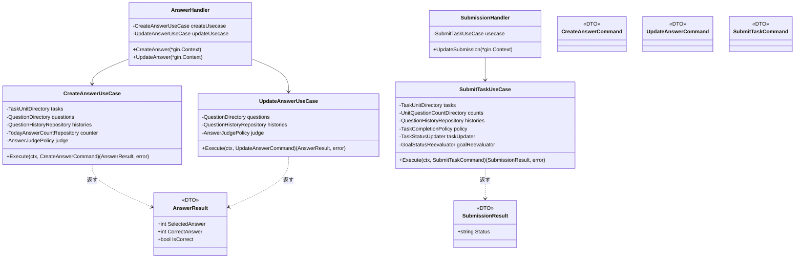
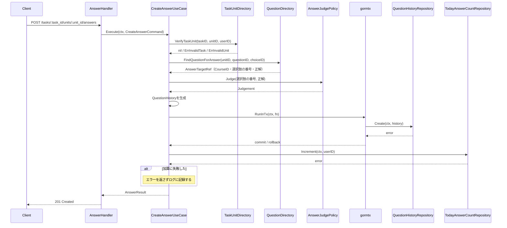
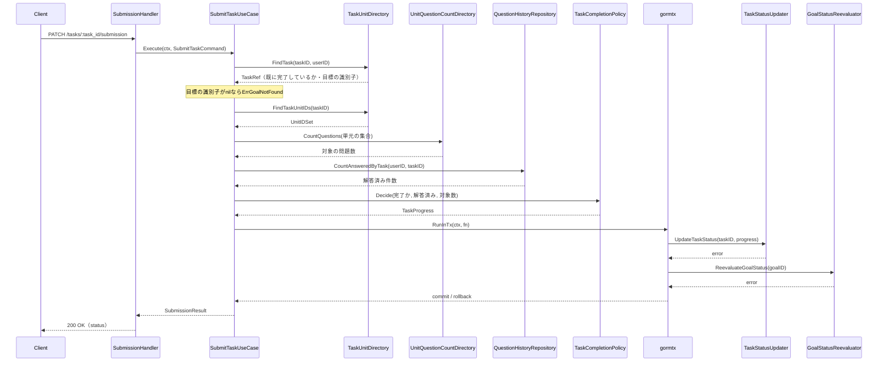
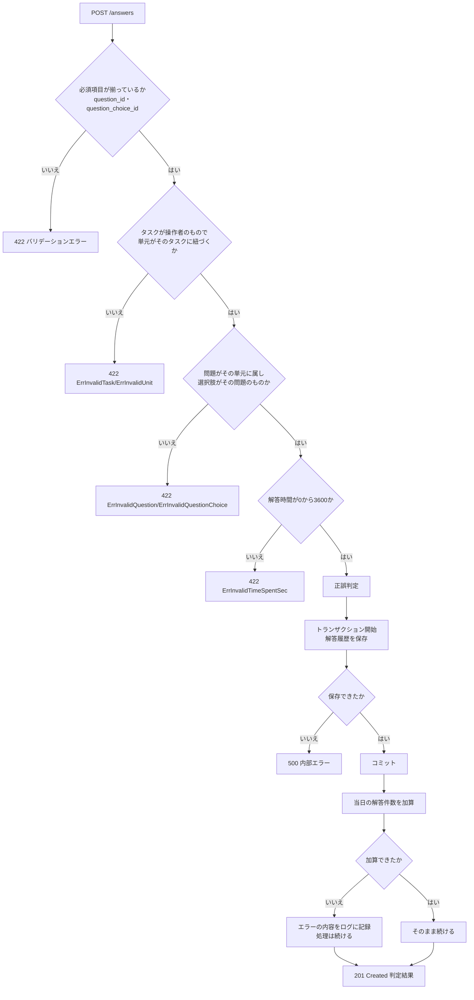
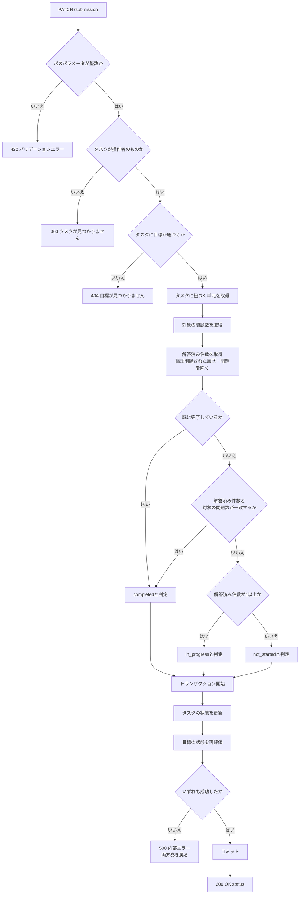

# 問題解答機能 Go実装仕様書 3 解答と提出

---

# 1. 機能概要

## 本書が担当するエンドポイント

|Method|Path|Handler|概要|
|-|-|-|-|
|POST|/api/v1/student/tasks/:task_id/units/:unit_id/answers|`answer_handler.go`|問題への解答を登録し、正誤を判定する|
|PATCH|/api/v1/student/tasks/:task_id/units/:unit_id/answers/update|`answer_handler.go`|既存の解答履歴を更新し、再判定する|
|PATCH|/api/v1/student/tasks/:task_id/submission|`submission_handler.go`|タスクを提出し、タスクと目標の状態を更新する|

いずれも状態を変更する。他機能への波及もこのスライスに集中する。

- **解答の登録**: 当日の解答件数（Redis のカウンタ）を1加算する。この値は「ダッシュボード機能」が表示に用いる（①「9. 非同期処理」）
- **提出**: タスクの状態と、タスクが属する目標の状態を更新する（①「5. API / 処理詳細」`#update`（提出））

## 本書の位置づけ

本書は`問題解答機能_Go実装仕様書_1_基盤.md`（以下「基盤編」）のスライス編である。

基盤編が定めるもの（本書では繰り返さない）:

- Domain層のすべて（Entity・Value Object・Repository Interface・Domain Service・Domain Error）
- Infrastructure層のうち複数のスライスが使うもの（GORMモデル・`QuestionHistoryRepository`の実装・当日の解答件数の実装・他Contextへのアダプタ）
- Transaction・Validation・Authorization・Errorの実装方針
- ディレクトリ構成と機能全体のファイル一覧

本書が定めるもの:

- 上記3エンドポイントのApplication層（UseCase・DTO）
- 同Presentation層（Handler・Request / Response DTO）
- 同API仕様・テストケース設計
- `presentation/routes.go`（**機能全体のルート登録**）

## 3つのエンドポイントを1つのスライスにまとめた理由

提出は単独では4ファイルと小さい。解答の登録・更新と同じスライス編にまとめた（③自動生成プロンプト「小さすぎる場合は複数のHandlerを1つのスライス編にまとめてください」）。

いずれも状態を変更する操作であり、他機能への波及もこの3つに集中する。トランザクション境界の違い（解答は書き込み1件、提出は他Contextの2つの書き込みにまたがる）を並べて確認できる点でもまとめる意味がある。

## 採用設計パターン

Domain Model（②「4. 設計パターン」）。基盤編「1. 機能概要」を参照。

---

# 2. ディレクトリ構成

基盤編「2. ディレクトリ構成」の機能全体のファイル一覧のうち、本書が担当するものは以下の13である。

```
internal/questionanswering/application/dto/create_answer_command.go
internal/questionanswering/application/dto/update_answer_command.go
internal/questionanswering/application/dto/submit_task_command.go
internal/questionanswering/application/dto/answer_result.go
internal/questionanswering/application/dto/submission_result.go
internal/questionanswering/application/usecase/create_answer_usecase.go
internal/questionanswering/application/usecase/update_answer_usecase.go
internal/questionanswering/application/usecase/submit_task_usecase.go
internal/questionanswering/presentation/handler/answer_handler.go
internal/questionanswering/presentation/handler/submission_handler.go
internal/questionanswering/presentation/request/answer_request.go
internal/questionanswering/presentation/response/answer_response.go
internal/questionanswering/presentation/response/submission_response.go
internal/questionanswering/presentation/routes.go
```

テストが付くのはUseCase3つとHandler2つの5であり、テスト込みで18となる。`routes.go`・Request / Response DTOにはテストを付けない（③自動生成プロンプト「ファイル数の見積り」）。

上の一覧は14行だが、`routes.go`は機能全体のルート登録であり本書が担当するため、本書の実装ファイル数は13＋`routes.go`の14として数える。基盤編「2. ディレクトリ構成」の表に記載した「13」は`routes.go`を除いた数である。

`presentation/request/answer_request.go`は解答の登録・更新で共有する。両者の入力項目が同一であるためである（①「5. API / 処理詳細」`#create`・`#update`（解答））。提出はリクエストボディを持たないためRequest DTOを設けない。

---

# 3. Domain層設計

本書では定義しない。基盤編「3. Domain層設計」を参照。

本書のUseCaseが使うDomain層の要素:

|要素|用途|
|-|-|
|`entity.QuestionHistory`|解答履歴の生成・更新|
|`valueobject.Judgement`|正誤判定の結果|
|`valueobject.TimeSpentSec`|解答時間|
|`valueobject.AnsweredAt`|解答日時|
|`valueobject.TaskProgress`|タスクのあるべき状態|
|`valueobject.UnitIDSet`|提出で対象の問題数を数えるための単元の識別子の集合|
|`repository.QuestionHistoryRepository`|`Create`・`Update`・`FindByAnswerKey`・`CountAnsweredByTask`を呼ぶ|
|`repository.TodayAnswerCountRepository`|`Increment`を呼ぶ|
|`service.AnswerJudgePolicy`|正誤判定|
|`service.TaskCompletionPolicy`|タスクのあるべき状態の判定|
|Domain Error（基盤編の一覧）|入力・業務検証の失敗|

本書だけが使うDomain層の要素はない。基盤編が定めたものをすべて使う。

**基盤編のDomain Serviceを使うのは本書だけである。** `2_問題参照`は判定を行わず、既に記録された結果を読むだけである。

---

# 4. クラス図

基盤編「4. クラス図」を参照。本書はUseCaseとHandlerを追加するのみである。



`AnswerHandler`が2つのUseCaseを受け取るのは、Rails現行の`AnswersController`が`create`・`update`の両方を持つためである（①「4. API一覧」）。

`UpdateAnswerUseCase`が`TaskUnitDirectory`を受け取らないのは、タスク・単元・問題の紐づきを確認しないためである（下記）。

---

# 5. 状態遷移図

本書が扱う解答履歴に状態はない（基盤編「5. 状態遷移図」）。

提出が判定するタスクのあるべき状態の遷移は基盤編「5. 状態遷移図」に記載した。本書ではその判定結果を`task-management`へ渡す。

---

# 6. Application層設計

## DTO（Command）

### CreateAnswerCommand（`application/dto/create_answer_command.go`）

|フィールド|型|意味|
|-|-|-|
|UserID|uint|操作者の識別子|
|TaskID|uint|対象タスクの識別子|
|UnitID|uint|対象単元の識別子|
|QuestionID|uint|対象問題の識別子|
|QuestionChoiceID|uint|選択した選択肢の識別子|
|AnswerText|`*string`|テキスト解答。任意|
|TimeSpentSec|`*int`|解答時間。任意。検証はDomain層で行う|
|ExplanationViewed|bool|解説を閲覧したか。未指定は`false`|

### UpdateAnswerCommand（`application/dto/update_answer_command.go`）

`CreateAnswerCommand`と同じ8項目である。入力項目が同一であるため（①「5. API / 処理詳細」`#update`（解答））。

同じ型を共有せず別に定義する。扱いが異なるためである（登録は紐づきを確認し当日の解答件数を加算する、更新はいずれも行わない）。将来どちらかの入力が変わったときに他方が巻き込まれないようにする。

### SubmitTaskCommand（`application/dto/submit_task_command.go`）

|フィールド|型|意味|
|-|-|-|
|UserID|uint|操作者の識別子|
|TaskID|uint|対象タスクの識別子|

## DTO（出力）

### AnswerResult（`application/dto/answer_result.go`）

|フィールド|型|意味|
|-|-|-|
|SelectedAnswer|int|選択した選択肢の番号|
|CorrectAnswer|int|正解の番号|
|IsCorrect|bool|正誤|

`valueobject.Judgement`の3つの値をそのまま移す（基盤編「3. Domain層設計」）。登録・更新で同じ型を返す。Rails現行がいずれも同じ3項目を返しているためである（①「5. API / 処理詳細」）。

作成した解答履歴の識別子を含めない。Rails現行が返していないためである（同）。

### SubmissionResult（`application/dto/submission_result.go`）

|フィールド|型|意味|
|-|-|-|
|Status|string|判定したタスクの状態（`not_started` / `in_progress` / `completed`）|

`valueobject.TaskProgress`の`String()`の結果を入れる。整数のままPresentation層へ渡さない（アーキテクチャ規約「6. データフロー」）。

## UseCase

### CreateAnswerUseCase（`application/usecase/create_answer_usecase.go`）

|項目|内容|
|-|-|
|struct名|`CreateAnswerUseCase`|
|受け取る依存|`TaskUnitDirectory`、`QuestionDirectory`、`repository.QuestionHistoryRepository`、`repository.TodayAnswerCountRepository`、`*service.AnswerJudgePolicy`、`*gorm.DB`（トランザクションの開始に用いる）、現在時刻の取得手段、ログ出力|
|メソッド|`Execute(ctx context.Context, cmd dto.CreateAnswerCommand) (dto.AnswerResult, error)`|

処理ステップ:

1. `tasks.VerifyTaskUnit(ctx, cmd.TaskID, cmd.UnitID, cmd.UserID)`で、タスクが操作者自身のものであり単元がそのタスクに紐づいているかを確認する
2. 失敗した場合、`ErrInvalidTask`または`ErrInvalidUnit`として返す（**422**。404ではない。基盤編「12. Validation実装方針」）
3. `questions.FindQuestionForAnswer(ctx, cmd.UnitID, cmd.QuestionID, cmd.QuestionChoiceID)`で、問題がその単元に属し選択肢がその問題のものであることを確認し、判定に必要な値（コースの識別子・選択肢の番号・問題の正解）を受け取る
4. 失敗した場合、`ErrInvalidQuestion`または`ErrInvalidQuestionChoice`として返す（422）
5. `judge.Judge(選択肢の番号, 問題の正解)`で`Judgement`を得る
6. `valueobject.NewTimeSpentSec(cmd.TimeSpentSec)`・`NewAnsweredAt(現在時刻)`を生成する。範囲外の解答時間は`ErrInvalidTimeSpentSec`として返す（422）
7. `entity.NewQuestionHistory(...)`で解答履歴を生成する。`courseID`は3で受け取った値を入れる
8. `gormtx.RunInTx`でトランザクションを開始し、`histories.Create`を呼ぶ
9. コミット後、`counter.Increment(ctx, cmd.UserID)`で当日の解答件数を1加算する
10. **9が失敗した場合、エラーを返さず内容をログに記録する**（基盤編「14. Error実装方針」）
11. `AnswerResult`を返す

**9をトランザクションの外・コミット後に置く。** 当日の解答件数はRedisに保持されており、RDBのトランザクションに含められない。逆の順序（先に加算）にすると、保存が失敗したときに件数だけが増える（基盤編「11. Transaction実装方針」）。

**9の失敗を吸収する。** 加算の失敗で解答の記録が失敗してはならない。解答は既にコミットされており巻き戻すこともできない（①「9. 非同期処理」）。ログレベルはエラーとする。

1〜7はトランザクションの外で行う。他Contextの参照と値の生成であり、書き込みを含まないためである。

**重複した解答履歴を防がない。** 同一のタスク・単元・問題に対して複数回呼ばれても、そのたびに新しい履歴を作る。Rails現行の挙動を維持する（①「5. API / 処理詳細」`#create`、②「17. Error設計」の「Rails現行の挙動を維持するもの」）。

### UpdateAnswerUseCase（`application/usecase/update_answer_usecase.go`）

|項目|内容|
|-|-|
|struct名|`UpdateAnswerUseCase`|
|受け取る依存|`QuestionDirectory`、`repository.QuestionHistoryRepository`、`*service.AnswerJudgePolicy`、`*gorm.DB`、現在時刻の取得手段|
|メソッド|`Execute(ctx context.Context, cmd dto.UpdateAnswerCommand) (dto.AnswerResult, error)`|

処理ステップ:

1. `histories.FindByAnswerKey(ctx, cmd.UserID, cmd.TaskID, cmd.UnitID, cmd.QuestionID)`で既存の解答履歴を取得する
2. 見つからなければ`ErrQuestionHistoryNotFound`として返す（**422**。404ではない。①「5. API / 処理詳細」`#update`（解答））
3. `questions.FindQuestionForAnswer(ctx, cmd.UnitID, cmd.QuestionID, cmd.QuestionChoiceID)`で選択肢が対象問題のものであることを確認し、判定に必要な値を受け取る
4. 失敗した場合、`ErrInvalidQuestionChoice`として返す（422）
5. `judge.Judge(...)`で`Judgement`を得る
6. `NewTimeSpentSec`・`NewAnsweredAt(現在時刻)`を生成する
7. `history.Reanswer(...)`で内容と判定結果を差し替える。解答日時も上書きする
8. `gormtx.RunInTx`でトランザクションを開始し、`histories.Update`を呼ぶ
9. `AnswerResult`を返す

**`TaskUnitDirectory`を呼ばない。** タスク・単元・問題の紐づきを確認しない。1の検索条件（操作者・タスク・単元・問題の4条件一致）がその役割を兼ねている（①「5. API / 処理詳細」`#update`（解答））。

**当日の解答件数を加算しない。** 加算は登録のみである（同）。

**判定には取得した解答履歴が参照している問題を用いる。** 3で`cmd.UnitID`・`cmd.QuestionID`を渡すが、1で見つかった履歴の問題と一致することは1の検索条件で保証されている（同）。

解答日時を上書きするため、初回の解答日時は保持されない（基盤編「3. Domain層設計」）。

同一条件の解答履歴が複数ある場合、`FindByAnswerKey`が返す1件のみを更新する。Rails現行も`find_by`で同じ結果になる（①「5. API / 処理詳細」`#update`（解答））。

### SubmitTaskUseCase（`application/usecase/submit_task_usecase.go`）

|項目|内容|
|-|-|
|struct名|`SubmitTaskUseCase`|
|受け取る依存|`TaskUnitDirectory`、`UnitQuestionCountDirectory`、`repository.QuestionHistoryRepository`、`*service.TaskCompletionPolicy`、`TaskStatusUpdater`、`GoalStatusReevaluator`、`*gorm.DB`|
|メソッド|`Execute(ctx context.Context, cmd dto.SubmitTaskCommand) (dto.SubmissionResult, error)`|

処理ステップ:

1. `tasks.FindTask(ctx, cmd.TaskID, cmd.UserID)`でタスクの情報（既に完了しているか・属する目標の識別子）を取得する
2. 見つからなければ`ErrTaskNotFound`として返す（**404**）
3. 目標の識別子が`nil`であれば`ErrGoalNotFound`として返す（404。①「5. API / 処理詳細」`#update`（提出））
4. `tasks.FindTaskUnitIDs(ctx, cmd.TaskID)`でタスクに紐づく単元の識別子の集合を取得する
5. `counts.CountQuestions(ctx, 単元の集合)`で対象の問題数を取得する
6. `histories.CountAnsweredByTask(ctx, cmd.UserID, cmd.TaskID)`で解答済み件数を取得する
7. `policy.Decide(既に完了しているか, 解答済み件数, 対象の問題数)`で`TaskProgress`を得る
8. `gormtx.RunInTx`でトランザクションを開始し、以下を順に呼ぶ
   1. `taskUpdater.UpdateTaskStatus(ctx, cmd.TaskID, progress)`
   2. `goalReevaluator.ReevaluateGoalStatus(ctx, 目標の識別子)`
9. `SubmissionResult`（`progress.String()`）を返す

**8の2つを1つのトランザクションで囲む。** 別にすると、タスクだけが完了になって目標の状態が古いまま残る状態が起こりうる。Rails現行も`Student::SubmissionService`が同じ境界である（基盤編「11. Transaction実装方針」）。

トランザクションの`ctx`をそのまま相手Contextへ渡す。相手の操作は自らトランザクションを開始せず、`gormtx.DBFromContext`が`ctx`のトランザクションを見つけて参加する（同）。

1〜7はトランザクションの外で行う。参照と判定であり書き込みを含まない。

**3を8より前に行う。** 目標の識別子が`nil`のまま8へ進むと、タスクの状態だけを更新してから目標の再評価で失敗し、ロールバックすることになる。先に弾けば無駄な書き込みを行わない。

Rails現行はタスクの状態を更新したあとに`task.goal_id`を参照しており、`nil`の場合はそこで初めて失敗する（①「5. API / 処理詳細」`#update`（提出））。本書では先に確認するが、**外部から観測できる結果は同じ**である。いずれも404を返し、タスクの状態の更新はトランザクションにより巻き戻る。

**既に完了しているタスクでも8を実行する。** 7が完了を返すため、同じ状態で更新することになる。Rails現行も`TaskStatusUpdaterService`を無条件に呼んでいる（同）。更新を省く最適化を入れない。目標の状態の再評価は、他のタスクの状態が変わっている可能性があるため省けない。

**対象の問題が0件の場合、完了と判定される。** `TaskCompletionPolicy`がそのように実装されている（基盤編「3. Domain層設計」）。

---

# 7. シーケンス図・処理フロー図

## シーケンス図

### CreateAnswer



### SubmitTask



`UpdateAnswer`のシーケンス図は省略する。`CreateAnswer`から対象の確認と当日の解答件数の加算を除いた形であり、図示しても同じ構造が繰り返されるためである。処理順序は「6. Application層設計」に記載したとおりである。

## 処理フロー図

### CreateAnswer

当日の解答件数の加算の失敗を吸収する分岐があるため図示する。



### SubmitTask



`UpdateAnswer`の処理フロー図は省略する。分岐が対象の検索と選択肢の確認のみであり、`CreateAnswer`の図の一部にあたる。

---

# 8. Infrastructure層設計

本書で追加するInfrastructure層の実装はない。

本書のUseCaseが使う実装はいずれも基盤編が定める。

|使う実装|定義元|
|-|-|
|`QuestionHistoryRepository`の実装（`Create` / `Update` / `FindByAnswerKey` / `CountAnsweredByTask`）|基盤編「8. Infrastructure層設計」|
|`TodayAnswerCountRepository`の実装（`Increment`）|同|
|`TaskUnitDirectory`の実装（`VerifyTaskUnit` / `FindTask` / `FindTaskUnitIDs`）|同|
|`QuestionDirectory`の実装（`FindQuestionForAnswer`）|同|
|`UnitQuestionCountDirectory`の実装（`CountQuestions`）|同|
|`TaskStatusUpdater`の実装|同|
|`GoalStatusReevaluator`の実装|同|

**本機能のアダプタ5つすべてを使うのは本書だけである。** `2_問題参照`は`TaskUnitDirectory`と`QuestionDirectory`の2つのみを使う。

---

# 9. Presentation層設計

## Handler

### AnswerHandler（`presentation/handler/answer_handler.go`）

|項目|内容|
|-|-|
|struct名|`AnswerHandler`|
|受け取る依存|`*usecase.CreateAnswerUseCase`、`*usecase.UpdateAnswerUseCase`|
|コンストラクタ|`NewAnswerHandler(create *usecase.CreateAnswerUseCase, update *usecase.UpdateAnswerUseCase) *AnswerHandler`|

|メソッド|HTTPメソッド|パス|
|-|-|-|
|`CreateAnswer`|POST|/api/v1/student/tasks/:task_id/units/:unit_id/answers|
|`UpdateAnswer`|PATCH|/api/v1/student/tasks/:task_id/units/:unit_id/answers/update|

#### CreateAnswer 処理順序

1. `c.Request.Context()`からcurrent userを取得する
2. パスパラメータ`task_id`・`unit_id`を整数として読み取る。解釈できない場合は422
3. `AnswerRequest`へバインドする。`question_id`・`question_choice_id`は必須
4. `CreateAnswerCommand`を組み立ててUseCaseを呼ぶ
5. エラーが返った場合は`c.Error(err)`で返す。ステータスへの変換はミドルウェアが行う（基盤編「14. Error実装方針」）
6. `AnswerResult`を`AnswerResponse`へ変換する
7. **201 Created**で返す（①「5. API / 処理詳細」`#create`）

#### UpdateAnswer 処理順序

1〜6は`CreateAnswer`と同じ（組み立てるのは`UpdateAnswerCommand`）。7のみ**200 OK**で返す（①「5. API / 処理詳細」`#update`（解答））。

`task_id`・`unit_id`をパスパラメータから取るのは、Rails現行がパスパラメータを`params.permit`でリクエストパラメータとして受け取っているためである（①「4. API一覧」）。リクエストボディに同名の項目が含まれていても、パスパラメータを優先する。

### SubmissionHandler（`presentation/handler/submission_handler.go`）

|項目|内容|
|-|-|
|struct名|`SubmissionHandler`|
|受け取る依存|`*usecase.SubmitTaskUseCase`|
|コンストラクタ|`NewSubmissionHandler(u *usecase.SubmitTaskUseCase) *SubmissionHandler`|

|メソッド|HTTPメソッド|パス|
|-|-|-|
|`UpdateSubmission`|PATCH|/api/v1/student/tasks/:task_id/submission|

処理順序:

1. current userを取得する
2. パスパラメータ`task_id`を整数として読み取る
3. `SubmitTaskCommand`を組み立ててUseCaseを呼ぶ
4. エラーが返った場合は`c.Error(err)`で返す
5. `SubmissionResult`を`SubmissionResponse`へ変換する
6. 200 OKで返す

リクエストボディのバインドは行わない。提出はパスパラメータのみで動作する（①「5. API / 処理詳細」`#update`（提出））。

## Request DTO

### AnswerRequest（`presentation/request/answer_request.go`）

解答の登録・更新で共有する。両者の入力項目が同一であるためである。

|フィールド|型|JSONキー|検証|
|-|-|-|-|
|QuestionID|uint|`question_id`|`binding:"required"`|
|QuestionChoiceID|uint|`question_choice_id`|`binding:"required"`|
|AnswerText|`*string`|`answer_text`|任意|
|TimeSpentSec|`*int`|`time_spent_sec`|任意。範囲の検証はDomain層で行う|
|ExplanationViewed|`*bool`|`explanation_viewed`|任意。`nil`は`false`として扱う|

`task_id`・`unit_id`をこのstructに含めない。パスパラメータから読み取るためである。

`ExplanationViewed`を`*bool`とするのは、未指定と`false`を区別してから`false`へ寄せるためである。`binding:"required"`は`false`を未入力と見なすため、必須にできない。Rails現行は`attribute :explanation_viewed, :boolean, default: false`で未指定を`false`として扱う（①「5. API / 処理詳細」`#create`）。

`TimeSpentSec`の範囲の検証をPresentation層で行わない。`binding:"min=0,max=3600"`で表せるが、業務ルールとしての上限（1時間）はDomain層の`TimeSpentSec`が持つ（基盤編「3. Domain層設計」）。検証を2箇所に置かない。

リクエストボディが`task`等のキーでネストしないのは、Rails現行の`answer_params`が`params.permit`でフラットに受け取っているためである（①「5. API / 処理詳細」`#create`）。目標管理機能・タスク管理機能が`goal`・`task`キーでネストするのとは異なる。

## Response DTO

### AnswerResponse（`presentation/response/answer_response.go`）

|フィールド|型|JSONキー|
|-|-|-|
|SelectedAnswer|`int`|`selected_answer`|
|CorrectAnswer|`int`|`correct_answer`|
|IsCorrect|`bool`|`is_correct`|

最上位をラップせずそのまま返す。登録・更新で同じ形である（①「5. API / 処理詳細」）。

作成した解答履歴の識別子を含めない。

### SubmissionResponse（`presentation/response/submission_response.go`）

|フィールド|型|JSONキー|
|-|-|-|
|Status|`string`|`status`|

最上位は`status`キーでラップする（①「5. API / 処理詳細」`#update`（提出））。値は`not_started` / `in_progress` / `completed`の文字列である。

## Routing（`presentation/routes.go`）

**本ファイルは機能全体のルートを登録する。** `2_問題参照`が担当するルートも含む。

|Method|Path|Handler|CSRF|
|-|-|-|-|
|GET|/api/v1/student/tasks/:task_id/units/:unit_id/questions|`QuestionHandler.ListQuestions`|対象外|
|GET|/api/v1/student/tasks/:task_id/units/:unit_id/confirmation|`ConfirmationHandler.ShowConfirmation`|対象外|
|POST|/api/v1/student/tasks/:task_id/units/:unit_id/answers|`AnswerHandler.CreateAnswer`|**対象**|
|PATCH|/api/v1/student/tasks/:task_id/units/:unit_id/answers/update|`AnswerHandler.UpdateAnswer`|**対象**|
|PATCH|/api/v1/student/tasks/:task_id/submission|`SubmissionHandler.UpdateSubmission`|**対象**|

いずれも認証Middleware・`student`ロール確認Middlewareを経由する。`POST`・`PATCH`はCookieで認可される状態変更であるため、CSRF検証Middlewareの対象に含める（Gin規約「5. CSRF対策」の「適用範囲」、基盤編「13. Authorization実装方針」）。

解答の更新のパスが`/answers/update`となっているのは、Rails現行が`resources :answers, only: [:create]`の`collection`に`patch :update`を足した形であるためである。RESTの慣例では`PATCH /answers/:id`となるところだが、解答履歴の識別子をパスに持たず、タスク・単元・問題の組で対象を特定する（①「4. API一覧」）。本書でもこのパスを維持する。

パスの前半（`/tasks/:task_id`・`/units/:unit_id`）は`task-management`・`curriculum`が所有するリソースの下にある。本Contextは`questions`・`confirmation`・`answers`・`submission`以下のみを登録する。学習ログ機能③も同じ扱いである（同③「9. Presentation層設計」）。

---

# 10. API仕様

|Method|Path|Handler|Request|Response|Status Code|
|-|-|-|-|-|-|
|POST|/api/v1/student/tasks/:task_id/units/:unit_id/answers|CreateAnswer|パス: `task_id`・`unit_id`、Body: `AnswerRequest`|`AnswerResponse`|**201**|
|PATCH|/api/v1/student/tasks/:task_id/units/:unit_id/answers/update|UpdateAnswer|同じ|`AnswerResponse`|200|
|PATCH|/api/v1/student/tasks/:task_id/submission|UpdateSubmission|パス: `task_id`|`SubmissionResponse`|200|

エラーレスポンスの本文は基盤編「14. Error実装方針」のとおり。

## 全Endpoint共通

|条件|Status Code|Error内容|
|-|-|-|
|未認証|401|認証Middlewareが返す|
|`student`ロールでない|403|ロール確認Middlewareが返す|
|CSRFトークンが不正|403|CSRF検証Middlewareが返す|
|パスパラメータが整数でない|422|`{"errors": [...]}`|

## POST /api/v1/student/tasks/:task_id/units/:unit_id/answers

|条件|Status Code|Error内容|
|-|-|-|
|`question_id` / `question_choice_id`の未入力|422|`{"errors": ["Question を入力してください", ...]}`|
|タスクが操作者自身のものでない（存在しない場合を含む）|**422**|`ErrInvalidTask`。`Task が不正です`。**404ではない**|
|単元がそのタスクに紐づかない|**422**|`ErrInvalidUnit`。`Unit が不正です`|
|問題がその単元に紐づかない|**422**|`ErrInvalidQuestion`。`Question が不正です`|
|選択肢が対象問題のものでない|422|`ErrInvalidQuestionChoice`。`Question choice はこの問題の選択肢ではありません`|
|`time_spent_sec`が0未満または3600超|422|`ErrInvalidTimeSpentSec`|
|問題の正解を整数に変換できない|500|`ErrInvalidCorrectAnswer`。データ不整合|
|当日の解答件数の加算に失敗した|—|**エラーにしない。** 201を返し、ログに記録する|

**タスク・単元・問題が見つからない場合が422である点が、問題一覧・提出と異なる。** Rails現行の`Student::CreateQuestionHistoryForm`が`prepare_context`でこれらをFormの検証エラーとして扱っているためである（①「5. API / 処理詳細」`#create`）。

同一のタスク・単元・問題に対して複数回呼んでもエラーにならない。そのたびに新しい履歴が作られる（同）。

## PATCH /api/v1/student/tasks/:task_id/units/:unit_id/answers/update

|条件|Status Code|Error内容|
|-|-|-|
|`question_id` / `question_choice_id`の未入力|422|`{"errors": [...]}`|
|対象の解答履歴が見つからない|**422**|`ErrQuestionHistoryNotFound`。`解答履歴が見つかりません`。**404ではない**|
|選択肢が対象問題のものでない|422|`ErrInvalidQuestionChoice`|
|`time_spent_sec`が0未満または3600超|422|`ErrInvalidTimeSpentSec`|

**タスク・単元・問題の紐づきを検証しない。** 解答履歴の検索条件がその役割を兼ねている。存在しないタスクを指定した場合も「解答履歴が見つからない」として422になる（①「5. API / 処理詳細」`#update`（解答））。

## PATCH /api/v1/student/tasks/:task_id/submission

|条件|Status Code|Error内容|
|-|-|-|
|対象のタスクが存在しない、または他の生徒のタスク|404|`ErrTaskNotFound`。本文は`{"message": "タスクが見つかりません"}`|
|タスクに目標が紐づいていない|404|`ErrGoalNotFound`。本文は`{"message": "目標が見つかりません"}`|
|タスクの状態の更新または目標の状態の再評価に失敗した|500|両方が巻き戻る|

リクエストボディを持たないため、入力検証に起因する422はパスパラメータの形式不正のみである。

対象の問題が0件のタスクでも成功し、`completed`が返る（①「5. API / 処理詳細」`#update`（提出））。

---

# 11. Transaction実装方針

基盤編「11. Transaction実装方針」を参照。本書の担当範囲に固有のものは以下である。

|操作|境界|囲む範囲|
|-|-|-|
|CreateAnswer|解答履歴の保存のみ|`histories.Create`|
|UpdateAnswer|解答履歴の更新のみ|`histories.Update`|
|SubmitTask|**UseCaseの処理単位**|`taskUpdater.UpdateTaskStatus`と`goalReevaluator.ReevaluateGoalStatus`|

いずれも`gormtx.RunInTx`で開始する。`db.WithContext(ctx).Transaction(...)`を直接呼ばない。

**当日の解答件数の加算はトランザクションの外・コミット後に行う。** Redisに保持されておりRDBのトランザクションに含められない。逆の順序にすると保存が失敗したときに件数だけが増える（基盤編「11. Transaction実装方針」）。

**提出では相手Contextの操作にトランザクションの`ctx`をそのまま渡す。** 相手の操作は自らトランザクションを開始せず参加する。この連鎖により1つのトランザクションが`tasks`・`goals`の2テーブルにまたがる。

他Contextの参照（`VerifyTaskUnit`・`FindQuestionForAnswer`・`FindTask`・`FindTaskUnitIDs`・`CountQuestions`）はいずれも読み取りであり、トランザクションの外で行う。

---

# 12. Validation実装方針

基盤編「12. Validation実装方針」を参照。本書の担当範囲に固有のものは以下である。

## Presentation

|検証|対象|扱い|
|-|-|-|
|パスパラメータが整数か|`task_id`・`unit_id`|整数でなければ422|
|必須チェック|`question_id`・`question_choice_id`|`binding:"required"`|
|`explanation_viewed`|`*bool`|未指定（`nil`）は`false`として扱う。必須にしない|
|`time_spent_sec`|`*int`|範囲の検証を行わない。Domain層に委ねる|

リクエストボディはフラットである。`task`等のキーでネストしない（①「5. API / 処理詳細」`#create`）。

## Domain

|検証|置き場所|
|-|-|
|解答時間が0以上3600以下|`valueobject.TimeSpentSec`の生成|
|解答日時がゼロ値でない|`valueobject.AnsweredAt`の生成|
|必須の識別子が0でない|`entity.QuestionHistory`のファクトリ|
|正解が整数に変換できる|`service.AnswerJudgePolicy.Judge`|

## 他Contextへ問う検証

|検証|呼び出す先|エラー|使う操作|
|-|-|-|-|
|タスク・単元の紐づき|`TaskUnitDirectory.VerifyTaskUnit`|`ErrInvalidTask` / `ErrInvalidUnit`（**422**）|CreateAnswer|
|問題・選択肢の紐づき|`QuestionDirectory.FindQuestionForAnswer`|`ErrInvalidQuestion` / `ErrInvalidQuestionChoice`（422）|CreateAnswer・UpdateAnswer|
|タスクの存在と所有|`TaskUnitDirectory.FindTask`|`ErrTaskNotFound`（**404**）|SubmitTask|
|タスクに目標が紐づくか|同（戻り値の`GoalID`が`nil`か）|`ErrGoalNotFound`（404）|SubmitTask|

**同じ「タスクが見つからない」が、CreateAnswerでは422、SubmitTaskでは404になる。** Rails現行の扱いの違いをそのまま維持する（基盤編「14. Error実装方針」）。アダプタは「見つからない」という事実のみを返し、どのエラーにするかはUseCaseが決める。

UpdateAnswerはタスク・単元の紐づきを検証しない。解答履歴の検索条件が兼ねる。

---

# 13. Authorization実装方針

基盤編「13. Authorization実装方針」を参照。本書の担当範囲に固有のものは以下である。

- いずれも`POST`または`PATCH`であり、**CSRF検証Middlewareの対象**である（Gin規約「5. CSRF対策」の「適用範囲」）
- 所有権のスコープは、UseCaseが操作者の識別子を参照手段とRepositoryの検索条件に渡すことで担保する
- UpdateAnswerは`FindByAnswerKey`に操作者の識別子を含めるため、他の生徒の解答履歴は更新できない
- SubmitTaskは`FindTask`に操作者の識別子を渡すため、他の生徒のタスクは提出できない

「存在しない」と「他の生徒のもの」を区別しない。ただし**返すステータスは操作によって異なる**（CreateAnswerは422、SubmitTaskは404）。これは所有権の判定の違いではなく、Rails現行のエラーの扱いの違いによるものである。

---

# 14. Error実装方針

基盤編「14. Error実装方針」を参照。本書の担当範囲に固有のものは以下である。

|Error|発生箇所|HTTP Status|ボディ|
|-|-|-|-|
|`ErrInvalidTask` / `ErrInvalidUnit` / `ErrInvalidQuestion`|`CreateAnswerUseCase`|422|`{"errors": [...]}`|
|`ErrInvalidQuestionChoice`|`CreateAnswerUseCase` / `UpdateAnswerUseCase`|422|同|
|`ErrInvalidTimeSpentSec`|両UseCase（`TimeSpentSec`の生成）|422|同|
|`ErrQuestionHistoryNotFound`|`UpdateAnswerUseCase`|422|同|
|`ErrTaskNotFound`|`SubmitTaskUseCase`|404|`{"message": "タスクが見つかりません"}`|
|`ErrGoalNotFound`|`SubmitTaskUseCase`|404|`{"message": "目標が見つかりません"}`|
|`ErrInvalidCorrectAnswer`|`AnswerJudgePolicy`|500|`{"errors": [...]}`|
|パスパラメータの形式不正|Handler|422|同|

**当日の解答件数の加算の失敗は例外的に扱う。** `CreateAnswerUseCase`がエラーを吸収し、呼び出し元へ返さない。内容をログに記録して201を返す（①「9. 非同期処理」）。

加算の失敗で解答の記録が失敗してはならない。解答は既にコミットされており、巻き戻すこともできない（基盤編「11. Transaction実装方針」）。

ログレベルは、業務上の失敗ではなく技術的な障害であるためエラーレベルとする。Rails現行も`Rails.logger.error`で記録している（①「9. 非同期処理」）。

**本書の担当範囲に`errors`形式の404はない。** `ErrTaskOrUnitNotFound`を使うのは`2_問題参照`の確認表示のみである（同書「14. Error実装方針」）。

---

# 15. GORM / DBクエリ設計

本書で追加するクエリはない。基盤編「15. GORM / DBクエリ設計」を参照。

本書のUseCaseが発行するクエリ:

|メソッド|クエリ内容|論理削除の扱い|
|-|-|-|
|`Create`|`question_histories`への挿入|—|
|`Update`|`question_choice_id`・`answer_text`・`time_spent_sec`・`is_correct`・`explanation_viewed`・`answered_at`の6列を更新|**除外しない**（対象の検索時）|
|`FindByAnswerKey`|`user_id`・`task_id`・`unit_id`・`question_id`の4条件で1件取得|**除外しない**|
|`CountAnsweredByTask`|`user_id`・`task_id`で絞り込み、`questions`と結合して件数を数える|**除外する**（履歴・問題の双方）|

`CountAnsweredByTask`だけ論理削除を除外する。提出の判定が教員画面の進捗率と一致する必要があるためである（基盤編「8. Infrastructure層設計」）。同じテーブルを扱う`FindByAnswerKey`は除外しない点と対照的である。

当日の解答件数はRedisであり、SQLを発行しない。`tasks`・`units`・`questions`・`question_choices`・`goals`へは参照手段経由で触れる（②「21. DB操作仕様」）。

---

# 16. テストケース設計

②「22. テスト戦略」のうち、本書の担当範囲のテストケースを記載する。Domain Test・Repository Testは基盤編に記載した。

## UseCase Test

### CreateAnswerUseCase

|テストケース|
|-|
|正常系: 解答履歴が保存され、判定結果が返ること|
|正常系: `courseID`が`FindQuestionForAnswer`の戻り値から設定されること|
|正常系: 解答日時が現在時刻で設定されること|
|正常系: **当日の解答件数の加算が呼ばれること**|
|正常系: `explanation_viewed`が未指定のとき`false`で保存されること|
|正常系: `answer_text`・`time_spent_sec`が未指定でも保存できること|
|正常系: 同一のタスク・単元・問題に対して2回呼ぶと2件の履歴が作られること|
|異常系: **当日の解答件数の加算が失敗してもエラーを返さず、解答履歴が残ること**|
|異常系: 加算の失敗時にエラーの内容がログに記録されること|
|異常系: `VerifyTaskUnit`がタスクの不存在を返した場合に`ErrInvalidTask`を返すこと（`ErrTaskNotFound`ではないこと）|
|異常系: `VerifyTaskUnit`が単元の不存在を返した場合に`ErrInvalidUnit`を返すこと|
|異常系: `FindQuestionForAnswer`が問題の不存在を返した場合に`ErrInvalidQuestion`を返すこと|
|異常系: `FindQuestionForAnswer`が選択肢の不一致を返した場合に`ErrInvalidQuestionChoice`を返すこと|
|異常系: `time_spent_sec`が3601のとき`ErrInvalidTimeSpentSec`を返し、保存も加算も呼ばないこと|
|異常系: 対象の確認が失敗した場合、保存と加算を呼ばないこと|
|異常系: 保存が失敗した場合、加算を呼ばないこと|

### UpdateAnswerUseCase

|テストケース|
|-|
|正常系: 既存の解答履歴が更新され、判定結果が返ること|
|正常系: 解答日時が現在時刻で上書きされ、初回の値が保持されないこと|
|正常系: **当日の解答件数の加算を呼ばないこと**|
|正常系: `VerifyTaskUnit`を呼ばないこと（タスク・単元の紐づきを確認しないこと）|
|異常系: 対象の解答履歴が見つからない場合に`ErrQuestionHistoryNotFound`を返すこと（404ではなく422へ変換されること）|
|異常系: 操作者が異なる解答履歴は見つからないものとして扱われること|
|異常系: 選択肢が対象問題のものでない場合に`ErrInvalidQuestionChoice`を返すこと|
|異常系: 対象が見つからない場合、更新を呼ばないこと|

### SubmitTaskUseCase

|テストケース|
|-|
|正常系: タスクの状態の更新と目標の状態の再評価の双方が呼ばれること|
|正常系: 判定結果が`SubmissionResult.Status`に文字列で入ること|
|正常系: 既に完了しているタスクでも、状態の更新と目標の再評価が呼ばれること|
|正常系: **対象の問題が0件のとき`completed`が返ること**|
|正常系: 解答済み件数が対象の問題数と一致するとき`completed`が返ること|
|正常系: 解答済み件数が1以上で一致しないとき`in_progress`が返ること|
|正常系: 解答済み件数が0で対象の問題数が1以上のとき`not_started`が返ること|
|正常系: `CountAnsweredByTask`に操作者とタスクの識別子が渡されること|
|異常系: タスクが見つからない場合に`ErrTaskNotFound`を返すこと（404へ変換されること）|
|異常系: **タスクに目標が紐づいていない場合に`ErrGoalNotFound`を返し、タスクの状態の更新を呼ばないこと**|
|異常系: タスクの状態の更新が失敗した場合、目標の再評価を呼ばずエラーを返すこと|
|異常系: 目標の再評価が失敗した場合、エラーを返すこと（タスクの状態の更新は巻き戻る）|

## Handler Test

### AnswerHandler.CreateAnswer

|テストケース|
|-|
|正常系: **201**と`selected_answer`・`correct_answer`・`is_correct`の3項目が返ること|
|正常系: リクエストボディが`task`等のキーでネストせずフラットであること|
|正常系: `explanation_viewed`を省略しても成功すること|
|正常系: `task_id`・`unit_id`をパスパラメータから読み取ること|
|正常系: レスポンスに解答履歴の識別子が含まれないこと|
|異常系: `question_id`・`question_choice_id`の未入力で422が返ること|
|異常系: `task_id`が整数でない場合に422が返ること|
|異常系: タスクの不存在で**422**が返ること（404ではないこと）|

### AnswerHandler.UpdateAnswer

|テストケース|
|-|
|正常系: **200**と3項目が返ること|
|異常系: 対象の解答履歴が見つからない場合に**422**が返ること|

### SubmissionHandler.UpdateSubmission

|テストケース|
|-|
|正常系: 200と`{"status": "..."}`が返ること（`status`キーでラップされること）|
|正常系: リクエストボディを送らなくても成功すること|
|異常系: タスクの不存在で404と`{"message": "タスクが見つかりません"}`が返ること|
|異常系: タスクに目標が紐づいていない場合に404と`{"message": "目標が見つかりません"}`が返ること|

## Integration Test

|テストケース|
|-|
|解答の登録: 登録後に問題一覧の`answered`が真になること|
|解答の登録: **登録後にダッシュボードの当日の解答件数が増えること**|
|解答の登録: 同じ問題に2回登録すると履歴が2件になること|
|解答の更新: 更新後に確認表示の正誤が変わること|
|解答の更新: 更新しても当日の解答件数が増えないこと|
|提出: すべての問題を解答してから提出すると、タスクが完了になり目標の状態も再評価されること|
|提出: 一部だけ解答して提出すると、タスクが進行中になること|
|提出: 1件も解答せず提出すると、タスクが未着手のままになること|
|提出: 論理削除された問題に対する解答が進捗に数えられないこと|
|提出: **タスクの状態の更新が失敗した場合、目標の状態も巻き戻ること**|
|認可: 未認証・`student`ロール以外のユーザーがアクセスした場合に拒否されること|
|認可: 他の生徒のタスクを指定した場合、登録は422、提出は404になること|
|認可: 他の生徒の解答履歴を更新できないこと（422になること）|
|CSRF: `POST`・`PATCH`でCSRFトークンが不正な場合に拒否されること|
|ルート: 解答の更新のパスが`/answers/update`であること|
|ルート: 5つのエンドポイントすべてが登録されていること|

---

# 17. ②からの補足事項

②に明記がなく、実装のために追加で判断した内容のうち、本書の担当範囲のものを記載する。基盤編に固有のものは基盤編「17. ②からの補足事項」を参照。

|判断した内容|判断理由|推測かどうか|
|-|-|-|
|解答の登録・更新・提出を1つのスライス編にまとめた|提出は単独では4ファイルと小さい。いずれも状態を変更する操作であり、他機能への波及もこの3つに集中する（③自動生成プロンプト「小さすぎる場合は複数のHandlerを1つのスライス編にまとめてください」）|補足（プロンプトの適用）|
|`CreateAnswerCommand`と`UpdateAnswerCommand`を別に定義した|入力項目は同一だが扱いが異なる（登録は紐づきを確認し当日の解答件数を加算する、更新はいずれも行わない）。将来どちらかの入力が変わったときに他方が巻き込まれないようにする|補足（実装レベルの整理）|
|`AnswerRequest`を登録・更新で共有した|Presentation層の入力項目は完全に同一であり、バインドの仕様も同じである。Command側で分けているため、UseCaseへの受け渡しで扱いは分かれる|補足（実装レベルの整理）|
|`ExplanationViewed`を`*bool`とした|未指定と`false`を区別してから`false`へ寄せるため。`binding:"required"`は`false`を未入力と見なすため必須にできない。Rails現行は`default: false`で扱う（①「5. API / 処理詳細」`#create`）|補足（①の実体に基づく）|
|`time_spent_sec`の範囲の検証をPresentation層で行わないことにした|`binding:"min=0,max=3600"`で表せるが、業務ルールとしての上限はDomain層の`TimeSpentSec`が持つ。検証を2箇所に置かない|補足（責務の整理）|
|`SubmitTaskUseCase`で目標の識別子の`nil`チェックを状態の更新より前に置いた|Rails現行はタスクの状態を更新したあとに参照しており、`nil`の場合はそこで失敗する（①「5. API / 処理詳細」`#update`（提出））。先に弾けば無駄な書き込みを行わない。**外部から観測できる結果は同じ**（いずれも404、タスクの状態の更新は巻き戻る）|補足（レスポンスが同じになるため外部仕様の変更にあたらない）|
|既に完了しているタスクでも状態の更新と目標の再評価を呼ぶことにした|Rails現行も`TaskStatusUpdaterService`を無条件に呼んでいる（同）。目標の状態の再評価は他のタスクの状態が変わっている可能性があるため省けない|補足（①の実体に基づく）|
|`UpdateAnswer`のシーケンス図・処理フロー図を省略した|`CreateAnswer`から対象の確認と当日の解答件数の加算を除いた形であり、同じ構造の繰り返しになる|補足（③自動生成プロンプト「単純すぎて図示する意味がない場合は省略し、理由を記載してください」）|
|リクエストボディをフラットにした（`task`等のキーでネストしない）|Rails現行の`answer_params`が`params.permit`でフラットに受け取っている（①「5. API / 処理詳細」`#create`）。目標管理機能・タスク管理機能が`goal`・`task`キーでネストするのとは異なる|補足（①の実体に基づく）|
|`routes.go`を本書の担当とした|全エンドポイントのルートを1ファイルで登録するため、最後に実装するスライス編に置く。各スライス編は自身が担当するルートの定義を記載する|補足（実装の順序に基づく整理）|
|パスの前半を本Contextが登録しないことにした|`/tasks/:task_id`・`/units/:unit_id`は`task-management`・`curriculum`が所有するリソースの下にある。本Contextは`questions`・`confirmation`・`answers`・`submission`以下のみを登録する。学習ログ機能③も同じ扱いである|補足（学習ログ機能③と揃えた判断。入れ子のルートの登録方針は規約に定めがない）|

ステータスコード（201・200・422・404・500）、レスポンスの形状（`status`キーでのラップ・3項目）、トランザクション境界、当日の解答件数の加算の位置と失敗の扱い、対象が見つからない場合のステータスの違いは、いずれも①または基盤編に根拠があるため推測ではない。根拠はそれぞれ該当節に記載した。
