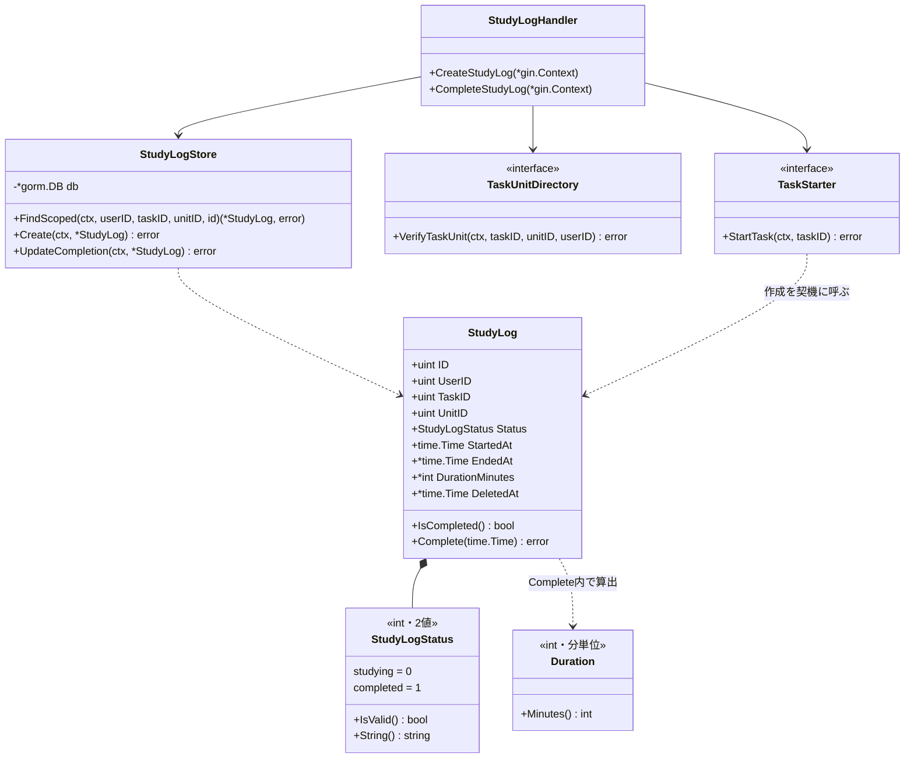
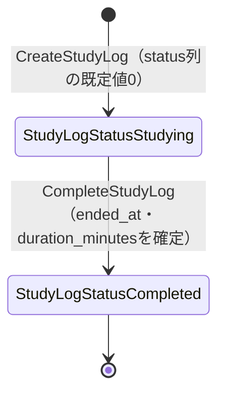
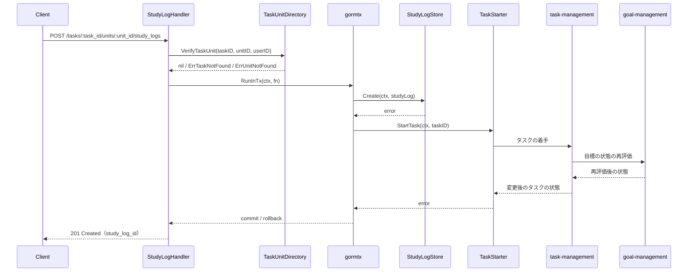
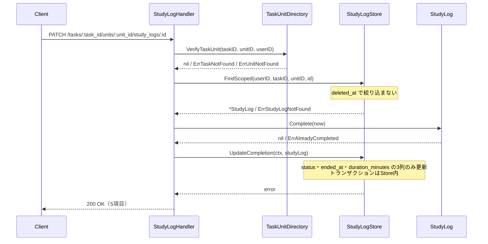
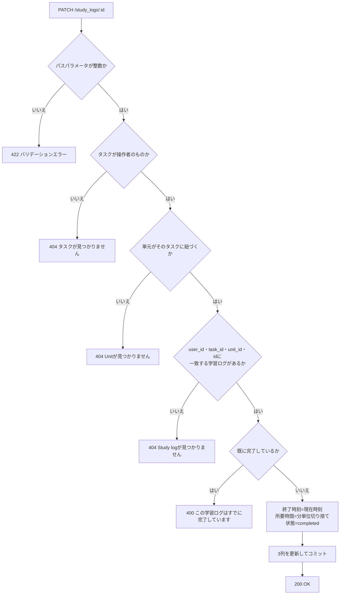

# 学習ログ機能 Go実装仕様書

---

# 1. 機能概要

## 機能概要

生徒がタスク内の単元学習にどれだけ取り組んだかを記録する機能である。提供するAPIは学習開始の記録と学習ログの完了の2つで、一覧取得・削除は提供しない（①「4. API一覧」）。

同一のタスク・単元に対して、学習セッションごとに複数の学習ログを記録できる。学習中の学習ログが既にある場合も、重複を防ぐ仕組みはない（①「5. API / 処理詳細」`#create`）。

**学習開始の記録は他機能の状態に波及する。** 未着手のタスクが「進行中」になり、さらにタスクが属する目標の状態も再評価される。これは`task-management`が公開する「タスクの着手」を呼ぶ形で実現する（①「7. 状態管理」、②「3. Bounded Context」）。学習ログの完了では波及しない。

## 採用設計パターンとその理由（②からの要約）

- 採用パターン: **Active Record**（②「4. 設計パターン」）
- 判断根拠: 開始・完了の2操作のみで、状態遷移も一方向・単一経路であるため
- 採用しなかったパターン: Transaction Script（状態チェックと所要時間の算出をEntity側に寄せた方が変更範囲を限定しやすいため）、Domain Model（複数の業務ルールが絡み合う複雑さがないため）、Event Sourcing（イベント履歴の再構築・監査要件がないため）

本書はアーキテクチャ規約「3. 設計パターンごとの構造適用方針」のActive Record節の構造（Entity相当のstructとStoreを同一packageに置く、usecase層なし、Repository Interfaceの分離なし）に従って実装レベルへ落とし込む。

## 本書が対象とする実装範囲

②が設計した`study-log` Bounded ContextのActive Record実装である。Model（Entity相当のstruct定義）、Store（永続化処理）、他Contextへの参照と呼び出し（`dependency.go`のインターフェースとそのアダプタ）、Presentation層（Handler / Request / Response / Routing）を対象とする。

対象外は、タスク・単元そのものの管理と、タスク・目標の状態を変える手続きそのものである（いずれも他Contextの責務。②「3. Bounded Context」）。本Contextは`task-management`の公開操作を呼ぶだけで、タスクの状態を直接書き換えない。

---

# 2. ディレクトリ構成

## 対象Bounded Context名

- `study-log`（②「3. Bounded Context」）

## ディレクトリ・パッケージ名

アーキテクチャ規約「4. Bounded Context構成」の「Contextディレクトリの命名」に従い、Context名`study-log`から`-`を取り除いて連結した全小文字の名前とする。したがってディレクトリ名は`internal/studylog/`、package名は同じ`studylog`となる。同規約は`internal/study_log/`のようにアンダースコアで区切ることを禁じている。同規約の例示にも`internal/studylog/`が挙げられている。

Context名とディレクトリ名は規約から機械的に決まるため、②に明記がなくても推測にはならない。

## ②で採用した設計パターン

Active Record（②「4. 設計パターン」）

## 作成するディレクトリ一覧

```
internal/studylog/
internal/studylog/infrastructure/contextadapter/
internal/studylog/presentation/handler/
internal/studylog/presentation/request/
internal/studylog/presentation/response/
```

`domain/`・`application/`・`infrastructure/gormrepo/`は作成しない。Active Record採用のためレイヤー分離を行わず、Model・Storeをpackage直下に置く（アーキテクチャ規約「3. 設計パターンごとの構造適用方針」）。`infrastructure/contextadapter/`のみ、他Contextの公開操作へ委譲するアダプタの置き場所として設ける（同「4. Bounded Context構成」）。

## 作成するファイル一覧

```
internal/studylog/context.go                      # NewContext（依存関係の組み立て）
internal/studylog/dependency.go                   # 他Contextへの依存を宣言するインターフェース
internal/studylog/study_log.go                    # StudyLog struct（Model）+ Complete()
internal/studylog/study_log_status.go             # StudyLogStatus型（整数の列挙型・2値）
internal/studylog/duration.go                     # Duration型（所要時間の算出）
internal/studylog/errors.go                        # struct/Storeが返すエラー定義
internal/studylog/study_log_store.go               # StudyLogStore（永続化・検索・完了更新）
internal/studylog/infrastructure/contextadapter/task_unit_directory.go  # TaskUnitDirectoryの実装
internal/studylog/infrastructure/contextadapter/task_starter.go         # TaskStarterの実装
internal/studylog/presentation/handler/study_log_handler.go
internal/studylog/presentation/request/study_log_request.go
internal/studylog/presentation/response/study_log_response.go
internal/studylog/presentation/routes.go
```

## 文書の分割

本書は分割しない。実装ファイルは上記の13であり、テストが付くもの（StudyLog・StudyLogStatus・Duration・StudyLogStore・2つのアダプタ・StudyLogHandlerの7）を加えると20となるため、1文書あたり30〜35という範囲に収まる。

---

# 3. Domain層設計

**実装上の位置づけ**: 本機能はActive Record採用のため、domain層・infrastructure層のレイヤー分離を行わない。以下は「Entity」の代わりに「Model（Entity相当）」として、`studylog`パッケージ直下のstructとして扱う（アーキテクチャ規約「3. 設計パターンごとの構造適用方針」Active Record節）。

## Model（Entity相当）

### StudyLog（`study_log.go`）

②「6. Entity設計」「7. Value Object設計」に基づくStudyLogのGoフィールド定義。

|フィールド名|型|意味|
|-|-|-|
|ID|uint|学習ログの識別子|
|UserID|uint|所有者（生徒）のユーザーID。②「16. Authorization設計」の所有権確認の材料|
|TaskID|uint|対象タスクの識別子。`study_logs.task_id`はNOT NULLである（①「6. データモデル」）|
|UnitID|uint|対象単元の識別子。`study_logs.unit_id`はNOT NULLである|
|Status|StudyLogStatus|状態。②「7. Value Object設計」のStudyLogStatusを型として保持|
|StartedAt|time.Time|学習開始時刻。`study_logs.started_at`は**NOT NULL**であり、作成時に現在時刻が入る（①「6. データモデル」）。未設定を表さないためポインタにしない|
|EndedAt|`*time.Time`|学習終了時刻。完了するまで未設定であるためポインタとする|
|DurationMinutes|`*int`|所要時間（分）。完了するまで未設定であるためポインタとする|
|DeletedAt|`*time.Time`|論理削除日時。下記のとおり`gorm.DeletedAt`を使わない|
|CreatedAt|time.Time|作成日時（Gorm規約「4. タイムスタンプのトラッキング」によりGORMが設定する）|
|UpdatedAt|time.Time|更新日時（同）|

公開メソッド:

|メソッド|引数|戻り値|責務|
|-|-|-|-|
|`(l StudyLog) IsCompleted() bool`|なし|`bool`|既に完了しているかを判定する|
|`(l *StudyLog) Complete(now time.Time) error`|`now time.Time`|`error`|完了済みであれば`ErrAlreadyCompleted`を返す。そうでなければ`EndedAt`に`now`、`DurationMinutes`に`NewDuration(l.StartedAt, now)`の結果、`Status`に`StudyLogStatusCompleted`を設定する（①「5. API / 処理詳細」`#update`）|

不変条件: `StartedAt`が設定済みであること、`Status`が許容値の範囲内であること、`Status`が`completed`のときに`EndedAt`・`DurationMinutes`が設定済みであること。

状態の変更と終了時刻・所要時間の設定は`Complete`の1箇所に閉じ込める。`Status`フィールドへの直接代入を行わない。完了済みの判定と更新を同じメソッドに置くことで、二重完了を防ぐ判定が漏れる余地をなくす（②「17. Error設計」）。

`studying`へ戻すメソッドは設けない。現行実装に戻す操作が存在しないためである（①「7. 状態管理」）。

`DeletedAt`は`gorm.DeletedAt`ではなく`*time.Time`としてマッピングする。Gorm規約「0. 本プロジェクトでの採用方針」の論理削除は`gorm.DeletedAt`の使用を定めているが、これは**削除操作を実装する場合の規定**である。本機能には削除操作が存在せず、`gorm.DeletedAt`を使うと`Find`系が`deleted_at IS NULL`を自動付与してしまう。`StudyLog`は`active`という絞り込みを持つが`default_scope`は持たず、`#update`も`active`を使っていないため、Rails現行は論理削除済みのレコードも検索の対象に含める（①「6. データモデル」）。自動付与が入ると外部仕様が変わるため、絞り込みが入らない型を選ぶ（「15. GORM / DBクエリ設計」）。

### StudyLogStatus（`study_log_status.go`）

②「7. Value Object設計」のStudyLogStatusに対応する型。Active Record方針上、独立したValue Object層は設けず、StudyLogの構成要素としてpackage内の付随型として扱う。

|項目|内容|
|-|-|
|型定義|`type StudyLogStatus int`|
|許容値|`StudyLogStatusStudying`（0）/ `StudyLogStatusCompleted`（1）を`iota`で宣言する（コーディング規約「3. 命名規則」の「定数のグループ化と`iota`」）|
|公開メソッド|`IsValid() bool`、`String() string`（`studying` / `completed`を返す。`stringer`で生成する）|

`study_logs.status`はRailsの`enum`として**整数**で保持される（`studying`=0 / `completed`=1。既定値は0。①「6. データモデル」）。そのため型を`int`とし、整数カラムへそのまま対応させる。APIの出力は文字列であるため、Response DTOへ入れる際に`String()`で変換する（コーディング規約「3. 命名規則」）。

**2値のみである。** 目標・タスク・タスク下書きの`status`は3値（`not_started` / `in_progress` / `completed`）だが、学習ログは`studying`と`completed`の2値であり、`not_started`に相当する値を持たない（①「6. データモデル」）。他機能の状態の型と共有しない。

文字列から変換する関数は設けない。APIの入力として状態を受け取らないためである。

### Duration（`duration.go`）

②「7. Value Object設計」のDuration（所要時間）に対応する型。

|項目|内容|
|-|-|
|型定義|`type Duration int`（分単位の値を保持する）|
|生成方法|`NewDuration(startedAt, endedAt time.Time) Duration`。経過時間を分単位で算出し、**小数を切り捨てる**|
|公開メソッド|`Minutes() int`|

1分未満の学習は`0`になる（①「5. API / 処理詳細」`#update`）。Rails現行は`((ended_at - started_at) / 60).floor`で算出しており、同じ結果になる。

終了時刻が開始時刻より前の場合に負の値を返しうるが、現行実装にその検証はない。本書でも検証を加えない。終了時刻は常にサーバの現在時刻であり、開始時刻より前になる経路がないためである。

永続化は`*int`（`DurationMinutes`）として扱う。完了するまで未設定であるため、`Duration`型をそのままフィールドに持たせず、`Complete`の中で`*int`へ変換して設定する。

## Value Object

対象外（Active Record採用のため独立したValue Object層は設けない）。②が設計したStudyLogStatus・Durationは、上記のとおりStudyLogと同一package内の付随型として扱う。②「7. Value Object設計」の「Value Objectを採用しないもの」（開始時刻・終了時刻そのもの）は`time.Time`・`*time.Time`のフィールドとする。

## Repository Interface

対象外（Active Record採用のため、domain層にRepository Interfaceを定義しない。永続化・検索はEntity相当のstructと同一package内のStoreとして「8. Infrastructure層設計」に記載する）。

他Contextへの参照と呼び出しのみ、インターフェースとして`dependency.go`に宣言する。②「11. Repository設計」の「他Contextの参照手段と公開操作」に対応する（規約「5. Context間連携ルール」）。詳細は「8. Infrastructure層設計」に記載する。

## Domain Service

対象外。②「8. Domain Service」のとおり、所有権の確認は他Contextの参照結果に基づく単純な照合であり、完了時の状態チェックと所要時間の算出はいずれもStudyLog単体の振る舞いとして表現できるため不要と判断されている。

## Domain Event

対象外。②「18. Domain Event」のとおり、非同期の副作用が現行仕様に存在しないため採用しない。

タスクの着手への波及は非同期ではなく、同じトランザクションの中で同期的に呼ぶ（②「14. Transaction設計」）。Domain Eventとして扱わない。

## Domain Error（struct/Storeが返すエラー）

②「17. Error設計」に対応する内容を、`errors.go`内のセンチネルエラー（`error`型の変数）として定義する。

|エラー|発生条件|メッセージ|
|-|-|-|
|`ErrAlreadyCompleted`|`Complete()`時に、既に完了している学習ログが対象だった場合|`この学習ログはすでに完了しています`（①「5. API / 処理詳細」`#update`）|
|`ErrTaskNotFound`|対象タスクが存在しない、または操作者自身のものでない|—（「14. Error実装方針」で404へ変換する。本文の名称は`タスク`）|
|`ErrUnitNotFound`|対象単元が指定タスクに紐づいていない|—（同。本文の名称は`Unit`）|
|`ErrStudyLogNotFound`|`StudyLogStore`が指定の条件に一致する学習ログを取得できなかった場合（他の生徒のものを指定した場合を含む）|—（同。本文の名称は`Study log`）|
|`ErrInvalidStudyLogStatus`|`Complete()`・検証時に状態が許容値外の場合|—（内部エラー。APIの入力で状態を受け取らないため、通常は発生しない）|

`ErrAlreadyCompleted`は**400**へ変換する。Rails現行が`Student::AlreadyCompletedStudyLogError`を`Api::V1::Student::BaseController`の`rescue_from`で捕まえ、400で返しているためである（①「5. API / 処理詳細」`#update`、②「17. Error設計」の「Rails現行の挙動を維持するもの」）。業務ルール違反としては422が自然だが、フロントエンドを変更しない方針を優先する。

404に変換するエラーを3つに分けているのは、**本文に入るモデル名が対象ごとに異なる**ためである。`Task`は日本語訳があり`タスク`になるが、`Unit`・`StudyLog`は訳が定義されていないため`Unit`・`Study log`と英語になる（①「6. データモデル」の「エラーレスポンスの本文」）。1つのエラーにまとめると名称を作り分けられない。

---

# 4. クラス図



Active Record採用のためRepository Interfaceは存在せず、`StudyLogStore`が`StudyLog`と同一package内で永続化を担う。他Contextへの参照と呼び出しのみ、インターフェースとして本Contextに置く（コーディング規約「7. インターフェース」）。実装は`infrastructure/contextadapter/`に閉じ込める。

`Duration`はフィールドとして保持せず、`Complete`の中で算出して`DurationMinutes`（`*int`）へ入れる。

---

# 5. 状態遷移図



遷移条件:

- 作成時は`studying`で固定する。APIの入力で状態を受け取らない（①「7. 状態管理」）
- `CompleteStudyLog`で`completed`へ移る。同時に終了時刻を現在時刻、所要時間を算出値に設定する
- **`completed`から`studying`へ戻る遷移はない。** 完了済みの学習ログを重ねて完了させようとすると`ErrAlreadyCompleted`（400）になる
- 遷移は一方向・単一経路であり、`Complete`メソッドの1箇所でのみ起きる

他機能への波及（この図には含めない）:

|契機|波及先|内容|
|-|-|-|
|`CreateStudyLog`|`tasks.status`|`task-management`の「タスクの着手」を呼ぶ。未着手のタスクが「進行中」になる|
|同|`goals.status`|上記でタスクの状態が変わった場合、`task-management`が`goal-management`の再評価を呼ぶ|
|`CompleteStudyLog`|—|波及しない（①「7. 状態管理」）|

論理削除（`deleted_at`）は`status`とは独立した軸であり、値を設定する操作が存在しないため遷移として扱わない。

---

# 6. Application層設計

対象外（Active Record採用のため、usecase層を設けない。②「12. UseCase設計」に記載されたCreateStudyLog / CompleteStudyLogの業務操作は、HandlerがStoreと他Contextの参照手段・公開操作を直接呼び出す処理として実装する。処理順序は「9. Presentation層設計」のHandler処理順序に統合して記載する）。

---

# 7. シーケンス図・処理フロー図

## シーケンス図

### CreateStudyLog



タスクが既に進行中・完了であれば、`StartTask`は何もしない。目標の状態の再評価も行われない（①「5. API / 処理詳細」`#create`）。

### CompleteStudyLog



## 処理フロー図

### CompleteStudyLog



`CreateStudyLog`は、対象の確認を終えたあとは分岐がなく一直線であるため処理フロー図を省略する。処理順序は「9. Presentation層設計」のHandler処理順序に記載したとおりである。

---

# 8. Infrastructure層設計

**実装上の位置づけ**: 本機能はActive Record採用のため、Repository Interfaceの実装という形は取らない。②「11. Repository設計」で定義された責務を、Model（StudyLog）と同一package内のStoreとして実装する。

## Store実装

### StudyLogStore（`study_log_store.go`）

|項目|内容|
|-|-|
|struct名|`StudyLogStore`|
|対応するGORMモデル|`StudyLog`struct自体をGORMモデルとして扱う（詳細は「15. GORM / DBクエリ設計」参照）|
|保持するフィールド|`db *gorm.DB`|
|コンストラクタ|`NewStudyLogStore(db *gorm.DB) *StudyLogStore`|

メソッド一覧:

|メソッド|引数|戻り値|発行するクエリ内容|
|-|-|-|-|
|`FindScoped`|`ctx context.Context, userID, taskID, unitID, id uint`|`(*StudyLog, error)`|`user_id`・`task_id`・`unit_id`・`id`のすべてに一致する1件取得。一致しない場合は`ErrStudyLogNotFound`（他の生徒のものを含む404相当。②「16. Authorization設計」の所有権確認をクエリ条件として実現する）|
|`Create`|`ctx context.Context, studyLog *StudyLog`|`error`|StudyLogレコードの新規作成。`status`は`StudyLogStatusStudying`（0）、`started_at`は現在時刻、`ended_at`・`duration_minutes`は未設定で作成する（①「5. API / 処理詳細」`#create`）|
|`UpdateCompletion`|`ctx context.Context, studyLog *StudyLog`|`error`|対象レコードの`status`・`ended_at`・`duration_minutes`の3列のみを更新する。`started_at`は変更しない（②「21. DB操作仕様」）|

**`deleted_at`による絞り込みを行わない。** `StudyLog`は`active`という絞り込みを持つが`default_scope`は持たず、`#update`も`active`を使っていないため、Rails現行は論理削除済みのレコードも検索の対象に含める（①「6. データモデル」、②「11. Repository設計」）。`Goal`・`Task`のStoreとは異なる点であり、実装時に他機能のStoreから条件をコピーしないよう注意する。

一覧取得・削除のメソッドは設けない。現行Railsに実装がなく、②「11. Repository設計」の範囲外であるためである。

各メソッドは`gormtx.DBFromContext(ctx, s.db)`で接続を取得する。トランザクション中であればその接続を、そうでなければ通常の接続を使う（「11. Transaction実装方針」）。

`UpdateCompletion`は、自らトランザクションを開始する。書き込みが学習ログ1件のみであり、Handler側で境界を取る必要がないためである（②「14. Transaction設計」）。`gormtx.RunInTx`を用い、`db.WithContext(ctx).Transaction(...)`を直接呼ばない。

②「11. Repository設計」に明記のとおり、業務ルール判定・認可判定はStoreに持たせない。所有権と紐づきの確認は「4つの識別子が一致するレコードを取得できるか」というクエリ条件として表現し、判定ロジック自体はHandler側の処理順序で扱う。完了可否の判定は`StudyLog.Complete`が担う。

## 他Contextの参照手段と公開操作の実装

`dependency.go`で宣言したインターフェースの実装である。相手Contextが公開する操作へ委譲し、本Contextから相手のテーブルへクエリを発行しない（アーキテクチャ規約「5. Context間連携ルール」、②「11. Repository設計」）。いずれもGORMに依存せず相手Contextの公開操作を呼ぶアダプタであるため`infrastructure/contextadapter/`に置く（同「4. Bounded Context構成」）。

|インターフェース|相手Context|メソッド|責務|
|-|-|-|-|
|`TaskUnitDirectory`|`task-management`|`VerifyTaskUnit(ctx context.Context, taskID, unitID, userID uint) error`|指定のタスクが操作者自身のものであり、かつ指定の単元がそのタスクに紐づいているかを確認する。タスクが見つからなければ`ErrTaskNotFound`、単元が紐づいていなければ`ErrUnitNotFound`を返す（①「5. API / 処理詳細」）|
|`TaskStarter`|`task-management`|`StartTask(ctx context.Context, taskID uint) error`|タスクの着手を呼ぶ。未着手のタスクを進行中にし、タスクが属する目標の状態も再評価される。既に進行中・完了であれば何もしない（①「7. 状態管理」、タスク管理機能②「12. UseCase設計」の`StartTask`）|

`VerifyTaskUnit`が2種類のエラーを返し分けるのは、404の本文に入る名称が`タスク`と`Unit`で異なるためである（「3. Domain層設計」のDomain Error）。相手Contextが返すエラーを、本Contextのセンチネルエラーへアダプタの中で変換する。

`unit-reference` Contextへの依存は持たない。本機能のレスポンスに単元の情報を含めず、「タスクに紐づく単元か」という関係は`task-management`が持つためである（②「11. Repository設計」）。Rails現行も`task.units.find(unit_id)`とタスク経由で単元を取っている（①「5. API / 処理詳細」`#create`）。

**②からの補足**: 相手Contextが公開する操作の具体的なシグネチャは、`task-management`の③で確定する。本書では消費者側のインターフェースをコーディング規約「7. インターフェース」の方針に従って本Contextに置き、実装をアダプタに閉じ込める。

タスク管理機能③は`StartTask(ctx context.Context, taskID uint) (TaskStatus, error)`として変更後の状態を返す設計である（同③「8. Infrastructure層設計」）。本Contextは変更後の状態を使わないため、インターフェースでは`error`のみを受け取る形とし、アダプタの中で戻り値を捨てる。消費者が必要としない値をインターフェースに持ち込まないためである。

## 外部連携実装

対象外。②にMail・Cache・Queue等の外部連携は記載されていない。

---

# 9. Presentation層設計

## Handler

### StudyLogHandler（`presentation/handler/study_log_handler.go`）

|項目|内容|
|-|-|
|struct名|`StudyLogHandler`|
|対応する呼び出し先|`StudyLogStore`、`TaskUnitDirectory`、`TaskStarter`（Active Record採用のためUseCaseを経由せず直接呼び出す）|
|コンストラクタ|`NewStudyLogHandler(store *StudyLogStore, tasks TaskUnitDirectory, starter TaskStarter) *StudyLogHandler`|

メソッド一覧（HTTPメソッド・パス対応）:

|メソッド|HTTPメソッド|パス|
|-|-|-|
|`CreateStudyLog`|POST|/api/v1/student/tasks/:task_id/units/:unit_id/study_logs|
|`CompleteStudyLog`|PATCH|/api/v1/student/tasks/:task_id/units/:unit_id/study_logs/:id|

処理順序（UseCase層を経由しない分、本来UseCaseが担う手順をここに明記する）:

### CreateStudyLog

1. `c.Request.Context()`からcurrent user（認証Middlewareが格納したstudentユーザー）を取得する（②「16. Authorization設計」）
2. パスパラメータ`task_id`・`unit_id`を読み取る。リクエストボディはない（①「5. API / 処理詳細」`#create`）
3. `taskUnitDirectory.VerifyTaskUnit`で、タスクが操作者自身のものであり単元がそのタスクに紐づいているかを確認する。`ErrTaskNotFound` / `ErrUnitNotFound`はそれぞれ404のAppErrorへ変換して`c.Error(err)`で返す（「14. Error実装方針」）
4. StudyLogを組み立てる。`UserID`はcurrent userのID、`Status`は`StudyLogStatusStudying`、`StartedAt`は現在時刻、`EndedAt`・`DurationMinutes`は未設定とする
5. `gormtx.RunInTx`でトランザクションを開始し、以下を順に呼ぶ（②「14. Transaction設計」）
   1. `store.Create`で学習ログを作成する
   2. `taskStarter.StartTask`でタスクの着手を呼ぶ
6. `{"study_log_id": <識別子>}`を**201 Created**で返す（①「5. API / 処理詳細」`#create`）

3の確認は読み取りであり、トランザクションの外で行う（②「14. Transaction設計」）。

5の2つを1つのトランザクションに含めるのは、学習ログだけが残ってタスクが未着手のまま残る状態を防ぐためである。Rails現行も同じ境界である（①「5. API / 処理詳細」`#create`）。

### CompleteStudyLog

1. current userを取得する
2. パスパラメータ`task_id`・`unit_id`・`id`を読み取る。リクエストボディはない
3. `taskUnitDirectory.VerifyTaskUnit`で対象タスク・単元を確認する（`#create`と同じ手順。①「5. API / 処理詳細」`#update`）
4. `store.FindScoped`で`user_id`・`task_id`・`unit_id`・`id`のすべてに一致する学習ログを取得する。一致しなければ`ErrStudyLogNotFound`→404
5. `studyLog.Complete(time.Now())`を呼ぶ。既に完了していれば`ErrAlreadyCompleted`→**400**のAppErrorへ変換して返す
6. `store.UpdateCompletion`で`status`・`ended_at`・`duration_minutes`を更新する
7. `StudyLogResponse`へ変換して200 OKで返す

タスク・目標の状態には波及しない（①「7. 状態管理」）。`taskStarter`を呼ばない。

## Request / Response DTO

### Request（`presentation/request/study_log_request.go`）

リクエストボディを持つエンドポイントがないため、ボディ用のstructを定義しない。パスパラメータのみを扱う。

|struct名|フィールド|型|検証|
|-|-|-|-|
|`StudyLogPathParams`|TaskID|uint|`uri:"task_id" binding:"required"`。整数として検証する|
||UnitID|uint|`uri:"unit_id" binding:"required"`|
||ID|uint|`uri:"id" binding:"required"`。完了操作のみで用いる|

`status`・`started_at`・`ended_at`・`duration_minutes`は入力として受け取らない。いずれもサーバ側で決まる値である（①「5. API / 処理詳細」）。

### Response（`presentation/response/study_log_response.go`）

|struct名|フィールド|型|JSONキー|
|-|-|-|-|
|`CreateStudyLogResponse`|StudyLogID|`uint`|`study_log_id`|
|`StudyLogResponse`|ID|`uint`|`id`|
||Status|`string`|`status`|
||StartedAt|`time.Time`|`started_at`|
||EndedAt|`*time.Time`|`ended_at`|
||DurationMinutes|`*int`|`duration_minutes`|

- **作成**: `{"study_log_id": <識別子>}`を返す。識別子をキーでラップする形はRails現行のとおりである（①「5. API / 処理詳細」`#create`）
- **完了**: 最上位をラップせず`StudyLogResponse`をそのまま返す。項目は5つのみである（①「5. API / 処理詳細」`#update`）
- `StudyLogResponse.Status`は整数ではなく文字列を入れる。Modelの`StudyLogStatus`は整数の列挙型であるため、`String()`で変換してから設定する（「3. Domain層設計」）
- `user_id`・`task_id`・`unit_id`は含めない。Rails現行の`StudyLogSerializer`が返していないためである（①「5. API / 処理詳細」`#update`）
- `started_at`・`ended_at`は**日付フォーマットの加工を行わず日時のまま返す**。他機能のシリアライザは`YYYY/MM/DD`へ整形しているが、`StudyLogSerializer`は整形していない（同）
- エラーレスポンスは専用structを本書で定義しない。形式は「14. Error実装方針」のとおりであり、集中エラーハンドリングミドルウェアが組み立てる

**②からの補足（要確認）**: 日時をそのまま返す場合、Goの`time.Time`の既定のJSON表現はRFC3339（`2026-11-06T12:34:56.789012Z`）であり、RailsのActiveSupportの既定（`2026-11-06T12:34:56.789Z`。小数部3桁）と**小数部の桁数が異なる**。フロントエンドが文字列として扱っている場合は影響しないが、桁数に依存した処理があると差が出る。整形方針を揃えるかは実装前に確認が必要である（「17. ②からの補足事項」）。

## Routing（`presentation/routes.go`）

|Method|Path|Handler|
|-|-|-|
|POST|/api/v1/student/tasks/:task_id/units/:unit_id/study_logs|StudyLogHandler.CreateStudyLog|
|PATCH|/api/v1/student/tasks/:task_id/units/:unit_id/study_logs/:id|StudyLogHandler.CompleteStudyLog|

いずれもタスク・単元の下に入れ子になったパスである。Rails現行の`resources :study_logs, only: [:create, :update]`が`tasks`→`units`の入れ子の中に定義されていることに対応する（①「4. API一覧」）。

いずれのルートも認証Middleware・`student`ロール確認Middlewareを経由する（②「16. Authorization設計」）。`POST`・`PATCH`はCookieで認可される状態変更であるため、CSRF検証Middlewareの対象にも含める（Gin規約「5. CSRF対策」の「適用範囲」）。本機能にGETのエンドポイントはない。

一覧取得・削除の経路は定義しない。Rails現行にも存在しないためである（①「4. API一覧」）。

ルートの登録は本Contextの`routes.go`が行うが、パスの前半（`/tasks/:task_id/units/:unit_id`）は`task-management`が所有するリソースの下にある。パスの文字列を本Contextが持つことになるため、`task-management`側のルート定義と重複しないよう、本Contextは`study_logs`以下のみを登録する形にする（**②からの補足**。詳細は「17. ②からの補足事項」参照）。

---

# 10. API仕様

|Method|Path|Handler|Request|Response|Status Code|
|-|-|-|-|-|-|
|POST|/api/v1/student/tasks/:task_id/units/:unit_id/study_logs|CreateStudyLog|パス: `task_id`・`unit_id`|`CreateStudyLogResponse`|201|
|PATCH|/api/v1/student/tasks/:task_id/units/:unit_id/study_logs/:id|CompleteStudyLog|パス: `task_id`・`unit_id`・`id`|`StudyLogResponse`|200|

いずれもリクエストボディを持たない。作成が201であるのは、①「5. API / 処理詳細」のとおり`#create`が`status: :created`を返しているためである。

エラーレスポンスの本文は「14. Error実装方針」のとおり、400が`{"errors": [...]}`、404が`{"message": "〇〇が見つかりません"}`である。

各Endpointのエラーケース:

## 全Endpoint共通

|条件|Status Code|Error内容|
|-|-|-|
|未認証|401|認証Middlewareが返す（②「16. Authorization設計」）|
|`student`ロールでない|403|ロール確認Middlewareが返す|
|CSRFトークンが不正|403|CSRF検証Middlewareが返す（Gin規約「5. CSRF対策」）|
|対象タスクが存在しない、または他の生徒のタスクである|404|`ErrTaskNotFound`。本文は`{"message": "タスクが見つかりません"}`|
|対象単元が指定タスクに紐づいていない|404|`ErrUnitNotFound`。本文は`{"message": "Unitが見つかりません"}`|

認証・認可・CSRFのステータスコードは本機能で定めるものではなく、該当Middlewareの仕様に従う。

## POST /api/v1/student/tasks/:task_id/units/:unit_id/study_logs

固有のエラーケースはない。学習中の学習ログが既に存在していても重複を防がず、新しい学習ログを作って201を返す（①「5. API / 処理詳細」`#create`）。

## PATCH /api/v1/student/tasks/:task_id/units/:unit_id/study_logs/:id

|条件|Status Code|Error内容|
|-|-|-|
|対象の学習ログが存在しない、または他の生徒のものである|404|`ErrStudyLogNotFound`。本文は`{"message": "Study logが見つかりません"}`|
|対象の学習ログが既に完了している|**400**|`ErrAlreadyCompleted`。本文は`{"errors": ["この学習ログはすでに完了しています"]}`（①「5. API / 処理詳細」`#update`）|

論理削除済みの学習ログは404にならず、完了操作の対象になる（①「6. データモデル」）。

---

# 11. Transaction実装方針

## Transaction開始位置

②「14. Transaction設計」のとおり、操作によって境界の位置が異なる。

- `CreateStudyLog`: Handlerの処理単位でトランザクションを開始する。学習ログの作成と`task-management`の「タスクの着手」という2つの書き込みにまたがるため、Storeメソッド内では境界を取れない
- `CompleteStudyLog`: `StudyLogStore.UpdateCompletion`の内側でトランザクションを開始する。書き込みは学習ログ1件のみである

いずれも`gormtx.RunInTx(ctx, db, func(ctx context.Context, tx *gorm.DB) error { ... })`を用いる。`db.WithContext(ctx).Transaction(...)`を直接呼ばない。呼び出し側が既に開始したトランザクションに参加せず、独立した2つ目を開始してしまうためである（アーキテクチャ規約「11. Transaction実装パターン（TransactionManager）」）。

対象タスク・単元の確認（`TaskUnitDirectory`）は読み取りであり、トランザクションの外で行う（②「14. Transaction設計」）。

## Transaction終了位置

- `CreateStudyLog`: 学習ログの作成と、タスクの着手（およびそこから呼ばれる目標の状態の再評価）が完了した時点でコミットする。いずれかが失敗した場合はロールバックする
- `CompleteStudyLog`: 3列の更新が完了した時点でコミットする

## 他Contextの操作をトランザクションに含める扱い

`TaskStarter.StartTask`には、Handlerが`RunInTx`で開始したトランザクションの`ctx`をそのまま渡す。`task-management`の`StartTask`は自らトランザクションを開始せず、`gormtx.DBFromContext`が`ctx`のトランザクションを見つけて参加する（タスク管理機能③「11. Transaction実装方針」）。

`StartTask`からさらに呼ばれる`goal-management`の「目標の状態の再評価」も、同じ`ctx`を渡すため同じトランザクションの中で実行される。

この連鎖により、1つのトランザクションが`study_logs`・`tasks`・`goals`の3テーブルにまたがる。学習ログだけが残ってタスクが未着手のまま残る状態、タスクが進行中になったのに目標の状態が古いまま残る状態のいずれも防ぐためである（②「14. Transaction設計」）。

## 複数Storeにまたがる場合の扱い

本Contextが持つStoreは`StudyLogStore`のみである。トランザクションが複数のStoreにまたがることはない。他Contextの操作にまたがる場合の扱いは上記のとおりである。

---

# 12. Validation実装方針

## Presentation

- パスパラメータ`task_id`・`unit_id`・`id`を整数として読み取り、解釈できない場合は422とする
- リクエストボディを持たないため、ボディのバインドと必須チェックは行わない（①「5. API / 処理詳細」）
- クエリパラメータも扱わない

## 業務ルール検証

Active Record採用のため、StudyLog（Model）のメソッドで検証する。

- `Complete`が、既に完了している場合に`ErrAlreadyCompleted`を返す（②「15. Validation設計」の状態チェック）

Model単体では完結しない検証は、Handlerが他Contextの参照手段を呼び出して行う。

|検証|呼び出す先|
|-|-|
|対象タスクが操作者自身のものか|`TaskUnitDirectory.VerifyTaskUnit`|
|対象単元が指定タスクに紐づいているか|同|

所有権の確認（他の生徒の学習ログへのアクセスの禁止）は、Modelのメソッドではなく`StudyLogStore.FindScoped`の検索条件として実現する。②「11. Repository設計」で「所有権判定そのものをStoreに持たせない」とされているため、判定そのものはHandler側の処理順序に含め、Storeはその判定に必要なクエリ条件（4つの識別子の一致）のみを提供する。

所要時間に対する検証は設けない。終了時刻は常にサーバの現在時刻であり、開始時刻より前になる経路がないためである（「3. Domain層設計」のDuration）。

---

# 13. Authorization実装方針

- Middlewareで行う処理: 認証済みユーザーの特定と`context.Context`への格納、役割（`student`）であることの確認（②「16. Authorization設計」Middleware節）
- Handlerで行う処理: `context.Context`からcurrent userを取り出し、他Contextの参照手段とStore呼び出しの`user_id`として使用する。具体的な業務権限判定はHandler自体には持たせず、参照手段と検索条件に委譲する
- Store／Modelで行う処理: `StudyLogStore.FindScoped`が`user_id`・`task_id`・`unit_id`・`id`のすべて一致を検索条件とすることで、所有権と紐づきの確認を実現する。StudyLog（Model）自体は`UserID`フィールドを保持し、所有権確認の材料を提供するのみで、判定ロジックは持たない（②「16. Authorization設計」）
- タスク・単元の確認: `TaskUnitDirectory.VerifyTaskUnit`に委ねる。`tasks`・`task_units`は`task-management`が所有するため、本Contextからクエリを発行しない（②「11. Repository設計」）
- CSRF: `POST`・`PATCH`はCookieで認可される状態変更であるため、CSRF検証Middlewareの対象に含める（Gin規約「5. CSRF対策」の「適用範囲」）。本機能にGETのエンドポイントはない

「存在しない」と「他の生徒のもの」を区別せず、いずれも404として返す（①「8. 権限制御」、②「15. Validation設計」）。

本Contextには他Contextから呼ばれる公開操作が存在しないため、認可を行わない経路はない。

---

# 14. Error実装方針

## Domain Error → Application Errorへの変換方針

Active Record採用のためDomain Errorに相当する層がなく、`errors.go`のセンチネルエラーをそのままApplication Error相当として扱う（アーキテクチャ規約「12. Error変換パターン（AppError）」の「Transaction Script / Active Record採用時の変換」）。センチネルエラーから`internal/shared/apperror`の`AppError`を実装した型への変換は、Storeまたは呼び出し元のHandlerで`errors.Is`により判別して行う。

他Contextのアダプタが返すエラーも、アダプタの中で本Contextのセンチネルエラー（`ErrTaskNotFound` / `ErrUnitNotFound`）へ変換する。相手Contextのエラー型を本Contextのハンドリングに持ち込まない（規約「5. Context間連携ルール」）。

## Application Error → HTTPレスポンスへの変換方針

Gin規約「8. エラーハンドリングミドルウェア」の集中エラーハンドリングミドルウェアに変換を集約する。Handlerは`c.Error(err)`でエラーを登録するのみとし、個々のHandlerでステータスコードを判定しない。ミドルウェアが`errors.As`で`AppError`を1回だけ判定し、`StatusCode()`でステータス、`LogLevel()`でログレベルを決める。

レスポンスのボディは、②「17. Error設計」の「エラーレスポンスの本文」のとおりRails現行の形を維持する。

|条件|HTTP Status|ボディ|
|-|-|-|
|`ErrAlreadyCompleted`|**400**|`{"errors": ["この学習ログはすでに完了しています"]}`|
|`ErrTaskNotFound`|404|`{"message": "タスクが見つかりません"}`|
|`ErrUnitNotFound`|404|`{"message": "Unitが見つかりません"}`|
|`ErrStudyLogNotFound`|404|`{"message": "Study logが見つかりません"}`|
|パスパラメータの形式不正|422|`{"errors": [...]}`|
|その他の未分類のエラー|500|`{"errors": [...]}`|
|認証・認可・CSRF|401 / 403|`{"errors": [...]}`。該当Middlewareが組み立てる|

404のみ本文の形が異なるため、ミドルウェアは`AppError`から得たステータスが404の場合に`message`キーの本文を組み立てる。この分岐は`internal/shared/middleware`のエラーハンドラに1箇所だけ置き、Handler側に持たせない。

**404の本文に入る名称が対象ごとに異なる点が、本機能の特徴である。** `タスク`・`Unit`・`Study log`の3通りがある。`Task`はモデル名の日本語訳があるが、`Unit`・`StudyLog`は訳が定義されていないため英語のまま出る（①「6. データモデル」の「エラーレスポンスの本文」）。そのため404のAppErrorは名称を値として保持し、ミドルウェアがその名称を本文に差し込む形にする。ミドルウェア側に機能ごとの名称表を持たせない。

**②からの補足**: 404の本文の形はRails現行の`ApplicationController#not_found`が決めており、全機能に共通する。ミドルウェア側の分岐も全機能で共通になるため、実装時は本機能に固有の処理として書かない。一方、名称を3通り作り分ける必要があるのは本機能固有である。

## Infrastructure Errorのハンドリング方針

DB接続失敗・永続化失敗（GORMが返すその他のエラー）は、`fmt.Errorf`でラップして返す（コーディング規約「18. エラーハンドリング」）。`AppError`へ変換されずにミドルウェアへ到達した場合も、未分類のエラーとして500で扱う。

|Error種別|発生層|HTTP Status|
|-|-|-|
|`ErrTaskNotFound`|Handler（`TaskUnitDirectory`経由）|404（名称: `タスク`）|
|`ErrUnitNotFound`|Handler（同）|404（名称: `Unit`）|
|`ErrStudyLogNotFound`|Store → Application（変換）|404（名称: `Study log`）|
|`ErrAlreadyCompleted`|Model（`Complete`）|**400**|
|パスパラメータの形式不正|Presentation|422|
|`ErrInvalidStudyLogStatus`|Model|500（APIの入力で状態を受け取らないため、通常は発生しない）|
|`task-management`の「タスクの着手」の失敗|Handler（`TaskStarter`経由）|500|
|認証エラー|Middleware|401|
|認可エラー（役割不一致）|Middleware|403|
|CSRFトークン不正|Middleware|403|
|DB接続失敗・永続化失敗|Store（Infrastructure相当）|500|

`ErrAlreadyCompleted`を400とするのは、Rails現行が`Student::AlreadyCompletedStudyLogError`を`Api::V1::Student::BaseController`の`rescue_from`で捕まえ、400で返しているためである（①「5. API / 処理詳細」`#update`、②「17. Error設計」の「Rails現行の挙動を維持するもの」）。業務ルール違反としては422が自然だが、フロントエンドを変更しない方針を優先する。

タスクの着手が失敗した場合は、学習ログの作成もロールバックされる。呼び出し側のトランザクションに含まれているためである（「11. Transaction実装方針」）。

---

# 15. GORM / DBクエリ設計

②「20. DB設計方針」のとおり、既存Rails DBを継続利用し、スキーマ変更は行わない。既存の`study_logs`テーブルを利用する。

## 利用するGORMモデルとテーブルの対応

|Goモデル|テーブル名|備考|
|-|-|-|
|`StudyLog`|`study_logs`|Gorm規約「2. 複数形のテーブル名」の既定命名規則で一致するため、`TableName()`のオーバーライドは不要|

- `StudyLog`struct自体をGORMモデルとして扱う（Active Record方針上、Entity相当のstructとGORMモデルを分離しない）
- カラム対応はGorm規約の既定命名規則（フィールド名のsnake_case）に従う。`ID`→`id`、`UserID`→`user_id`、`TaskID`→`task_id`、`UnitID`→`unit_id`、`StartedAt`→`started_at`、`EndedAt`→`ended_at`、`DurationMinutes`→`duration_minutes`
- **`DeletedAt`は`*time.Time`としてマッピングし、`gorm.DeletedAt`を使わない。** Gorm規約「0. 本プロジェクトでの採用方針」の論理削除は`gorm.DeletedAt`の使用を定めているが、これは削除操作を実装する場合の規定である。本機能に削除操作は存在せず、`gorm.DeletedAt`を使うと`Find`系が`deleted_at IS NULL`を自動付与する。`StudyLog`は`default_scope`を持たず`#update`も`active`を使っていないため（①「6. データモデル」）、自動付与が入ると外部仕様が変わる。フロントエンドを変更しない方針により、絞り込みが入らない型を選ぶ
- `StudyLogStatus`は`int`を基底型とする型であるため、GORMは追加実装なしに整数カラムとして扱える（①「6. データモデル」のとおり`study_logs.status`は整数）
- `StartedAt`を`time.Time`（非ポインタ）とするのは、`study_logs.started_at`がNOT NULLであり未設定を表す必要がないためである。`EndedAt`・`DurationMinutes`は完了するまでNULLであるためポインタとする
- `Duration`型はカラムに対応させない。`Complete`の中で算出し`DurationMinutes`（`*int`）へ入れるため、`Scanner`／`driver.Valuer`の実装は不要である

目標管理・タスク管理・タスク下書きの各③では`DueDate`に`Scanner`／`driver.Valuer`を実装しているが、本機能にはValue Objectをそのままカラムへ対応させる箇所がない。

## 主要クエリの条件・ソート・ページネーション方針

- `StudyLogStore.FindScoped`: `user_id`・`task_id`・`unit_id`・`id`のすべてに一致する1件を取得する。**`deleted_at`を条件に含めない**（上記）
- `StudyLogStore.Create`: 全列を挿入する。`status`は0、`started_at`は現在時刻、`ended_at`・`duration_minutes`・`deleted_at`はNULLで作成する
- `StudyLogStore.UpdateCompletion`: `status`・`ended_at`・`duration_minutes`の3列のみを更新する。`started_at`は変更しない（②「21. DB操作仕様」）
- 結合は行わない。`tasks`・`units`へは本Contextからクエリを発行せず、`task-management`の参照手段に委ねる（②「21. DB操作仕様」）
- ページネーション・ソートは不要である。取得は単一の学習ログ単位であり、一覧取得が存在しない

## 既存Schemaへの変更

②「20. DB設計方針」のとおり、スキーマ変更は提案されていない。本書でも既存`study_logs`テーブルをそのまま利用する前提とする。

同一のタスク・単元の組に対する一意制約はない。学習セッションごとに複数行が作られるためである（①「6. データモデル」）。

---

# 16. テストケース設計

②「22. テスト戦略」を、Active Record採用に合わせて読み替える（アーキテクチャ規約「3. 設計パターンごとの構造適用方針」の読み替えルールに従い、Domain Test→Model Test、UseCase Test→対象外、Repository Test→Store Test）。

## Model Test

|対象|テストケース|
|-|-|
|`StudyLogStatus.IsValid`|宣言済みの値（0 / 1）でtrueを返し、2以上でfalseを返すこと|
|`StudyLogStatus.String`|各値が`studying` / `completed`を返すこと|
|`NewDuration`|経過時間が分単位の切り捨てで算出されること|
|`NewDuration`|1分未満の経過時間で`0`を返すこと|
|`NewDuration`|59秒で`0`、60秒で`1`、119秒で`1`を返すこと（境界）|
|`StudyLog.IsCompleted`|`studying`でfalse、`completed`でtrueを返すこと|
|`StudyLog.Complete`|`EndedAt`・`DurationMinutes`・`Status`が設定されること|
|`StudyLog.Complete`|既に完了している場合に`ErrAlreadyCompleted`を返し、各フィールドを変更しないこと|

## UseCase Test

対象外（Active Record採用のため、usecase層を設けない）。

## Store Test

|対象|テストケース|
|-|-|
|`StudyLogStore.FindScoped`|4つの識別子すべてに一致する学習ログが取得できること|
|`StudyLogStore.FindScoped`|`user_id`が異なる場合に`ErrStudyLogNotFound`が返ること|
|`StudyLogStore.FindScoped`|`task_id`・`unit_id`のいずれかが異なる場合に`ErrStudyLogNotFound`が返ること|
|`StudyLogStore.FindScoped`|**論理削除済み（`deleted_at`が設定済み）の学習ログも取得できること**（`Goal`・`Task`と異なる点）|
|`StudyLogStore.Create`|レコードが作成され、`status`が0、`started_at`が設定され、`ended_at`・`duration_minutes`がNULLで保存されること|
|`StudyLogStore.Create`|同一のタスク・単元に対して複数の学習ログを作成できること|
|`StudyLogStore.UpdateCompletion`|`status`・`ended_at`・`duration_minutes`の3列のみが更新され、`started_at`が変わらないこと|
|`StudyLogStore.UpdateCompletion`|呼び出し側がトランザクションを開始していない場合も自らトランザクションを張って更新すること|

## Handler Test

|対象|テストケース|
|-|-|
|`StudyLogHandler.CreateStudyLog`|正常系: 201と`{"study_log_id": ...}`が返ること|
|`StudyLogHandler.CreateStudyLog`|正常系: 作成された学習ログの`status`が`studying`であること|
|`StudyLogHandler.CreateStudyLog`|正常系: `TaskStarter.StartTask`が呼ばれること|
|`StudyLogHandler.CreateStudyLog`|正常系: 学習中の学習ログが既にある場合も新しく作成され201が返ること|
|`StudyLogHandler.CreateStudyLog`|異常系: `TaskStarter.StartTask`が失敗した場合に学習ログの作成もロールバックされること|
|`StudyLogHandler.CreateStudyLog`|異常系: タスクが他の生徒のものの場合に404と`{"message": "タスクが見つかりません"}`が返ること|
|`StudyLogHandler.CreateStudyLog`|異常系: 単元がタスクに紐づかない場合に404と`{"message": "Unitが見つかりません"}`が返ること|
|`StudyLogHandler.CompleteStudyLog`|正常系: 200で`id`・`status`・`started_at`・`ended_at`・`duration_minutes`の5項目が返ること|
|`StudyLogHandler.CompleteStudyLog`|正常系: `user_id`・`task_id`・`unit_id`がレスポンスに含まれないこと|
|`StudyLogHandler.CompleteStudyLog`|正常系: `started_at`・`ended_at`が日時のまま返ること（`YYYY/MM/DD`へ整形しないこと）|
|`StudyLogHandler.CompleteStudyLog`|正常系: `TaskStarter.StartTask`が呼ばれないこと|
|`StudyLogHandler.CompleteStudyLog`|異常系: 学習ログが存在しない・他の生徒のものの場合に404と`{"message": "Study logが見つかりません"}`が返ること|
|`StudyLogHandler.CompleteStudyLog`|異常系: 既に完了している場合に**400**と`{"errors": ["この学習ログはすでに完了しています"]}`が返ること|
|全Handler|異常系: パスパラメータが整数でない場合に422が返ること|
|エラーハンドラ|404のみ`message`キー、それ以外は`errors`キーの本文になること|
|エラーハンドラ|404の名称が対象ごとに`タスク`・`Unit`・`Study log`になること|

## Integration Test

|対象|テストケース|
|-|-|
|学習開始〜完了の一連の流れ|エンドポイント経由で作成と完了が正常に動作すること（②「22. テスト戦略」Integration Test）|
|状態の波及|学習開始により、未着手だったタスクが「進行中」になること|
|状態の波及|同時に、タスクが属する目標の状態も再評価されること|
|状態の波及|タスクが既に進行中・完了の場合、タスク・目標の状態が変わらないこと|
|状態の波及|学習完了ではタスク・目標の状態が変わらないこと|
|トランザクション|学習ログの作成とタスクの着手が同一トランザクションであること（タスクの着手を失敗させると学習ログも残らないこと）|
|認可|未認証・`student`ロール以外のユーザーがアクセスした場合に拒否されること|
|認可|他の生徒のタスク・学習ログを指定した場合に404になること|
|CSRF|`POST`・`PATCH`でCSRFトークンが不正な場合に拒否されること（Gin規約「5. CSRF対策」）|

---

# 17. ②からの補足事項

②に明記がなく、実装のために追加で判断した内容は以下のとおりである。

|判断した内容|判断理由|推測かどうか|
|-|-|-|
|Active Record構造を`study_log.go` / `study_log_status.go` / `duration.go` / `errors.go` / `study_log_store.go`に分割した|②が扱う対象（StudyLog本体・状態・所要時間）が複数あり、責務ごとにファイルを分けた方が可読性が高いと判断したため。Active Record構造（レイヤー分離をしない、同一package内に置く）という設計方針自体は変更していない|実装レベルの整理（②の設計判断と矛盾しない）|
|`DeletedAt`に`gorm.DeletedAt`を使わず`*time.Time`とした|Gorm規約「0. 本プロジェクトでの採用方針」の論理削除は`gorm.DeletedAt`の使用を定めているが、これは削除操作を実装する場合の規定である。本機能に削除操作はなく、`gorm.DeletedAt`を使うと`deleted_at IS NULL`が自動付与され、論理削除済みも対象とするRails現行の挙動（①「6. データモデル」）が変わる|補足（タスク下書き機能③と同じ判断。規約側に「削除操作を持たないContextでの扱い」の記載はないため、規約側に明記すべきか要確認）|
|404に変換するエラーを`ErrTaskNotFound` / `ErrUnitNotFound` / `ErrStudyLogNotFound`の3つに分けた|404の本文に入るモデル名が対象ごとに`タスク`・`Unit`・`Study log`と異なるため（①「6. データモデル」の「エラーレスポンスの本文」）。1つにまとめると名称を作り分けられない|補足（①の実体に基づく）|
|404のAppErrorに名称を値として保持させ、ミドルウェアがその名称を本文に差し込む形にした|ミドルウェアは全機能で共通であり、機能ごとの名称表を持たせないため|補足（実装方式の具体化）|
|`TaskStarter`インターフェースの戻り値を`error`のみとした|タスク管理機能③の`StartTask`は変更後の状態を返すが、本Contextは使わない。消費者が必要としない値をインターフェースに持ち込まないため（コーディング規約「7. インターフェース」）|補足|
|`TaskUnitDirectory.VerifyTaskUnit`が2種類のエラーを返し分ける形にした|タスクと単元で404の名称が異なるため。相手Contextが返すエラーをアダプタの中で本Contextのセンチネルエラーへ変換する|補足|
|`unit-reference` Contextへの依存を持たせなかった|本機能のレスポンスに単元の情報を含めず、「タスクに紐づく単元か」という関係は`task-management`が持つため。Rails現行も`task.units.find(unit_id)`とタスク経由で単元を取っている（①「5. API / 処理詳細」`#create`）|補足（②「11. Repository設計」に従う）|
|`StartedAt`を`time.Time`（非ポインタ）、`EndedAt`・`DurationMinutes`を`*int`・`*time.Time`とした|`started_at`はNOT NULLであり未設定を表す必要がない。`ended_at`・`duration_minutes`は完了するまでNULLである（①「6. データモデル」）|補足（①の実体に基づく）|
|`Duration`型をカラムに対応させず、`Complete`の中で`*int`へ変換する形にした|完了するまで未設定であり、`Scanner`／`driver.Valuer`を実装するより変換を1箇所に閉じ込める方が単純であるため|補足|
|所要時間が負になる場合の検証を設けなかった|終了時刻は常にサーバの現在時刻であり、開始時刻より前になる経路がない。Rails現行にも検証がない|補足（①の実体に基づく）|
|`started_at`・`ended_at`の**日時の表現形式**を確定しなかった|Goの`time.Time`の既定のJSON表現はRFC3339（小数部6桁）、RailsのActiveSupportの既定は小数部3桁であり**桁数が異なる**。フロントエンドが文字列として扱っている場合は影響しないが、桁数に依存した処理があると差が出る|**要確認**（フロントエンドを変更しない方針に関わる。整形方針を揃えるかは実装前に確認が必要）|
|ルートの登録を`study_logs`以下のみに限る形にした|パスの前半（`/tasks/:task_id/units/:unit_id`）は`task-management`が所有するリソースの下にある。パスの文字列を複数のContextが重複して持たないようにするため|要確認（入れ子のルートをどのContextが登録するかの方針は規約に定めがない。`cmd/server/main.go`での組み立て方とあわせて確認が必要）|

ディレクトリ名・package名（`internal/studylog/`）、レスポンスの形状（`study_log_id`キー、5項目、日付の整形なし）、HTTPステータス（201・200・400・404）、`study_logs.status`の整数2値での保持、トランザクション境界は、いずれも規約または①に根拠があるため推測ではない。根拠はそれぞれ該当節に記載した。
