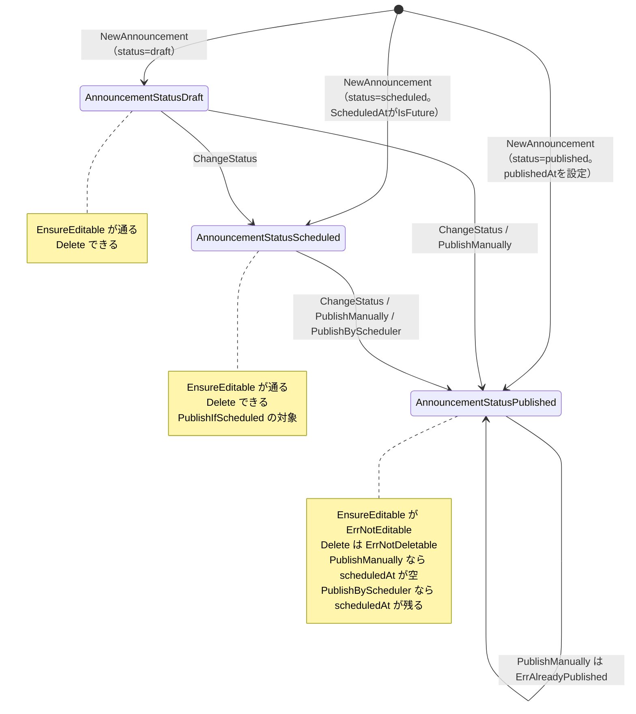
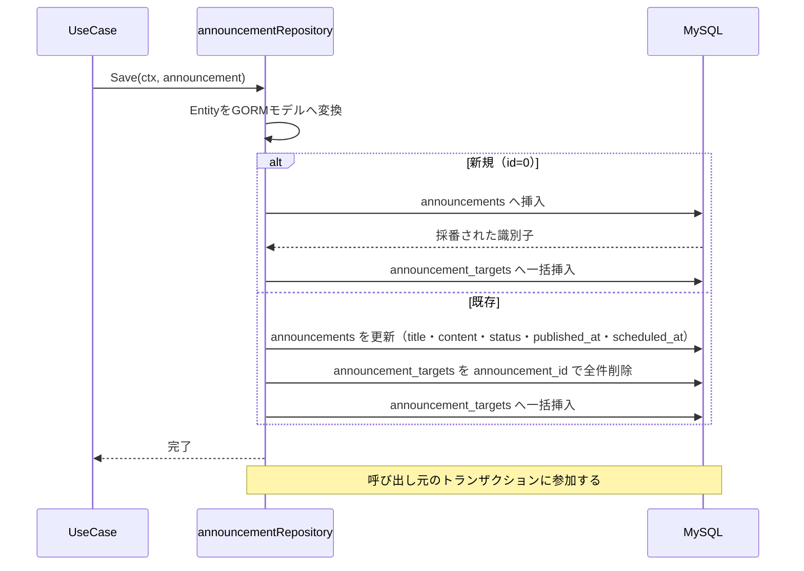
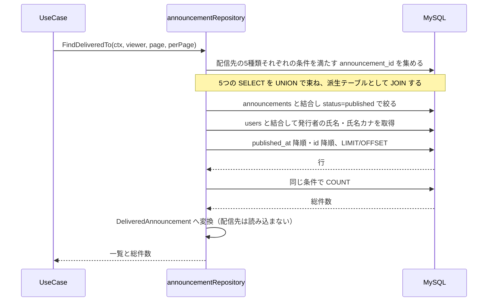
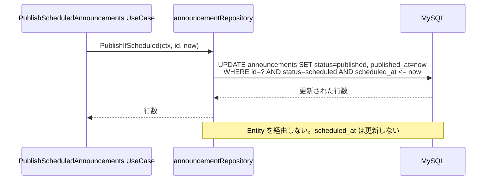
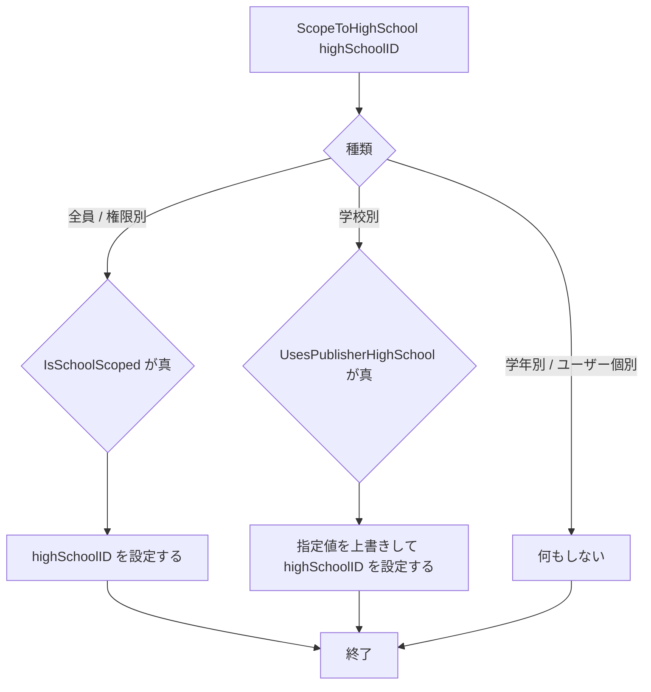
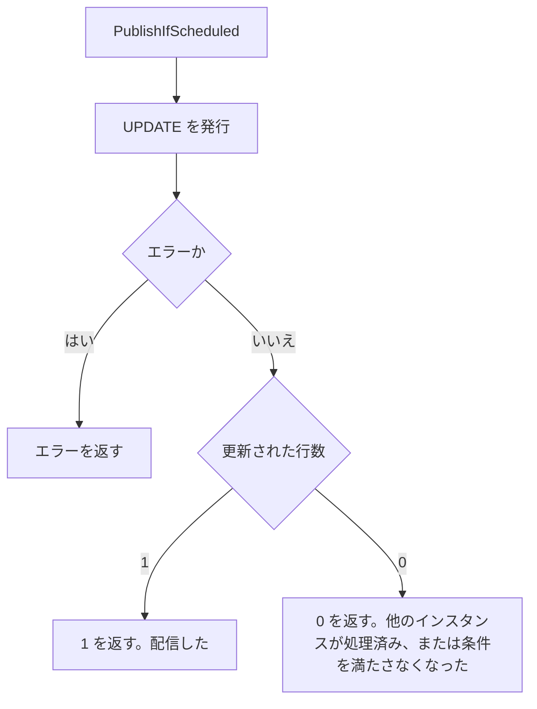

# 教師お知らせ機能 Go実装仕様書（1. Domain・Infrastructure）

---

# 1. 機能概要

## 機能概要

教員が、自校の生徒・教員に向けたお知らせを作成・更新し、自分に配信されたお知らせも読めるようにする機能である（②「1. 機能概要」）。エンドポイントは6つで、配信先の指定を伴う点が中心である。

## 採用設計パターンとその理由（②からの要約）

**Domain Model**（②「4. 設計パターン」）

お知らせは下書き・予約・配信済みの3状態を持ち、遷移の規則がある。配信先が5種類あり種類ごとに必要な項目と制約が異なる。学年制限のある教員には別の制約が重なる。これらを1か所に集めるためEntityと集約を用いる。

## 本書が対象とする実装範囲

**本書は`announcement` Context全体のDomain層とInfrastructure層を対象とする。**

`announcement` Contextはお知らせ機能・教師お知らせ機能・管理者お知らせ管理機能の3文書が共有する（②「3. Bounded Context」）。②でDomain層の定義を本機能に集約したのと同じく、③でもDomain層・Infrastructure層の実装を本書に集約する。

- Domain層のすべて（Entity・Value Object・Domain Service・Repository Interface・Domain Error）
- Infrastructure層のすべて（GORMモデル・Repository実装・他Contextへのアダプタ4つ）
- `context.go`（依存関係の組み立て）・`dependency.go`（他Contextへの依存を宣言するインターフェースと受け渡し用の型）
- Transaction・Validation・Authorization・Errorの実装方針（Context全体で共通）

エンドポイントごとのUseCase・DTO・Handler・Request / Response DTO・ルーティングは次の3文書で扱う。

|文書|担当|
|-|-|
|`教師お知らせ機能_Go実装仕様書_2_Application・Presentation.md`|本機能の6エンドポイント|
|`お知らせ機能_Go実装仕様書.md`|お知らせ機能の2エンドポイント|
|`管理者お知らせ管理機能_Go実装仕様書.md`|管理者お知らせ管理機能の7エンドポイントと定期実行|

---

# 2. ディレクトリ構成

## 対象Bounded Context名

- `announcement`（②「3. Bounded Context」）

## ディレクトリ・パッケージ名

アーキテクチャ規約「4. Bounded Context構成」の「Contextディレクトリの命名」に従い、Context名`announcement`から`-`を取り除いて連結した全小文字の名前とする。`-`を含まないため、ディレクトリ名は`internal/announcement/`、package名は同じ`announcement`となる。

Context名とディレクトリ名は規約から機械的に決まるため、②に明記がなくても推測にはならない。

**`application/`・`presentation/`の下をロール別のサブディレクトリに分ける。** 規約同章の末尾が「同一Contextを複数の機能文書が共有し、UseCase・Handlerのstruct名が機能間で衝突する場合は、`application/`・`presentation/`の下を利用者ロール別のサブディレクトリ（`student/`・`teacher/`・`admin/`）に分割してよい」と定めている。

本Contextでは衝突が実際に起きる。3機能がいずれも「お知らせの一覧を取得する」UseCaseとHandlerを持つためである。

|機能|UseCase名|Handler名|
|-|-|-|
|お知らせ機能|`ListAnnouncements`|`AnnouncementHandler`|
|教師お知らせ機能|`ListAnnouncements`|`AnnouncementHandler`|
|管理者お知らせ管理機能|`ListAdminAnnouncements`|`AnnouncementHandler`|

ロール別に分けることで、いずれも同じ名前のまま衝突しない。

## ②で採用した設計パターン

Domain Model（②「4. 設計パターン」）。**Context全体の構成もDomain Modelである**（②「3. Bounded Context」）。お知らせ機能はTransaction Scriptで足りる業務だが、同じ構成に従う。

## 作成するディレクトリ一覧

```
internal/announcement/
internal/announcement/domain/entity/
internal/announcement/domain/valueobject/
internal/announcement/domain/service/
internal/announcement/domain/repository/
internal/announcement/application/usecase/
internal/announcement/application/student/usecase/
internal/announcement/application/student/dto/
internal/announcement/application/teacher/usecase/
internal/announcement/application/teacher/dto/
internal/announcement/application/admin/usecase/
internal/announcement/application/admin/dto/
internal/announcement/infrastructure/gormrepo/
internal/announcement/infrastructure/contextadapter/
internal/announcement/presentation/student/handler/
internal/announcement/presentation/student/response/
internal/announcement/presentation/teacher/handler/
internal/announcement/presentation/teacher/request/
internal/announcement/presentation/teacher/response/
internal/announcement/presentation/admin/handler/
internal/announcement/presentation/admin/request/
internal/announcement/presentation/admin/response/
```

`domain/specification/`は作成しない。②に仕様オブジェクトとして切り出す判断がない。配信先の指定可否は`domain/service/`のDomain Serviceとして扱う（②「8. Domain Service」）。

`domain/event/`は作成しない。②「18. Domain Event」のとおりDomain Eventを採用しない。

`infrastructure/mail/`・`infrastructure/cache/`・`infrastructure/queue/`は作成しない。②「18. Domain Event」のとおりメール送信・通知の送信を行わず、キャッシュも使わない。予約配信の自動切替は`jobs`テーブルを使わない定期実行であり、キューを持たない（管理者お知らせ管理機能②「18. Domain Event」）。

`presentation/student/request/`は作成しない。お知らせ機能がクエリパラメータとしてページ指定のみを受け取り、Request DTOを設けないためである（お知らせ機能③「9. Presentation層設計」）。

規約「4. Bounded Context構成」の「機能で不要なディレクトリは作成しない。『層として必要だから』という理由で空のディレクトリを置かない」に従う。

## Context全体のファイル一覧と担当文書

```
# --- 本書（教師お知らせ機能③_1_Domain・Infrastructure）が担当 ---
internal/announcement/context.go                                                  # NewContext（依存関係の組み立て）
internal/announcement/dependency.go                                               # 他Contextへの依存を宣言するインターフェースと受け渡し用の型
internal/announcement/domain/errors.go                                            # Domain Error
internal/announcement/domain/entity/announcement.go                               # Announcement（Aggregate Root）
internal/announcement/domain/entity/announcement_target.go                        # AnnouncementTarget
internal/announcement/domain/valueobject/announcement_status.go                   # AnnouncementStatus
internal/announcement/domain/valueobject/scheduled_at.go                          # ScheduledAt
internal/announcement/domain/valueobject/delivery_target_type.go                  # DeliveryTargetType
internal/announcement/domain/service/target_deliverability_policy.go              # TargetDeliverabilityPolicy
internal/announcement/domain/repository/announcement_repository.go                # Repository Interface
internal/announcement/infrastructure/gormrepo/announcement_model.go               # announcements・announcement_targetsのGORMモデル
internal/announcement/infrastructure/gormrepo/announcement_repository.go          # Repository実装
internal/announcement/infrastructure/contextadapter/user_directory.go             # userへのアダプタ
internal/announcement/infrastructure/contextadapter/grade_directory.go            # master-dataへのアダプタ
internal/announcement/infrastructure/contextadapter/teacher_permission_directory.go # teacher-permissionへのアダプタ
internal/announcement/infrastructure/contextadapter/student_directory.go          # student-directoryへのアダプタ
internal/announcement/application/usecase/create_system_announcement.go           # 他Contextへ公開する操作（ロール別ディレクトリの外）

# --- 教師お知らせ機能③_2_Application・Presentation が担当 ---
internal/announcement/application/teacher/usecase/list_announcements.go
internal/announcement/application/teacher/usecase/show_announcement.go
internal/announcement/application/teacher/usecase/get_form_options.go
internal/announcement/application/teacher/usecase/get_announcement_for_edit.go
internal/announcement/application/teacher/usecase/create_announcement.go
internal/announcement/application/teacher/usecase/update_announcement.go
internal/announcement/application/teacher/dto/list_announcements_query.go
internal/announcement/application/teacher/dto/announcement_list_item.go
internal/announcement/application/teacher/dto/form_options.go
internal/announcement/application/teacher/dto/announcement_for_edit.go
internal/announcement/application/teacher/dto/create_announcement_command.go
internal/announcement/application/teacher/dto/update_announcement_command.go
internal/announcement/presentation/teacher/handler/announcement_handler.go
internal/announcement/presentation/teacher/request/announcement_request.go
internal/announcement/presentation/teacher/request/form_options_request.go
internal/announcement/presentation/teacher/response/announcement_list_response.go
internal/announcement/presentation/teacher/response/announcement_response.go
internal/announcement/presentation/teacher/response/form_options_response.go
internal/announcement/presentation/teacher/response/announcement_edit_response.go
internal/announcement/presentation/routes.go                                      # Context全体のルート登録

# --- お知らせ機能③ が担当 ---
internal/announcement/application/student/usecase/list_announcements.go
internal/announcement/application/student/usecase/show_announcement.go
internal/announcement/application/student/dto/list_announcements_query.go
internal/announcement/application/student/dto/announcement_item.go
internal/announcement/presentation/student/handler/announcement_handler.go
internal/announcement/presentation/student/response/announcement_response.go

# --- 管理者お知らせ管理機能③ が担当 ---
internal/announcement/application/admin/usecase/list_announcements.go
internal/announcement/application/admin/usecase/show_announcement.go
internal/announcement/application/admin/usecase/create_announcement.go
internal/announcement/application/admin/usecase/update_announcement.go
internal/announcement/application/admin/usecase/delete_announcement.go
internal/announcement/application/admin/usecase/publish_announcement.go
internal/announcement/application/admin/usecase/list_high_school_announcements.go
internal/announcement/application/admin/usecase/publish_scheduled_announcements.go
internal/announcement/application/admin/dto/list_announcements_query.go
internal/announcement/application/admin/dto/announcement_list_item.go
internal/announcement/application/admin/dto/announcement_detail.go
internal/announcement/application/admin/dto/create_announcement_command.go
internal/announcement/application/admin/dto/update_announcement_command.go
internal/announcement/application/admin/dto/high_school_announcement_item.go
internal/announcement/application/admin/dto/publish_command.go
internal/announcement/presentation/admin/handler/announcement_handler.go
internal/announcement/presentation/admin/handler/high_school_announcement_handler.go
internal/announcement/presentation/admin/request/announcement_request.go
internal/announcement/presentation/admin/request/list_announcements_request.go
internal/announcement/presentation/admin/response/announcement_list_response.go
internal/announcement/presentation/admin/response/announcement_detail_response.go
internal/announcement/presentation/admin/response/high_school_announcement_response.go
internal/announcement/presentation/admin/response/announcement_target_response.go
```

`routes.go`は`announcement` Context全体のルートを1ファイルで登録する。教師お知らせ機能③_2が作成し、お知らせ機能③・管理者お知らせ管理機能③がそれぞれ自身のルートを追加する。コース参照機能③が`dependency.go`について同じ扱いをしており、それに揃える（同③「2. ディレクトリ構成」）。

## 文書の分割

`announcement` Context全体の実装ファイルは**66**である。3つの機能文書で分担し、教師お知らせ機能③はさらに2文書へ分ける。

|文書|担当|実装|テスト込みの目安|
|-|-|-|-|
|`教師お知らせ機能_Go実装仕様書_1_Domain・Infrastructure.md`（本書）|Domain層・Infrastructure層・`context.go`・`dependency.go`・`CreateSystemAnnouncement`・実装方針|17|29|
|`教師お知らせ機能_Go実装仕様書_2_Application・Presentation.md`|本機能の6エンドポイント・`routes.go`|20|27|
|`お知らせ機能_Go実装仕様書.md`|お知らせ機能の2エンドポイント|6|9|
|`管理者お知らせ管理機能_Go実装仕様書.md`|管理者お知らせ管理機能の7エンドポイントと定期実行|23|33|

教師お知らせ機能③を**レイヤーで割る**のは、本機能のHandlerが1つしかないためである（③自動生成プロンプト「2. ディレクトリ構成」の「Handlerが1つしかない機能」）。Domain層とInfrastructure層をまとめて1文書にしたのは、Domain層が8・Infrastructure層が6であり、それぞれ単独では小さすぎるためである。生徒CSVインポート機能③がDomain・Infrastructure・Application/Presentationの3分割であるのに対し、本機能は2分割とする。

実装の順序は**本書 → 教師お知らせ機能③_2 → お知らせ機能③ → 管理者お知らせ管理機能③**とする。本書がDomain層とRepository実装を定めるため、他の3文書はそれに依存する。`routes.go`が教師お知らせ機能③_2にあるため、お知らせ機能③・管理者お知らせ管理機能③はその後になる。

---

# 3. Domain層設計

**本節は`announcement` Context全体のDomain層を定める。** 他の3文書は本節を参照する。

## Entity

### Announcement（`domain/entity/announcement.go`）

Aggregate Rootである（②「5. Aggregate設計」）。

|項目|内容|
|-|-|
|struct名|`Announcement`|

保持するフィールド:

|フィールド|型|意味|
|-|-|-|
|`id`|`uint`|識別子。作成前は`0`|
|`title`|`string`|件名。255文字以内|
|`content`|`string`|本文。10,000文字以内|
|`status`|`valueobject.AnnouncementStatus`|状態|
|`publishedAt`|`*time.Time`|配信日時。配信済みになるときに設定される|
|`scheduledAt`|`valueobject.ScheduledAt`|予約日時|
|`publisherID`|`uint`|発行者の識別子|
|`systemGenerated`|`bool`|システムが自動生成したものかどうか|
|`targets`|`[]*AnnouncementTarget`|配信先。1件以上|

**フィールドはすべて非公開とする。** 状態と配信日時の整合、配信先が1件以上あることを外から崩せないようにするためである（②「5. Aggregate設計」）。

公開するmethod一覧:

|メソッド|引数|戻り値|責務|
|-|-|-|-|
|`NewAnnouncement`|`title, content string, status valueobject.AnnouncementStatus, scheduledAt valueobject.ScheduledAt, publisherID uint, systemGenerated bool, targets []*AnnouncementTarget`|`(*Announcement, error)`|作成する。件名・本文・配信先の検証と、状態に応じた予約日時・配信日時の整合を行う|
|`ReconstructAnnouncement`|永続化された全フィールド|`*Announcement`|GORMモデルから復元する。検証を行わない|
|`ID` / `Title` / `Content` / `Status` / `PublishedAt` / `ScheduledAt` / `PublisherID` / `SystemGenerated` / `Targets`|-|各値|参照用|
|`IsEditable`|-|`bool`|配信済みでないかを返す|
|`UpdateContent`|`title, content *string`|`error`|件名・本文を更新する。**`nil`の項目は変更しない**（部分更新のため）|
|`ChangeStatus`|`status valueobject.AnnouncementStatus, scheduledAt valueobject.ScheduledAt`|`error`|状態と予約日時を変更する。遷移の可否と予約日時の整合を検証し、配信済みになるときは配信日時を設定する。**現在と同じ状態が渡された場合は遷移の判定を行わず、予約日時のみを変更する**|
|`PublishManually`|-|`error`|手動配信する。既に配信済みなら拒否する。配信日時を設定し、**予約日時を消す**|
|`PublishByScheduler`|-|`error`|自動切替で配信する。配信日時を設定し、**予約日時を消さない**|
|`ReplaceTargets`|`targets []*AnnouncementTarget`|`error`|配信先を全件入れ替える。1件以上であることを検証する|
|`EnsureEditable`|-|`error`|配信済みなら`ErrNotEditable`を返す。更新の前に呼ぶ|
|`EnsureDeletable`|-|`error`|配信済みなら`ErrNotDeletable`を返す。削除の前に呼ぶ|

`UpdateContent`が`*string`を取るのは、管理者お知らせ管理機能の更新が部分更新であるためである（管理者お知らせ管理機能②「12. UseCase設計」）。教師お知らせ機能の更新は全項目を渡すが、同じメソッドを使う。

`PublishManually`と`PublishByScheduler`を分けるのは、予約日時の扱いが異なるためである（②「10. 状態遷移図」）。

**`ChangeStatus`に現在と同じ状態が渡された場合を遷移として扱わない。** `AnnouncementStatus.CanTransitionTo`は同じ状態への遷移を偽とするが、これは「配信済みから配信済みへの再配信を通さない」ための規則である（「3. Domain層設計」の`AnnouncementStatus`）。一方、予約のお知らせの予約日時だけを変更する操作は正当であり、このとき状態は予約のまま渡される。遷移の判定を行うと`ErrInvalidStatusTransition`になってしまう。同じ状態が渡された場合は予約日時の整合（予約状態なら設定済みかつ未来日時）のみを検証する。配信済みの場合は`ErrNotEditable`が先に返るため、再配信の経路は塞がれたままである。

この扱いは管理者お知らせ管理機能の部分更新で必要になる（管理者お知らせ管理機能③「6. Application層設計」の`UpdateAnnouncement`）。

`EnsureEditable`を`IsEditable`と別に設けるのは、呼び出し側が真偽値を見て自分でエラーを組み立てる形を避けるためである。エラーの文言を1か所に保つ。

`EnsureDeletable`を`EnsureEditable`と別に設けるのは、同じ「配信済みでない」という条件に対してRails現行のメッセージが異なるためである（「配信済みのため編集できません」と「配信済みのため削除できません」。管理者お知らせ管理機能①「5. API / 処理詳細」`#update`・`#destroy`）。判定は同じでも返すエラーが異なるため、呼び出し側で選べる形にする。

検証の内容:

|検証|タイミング|エラー|
|-|-|-|
|件名が空でない|作成・`UpdateContent`|`ErrTitleRequired`|
|件名が255文字以内|同|`ErrTitleTooLong`|
|本文が空でない|同|`ErrContentRequired`|
|本文が10,000文字以内|同|`ErrContentTooLong`|
|配信先が1件以上|作成・`ReplaceTargets`|`ErrTargetsRequired`|
|状態遷移が許される|`ChangeStatus`|`ErrInvalidStatusTransition`|
|予約状態で予約日時が設定され未来日時|作成・`ChangeStatus`|`ErrScheduledAtRequired` / `ErrScheduledAtNotFuture`|
|配信済みでない|`EnsureEditable`・`UpdateContent`・`ChangeStatus`・`ReplaceTargets`|`ErrNotEditable`|
|配信済みでない（削除）|`EnsureDeletable`|`ErrNotDeletable`|
|既に配信済みでない|`PublishManually`|`ErrAlreadyPublished`|

**配信日時の設定は`||=`相当とする。** 状態が配信済みに変わるとき、配信日時が未設定であれば現在時刻を設定し、既に設定されている場合は上書きしない（①「7. 状態管理」）。現在時刻の取得手段はコンストラクタで受け取る（「17. ②からの補足事項」参照）。

### AnnouncementTarget（`domain/entity/announcement_target.go`）

|項目|内容|
|-|-|
|struct名|`AnnouncementTarget`|

保持するフィールド:

|フィールド|型|意味|
|-|-|-|
|`id`|`uint`|識別子。作成前は`0`|
|`targetType`|`valueobject.DeliveryTargetType`|配信先の種類|
|`userRoleID`|`*uint`|権限の識別子|
|`gradeID`|`*uint`|学年の識別子|
|`highSchoolID`|`*uint`|高校の識別子|
|`userID`|`*uint`|ユーザーの識別子|

公開するmethod一覧:

|メソッド|引数|戻り値|責務|
|-|-|-|-|
|`NewAnnouncementTarget`|`targetType valueobject.DeliveryTargetType, userRoleID, gradeID, highSchoolID, userID *uint`|`(*AnnouncementTarget, error)`|作成する。種類ごとに必要な項目が揃っていることを検証する|
|`ReconstructAnnouncementTarget`|永続化された全フィールド|`*AnnouncementTarget`|GORMモデルから復元する。検証を行わない|
|`ID` / `TargetType` / `UserRoleID` / `GradeID` / `HighSchoolID` / `UserID`|-|各値|参照用|
|`ScopeToHighSchool`|`highSchoolID uint`|-|自校への絞り込みを適用する。**種類が全員・権限別のときに高校を設定する。学校別のときは指定値を上書きして設定する。それ以外は何もしない**|

検証の内容（`DeliveryTargetType`が示す必要項目に基づく）:

|種類|必要な項目|エラー|
|-|-|-|
|全員|なし|-|
|権限別|権限の識別子|`ErrUserRoleRequired`|
|学年別|学年の識別子**と**権限の識別子|`ErrGradeRequired` / `ErrUserRoleRequired`|
|学校別|なし（発行者の所属校を使う）|-|
|ユーザー個別|ユーザーの識別子|`ErrUserRequired`|

**学年別では権限も必須である**（①「5. API / 処理詳細」`#create`）。

`ScopeToHighSchool`が3つの振る舞いを持つ理由は①「5. API / 処理詳細」`#create`の「自校内への絞り込み」のとおりである。全員・権限別は付与しないと他校に届き、学校別は指定値を信用せず発行者の所属校を使う。

**管理者お知らせ管理機能ではこのメソッドを呼ばない。** 管理者は所属校を持たないためである（管理者お知らせ管理機能②「6. Entity設計」）。

## Value Object

### AnnouncementStatus（`domain/valueobject/announcement_status.go`）

|項目|内容|
|-|-|
|型|`int`を基底型とする型|
|値|`AnnouncementStatusDraft`（0）、`AnnouncementStatusScheduled`（1）、`AnnouncementStatusPublished`（2）|

**`iota`をそのまま使う。** `announcements.status`の整数値が0から始まる（①「6. データモデル」）。コーディング規約「3. 命名規則」の「定数のグループ化と `iota`」に従う。

|メソッド|引数|戻り値|責務|
|-|-|-|-|
|`ParseAnnouncementStatus`|`s string`|`(AnnouncementStatus, error)`|文字列から変換する。既知でない値は`ErrInvalidStatus`|
|`String`|-|`string`|`draft` / `scheduled` / `published`を返す（コーディング規約「3. 命名規則」の「enumの `String()` 実装」）|
|`IsValid`|-|`bool`|宣言済みの値かを返す|
|`IsPublished`|-|`bool`|配信済みかを返す|
|`IsScheduled`|-|`bool`|予約かを返す|
|`CanTransitionTo`|`to AnnouncementStatus`|`bool`|遷移が許されるかを返す|

`CanTransitionTo`の規則（②「10. 状態遷移図」）:

|遷移元|許される遷移先|
|-|-|
|下書き|予約、配信済み|
|予約|配信済み|
|配信済み|なし|

**同じ状態への遷移は許さない。** 配信済みから配信済みへの遷移を許すと再配信が通る。手動配信は`PublishManually`が別に判定する。

### ScheduledAt（`domain/valueobject/scheduled_at.go`）

|項目|内容|
|-|-|
|型|`*time.Time`を内包するstruct|

|メソッド|引数|戻り値|責務|
|-|-|-|-|
|`NewScheduledAt`|`t *time.Time`|`ScheduledAt`|作成する。検証は行わない（状態と組み合わせて判定するため）|
|`EmptyScheduledAt`|-|`ScheduledAt`|未設定の値を返す|
|`Value`|-|`*time.Time`|値を返す|
|`IsEmpty`|-|`bool`|未設定かを返す|
|`IsFuture`|`now time.Time`|`bool`|指定時刻より後かを返す。未設定なら偽|

**`IsFuture`が現在時刻を引数で受け取る。** 境界条件（ちょうど現在時刻の場合）をテストで固定できるようにするためである。Rails現行は`scheduled_at < Time.current`で過去を拒否しており、**ちょうど現在時刻は未来として扱われない**（①「5. API / 処理詳細」`#create`）。同じ判定にする。

### DeliveryTargetType（`domain/valueobject/delivery_target_type.go`）

|項目|内容|
|-|-|
|型|`int`を基底型とする型|
|値|`DeliveryTargetTypeAllUsers`（0）、`ByRole`（1）、`ByGrade`（2）、`BySchool`（3）、`ByUser`（4）|

**`iota`をそのまま使う。** `announcement_targets.target_type`の整数値が0から始まる（①「6. データモデル」）。

|メソッド|引数|戻り値|責務|
|-|-|-|-|
|`ParseDeliveryTargetType`|`s string`|`(DeliveryTargetType, error)`|文字列から変換する。既知でない値は`ErrInvalidTargetType`|
|`String`|-|`string`|`all_users` / `by_role` / `by_grade` / `by_school` / `by_user`を返す|
|`IsValid`|-|`bool`|宣言済みの値かを返す|
|`RequiresUserRole`|-|`bool`|権限の識別子が必要かを返す（権限別・学年別で真）|
|`RequiresGrade`|-|`bool`|学年の識別子が必要かを返す（学年別で真）|
|`RequiresUser`|-|`bool`|ユーザーの識別子が必要かを返す（ユーザー個別で真）|
|`IsSchoolScoped`|-|`bool`|自校への絞り込みで高校を付与する対象かを返す（**全員・権限別で真**）|
|`UsesPublisherHighSchool`|-|`bool`|発行者の所属校をそのまま使う種類かを返す（**学校別で真**）|
|`IsGradeRestrictable`|-|`bool`|学年で絞り込める種類かを返す（**学年別・ユーザー個別で真**）|

`IsGradeRestrictable`が偽になる種類（全員・権限別・学校別）は、学年制限のある教員が指定できない（①「5. API / 処理詳細」`#create`）。

## Repository Interface

### AnnouncementRepository（`domain/repository/announcement_repository.go`）

|メソッド|引数|戻り値|責務|
|-|-|-|-|
|`Save`|`ctx context.Context, a *entity.Announcement`|`error`|Aggregateを保存する。新規なら作成、既存なら更新。**配信先の入れ替えを含む**|
|`FindByID`|`ctx context.Context, id uint`|`(*entity.Announcement, error)`|識別子で取得する。見つからなければ`ErrAnnouncementNotFound`|
|`FindByIDAndPublisherRole`|`ctx context.Context, id uint, roleID uint`|`(*entity.Announcement, error)`|識別子と発行者のロールで取得する。管理者お知らせ管理機能が用いる|
|`FindByIDAndPublisher`|`ctx context.Context, id, publisherID uint`|`(*entity.Announcement, error)`|識別子と発行者で取得する。所有権の確認をクエリ条件として実現する|
|`FindDeliveredTo`|`ctx context.Context, viewer ViewerScope, page, perPage int`|`([]*DeliveredAnnouncement, int64, error)`|配信されたお知らせを検索する|
|`FindDeliveredToByID`|`ctx context.Context, viewer ViewerScope, id uint`|`(*DeliveredAnnouncement, error)`|配信されたお知らせを1件取得する|
|`FindAuthoredBy`|`ctx context.Context, publisherID uint, page, perPage int`|`([]*entity.Announcement, int64, error)`|発行者が作成したお知らせを検索する。システム生成を除く|
|`FindByPublisherRole`|`ctx context.Context, cond AdminSearchCondition, page, perPage int`|`([]*DeliveredAnnouncement, int64, error)`|発行者のロールによる検索。件名の部分一致・状態で絞り込む|
|`FindByHighSchool`|`ctx context.Context, highSchoolID uint, page, perPage int`|`([]*DeliveredAnnouncement, int64, error)`|高校を配信先に含むお知らせを検索する|
|`FindDuePublications`|`ctx context.Context, now time.Time`|`([]uint, error)`|予約日時を過ぎた予約の識別子を返す|
|`PublishIfScheduled`|`ctx context.Context, id uint, now time.Time`|`(int64, error)`|状態を条件に含めた配信済みへの更新を行い、更新された行数を返す|
|`Delete`|`ctx context.Context, a *entity.Announcement`|`error`|Aggregateを削除する。配信先も削除する|

引数・戻り値の型:

|型|置き場所|フィールド|
|-|-|-|
|`ViewerScope`|`domain/repository/`|`UserID uint`・`UserRoleID *uint`・`GradeID *uint`・`HighSchoolID *uint`|
|`AdminSearchCondition`|同|`PublisherRoleID uint`・`Keyword string`・`Status *valueobject.AnnouncementStatus`|
|`DeliveredAnnouncement`|同|`Announcement *entity.Announcement`・`PublisherName string`・`PublisherNameKana string`|

`ViewerScope`の識別子を`*uint`にするのは、`users.user_role_id`・`grade_id`・`high_school_id`がいずれも未設定を許すためである（ユーザー基盤機能①「6. データモデル」）。未設定の利用者には、その項目を使う配信先が一致しない。

`DeliveredAnnouncement`が発行者の氏名を含むのは、レスポンスに必要であり、お知らせごとに`user`へ問い合わせるとN+1になるためである（お知らせ機能②「11. Repository設計」）。**Entityに発行者の氏名を持たせない。** 他Contextが所有するデータであり、Entityの属性にすると`announcement` Contextがユーザーの情報を抱えることになる。

`FindDuePublications`が識別子のみを返すのは、更新が`PublishIfScheduled`で行われ、Entityを必要としないためである（管理者お知らせ管理機能②「11. Repository設計」）。

**`PublishIfScheduled`がEntityを経由しない。** 更新条件に遷移前の状態を含めた更新を1回で発行するためである（規約「13. 非同期ジョブ実行パターン（JobQueue）」の「二重実行は状態の更新条件で防ぐ」）。Entityを取得してから更新すると、取得と更新の間に他のインスタンスが処理する余地が生まれる。

**インターフェースのメソッド数が12である。** コーディング規約「6. 構造体・インターフェース設計」の「インターフェースのメソッド数」は3メソッド以内を目安としているが、1つのAggregateに対するRepositoryであり、分割すると同じAggregateの永続化が複数のインターフェースに分かれる。問題解答機能③基盤編も`QuestionHistoryRepository`を7メソッドとしており、同じ扱いとする（「17. ②からの補足事項」参照）。

## Domain Service

### TargetDeliverabilityPolicy（`domain/service/target_deliverability_policy.go`）

②「8. Domain Service」の判定を実装する。

|項目|内容|
|-|-|
|struct名|`TargetDeliverabilityPolicy`|
|保持するフィールド|なし（純粋な判定）|
|コンストラクタ|`NewTargetDeliverabilityPolicy() *TargetDeliverabilityPolicy`|

|メソッド|引数|戻り値|責務|
|-|-|-|-|
|`Verify`|`targets []*entity.AnnouncementTarget, pub PublisherContext`|`error`|配信先の集合が発行者にとって指定できるものかを判定する|

`PublisherContext`（同ファイルに定義）:

|フィールド|型|意味|
|-|-|-|
|`HighSchoolID`|`uint`|発行者の所属校|
|`GradeRestriction`|`*uint`|担当学年の制限。制限がなければ`nil`|
|`Grades`|`map[uint]GradeInfo`|配信先に指定された学年の情報（所属高校）|
|`Users`|`map[uint]UserInfo`|配信先に指定されたユーザーの情報（所属高校・ロール・学年）|

`GradeInfo`は`HighSchoolID uint`、`UserInfo`は`HighSchoolID *uint`・`IsStudent bool`・`GradeID *uint`を持つ。

**外部情報を引数で受け取る。** Domain層が`user`・`master-data`・`teacher-permission`を参照しないためである（②「8. Domain Service」）。UseCaseが必要な情報を集めて渡す。

判定の順序と内容（②「13. シーケンス図・処理フロー図」の処理フロー図のとおり）:

1. 指定された学年が`Grades`に存在しない → `ErrGradeNotFound`
2. 指定されたユーザーが`Users`に存在しない → `ErrUserNotFound`
3. 指定された学年の所属高校が`pub.HighSchoolID`と異なる → `ErrGradeOtherSchool`
4. 指定されたユーザーの所属高校が`pub.HighSchoolID`と異なる → `ErrUserOtherSchool`
5. `pub.GradeRestriction`が`nil`でない場合
   - 学年で絞り込めない種類（全員・権限別・学校別）が含まれる → `ErrTargetNotGradeRestrictable`
   - 学年別の学年が`*pub.GradeRestriction`と異なる → `ErrGradeNotAllowed`
   - ユーザー個別のユーザーが生徒でない、または学年が`*pub.GradeRestriction`と異なる → `ErrUserNotAllowed`

**権限の実在確認はこの判定に含めない。** 権限の識別子が存在するかはUseCaseが`user`へ問い合わせて判定する（教師お知らせ機能③_2「6. Application層設計」）。`PublisherContext`に権限の情報を持たせると、判定の引数が増えるだけで判定の内容が変わらないためである。

**複数の配信先が同じ違反をする場合、違反ごとにエラーを返す。** Rails現行が配信先の件数分メッセージを返す（②「19. API仕様」の「変更しないもの」）。複数のエラーをまとめて返すため、戻り値は複数のエラーを保持できる形とする（「14. Error実装方針」）。

## Domain Event

対象外。②「18. Domain Event」のとおりDomain Eventを採用しない。`domain/event/`を作成しない。

予約配信の自動切替は定期実行として実装する（管理者お知らせ管理機能③「8. Infrastructure層設計」）。

## Domain Error（`domain/errors.go`）

センチネルエラーを定義する。

|変数名|意味|HTTP Status|
|-|-|-|
|`ErrTitleRequired`|件名が入力されていない|422|
|`ErrTitleTooLong`|件名が255文字を超える|422|
|`ErrContentRequired`|本文が入力されていない|422|
|`ErrContentTooLong`|本文が10,000文字を超える|422|
|`ErrInvalidStatus`|状態が既知の3値でない|422|
|`ErrInvalidStatusTransition`|状態遷移が許されない組み合わせ|422|
|`ErrScheduledAtRequired`|予約状態で予約日時が設定されていない|422|
|`ErrScheduledAtNotFuture`|予約日時が未来日時でない|422|
|`ErrNotEditable`|配信済みのため編集できない|422|
|`ErrNotDeletable`|配信済みのため削除できない|422|
|`ErrAlreadyPublished`|既に配信済み（手動配信）|422|
|`ErrTargetsRequired`|配信先が1件以上ない|422|
|`ErrInvalidTargetType`|配信先の種類が既知の5値でない|422|
|`ErrUserRoleRequired`|権限別・学年別で権限が指定されていない|422|
|`ErrGradeRequired`|学年別で学年が指定されていない|422|
|`ErrUserRequired`|ユーザー個別でユーザーが指定されていない|422|
|`ErrGradeNotFound`|指定された学年が存在しない|422|
|`ErrUserNotFound`|指定されたユーザーが存在しない|422|
|`ErrUserRoleNotFound`|指定された権限が存在しない|422|
|`ErrGradeOtherSchool`|指定された学年が他校のもの|422|
|`ErrUserOtherSchool`|指定されたユーザーが他校のもの|422|
|`ErrTargetNotGradeRestrictable`|学年制限があるため指定できない配信先|422|
|`ErrGradeNotAllowed`|学年制限があるため指定できない学年|422|
|`ErrUserNotAllowed`|学年制限があるため指定できないユーザー|422|
|`ErrAnnouncementNotFound`|お知らせが存在しない|404|
|`ErrHighSchoolNotFound`|高校別一覧で指定された高校が存在しない|404|
|`ErrAnnouncementOperationForbidden`|発行者でなく、かつ発行者が在籍中のため操作できない|403|
|`ErrNotEditableForEdit`|**編集フォームの取得で配信済み**|404|

`ErrNotEditable`と`ErrNotEditableForEdit`を分けるのは、同じ状態に対して経路によってステータスが異なるためである。更新は`422`、編集フォームの取得は`404`である（②「17. Error設計」）。

`ErrNotDeletable`を`ErrNotEditable`と分けるのは、Rails現行のメッセージが異なるためである（「配信済みのため編集できません」と「配信済みのため削除できません」。管理者お知らせ管理機能①「5. API / 処理詳細」）。

`ErrHighSchoolNotFound`・`ErrAnnouncementOperationForbidden`は業務ルール違反ではなく、対象の不存在と権限の不足を表す。管理者お知らせ管理機能②「17. Error設計」がApplication Errorに分類しているが、**宣言の置き場所は`domain/errors.go`に揃える。** Context内でセンチネルエラーの定義を1ファイルに集めることで、同じ条件に対して層ごとに別のエラーが生まれることを避ける（管理者お知らせ管理機能③「14. Error実装方針」）。

エラーのメッセージはRails現行の文言を維持する（②「15. Validation設計」）。項目名が英語表記になる点も維持する。

---

# 4. クラス図

```mermaid
classDiagram
    class Announcement {
        -uint id
        -string title
        -string content
        -AnnouncementStatus status
        -*time.Time publishedAt
        -ScheduledAt scheduledAt
        -uint publisherID
        -bool systemGenerated
        -[]*AnnouncementTarget targets
        +IsEditable() bool
        +EnsureEditable() error
        +EnsureDeletable() error
        +UpdateContent(*string, *string) error
        +ChangeStatus(AnnouncementStatus, ScheduledAt) error
        +PublishManually() error
        +PublishByScheduler() error
        +ReplaceTargets([]*AnnouncementTarget) error
    }
    class AnnouncementTarget {
        -uint id
        -DeliveryTargetType targetType
        -*uint userRoleID
        -*uint gradeID
        -*uint highSchoolID
        -*uint userID
        +ScopeToHighSchool(uint)
    }
    class AnnouncementStatus {
        <<Value Object>>
        +ParseAnnouncementStatus(string) (AnnouncementStatus, error)
        +String() string
        +IsPublished() bool
        +IsScheduled() bool
        +CanTransitionTo(AnnouncementStatus) bool
    }
    class ScheduledAt {
        <<Value Object>>
        -*time.Time value
        +IsEmpty() bool
        +IsFuture(time.Time) bool
    }
    class DeliveryTargetType {
        <<Value Object>>
        +RequiresUserRole() bool
        +RequiresGrade() bool
        +RequiresUser() bool
        +IsSchoolScoped() bool
        +UsesPublisherHighSchool() bool
        +IsGradeRestrictable() bool
    }
    class TargetDeliverabilityPolicy {
        <<Domain Service>>
        +Verify([]*AnnouncementTarget, PublisherContext) error
    }
    class PublisherContext {
        +uint HighSchoolID
        +*uint GradeRestriction
        +map~uint,GradeInfo~ Grades
        +map~uint,UserInfo~ Users
    }
    class AnnouncementRepository {
        <<interface>>
        +Save(ctx, *Announcement) error
        +FindByID(ctx, uint) (*Announcement, error)
        +FindByIDAndPublisher(ctx, uint, uint) (*Announcement, error)
        +FindByIDAndPublisherRole(ctx, uint, uint) (*Announcement, error)
        +FindDeliveredTo(ctx, ViewerScope, int, int) ([]*DeliveredAnnouncement, int64, error)
        +FindDeliveredToByID(ctx, ViewerScope, uint) (*DeliveredAnnouncement, error)
        +FindAuthoredBy(ctx, uint, int, int) ([]*Announcement, int64, error)
        +FindByPublisherRole(ctx, AdminSearchCondition, int, int) ([]*DeliveredAnnouncement, int64, error)
        +FindByHighSchool(ctx, uint, int, int) ([]*DeliveredAnnouncement, int64, error)
        +FindDuePublications(ctx, time.Time) ([]uint, error)
        +PublishIfScheduled(ctx, uint, time.Time) (int64, error)
        +Delete(ctx, *Announcement) error
    }
    class announcementRepository {
        -db *gorm.DB
    }

    Announcement "1" *-- "1..*" AnnouncementTarget
    Announcement --> AnnouncementStatus
    Announcement --> ScheduledAt
    AnnouncementTarget --> DeliveryTargetType
    TargetDeliverabilityPolicy ..> AnnouncementTarget
    TargetDeliverabilityPolicy ..> PublisherContext
    AnnouncementRepository ..> Announcement
    AnnouncementRepository <|.. announcementRepository : gormrepoで実装
```



`AnnouncementTarget`のフィールドを非公開にし、`ScopeToHighSchool`で高校を設定する形にしている。UseCaseが直接フィールドを書き換えられないようにするためである。

`PublisherContext`を`domain/service/`に置くのは、`TargetDeliverabilityPolicy`の引数の型であり、他の層から参照されるのは組み立てのときだけであるためである。

---

# 5. 状態遷移図



`CanTransitionTo`が拒否する組み合わせ:

|遷移元|遷移先|エラー|
|-|-|-|
|`AnnouncementStatusScheduled`|`AnnouncementStatusDraft`|`ErrInvalidStatusTransition`|
|`AnnouncementStatusPublished`|任意|同|
|同じ状態への遷移|同じ状態|同|

`PublishManually`と`PublishByScheduler`の違い:

|メソッド|`publishedAt`|`scheduledAt`|既に配信済みのとき|
|-|-|-|-|
|`PublishManually`|未設定なら現在時刻を設定|**空にする**|`ErrAlreadyPublished`|
|`PublishByScheduler`|同|**変更しない**|何もしない（`PublishIfScheduled`が0件を返すため呼ばれない）|

---

# 6. Application層設計

対象外。本書はDomain層とInfrastructure層を対象とする。

各機能のUseCase・DTOは次の文書に記載する。

|文書|担当|
|-|-|
|`教師お知らせ機能_Go実装仕様書_2_Application・Presentation.md`|本機能の6つのUseCase|
|`お知らせ機能_Go実装仕様書.md`|お知らせ機能の2つのUseCase|
|`管理者お知らせ管理機能_Go実装仕様書.md`|管理者お知らせ管理機能の8つのUseCase|

---

# 7. シーケンス図・処理フロー図

本書が担当するのはDomain層とInfrastructure層であり、エンドポイント単位の呼び出し関係は各文書で示す。本節ではRepository実装の中の流れを示す。

## シーケンス図

### Save（Aggregateの保存。配信先の入れ替えを含む）



### FindDeliveredTo（配信されたお知らせの検索）



### PublishIfScheduled（自動切替の更新）



## 処理フロー図

### 配信先の自校への絞り込み（ScopeToHighSchool）



### 状態を条件に含めた更新の結果の判断



---

# 8. Infrastructure層設計

**本節は`announcement` Context全体のInfrastructure層を定める。**

## Repository実装

### announcementRepository（`infrastructure/gormrepo/announcement_repository.go`）

`domain/repository`の`AnnouncementRepository`の実装である。

|項目|内容|
|-|-|
|struct名|非公開struct（例: `announcementRepository`）|
|コンストラクタ|`NewAnnouncementRepository(db *gorm.DB) repository.AnnouncementRepository`|
|保持するフィールド|`db *gorm.DB`|
|対応するGORMモデル|`announcementModel`・`announcementTargetModel`（`announcement_model.go`）|

各メソッドは`gormtx.DBFromContext(ctx, r.db)`で接続を取得する。トランザクション中であればその接続を、そうでなければ通常の接続を使う（「11. Transaction実装方針」）。`db.WithContext(ctx).Transaction(...)`を直接呼ばない。

Entity ⇔ GORMモデルの変換はこのpackage内で行う。Entityは非公開フィールドを持つため、変換用のコンストラクタ（`entity.ReconstructAnnouncement`・`entity.ReconstructAnnouncementTarget`）を用いて組み立てる。Domain層のEntityにGORMタグを付けない（アーキテクチャ規約「2. レイヤー責務と依存方向（Domain Model / Event Sourcing）」）。

発行するクエリ:

|メソッド|クエリ内容|
|-|-|
|`Save`（新規）|`announcements`へ挿入し、採番された識別子で`announcement_targets`へ一括挿入する|
|`Save`（既存）|`announcements`の`title`・`content`・`status`・`published_at`・`scheduled_at`を更新する。`announcement_targets`を`announcement_id`で全件削除し、一括挿入する|
|`FindByID`|`id`で1件取得し、`announcement_targets`を一括取得する。見つからなければ`ErrAnnouncementNotFound`|
|`FindByIDAndPublisher`|`id`・`publisher_id`で1件取得し、配信先を一括取得する。見つからなければ同|
|`FindByIDAndPublisherRole`|`id`で絞り、`users`と結合して発行者の`user_role_id`が一致するものを1件取得する。配信先を一括取得する|
|`FindDeliveredTo`|配信範囲の突き合わせ（下記）。`status`が配信済み。`users`と結合して発行者の氏名・氏名カナを取得。`published_at`降順・`id`降順、`LIMIT`/`OFFSET`。総件数も取得する。**配信先を読み込まない**|
|`FindDeliveredToByID`|同じ突き合わせに`announcements.id`を加えて1件取得する|
|`FindAuthoredBy`|`publisher_id`・`system_generated`が偽で絞る。`published_at`降順・`id`降順、`LIMIT`/`OFFSET`。総件数も取得する。**配信先を読み込まない**|
|`FindByPublisherRole`|`users`と結合して発行者の`user_role_id`が一致するものに絞る。`title`の部分一致（指定時）、`status`（指定時）。`created_at`降順・`id`降順、`LIMIT`/`OFFSET`。総件数も取得する。**配信先を一括取得する**|
|`FindByHighSchool`|`announcement_targets`の`high_school_id`が一致するものに絞り、重複を除く。`created_at`降順・`id`降順、`LIMIT`/`OFFSET`。総件数も取得する。**配信先を一括取得する**|
|`FindDuePublications`|`status`が予約、`scheduled_at`が引数の時刻以前。`id`のみを取得する|
|`PublishIfScheduled`|`id`・`status`が予約・`scheduled_at`が引数の時刻以前を条件に、`status`を配信済み、`published_at`を引数の時刻へ更新する。**`scheduled_at`を更新しない。** 更新された行数を返す|
|`Delete`|`announcement_targets`を`announcement_id`で全件削除し、`announcements`を`id`で削除する|

### 配信範囲の突き合わせの実装

②「11. Repository設計」の「配信されたお知らせの検索について」を実装に落とし込む。

配信先の5種類それぞれの条件を満たす`announcement_id`を集め、重複を除いてから`announcements`と結合する。

|種類|条件|
|-|-|
|全員|`target_type`が全員、`high_school_id`が`NULL`または`viewer.HighSchoolID`|
|権限別|`target_type`が権限別、`user_role_id`が`viewer.UserRoleID`、`high_school_id`が`NULL`または`viewer.HighSchoolID`|
|学年別|`target_type`が学年別、`grade_id`が`viewer.GradeID`、`user_role_id`が`NULL`または`viewer.UserRoleID`|
|学校別|`target_type`が学校別、`high_school_id`が`viewer.HighSchoolID`|
|ユーザー個別|`target_type`がユーザー個別、`user_id`が`viewer.UserID`|

**5つの検索を`UNION`で束ね、派生テーブルとして`announcements`へ結合する。** 識別子の集合を`IN`の副問い合わせに入れる形にしない。Rails現行も同じ形を選んでおり、理由として「`IN`の副問い合わせにするとMySQLが相関サブクエリに変換して全件を評価する」ことを挙げている（①「10. Rails実装対応表」）。

`UNION`（`UNION ALL`ではない）を使うことで重複が除かれる。複数の配信先が条件を満たしても、お知らせは1件として返る（①「5. API / 処理詳細」`#index`）。

`viewer.UserRoleID`・`GradeID`・`HighSchoolID`が`nil`の場合、その項目を使う条件は一致しない。たとえば学年が未設定の利用者には学年別の配信先が一致しない。**`nil`を`NULL`との比較にしない。** `grade_id = NULL`は常に偽になるため、条件そのものを組み立てない形にする（「17. ②からの補足事項」参照）。

**発行者の在籍状態で絞り込まない。** `users`との結合は発行者の氏名の取得のためであり、`deleted_at`を条件に含めない（①「6. データモデル」）。

### 配信先を読み込むかどうか

|メソッド|配信先|理由|
|-|-|-|
|`FindByID` / `FindByIDAndPublisher` / `FindByIDAndPublisherRole`|**読み込む**|更新・削除の対象であり、Aggregateとして扱う必要がある。編集フォームの取得でも返す|
|`FindByPublisherRole` / `FindByHighSchool`|**読み込む**|一覧のレスポンスに配信先の種類を含める（管理者お知らせ管理機能①「5. API / 処理詳細」）|
|`FindDeliveredTo` / `FindDeliveredToByID` / `FindAuthoredBy`|**読み込まない**|レスポンスに配信先を含めない（①「5. API / 処理詳細」）|

配信先を読み込む場合は`Preload`相当で一括取得する。お知らせごとに個別に問い合わせるN+1を避ける（Gorm規約「0. 本プロジェクトでの採用方針」の「リレーションの取得とN+1対策」）。

**配信先を読み込まない場合、`ReconstructAnnouncement`に空の配信先を渡す。** Entityの不変条件（配信先が1件以上）は作成・入れ替えのときに検証するものであり、復元時には検証しない（「3. Domain層設計」の`ReconstructAnnouncement`）。参照専用の用途で空の配信先を持つEntityが生じるが、保存の対象にしないため不変条件を崩さない（「17. ②からの補足事項」参照）。

### 件名の部分一致

`FindByPublisherRole`の`Keyword`は`LIKE`の部分一致で絞り込む。**検索語に含まれるワイルドカード文字（`%`・`_`）をエスケープしてから渡す。** Rails現行も`sanitize_sql_like`でエスケープしている（管理者お知らせ管理機能①「5. API / 処理詳細」`#index`）。

共通マスタ参照機能③基盤編「17. ②からの補足事項」1が、Rails現行がエスケープしていない検索についてGo側でエスケープする判断をしている。本機能ではRails現行が既にエスケープしており、同じ扱いになる。

### GORMモデル（`infrastructure/gormrepo/announcement_model.go`）

|モデル|テーブル|備考|
|-|-|-|
|`announcementModel`|`announcements`|Gorm規約「2. 複数形のテーブル名」の既定命名規則で一致するため、`TableName()`のオーバーライドは不要|
|`announcementTargetModel`|`announcement_targets`|同|

カラム対応はGorm規約の既定命名規則（フィールド名のsnake_case）に従う。`PublishedAt`→`published_at`、`ScheduledAt`→`scheduled_at`、`PublisherID`→`publisher_id`、`SystemGenerated`→`system_generated`、`TargetType`→`target_type`、`UserRoleID`→`user_role_id`等。

**いずれのモデルも`DeletedAt`を持たない。** `announcements`・`announcement_targets`に論理削除の列が存在しない（①「6. データモデル」）。他機能③が`*time.Time`と`gorm.DeletedAt`のどちらを使うかを判断しているのとは異なり、本Contextでは判断の対象自体がない。

NULL可のカラムはポインタとする。

|フィールド|型|理由|
|-|-|-|
|`announcementModel.PublishedAt`|`*time.Time`|配信済みになるまでNULL|
|`announcementModel.ScheduledAt`|`*time.Time`|予約でなければNULL|
|`announcementTargetModel.UserRoleID` / `GradeID` / `HighSchoolID` / `UserID`|`*uint`|種類によって使う列が変わるため、いずれもNULL可（①「6. データモデル」）|

`announcementModel.PublisherID`は`uint`（非ポインタ）とする。`announcements.publisher_id`が未設定を許さないためである。`announcementModel.SystemGenerated`は`bool`とする。既定値が`false`であり未設定を許さない。

`announcementModel.Status`・`announcementTargetModel.TargetType`は`int`とする。Value Objectを直接カラムへ対応させず、変換はこのpackage内で行う。整数の列挙型であり`Scanner`／`driver.Valuer`を実装する必要がない（目標管理機能③が`DueDate`に実装しているのとは異なる）。

`announcementWithPublisherModel`は、発行者の氏名を含む結合結果を受け取る型である。テーブルに対応しないため`TableName()`を持たない。

## 外部連携実装

対象外。②「18. Domain Event」のとおりメール送信・通知の送信を行わない。キャッシュも使わない。

**予約配信の自動切替は外部連携ではない。** `jobs`テーブルもキューも使わず、ワーカーのプロセス内の定期実行として実装する（管理者お知らせ管理機能③「8. Infrastructure層設計」）。

## 他Contextの参照手段の実装

`dependency.go`で宣言したインターフェースの実装である。相手Contextが公開する操作へ委譲し、本Contextから相手のテーブルへクエリを発行しない（アーキテクチャ規約「5. Context間連携ルール」）。GORMに依存せず相手Contextの公開操作を呼ぶアダプタであるため`infrastructure/contextadapter/`に置く（同「4. Bounded Context構成」）。

|ファイル|struct / コンストラクタ|満たすインターフェース|
|-|-|-|
|`user_directory.go`|`userDirectory`＋`NewUserDirectory(userContext *user.Context) *userDirectory`|`ViewerDirectory`・`TargetUserDirectory`・`UserRoleDirectory`・`PublisherDirectory`|
|`grade_directory.go`|`gradeDirectory`＋`NewGradeDirectory(masterDataContext *masterdata.Context) *gradeDirectory`|`TargetGradeDirectory`・`GradeOptionDirectory`|
|`teacher_permission_directory.go`|`teacherPermissionDirectory`＋`NewTeacherPermissionDirectory(tpContext *teacherpermission.Context) announcement.GradeRestrictionDirectory`|`GradeRestrictionDirectory`|
|`student_directory.go`|`studentDirectory`＋`NewStudentDirectory(sdContext *studentdirectory.Context) announcement.StudentOptionDirectory`|`StudentOptionDirectory`|

`userDirectory`・`gradeDirectory`は複数のインターフェースを満たすため、コンストラクタの戻り値をインターフェースにできない。具象型を返す（コーディング規約「7. インターフェース」の「実装側は可能な限り具象型を返す」）。インターフェースを満たすことはブランク識別子への代入でコンパイル時に検証する（同「コンパイル時のインターフェース充足チェック」）。

```
var _ announcement.ViewerDirectory = (*userDirectory)(nil)
```

アダプタの責務は委譲と型変換のみである。配信先の判定・選択肢の絞り込み・並べ替えをアダプタで行わない。

## `dependency.go`に定義するインターフェースと型

本Contextから他Contextへの依存を宣言する。コーディング規約「7. インターフェース」の「インターフェースは、実装するパッケージではなく、利用するパッケージ側で定義する」に従い、利用側である本Contextに置く。

### `user`への参照

|インターフェース|メソッド|責務|
|-|-|-|
|`ViewerDirectory`|`FindViewerScope(ctx context.Context, userID uint) (ViewerScope, error)`|操作者の所属校・学年・ロールを返す。配信範囲の突き合わせに使う（①「5. API / 処理詳細」`#index`）|
|`TargetUserDirectory`|`FindTargetUsers(ctx context.Context, userIDs []uint) (map[uint]TargetUserRef, error)`|配信先に指定されたユーザーの所属校・ロールが生徒かどうか・学年を返す。該当しない識別子は結果に含めない（同`#create`）|
|`UserRoleDirectory`|`ExistsAllUserRoles(ctx context.Context, roleIDs []uint) (bool, error)`|指定された権限がすべて存在するかを返す（同）|
||`FindAssignableUserRoles(ctx context.Context) ([]UserRoleRef, error)`|教員が指定できる権限の一覧を返す。**管理者・保護者を除く**（同`#new`）|
||`FindAdminRoleID(ctx context.Context) (uint, error)`|管理者ロールの識別子を返す（管理者お知らせ管理機能②「11. Repository設計」）|
|`PublisherDirectory`|`FindPublishers(ctx context.Context, userIDs []uint) (map[uint]PublisherRef, error)`|発行者の氏名・氏名カナ・在籍状態を返す。編集フォームの配信先のユーザー名と、権限の判定に使う|

`ViewerDirectory`・`TargetUserDirectory`・`UserRoleDirectory`・`PublisherDirectory`に分けるのは、利用する機能が異なるためである（コーディング規約「6. 構造体・インターフェース設計」の「インターフェースのメソッド数」）。

|インターフェース|使う機能|
|-|-|
|`ViewerDirectory`|お知らせ機能・教師お知らせ機能|
|`TargetUserDirectory`|教師お知らせ機能|
|`UserRoleDirectory`|教師お知らせ機能・管理者お知らせ管理機能|
|`PublisherDirectory`|教師お知らせ機能・管理者お知らせ管理機能|

`ViewerScope`は`domain/repository/`に定義し、`dependency.go`から参照する。Repositoryの引数の型であり、Domain層がContextディレクトリ直下のpackageを参照しない形にするためである（アーキテクチャ規約「2. レイヤー責務と依存方向（Domain Model / Event Sourcing）」。問題解答機能③基盤編が`QuestionIDSet`について同じ判断をしている）。

### `master-data`への参照

|インターフェース|メソッド|責務|
|-|-|-|
|`TargetGradeDirectory`|`FindTargetGrades(ctx context.Context, gradeIDs []uint) (map[uint]TargetGradeRef, error)`|配信先に指定された学年の所属高校を返す。該当しない識別子は結果に含めない（①「5. API / 処理詳細」`#create`）|
|`GradeOptionDirectory`|`FindGradesByHighSchoolID(ctx context.Context, highSchoolID uint) ([]GradeOptionRef, error)`|高校配下の学年の選択肢を返す。表示名を含む（同`#new`）|
||`FindGrades(ctx context.Context, gradeIDs []uint) ([]GradeOptionRef, error)`|指定された学年の選択肢を返す。学年制限があるときに使う（同）|
||`ExistsHighSchool(ctx context.Context, highSchoolID uint) (bool, error)`|高校が存在するかを返す（管理者お知らせ管理機能①「5. API / 処理詳細」）|

`master-data`が公開する操作との対応（共通マスタ参照機能③基盤編「8. Infrastructure層設計」）:

|本Contextのメソッド|`master-data`の公開操作|
|-|-|
|`FindTargetGrades`|`FindGrades`。返った属性の所属高校の識別子を取り出す|
|`FindGradesByHighSchoolID`|同名の`FindGradesByHighSchoolID`|
|`FindGrades`|`FindGrades`|
|`ExistsHighSchool`|`FindHighSchools`に1件分の集合を渡し、結果が空でないかを見る|

### `teacher-permission`への参照

|インターフェース|メソッド|責務|
|-|-|-|
|`GradeRestrictionDirectory`|`FindGradeRestriction(ctx context.Context, userID uint) (*uint, error)`|操作者の担当学年の制限を返す。制限がなければ`nil`（①「5. API / 処理詳細」`#new`・`#create`）|

### `student-directory`への参照

|インターフェース|メソッド|責務|
|-|-|-|
|`StudentOptionDirectory`|`FindStudentOptions(ctx context.Context, cond StudentOptionCondition, page, perPage int) ([]StudentOptionRef, int64, error)`|所属校・学年・キーワードで絞り込んだ生徒の一覧を返す。氏名カナ昇順（同`#new`）|

### 受け渡し用の型

|型|フィールド|
|-|-|
|`TargetUserRef`|`ID uint`・`HighSchoolID *uint`・`IsStudent bool`・`GradeID *uint`|
|`TargetGradeRef`|`ID uint`・`HighSchoolID uint`|
|`UserRoleRef`|`ID uint`・`Name string`|
|`PublisherRef`|`ID uint`・`Name string`・`NameKana string`・`Deactivated bool`|
|`GradeOptionRef`|`ID uint`・`Year int`・`DisplayName string`|
|`StudentOptionCondition`|`HighSchoolID uint`・`GradeID *uint`・`Keyword string`|
|`StudentOptionRef`|`ID uint`・`Name string`・`NameKana string`・`GradeID *uint`|

いずれも本Contextが必要とする項目だけを持つ。相手Contextの内部Entityを持ち込まない（アーキテクチャ規約「5. Context間連携ルール」）。

`PublisherRef`に`Deactivated`を含めるのは、管理者お知らせ管理機能の権限の判定に使うためである（管理者お知らせ管理機能②「16. Authorization設計」）。

**②からの補足**: 相手Contextが公開する操作の具体的なシグネチャは、各機能の③で確定する。`user`・`master-data`は確定済みである。`teacher-permission`・`student-directory`は未追随であり、同機能の追随時にシグネチャを合わせる（「17. ②からの補足事項」参照）。

## 依存関係の組み立て（`context.go`）

アーキテクチャ規約「14. 依存関係の組み立て（DI配線）」の「Context単位の組み立て関数」に従う。

|項目|内容|
|-|-|
|関数|`NewContext(db *gorm.DB, userContext *user.Context, masterDataContext *masterdata.Context, tpContext *teacherpermission.Context, sdContext *studentdirectory.Context, clock Clock) *Context`|
|組み立てる内容|Repository実装・4つのアダプタ・`TargetDeliverabilityPolicy`を生成し、3機能分のUseCase（計16）へ注入する。4つのHandlerへ注入する|
|公開するもの|ルーティング登録に必要な4つのHandler、他Contextへ公開する操作、定期実行のUseCase|

`clock`を受け取るのは、配信日時・予約日時の判定に現在時刻を使い、テストで固定できるようにするためである（「17. ②からの補足事項」参照）。

## 本Contextが他Contextへ公開する操作

②「11. Repository設計」の「本Contextが他Contextへ公開する操作」の2つである。`Context`のメソッドとして定める。

|メソッド|委譲先|呼び出し元|
|-|-|-|
|`CreateSystemAnnouncement(ctx context.Context, in SystemAnnouncementInput) error`|専用のUseCase|`school-class`・`interview-request`等|
|`FindRecentAnnouncements(ctx context.Context, limit int) ([]RecentAnnouncementRef, error)`|`AnnouncementRepository.FindByPublisherRole`相当|`admin-dashboard`|
|`FindDeliveredAnnouncements(ctx context.Context, userID uint, limit int) ([]DeliveredAnnouncementRef, error)`|`ViewerDirectory.FindViewerScope` → `AnnouncementRepository.FindDeliveredTo`|`teacher-dashboard`|

`SystemAnnouncementInput`は`Title string`・`Content string`・`PublisherID uint`・`Targets []SystemAnnouncementTarget`を持つ。`SystemAnnouncementTarget`は配信先の種類と識別子を持つ。

**システム生成のお知らせは下書きを経ずに配信済みで作成する。** `systemGenerated`を真とする（①「10. Rails実装対応表」の`Common::CreateSystemAnnouncementService`）。

**自校への絞り込みを適用しない。** 呼び出し元が配信先を明示的に指定するためである。Rails現行も`school_scoped?`が偽である（同）。

`CreateSystemAnnouncement`のUseCaseは`application/`のどのロール別ディレクトリにも属さない。**`application/usecase/create_system_announcement.go`として、ロール別ディレクトリの外に置く。** 利用者ロールに紐づかない操作であるためである（「17. ②からの補足事項」参照）。この1ファイルは本書が担当する。

`DeliveredAnnouncementRef`は`ID uint`・`Title string`・`Content string`・`PublishedAt *time.Time`・`PublisherID uint`・`PublisherName string`・`PublisherNameKana string`を持つ。教師ダッシュボードが表示する項目に合わせたもので、状態・配信予定日時・作成日時・配信先を含めない（教師ダッシュボード機能①「5. API / 処理詳細」`#show`）。

**`FindDeliveredAnnouncements`は操作者の配信範囲を本Contextで解決する。** 呼び出し元は利用者の識別子と件数の上限だけを渡し、`ViewerDirectory.FindViewerScope`で所属校・学年・ロールを取得してから`FindDeliveredTo`へ渡す。配信先の突き合わせ規則を呼び出し元へ漏らさないためである（②「11. Repository設計」の「配信されたお知らせの検索について」）。`FindDeliveredTo`はページネーションを引数に取るため、`page = 1`・`perPage = limit`として呼び出し、総件数は捨てる。

**ロールで絞り込まない。** 配信先の突き合わせが利用者の属性で行われるため、呼び出し元が教師であることは条件に現れない（同）。`teacher-dashboard`側で操作者が教師であることはMiddlewareが保証する。

---

# 9. Presentation層設計

対象外。本書はDomain層とInfrastructure層を対象とする。

Handler・Request / Response DTO・ルーティングは各機能の文書に記載する。`routes.go`は教師お知らせ機能③_2が作成する（「2. ディレクトリ構成」）。

---

# 10. API仕様

対象外。本書はエンドポイントを担当しない。

Context全体のエンドポイント一覧を示す。詳細は各文書に記載する。

|Method|Path|担当文書|
|-|-|-|
|GET|`/api/v1/student/announcements`|お知らせ機能③|
|GET|`/api/v1/student/announcements/:id`|同|
|GET|`/api/v1/teacher/announcements`|教師お知らせ機能③_2|
|GET|`/api/v1/teacher/announcements/:id`|同|
|GET|`/api/v1/teacher/announcements/new`|同|
|GET|`/api/v1/teacher/announcements/:id/edit`|同|
|POST|`/api/v1/teacher/announcements`|同|
|PATCH / PUT|`/api/v1/teacher/announcements/:id`|同|
|GET|`/api/v1/admin/announcements`|管理者お知らせ管理機能③|
|GET|`/api/v1/admin/announcements/:id`|同|
|POST|`/api/v1/admin/announcements`|同|
|PATCH / PUT|`/api/v1/admin/announcements/:id`|同|
|DELETE|`/api/v1/admin/announcements/:id`|同|
|POST|`/api/v1/admin/announcements/:id/publish`|同|
|GET|`/api/v1/admin/high_schools/:id/announcements`|同|

---

# 11. Transaction実装方針

**本節は`announcement` Context全体の方針を定める。**

②「14. Transaction設計」の基本方針（UseCase単位）を実装に落とし込む。アーキテクチャ規約「11. Transaction実装パターン（TransactionManager）」に従う。

## Transaction開始箇所

UseCase内で`gormtx.RunInTx`を呼ぶ。`db.WithContext(ctx).Transaction(...)`を直接呼ばない（規約同章）。

|UseCase|トランザクション|囲む範囲|
|-|-|-|
|教師お知らせ機能の`CreateAnnouncement`|**使う**|Aggregateの保存（お知らせと配信先の作成）|
|教師お知らせ機能の`UpdateAnnouncement`|**使う**|Aggregateの取得（**排他ロック**）・更新・配信先の入れ替え|
|管理者お知らせ管理機能の`CreateAnnouncement`|**使う**|Aggregateの保存（お知らせと配信先の作成）|
|管理者お知らせ管理機能の`DeleteAnnouncement`|**使う**|Aggregateの削除（配信先とお知らせ）|
|管理者お知らせ管理機能の`UpdateAnnouncement`・`PublishAnnouncement`|使わない|お知らせの更新のみであり単一の書き込み|
|`CreateSystemAnnouncement`|**使う**|Aggregateの保存|
|`PublishScheduledAnnouncements`|**使わない（全体として）**|1件ごとに更新を発行する|
|参照のみのUseCase|使わない|-|

## Transaction終了箇所

`gormtx.RunInTx`に渡した関数が`nil`を返せばコミット、エラーを返せばロールバックする。

## 複数Repositoryにまたがる場合の扱い

本Contextが持つRepositoryは`AnnouncementRepository`のみである。複数のRepositoryにまたがる操作はない。

**他Contextの参照手段の呼び出しをトランザクションの外で行う。** 配信先の検証に必要な情報の取得であり、本Contextの書き込みと原子性を保証する関係にない（②「14. Transaction設計」）。`TargetDeliverabilityPolicy`の判定もトランザクションの外で行う。

## 排他ロック

教師お知らせ機能の`UpdateAnnouncement`で、取得したAggregateに対する排他ロックを取る。配信先の入れ替え中に同じお知らせが別のリクエストで更新されると配信先が混ざるためである（②「14. Transaction設計」）。

管理者お知らせ管理機能の更新・配信ではロックを取らない。配信先を入れ替えないためである（管理者お知らせ管理機能②「14. Transaction設計」）。

## 定期実行での扱い

`PublishScheduledAnnouncements`は全体をトランザクションで囲まない。1件ごとに`PublishIfScheduled`を呼び、**更新条件に遷移前の状態を含めることで排他する**（規約「13. 非同期ジョブ実行パターン（JobQueue）」の「二重実行は状態の更新条件で防ぐ」）。

1件の更新は単一の`UPDATE`であり、トランザクションを明示しなくても原子性が保たれる。

## 他Contextのトランザクションへの参加

`CreateSystemAnnouncement`は他Contextから呼ばれる。呼び出し元がトランザクションを開始している場合はそれに参加する。`gormtx.DBFromContext`が`ctx`のトランザクションを見つけるため、本操作側で新しいトランザクションを開始しない（規約「11. Transaction実装パターン（TransactionManager）」の「呼び出し側トランザクションの引き継ぎ」）。

たとえばクラス編成の申請承認が、申請の更新と通知の作成を1つのトランザクションで行う。通知だけが残る・通知だけが失われる状態を避けるためである。

---

# 12. Validation実装方針

**本節は`announcement` Context全体の方針を定める。**

②「15. Validation設計」のバリデーション仕様を実装レベルに落とし込む。

## Presentation

Request DTOでのチェック内容は各機能の文書に記載する。本節では方針を示す。

- ボディのバインドには`ShouldBindJSON`を使う。クエリパラメータのみの場合は`ShouldBindQuery`を使う（Gin規約「6. Model BindingとValidation」）
- `binding`タグで表せるのは型・必須・値域である。**件名・本文の長さ、状態の値域、配信先の種類ごとの必要項目は`binding`タグで表さない。** Domain層の検証に委ねる
- 検証の失敗はHandlerで`c.Error`に積み、Gin規約「8. エラーハンドリングミドルウェア」の集約ハンドラがHTTPレスポンスへ変換する。`c.Error`は1回だけ呼ぶ

**`announcement_targets`が配列であることの検証をPresentation層に置く。** Rails現行はFormで検証しているが、「配列として受け取れるか」は入力の形式の問題である（②「15. Validation設計」）。JSONのバインドで配列以外が渡された場合、バインドが失敗する。

## 業務ルール検証

Domain Model採用のため、Entity／Value Object生成時とDomain Serviceで検証する。

|検証|置き場所|
|-|-|
|状態の値域|`valueobject.ParseAnnouncementStatus`|
|配信先の種類の値域|`valueobject.ParseDeliveryTargetType`|
|件名・本文の必須と長さ|`entity.NewAnnouncement`・`entity.Announcement.UpdateContent`|
|配信先の種類ごとの必要項目|`entity.NewAnnouncementTarget`|
|配信先が1件以上|`entity.NewAnnouncement`・`entity.Announcement.ReplaceTargets`|
|予約状態での予約日時の必須と未来日時|`entity.NewAnnouncement`・`entity.Announcement.ChangeStatus`|
|状態遷移の可否|`valueobject.AnnouncementStatus.CanTransitionTo`（`ChangeStatus`が呼ぶ）|
|配信済みの編集・削除の可否|`entity.Announcement.EnsureEditable`|
|既に配信済みの手動配信の可否|`entity.Announcement.PublishManually`|
|配信先の実在・自校・学年制限|`service.TargetDeliverabilityPolicy.Verify`|
|権限の実在|UseCase（`UserRoleDirectory.ExistsAllUserRoles`の結果で判定）|

**権限の実在確認だけがUseCaseにある。** `TargetDeliverabilityPolicy`に持たせると引数が増えるだけで判定の内容が変わらないためである（「3. Domain層設計」）。

## 複数のエラーをまとめて返す

Rails現行は複数の検証に失敗した場合、メッセージを全件返す（②「19. API仕様」）。配信先が複数あり、いずれも不正な場合は件数分のメッセージが返る。

Go設計でもこれに合わせる。`TargetDeliverabilityPolicy.Verify`と`entity.NewAnnouncement`は、複数のエラーを保持できる形で返す（「14. Error実装方針」）。

---

# 13. Authorization実装方針

**本節は`announcement` Context全体の方針を定める。**

②「16. Authorization設計」を実装に落とし込む。

|層|処理|
|-|-|
|Middleware|認証と、ロール（`student` / `teacher` / `admin`）の判定。Casbin RBACで行う（Gin規約「4. 認可（Casbin RBAC）」）。**ルートのグループごとに適用するロールが異なる**|
|Handler|操作者の識別子を`context.Context`から取り出し、UseCaseへ渡す。リクエストから受け取らない（コーディング規約「20. `context.Context`」）|
|UseCase|**所有権・対象の絞り込みをRepositoryの検索条件として行う。** 管理者お知らせ管理機能の権限の判定はガード節として行う|
|Domain|状態による操作の可否を判定する（`EnsureEditable`・`PublishManually`）。配信先の指定可否を判定する（`TargetDeliverabilityPolicy`）|

## 検索条件による所有権・対象の絞り込み

|機能|絞り込み|使うメソッド|該当しないときのステータス|
|-|-|-|-|
|お知らせ機能|配信範囲の突き合わせ|`FindDeliveredTo` / `FindDeliveredToByID`|404|
|教師お知らせ機能（一覧・詳細）|同|同|404|
|教師お知らせ機能（`authored`）|発行者が操作者|`FindAuthoredBy`|-（一覧のため）|
|教師お知らせ機能（編集・更新）|発行者が操作者|`FindByIDAndPublisher`|404|
|管理者お知らせ管理機能|発行者のロールが管理者|`FindByIDAndPublisherRole` / `FindByPublisherRole`|404|

取得してから発行者を比較する形にしない。`403`を返す経路を作ることになり、Rails現行の`404`と挙動が変わる（②「16. Authorization設計」）。

## 管理者お知らせ管理機能の権限の判定

対象の絞り込みを通過した後、UseCaseのガード節で判定する（管理者お知らせ管理機能②「16. Authorization設計」）。

条件: 発行者が操作者である、または**発行者が論理削除済みである**。

発行者の在籍状態は`PublisherDirectory.FindPublishers`で取得する。判定を通らない場合は`403`を返す。

**この判定は更新・削除・配信のみに適用する。** 一覧・詳細・高校別一覧では行わない。

## 定期実行での扱い

`PublishScheduledAnnouncements`は操作者を持たない。認証・認可の対象外である。HTTPを経由せず、プロセス内の定期実行から呼ばれる。

## `CreateSystemAnnouncement`での扱い

認可を行わない。HTTPを経由せず他Contextから呼ばれ、呼び出し元が操作者の権限を確認している（②「11. Repository設計」）。

---

# 14. Error実装方針

**本節は`announcement` Context全体の方針を定める。**

②「17. Error設計」のエラー仕様を実装レベルに落とし込む。

## Domain Error → Application Errorへの変換方針

アーキテクチャ規約「12. Error変換パターン（AppError）」の「Domain Model採用時の変換」に従う。Domain層のセンチネルエラーをUseCaseが`apperror.AppError`へ包み、Handlerは`c.Error(err)`を呼ぶだけとする。

## Application Error → HTTPレスポンスへの変換方針

|業務シナリオ|Error変数名／型|発生層|HTTP Status|
|-|-|-|-|
|`announcement`パラメータがない|Request DTOのバインド失敗をバリデーションエラーへ変換したもの|Presentation|400|
|パスパラメータ・日時・配列の形式が不正|同|Presentation|422|
|件名・本文・状態・予約日時の検証失敗|`ErrTitleRequired`等（「3. Domain層設計」のDomain Error）|Domain|422|
|配信先の指定が不正|`ErrInvalidTargetType`・`ErrGradeRequired`等|Domain|422|
|状態遷移が許されない|`ErrInvalidStatusTransition`|Domain|422|
|配信済みのため編集できない（更新）|`ErrNotEditable`|Domain|422|
|配信済みのため削除できない|`ErrNotDeletable`|Domain|422|
|既に配信済み（手動配信）|`ErrAlreadyPublished`|Domain|422|
|お知らせが存在しない|`ErrAnnouncementNotFound`|Domain|404|
|**配信済みのため編集できない（編集フォームの取得）**|`ErrNotEditableForEdit`|Domain|**404**|
|高校が存在しない|管理者お知らせ管理機能のUseCaseが返す|Application|404|
|操作する権限がない|管理者お知らせ管理機能のUseCaseが返す|Application|403|
|DBアクセス・他Contextの呼び出しの失敗|包まずそのまま返す|Infrastructure|500|
|未認証|認証ミドルウェアが返す|Middleware|401|
|ロールが一致しない|認可ミドルウェアが返す|Middleware|403|

`ErrNotEditable`と`ErrNotEditableForEdit`でステータスが異なる。同じ状態に対して経路によって扱いが違うためである（②「17. Error設計」）。**UseCaseが経路に応じて使い分ける。** Entityは`EnsureEditable`で`ErrNotEditable`を返し、編集フォームの取得のUseCaseがそれを`ErrNotEditableForEdit`へ読み替える。

`ErrAnnouncementNotFound`の`StatusCode`は404、`LogLevel`は情報レベルとする。存在しない識別子の指定は利用者の操作によって起こりうるものであり、障害ではない。

## `404`の本文

Rails現行の`{"message": "..."}`を維持する（②「17. Error設計」）。規約「15. API規約（レスポンス形式・ページネーション・URL・クエリパラメータ）」はエラー本文を`{"errors": [...]}`と定めているが、フロントエンドを変更しない方針のため維持する。

`AppError`に本文の形と名称を持たせ、ミドルウェアがそれに従って本文を組み立てる。機能ごとの名称表をミドルウェアに持たせないためである。問題解答機能③基盤編「14. Error実装方針」が同じ仕組みを採っており、それに揃える。

名称は次のとおりとする。日本語訳が定義されていないRails現行の出力に合わせる（①「5. API / 処理詳細」`#show`）。

|対象|名称|
|-|-|
|お知らせ|`Announcement`|
|高校|`High school`|

## 複数のエラーをまとめて返す

`422`の本文に複数のメッセージを含める必要がある（②「19. API仕様」）。

アーキテクチャ規約「12. Error変換パターン（AppError）」の「複数フィールドのバリデーションエラー」に従い、`AppError`と`FieldErrorer`を実装する型を1つ作り、`Fields()`に失敗したすべてのメッセージを入れる。`c.Error`は1回だけ呼ぶ。

**レスポンスの`errors`には、Gin規約「8. エラーハンドリングミドルウェア」の`ErrorHandler`が`appErr.Error()`の結果を1要素だけ入れる。** そのため`errors`が1要素、`fields`が全件となる。Rails現行は`errors`に全件を並べるため差分が生じる。

これは分析機能③スライス編「14. Error実装方針」で同じ制約に当たった点である。解消には`apperror`と`ErrorHandler`の拡張が必要であり、規約に定めのない事項を本書で新設しない。残タスクに記録済みの事項として扱う（「17. ②からの補足事項」参照）。

## Infrastructure Errorのハンドリング方針

Repository実装・アダプタは、DBや相手Contextが返したエラーを包み直さず、そのまま返す。本Contextで意味づけし直す余地がないためである。

**ただし`FindByID`系は該当なしを`ErrAnnouncementNotFound`へ変換する。** GORMの「レコードが見つからない」を呼び出し元に漏らさないためである（アーキテクチャ規約「12. Error変換パターン（AppError）」）。

**定期実行では扱いが異なる。** `PublishIfScheduled`が失敗しても例外を上位へ伝えず、記録に残して次の対象へ進む（管理者お知らせ管理機能③「6. Application層設計」）。

---

# 15. GORM / DBクエリ設計

②「20. DB設計方針」のとおり、既存Rails DBを継続利用し、スキーマ変更は行わない。

## 利用するGORMモデルとテーブルの対応

|Goモデル|テーブル名|備考|
|-|-|-|
|`announcementModel`|`announcements`|Gorm規約「2. 複数形のテーブル名」の既定命名規則で一致するため、`TableName()`のオーバーライドは不要|
|`announcementTargetModel`|`announcement_targets`|同|

カラム対応・ポインタの使い分けは「8. Infrastructure層設計」のGORMモデルに記載する。要点を再掲する。

- **いずれのモデルも`DeletedAt`を持たない**（対象テーブルに列が存在しない）
- `PublishedAt`・`ScheduledAt`は`*time.Time`、配信先の4つの識別子は`*uint`
- `Status`・`TargetType`は`int`。Value Objectを直接カラムへ対応させず、変換はgormrepo内で行う

`users`・`user_roles`に対応するモデルは持たない。**ただし結合のために`users`・`user_roles`をクエリで参照する。** 発行者の氏名の取得と、発行者のロールによる絞り込みに必要である（②「21. DB操作仕様」が例外として認めている）。結合結果は`announcementWithPublisherModel`で受け取る。

## 主要クエリの条件・ソート・ページネーション方針

|メソッド|対象テーブル|条件|結合|
|-|-|-|-|
|`Save`|`announcements`, `announcement_targets`|`id`（更新時）|なし|
|`FindByID`|`announcements`, `announcement_targets`|`id`|配信先を一括取得|
|`FindByIDAndPublisher`|同|`id`, `publisher_id`|同|
|`FindByIDAndPublisherRole`|`announcements`, `announcement_targets`, `users`|`id`, 発行者の`user_role_id`|`users`（内部結合）、配信先を一括取得|
|`FindDeliveredTo`|`announcements`, `announcement_targets`, `users`|配信範囲の突き合わせ、`status`が配信済み|配信先の`UNION`を派生テーブルとして結合、`users`（内部結合）|
|`FindDeliveredToByID`|同|同＋`announcements.id`|同|
|`FindAuthoredBy`|`announcements`|`publisher_id`, `system_generated`が偽|なし|
|`FindByPublisherRole`|`announcements`, `announcement_targets`, `users`|発行者の`user_role_id`、`title`の部分一致、`status`|`users`（内部結合）、配信先を一括取得|
|`FindByHighSchool`|`announcements`, `announcement_targets`, `users`|配信先の`high_school_id`、重複を除く|同|
|`FindDuePublications`|`announcements`|`status`が予約、`scheduled_at <= ?`|なし|
|`PublishIfScheduled`|`announcements`|`id`, `status`が予約, `scheduled_at <= ?`|なし|
|`Delete`|`announcements`, `announcement_targets`|`id`|なし|

ソートとページネーション:

|メソッド|ソート|
|-|-|
|`FindDeliveredTo` / `FindAuthoredBy`|`published_at`降順、`id`降順|
|`FindByPublisherRole` / `FindByHighSchool`|`created_at`降順、`id`降順|

- ページネーションは`LIMIT`/`OFFSET`で行う。総件数は別のクエリで`COUNT`する
- `FindAuthoredBy`で`published_at`降順を使うが、下書き・予約の`published_at`は`NULL`である。**MySQLでは`NULL`が降順で最後になる。** 並び順が安定しない点はRails現行と同じであり、第2キーの`id`降順で決定的にする（②「19. API仕様」の「変更しないもの」）
- `deleted_at`を条件に含めない（対象テーブルに列がない）
- **`users`との結合で`deleted_at`を条件に含めない。** 論理削除済みの発行者のお知らせも返す（①「6. データモデル」）
- 件名の部分一致は検索語のワイルドカード文字をエスケープしてから渡す（「8. Infrastructure層設計」）
- 配信範囲の突き合わせは`UNION`で束ねた派生テーブルとして結合する（同）
- `scheduled_at`の比較がずれないよう、接続のタイムゾーンを固定する（Gorm規約「4. タイムスタンプのトラッキング」の「接続のタイムゾーン」）。RailsがUTCで保存しているため、Go側もUTCで扱う

## 既存Schemaへの変更

②「20. DB設計方針」のとおり、変更なし。

---

# 16. テストケース設計

本書が担当するDomain層とInfrastructure層を対象とする。各機能のUseCase Test・Handler Test・Integration Testは各文書に記載する。

## Domain Test

|対象|テストケース|
|-|-|
|`AnnouncementStatus.ParseAnnouncementStatus`|`draft` / `scheduled` / `published`が変換されること|
||既知でない値で`ErrInvalidStatus`を返すこと|
|`AnnouncementStatus.String`|各値が`draft` / `scheduled` / `published`を返すこと|
|`AnnouncementStatus.CanTransitionTo`|下書き → 予約・配信済みが真になること|
||予約 → 配信済みが真になること|
||予約 → 下書きが偽になること|
||配信済み → 任意が偽になること|
||**同じ状態への遷移が偽になること**|
|`ScheduledAt.IsFuture`|未設定で偽になること|
||指定時刻より後で真になること|
||**ちょうど指定時刻で偽になること**（Rails現行が`< Time.current`で判定するため）|
||指定時刻より前で偽になること|
|`DeliveryTargetType.ParseDeliveryTargetType`|5つの値が変換されること、既知でない値で`ErrInvalidTargetType`を返すこと|
|`DeliveryTargetType.RequiresUserRole`|権限別・学年別で真、それ以外で偽になること|
|`DeliveryTargetType.RequiresGrade`|学年別で真、それ以外で偽になること|
|`DeliveryTargetType.RequiresUser`|ユーザー個別で真、それ以外で偽になること|
|`DeliveryTargetType.IsSchoolScoped`|**全員・権限別で真**、それ以外で偽になること|
|`DeliveryTargetType.UsesPublisherHighSchool`|**学校別で真**、それ以外で偽になること|
|`DeliveryTargetType.IsGradeRestrictable`|**学年別・ユーザー個別で真**、全員・権限別・学校別で偽になること|
|`NewAnnouncementTarget`|全員で識別子なしでも作成できること|
||権限別で権限がないとき`ErrUserRoleRequired`を返すこと|
||**学年別で学年と権限の両方が必要であること**|
||学校別で識別子なしでも作成できること|
||ユーザー個別でユーザーがないとき`ErrUserRequired`を返すこと|
|`AnnouncementTarget.ScopeToHighSchool`|全員・権限別で高校が設定されること|
||**学校別で指定値が上書きされること**|
||学年別・ユーザー個別で何も変わらないこと|
|`NewAnnouncement`|件名が空で`ErrTitleRequired`を返すこと|
||件名が256文字で`ErrTitleTooLong`、255文字で成功すること|
||本文が空で`ErrContentRequired`を返すこと|
||本文が10,001文字で`ErrContentTooLong`、10,000文字で成功すること|
||配信先が0件で`ErrTargetsRequired`を返すこと|
||状態が予約で予約日時が未設定のとき`ErrScheduledAtRequired`を返すこと|
||状態が予約で予約日時が過去のとき`ErrScheduledAtNotFuture`を返すこと|
||状態が配信済みのとき配信日時が設定されること|
||状態が下書き・予約のとき配信日時が設定されないこと|
||**複数の検証に失敗したとき、すべてのエラーが返ること**|
|`Announcement.IsEditable`|下書き・予約で真、配信済みで偽になること|
|`Announcement.EnsureEditable`|配信済みで`ErrNotEditable`を返すこと|
|`Announcement.EnsureDeletable`|配信済みで`ErrNotDeletable`を返すこと|
||下書き・予約で`nil`を返すこと|
|`Announcement.UpdateContent`|`nil`の項目が変更されないこと|
||配信済みで`ErrNotEditable`を返すこと|
||空文字を渡したとき`ErrTitleRequired`・`ErrContentRequired`を返すこと|
|`Announcement.ChangeStatus`|許されない遷移で`ErrInvalidStatusTransition`を返すこと|
||**現在と同じ状態を渡したとき遷移の判定が行われず、予約日時のみが変わること**|
||**予約のまま予約日時を過去にしたとき`ErrScheduledAtNotFuture`を返すこと**|
||配信済みへの遷移で配信日時が設定されること|
||**配信日時が既に設定されている場合に上書きしないこと**|
||予約への遷移で予約日時が未設定・過去のとき拒否すること|
||配信済みで`ErrNotEditable`を返すこと|
|`Announcement.PublishManually`|下書きから配信できること|
||予約から配信できること|
||**予約日時が空になること**|
||配信日時が設定されること|
||既に配信済みで`ErrAlreadyPublished`を返すこと|
|`Announcement.PublishByScheduler`|予約から配信できること|
||**予約日時が残ること**|
||配信日時が設定されること|
|`Announcement.ReplaceTargets`|配信先が入れ替わること|
||0件で`ErrTargetsRequired`を返すこと|
||配信済みで`ErrNotEditable`を返すこと|
|`TargetDeliverabilityPolicy.Verify`|指定された学年が`Grades`にないとき`ErrGradeNotFound`を返すこと|
||指定されたユーザーが`Users`にないとき`ErrUserNotFound`を返すこと|
||学年が他校のとき`ErrGradeOtherSchool`を返すこと|
||ユーザーが他校のとき`ErrUserOtherSchool`を返すこと|
||**学年制限が`nil`のとき、全員・権限別・学校別を指定できること**|
||学年制限があるとき、全員を指定して`ErrTargetNotGradeRestrictable`を返すこと|
||学年制限があるとき、権限別を指定して同じエラーを返すこと|
||学年制限があるとき、学校別を指定して同じエラーを返すこと|
||学年制限があるとき、自分の学年の学年別を指定して成功すること|
||学年制限があるとき、他の学年の学年別を指定して`ErrGradeNotAllowed`を返すこと|
||学年制限があるとき、自分の学年の生徒のユーザー個別を指定して成功すること|
||学年制限があるとき、他の学年の生徒を指定して`ErrUserNotAllowed`を返すこと|
||学年制限があるとき、**同じ学年の教員**を指定して`ErrUserNotAllowed`を返すこと|
||**複数の配信先が同じ違反をしたとき、違反ごとにエラーが返ること**|

## UseCase Test

各機能の文書に記載する。

## Repository Test

|対象|テストケース|
|-|-|
|`Save`（新規）|お知らせと配信先が作成されること|
||採番された識別子が配信先に設定されること|
||`system_generated`が保存されること|
|`Save`（既存）|`title`・`content`・`status`・`published_at`・`scheduled_at`が更新されること|
||**配信先が全件削除されてから作り直されること**|
||`publisher_id`・`system_generated`が変わらないこと|
|`FindByID`|配信先を含むAggregateが取得できること|
||存在しない識別子で`ErrAnnouncementNotFound`を返すこと|
|`FindByIDAndPublisher`|発行者が一致するとき取得できること|
||発行者が異なるとき`ErrAnnouncementNotFound`を返すこと|
|`FindByIDAndPublisherRole`|発行者のロールが一致するとき取得できること|
||発行者のロールが異なるとき`ErrAnnouncementNotFound`を返すこと|
||**発行者が論理削除済みでも取得できること**|
|`FindDeliveredTo`|**全員（高校未設定）がすべての利用者に届くこと**|
||**全員（高校設定済み）がその高校の利用者にのみ届くこと**|
||**権限別が権限の一致で届くこと。高校が設定されていればその高校に限られること**|
||**学年別が学年の一致で届くこと。権限が設定されていればその権限に限られること**|
||**学校別がその高校の利用者に届くこと**|
||**ユーザー個別がその利用者にのみ届くこと**|
||**複数の配信先が条件を満たしても1件として返ること**|
||下書き・予約が含まれないこと|
||**論理削除済みの発行者のお知らせも返ること**|
||`published_at`降順、同値のとき`id`降順になること|
||ページをまたいで重複・欠落がないこと|
||総件数が絞り込み後の件数になること|
||発行者の氏名・氏名カナが取得できること|
||**配信先を読み込まないこと**|
||利用者の学年が未設定のとき、学年別の配信先が一致しないこと|
||利用者のロールが未設定のとき、権限別の配信先が一致しないこと|
||利用者の所属校が未設定のとき、学校別の配信先が一致しないこと|
|`FindDeliveredToByID`|配信されたお知らせを取得できること|
||配信されていないお知らせで`ErrAnnouncementNotFound`を返すこと|
||下書き・予約で同じエラーを返すこと|
|`FindAuthoredBy`|発行者が一致するお知らせが返ること|
||**システム生成が除かれること**|
||状態で絞り込まれないこと（下書き・予約も返ること）|
||`published_at`が`NULL`の行が降順で最後になること|
|`FindByPublisherRole`|発行者のロールが一致するお知らせが返ること|
||教員が発行したお知らせが除かれること|
||**発行者が論理削除済みの管理者のお知らせが含まれること**|
||件名の部分一致で絞り込まれること|
||**検索語に`%`・`_`が含まれてもパターンとして解釈されないこと**|
||状態で絞り込まれること、状態が未指定のとき絞り込まれないこと|
||`created_at`降順、同値のとき`id`降順になること|
||配信先を読み込むこと|
|`FindByHighSchool`|配信先の高校が一致するお知らせが返ること|
||**複数の配信先が同じ高校を指すお知らせが1件として返ること**|
||配信先の高校が未設定のお知らせが含まれないこと|
||状態で絞り込まれないこと|
||配信先を読み込むこと|
|`FindDuePublications`|状態が予約で予約日時が引数の時刻以前の識別子が返ること|
||予約日時が未来のものが含まれないこと|
||下書き・配信済みが含まれないこと|
||**ちょうど引数の時刻のものが含まれること**（`<=`で判定するため）|
|`PublishIfScheduled`|予約のお知らせが配信済みになり、行数1が返ること|
||`published_at`が引数の時刻になること|
||**`scheduled_at`が変わらないこと**|
||既に配信済みの行で行数0が返ること|
||下書きの行で行数0が返ること|
||予約日時が未来の行で行数0が返ること|
|`Delete`|お知らせと配信先の両方が削除されること|
|全メソッド|`gormtx.DBFromContext`で接続を取得すること（他Contextが開始したトランザクションの内側から呼ばれた場合に同じ接続を使うこと）|

**配信範囲の突き合わせが本書のテストの中心である。** 誤って他の利用者向けのお知らせが見えることは情報の漏えいにあたるため、5種類すべてと未設定の組み合わせを確認する。

## アダプタ Test

|対象|テストケース|
|-|-|
|`userDirectory`|`FindViewerScope`が所属校・学年・ロールを`ViewerScope`へ変換すること、未設定の項目が`nil`になること|
||`FindTargetUsers`が該当しない識別子を結果に含めないこと|
||`FindTargetUsers`が生徒かどうかを判定して返すこと|
||`ExistsAllUserRoles`が空の集合で真を返すこと|
||`FindAssignableUserRoles`が**管理者・保護者を除く**こと|
||`FindAdminRoleID`が管理者ロールの識別子を返すこと|
||`FindPublishers`が在籍状態を含めて返すこと|
||4つのインターフェースをすべて満たすこと|
||相手Contextがエラーを返した場合、包み直さずそのまま返すこと|
|`gradeDirectory`|`FindTargetGrades`が`master-data`の`FindGrades`を呼び、所属高校を取り出すこと|
||`FindGradesByHighSchoolID`が表示名を含めて返すこと|
||`ExistsHighSchool`が`FindHighSchools`に1件分の集合を渡し、結果の有無で判定すること|
||空の集合で相手Contextを呼ばずに空を返すこと|
||2つのインターフェースをすべて満たすこと|
|`teacherPermissionDirectory`|制限がないとき`nil`を返すこと|
|`studentDirectory`|絞り込み条件・ページ指定を相手Contextへ渡すこと、氏名カナ昇順の結果をそのまま返すこと|

## Handler Test

各機能の文書に記載する。

## Integration Test

各機能の文書に記載する。本書が担当する範囲として、公開操作のテストを挙げる。

|対象|テストケース|
|-|-|
|`CreateSystemAnnouncement`|**下書きを経ずに配信済みで作成されること**|
||`system_generated`が真になること|
||**自校への絞り込みが適用されないこと**|
||配信先が指定どおりに作成されること|
||呼び出し元が開始したトランザクションの内側で動作すること（ロールバックでお知らせも残らないこと）|
||作成されたお知らせが、配信先に一致する利用者の一覧に現れること|
|`FindRecentAnnouncements`|管理者ダッシュボードから呼ばれて結果を返すこと|
|`FindDeliveredAnnouncements`|操作者を配信対象に含む公開中のお知らせが、配信日時の降順で件数の上限まで返ること。配信対象に含まれないお知らせと公開中でないお知らせが返らないこと|

---

# 17. ②からの補足事項

## 1. `application/`・`presentation/`をロール別に分ける

- 判断した内容: `application/student/`・`application/teacher/`・`application/admin/`と`presentation/student/`・`presentation/teacher/`・`presentation/admin/`に分ける
- 判断理由: アーキテクチャ規約「4. Bounded Context構成」の末尾が「同一Contextを複数の機能文書が共有し、UseCase・Handlerのstruct名が機能間で衝突する場合は、`application/`・`presentation/`の下を利用者ロール別のサブディレクトリに分割してよい」と定めている。本Contextでは3機能がいずれも「お知らせの一覧を取得する」UseCaseとHandlerを持ち、衝突が実際に起きる
- 推測かどうか: 推測ではない。規約が認めている分割である

## 2. `CreateSystemAnnouncement`をロール別ディレクトリの外に置く

- 判断した内容: `application/usecase/create_system_announcement.go`として、`student/`・`teacher/`・`admin/`のいずれにも入れない
- 判断理由: 利用者ロールに紐づかない操作であり、HTTPを経由せず他Contextから呼ばれる（②「11. Repository設計」）。ロール別ディレクトリに入れると、どのロールのものかという誤った対応がつく
- 推測かどうか: **②からの補足**。規約はロール別の分割を認めているが、ロールに属さない操作の置き場所までは定めていない

## 3. 現在時刻の取得手段をコンストラクタで受け取る

- 判断した内容: 配信日時の設定・予約日時の未来判定に使う現在時刻を、`Clock`としてコンストラクタで受け取る。`time.Now()`を直接呼ばない
- 判断理由: 予約日時の境界条件（ちょうど現在時刻）と、配信日時が設定されるかどうかをテストで固定できるようにするため。問題解答機能③基盤編も同じ判断をしている
- 推測かどうか: 推測ではない。規約に定めのない範囲での実装手段の選択である

## 4. `ScheduledAt.IsFuture`がちょうど現在時刻を未来としない

- 判断した内容: 予約日時が現在時刻と等しい場合、未来ではないと判定する
- 判断理由: Rails現行が`scheduled_at < Time.current`で過去を拒否しており、ちょうど現在時刻は拒否されない。つまり`scheduled_at >= Time.current`が許される。Go側で`IsFuture`を`after(now)`にすると、ちょうど現在時刻が拒否されRails現行と挙動が変わる。**`!before(now)`相当の判定にする**
- 推測かどうか: **②からの補足**。②「15. Validation設計」は「未来日時であること」としているが、境界の扱いまでは定めていない。実際には秒単位で一致する確率が低く差分は生じにくいが、判定を明示する

## 5. `AnnouncementRepository`のメソッド数が12である

- 判断した内容: 1つのAggregateに対するRepositoryとして、12メソッドを1つのインターフェースに置く
- 判断理由: コーディング規約「6. 構造体・インターフェース設計」の「インターフェースのメソッド数」は3メソッド以内を目安としているが、分割すると同じAggregateの永続化が複数のインターフェースに分かれ、トランザクションの範囲が追いにくくなる。問題解答機能③基盤編も`QuestionHistoryRepository`を7メソッドとしている。**3機能が同じContextを共有するため、本Contextでは特にメソッド数が多くなる**
- 推測かどうか: **②からの補足**。規約の目安を超える判断であり、分割すべきかは検討の余地がある。利用側ごとに小さなインターフェースへ分ける案（お知らせ機能用・教師用・管理者用）もあるが、Repository実装が同じstructで複数を満たす形になり、Aggregateの永続化の入口が分散する

## 6. 配信先を読み込まないEntityが生じる

- 判断した内容: `FindDeliveredTo`・`FindAuthoredBy`では配信先を読み込まず、空の配信先を持つEntityを復元する
- 判断理由: レスポンスに配信先を含めないため、読み込むと不要なクエリが増える（お知らせ機能②「5. Aggregate設計」）。Entityの不変条件（配信先が1件以上）は作成・入れ替えのときに検証するものであり、復元時には検証しない。空の配信先を持つEntityは参照専用の用途に限られ、保存の対象にしない
- 推測かどうか: **②からの補足**。②「5. Aggregate設計」は配信先を読み込まない方針を示しているが、Entityの不変条件との関係までは定めていない。**参照専用のEntityと保存対象のEntityを型として区別しない判断である。** 区別する案（読み取り専用の別の型を設ける）もあるが、型が増える割に得られるものが少ないと判断した

## 7. `nil`の識別子を`NULL`との比較にしない

- 判断した内容: `ViewerScope`の`UserRoleID`・`GradeID`・`HighSchoolID`が`nil`の場合、その項目を使う配信先の条件を組み立てない
- 判断理由: `grade_id = NULL`はSQLで常に偽になる。条件を組み立てても結果は同じだが、クエリに無意味な条件が残る。また「利用者の学年が未設定のとき学年別の配信先は一致しない」という意図が、条件を組み立てないことで明確になる
- 推測かどうか: 推測ではない。SQLの仕様による

## 8. 複数メッセージを`errors`に並べられない

- 判断した内容: アーキテクチャ規約「12. Error変換パターン（AppError）」とGin規約「8. エラーハンドリングミドルウェア」のとおりに実装し、`errors`には最初のメッセージのみを入れる。全件は`fields`に入れる
- 判断理由: 現行の規約の`ErrorHandler`は`appErr.Error()`の結果を`errors`の1要素として返す形であり、複数のメッセージを並べる仕組みがない。規約に定めのない事項を本書で新設しない（CLAUDE.md「規約が正本」）
- 推測かどうか: **②からの補足**。②「19. API仕様」はエラー本文の形式がRails現行と同じであるとしているが、複数メッセージの扱いまでは検討されていない。**本Contextは配信先が複数あり、件数分のメッセージが返る場面が分析機能より多い。** 分析機能③スライス編「17. ②からの補足事項」4で同じ制約に当たっており、`計画書/tmp/残タスク.md` に記録済みである。解消には`apperror`と`ErrorHandler`の拡張が必要であり、その是非は規約側で判断する

## 9. `teacher-permission`・`student-directory`のシグネチャが未確定

- 判断した内容: 消費者側のインターフェース（`GradeRestrictionDirectory`・`StudentOptionDirectory`）を本Contextに置き、実装をアダプタに閉じ込める
- 判断理由: コーディング規約「7. インターフェース」の「利用側でインターフェースを定義する」に従う。相手Contextが別の形を公開している場合はアダプタが差を吸収する
- 推測かどうか: **②からの補足**。`teacher-permission`（教師権限管理機能）・`student-directory`（教師生徒参照機能）はいずれも未追随の文書である。**同機能の追随時にシグネチャを合わせる必要がある。** `user`・`master-data`は追随済みであり、公開操作との対応を「8. Infrastructure層設計」に記載した
