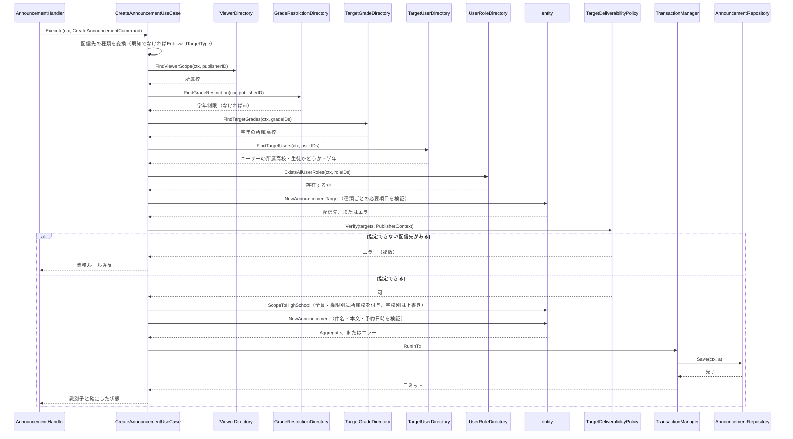
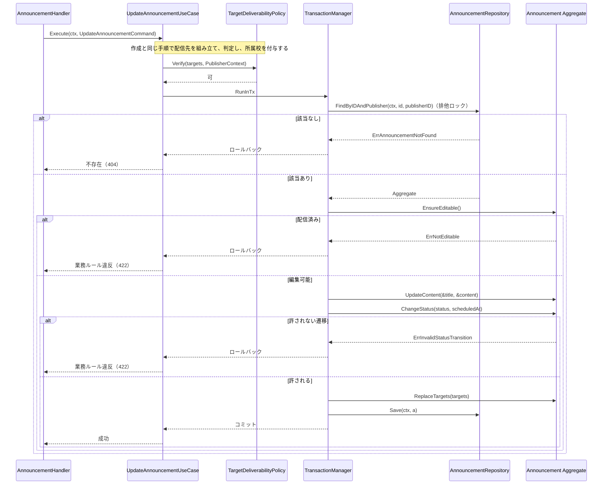
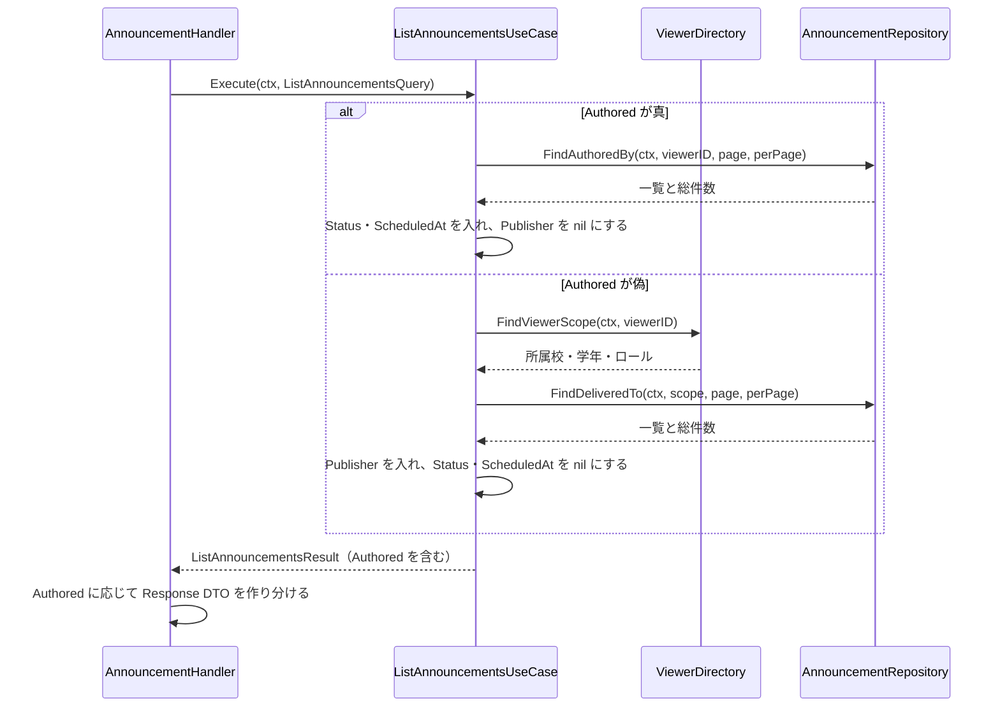
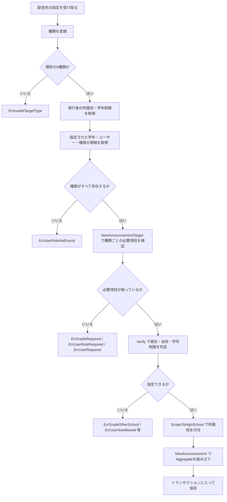
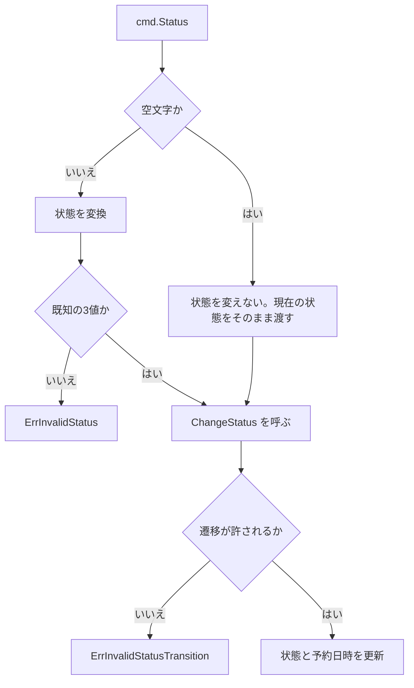

# 教師お知らせ機能 Go実装仕様書（2. Application・Presentation）

---

# 1. 機能概要

## 機能概要

教員が、自校の生徒・教員に向けたお知らせを作成・更新し、自分に配信されたお知らせも読めるようにする機能である（②「1. 機能概要」）。

本書は6つのエンドポイントを担当する。

|エンドポイント|概要|
|-|-|
|`GET /api/v1/teacher/announcements`|お知らせ一覧（`tab=authored`で切り替え）|
|`GET /api/v1/teacher/announcements/:id`|お知らせ詳細|
|`GET /api/v1/teacher/announcements/new`|新規作成フォームの選択肢|
|`GET /api/v1/teacher/announcements/:id/edit`|編集フォームの内容|
|`POST /api/v1/teacher/announcements`|お知らせ作成|
|`PATCH /api/v1/teacher/announcements/:id`|お知らせ更新|

## 採用設計パターンとその理由（②からの要約）

**Domain Model**（②「4. 設計パターン」）。理由は`教師お知らせ機能_Go実装仕様書_1_Domain・Infrastructure.md`「1. 機能概要」に記載のとおりである。

## 本書が対象とする実装範囲

- application層（`application/teacher/`配下のUseCase 6つとDTO 6つ）
- Presentation層（`presentation/teacher/`配下のHandler 1つ・Request DTO 2つ・Response DTO 4つ）
- **`presentation/routes.go`**（`announcement` Context全体のルート登録）

Domain層・Infrastructure層・`context.go`・`dependency.go`・Transaction / Validation / Authorization / Errorの実装方針は基盤編に記載する。本書では繰り返さず参照する。

---

# 2. ディレクトリ構成

## 対象Bounded Context名

- `announcement`（②「3. Bounded Context」）。ディレクトリは`internal/announcement/`、package名は`announcement`

Context全体のファイル一覧と担当文書の対応は基盤編「2. ディレクトリ構成」に記載する。

## ②で採用した設計パターン

Domain Model（②「4. 設計パターン」）

## 本書が担当するファイル一覧

```
internal/announcement/application/teacher/usecase/list_announcements.go
internal/announcement/application/teacher/usecase/show_announcement.go
internal/announcement/application/teacher/usecase/get_form_options.go
internal/announcement/application/teacher/usecase/get_announcement_for_edit.go
internal/announcement/application/teacher/usecase/create_announcement.go
internal/announcement/application/teacher/usecase/update_announcement.go
internal/announcement/application/teacher/dto/list_announcements_query.go
internal/announcement/application/teacher/dto/announcement_list_item.go
internal/announcement/application/teacher/dto/form_options.go
internal/announcement/application/teacher/dto/announcement_for_edit.go
internal/announcement/application/teacher/dto/create_announcement_command.go
internal/announcement/application/teacher/dto/update_announcement_command.go
internal/announcement/presentation/teacher/handler/announcement_handler.go
internal/announcement/presentation/teacher/request/announcement_request.go
internal/announcement/presentation/teacher/request/form_options_request.go
internal/announcement/presentation/teacher/response/announcement_list_response.go
internal/announcement/presentation/teacher/response/announcement_response.go
internal/announcement/presentation/teacher/response/form_options_response.go
internal/announcement/presentation/teacher/response/announcement_edit_response.go
internal/announcement/presentation/routes.go
```

実装20ファイル、テストが付くもの（UseCase 6・Handler 1の7）を加えて27であり、1文書あたり30〜35という範囲に収まる。

`routes.go`を本書に置くのは、Handlerを参照するためである。基盤編 → 本書の順に実装すれば単体でコンパイルが通る。お知らせ機能③・管理者お知らせ管理機能③は、本書が作成した`routes.go`へ自身のルートを追加する（基盤編「2. ディレクトリ構成」）。

---

# 3. Domain層設計

対象外。基盤編「3. Domain層設計」に記載する。

本書で定義するセンチネルエラーはない。Domain Errorは基盤編の`domain/errors.go`に集約する。

---

# 4. クラス図

Domain層のクラス図は基盤編「4. クラス図」に記載する。本書ではUseCaseとDTOの関係を示す。

```mermaid
classDiagram
    class ListAnnouncementsUseCase {
        -AnnouncementRepository repo
        -ViewerDirectory viewers
        +Execute(ctx, ListAnnouncementsQuery) (ListAnnouncementsResult, error)
    }
    class ShowAnnouncementUseCase {
        -AnnouncementRepository repo
        -ViewerDirectory viewers
        +Execute(ctx, viewerID, id) (*AnnouncementDetail, error)
    }
    class GetFormOptionsUseCase {
        -GradeRestrictionDirectory restrictions
        -GradeOptionDirectory grades
        -UserRoleDirectory roles
        -StudentOptionDirectory students
        -ViewerDirectory viewers
        +Execute(ctx, FormOptionsQuery) (*FormOptions, error)
    }
    class GetAnnouncementForEditUseCase {
        -AnnouncementRepository repo
        -PublisherDirectory publishers
        +Execute(ctx, publisherID, id) (*AnnouncementForEdit, error)
    }
    class CreateAnnouncementUseCase {
        -AnnouncementRepository repo
        -TargetDeliverabilityPolicy policy
        -ViewerDirectory viewers
        -GradeRestrictionDirectory restrictions
        -TargetUserDirectory targetUsers
        -TargetGradeDirectory targetGrades
        -UserRoleDirectory roles
        -TransactionManager tx
        -Clock clock
        +Execute(ctx, CreateAnnouncementCommand) (CreateAnnouncementResult, error)
    }
    class UpdateAnnouncementUseCase {
        -同じ依存 + repo
        +Execute(ctx, UpdateAnnouncementCommand) error
    }

    class ListAnnouncementsQuery {
        +uint ViewerID
        +bool Authored
        +int Page
        +int PerPage
    }
    class ListAnnouncementsResult {
        +[]AnnouncementListItem Items
        +bool Authored
        +int64 TotalCount
        +int CurrentPage
        +int PerPage
    }
    class AnnouncementListItem {
        +uint ID
        +string Title
        +string Content
        +*string Status
        +*time.Time PublishedAt
        +*time.Time ScheduledAt
        +*PublisherRef Publisher
    }
    class FormOptions {
        +[]GradeOptionRef Grades
        +[]UserRoleRef UserRoles
        +[]StudentOptionRef Students
        +int64 StudentTotalCount
        +int StudentCurrentPage
        +int StudentPerPage
        +*uint OwnGradeRestriction
    }
    class AnnouncementForEdit {
        +uint ID
        +string Title
        +string Content
        +string Status
        +*time.Time ScheduledAt
        +[]TargetForEdit Targets
    }
    class TargetForEdit {
        +uint ID
        +string TargetType
        +*uint HighSchoolID
        +*uint GradeID
        +*uint UserRoleID
        +*uint UserID
        +*string UserName
    }
    class CreateAnnouncementCommand {
        +uint PublisherID
        +string Title
        +string Content
        +string Status
        +*time.Time ScheduledAt
        +[]TargetInput Targets
    }
    class TargetInput {
        +string TargetType
        +*uint GradeID
        +*uint UserRoleID
        +*uint UserID
    }
    class UpdateAnnouncementCommand {
        +uint PublisherID
        +uint ID
        +string Title
        +string Content
        +string Status
        +*time.Time ScheduledAt
        +[]TargetInput Targets
    }

    ListAnnouncementsUseCase ..> ListAnnouncementsQuery
    ListAnnouncementsUseCase ..> ListAnnouncementsResult
    ListAnnouncementsResult --> AnnouncementListItem
    GetFormOptionsUseCase ..> FormOptions
    GetAnnouncementForEditUseCase ..> AnnouncementForEdit
    AnnouncementForEdit --> TargetForEdit
    CreateAnnouncementUseCase ..> CreateAnnouncementCommand
    CreateAnnouncementCommand --> TargetInput
    UpdateAnnouncementUseCase ..> UpdateAnnouncementCommand
```



`AnnouncementListItem`の`Status`・`ScheduledAt`・`Publisher`をポインタにしているのは、**タブによって返す項目が変わる**ためである（①「5. API / 処理詳細」`#index`）。`authored`のときは`Status`・`ScheduledAt`が入り`Publisher`が`nil`、それ以外のときは逆になる。

1つの型で両方を表すのは、Handlerがタブに応じてResponse DTOを作り分けるときに、同じ入力の形から選べるようにするためである。型を2つに分ける案もあるが、UseCaseの戻り値も2種類になり分岐が増える（「17. ②からの補足事項」参照）。

---

# 5. 状態遷移図

基盤編「5. 状態遷移図」に記載する。

本書が担当するUseCaseのうち、状態を変えるのは`CreateAnnouncement`（作成時の状態の決定）と`UpdateAnnouncement`（`ChangeStatus`の呼び出し）である。

---

# 6. Application層設計

## DTO（Command / Query）

|struct名|フィールド|区分|備考|
|-|-|-|-|
|`ListAnnouncementsQuery`|`ViewerID uint`・`Authored bool`・`Page int`・`PerPage int`|Query|`Authored`は`tab=authored`のとき真|
|`ListAnnouncementsResult`|`Items []AnnouncementListItem`・`Authored bool`・`TotalCount int64`・`CurrentPage int`・`PerPage int`|出力|`Authored`をHandlerへ伝えてResponse DTOを作り分けさせる|
|`AnnouncementListItem`|「4. クラス図」のとおり|出力|タブによって入る項目が変わる|
|`AnnouncementDetail`|`ID uint`・`Title string`・`Content string`・`PublishedAt *time.Time`・`Publisher PublisherRef`|出力|詳細取得の出力|
|`FormOptionsQuery`|`ViewerID uint`・`Keyword string`・`Page int`・`PerPage int`|Query||
|`FormOptions`|「4. クラス図」のとおり|出力|学年・権限・生徒・学年制限|
|`AnnouncementForEdit`|「4. クラス図」のとおり|出力|お知らせと配信先。ユーザー個別には氏名を含む|
|`TargetForEdit`|同|出力||
|`CreateAnnouncementCommand`|同|Command||
|`TargetInput`|同|Command|配信先1件分の指定|
|`UpdateAnnouncementCommand`|同|Command|`CreateAnnouncementCommand`に`ID`を加えた形|
|`CreateAnnouncementResult`|`AnnouncementID uint`・`Status string`|出力|Handlerが状態に応じたメッセージを選ぶ|

`TargetInput`に`HighSchoolID`を含めない。**配信先の高校は発行者の所属校から決まり、入力として受け取らない**（①「5. API / 処理詳細」`#create`の「自校内への絞り込み」）。Rails現行も`permit`に`high_school_id`を含めていない。

`CreateAnnouncementResult`が`Status`を返すのは、Handlerが3種類のメッセージを選ぶためである（①「5. API / 処理詳細」`#create`）。**状態が未指定のとき下書きになるため、入力の値ではなく確定した状態を返す必要がある。**

出力の型をPresentation層のResponse DTOと分けるのは、application層の型がJSONのキー名や最上位の構造といったHTTPの関心を持たないためである（アーキテクチャ規約「6. データフロー」）。

## UseCase

### ListAnnouncementsUseCase（`application/teacher/usecase/list_announcements.go`）

|項目|内容|
|-|-|
|struct名|`ListAnnouncementsUseCase`|
|コンストラクタが受け取る依存|`repository.AnnouncementRepository`、`announcement.ViewerDirectory`|
|公開メソッド|`Execute(ctx context.Context, q dto.ListAnnouncementsQuery) (dto.ListAnnouncementsResult, error)`|

処理ステップ:

1. `q.Authored`が真の場合、`repo.FindAuthoredBy(ctx, q.ViewerID, q.Page, q.PerPage)`を呼ぶ。手順3へ進む
2. 偽の場合、`viewers.FindViewerScope(ctx, q.ViewerID)`で操作者の所属を取得し、`repo.FindDeliveredTo(ctx, scope, q.Page, q.PerPage)`を呼ぶ
3. 取得結果を`AnnouncementListItem`へ変換する。**タブに応じて入れる項目を変える**
4. `Authored`・総件数・ページ情報を添えて返す

タブごとの変換:

|タブ|入れる項目|`nil`にする項目|
|-|-|-|
|`authored`|`ID`・`Title`・`Content`・`Status`・`PublishedAt`・`ScheduledAt`|`Publisher`|
|それ以外|`ID`・`Title`・`Content`・`PublishedAt`・`Publisher`|`Status`・`ScheduledAt`|

`authored`では`viewers.FindViewerScope`を呼ばない。配信範囲の突き合わせを行わないためである。

トランザクションは使用しない（②「14. Transaction設計」、基盤編「11. Transaction実装方針」）。

発生しうるApplication Error: なし。0件のときは空の一覧を返す。

### ShowAnnouncementUseCase（`application/teacher/usecase/show_announcement.go`）

|項目|内容|
|-|-|
|struct名|`ShowAnnouncementUseCase`|
|コンストラクタが受け取る依存|`repository.AnnouncementRepository`、`announcement.ViewerDirectory`|
|公開メソッド|`Execute(ctx context.Context, viewerID, id uint) (*dto.AnnouncementDetail, error)`|

処理ステップ:

1. `viewers.FindViewerScope(ctx, viewerID)`で操作者の所属を取得する
2. `repo.FindDeliveredToByID(ctx, scope, id)`を呼ぶ
3. `ErrAnnouncementNotFound`が返った場合はそのまま返す
4. `AnnouncementDetail`へ変換して返す

**自分が作成したお知らせでも、自分に配信されていなければ`ErrAnnouncementNotFound`になる**（①「5. API / 処理詳細」`#show`）。`authored`タブの一覧に現れるお知らせを詳細で開けるとは限らない。

発生しうるApplication Error: `ErrAnnouncementNotFound`（404）。

### GetFormOptionsUseCase（`application/teacher/usecase/get_form_options.go`）

|項目|内容|
|-|-|
|struct名|`GetFormOptionsUseCase`|
|コンストラクタが受け取る依存|`announcement.ViewerDirectory`、`announcement.GradeRestrictionDirectory`、`announcement.GradeOptionDirectory`、`announcement.UserRoleDirectory`、`announcement.StudentOptionDirectory`|
|公開メソッド|`Execute(ctx context.Context, q dto.FormOptionsQuery) (*dto.FormOptions, error)`|

処理ステップ:

1. `viewers.FindViewerScope(ctx, q.ViewerID)`で操作者の所属校を取得する
2. `restrictions.FindGradeRestriction(ctx, q.ViewerID)`で学年制限を取得する
3. 学年制限がある場合は`grades.FindGrades(ctx, []uint{*restriction})`、ない場合は`grades.FindGradesByHighSchoolID(ctx, highSchoolID)`で学年の選択肢を取得する
4. `roles.FindAssignableUserRoles(ctx)`で権限の選択肢を取得する
5. `students.FindStudentOptions(ctx, cond, q.Page, q.PerPage)`で生徒の一覧を取得する。`cond`の学年には学年制限を入れる
6. `FormOptions`を組み立てて返す

**本ContextのRepositoryを呼ばない。** 4つの参照手段の結果を1つにまとめるだけである（②「12. UseCase設計」）。お知らせに触れないUseCaseである。

操作者の所属校が未設定の場合、学年の選択肢と生徒の一覧が空になる。`teacher`ロールの利用者は所属校を持つ前提だが、未設定でもエラーにしない（「17. ②からの補足事項」参照）。

発生しうるApplication Error: なし。

### GetAnnouncementForEditUseCase（`application/teacher/usecase/get_announcement_for_edit.go`）

|項目|内容|
|-|-|
|struct名|`GetAnnouncementForEditUseCase`|
|コンストラクタが受け取る依存|`repository.AnnouncementRepository`、`announcement.PublisherDirectory`|
|公開メソッド|`Execute(ctx context.Context, publisherID, id uint) (*dto.AnnouncementForEdit, error)`|

処理ステップ:

1. `repo.FindByIDAndPublisher(ctx, id, publisherID)`でAggregateを取得する。`ErrAnnouncementNotFound`が返った場合はそのまま返す
2. `a.IsEditable()`が偽の場合、**`ErrNotEditableForEdit`を返す**
3. 配信先のうちユーザー個別のものからユーザーの識別子を集める
4. 識別子が1件以上あれば`publishers.FindPublishers(ctx, userIDs)`で氏名を取得する
5. `AnnouncementForEdit`へ変換する。ユーザー個別の配信先に氏名を入れ、それ以外は`nil`とする

手順2で`ErrNotEditable`ではなく`ErrNotEditableForEdit`を返す。**同じ状態に対して、更新は`422`、編集フォームの取得は`404`である**（基盤編「14. Error実装方針」）。

手順4で識別子が空のとき`publishers.FindPublishers`を呼ばない。空の集合での問い合わせを避けるためである（分析機能③基盤編「17. ②からの補足事項」5と同じ扱い）。

**ユーザーの氏名の取得に`PublisherDirectory`を使う。** 名前が発行者向けに見えるが、`user`から氏名を取る操作であり、配信先のユーザーにも使える（「17. ②からの補足事項」参照）。

発生しうるApplication Error: `ErrAnnouncementNotFound`（404）、`ErrNotEditableForEdit`（404）。

### CreateAnnouncementUseCase（`application/teacher/usecase/create_announcement.go`）

|項目|内容|
|-|-|
|struct名|`CreateAnnouncementUseCase`|
|コンストラクタが受け取る依存|`repository.AnnouncementRepository`、`*service.TargetDeliverabilityPolicy`、`announcement.ViewerDirectory`、`announcement.GradeRestrictionDirectory`、`announcement.TargetUserDirectory`、`announcement.TargetGradeDirectory`、`announcement.UserRoleDirectory`、`gormtx.TransactionManager`、`announcement.Clock`|
|公開メソッド|`Execute(ctx context.Context, cmd dto.CreateAnnouncementCommand) (dto.CreateAnnouncementResult, error)`|

処理ステップ:

1. `cmd.Targets`から配信先の種類を変換する。既知でない値があれば`ErrInvalidTargetType`を返す
2. `viewers.FindViewerScope(ctx, cmd.PublisherID)`で発行者の所属校を取得する
3. `restrictions.FindGradeRestriction(ctx, cmd.PublisherID)`で学年制限を取得する
4. 配信先から学年の識別子・ユーザーの識別子・権限の識別子を集める
5. `targetGrades.FindTargetGrades`・`targetUsers.FindTargetUsers`で学年・ユーザーの情報を取得する。いずれも識別子が空なら呼ばない
6. `roles.ExistsAllUserRoles`で権限の実在を確認する。存在しないものがあれば`ErrUserRoleNotFound`を返す
7. `entity.NewAnnouncementTarget`で配信先を組み立てる。種類ごとの必要項目の検証がここで行われる
8. `policy.Verify(targets, pubCtx)`で配信先の指定可否を判定する。失敗した場合はそのエラーを返す
9. 各配信先に`ScopeToHighSchool(highSchoolID)`を適用する
10. 状態を変換する。`cmd.Status`が空文字なら下書きとする
11. `entity.NewAnnouncement`でAggregateを組み立てる。件名・本文・予約日時の検証がここで行われる
12. `tx.RunInTx`の中で`repo.Save(ctx, a)`を呼ぶ
13. 作成した識別子と確定した状態を返す

**手順8をトランザクションの外で行う。** 配信先の判定に必要な情報の取得と判定は、本Contextの書き込みと原子性を保証する関係にない（②「14. Transaction設計」）。

**手順9を手順8の後に行う。** 判定の対象は利用者が指定した配信先であり、所属校を付与した後のものではない。学校別の配信先は指定値を無視して所属校を使うため、付与前に判定しないと「他校の学校別」を指定したときに判定をすり抜ける（「17. ②からの補足事項」参照）。

**手順10で空文字を下書きとする。** Rails現行が`status.presence`で空文字を`nil`にし、`Common::AnnouncementCreateService`が`initial_status`（下書き）を使う（①「5. API / 処理詳細」`#create`）。

`systemGenerated`は偽とする。本機能が作るお知らせはシステム生成ではない（同）。

発生しうるApplication Error: 配信先・件名・本文・状態・予約日時の検証失敗（いずれも422）。

### UpdateAnnouncementUseCase（`application/teacher/usecase/update_announcement.go`）

|項目|内容|
|-|-|
|struct名|`UpdateAnnouncementUseCase`|
|コンストラクタが受け取る依存|`CreateAnnouncementUseCase`と同じ依存|
|公開メソッド|`Execute(ctx context.Context, cmd dto.UpdateAnnouncementCommand) error`|

処理ステップ:

1. 作成の手順1〜9と同じ手順で配信先を組み立て、判定し、所属校を付与する
2. `tx.RunInTx`の中で次を行う
   1. `repo.FindByIDAndPublisher(ctx, cmd.ID, cmd.PublisherID)`でAggregateを**排他ロック付きで**取得する。`ErrAnnouncementNotFound`が返った場合はそのまま返す
   2. `a.EnsureEditable()`を呼ぶ。配信済みなら`ErrNotEditable`を返す
   3. `a.UpdateContent(&cmd.Title, &cmd.Content)`で件名・本文を更新する
   4. 状態を変換し、`a.ChangeStatus(status, scheduledAt)`を呼ぶ
   5. `a.ReplaceTargets(targets)`で配信先を全件入れ替える
   6. `repo.Save(ctx, a)`で保存する

**手順1をトランザクションの外で行う。** 作成と同じ理由である。

**手順2-1で排他ロックを取る。** 配信先の入れ替え中に同じお知らせが別のリクエストで更新されると配信先が混ざる（②「14. Transaction設計」）。ロックの取得はRepositoryの引数ではなく、トランザクションの中で`FindByIDAndPublisher`を呼ぶことで行う（「17. ②からの補足事項」参照）。

**手順2-2で`ErrNotEditable`を返す。** 編集フォームの取得が`ErrNotEditableForEdit`（404）を返すのとは異なり、更新は`422`である（基盤編「14. Error実装方針」）。

**手順2-3で`&cmd.Title`・`&cmd.Content`を渡す。** 本機能の更新は部分更新ではなく、件名・本文を常に渡す（①「5. API / 処理詳細」`#update`）。`UpdateContent`が`*string`を取るのは管理者お知らせ管理機能の部分更新のためであり、本機能では常に値を渡す。

**手順2-4で状態を常に渡す。** `cmd.Status`が空文字の場合の扱いが作成と異なる。Rails現行の更新は`status.presence`を使わず`delivery: { status: status }`をそのまま渡すため、空文字が`nil`として扱われ`status`が`nil`で更新される（①「5. API / 処理詳細」`#update`）。**Go設計では空文字を「状態を変えない」として扱う**（「17. ②からの補足事項」参照）。

発生しうるApplication Error: `ErrAnnouncementNotFound`（404）、`ErrNotEditable`（422）、配信先・件名・本文・状態・予約日時の検証失敗（422）。

---

# 7. シーケンス図・処理フロー図

## シーケンス図

### CreateAnnouncement



### UpdateAnnouncement



### ListAnnouncements（タブの切り替え）



## 処理フロー図

### 配信先の組み立てと判定の順序



**判定（`Verify`）が所属校の付与（`ScopeToHighSchool`）より前にある。** 学校別の配信先は付与で指定値が上書きされるため、付与後に判定すると他校の指定が検出されなくなる。

### 更新での状態の扱い



空文字を「状態を変えない」として扱う。現在の状態を渡すため、`CanTransitionTo`の同じ状態への遷移が偽になる点に注意する。**`ChangeStatus`を呼ばず、予約日時のみ更新する形にする**（「17. ②からの補足事項」参照）。

---

# 8. Infrastructure層設計

対象外。基盤編「8. Infrastructure層設計」に記載する。

本書が担当するInfrastructure層の実装はない。

---

# 9. Presentation層設計

## Handler

### AnnouncementHandler（`presentation/teacher/handler/announcement_handler.go`）

|項目|内容|
|-|-|
|struct名|`AnnouncementHandler`|
|対応する呼び出し先|6つのUseCase|
|保持するフィールド|`listUC`・`showUC`・`formOptionsUC`・`editUC`・`createUC`・`updateUC`|
|コンストラクタ|`NewAnnouncementHandler(...)`で6つのUseCaseを受け取る|
|メソッド|`Index`・`Show`・`New`・`Edit`・`Create`・`Update`|

`Index`の処理順序:

1. `ListAnnouncementsRequest`へ`ShouldBindQuery`でバインドする。失敗した場合は`c.Error`にバリデーションエラーを積んで戻る
2. ページ指定を正規化する（既定20・上限100）
3. `context.Context`から操作者の識別子を取り出す（コーディング規約「20. `context.Context`」）
4. `tab`が`authored`かを判定し、`ListAnnouncementsQuery`を組み立てる
5. `listUC.Execute`を呼ぶ
6. エラーの場合は`c.Error(err)`を呼んで戻る
7. **`Authored`に応じてResponse DTOを作り分ける**
8. `200`で返す

`Show`の処理順序:

1. パスパラメータ`id`を符号なし整数として解釈する。失敗した場合は`c.Error`に積んで戻る
2. 操作者の識別子を取り出す
3. `showUC.Execute`を呼ぶ
4. エラーの場合は`c.Error(err)`を呼んで戻る
5. `AnnouncementResponse`へ変換し、**最上位を単体のオブジェクト**として`200`で返す

`New`の処理順序:

1. `FormOptionsRequest`へ`ShouldBindQuery`でバインドする
2. ページ指定を正規化する
3. 操作者の識別子を取り出す
4. `formOptionsUC.Execute`を呼ぶ
5. エラーの場合は`c.Error(err)`を呼んで戻る
6. `FormOptionsResponse`へ変換する。**生徒一覧のみ`items`と`meta`の入れ子にする**
7. `200`で返す

`Edit`の処理順序:

1. パスパラメータ`id`を符号なし整数として解釈する
2. 操作者の識別子を取り出す
3. `editUC.Execute`を呼ぶ
4. エラーの場合は`c.Error(err)`を呼んで戻る。`ErrNotEditableForEdit`は`404`に変換される
5. `AnnouncementEditResponse`へ変換し、`200`で返す

`Create`の処理順序:

1. `CreateAnnouncementRequest`へ`ShouldBindJSON`でバインドする。失敗した場合は`c.Error`に積んで戻る
2. `announcement`オブジェクトが存在しない場合は`400`のバリデーションエラーを積んで戻る
3. 操作者の識別子を取り出す
4. `CreateAnnouncementCommand`を組み立て、`createUC.Execute`を呼ぶ
5. エラーの場合は`c.Error(err)`を呼んで戻る
6. **返った状態に応じてメッセージを選び**、識別子とあわせて`201`で返す

`Update`の処理順序:

1. パスパラメータ`id`を符号なし整数として解釈する
2. `UpdateAnnouncementRequest`へ`ShouldBindJSON`でバインドする
3. `announcement`オブジェクトが存在しない場合は`400`を積んで戻る
4. 操作者の識別子を取り出す
5. `UpdateAnnouncementCommand`を組み立て、`updateUC.Execute`を呼ぶ
6. エラーの場合は`c.Error(err)`を呼んで戻る
7. `{"message": "お知らせを更新しました。"}`を`200`で返す

状態に応じたメッセージ（①「5. API / 処理詳細」`#create`）:

|状態|メッセージ|
|-|-|
|`draft`|お知らせを下書きで作成しました。|
|`scheduled`|お知らせの配信を予約しました。|
|`published`|お知らせを配信しました。|

メッセージを定数としてHandlerに持たせる。Rails現行も`CREATED_MESSAGES`としてControllerに持っている（①「10. Rails実装対応表」）。

## Request / Response DTO

### ListAnnouncementsRequest（`presentation/teacher/request/announcement_request.go`）

|フィールド|型|タグ|チェック内容|
|-|-|-|-|
|`Tab`|`string`|`form:"tab"`|任意。`authored`以外・未指定は受信分として扱う|
|`Page`|`*int`|`form:"page"`|整数として解釈できること|
|`PerPage`|`*int`|`form:"per_page"`|同|

`Tab`の値を検証しない。既知でない値を受け取っても受信分として扱う（①「5. API / 処理詳細」`#index`）。

### CreateAnnouncementRequest / UpdateAnnouncementRequest（同ファイル）

|フィールド|型|タグ|チェック内容|
|-|-|-|-|
|`Announcement`|`*announcementBody`|`json:"announcement"`|`nil`のときHandlerで`400`にする|

`announcementBody`:

|フィールド|型|タグ|チェック内容|
|-|-|-|-|
|`Title`|`string`|`json:"title"`|Domain層で検証する|
|`Content`|`string`|`json:"content"`|同|
|`Status`|`string`|`json:"status"`|同。空文字を許す|
|`ScheduledAt`|`*time.Time`|`json:"scheduled_at"`|日時として解釈できること|
|`AnnouncementTargets`|`[]targetBody`|`json:"announcement_targets"`|配列であること。1件以上はDomain層で検証する|

`targetBody`:

|フィールド|型|タグ|
|-|-|-|
|`TargetType`|`string`|`json:"target_type"`|
|`GradeID`|`*uint`|`json:"grade_id"`|
|`UserRoleID`|`*uint`|`json:"user_role_id"`|
|`UserID`|`*uint`|`json:"user_id"`|

**`high_school_id`を受け取らない。** 配信先の高校は発行者の所属校から決まる（「6. Application層設計」）。Rails現行も`permit`に含めていない（①「5. API / 処理詳細」`#create`）。

`binding:"required"`を使わない。件名・本文・状態・配信先の必須はDomain層で検証し、Rails現行の文言を返すためである（基盤編「12. Validation実装方針」）。

`Announcement`を`*announcementBody`にするのは、`announcement`キーが存在しない場合に`400`を返すためである。Rails現行が必須パラメータ不足として`400`になる（①「5. API / 処理詳細」`#create`）。

`CreateAnnouncementRequest`と`UpdateAnnouncementRequest`は同じ形である。別のstructにするのは、将来どちらかの項目が変わったときに片方だけを変えられるようにするためである。

### FormOptionsRequest（`presentation/teacher/request/form_options_request.go`）

|フィールド|型|タグ|チェック内容|
|-|-|-|-|
|`Keyword`|`string`|`form:"keyword"`|任意。検証しない|
|`Page`|`*int`|`form:"page"`|整数として解釈できること|
|`PerPage`|`*int`|`form:"per_page"`|同|

### AnnouncementListResponse（`presentation/teacher/response/announcement_list_response.go`）

タブによって要素の型が変わる。

|struct名|フィールド|JSONキー|型|
|-|-|-|-|
|`AnnouncementListResponse`|`Announcements`|`announcements`|`[]any`|
||`Meta`|`meta`|`PaginationMetaResponse`|
|`ReceivedAnnouncementResponse`|`ID`|`id`|`uint`|
||`Title`|`title`|`string`|
||`Content`|`content`|`string`|
||`PublishedAt`|`published_at`|`*time.Time`|
||`Publisher`|`publisher`|`PublisherResponse`|
|`AuthoredAnnouncementResponse`|`ID`|`id`|`uint`|
||`Title`|`title`|`string`|
||`Content`|`content`|`string`|
||`Status`|`status`|`string`|
||`PublishedAt`|`published_at`|`*time.Time`|
||`ScheduledAt`|`scheduled_at`|`*time.Time`|
|`PublisherResponse`|`ID`|`id`|`uint`|
||`Name`|`name`|`string`|
||`NameKana`|`name_kana`|`string`|

`Announcements`を`[]any`にするのは、タブによって要素の型が変わるためである。コーディング規約「14. `any`」は`any`の使用を認めている。**Handlerが`Authored`を見て要素の型を決めるため、型アサーションは発生しない**（「17. ②からの補足事項」参照）。

`Announcements`が`nil`のときは空スライスを入れる。`null`で返らないようにするためである。

### AnnouncementResponse（`presentation/teacher/response/announcement_response.go`）

|struct名|フィールド|JSONキー|型|
|-|-|-|-|
|`AnnouncementResponse`|`ID`|`id`|`uint`|
||`Title`|`title`|`string`|
||`Content`|`content`|`string`|
||`PublishedAt`|`published_at`|`*time.Time`|
||`Publisher`|`publisher`|`PublisherResponse`|

最上位が単体のオブジェクトである。キーで包まない（①「5. API / 処理詳細」`#show`）。

### FormOptionsResponse（`presentation/teacher/response/form_options_response.go`）

|struct名|フィールド|JSONキー|型|
|-|-|-|-|
|`FormOptionsResponse`|`Grades`|`grades`|`[]GradeResponse`|
||`UserRoles`|`user_roles`|`[]UserRoleResponse`|
||`Students`|`students`|`StudentsResponse`|
||`OwnGradeRestriction`|`own_grade_restriction`|`*uint`|
|`StudentsResponse`|`Items`|`items`|`[]StudentResponse`|
||`Meta`|`meta`|`PaginationMetaResponse`|
|`GradeResponse`|`ID`・`Year`・`DisplayName`|`id`・`year`・`display_name`|`uint`・`int`・`string`|
|`UserRoleResponse`|`ID`・`Name`|`id`・`name`|`uint`・`string`|
|`StudentResponse`|`ID`・`Name`・`NameKana`・`GradeID`|`id`・`name`・`name_kana`・`grade_id`|`uint`・`string`・`string`・`*uint`|

**生徒一覧のみ`items`と`meta`の入れ子になっている。** 学年・権限は全件を返すためページ情報を持たない（①「5. API / 処理詳細」`#new`）。

`OwnGradeRestriction`を`*uint`にするのは、制限がない場合に`null`を返すためである（同）。

`StudentResponse`の項目は`student-directory`が返す生徒の表示項目に合わせる。同機能は未追随であり、項目は追随時に確認する（「17. ②からの補足事項」参照）。

### AnnouncementEditResponse（`presentation/teacher/response/announcement_edit_response.go`）

|struct名|フィールド|JSONキー|型|
|-|-|-|-|
|`AnnouncementEditResponse`|`Announcement`|`announcement`|`AnnouncementEditItemResponse`|
||`AnnouncementTargets`|`announcement_targets`|`[]AnnouncementTargetResponse`|
|`AnnouncementEditItemResponse`|`ID`|`id`|`uint`|
||`Title`|`title`|`string`|
||`Content`|`content`|`string`|
||`Status`|`status`|`string`|
||`ScheduledAt`|`scheduled_at`|`*time.Time`|
|`AnnouncementTargetResponse`|`ID`|`id`|`uint`|
||`TargetType`|`target_type`|`string`|
||`HighSchoolID`|`high_school_id`|`*uint`|
||`GradeID`|`grade_id`|`*uint`|
||`UserRoleID`|`user_role_id`|`*uint`|
||`UserID`|`user_id`|`*uint`|
||`UserName`|`user_name`|`*string`|

`announcement`に`published_at`を含めない。編集対象が配信済みでないため常に未設定である（①「5. API / 処理詳細」`#edit`）。

`UserName`はユーザー個別の配信先でのみ値が入り、それ以外は`null`である（同）。

## Routing

`presentation/routes.go`に登録する。**`announcement` Context全体のルートを1ファイルで登録する。** 本書が作成し、お知らせ機能③・管理者お知らせ管理機能③が自身のルートを追加する。

Gin規約「1. ルーティング」「2. ルートグルーピング」に従う。

|グループ|Middleware|Method|Path|Handler|担当文書|
|-|-|-|-|-|-|
|`/api/v1/student`|認証・`student`ロール|GET|`/announcements`|`student/handler.AnnouncementHandler.Index`|お知らせ機能③|
|同|同|GET|`/announcements/:id`|`student/handler.AnnouncementHandler.Show`|同|
|`/api/v1/teacher`|認証・`teacher`ロール|GET|`/announcements`|`teacher/handler.AnnouncementHandler.Index`|本書|
|同|同|GET|`/announcements/new`|`teacher/handler.AnnouncementHandler.New`|本書|
|同|同|GET|`/announcements/:id`|`teacher/handler.AnnouncementHandler.Show`|本書|
|同|同|GET|`/announcements/:id/edit`|`teacher/handler.AnnouncementHandler.Edit`|本書|
|同|同|POST|`/announcements`|`teacher/handler.AnnouncementHandler.Create`|本書|
|同|同|PATCH・PUT|`/announcements/:id`|`teacher/handler.AnnouncementHandler.Update`|本書|
|`/api/v1/admin`|認証・`admin`ロール|（7ルート）|-|`admin/handler`|管理者お知らせ管理機能③|

**`/announcements/new`を`/announcements/:id`より先に登録する。** Ginのルーティングは静的なパスを優先するが、登録順に依存しない形にするため明示的に先に置く（「17. ②からの補足事項」参照）。

`PATCH`と`PUT`の両方を登録する。Rails現行の`resources`が両方を生成している（①「4. API一覧」）。

**CSRF対策を`POST`・`PATCH`・`PUT`に適用する。** Gin規約「5. CSRF対策」の適用範囲（状態を変更するメソッド）に含まれる。`GET`には適用しない。

---

# 10. API仕様

|Method|Path|Handler|Request|Response|Status Code|
|-|-|-|-|-|-|
|GET|`/api/v1/teacher/announcements`|`Index`|`tab`・`page`・`per_page`|`AnnouncementListResponse`|200 / 422 / 401 / 403 / 500|
|GET|`/api/v1/teacher/announcements/:id`|`Show`|パスパラメータ`id`|`AnnouncementResponse`|200 / 404 / 422 / 401 / 403 / 500|
|GET|`/api/v1/teacher/announcements/new`|`New`|`keyword`・`page`・`per_page`|`FormOptionsResponse`|200 / 422 / 401 / 403 / 500|
|GET|`/api/v1/teacher/announcements/:id/edit`|`Edit`|パスパラメータ`id`|`AnnouncementEditResponse`|200 / 404 / 422 / 401 / 403 / 500|
|POST|`/api/v1/teacher/announcements`|`Create`|ボディ`announcement`|`{"message": "...", "announcement_id": N}`|201 / 422 / 400 / 401 / 403 / 500|
|PATCH・PUT|`/api/v1/teacher/announcements/:id`|`Update`|パスパラメータ`id`、ボディ`announcement`|`{"message": "お知らせを更新しました。"}`|200 / 422 / 404 / 400 / 401 / 403 / 500|

## Errorケース

|条件|Status Code|Error内容|
|-|-|-|
|`announcement`キーがない|400|`{"errors": ["お知らせの内容を指定してください"]}`|
|`id`が符号なし整数でない|422|`{"errors": ["お知らせの指定が不正です"]}`|
|`scheduled_at`が日時でない|422|`{"errors": ["配信日時の指定が不正です"]}`|
|`announcement_targets`が配列でない|422|`{"errors": ["Announcement targets 配列で指定してください"], "fields": [...]}`|
|件名・本文・状態・予約日時の検証失敗|422|`{"errors": [最初のメッセージ], "fields": [全件]}`|
|配信先の指定が不正|422|同|
|状態遷移が許されない|422|`{"errors": ["status は {遷移元} から {遷移先} へは変更できません"]}`|
|配信済みのため編集できない（更新）|422|`{"errors": ["配信済みのお知らせは編集できません"]}`|
|他の教員が作成した、存在しない|404|`{"message": "Announcementが見つかりません"}`|
|**配信済みのため編集できない（編集フォームの取得）**|404|同|
|自分に配信されていない（詳細）|404|同|
|DBアクセス・他Contextの呼び出しの失敗|500|`{"errors": ["internal server error"]}`|
|未認証|401|認証ミドルウェアの応答|
|`teacher`ロール以外|403|`{"errors": ["この操作を行う権限がありません"]}`|

**複数の検証に失敗した場合、`errors`が1要素・`fields`が全件になる。** Rails現行は`errors`に全件を並べるため差分が生じる（基盤編「14. Error実装方針」）。

---

# 11. Transaction実装方針

基盤編「11. Transaction実装方針」に記載する。

本書が担当するUseCaseの扱いを再掲する。

|UseCase|トランザクション|排他ロック|
|-|-|-|
|`CreateAnnouncement`|**使う**（Aggregateの保存）|不要|
|`UpdateAnnouncement`|**使う**（取得・更新・配信先の入れ替え）|**取る**|
|`ListAnnouncements`・`ShowAnnouncement`・`GetFormOptions`・`GetAnnouncementForEdit`|使わない|不要|

配信先の判定（`TargetDeliverabilityPolicy.Verify`）と他Contextの参照手段の呼び出しは、トランザクションの外で行う（「6. Application層設計」）。

---

# 12. Validation実装方針

方針は基盤編「12. Validation実装方針」に記載する。本書では本書が担当する検証内容を示す。

## Presentation

|フィールド|struct名|バリデーションタグ|エラーメッセージ|Status|
|-|-|-|-|-|
|`Announcement`|`CreateAnnouncementRequest` / `UpdateAnnouncementRequest`|なし（`nil`判定をHandlerで行う）|お知らせの内容を指定してください|400|
|`ScheduledAt`|`announcementBody`|なし（`*time.Time`へのバインド失敗で検出）|配信日時の指定が不正です|422|
|`AnnouncementTargets`|同|なし（配列へのバインド失敗で検出）|Announcement targets 配列で指定してください|422|
|`Tab`|`ListAnnouncementsRequest`|なし（検証しない）|-|-|
|`Keyword`|`FormOptionsRequest`|なし（検証しない）|-|-|
|`Page`・`PerPage`|両Request|なし（`*int`へのバインド失敗で検出）|ページの指定が不正です|422|
|`id`（パスパラメータ）|-|Handlerで符号なし整数として解釈|お知らせの指定が不正です|422|

ページ指定の正規化はHandlerで行う。

|入力|正規化後|
|-|-|
|`page`が未指定・0以下|`1`|
|`per_page`が未指定・0以下|`20`|
|`per_page`が101以上|`100`|

既定値と上限は全APIで共通の値であり、規約「15. API規約（レスポンス形式・ページネーション・URL・クエリパラメータ）」に従う。**お知らせ機能が既定5件であるのとは異なる**（お知らせ機能③「12. Validation実装方針」）。

## 業務ルール検証

Domain Model採用のため、Entity／Value Object生成時とDomain Serviceで検証する。置き場所は基盤編「12. Validation実装方針」の表のとおりである。

本書が担当するUseCaseが呼ぶ検証:

|UseCase|呼ぶ検証|
|-|-|
|`CreateAnnouncement`|`ParseDeliveryTargetType`・`ExistsAllUserRoles`・`NewAnnouncementTarget`・`Verify`・`ParseAnnouncementStatus`・`NewAnnouncement`|
|`UpdateAnnouncement`|上記に加えて`EnsureEditable`・`UpdateContent`・`ChangeStatus`・`ReplaceTargets`|
|`GetAnnouncementForEdit`|`IsEditable`（偽なら`ErrNotEditableForEdit`）|

---

# 13. Authorization実装方針

基盤編「13. Authorization実装方針」に記載する。

本書のHandlerはいずれも操作者の識別子を`context.Context`から取り出し、UseCaseへ渡す。リクエストから受け取らない。

所有権の確認はRepositoryの検索条件で行う。

|操作|絞り込み|該当しないとき|
|-|-|-|
|一覧（`authored`）|`FindAuthoredBy`（発行者が操作者）|-|
|一覧（それ以外）・詳細|`FindDeliveredTo` / `FindDeliveredToByID`（配信範囲の突き合わせ）|404|
|編集フォーム・更新|`FindByIDAndPublisher`（発行者が操作者）|404|

学年制限の制約は`TargetDeliverabilityPolicy`が判定する。Middlewareのロール判定では表せない（②「16. Authorization設計」）。

---

# 14. Error実装方針

方針は基盤編「14. Error実装方針」に記載する。

本書で定義するセンチネルエラーはない。Domain Errorは基盤編の`domain/errors.go`に集約する。

本書が担当するUseCaseが返すエラーと、HTTPステータスへの対応:

|UseCase|返すエラー|Status|
|-|-|-|
|`ListAnnouncements`|なし（Infrastructure Errorのみ）|500|
|`ShowAnnouncement`|`ErrAnnouncementNotFound`|404|
|`GetFormOptions`|なし（Infrastructure Errorのみ）|500|
|`GetAnnouncementForEdit`|`ErrAnnouncementNotFound`・**`ErrNotEditableForEdit`**|404|
|`CreateAnnouncement`|配信先・件名・本文・状態・予約日時の検証失敗|422|
|`UpdateAnnouncement`|`ErrAnnouncementNotFound`（404）、`ErrNotEditable`（422）、上記の検証失敗（422）|404 / 422|

**`GetAnnouncementForEdit`が`ErrNotEditableForEdit`を返す点が本書の要である。** Entityは`EnsureEditable`で`ErrNotEditable`を返すが、このUseCaseは`IsEditable`を見て`ErrNotEditableForEdit`を自分で返す。経路によってステータスが異なるRails現行に合わせる（基盤編「14. Error実装方針」）。

複数のエラーをまとめて返す扱いは基盤編「14. Error実装方針」のとおりである。`errors`が1要素・`fields`が全件になる。

---

# 15. GORM / DBクエリ設計

対象外。基盤編「15. GORM / DBクエリ設計」に記載する。

本書が担当するUseCaseは、基盤編のRepositoryを呼ぶだけであり、自らクエリを組み立てない。

---

# 16. テストケース設計

## Domain Test

基盤編「16. テストケース設計」に記載する。

## UseCase Test

Repositoryと他Contextの参照手段をテストダブルに差し替えて検証する。

|対象|テストケース|
|-|-|
|`ListAnnouncements`|`Authored`が真のとき`FindAuthoredBy`を呼び、`FindViewerScope`を呼ばないこと|
||`Authored`が偽のとき`FindViewerScope`と`FindDeliveredTo`を呼ぶこと|
||`Authored`が真のとき`Status`・`ScheduledAt`が入り`Publisher`が`nil`になること|
||`Authored`が偽のとき`Publisher`が入り`Status`・`ScheduledAt`が`nil`になること|
||`Authored`を戻り値に含めること|
||0件のとき空の一覧とページ情報を返すこと|
|`ShowAnnouncement`|`FindDeliveredToByID`を呼ぶこと|
||該当なしのとき`ErrAnnouncementNotFound`を返すこと|
||**自分が発行したお知らせでも配信されていなければ不存在になること**|
|`GetFormOptions`|**本ContextのRepositoryを呼ばないこと**|
||学年制限があるとき`FindGrades`を呼び、`FindGradesByHighSchoolID`を呼ばないこと|
||学年制限がないとき`FindGradesByHighSchoolID`を呼ぶこと|
||生徒の絞り込み条件に学年制限が入ること|
||`FindAssignableUserRoles`の結果をそのまま返すこと|
|`GetAnnouncementForEdit`|`FindByIDAndPublisher`を呼ぶこと|
||該当なしのとき`ErrAnnouncementNotFound`を返すこと|
||**配信済みのとき`ErrNotEditableForEdit`を返すこと（`ErrNotEditable`ではないこと）**|
||ユーザー個別の配信先に氏名が入ること|
||ユーザー個別以外の配信先の氏名が`nil`になること|
||ユーザー個別の配信先がないとき`FindPublishers`を呼ばないこと|
|`CreateAnnouncement`|既知でない配信先の種類で`ErrInvalidTargetType`を返すこと|
||権限が存在しないとき`ErrUserRoleNotFound`を返すこと|
||`Verify`が呼ばれること|
||**`Verify`が`ScopeToHighSchool`より先に呼ばれること**|
||`Verify`が失敗したとき保存を呼ばないこと|
||全員・権限別の配信先に所属校が付与されること|
||学校別の配信先の指定値が所属校で上書きされること|
||状態が空文字のとき下書きになること|
||`systemGenerated`が偽になること|
||トランザクションの中で保存されること|
||確定した状態を戻り値に含めること|
||学年・ユーザー・権限の識別子が空のとき、対応する参照手段を呼ばないこと|
|`UpdateAnnouncement`|該当なしのとき`ErrAnnouncementNotFound`を返すこと|
||配信済みのとき`ErrNotEditable`を返すこと（`ErrNotEditableForEdit`ではないこと）|
||**排他ロック付きで取得すること**|
||配信先が全件入れ替わること|
||**状態が空文字のとき状態を変えないこと**|
||許されない遷移で`ErrInvalidStatusTransition`を返すこと|
||`Verify`がトランザクションの外で呼ばれること|
||トランザクションの中で保存されること|

## Repository Test

基盤編「16. テストケース設計」に記載する。

## アダプタ Test

基盤編「16. テストケース設計」に記載する。

## Handler Test

|対象|テストケース|
|-|-|
|`Index`|`tab=authored`のとき`status`・`scheduled_at`を含み`publisher`を含まないこと|
||`tab`が未指定・それ以外のとき`publisher`を含み`status`・`scheduled_at`を含まないこと|
||`announcements`キーと`meta`を持つこと|
||`per_page`の既定が20、上限が100になること|
||0件のとき`[]`で返ること（`null`にしないこと）|
|`Show`|**最上位が単体のオブジェクトで返ること**|
||`ErrAnnouncementNotFound`のとき`404`と`{"message": "Announcementが見つかりません"}`が返ること|
||`id`が符号なし整数でないとき`422`が返ること|
|`New`|**生徒一覧のみ`items`と`meta`の入れ子になること**|
||`grades`・`user_roles`がページ情報を持たないこと|
||`own_grade_restriction`が制限なしのとき`null`で返ること|
|`Edit`|`announcement`と`announcement_targets`の2つのキーを持つこと|
||`announcement`に`published_at`を含めないこと|
||ユーザー個別の配信先に`user_name`が入り、それ以外は`null`になること|
||`ErrNotEditableForEdit`のとき`404`が返ること|
|`Create`|**状態に応じた3種類のメッセージが返ること**|
||`announcement_id`が返ること|
||`201`で返ること|
||`announcement`キーがないとき`400`が返ること|
||`announcement_targets`が配列でないとき`422`が返ること|
||`high_school_id`を受け取らないこと（渡しても無視されること）|
|`Update`|`{"message": "お知らせを更新しました。"}`が返ること|
||`ErrNotEditable`のとき`422`が返ること|
||`PATCH`・`PUT`の両方で動作すること|
|全メソッド|操作者を`context.Context`から取り出し、リクエストから受け取らないこと|
||application層のエラーを`c.Error`へ渡し、自身で`c.JSON`しないこと|
||`c.Error`を1回だけ呼ぶこと|

## Integration Test

|対象|テストケース|
|-|-|
|認可|未認証で`401`、`student`・`admin`ロールで`403`|
|作成|**作成したお知らせが、配信先に一致する生徒の一覧に現れること**|
|作成|**教員が作成したお知らせが他校の利用者に届かないこと**（全員・権限別を指定した場合も）|
|作成|学校別を指定したとき、指定値ではなく発行者の所属校が使われること|
|作成|学年別で権限を指定しないとき`422`になること|
|作成|他校の学年・ユーザーを指定して`422`になること|
|作成|状態を指定せずに作成すると下書きになり、メッセージが「お知らせを下書きで作成しました。」になること|
|作成|予約で作成し、予約日時が過去のとき`422`になること|
|学年制限|学年制限のある教員が、全員・権限別・学校別を指定して`422`になること|
|学年制限|学年制限のある教員が、自分の学年の学年別を指定して成功すること|
|学年制限|学年制限のある教員が、自分の学年の生徒のユーザー個別を指定して成功すること|
|学年制限|学年制限のある教員が、同じ学年の教員をユーザー個別で指定して`422`になること|
|学年制限|`new`のレスポンスで、学年の選択肢が自分の学年1件になること|
|更新|**配信先が入れ替わり、以前の配信先の利用者に届かなくなること**|
|更新|配信済みのお知らせの更新が`422`になること|
|更新|他の教員のお知らせの更新が`404`になること|
|編集フォーム|**配信済みのお知らせの編集フォーム取得が`404`になること**|
|編集フォーム|他の教員のお知らせで`404`になること|
|一覧|`authored`でシステム生成のお知らせが除かれること|
|一覧|`authored`で下書き・予約が含まれること|
|詳細|自分が作成したお知らせでも、自分に配信されていなければ`404`になること|
|CSRF|`POST`・`PATCH`でCSRFトークンが不正な場合に拒否されること（Gin規約「5. CSRF対策」）|
|ルート|`/announcements/new`が`/announcements/:id`として解決されないこと|

**教員が作成したお知らせが他校に届かないことは、配信先への所属校の付与が効いているかを確かめるものである。** 付与を忘れると全校に届くため、Integration Testで必ず確認する（②「22. テスト戦略」）。

---

# 17. ②からの補足事項

基盤編「17. ②からの補足事項」に記載した9件に加え、本書で判断した内容を示す。

## 1. `Verify`を`ScopeToHighSchool`より先に呼ぶ

- 判断した内容: 配信先の指定可否の判定を、所属校の付与より前に行う
- 判断理由: 学校別の配信先は付与で指定値が上書きされる（基盤編「3. Domain層設計」の`ScopeToHighSchool`）。付与後に判定すると、他校の高校を指定した学校別の配信先が自校のものに書き換わってから判定され、違反が検出されない。Rails現行はFormの検証（判定）とServiceの組み立て（付与）が分かれており、判定が先に行われる
- 推測かどうか: **②からの補足**。②「12. UseCase設計」は手順として判定と付与を順に挙げているが、順序が結果を変える点までは述べていない。**順序を誤ると他校への配信を防げなくなる**ため、本書で明示した

## 2. 更新で状態が空文字のとき状態を変えない

- 判断した内容: `UpdateAnnouncement`で`cmd.Status`が空文字のとき、`ChangeStatus`を呼ばず予約日時のみ更新する
- 判断理由: Rails現行の更新は`delivery: { status: status }`をそのまま渡すため、空文字が`nil`として`status`へ代入され、`status`が`nil`で更新される。`Announcement`モデルの`enum ... validate: true`により`nil`は検証エラーになるため、**実際には`422`になる**。Go設計で同じ挙動を再現すると「状態を空文字で渡すと`422`」になるが、これはフロントエンドが状態を必ず送る前提では到達しない。状態を変えない扱いの方が、部分的な更新の意図に沿う
- 推測かどうか: **②からの補足**。②「12. UseCase設計」は状態を変えない更新も可能としているが、空文字の扱いまでは定めていない。**Rails現行では`422`になる可能性があり、挙動が変わる。** フロントエンドが状態を必ず送るかは未確認である

## 3. `AnnouncementListItem`を1つの型でタブ両方に使う

- 判断した内容: タブによって入る項目が変わる1つの型を使い、入らない項目を`nil`にする
- 判断理由: 型を2つに分けるとUseCaseの戻り値も2種類になり、`ListAnnouncementsResult`が`any`か2つのフィールドを持つ形になる。1つの型にして`Authored`をHandlerへ伝える方が、分岐が1か所（Response DTOの作り分け）に収まる
- 推測かどうか: 推測ではない。規約に定めのない範囲での実装手段の選択である

## 4. `AnnouncementListResponse.Announcements`を`[]any`にする

- 判断した内容: 一覧のレスポンスの要素を`[]any`とし、Handlerがタブに応じて要素の型を決める
- 判断理由: タブによってJSONの項目が変わるため、1つのstructで表すと使わない項目が`omitempty`に依存する。`omitempty`では`status`が空文字のときキーが消えるなど、意図しない省略が起きる。`[]any`にして要素の型を使い分ければ、各タブのJSONが明確になる。コーディング規約「14. `any`」は`any`の使用を認めており、**Handlerが型を決めるため型アサーションは発生しない**
- 推測かどうか: **②からの補足**。②「19. API仕様」はタブによって項目が変わることを差分として挙げていないが、実装方法までは定めていない

## 5. `PublisherDirectory`を配信先のユーザーの氏名の取得にも使う

- 判断した内容: 編集フォームの配信先のユーザー名を`PublisherDirectory.FindPublishers`で取得する
- 判断理由: `user`から氏名を取る操作であり、発行者と配信先のユーザーで違いがない。別のインターフェースを設けると同じ操作が2つになる
- 推測かどうか: **②からの補足**。名前が発行者向けに見える点は分かりにくい。`UserNameDirectory`のような名前にする案もあるが、管理者お知らせ管理機能が在籍状態を同じインターフェースから取るため、発行者向けの名前のままとした。**基盤編「8. Infrastructure層設計」の`PublisherRef`が氏名と在籍状態の両方を持つ形と対応する**

## 6. 排他ロックをトランザクションの中の取得で行う

- 判断した内容: `UpdateAnnouncement`で、トランザクションの中で`FindByIDAndPublisher`を呼ぶことでロックを取る
- 判断理由: Repositoryのメソッドにロックの有無を引数で渡す形にすると、呼び出し側がロックを忘れる余地が残る。トランザクションの中で取得したAggregateは常にロックされる形にする。Repository実装が`gormtx.DBFromContext`でトランザクションの接続を取得するため、トランザクションの中かどうかで振る舞いを変えられる
- 推測かどうか: **②からの補足**。②「14. Transaction設計」は排他ロックを取ることを定めているが、取り方までは定めていない。**Repository実装側で「トランザクション中なら`FOR UPDATE`を付ける」という判断を持つことになる。** 常に付ける形にすると参照だけの経路でも行がロックされるため、実装時に確認が必要である

## 7. `/announcements/new`を`/announcements/:id`より先に登録する

- 判断した内容: 静的なパスを動的なパスより先に登録する
- 判断理由: Ginのルーティングは静的なパスを優先するため順序に依存しないが、明示的に先に置くことで読み手が衝突を心配せずに済む。`new`が`:id`として解決されると、`id`に`new`が渡り`422`になる
- 推測かどうか: 推測ではない。Integration Testで確認する

## 8. 生徒一覧の項目が`student-directory`の追随待ちである

- 判断した内容: `StudentResponse`の項目を`id`・`name`・`name_kana`・`grade_id`とする
- 判断理由: Rails現行が`StudentSerializer`を使っており（①「10. Rails実装対応表」）、同Serializerは教師生徒参照機能が所有する。項目はその機能の①で確認すべきものである
- 推測かどうか: **②からの補足**。`student-directory`（教師生徒参照機能）は未追随であり、**同機能の追随時に項目とシグネチャを合わせる必要がある。** 本書では4項目と仮定した
