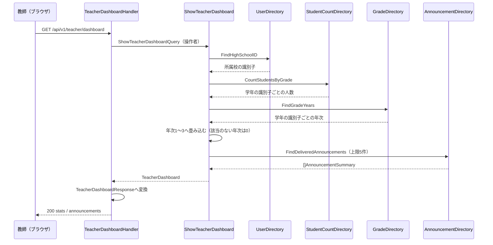

# 教師ダッシュボード機能 Go実装仕様書

---

# 1. 機能概要

教師のホーム画面に、同校の学年別生徒数と、教師に配信された公開中のお知らせ最新5件を表示する機能である（①「1. 機能概要」）。エンドポイントは`GET /api/v1/teacher/dashboard`の1つで、2つの参照の結果を1つのレスポンスに合成して返す。

|項目|内容|
|-|-|
|対象Context|`teacher-dashboard`（②「3. Bounded Context」）|
|採用パターン|Transaction Script（②「4. 設計パターン」）|
|本Contextが所有するテーブル|なし（②「21. DB操作仕様」）|
|他Contextへの依存|`user`による操作者の属性の参照と学年別の人数集計、`master-data`による学年の年次の参照、`announcement`による配信済みお知らせの参照|
|書き込み|なし。参照のみ（②「14. Transaction設計」）|

## 採用設計パターンの理由（②からの要約）

- 自ら保持する状態（Entity）を持たず、2つの読み取りを合成するだけである
- 生徒の集計条件もお知らせの配信条件も、所有Contextが持つ既存の規則をそのまま使う
- 表示項目が増えても、application層の関数に参照を足すだけで対応できる

②はActive Record（永続化対象のEntityが存在しない）・Domain Model（状態遷移や複数の業務ルールを持つEntityが存在しない）・Event Sourcing（状態変更と履歴再構築の概念が存在しない）をいずれも採用していない（②「24. 採用しなかった設計」）。

## 本書が対象とする実装範囲

- `internal/teacherdashboard`配下の全ファイル
- `user`・`master-data`・`announcement`が公開する操作そのものの実装は対象外である。本書は、それらを呼ぶインターフェースとアダプタまでを定める

---

# 2. ディレクトリ構成

## 対象Bounded Context名

- `teacher-dashboard`（②「3. Bounded Context」）

## ディレクトリ・パッケージ名

アーキテクチャ規約「4. Bounded Context構成」の「Contextディレクトリの命名」に従い、Context名から`-`を取り除いて連結した全小文字の名前とする。ディレクトリ名は`internal/teacherdashboard/`、package名は同じ`teacherdashboard`となる。短縮・省略はしない。

ロール別のサブディレクトリは設けない。本Contextは教師のみが利用する（②「1. 機能概要」）。

## ②で採用した設計パターン

Transaction Script（②「4. 設計パターン」）

## 作成するディレクトリ一覧

```
internal/teacherdashboard/
internal/teacherdashboard/application/
internal/teacherdashboard/infrastructure/contextadapter/
internal/teacherdashboard/presentation/handler/
internal/teacherdashboard/presentation/response/
```

`domain/`・`application/usecase/`を作成しない。Transaction Script採用のため、domain層とUseCase structを設けない（アーキテクチャ規約「3. 設計パターンごとの構造適用方針」Transaction Script節）。

`infrastructure/gormrepo/`を作成しない。**本Contextが所有するテーブルがなく、GORMでDBを読み書きする実装を持たない**ためである（②「21. DB操作仕様」の「本Contextはテーブルへ直接アクセスしない」）。`infrastructure/`配下は`contextadapter/`のみとなる。カレンダー機能③「2. ディレクトリ構成」が同じ構成を取る。

`presentation/request/`を作成しない。本APIはリクエストパラメータを持たない（②「19. API仕様」）。

規約「4. Bounded Context構成」の「機能で不要なディレクトリは作成しない」に従う。

## 作成するファイル一覧

```
internal/teacherdashboard/context.go                      # NewContext（依存関係の組み立て）
internal/teacherdashboard/dependency.go                   # 他Contextへの依存を宣言するインターフェースと受け渡し用の型

internal/teacherdashboard/application/show_teacher_dashboard.go   # ShowTeacherDashboard（2つの参照をまとめる関数）

internal/teacherdashboard/infrastructure/contextadapter/user_directory.go           # UserDirectoryの実装
internal/teacherdashboard/infrastructure/contextadapter/student_count_directory.go  # StudentCountDirectoryの実装
internal/teacherdashboard/infrastructure/contextadapter/grade_directory.go          # GradeDirectoryの実装
internal/teacherdashboard/infrastructure/contextadapter/announcement_directory.go   # AnnouncementDirectoryの実装

internal/teacherdashboard/presentation/handler/teacher_dashboard_handler.go
internal/teacherdashboard/presentation/response/teacher_dashboard_response.go
internal/teacherdashboard/presentation/routes.go
```

## 文書の分割

本書は分割しない。実装ファイルは上記の10であり、テストが付くもの（`ShowTeacherDashboard`・4つのアダプタ・`TeacherDashboardHandler`の6）を加えても16であるため、1文書あたり30〜35という範囲に収まる（③自動生成プロンプト「文書の分割（1文書あたり30〜35ファイル）」）。

---

# 3. Domain層設計

**対象外。** 本機能はTransaction Script採用のため、domain層を作成しない（アーキテクチャ規約「3. 設計パターンごとの構造適用方針」Transaction Script節）。

|②の節|本書での扱い|
|-|-|
|②「5. Aggregate設計」（不要）|Aggregateを定義しない|
|②「6. Entity設計」（本Contextが管理するEntityなし）|Entityを定義しない|
|②「7. Value Object設計」の`GradeStudentCounts`|Value Objectという型は作らず、application層の出力の型として表す（「6. Application層設計」）|
|②「8. Domain Service」（不要）|Domain Serviceを定義しない|
|②「18. Domain Event」（不要）|Domain Eventを定義しない|
|②「17. Error設計」のDomain Error（定義しない）|センチネルエラーを定義せず、`errors.go`を作成しない|

②「11. Repository設計」の`StudentStatisticsRepository`・`AnnouncementRepository`は、同節の「実装上の位置づけ」のとおりdomain層のRepository Interfaceとしては定義しない。いずれも所有Contextの公開操作を呼ぶものであるため、本書では`dependency.go`のインターフェースとして表す。

## 他Contextへの依存（`dependency.go`）

他Contextの公開操作を呼ぶためのインターフェースは、Contextディレクトリ直下の`dependency.go`に置く（アーキテクチャ規約「4. Bounded Context構成」）。実装は`infrastructure/contextadapter/`に置く（「8. Infrastructure層設計」）。

```go
type UserDirectory interface {
    // FindHighSchoolID は指定した利用者の所属校の識別子を返す。
    // 所属校が設定されていない場合は found が false になる。
    FindHighSchoolID(ctx context.Context, userID uint) (highSchoolID uint, found bool, err error)
}

type StudentCountDirectory interface {
    // CountStudentsByGrade は指定した高校に所属する生徒の人数を、学年の識別子ごとに返す。
    // 無効化済みの生徒も数に含める。人数が0の学年は結果に含まれない。
    CountStudentsByGrade(ctx context.Context, highSchoolID uint) (map[uint]int, error)
}

type GradeDirectory interface {
    // FindGradeYears は指定した高校に属する学年の識別子と年次を返す。
    FindGradeYears(ctx context.Context, highSchoolID uint) (map[uint]int, error)
}

type AnnouncementDirectory interface {
    // FindDeliveredAnnouncements は指定した利用者を配信対象に含む公開中のお知らせを、
    // 配信日時の降順で limit 件まで返す。
    FindDeliveredAnnouncements(ctx context.Context, userID uint, limit int) ([]AnnouncementSummary, error)
}

// AnnouncementSummary はダッシュボードが表示するお知らせ1件である。
// 状態・配信予定日時・作成日時・配信先を持たない（①「5. API / 処理詳細」Response）。
type AnnouncementSummary struct {
    ID          uint
    Title       string
    Content     string
    PublishedAt *time.Time
    Publisher   PublisherSummary
}

type PublisherSummary struct {
    ID       uint
    Name     string
    NameKana string
}
```

|インターフェース|委譲先|所有Context側の定義|
|-|-|-|
|`UserDirectory`|`user`の`GetUserAttributes`|ユーザー基盤機能③「公開する操作」|
|`StudentCountDirectory`|`user`の`CountUsers`|ユーザー基盤機能③「公開する操作」|
|`GradeDirectory`|`master-data`の`FindGradesByHighSchoolID`|共通マスタ参照機能③_1「公開する操作」|
|`AnnouncementDirectory`|`announcement`の`FindDeliveredAnnouncements`|教師お知らせ機能③_1「本Contextが他Contextへ公開する操作」|

**②からの補足**: メソッド名・シグネチャと受け渡し用の型は②に明記がないため、コーディング規約「7. インターフェース」（利用側で定義する）・アーキテクチャ規約「5. Context間連携ルール」に従って実装のために補った。他Contextの参照に`Directory`を用いる既存③文書（管理者ダッシュボード・カレンダー・分析・管理者高校学年参照）の形に合わせている。

**人数の集計と年次の対応づけを2つのインターフェースに分けた。** 集計は`user`、学年の年次は`master-data`が持つ事実であり、所有Contextが異なるためである（②「3. Bounded Context」）。年次への畳み込みはapplication層で行う（「6. Application層設計」）。

`UserDirectory`が所属校の識別子だけを返すのは、本Contextが操作者について必要とするのがそれだけであるためである。`user`の`GetUserAttributes`は属性一式を返すが、アダプタが所属校の識別子を取り出す（「8. Infrastructure層設計」）。所属校が設定されていないことをエラーにせず`found`で返すのは、`user`③の`FindUserByEmail`が「存在しない」を同じ形で返しているためである。本Contextでの扱いは「12. Validation実装方針」で定める。

`map[uint]int`を2つの参照の戻り値としたのは、いずれも識別子を鍵とした引き当てにしか使わないためである。並び順を持たない（**②からの補足**。②は戻り値の形を定めていない）。

---

# 4. クラス図

省略する。

理由: ②「9. クラス図」が省略しており、本書でも可視化すべきEntity関係が存在しない（「3. Domain層設計」）。本Contextの構成要素は`dependency.go`の4つのインターフェースと1つのapplication関数、1つのHandlerのみである。

---

# 5. 状態遷移図

省略する。

理由: ②「10. 状態遷移図」のとおり、本Contextは状態を持たず、状態を変更しない。レスポンスにお知らせの状態を含めない（①「5. API / 処理詳細」Response）ため、他Contextの状態をそのまま載せることもない。

---

# 6. Application層設計

本機能はTransaction Script採用のため、UseCase structを設けない。②「12. UseCase設計」の`ShowTeacherDashboard`を、application層の関数として実装する（アーキテクチャ規約「3. 設計パターンごとの構造適用方針」Transaction Script節）。

## DTO（Command / Query）

|struct名|フィールド|区分|備考|
|-|-|-|-|
|`ShowTeacherDashboardQuery`|`UserID uint`|Query（入力）|操作者の識別子。所属校の解決はapplication層で行う|
|`TeacherDashboard`|`Stats GradeStudentCounts`・`Announcements []AnnouncementSummary`|出力|`AnnouncementSummary`は`dependency.go`の型をそのまま使う|
|`GradeStudentCounts`|`GradeOne int`・`GradeTwo int`・`GradeThree int`|出力（内包型）|年次1〜3の生徒数。②「7. Value Object設計」の`GradeStudentCounts`に対応する|

`GradeStudentCounts`を3つのフィールドを持つstructとし、`map[int]int`やスライスにしないのは、①「5. API / 処理詳細」Responseが**年次ごとの人数を3項目で固定**としているためである。年次4以上の学年と学年未設定の生徒は集計に現れない。

出力の型をPresentation層のResponse DTOと分けるのは、application層の型がJSONのキー名を持たないためである（アーキテクチャ規約「6. データフロー」）。

**②からの補足**: `ShowTeacherDashboardQuery`が操作者の識別子だけを持ち、所属校を持たないのは、認証Middlewareが`ctx`へ格納するのが利用者の識別子であるためである（認証機能③_2「9. Presentation層設計」）。所属校の解決をHandlerに置くと、Handlerが`UserDirectory`を持つことになり、「Handlerはルーティングとレスポンス変換のみを担う」という②「16. Authorization設計」の分担から外れる。

## 関数

### ShowTeacherDashboard（`application/show_teacher_dashboard.go`）

|項目|内容|
|-|-|
|関数|`ShowTeacherDashboard(ctx context.Context, q ShowTeacherDashboardQuery) (TeacherDashboard, error)`|
|受け取る依存|`UserDirectory`・`StudentCountDirectory`・`GradeDirectory`・`AnnouncementDirectory`（コンストラクタで注入する`struct`のメソッドとして実装してよい）|

処理ステップ（②「12. UseCase設計」・①「5. API / 処理詳細」処理内容）:

1. `UserDirectory.FindHighSchoolID`で操作者の所属校の識別子を取得する。`found`が偽の場合はエラーを返す（「12. Validation実装方針」）
2. `StudentCountDirectory.CountStudentsByGrade`で、所属校の生徒の人数を学年の識別子ごとに取得する
3. `GradeDirectory.FindGradeYears`で、所属校に属する学年の識別子と年次を取得する
4. 手順2の人数を、手順3の年次で畳み込み、`GradeStudentCounts`へ入れる。年次が1・2・3のもののみを対象とし、それ以外の年次と、手順3に現れない学年の識別子は加算しない
5. `AnnouncementDirectory.FindDeliveredAnnouncements(ctx, q.UserID, MaxAnnouncements)`で、操作者に配信された公開中のお知らせを取得する
6. 手順4・5の結果を`TeacherDashboard`へ組み立てて返す

定数`MaxAnnouncements = 5`を`application`パッケージに置く。表示する件数の上限であり、本Contextが持つ（②「12. UseCase設計」。管理者ダッシュボード機能③「6. Application層設計」が同じ扱いをしている）。

**該当する生徒がいない年次は0とする。** 手順2の結果に現れない学年は加算されないため、`GradeStudentCounts`のゼロ値がそのまま残る（①「5. API / 処理詳細」Response）。

**年次による絞り込みをapplication層で行う。** `user`の`CountUsers`は学年の識別子で集計するだけで年次を知らず、年次から学年への対応は`master-data`が持つ（②「3. Bounded Context」）。両方を知っているのは本Contextのみである。

**1つの年次に複数の学年が対応しうる。** 同じ高校に同じ年次の学年が複数ある場合、手順4は人数を合算する（**②からの補足**。②は年次への対応づけとのみ定めており、重複時の扱いを定めていない。合算するのは、Rails現行が年次で`group`しているためである。①「5. API / 処理詳細」処理内容）。

**いずれかの参照が失敗した場合はエラーを返す。** 部分的な結果を返さない（②「17. Error設計」）。管理者ダッシュボード機能③が当日の解答件数の失敗を`0`に吸収するのとは扱いが異なる。吸収する根拠（Rails現行が既定値を返す）が本機能には存在しないためである。

**お知らせが0件の場合は長さ0のスライスを返す。** `nil`を返さない。`nil`スライスはJSONで`null`になり、Rails現行の`[]`と異なる（**②からの補足**。管理者高校学年参照機能③「6. Application層設計」が同じ扱いをしている）。

トランザクションは使用しない（②「14. Transaction設計」、「11. Transaction実装方針」）。

---

# 7. シーケンス図・処理フロー図

## シーケンス図



②「13. シーケンス図・処理フロー図」のシーケンス図を、実際に定義するインターフェース名・関数名で具体化したものである。②が`user`への1回の呼び出しとして描いた箇所は、操作者の属性の参照と人数の集計の2つに分かれる（②「3. Bounded Context」の「本Contextが利用する公開操作」）。

## 処理フロー図

省略する。

理由: ②「13. シーケンス図・処理フロー図」が省略しており、業務ルールによる条件分岐を持たない。年次1〜3の判定は畳み込みの中の絞り込みであり、処理の分岐ではない。

---

# 8. Infrastructure層設計

## Infrastructure関数（Transaction Script採用時）

**対象外。** 本Contextが所有するテーブルがなく、DBへクエリを発行する関数を持たない（②「21. DB操作仕様」）。`infrastructure/`配下に置くのは、`dependency.go`のインターフェースの実装（`contextadapter/`）のみである。

## contextadapter（`dependency.go`のインターフェースの実装）

`dependency.go`で宣言した4つのインターフェースの実装を`infrastructure/contextadapter/`に置く（アーキテクチャ規約「4. Bounded Context構成」。`gormrepo/`には置かない）。相手Contextの公開操作へ委譲するだけであり、本Contextから相手のテーブルへクエリを発行しない（同「5. Context間連携ルール」）。

### UserDirectory実装（`contextadapter/user_directory.go`）

- 実装struct名: 非公開struct + コンストラクタ`NewUserDirectory`
- 委譲先: `user`の`GetUserAttributes(ctx, []uint{userID})`
- 委譲内容: 返った`UserAttributes`から`HighSchoolID`（`*uint`）を取り出す。結果が空（識別子が見つからない）の場合と`HighSchoolID`が`nil`の場合は、いずれも`found`を偽として返す
- 本アダプタはGORMに依存せず、`users`へクエリを発行しない

### StudentCountDirectory実装（`contextadapter/student_count_directory.go`）

- 実装struct名: 非公開struct + コンストラクタ`NewStudentCountDirectory`
- 委譲先: `user`の`CountUsers(ctx, cond, unit)`
- 渡す条件: `SearchCondition`の`Roles`に生徒、`HighSchoolIDs`に引数の高校の識別子、`Deactivated`に`IncludeDeactivated`を指定する。`AggregateUnit`は`AggregateByGrade`とする
- 委譲内容: 返った`[]CountResult`を、`Key`（学年の識別子）を鍵、`Count`を値とする`map[uint]int`へ移す

**`Deactivated`に`IncludeDeactivated`を指定する。** 無効化済みの生徒も人数に含めるというRails現行の挙動を維持するためである（①「5. API / 処理詳細」業務ルール、②「15. Validation設計」）。`user`③は無効化の扱いを呼び出し側に必ず指定させるため、指定の省略はできない。管理者高校学年参照機能の生徒数が無効化済みを除外しているのとは扱いが異なる。

**学年の識別子を条件に入れない。** 年次1〜3への絞り込みはapplication層が畳み込みで行う（「6. Application層設計」）。条件に入れるには先に学年を引く必要があり、呼び出しの順序に依存が生まれる。

### GradeDirectory実装（`contextadapter/grade_directory.go`）

- 実装struct名: 非公開struct + コンストラクタ`NewGradeDirectory`
- 委譲先: `master-data`の`FindGradesByHighSchoolID(ctx, highSchoolID)`
- 委譲内容: 返った`[]GradeRef`を、`ID`を鍵、`Year`を値とする`map[uint]int`へ移す。`DisplayName`は使わない

表示名を使わないのは、本機能のレスポンスが年次ごとの人数だけを返し、学年の名称を含まないためである（①「5. API / 処理詳細」Response）。

### AnnouncementDirectory実装（`contextadapter/announcement_directory.go`）

- 実装struct名: 非公開struct + コンストラクタ`NewAnnouncementDirectory`
- 委譲先: `announcement`の`FindDeliveredAnnouncements(ctx, userID, limit)`
- 委譲内容: 件数の上限と操作者の識別子のみを渡し、返った値を`AnnouncementSummary`・`PublisherSummary`へ移す
- **配信対象の突き合わせと公開中の絞り込み、並び順の決定は所有Context側が行う。** 本アダプタは条件を組み立てない（教師お知らせ機能③_1「本Contextが他Contextへ公開する操作」）

**②からの補足**: 相手Contextの公開操作が返す型は所有Context側の③で確定している。4つのアダプタはいずれも、受け取った値を本Contextの型へ移す変換だけを持つ。

## 外部連携実装

対象外。本Contextから外部サービス・キャッシュ・キューへ直接アクセスしない。集計結果のキャッシュも設けない（②「24. 採用しなかった設計」）。

## 依存関係の組み立て（`context.go`）

規約「14. 依存関係の組み立て（DI配線）」の「Context単位の組み立て関数」に従い、`NewContext`を`context.go`に置く。

|項目|内容|
|-|-|
|関数|`NewContext(userContext *user.Context, masterDataContext *masterdata.Context, announcementContext *announcement.Context) *Context`|
|組み立てる内容|4つのアダプタ → application層の関数（またはそれを束ねるstruct） → `TeacherDashboardHandler`|
|公開するもの|ルーティング登録に必要な`TeacherDashboardHandler`|

**`*gorm.DB`を受け取らない。** 本Contextが所有するテーブルを持たず、GORMを使う実装がないためである（**②からの補足**。規約「14. 依存関係の組み立て（DI配線）」の例示は`*gorm.DB`を渡す形だが、管理者ダッシュボード機能③「8. Infrastructure層設計」・カレンダー機能③「8. Infrastructure層設計」が同じ理由で取らない形としている）。

**本Contextは他Contextへ操作を公開しない。** 画面表示のための合成が責務であり、他Contextが必要とする事実を所有しない（②「3. Bounded Context」）。

---

# 9. Presentation層設計

## Handler

### TeacherDashboardHandler（`presentation/handler/teacher_dashboard_handler.go`）

|項目|内容|
|-|-|
|struct名|`TeacherDashboardHandler`|
|対応する呼び出し先|application層の`ShowTeacherDashboard`|
|コンストラクタ|`NewTeacherDashboardHandler(showTeacherDashboard *application.TeacherDashboardService) *TeacherDashboardHandler`。関数として注入する形でもよい。4つのアダプタは`NewContext`がapplication層へ渡すため、Handlerは受け取らない|

メソッド一覧:

|メソッド|HTTPメソッド|パス|
|-|-|-|
|`ShowDashboard`|GET|`/api/v1/teacher/dashboard`|

処理順序:

1. 入力のバインドと検証を行わない。本APIはリクエストパラメータを持たない（②「15. Validation設計」）
2. `c.Request.Context()`から認証Middlewareが格納した操作者の識別子を取得する（②「16. Authorization設計」）
3. `ShowTeacherDashboardQuery`を組み立てて`ShowTeacherDashboard`を呼ぶ
4. エラーが返った場合は500のAppErrorへ変換して`c.Error(err)`で返す（「14. Error実装方針」）
5. `TeacherDashboard`を`TeacherDashboardResponse`へ変換し、200 OKで返す

Handlerは業務の判定を持たない。操作者が教師であることの確認はMiddlewareが行う（②「16. Authorization設計」）。

## Request / Response DTO

Request DTOは作成しない（②「19. API仕様」のRequest: パラメータなし）。

### Response（`presentation/response/teacher_dashboard_response.go`）

|struct名|フィールド|型|JSONキー|
|-|-|-|-|
|`TeacherDashboardResponse`|Stats|`StatsResponse`|`stats`|
||Announcements|`[]AnnouncementResponse`|`announcements`|
|`StatsResponse`|GradeOneStudentsCount|`int`|`grade_one_students_count`|
||GradeTwoStudentsCount|`int`|`grade_two_students_count`|
||GradeThreeStudentsCount|`int`|`grade_three_students_count`|
|`AnnouncementResponse`|ID|`uint`|`id`|
||Title|`string`|`title`|
||Content|`string`|`content`|
||PublishedAt|`*time.Time`|`published_at`|
||Publisher|`PublisherResponse`|`publisher`|
|`PublisherResponse`|ID|`uint`|`id`|
||Name|`string`|`name`|
||NameKana|`string`|`name_kana`|

JSONキー名は①「5. API / 処理詳細」Responseのとおりとする。Rails現行との差分を作らない（②「19. API仕様」）。

`AnnouncementResponse`に状態・配信予定日時・作成日時・配信先を持たせない。ダッシュボードは公開中のものだけを表示するため、状態や配信対象の判断材料を必要としない（①「5. API / 処理詳細」Response）。管理者ダッシュボード機能③の`RecentAnnouncementResponse`が状態と配信予定日時を含むのとは異なる。

`Announcements`を`nil`にしない。`nil`スライスはJSONで`null`になり、Rails現行の`[]`と異なる（「6. Application層設計」）。

## Routing（`presentation/routes.go`）

- 登録するルート: `GET /api/v1/teacher/dashboard`
- 登録方法: 教師向けのルートグループ（認証Middleware・`teacher`ロールの認可Middlewareが適用されたグループ）に対して、本Contextの`RegisterRoutes`が1つのルートを登録する（Gin規約「1. ルーティング」「2. ルートグルーピング」）
- リソース名は単数形の`dashboard`とする。1つしか存在しないリソースであるため（規約「15. API規約（レスポンス形式・ページネーション・URL・クエリパラメータ）」のURL）

---

# 10. API仕様

②「19. API仕様」のとおり、Rails現行仕様と同一のエンドポイント・メソッド・レスポンス構造を維持する。

|Method|Path|Handler|Request|Response|Status Code|
|-|-|-|-|-|-|
|GET|`/api/v1/teacher/dashboard`|`TeacherDashboardHandler.ShowDashboard`|なし|`TeacherDashboardResponse`|200|

## Errorケース

|条件|Status Code|本文|
|-|-|-|
|未認証|401|認証Middlewareが返す（Gin規約「5. 認証・認可Middleware」）|
|`teacher`ロールでない|403|認可Middlewareが返す|
|操作者に所属校が設定されていない|500|`{"errors": ["予期しないエラーが発生しました"]}`|
|他Contextの参照に失敗|500|同上|

①「5. API / 処理詳細」Errorケースは「なし（認証前提）」であり、業務エラーを返す経路を持たない。②「19. API仕様」の「技術的失敗時は500系で統一する」に従う。

401・403はMiddlewareが返すものであり、本Contextのコードには現れない。①が挙げていないのは、Rails現行でも生徒向けAPI共通の認可で処理されるためである（①「8. 権限制御」）。

---

# 11. Transaction実装方針

## Transaction開始箇所

なし。②「14. Transaction設計」のとおり、本機能は書き込みを伴わないためトランザクションを使用しない。`transaction.Manager`を注入しない。

## Transaction終了箇所

該当なし。

## 複数の参照にまたがる場合の扱い

4つの参照はいずれも独立した読み取りであり、1トランザクションにまとめない。`ShowTeacherDashboard`が順に呼び、結果を組み立てる（「6. Application層設計」）。

**手順の並行実行は行わない。** 所属校の解決が他の3つの前提になっており、残る3つを並行にしても、失敗時にどのエラーを返すかとログの順序が複雑になる（**②からの補足**。②「12. UseCase設計」は実装上の判断として③に委ねている。カレンダー機能③「6. Application層設計」が同じ判断をしている）。

---

# 12. Validation実装方針

## Presentation

該当なし。②「15. Validation設計」のとおり、本APIはリクエストパラメータを取らないため、型・必須・形式のいずれの検証も発生しない。`binding`タグを持つRequest DTOを作成しない。

## 業務ルール検証

application層の関数内のガード節で行う（アーキテクチャ規約「3. 設計パターンごとの構造適用方針」Transaction Script節）。

|検証|箇所|扱い|
|-|-|-|
|操作者に所属校が設定されていること|`ShowTeacherDashboard`の手順1|`found`が偽のときエラーを返す。500へ変換する（「14. Error実装方針」）|
|集計対象の年次が1〜3であること|`ShowTeacherDashboard`の手順4|条件を満たさない学年を加算しない。エラーにしない|
|無効化済みの生徒を含めること|`StudentCountDirectory`実装|`IncludeDeactivated`を指定する（「8. Infrastructure層設計」）|

②「15. Validation設計」の「Domain」に挙げられた3つの業務ルールを、上の表のとおり実装上の箇所へ割り当てた。お知らせの閲覧条件は本Contextが持たず、`announcement`の条件をそのまま使う（同）。

**所属校の未設定をエラーにする。** 教師は必ず高校に所属しており、未設定は本来起こらないデータの状態である（①「5. API / 処理詳細」業務ルール「生徒数は同校の生徒のみを対象とする」）。0件として返すと、所属校がない教師に空のダッシュボードを見せることになり、誤りが気づかれない（**②からの補足**。②「17. Error設計」の「前提条件不備」をこの箇所と対応づけた）。

---

# 13. Authorization実装方針

②「16. Authorization設計」の層ごとの分担を、そのまま実装の箇所へ割り当てる。

|層|実装|
|-|-|
|Middleware|認証済み利用者を特定し、`teacher`ロールであることを確認する。ルートグループに適用する（「9. Presentation層設計」）|
|Handler|判定しない。`ctx`から操作者の識別子を取り出し、application層へ渡す|
|application層|判定しない。所属校の識別子を2つの参照へ、操作者の識別子をお知らせの参照へ、絞り込み条件として渡す|
|Domain|該当なし。domain層を持たない|

**認可の実体的な判定は所有Contextが行う。** 誰の生徒を数えるかは`user`の集計条件、どのお知らせを見せるかは`announcement`の配信対象の突き合わせが決める（②「16. Authorization設計」の判断理由）。本Contextは条件を渡す役割にとどめる。

**他校の情報が混ざらないことは、所属校の識別子を条件に渡すことで担保する。** 操作者の所属校は`user`から取得したものであり、リクエストから受け取らない（「6. Application層設計」の手順1）。高校の識別子をパラメータで受け取る経路を作らない。

---

# 14. Error実装方針

## Domain Error → Application Errorへの変換方針

Domain Errorを定義しない（②「17. Error設計」、「3. Domain層設計」）。変換は発生しない。

## Application Error → HTTPレスポンスへの変換方針

- `ShowTeacherDashboard`が返すエラーは、Handlerで`apperror`の内部エラーへ変換し、`c.Error(err)`でエラーMiddlewareへ渡す（規約「7. エラー設計」・Gin規約「4. エラーハンドリング」）
- ②「19. API仕様」のとおり、業務エラーという区分を持たず、すべて500へ変換する

## Infrastructure Errorのハンドリング方針

- アダプタ内で相手Contextの公開操作が返したエラーは、コーディング規約「6. エラーハンドリング」に従い`fmt.Errorf`と`%w`でラップして返す
- application層はさらに文脈を付けてHandlerへ伝える。途中で握り潰さない（「6. Application層設計」）

|Error種別|発生箇所|HTTP Status|
|-|-|-|
|操作者に所属校が設定されていない|`ShowTeacherDashboard`のガード節|500|
|`user`の参照・集計の失敗|`UserDirectory`・`StudentCountDirectory`|500|
|`master-data`の参照の失敗|`GradeDirectory`|500|
|`announcement`の参照の失敗|`AnnouncementDirectory`|500|
|未認証|認証Middleware|401|
|ロール不一致|認可Middleware|403|

**所属校の未設定を専用のエラー型にしない。** レスポンスでの区別がなく、呼び出し元が分岐しないためである（**②からの補足**。②「17. Error設計」はApplication Errorとして区別するが、HTTPへの変換が1通りであるため、センチネルエラーを設ける利得がない）。ログには所属校が未設定である旨を記録し、原因を追えるようにする。

---

# 15. GORM / DBクエリ設計

**対象外。** 本Contextが所有するテーブルがなく、GORMモデルも、DBへ発行するクエリも持たない（②「20. DB設計方針」「21. DB操作仕様」）。

|②「21. DB操作仕様」の参照手段|発行するContext|本Contextが渡す条件|
|-|-|-|
|操作者の属性の参照|`user`|操作者の識別子|
|学年別の生徒数の集計|`user`|所属校の識別子、役割（生徒）、無効化済みを含む、集計の単位（学年）|
|高校配下の学年の参照|`master-data`|所属校の識別子|
|公開中のお知らせの参照|`announcement`|操作者の識別子、件数の上限（5）|

## Schemaに対する変更

なし（②「20. DB設計方針」）。マイグレーションを作成しない。

`users`・`grades`・`announcements`へ本Contextからクエリを発行しない。Gorm規約の適用対象となる実装を持たないため、同規約の個別の項目（`TranslateError`・論理削除・N+1の回避等）は本Contextに現れない。

---

# 16. テストケース設計

②「22. テスト戦略」を、Transaction Script採用時の区分の読み替えに従って具体化する。

## Domain Test

対象外。domain層を持たない。

## Application関数 Test

|対象|テストケース|
|-|-|
|`ShowTeacherDashboard`|所属校の生徒の人数が、年次1〜3の3項目へ畳み込まれて返ること|
|`ShowTeacherDashboard`|該当する生徒がいない年次が0になること|
|`ShowTeacherDashboard`|年次が4以上の学年の人数が、どの項目にも加算されないこと|
|`ShowTeacherDashboard`|同じ年次の学年が複数ある場合に、人数が合算されること|
|`ShowTeacherDashboard`|集計結果に現れた学年の識別子が学年の参照結果に存在しない場合に、加算されないこと|
|`ShowTeacherDashboard`|お知らせが`MaxAnnouncements`（5）を上限に返ること|
|`ShowTeacherDashboard`|お知らせが0件のとき、`nil`ではなく長さ0のスライスが返ること|
|`ShowTeacherDashboard`|所属校が設定されていないとき、エラーを返すこと|
|`ShowTeacherDashboard`|4つの参照のいずれかが失敗したとき、エラーを返し、部分的な結果を返さないこと|

4つの参照はいずれもインターフェースであるため、テストダブルを差し替えて検証する（コーディング規約「7. インターフェース」）。

## Repository Test

対象外。Repository Interfaceを定義しない。

## contextadapter Test

②「22. テスト戦略」のRepository Testが挙げた検証観点のうち、委譲の仕方に関わるものをアダプタのテストとして持つ。

|対象|テストケース|
|-|-|
|`UserDirectory`|所属校が設定されている場合に識別子が返り、未設定の場合と利用者が見つからない場合に`found`が偽になること|
|`StudentCountDirectory`|役割（生徒）・所属校・無効化済みを含む・集計の単位（学年）が、`CountUsers`へ渡る条件に含まれること|
|`StudentCountDirectory`|返った集計結果が、学年の識別子を鍵とする対応へ移されること|
|`GradeDirectory`|高校配下の学年が、識別子を鍵とし年次を値とする対応へ移されること|
|`AnnouncementDirectory`|操作者の識別子と件数の上限が委譲先へ渡り、返ったお知らせが`AnnouncementSummary`へ移されること|

学年別集計そのものの正確性（他校の生徒を含まないこと、無効化済みの生徒を含むこと）は`user`③のテストが担う。本書は条件が正しく渡ることを検証する。

## Handler Test

|対象|テストケース|
|-|-|
|`TeacherDashboardHandler.ShowDashboard`|200と、`stats`・`announcements`のJSONキーが①のとおりであること|
|`TeacherDashboardHandler.ShowDashboard`|application層がエラーを返した場合に500となること|

## Integration Test

|対象|テストケース|
|-|-|
|`GET /api/v1/teacher/dashboard`|教師として、同校の年次別生徒数と配信された公開中のお知らせ最新5件が取得できること|
|`GET /api/v1/teacher/dashboard`|他校の生徒の人数と、配信対象に含まれないお知らせが混ざらないこと|
|`GET /api/v1/teacher/dashboard`|未認証で401、`teacher`以外のロールで403となること|

---

# 17. ②からの補足事項

②に明記がなく、実装のために本書で補った内容である。いずれも②の設計判断（Context・採用パターン・責務の分担・Authorization方針・Error方針）を変えるものではない。

|補った内容|理由|推測か|
|-|-|-|
|`dependency.go`の4つのインターフェース名・メソッド名・シグネチャと、`AnnouncementSummary`・`PublisherSummary`の型|②は依存する操作を日本語で示すのみで、型を定めていない。コーディング規約「7. インターフェース」・アーキテクチャ規約「5. Context間連携ルール」に従い、既存③文書の`Directory`の形に合わせて補った|推測ではない（規約と既存文書の形に従った命名）|
|操作者の所属校を`user`の`GetUserAttributes`で解決し、Handlerではなくapplication層で行う|認証Middlewareが`ctx`へ格納するのは利用者の識別子のみである（認証機能③_2「9. Presentation層設計」）。所属校の解決をHandlerに置くと、②「16. Authorization設計」のHandlerの分担から外れる|推測ではない（認証機能③と②の分担に基づく）|
|年次1〜3への畳み込みをapplication層に置き、`CountUsers`の条件に学年の識別子を入れない|人数の集計は`user`、年次は`master-data`が持ち、両方を知るのは本Contextのみである（②「3. Bounded Context」）。条件に入れると呼び出しの順序に依存が生まれる|推測ではない（②の依存関係に基づく）|
|同じ年次の学年が複数ある場合に人数を合算する|②は年次への対応づけとのみ定める。Rails現行が年次で`group`しているため合算が現行と一致する（①「5. API / 処理詳細」処理内容）|推測ではない（①に基づく）|
|`GradeStudentCounts`をdomain層のValue Objectではなくapplication層の出力の型とする|Transaction Script採用時はdomain層を設けない（アーキテクチャ規約「3. 設計パターンごとの構造適用方針」）|推測ではない（規約の読み替え）|
|所属校の未設定をエラーとし、0件として返さない|所属校がない教師に空のダッシュボードを見せると誤りが気づかれない。②「17. Error設計」の「前提条件不備」に対応づけた|推測|
|所属校の未設定に専用のエラー型（センチネルエラー）を設けない|HTTPへの変換が500の1通りであり、呼び出し元が分岐しない|推測|
|`NewContext`が`*gorm.DB`を受け取らない|本Contextが所有するテーブルを持たない（②「21. DB操作仕様」）。管理者ダッシュボード機能③・カレンダー機能③が同じ判断をしている|推測ではない（②と既存③に基づく）|
|4つの参照を並行に呼ばない|②は実装上の判断として③に委ねている。失敗時にどのエラーを返すかとログの順序が複雑になる|推測|
|お知らせが0件のときに`nil`ではなく長さ0のスライスを返す|`nil`スライスはJSONで`null`になり、Rails現行の`[]`と異なる|推測ではない（①のResponseに基づく）|
|「contextadapter Test」という区分を設け、②「22. テスト戦略」のRepository Testの観点を割り当てた|Repository Interfaceを定義しないため、②の検証意図を置く先が他にない|推測ではない（②の検証意図の保持）|

上記以外に、②の設計判断を変更した箇所はない。
