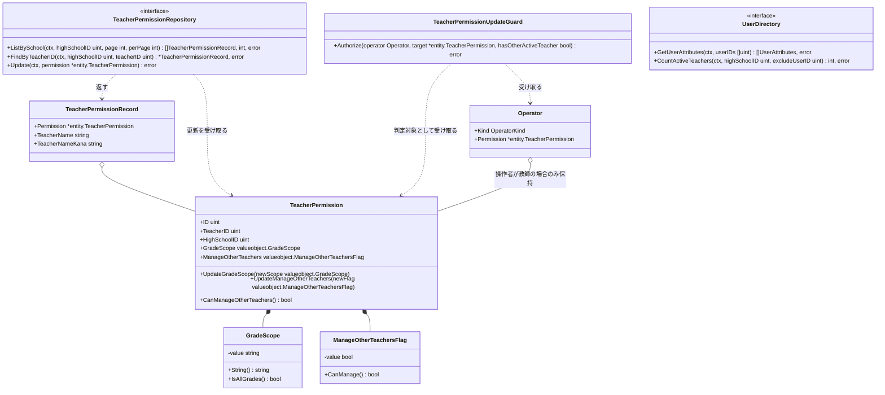
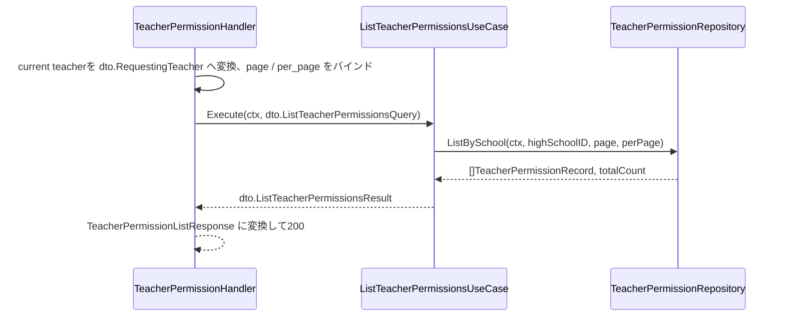
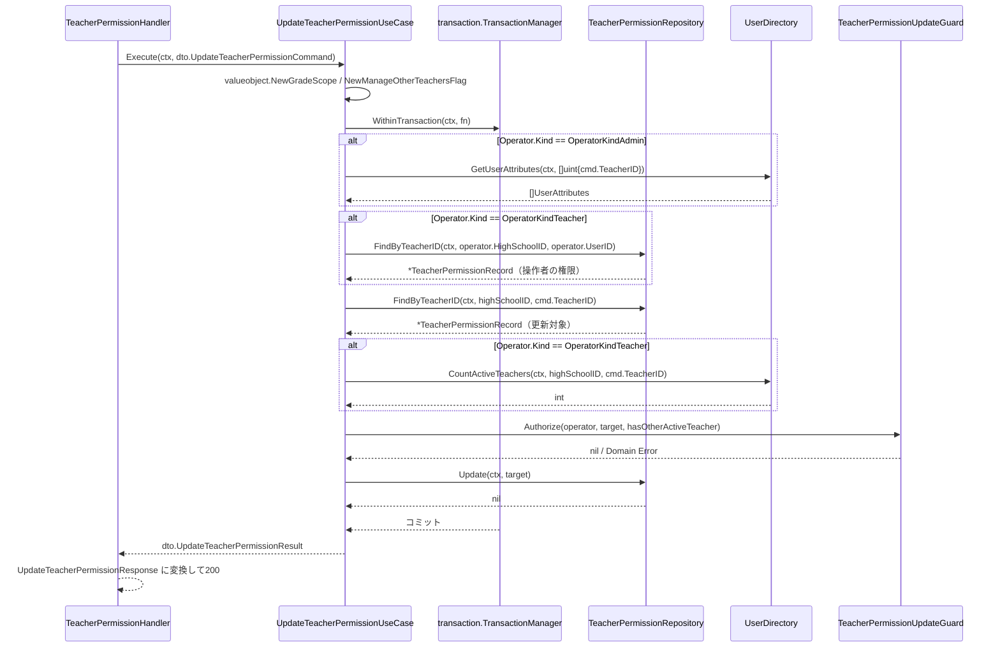
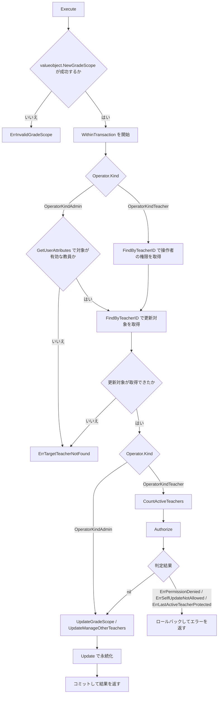

# 教師権限管理機能 Go実装仕様書

---

# 1. 機能概要

## 機能概要

教師が同校教員の権限（学年閲覧範囲 `grade_scope`、他教員管理権限 `manage_other_teachers`）を確認・更新できる機能である。更新操作は `manage_other_teachers` 権限を持つ教師のみが行え、さらに「自分自身の権限は更新できない」「校内で最後の有効教員の権限は更新できない」という組織運用上の保護ルールが課される（②「1. 機能概要」）。

教員権限の更新は本Contextの`UpdateTeacherPermissionUseCase`に一本化し、管理者教員管理機能からの更新も同じUseCaseを呼ぶ（②「12. UseCase設計」）。上記の保護ルールと他教員管理権限の判定は、操作者が教師の場合にのみ適用する。

## 採用設計パターンとその理由（②からの要約）

②「4. 設計パターン」により、本機能は **Domain Model** を採用する。

- 更新操作に「更新者が `manage_other_teachers` 権限を持つか」「更新者が自分自身を更新していないか」「更新対象が校内で最後の有効教員でないか」という業務上の不変条件が課されており、単純なCRUD検証を超えている
- 特に「最後の有効教員保護」は、対象教員1件の属性だけでは判定できず、同校に所属する他の有効教員の集合を踏まえて初めて判定できる、複数エンティティにまたがる業務ルールである
- 保護ルールをUseCase内の条件分岐として散在させず、Entity + Domain Service（`TeacherPermissionUpdateGuard`）に集約することで、ルールの見落としを防ぎ、保守性・テスト容易性を高める

Transaction Script・Active Record・Event Sourcingは、②「4. 設計パターン」の「採用しなかったパターン」節の理由により不採用とされている。本書はこの判断を変更しない。

## 本書が対象とする実装範囲

- `GET /api/v1/teacher/permissions`（同校教員の権限一覧取得）
- `GET /api/v1/teacher/permissions/:id`（指定教員の権限詳細取得）
- `PATCH /api/v1/teacher/permissions/:id`（指定教員の権限更新）

の3エンドポイントの実装に必要な、Domain層（Entity・Value Object・Repository Interface・Domain Service・Domain Error）、Application層（UseCase・DTO）、Infrastructure層（Repository実装）、Presentation層（Handler・Request/Response・Routing）の実装単位を規定する。

`UpdateTeacherPermissionUseCase`は管理者教員管理機能からも呼ばれるが、その呼び出し側のHandler・Middlewareは本書の対象外であり、`管理者教員管理機能_Go実装仕様書.md`で規定する。

規約`アーキテクチャ規約.md`「3. 設計パターンごとの構造適用方針」の「Domain Model」節に従い、`{context}/domain`・`application`・`infrastructure`・`presentation`のフルレイヤー構成を適用する。

---

# 2. ディレクトリ構成

## 対象Bounded Context名

- `teacher-permission`（②「3. Bounded Context」）

## ②で採用した設計パターン

- Domain Model（②「4. 設計パターン」）

## ディレクトリ一覧

```
internal/teacherpermission/
├── context.go                    # NewContext（依存関係の組み立て）
├── dependency.go                 # 他Contextへの依存を宣言するインターフェース
├── domain/
│   ├── entity/
│   ├── valueobject/
│   ├── repository/
│   ├── service/
│   └── errors/
├── application/
│   ├── dto/
│   └── usecase/
├── infrastructure/
│   ├── gormrepo/                 # Repository実装・GORMモデル
│   └── contextadapter/           # dependency.goのインターフェースの実装
└── presentation/
    ├── handler/
    ├── request/
    ├── response/
    └── routes.go
```

ディレクトリ名・package名は、アーキテクチャ規約「4. Bounded Context構成」の「Contextディレクトリの命名」に従い、Context名`teacher-permission`から`-`を取り除いた連結形`teacherpermission`とする。Domain Modelを採用するため、Contextディレクトリ直下には`context.go`と`dependency.go`のみを置き、他は`domain/`等のサブディレクトリに配置する。

Repository実装とGORMモデルは`infrastructure/gormrepo/`（package `gormrepo`）に置く（同規約の「代表例」、Gorm規約「2. モデル定義」）。`dependency.go`で宣言した`UserDirectory`の実装は、GORMに依存せず`user` Contextの公開操作へ委譲するアダプタであるため`infrastructure/contextadapter/`（package `contextadapter`）に置く（同規約「4. Bounded Context構成」）。

`domain/specification/`・`domain/event/`・`infrastructure/mail/`・`infrastructure/cache/`・`infrastructure/queue/`は本機能では対象外とする。②「18. Domain Event」でDomain Eventは現時点で不採用と明記されており、Mail・Cache・Queue等の外部連携要件も②に記載がないため。

## 作成するファイル一覧

```
internal/teacherpermission/context.go
internal/teacherpermission/dependency.go

internal/teacherpermission/domain/entity/teacher_permission.go

internal/teacherpermission/domain/valueobject/grade_scope.go
internal/teacherpermission/domain/valueobject/manage_other_teachers_flag.go

internal/teacherpermission/domain/repository/teacher_permission_repository.go

internal/teacherpermission/domain/service/teacher_permission_update_guard.go

internal/teacherpermission/domain/errors/errors.go

internal/teacherpermission/application/dto/list_teacher_permissions_dto.go
internal/teacherpermission/application/dto/show_teacher_permission_dto.go
internal/teacherpermission/application/dto/update_teacher_permission_dto.go

internal/teacherpermission/application/usecase/list_teacher_permissions_usecase.go
internal/teacherpermission/application/usecase/show_teacher_permission_usecase.go
internal/teacherpermission/application/usecase/update_teacher_permission_usecase.go

internal/teacherpermission/infrastructure/gormrepo/teacher_permission_model.go
internal/teacherpermission/infrastructure/gormrepo/teacher_permission_repository.go
internal/teacherpermission/infrastructure/contextadapter/user_directory.go

internal/teacherpermission/presentation/handler/teacher_permission_handler.go
internal/teacherpermission/presentation/request/teacher_permission_request.go
internal/teacherpermission/presentation/response/teacher_permission_response.go
internal/teacherpermission/presentation/routes.go
```

## 文書の分割

本書は分割しない。実装ファイルは上記の21であり、テストが付くもの（Entity 1・Value Object 2・Domain Service 1・Repository実装 1・アダプタ 1・UseCase 3）を加えると30となるため、1文書あたり30〜35という範囲に収まる。

---

# 3. Domain層設計

## Entity

### TeacherPermission（`domain/entity/teacher_permission.go`）

- struct名: `TeacherPermission`
- フィールド:

|フィールド|型|意味|
|-|-|-|
|`ID`|`uint`|権限レコード自体の識別子（`teacher_permissions.id`相当）|
|`TeacherID`|`uint`|権限の帰属先である教員のID。teacher-management Contextが管理する教員アカウント（Teacher）への参照（②7章「Value Objectを採用しないもの」）|
|`HighSchoolID`|`uint`|所属校ID。権限更新のスコープ判定（同校であるか）に用いる|
|`GradeScope`|`valueobject.GradeScope`|学年閲覧範囲|
|`ManageOtherTeachers`|`valueobject.ManageOtherTeachersFlag`|他教員管理権限|

- 公開メソッド一覧（引数・戻り値のみ。ロジックは記述しない）:

|メソッド|引数|戻り値|責務|
|-|-|-|-|
|`NewTeacherPermission`|`(id uint, teacherID uint, highSchoolID uint, gradeScope valueobject.GradeScope, manageOtherTeachers valueobject.ManageOtherTeachersFlag)`|`(*TeacherPermission, error)`|不変条件を満たしたTeacherPermissionを生成するファクトリ|
|`UpdateGradeScope`|`(newScope valueobject.GradeScope)`|なし|`grade_scope`を更新する|
|`UpdateManageOtherTeachers`|`(newFlag valueobject.ManageOtherTeachersFlag)`|なし|`manage_other_teachers`を更新する|
|`CanManageOtherTeachers`|`()`|`bool`|保有する権限で他教員を管理できるかを判定する（②6章「保有する権限で『他教員を管理できるか』を自ら判定できるようにする」）|

- 不変条件（ファクトリで保証する内容）:
  - `GradeScope`は`valueobject.GradeScope`型としてのみ保持され、生成時に許容値検証済みであることが保証される
  - `ManageOtherTeachers`は`valueobject.ManageOtherTeachersFlag`型としてのみ保持される
  - `TeacherID`は0を許容しない

> **②からの補足**: `UpdateGradeScope` / `UpdateManageOtherTeachers`は、引数として渡すValue Objectの生成時点（`valueobject.NewGradeScope`等）で妥当性検証が完了している前提のため、戻り値を`error`とせず`void`とした。②「6. Entity設計」に更新メソッドのシグネチャそのものの明記はなく、実装上の判断である（推測）。

## Value Object

### GradeScope（`domain/valueobject/grade_scope.go`）

- struct名: `GradeScope`
- フィールド: `value string`（非公開）。APIの入出力と同じ文字列表現を保持する。永続化される`grade_scope`列は整数であり、その対応付けはInfrastructure層が担う（8章・15章）
- 生成時に検証するルール: `own_grade` / `all_grades` の定義済み値以外を許容しない（②7章）
- 公開メソッド: `NewGradeScope(raw string) (GradeScope, error)` / `(g GradeScope) String() string` / `(g GradeScope) IsAllGrades() bool`

### ManageOtherTeachersFlag（`domain/valueobject/manage_other_teachers_flag.go`）

- struct名: `ManageOtherTeachersFlag`
- フィールド: `value bool`（非公開）
- 生成時に検証するルール: true/false以外の値を許容しない（②7章）
- 公開メソッド: `NewManageOtherTeachersFlag(raw bool) ManageOtherTeachersFlag` / `(f ManageOtherTeachersFlag) CanManage() bool`

> **②からの補足**: `NewManageOtherTeachersFlag`はGoの`bool`型自体が true/false 以外の値を取り得ないため、実質的にエラーを返す必要がない。②7章の「独自ルール: true/false以外の値を許容しない」はRailsの動的型言語を前提とした記述と考えられ、Go実装では型システムによって自動的に満たされる。そのためコンストラクタはエラーを返さない形にした（②の設計判断自体は変更せず、Go言語の型特性に合わせた実装上の判断であることを明示する）。

## Value Objectを採用しないもの

②7章の方針どおり、対象教員のID・氏名はTeacherPermissionが直接保持せず、`TeacherID`（teacher-management Context管理の教員アカウントへの参照）としてのみ保持する。氏名・かな氏名はApplication層のDTOで、Repositoryが返す付帯情報として扱う（6章・8章参照）。

## Repository Interface

### TeacherPermissionRepository（`domain/repository/teacher_permission_repository.go`）

|メソッド|引数|戻り値|責務|
|-|-|-|-|
|`ListBySchool`|`(ctx context.Context, highSchoolID uint, page int, perPage int)`|`(records []TeacherPermissionRecord, totalCount int, err error)`|同校教員の権限一覧取得（氏名カナ順、ページネーション）|
|`FindByTeacherID`|`(ctx context.Context, highSchoolID uint, teacherID uint)`|`(*TeacherPermissionRecord, error)`|指定教員（同校スコープ）の権限詳細取得|
|`Update`|`(ctx context.Context, permission *entity.TeacherPermission)`|`error`|権限の更新|

`TeacherPermissionRecord`（同ファイル内で定義する、Entity + 付帯情報の複合型）:

|フィールド|型|備考|
|-|-|-|
|`Permission`|`*entity.TeacherPermission`|権限Entity本体|
|`TeacherName`|`string`|対象教員の氏名（一覧・詳細表示用）|
|`TeacherNameKana`|`string`|対象教員のかな氏名（一覧・詳細表示用、ソートキー）|

> **②からの補足**: ②11章のTeacherPermissionRepositoryは「氏名カナ順のソート」を検索機能として保持するとしているが、Entity自体（②6章）は氏名を保持しない設計である。そのため一覧・詳細表示に必要な氏名情報を、Entityとは別にRepositoryの戻り値（`TeacherPermissionRecord`）として付帯させる構成とした。これは②のEntity設計・Repository設計の記載を矛盾なく実装に落とし込むための判断であり、新しい業務ルールの追加ではない（推測ではなく、②の記載同士の整合を取るための実装判断）。

校内の有効教員の存在確認は本Contextの Repository では行わない。教員の有効状態・ロール・所属校は`user` Contextが正として管理するため、`dependency.go`に宣言するインターフェース経由で`user` Contextの公開参照を呼び出す（②「3. Bounded Context」「9. Repository設計」）。

Repositoryは、保護ルールの判断そのもの（更新可否）は行わない。判断は`TeacherPermissionUpdateGuard`（Domain Service）の責務とする（②11章「保持しない責務」）。

## 他Contextへの依存（`dependency.go`）

```go
package teacherpermission

// UserDirectory は user Context が公開する参照操作のうち、本Contextが利用するものである。
// 教員の有効状態・ロール・所属校は user Context が正として管理する（②「3. Bounded Context」）。
type UserDirectory interface {
    // GetUserAttributes は指定したユーザーの基本属性を取得する。
    // 無効化済みのユーザーも返り、無効化状態は属性として含まれる。
    GetUserAttributes(ctx context.Context, userIDs []uint) ([]UserAttributes, error)

    // CountActiveTeachers は、除外対象を除いた同校の有効な教員の人数を返す。
    // user Context の CountUsers に、所属校・役割teacher・除外ID・無効化済みを除外する指定で委譲する。
    CountActiveTeachers(ctx context.Context, highSchoolID uint, excludeUserID uint) (int, error)
}

// UserAttributes は user Context から受け取るユーザーの基本属性である。
type UserAttributes struct {
    UserID       uint
    HighSchoolID uint
    Role         string
    Disabled     bool
}
```

`CountActiveTeachers`は、②「11. Repository設計」の「指定教員を除いた、校内の有効教員が他に存在するかどうかを確認する」に対応する。人数が0より大きいかどうかで存在確認を兼ねる（`user`②「CountUsers」）。

## Domain Service

### TeacherPermissionUpdateGuard（`domain/service/teacher_permission_update_guard.go`）

- struct名: `TeacherPermissionUpdateGuard`
- 依存: なし（Repositoryに依存しない。判定に必要な事実は呼び出し元UseCaseが取得し、引数として渡す）
- メソッドシグネチャ: `(g TeacherPermissionUpdateGuard) Authorize(operator Operator, target *entity.TeacherPermission, hasOtherActiveTeacher bool) error`
- `Operator`（同ファイル内で定義する）: 操作者の種別（`OperatorKindTeacher` / `OperatorKindAdmin`）と、教師の場合の権限Entity（`*entity.TeacherPermission`）を保持する
- 責務: 操作者が教師の場合に、以下の順に保護ルールを判定する（②8章）
  - `operator.Permission.CanManageOtherTeachers()`が`false`の場合、権限不足として扱う
  - `operator.Permission.TeacherID == target.TeacherID`の場合、自己更新として扱う
  - `hasOtherActiveTeacher`が`false`の場合、最後の有効教員保護として扱う
  - 上記いずれにも該当しない場合のみ`nil`を返す
- 操作者が管理者（`OperatorKindAdmin`）の場合は、いずれの判定も行わず`nil`を返す（②8章。Rails現行の管理者の教員更新には保護ルールに相当する定めがない。`管理者教員管理機能_Rails現行仕様書.md`「`Api::V1::Admin::TeachersController#update`」の「業務ルール」）

> **②からの補足**: `Authorize`のシグネチャが参照手段を直接受け取らず`hasOtherActiveTeacher bool`という判定済みの事実を引数で受け取る構成としたのは、②8章「テスト容易性: 保護ルールを独立したDomain Serviceとして切り出すことで、DBや他の全業務フローを経由せずにルール単体を検証できる」を満たすための実装判断である（推測）。事実確認（`user` Contextの`CountUsers`の呼び出し）はUseCase側の責務とし（6章参照）、Domain Serviceは`dependency.go`のインターフェースにもRepository Interfaceにも依存しない純粋な判定ロジックとする。これによりDomainがInfrastructureは元より、他Contextの呼び出しコストにも依存しない構成となる。

## 追加で必要としないService

②8章のとおり、`grade_scope` / `manage_other_teachers`の値そのものの妥当性検証はValue Objectの責務に閉じており、別途Domain Serviceを設けない。

## Domain Error

`domain/errors/errors.go`に、`errors.New`によるセンチネルエラー変数として定義する（②「17. Error設計」のDomain Errorに対応）。

|変数名|発生条件|
|-|-|
|`ErrPermissionDenied`|更新者が`manage_other_teachers`権限を持たない|
|`ErrSelfUpdateNotAllowed`|更新者が更新対象本人である（自己更新禁止）|
|`ErrLastActiveTeacherProtected`|更新対象が校内で最後の有効教員である|
|`ErrInvalidGradeScope`|`grade_scope`が許容値（`own_grade` / `all_grades`）でない|

---

# 4. クラス図

3章で定義したstruct・interfaceの関係を次のとおり示す。`Operator`はDomain Service側（`domain/service`）が定義する操作者の表現であり、Application層の`dto.Operator`から組み立てる（6章）。



`TeacherPermissionUpdateGuard`は`TeacherPermissionRepository`・`UserDirectory`のいずれにも依存しない（3章）。判定に必要な事実は`hasOtherActiveTeacher`として引数で受け取る。

---

# 5. 状態遷移図

本書では状態遷移図を作成しない。

理由: ②「10. 状態遷移図」のとおり、`TeacherPermission`は名前付きの状態を持たない。`GradeScope`は`own_grade` / `all_grades`の2値、`ManageOtherTeachersFlag`は`true` / `false`の2値であり、それぞれ`UpdateGradeScope` / `UpdateManageOtherTeachers`で独立に上書きされる。禁止される組み合わせはなく、遷移の可否は`TeacherPermissionUpdateGuard.Authorize`の結果のみで決まるため、7章の処理フロー図で表現する。

---

# 6. Application層設計

## DTO（Command / Query）

|struct名|フィールド|型|区分|
|-|-|-|-|
|`RequestingTeacher`|`TeacherID`|`uint`|current teacherの識別子（一覧・詳細の入力要素）|
||`HighSchoolID`|`uint`|所属校ID|
|`Operator`|`Kind`|`OperatorKind`|更新の操作者種別（`OperatorKindTeacher` / `OperatorKindAdmin`）|
||`UserID`|`uint`|操作者の識別子|
||`HighSchoolID`|`uint`|所属校ID。操作者が教師の場合のみ設定する|
|`ListTeacherPermissionsQuery`|`RequestingTeacher`|`RequestingTeacher`|Query|
||`Page`|`int`|Query|
||`PerPage`|`int`|Query|
|`ListTeacherPermissionsResult`|`RequestingTeacher`|`RequestingTeacher`|出力|
||`Permissions`|`[]TeacherPermissionSummary`|出力|
||`CurrentPage`|`int`|出力|
||`TotalPages`|`int`|出力|
||`TotalCount`|`int`|出力|
||`PerPage`|`int`|出力|
|`ShowTeacherPermissionQuery`|`RequestingTeacher`|`RequestingTeacher`|Query|
||`TeacherID`|`uint`|Query|
|`ShowTeacherPermissionResult`|`Permission`|`TeacherPermissionSummary`|出力|
|`UpdateTeacherPermissionCommand`|`Operator`|`Operator`|Command|
||`TeacherID`|`uint`|Command|
||`GradeScope`|`string`|Command|
||`ManageOtherTeachers`|`bool`|Command|
|`UpdateTeacherPermissionResult`|`Permission`|`TeacherPermissionSummary`|出力|
|`TeacherPermissionSummary`|`TeacherID`|`uint`|出力共通型|
||`TeacherName`|`string`|出力共通型|
||`TeacherNameKana`|`string`|出力共通型|
||`GradeScope`|`string`|出力共通型|
||`ManageOtherTeachers`|`bool`|出力共通型|

> **②からの補足**: `RequestingTeacher`・`Operator`の具体的なフィールド構成は②16章「UseCase」の記載（「current userの所属校IDを用いて、権限一覧・詳細の取得範囲を同校にスコープする」）と②12章「UpdateTeacherPermissionUseCase」の入力（操作者の識別子・種別）から導出したものであり、型・フィールド名自体は②に明記がない（推測）。current user情報自体の取得元（認証Middleware・shared/authパッケージ等）は本機能のスコープ外とする。更新のみ`Operator`を受け取るのは、一覧・詳細が教師の画面専用であり管理者経路を持たないためである（②「19. API仕様」）。

更新時に本Contextが`Operator.HighSchoolID`でスコープするのは操作者が教師の場合に限る。管理者は所属校を持たないため、更新対象の所属校は`user` Contextの`GetUserAttributes`で取得した対象教員自身の所属校を用いる。対象教員が指定高校に所属することの確認は、呼び出し側（管理者教員管理機能のHandler）が行う（②「12. UseCase設計」の「対象教員の所属校の確認」）。

## UseCase

### ListTeacherPermissionsUseCase（`application/usecase/list_teacher_permissions_usecase.go`）

- struct名: `ListTeacherPermissionsUseCase`
- コンストラクタが受け取る依存: `repository.TeacherPermissionRepository`
- 公開メソッド: `(u *ListTeacherPermissionsUseCase) Execute(ctx context.Context, query dto.ListTeacherPermissionsQuery) (dto.ListTeacherPermissionsResult, error)`
- 処理ステップ（呼び出し順序）:
  1. `TeacherPermissionRepository.ListBySchool(ctx, query.RequestingTeacher.HighSchoolID, query.Page, query.PerPage)`を呼び出す
  2. 取得した`TeacherPermissionRecord`群を`TeacherPermissionSummary`に変換する
  3. 総件数からページ情報（`TotalPages`・`PerPage`）を組み立てる
  4. `ListTeacherPermissionsResult`を構築して返す
- トランザクション境界: なし（読み取りのみ、②14章）
- 発生しうるApplication Error: なし（該当0件の場合も正常系として空一覧を返す）

### ShowTeacherPermissionUseCase（`application/usecase/show_teacher_permission_usecase.go`）

- struct名: `ShowTeacherPermissionUseCase`
- コンストラクタが受け取る依存: `repository.TeacherPermissionRepository`
- 公開メソッド: `(u *ShowTeacherPermissionUseCase) Execute(ctx context.Context, query dto.ShowTeacherPermissionQuery) (dto.ShowTeacherPermissionResult, error)`
- 処理ステップ:
  1. `TeacherPermissionRepository.FindByTeacherID(ctx, query.RequestingTeacher.HighSchoolID, query.TeacherID)`を呼び出す
  2. 見つからない場合（同校でない場合を含む）、`ErrTargetTeacherNotFound`（Application Error）を返す
  3. 見つかった場合、`TeacherPermissionSummary`に変換し`ShowTeacherPermissionResult`を返す
- トランザクション境界: なし（読み取りのみ）
- 発生しうるApplication Error: `ErrTargetTeacherNotFound`

### UpdateTeacherPermissionUseCase（`application/usecase/update_teacher_permission_usecase.go`）

- struct名: `UpdateTeacherPermissionUseCase`
- コンストラクタが受け取る依存: `repository.TeacherPermissionRepository`, `UserDirectory`（`dependency.go`）, `*service.TeacherPermissionUpdateGuard`, `transaction.TransactionManager`（`internal/shared/transaction`。後述11章）
- 公開メソッド: `(u *UpdateTeacherPermissionUseCase) Execute(ctx context.Context, cmd dto.UpdateTeacherPermissionCommand) (dto.UpdateTeacherPermissionResult, error)`
- 処理ステップ（呼び出し順序）:
  1. `valueobject.NewGradeScope(cmd.GradeScope)`で入力形式を検証する（不正時は`ErrInvalidGradeScope`）
  2. `valueobject.NewManageOtherTeachersFlag(cmd.ManageOtherTeachers)`を生成する
  3. `transaction.TransactionManager.WithinTransaction`のクロージャ内で以下（4〜8）を実行する
  4. 対象教員のスコープを決める。操作者が教師の場合は`cmd.Operator.HighSchoolID`を用いる。操作者が管理者の場合は`UserDirectory.GetUserAttributes(ctx, []uint{cmd.TeacherID})`で対象教員の所属校・ロール・無効化状態を取得し、その所属校を用いる（見つからない・教員でない・無効化済みの場合は`ErrTargetTeacherNotFound`）。管理者経路で対象教員が指定高校に所属することの確認は、本UseCaseでは行わず呼び出し側の責務とする（②「12. UseCase設計」の「対象教員の所属校の確認」）
  5. 操作者が教師の場合のみ、`TeacherPermissionRepository.FindByTeacherID(ctx, cmd.Operator.HighSchoolID, cmd.Operator.UserID)`で操作者自身の権限を取得する（②16章「Domain」の「更新者が`manage_other_teachers`権限を持つか」の判定に必要な入力）
  6. `TeacherPermissionRepository.FindByTeacherID(ctx, highSchoolID, cmd.TeacherID)`で更新対象の権限を取得する。見つからない場合は`ErrTargetTeacherNotFound`を返す
  7. 操作者が教師の場合のみ、`UserDirectory.CountActiveTeachers(ctx, highSchoolID, cmd.TeacherID)`で校内の他の有効教員の人数を取得し、0より大きいかどうかを存在確認とする
  8. `TeacherPermissionUpdateGuard.Authorize(operator, target, hasOtherActiveTeacher)`で保護ルールを判定する。違反時はDomain Error（`ErrPermissionDenied` / `ErrSelfUpdateNotAllowed` / `ErrLastActiveTeacherProtected`）をそのまま返す。操作者が管理者の場合、Guardは判定を行わず`nil`を返す
  9. `target.UpdateGradeScope(newScope)` / `target.UpdateManageOtherTeachers(newFlag)`で更新後の状態を反映し、`TeacherPermissionRepository.Update(ctx, target)`で永続化する
  10. `UpdateTeacherPermissionResult`を構築して返す
- トランザクション境界: ②14章「UpdateTeacherPermissionUseCaseの開始時にトランザクションを開始する」「保護ルール判定を通過し、TeacherPermissionの更新が完了した時点でコミットする」に従い、ステップ4〜9をトランザクション内で実行する（詳細は11章）
- 発生しうるApplication Error: `ErrTargetTeacherNotFound`。Domain Error（`ErrPermissionDenied` / `ErrSelfUpdateNotAllowed` / `ErrLastActiveTeacherProtected` / `ErrInvalidGradeScope`）はUseCaseで変換せずそのまま上位（Presentation）へ伝播させる

> **②からの補足**: ステップ5（操作者自身の`TeacherPermission`をRepository経由で取得する処理）は②に明記された呼び出し一覧（②12章）には直接記載がない。しかし②16章「Domain」で「更新者が`manage_other_teachers`権限を持つか」の判定がGuardの責務とされており、Guardが`*entity.TeacherPermission`を受け取る設計（本書3章）である以上、操作者自身のEntityをどこかで取得する必要がある。UseCase内で`TeacherPermissionRepository.FindByTeacherID`を再利用してこれを取得する構成とした（推測、②の記載を矛盾なく実装するための補足）。

> **②からの補足**: ステップ4で管理者の場合に対象教員の所属校を`user` Contextから取得するのは、管理者が所属校を持たず、教師経路と同じ「操作者の所属校でスコープする」方法が使えないためである。Rails現行の管理者の教員更新は、対象高校を取得した上でその高校に所属する教員として対象を特定している（`管理者教員管理機能_Rails現行仕様書.md`「`Api::V1::Admin::TeachersController#update`」の「処理内容」。他校の教員IDを指定した場合は404となる）。本UseCaseは管理者の所属校を持たないため、この高校スコープの確認は呼び出し側（管理者教員管理機能のHandlerが、対象教員を高校スコープ付きで取得する）が担い、現行の挙動を保つ（②「12. UseCase設計」の「対象教員の所属校の確認」）。

---

# 7. シーケンス図・処理フロー図

## シーケンス図

### 一覧取得（`GET /api/v1/teacher/permissions`）



詳細取得（`ShowTeacherPermissionUseCase`）は、`ListBySchool`の代わりに`FindByTeacherID`を1回呼ぶだけで、構造は同じである。

### 更新（`PATCH /api/v1/teacher/permissions/:id`）



`WithinTransaction`のクロージャ内で実行する範囲は11章のとおりである。`UserDirectory`の呼び出しも同じ`ctx`を受け取るため、同一トランザクションに参加する（規約「11. Transaction実装パターン（TransactionManager）」の「呼び出し側トランザクションの引き継ぎ」）。

## 処理フロー図

`UpdateTeacherPermissionUseCase.Execute`は検証と保護ルール判定を複数経るため、分岐を次のとおり示す。



一覧・詳細の参照は所属校による絞り込みのみで分岐を持たないため、処理フロー図を設けない。

---

# 8. Infrastructure層設計

## Repository実装

### TeacherPermissionRepository実装（`infrastructure/gormrepo/teacher_permission_repository.go`）

- 実装struct名: 非公開struct（例: `teacherPermissionRepository`）+ コンストラクタ`NewTeacherPermissionRepository(db *gorm.DB) repository.TeacherPermissionRepository`（規約「8. 命名規約（アーキテクチャレベル）」により`Impl`接尾辞を付けず、Infrastructure側のpackage名`gormrepo`で区別する）
- 対応するGORMモデル: `gormrepo.TeacherPermissionModel`（`infrastructure/gormrepo/teacher_permission_model.go`、`teacher_permissions`テーブルに対応）。氏名・所属校・有効性の絞り込みには、`users`テーブルの必要列（`id`・`high_school_id`・`name_kana`・`deleted_at`）のみを射影する読み取り専用の結合用struct（非公開）を同ファイル内に定義する
- 各メソッドで発行するクエリ内容:
  - `ListBySchool`: `users.high_school_id`が指定校IDと一致し、かつ`users.deleted_at`が未設定（有効教員）である教員に紐づく`teacher_permissions`を結合取得する。`users.name_kana`昇順でソートし、`page`・`perPage`に基づくページネーションを行う。絞り込み条件に一致する総件数を別途取得する
  - `FindByTeacherID`: `teacher_permissions`の対象教員IDと`users.high_school_id`が指定校IDに一致し、`users.deleted_at`が未設定であるレコードを取得する（同校スコープを兼ねる。②16章「UseCase」の「更新時、対象教員が同校であることを確認する」をクエリレベルで反映）
  - `Update`: 対象レコードの`grade_scope`・`manage_other_teachers`列を更新する
- DB接続の取得: 各メソッドは`gormtx.DBFromContext(ctx, r.db)`で接続を取得する。トランザクション中であればその接続を、そうでなければ通常の接続を使う（規約「11. Transaction実装パターン（TransactionManager）」。11章参照）
- Entity ⇔ GORMモデルの変換方針: 取得した行の`grade_scope`（整数）を`own_grade` / `all_grades`の文字列へ対応付けてから`valueobject.NewGradeScope`、`manage_other_teachers`真偽値から`valueobject.NewManageOtherTeachersFlag`を生成し、`entity.NewTeacherPermission`でEntityを組み立てる。書き込み時は逆向きに、`valueobject.GradeScope`の文字列表現を整数へ対応付ける。整数と文字列の対応（`own_grade`=0 / `all_grades`=1）は①「6. データモデル」のRailsの`enum`に一致させ、`gormrepo`内の非公開の対応表に閉じ込める。Domain層・Application層は整数を扱わない。結合先`users`テーブルの`name`・`name_kana`は`TeacherPermissionRecord`の付帯情報として保持する（3章参照）。変換関数（`toEntity`・`toRecord`）はrepository実装内の非公開関数とする

> **②からの補足**: `teacher_permissions`は`user_id`・`grade_scope`・`manage_other_teachers`のみを持ち、`high_school_id`列を持たない（①「6. データモデル」）。所属校・有効性・氏名はいずれも`users`テーブルとの結合で判定する。`teacher_permissions`が所属校・有効状態・氏名を持たず、これらを`users`との結合で判定することは②「21. DB操作仕様」が定めている。また、規約「5. Context間連携ルール」は他Contextの内部Entity・Infrastructure実装への直接依存を禁止しているが、本書では`users`テーブルの必要列のみを射影する読み取り専用の結合用structを本Context内に定義することで、`user` Context側のGORMモデル実装への直接依存を避ける（実装上の判断）。一覧・詳細の表示に必要な氏名・氏名カナは、ページネーションと並び替えを伴う画面向けの一覧であり、`user`②「3. Bounded Context」の「画面向けの一覧は、一覧を必要とする各Contextが自前の参照モデルとして持つ」に従って本Contextが参照モデルを持つ。一方、保護ルールの判定に使う「校内に他の有効な教員が存在するか」は画面向けの一覧ではないため、`user` Contextの`CountUsers`に委ねる（②「11. Repository設計」）。

### UserDirectoryAdapter（`infrastructure/contextadapter/user_directory.go`）

- 実装struct名: 非公開struct（例: `userDirectory`）+ コンストラクタ`NewUserDirectory(userContext *user.Context) UserDirectory`
- 責務: `dependency.go`の`UserDirectory`インターフェースを、`user` Contextの公開操作（`GetUserAttributes` / `CountUsers`）の呼び出しへ委譲する
- `CountActiveTeachers`は、`CountUsers`に「所属校＝指定校ID、役割＝`teacher`、除外ID＝対象教員ID、無効化の扱い＝有効のみ、集計の単位＝なし」を指定して呼び出し、得られた人数を返す
- DBアクセスを自前で行わない。`users`テーブルへのクエリは`user` Context側の責務である

> **②からの補足**: 「教員ロールである」という条件は②11章の「同校の有効教員集合」という記載から導出した（推測）。`user`②「CountUsers」は役割による絞り込みと除外IDの指定を入力に持つため、本Contextで`user_roles`を結合する必要はない。

## 外部連携実装

対象外。本機能はMail・Cache・Queue等の外部連携を必要としない（②に記載なし）。

---

# 9. Presentation層設計

## Handler

- struct名: `TeacherPermissionHandler`
- 対応する呼び出し先: `usecase.ListTeacherPermissionsUseCase` / `usecase.ShowTeacherPermissionUseCase` / `usecase.UpdateTeacherPermissionUseCase`
- メソッド一覧:

|メソッド|HTTPメソッド|パス|
|-|-|-|
|`List(c *gin.Context)`|GET|`/api/v1/teacher/permissions`|
|`Show(c *gin.Context)`|GET|`/api/v1/teacher/permissions/:id`|
|`Update(c *gin.Context)`|PATCH|`/api/v1/teacher/permissions/:id`|

- 処理順序（`List`）:
  1. Ginコンテキストから認証Middlewareが格納したcurrent teacher情報を取得し、`dto.RequestingTeacher`へ変換する（Handlerでは業務権限判定を行わない。②16章「Handler」）
  2. クエリパラメータ`page`・`per_page`をバインドする。`per_page`は既定値20・上限100とし、1以上の整数でない場合は既定値を用いる（`page`は未指定として扱う）
  3. `dto.ListTeacherPermissionsQuery`を組み立て、`ListTeacherPermissionsUseCase.Execute`を呼び出す
  4. 取得結果を`TeacherPermissionListResponse`へ変換する
  5. `200`でレスポンスを返す
- 処理順序（`Show`）:
  1. current teacher情報を取得し`dto.RequestingTeacher`へ変換する
  2. パスパラメータ`id`をバインドする
  3. `dto.ShowTeacherPermissionQuery`を組み立て、`ShowTeacherPermissionUseCase.Execute`を呼び出す
  4. エラーが返却された場合は`c.Error(err)`で登録して処理を終える。ステータスコードの決定はエラーハンドリングミドルウェアが行う（14章）
  5. 成功時は`TeacherPermissionDetailResponse`へ変換し`200`で返す
- 処理順序（`Update`）:
  1. current teacher情報を取得し、種別を`OperatorKindTeacher`として`dto.Operator`へ変換する
  2. パスパラメータ`id`をバインドする
  3. `UpdateTeacherPermissionRequest`をJSONボディからバインドし、Presentation Validation（12章）を行う。バインドに失敗した場合は`AppError`へ変換して`c.Error`で登録する
  4. `dto.UpdateTeacherPermissionCommand`を組み立て、`UpdateTeacherPermissionUseCase.Execute`を呼び出す
  5. エラーが返却された場合は`c.Error(err)`で登録して処理を終える。ステータスコード（403 / 404 / 422）の決定はエラーハンドリングミドルウェアが行う（14章）
  6. 成功時は`UpdateTeacherPermissionResponse`（`{"message": "権限更新に成功しました"}`）を`200`で返す

本Contextが公開するHandlerは教師の画面専用である。管理者の教員更新は管理者教員管理機能のHandlerが受け、種別を`OperatorKindAdmin`として`UpdateTeacherPermissionUseCase`を呼ぶ（②「12. UseCase設計」）。

## Request / Response DTO

Request DTO（`internal/teacherpermission/presentation/request/teacher_permission_request.go`）:

|struct名|フィールド|型|バリデーションタグ／チェック内容|
|-|-|-|-|
|`UpdateTeacherPermissionRequest`|`TeacherPermission`|`UpdateTeacherPermissionBody`|`binding:"required"`（②15章「Presentation」必須チェック）|
|`UpdateTeacherPermissionBody`|`GradeScope`|`string`|`json:"grade_scope" binding:"required"`（型チェック・必須チェック、②15章）|
||`ManageOtherTeachers`|`*bool`|`json:"manage_other_teachers" binding:"required"`（②15章）|

> **②からの補足**: リクエストボディは`teacher_permission`キーでネストする。Rails現行の`params.require(:teacher_permission).permit(:grade_scope, :manage_other_teachers)`（①「5. API / 処理詳細」）と同じ形である。`ManageOtherTeachers`を`*bool`（ポインタ）にしたのは、Goの`bool`ゼロ値（`false`）と「未送信」を区別し必須チェックを機能させるための実装判断である（推測）。

Response DTO（`internal/teacherpermission/presentation/response/teacher_permission_response.go`）:

|struct名|フィールド|型|JSONキー|
|-|-|-|-|
|`TeacherPermissionListResponse`|`CurrentUser`|`CurrentUserResponse`|`current_user`|
||`Teachers`|`[]TeacherPermissionSummaryResponse`|`teachers`|
||`Meta`|`MetaResponse`|`meta`|
|`CurrentUserResponse`|`ID`|`uint`|`id`|
||`Name`|`string`|`name`|
||`NameKana`|`string`|`name_kana`|
||`Grade`|`*GradeResponse`|`grade`|
||`InvitationStatus`|`string`|`invitation_status`|
||`TeacherPermission`|`TeacherPermissionResponse`|`teacher_permission`|
|`TeacherPermissionSummaryResponse`|`ID`|`uint`|`id`|
||`Name`|`string`|`name`|
||`TeacherPermission`|`TeacherPermissionResponse`|`teacher_permission`|
|`TeacherPermissionDetailResponse`|`ID`|`uint`|`id`|
||`Name`|`string`|`name`|
||`TeacherPermission`|`TeacherPermissionResponse`|`teacher_permission`|
|`TeacherPermissionResponse`|`ID`|`uint`|`id`|
||`GradeScope`|`string`|`grade_scope`|
||`ManageOtherTeachers`|`bool`|`manage_other_teachers`|
|`UpdateTeacherPermissionResponse`|`Message`|`string`|`message`|
|`MetaResponse`|`CurrentPage`|`int`|`current_page`|
||`TotalPages`|`int`|`total_pages`|
||`TotalCount`|`int`|`total_count`|
||`PerPage`|`int`|`per_page`|

フィールド構成は①「5. API / 処理詳細」のResponseに合わせる。一覧は`current_user` / `teachers` / `meta`の3キーを返し、詳細は対象教員の`id` / `name` / `teacher_permission`を返す。更新は更新後の状態ではなく`{"message": "権限更新に成功しました"}`のみを返す（①「5. API / 処理詳細」）。

`CurrentUserResponse.InvitationStatus`は、Rails現行の`TeacherSerializer#invitation_status`が本アクションでは常に既定値`pending`を返す（招待通知を引くための`latest_notifications`が渡されない）ため、固定で`pending`を返す（①「5. API / 処理詳細」の`index`のResponse）。`Grade`は教員に学年が紐づかない場合に`null`となる。

## Routing

`internal/teacherpermission/presentation/routes.go`

|Method|Path|Handler|
|-|-|-|
|GET|`/api/v1/teacher/permissions`|`TeacherPermissionHandler.List`|
|GET|`/api/v1/teacher/permissions/:id`|`TeacherPermissionHandler.Show`|
|PATCH|`/api/v1/teacher/permissions/:id`|`TeacherPermissionHandler.Update`|

いずれのルートも、認証Middleware・teacherロール確認Middlewareを経由する（②16章「Middleware」）。加えて`PATCH /api/v1/teacher/permissions/:id`はCookieで認可される状態変更であるため、CSRF検証Middlewareの対象に含める（Gin規約「7. CSRF対策」の「適用範囲」）。当該Middlewareはいずれも本機能内で新規実装せず、既存の共通Middlewareを利用する。Rails現行では`Api::V1::Teacher::BaseController`がPunditの`authorize :teacher_service, :access?`でロールを確認している（①「7. 権限制御」）。

---

# 10. API仕様

|Method|Path|Handler|Request|Response|Status Code|
|-|-|-|-|-|-|
|GET|/api/v1/teacher/permissions|TeacherPermissionHandler.List|page（query, optional）, per_page（query, optional。既定20・上限100）|TeacherPermissionListResponse|200|
|GET|/api/v1/teacher/permissions/:id|TeacherPermissionHandler.Show|id（path, required）|TeacherPermissionDetailResponse|200|
|PATCH|/api/v1/teacher/permissions/:id|TeacherPermissionHandler.Update|id（path, required）, UpdateTeacherPermissionRequest（body）|UpdateTeacherPermissionResponse|200|

Errorケース:

|条件|Status Code|Error内容|
|-|-|-|
|操作者（教師）が`manage_other_teachers`権限を持たない|403|`ErrPermissionDenied`。メッセージは`他教員を編集する権限がありません`（①「5. API / 処理詳細」）|
|対象教員が存在しない、同校でない、または論理削除済み|404|`ErrTargetTeacherNotFound`|
|操作者が自分自身を更新しようとした|422|`ErrSelfUpdateNotAllowed`。メッセージは`自分自身は更新できません`|
|更新対象が校内で最後の有効教員である|422|`ErrLastActiveTeacherProtected`。メッセージは`最後の教員は更新できません`|
|`grade_scope`が許容値でない|422|`ErrInvalidGradeScope`|
|`manage_other_teachers`が未送信（Presentation Validation）|422|入力不正|
|`page` / `per_page`パラメータが不正な形式|—|エラーとせず既定値で処理する（①「5. API / 処理詳細」。`page`は未指定、`per_page`は20として扱う）|
|`id`パラメータが不正な形式|404|対象教員が特定できないため`ErrTargetTeacherNotFound`と同じ扱いとする|
|未認証|401|認証エラー（②「17. Error設計」の「エラー仕様」）|
|teacherロールでない|403|権限エラー（②「17. Error設計」の「エラー仕様」）|
|CSRFトークンが不正（PATCH）|403|CSRF検証エラー（Gin規約「7. CSRF対策」）|

権限不足（403）と保護ルール違反（422）を区別する。対象教員の特定は権限判定より先に行うため、存在しないIDを指定した場合は権限の有無によらず404を返す（①「5. API / 処理詳細」の処理順）。

---

# 11. Transaction実装方針

## Transaction開始箇所

- `UpdateTeacherPermissionUseCase.Execute`内、入力DTOの形式検証（VO生成）の直後、更新者・更新対象の権限取得（6章ステップ4）を行う前に、`transaction.TransactionManager.WithinTransaction(ctx, fn)`を呼び出してトランザクションを開始する（②14章「UpdateTeacherPermissionUseCaseの開始時にトランザクションを開始する」を実装単位に落とし込んだもの）
- UseCaseが受け取るのは`internal/shared/transaction`のインターフェースのみとし、GORM実装（`internal/shared/transaction/gormtx`）には依存しない（規約「11. Transaction実装パターン（TransactionManager）」。Application層がGORMへ推移的に依存することを避けるため）

## Transaction終了箇所

- `TeacherPermissionUpdateGuard.Authorize`による保護ルール判定を通過し、`TeacherPermissionRepository.Update`による永続化が完了した時点でコミットする（②14章）
- 保護ルール判定（Domain Error）・対象未検出（`ErrTargetTeacherNotFound`）のいずれかが発生した場合はロールバックする
- `ListTeacherPermissionsUseCase` / `ShowTeacherPermissionUseCase`ではトランザクションを使用しない（②14章）

## 複数Repositoryにまたがる場合の扱い

`UpdateTeacherPermissionUseCase`は、`TeacherPermissionRepository`（操作者取得・対象取得・更新）と`UserDirectory`（`user` Contextの参照）を1つのトランザクション内で呼び出す。トランザクションは`context.Context`で引き継ぐ（規約「11. Transaction実装パターン（TransactionManager）」の「呼び出し側トランザクションの引き継ぎ」）ため、`WithinTransaction`が渡す`ctx`をそのまま下位へ引き渡す。`user` Contextの参照も同じ`ctx`を受け取るため、同じトランザクションに参加する。

`gormrepo`のRepository実装は、`ctx`からトランザクション用の接続を`gormtx.DBFromContext(ctx, r.db)`で取り出して使用する（8章）。開始するか既に始まっているものに参加するかの判定は`gormtx.RunInTx`の1箇所に集約され、`WithinTransaction`もこれに委ねる（規約「11. Transaction実装パターン（TransactionManager）」）。`db.WithContext(ctx).Transaction(...)`を直接呼ばない。

---

# 12. Validation実装方針

## Presentation

- 型チェック: `grade_scope`が文字列、`manage_other_teachers`が真偽値であることをJSONバインド時に検証する（②15章「型チェック」）
- 必須チェック: `grade_scope` / `manage_other_teachers`が送信されていることを`binding:"required"`で検証する（②15章「必須チェック」）
- フォーマットチェック: `grade_scope`が文字列として送信されていること（②15章「フォーマットチェック」）

## 業務ルール検証

Domain Model採用のため、Entity／Value Object生成時とUseCase内で以下を検証する。

- `valueobject.NewGradeScope`: `grade_scope`が`own_grade` / `all_grades`の許容値であるかを検証する（②15章「整合性チェック」）
- `valueobject.NewManageOtherTeachersFlag`: `manage_other_teachers`の型的な真偽値であることを保証する（Go型システムにより自動的に満たされる、3章参照）
- `TeacherPermissionUpdateGuard.Authorize`（UseCase内で呼び出す）: 更新者が`manage_other_teachers`権限を持つか（②15章「業務ルール」）、自己更新でないか・最後の有効教員でないか（②15章「状態チェック」）を検証する

## 責務分離

②15章の方針どおり、Presentationは「入力の形式が正しいか」を、Domainは「業務的に妥当か（更新してよい権限者か、保護対象でないか）」を担当する。これにより入力仕様の変更と組織運用ルールの変更を独立して扱える。

---

# 13. Authorization実装方針

## Middleware

- 認証済みユーザーを特定し、`teacher`ロールであることを確認する（②16章「Middleware」）
- `PATCH /api/v1/teacher/permissions/:id`はCookieで認可される状態変更であるため、CSRF検証の対象に含める（Gin規約「7. CSRF対策」の「適用範囲」）。一覧・詳細はGETのため対象外である

## Handler

- ルーティングとHTTP入出力の変換のみを担当し、業務権限判定は持たせない（②16章「Handler」）。current teacher情報を、一覧・詳細では`dto.RequestingTeacher`へ、更新では種別`OperatorKindTeacher`の`dto.Operator`へ変換してUseCaseへ渡すのみ

## UseCase

- `ListTeacherPermissionsUseCase` / `ShowTeacherPermissionUseCase`: `RequestingTeacher.HighSchoolID`を用いて取得範囲を同校にスコープする（②16章「UseCase」）
- `UpdateTeacherPermissionUseCase`: 操作者が教師の場合、`TeacherPermissionRepository.FindByTeacherID`のクエリ条件（同校スコープ）により、対象教員が同校であることを確認する（②16章「UseCase」「更新時、対象教員が同校であることを確認する」）。操作者が管理者の場合は、本UseCaseでは操作者の所属校によるスコープを行わず、`user` Contextから取得した対象教員自身の所属校を用いる。対象教員が指定高校に所属することの確認は呼び出し側（管理者教員管理機能のHandler）の責務である（②「12. UseCase設計」の「対象教員の所属校の確認」）

## Domain

- `TeacherPermissionUpdateGuard.Authorize`において、操作者が教師の場合に以下を判定する（②16章「Domain」）
  - 更新者が`manage_other_teachers`権限を持つか
  - 更新者が更新対象本人でないか
  - 更新対象が校内で最後の有効教員でないか
- 操作者が管理者の場合は、いずれの判定も行わない。管理者であることの確認と、対象教員が指定高校に所属することの確認は、管理者教員管理機能側のMiddleware・Handlerの責務である（②16章）

## 判断理由

②16章「判断理由」のとおり、「同校教員のみを対象とする」という認証・スコープ確認はMiddleware/UseCaseに配置し、「更新してよい権限者か」「保護対象でないか」という組織運用上の判断はDomain（Guard）に集約することで、権限体系や保護ルールの変更が生じてもDomain層のみの修正で対応できるようにする。

---

# 14. Error実装方針

## Domain Error → Application Errorへの変換方針

規約「12. Error変換パターン（AppError）」の標準パターンに従う。`TeacherPermissionUpdateGuard`・Value Objectが返すDomain Error（`ErrPermissionDenied` / `ErrSelfUpdateNotAllowed` / `ErrLastActiveTeacherProtected` / `ErrInvalidGradeScope`）は、各UseCaseが`errors.Is`で判別し、`internal/shared/apperror`の`AppError`を実装した型へ変換して返す。Domain Error自体にStatusCode/LogLevelを持たせない。

- `UpdateTeacherPermissionUseCase`: 上記4つのDomain Errorと、自身が返す対象不存在を`AppError`へ変換する
- `ShowTeacherPermissionUseCase`: 対象不存在を`AppError`（404相当）へ変換する
- `ListTeacherPermissionsUseCase`: 業務エラーを持たない。Infrastructure Errorのみを`AppError`（500相当）へ変換する

Domain Errorをそのままレスポンス層まで伝播させない。ステータスコードの決定は、組織運用ルールを表すDomain層の関心事ではないためである（②「17. Error設計」の「層間の変換」）。

## Application Error → HTTPレスポンスへの変換方針

Gin規約「8. エラーハンドリングミドルウェア」の集中エラーハンドリングミドルウェアに変換を集約する。Handlerは`c.Error(err)`でエラーを登録するのみとし、個々のHandlerでステータスコードを判定しない。ミドルウェアが`errors.As`で`AppError`を1回だけ判定し、`StatusCode()`でステータス、`LogLevel()`でログレベルを決める。

|Error種別|発生層|HTTP Status|
|-|-|-|
|`ErrPermissionDenied`|Domain（判定）→ Application（変換）|403|
|`ErrSelfUpdateNotAllowed`|Domain（判定）→ Application（変換）|422|
|`ErrLastActiveTeacherProtected`|Domain（判定）→ Application（変換）|422|
|`ErrInvalidGradeScope`|Domain（判定）→ Application（変換）|422|
|対象教員不存在（他校・論理削除済みを含む）|Application|404|
|Request DTOのバリデーションエラー（`binding`タグ違反）|Presentation|422|
|`page` / `per_page`パラメータ不正|Presentation|エラーとせず既定値で処理する（①「5. API / 処理詳細」）|
|`id`パラメータ不正|Presentation|404（対象教員を特定できないため）|
|未認証|Middleware|401|
|teacherロール不一致|Middleware|403|
|CSRFトークン不正（PATCH）|Middleware|403|
|DB接続障害等|Infrastructure|500|

ステータスコードは②「17. Error設計」の「エラー仕様」に対応する。

Presentation層で発生するバリデーションエラーも、Handler内でレスポンスを組み立てず、`AppError`へ変換して`c.Error`で登録する（Gin規約「8. エラーハンドリングミドルウェア」の`toValidationError`に相当）。

## Infrastructure Errorのハンドリング方針

DB接続失敗等のInfrastructure Errorは、Repository実装から`fmt.Errorf`でラップして返す（コーディング規約「6. エラーのラップ」）。UseCaseは業務エラーとして判別できないものを内部エラー相当の`AppError`へ変換し、エラーハンドリングミドルウェアが`500`を返す。`AppError`へ変換されずに到達したエラーも、同ミドルウェアが未分類のエラーとして`500`で扱う。

## 判断理由（②からの引用）

②17章「判断理由」のとおり、自己更新禁止・最後の教員保護・権限不足といった組織運用上の拒否理由は、単なる入力ミスとは性質が異なる業務ルール違反であるため、Domain Errorとして明確に区別する。外部への見せ方（ステータスコード・日本語メッセージ）はApplication層のエラー型とエラーハンドリングミドルウェアが担い、既存のerrors形式・メッセージを踏襲する（②19章）。

---

# 15. GORM / DBクエリ設計

## 利用するGORMモデルとテーブルの対応

②20章のとおり、既存Rails DBを継続利用し、Schema変更は行わない。

|struct名|テーブル|備考|
|-|-|-|
|`gormrepo.TeacherPermissionModel`|`teacher_permissions`|Gorm規約「複数形のテーブル名」のデフォルト変換では`teacher_permission_models`となり実テーブル名と一致しないため、`Tabler`インターフェース（`func (TeacherPermissionModel) TableName() string { return "teacher_permissions" }`）でテーブル名を明示する（Gorm規約「テーブル名」節に従う）|
|（読み取り専用射影）|`users`|`id`・`high_school_id`・`name`・`name_kana`・`deleted_at`列のみを射影する非公開struct。一覧・詳細の所属校絞り込み・有効教員判定・氏名表示・名前順ソートに用いる|

`TeacherPermissionModel`は主キーとして`ID`フィールドを持ち（Gorm規約「主キーとしてのID」のデフォルト規約に従う）、`CreatedAt` / `UpdatedAt`フィールドを持たせ、GORMの自動タイムスタンプ管理（Gorm規約「タイムスタンプのトラッキング」）に従う。カラム名はGoフィールド名のsnake_case変換に従い、`GradeScope`は`grade_scope`列、`ManageOtherTeachers`は`manage_other_teachers`列に対応する。

`grade_scope`列はRailsの`enum`として**整数**で保持されるため（①「6. データモデル」）、`TeacherPermissionModel.GradeScope`は`int`とする。Domain層の`valueobject.GradeScope`は`own_grade` / `all_grades`という文字列表現を持つため、整数と文字列の相互変換はrepository実装の変換関数が担う（8章）。`ManageOtherTeachers`は`bool`とする。カラムはNULL可だが、Railsのモデルが`true` / `false`のいずれかであることを検証しており、有効なレコードはNULLを取らない（①「6. データモデル」）。

`user_id`に一意制約があるため、`FindByTeacherID`の取得結果は0件または1件である（①「6. データモデル」）。

## 主要クエリの条件・ソート・ページネーション方針

- `ListBySchool`: `users.high_school_id`一致 AND `users.deleted_at IS NULL` → `teacher_permissions`を教員IDで結合 → `users.name_kana`昇順ソート → ページネーション → 総件数を別途取得
- `FindByTeacherID`: `teacher_permissions`の対象教員ID一致 AND `users.high_school_id`一致 AND `users.deleted_at IS NULL`
- `Update`: 対象レコードの`grade_scope`・`manage_other_teachers`列を更新
校内の有効教員の人数確認は本Contextでクエリを発行しない。`user` Contextの`CountUsers`に委ねる（8章「UserDirectoryAdapter」）。

SQL文そのものは記載しない。

## 既存Schemaに対する変更

②20章のとおり、Schema変更は提案されていないため、本書でも反映しない。「最後の有効教員」判定は`users.deleted_at`による既存の論理削除の仕組みを利用する（②20章）。

---

# 16. テストケース設計

Domain Model採用のため、②22章の区分をそのまま使用する。

## Domain Test

|対象|テストケース|
|-|-|
|`valueobject.NewGradeScope`|`own_grade` / `all_grades`を指定した場合、正しく生成されること|
|`valueobject.NewGradeScope`|許容値以外を指定した場合、`ErrInvalidGradeScope`相当のエラーが返ること|
|`entity.TeacherPermission.CanManageOtherTeachers`|`ManageOtherTeachers`が`true`のとき`true`を返すこと|
|`entity.TeacherPermission.CanManageOtherTeachers`|`ManageOtherTeachers`が`false`のとき`false`を返すこと|
|`TeacherPermissionUpdateGuard.Authorize`|更新者が`manage_other_teachers`権限を持たない場合、`ErrPermissionDenied`が返ること|
|`TeacherPermissionUpdateGuard.Authorize`|更新者が更新対象本人である場合、`ErrSelfUpdateNotAllowed`が返ること|
|`TeacherPermissionUpdateGuard.Authorize`|`hasOtherActiveTeacher`が`false`の場合、`ErrLastActiveTeacherProtected`が返ること|
|`TeacherPermissionUpdateGuard.Authorize`|いずれの保護ルールにも抵触しない場合、`nil`が返ること|
|`TeacherPermissionUpdateGuard.Authorize`|操作者が管理者の場合、更新対象が校内で最後の有効教員であっても`nil`が返ること|
|`TeacherPermissionUpdateGuard.Authorize`|操作者が管理者の場合、他教員管理権限を持たなくても`nil`が返ること|

## UseCase Test

|対象|テストケース|
|-|-|
|`ListTeacherPermissionsUseCase`|同校教員の権限一覧が氏名カナ順・ページネーション付きで取得できること|
|`ListTeacherPermissionsUseCase`|該当0件の場合、空一覧とページ情報が返ること|
|`ShowTeacherPermissionUseCase`|同校の対象教員を指定した場合、詳細情報が取得できること|
|`ShowTeacherPermissionUseCase`|他校の教員IDを指定した場合、`ErrTargetTeacherNotFound`が返ること|
|`UpdateTeacherPermissionUseCase`|`manage_other_teachers`権限を持つ更新者が、自分以外かつ校内で最後でない教員の権限を更新できること|
|`UpdateTeacherPermissionUseCase`|`manage_other_teachers`権限を持たない更新者が更新しようとした場合、`ErrPermissionDenied`が返り更新が行われないこと|
|`UpdateTeacherPermissionUseCase`|更新者が自分自身を更新しようとした場合、`ErrSelfUpdateNotAllowed`が返り更新が行われないこと|
|`UpdateTeacherPermissionUseCase`|更新対象が校内で最後の有効教員である場合、`ErrLastActiveTeacherProtected`が返り更新が行われないこと|
|`UpdateTeacherPermissionUseCase`|対象教員が存在しない、または他校である場合、`ErrTargetTeacherNotFound`が返ること|
|`UpdateTeacherPermissionUseCase`|保護ルール違反時、トランザクションがロールバックされ`Update`が呼ばれていないこと|
|`UpdateTeacherPermissionUseCase`|操作者が管理者の場合、保護ルールを適用せずに更新できること（校内で最後の有効教員であっても更新できること）|
|`UpdateTeacherPermissionUseCase`|操作者が管理者の場合、対象教員の所属校を`user` Contextから取得し、操作者の所属校でスコープしないこと（指定高校に所属するかの確認は呼び出し側の責務であり、その検証は管理者教員管理機能③のテストで行う）|

## Repository Test

|対象|テストケース|
|-|-|
|`TeacherPermissionRepository実装のListBySchool`|`high_school_id`・有効教員（`deleted_at IS NULL`）の絞り込みが正しく適用されること|
|`TeacherPermissionRepository実装のListBySchool`|`name_kana`昇順でソートされること|
|`TeacherPermissionRepository実装のListBySchool`|ページネーションの境界値（最終ページ・空ページ）が正しく扱われること|
|`TeacherPermissionRepository実装のFindByTeacherID`|同校かつ有効な対象教員の場合、レコードが取得できること|
|`TeacherPermissionRepository実装のFindByTeacherID`|他校・無効教員・不存在の場合、レコードが取得できないこと|
|`TeacherPermissionRepository実装のUpdate`|`grade_scope` / `manage_other_teachers`が正しく更新されること|
|`TeacherPermissionRepository実装の変換`|`grade_scope`列の整数0 / 1が`own_grade` / `all_grades`へ、またその逆へ正しく対応付けられること（①「6. データモデル」のRailsの`enum`と一致すること）|
|`UserDirectoryAdapter.CountActiveTeachers`|対象教員以外に同校の有効教員が存在する場合、1以上が返ること|
|`UserDirectoryAdapter.CountActiveTeachers`|対象教員が校内で最後の有効教員である場合、0が返ること|

## Handler Test

|対象|テストケース|
|-|-|
|`TeacherPermissionHandler.List`|`page`が正しい整数の場合、200と`TeacherPermissionListResponse`が返ること|
|`TeacherPermissionHandler.List`|`per_page`が未指定・0以下・整数でない場合、既定値20で処理されること|
|`TeacherPermissionHandler.List`|`per_page`が100を超える場合、100に丸められること|
|`TeacherPermissionHandler.Show`|`id`が正しい整数かつ対象が存在する場合、200と`TeacherPermissionDetailResponse`が返ること|
|`TeacherPermissionHandler.Show`|対象が存在しない場合、404が返ること|
|`TeacherPermissionHandler.Update`|正しい入力の場合、200と`{"message": "権限更新に成功しました"}`が返ること|
|`TeacherPermissionHandler.Update`|`grade_scope` / `manage_other_teachers`未送信の場合、422が返ること|
|`TeacherPermissionHandler.Update`|`ErrPermissionDenied`発生時、403と`他教員を編集する権限がありません`が返ること|
|`TeacherPermissionHandler.Update`|Domain Error（自己更新・最後の教員保護）発生時、422と対応するエラーメッセージが返ること|
|`TeacherPermissionHandler.Update`|対象教員が存在しない場合、404が返ること|

## Integration Test

|対象|テストケース|
|-|-|
|`GET /api/v1/teacher/permissions`|エンドポイント経由で同校教員の権限一覧が取得できること|
|`GET /api/v1/teacher/permissions/:id`|エンドポイント経由で対象教員の権限詳細が取得できること|
|`PATCH /api/v1/teacher/permissions/:id`|正常な更新が反映されること|
|`PATCH /api/v1/teacher/permissions/:id`|自己更新が拒否されること（422）|
|`PATCH /api/v1/teacher/permissions/:id`|最後の有効教員保護が機能すること（422）|
|`PATCH /api/v1/teacher/permissions/:id`|`manage_other_teachers`権限を持たない教員による更新が拒否されること（403）|
|`PATCH /api/v1/teacher/permissions/:id`|存在しない教員IDを指定した場合、権限の有無によらず404が返ること|
|全体|未認証・非teacherロールでのアクセスがMiddlewareで拒否されること|

---

# 17. ②からの補足事項

②に明記がなく、実装のために追加で判断した内容は以下のとおりである。

|No.|判断した内容|判断理由|推測かどうか|
|-|-|-|-|
|1|`internal/`配下のディレクトリ名・package名を`teacherpermission`とし、Repository実装とGORMモデルを`infrastructure/gormrepo/`、`UserDirectory`の実装を`infrastructure/contextadapter/`に置いた|規約「4. Bounded Context構成」の「Contextディレクトリの命名」（Context名から`-`を取り除いた連結形、短縮しない）および同節の`gormrepo/`・`contextadapter/`の定めによる|規約に基づく（推測ではない）|
|2|`TeacherPermission` Entityの更新メソッド（`UpdateGradeScope` / `UpdateManageOtherTeachers`）を戻り値`error`なしとした|引数のValue Object生成時点で妥当性検証が完了している前提のため。②6章にメソッドシグネチャの明記はない|推測（実装判断）|
|3|`ManageOtherTeachersFlag`のコンストラクタをエラーを返さない形にした|Goの`bool`型自体が真偽値以外を取り得ないため、②7章の「true/false以外の値を許容しない」というルールはGoの型システムにより自動的に満たされる|実装上の判断（②の設計判断自体は変更していない）|
|4|`TeacherPermissionRepository`の戻り値として、Entityとは別に氏名・かな氏名を含む`TeacherPermissionRecord`型を定義した|②6章のEntityは氏名を保持しない設計だが、②11章のRepositoryは氏名カナ順ソートを責務として持つため、一覧・詳細表示に必要な氏名情報をEntityとは別の付帯情報として扱う構成とした|実装上の判断（②の記載同士の整合を取るため）|
|5|`TeacherPermissionUpdateGuard.Authorize`が`user` Contextの参照を直接呼び出さず、判定済みの事実（`hasOtherActiveTeacher bool`）を引数で受け取る構成とした|②8章「テスト容易性」の記載（DBを経由せずルール単体を検証できること）を満たすための実装判断|推測|
|6|`UpdateTeacherPermissionUseCase`内で、更新者自身の`TeacherPermission`をRepository経由で取得する処理ステップを追加した|②16章「Domain」の権限判定（Guardが更新者のEntityを必要とする）を満たすために必要な処理だが、②12章のUseCase設計には明記がない|推測|
|7|Request DTO（`UpdateTeacherPermissionRequest`）を`teacher_permission`キーでネストしたJSON構造とし、`ManageOtherTeachers`を`*bool`とした|②19章「各エンドポイントの仕様」の記載（ボディは`teacher_permission`キーの下に`grade_scope`・`manage_other_teachers`を持つ）に従う。`*bool`は未送信と`false`を区別して必須チェックを機能させるためのGo実装上の判断|②に基づく（`*bool`の採用のみ実装判断）|
|8|Response DTOのフィールド構成（一覧の`current_user` / `teachers` / `meta`、詳細の`id` / `name` / `teacher_permission`、更新の`message`）|①「5. API / 処理詳細」のResponseに合わせた|①に基づく（推測ではない）|
|9|`teacher_permissions`テーブルが`high_school_id`列を持たず、`users`テーブルとの結合で所属校・有効性・氏名を判定する前提とした|②「21. DB操作仕様」が結合の必要性とその理由（`teacher_permissions`が`user_id`・`grade_scope`・`manage_other_teachers`のみを持つこと）を定めている|②に基づく（推測ではない）|
|10|一覧・詳細の表示に使う氏名・氏名カナは、`users`テーブルの必要列のみを射影する読み取り専用structを本Context内に定義して取得し、`user` Context側のGORMモデルを直接importしない方針とした|規約「5. Context間連携ルール」の「相手Contextの内部Entity・Infrastructure実装に直接依存しない」に配慮した実装判断。画面向けの一覧を各Contextが自前の参照モデルとして持つのは`user`②「3. Bounded Context」の方針による|実装判断（②・`user`②に基づく）|
|11|`CountActiveTeachers`の判定条件に「教員ロールであること」を含めた|②11章の「同校の有効教員集合」という記載から、生徒・管理者を含まない教員のみを対象とすべきと判断した。役割による絞り込みと除外IDの指定は`user`②の`CountUsers`が入力に持つため、本Contextで`user_roles`を結合しない|推測|
|12|CSRF検証を`PATCH /api/v1/teacher/permissions/:id`に適用する方針|②16章「Middleware」はCSRFに言及していないが、Gin規約「7. CSRF対策」の「適用範囲」が、Cookieで認可される状態変更をすべて検証対象に含めると定めている|規約に基づく（推測ではない）|
|13|Domain ErrorをUseCaseで`AppError`へ変換し、ステータスコードの決定をエラーハンドリングミドルウェアに集約する方針|②「17. Error設計」の「層間の変換」に従い、具体的な実装パターンは規約「12. Error変換パターン（AppError）」・Gin規約「8. エラーハンドリングミドルウェア」が定めている|規約に基づく（推測ではない）|
|14|トランザクションの抽象化に`internal/shared/transaction`の`TransactionManager`（`WithinTransaction`）を用い、Repository実装では`gormtx.DBFromContext`で接続を取り出す|②14章はトランザクション境界（開始・終了位置）のみを定めるが、その実装パターンは規約「11. Transaction実装パターン（TransactionManager）」が定めている|規約に基づく（推測ではない）|
|15|更新の入力に操作者の種別（教師／管理者）を持たせ、管理者の場合は`TeacherPermissionUpdateGuard`が保護ルールを適用しない構成とした|②8章・12章に従う。Rails現行では教師の権限管理画面にのみ保護ルール（①「7. 権限制御」）があり、管理者の教員更新には保護ルールに相当する定めがない（`管理者教員管理機能_Rails現行仕様書.md`「`Api::V1::Admin::TeachersController#update`」の「業務ルール」）ため、挙動を変えずに更新経路を一本化するための設計である|②・管理者教員管理機能①に基づく（推測ではない）|
|16|校内の有効教員の存在確認を本ContextのRepositoryではなく`user` Contextの`CountUsers`に委ねた|②「3. Bounded Context」「11. Repository設計」に従う。`teacher-management`への依存を外すことで、権限更新の入口の一本化によって生じる`teacher-management` → `teacher-permission`の依存と循環しないようにする|②に基づく（推測ではない）|
|17|`TeacherPermissionModel.GradeScope`を`int`とし、Domain層の`valueobject.GradeScope`が持つ文字列表現との相互変換をrepository実装に置いた|①「6. データモデル」のとおり`grade_scope`列はRailsの`enum`として整数で保持される。Domain層は永続化の表現に依存しないため、対応付けをInfrastructure層に閉じ込めた|①・規約に基づく（推測ではない）|
