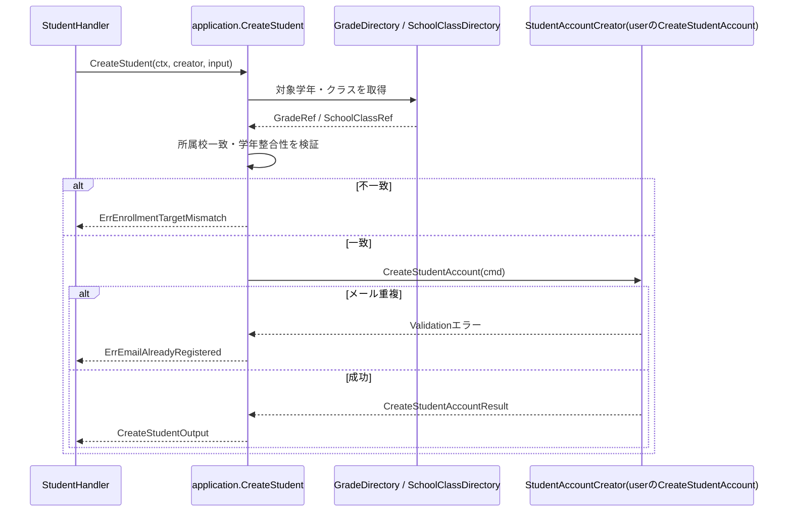
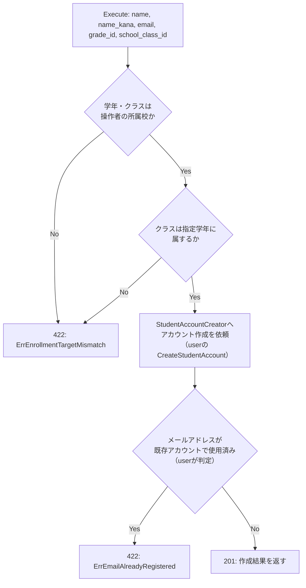

# 教師生徒参照機能 Go実装仕様書

---

# 1. 機能概要

## 機能概要

教師が同校の生徒一覧・生徒詳細を参照でき、あわせて生徒アカウントを1件ずつ新規登録できる機能である。一覧・詳細参照では、担当学年権限を持つ教師は担当学年の生徒のみに閲覧範囲が制限される。新規登録では、担当学年のみの権限区分の教師は担当学年以外の学年に登録できない（②「16. Authorization設計」）。生徒アカウント本体の作成処理（仮パスワード発行・生徒番号採番・招待メール送信）は、`user` Contextの`CreateStudentAccount`を直接呼び出す（②「3. Bounded Context」）。

## 採用設計パターンとその理由（②からの要約）

②「4. 設計パターン」により、本機能は引き続き **Transaction Script** を採用する。

- 一覧・詳細取得の業務ルールは「同校であること」「担当学年権限がある場合は担当学年のみ」という2条件の絞り込みに限定され、状態遷移・状態管理は存在しない
- 新規登録における本Context自身の業務ルールは「指定した学年・クラスが教師の所属校に属し、かつクラスが指定学年に属すること」という同校妥当性検証に限定される。氏名カナ・メール形式の入力検証は本Contextの入力検証（Presentation）が行い、仮パスワード発行・生徒番号採番・招待メール送信といった作成本体の複雑な処理は`user`の`CreateStudentAccount`へ委譲するため、本Context側にEntityへ振る舞いを集約するほどの複雑さは生まれない
- 検索条件構築・ページングおよび登録時の同校妥当性検証という、いずれも手続き的な処理が中心であり、Entityに振る舞いを持たせる必要性が薄い

Active Record・Domain Model・Event Sourcingは、②「4. 設計パターン」「24. 採用しなかった設計」のとおり不採用のままである。本書はこの判断を変更しない。

## 本書が対象とする実装範囲

- `GET /api/v1/teacher/students`（生徒一覧取得。`per_page`による可変ページング対応）
- `GET /api/v1/teacher/students/:id`（生徒詳細取得）
- `POST /api/v1/teacher/students`（生徒アカウントの新規登録）

の3エンドポイントの実装に必要な、`application`関数・`infrastructure`関数・Handler・Routing・Request/Response構造体の実装単位を規定する。①Rails実装（Teacher::StudentsQuery・Teacher::CreateStudentForm等の実装詳細）は本書作成時点で未提供のため参照不可であり、該当箇所は②の記載のみを根拠とする。

---

# 2. ディレクトリ構成

## 対象Bounded Context名

- `student-directory`（②「3. Bounded Context」）

## ②で採用した設計パターン

- Transaction Script（②「4. 設計パターン」）

規約「3. 設計パターンごとの構造適用方針」の Transaction Script構造（domain層・usecase層・Repository Interfaceを設けない）を適用する。

## ディレクトリ一覧

```
internal/studentdirectory/
├── context.go                    # NewContext（依存関係の組み立て）
├── dependency.go                 # 他Contextへの依存を宣言するインターフェースと受け渡し用の型
├── application/
├── infrastructure/
│   └── contextadapter/           # dependency.goのインターフェースの実装（相手Contextの公開操作へ委譲）
└── presentation/
    ├── handler/
    ├── request/
    └── response/
```

アーキテクチャ規約「4. Bounded Context構成」の「Contextディレクトリの命名」に従い、Context名`student-directory`から`-`を取り除いて連結した全小文字の名前とし、短縮・省略はしない。したがってディレクトリ名は`internal/studentdirectory/`、package名は同じ`studentdirectory`となる。同規約は`internal/student_directory/`のようにアンダースコアで区切ることも、短縮することも禁じている（package名にアンダースコアを使わないため、ディレクトリ名とpackage名が一致しなくなる）。`presentation/request/`を設ける理由は「6. Presentation層設計」参照。

## 作成するファイル一覧

```
internal/studentdirectory/context.go
internal/studentdirectory/dependency.go

internal/studentdirectory/application/list_students.go
internal/studentdirectory/application/show_student.go
internal/studentdirectory/application/show_student_goals.go
internal/studentdirectory/application/show_student_tasks.go
internal/studentdirectory/application/create_student.go
internal/studentdirectory/application/errors.go

internal/studentdirectory/infrastructure/student_query.go
internal/studentdirectory/infrastructure/student_goal_query.go
internal/studentdirectory/infrastructure/student_task_query.go
internal/studentdirectory/infrastructure/task_answer_stats_query.go
internal/studentdirectory/infrastructure/contextadapter/student_account_creator.go
internal/studentdirectory/infrastructure/contextadapter/existing_user_finder.go
internal/studentdirectory/infrastructure/contextadapter/grade_directory.go
internal/studentdirectory/infrastructure/contextadapter/school_class_directory.go
internal/studentdirectory/infrastructure/contextadapter/teacher_permission_directory.go

internal/studentdirectory/presentation/handler/student_handler.go
internal/studentdirectory/presentation/request/student_request.go
internal/studentdirectory/presentation/response/student_response.go
internal/studentdirectory/presentation/routes.go
```

---

# 3. Domain層設計

**対象外（Transaction Script採用のため、Domain層を設けない）。**

②「6. Entity設計」「7. Value Object設計」「8. Domain Service」「11. Repository設計」「17. Error設計」で示された設計意図は、Domain層のstruct/interfaceとしては実装せず、以下のとおり読み替えて反映する。

- Student Entity（②「6. Entity設計」）: 独立したEntity structは作らない。生徒情報は「4. Application層設計」のDTOと「5. Infrastructure層設計」の検索結果として表現する
- GradeScope Value Object（②「7. Value Object設計」）: 独立したValue Object型は作らない。「担当学年権限の有無」「対象学年ID」という絞り込み条件は、`application/list_students.go`・`application/show_student.go`の関数引数・ローカル変数として表現する
- StudentEnrollmentTarget Value Object（②「7. Value Object設計」）: 独立したValue Object型は作らない。「登録先の学年ID・クラスID」の組は`application/create_student.go`の関数引数として表現し、整合性検証は関数内のガード節で行う
- StudentEnrollmentPolicy（②「8. Domain Service」 Domain Service）: 独立したstruct/interfaceとしては設けない。「指定学年・クラスが同校に属し、クラスが指定学年に属すること」の判定を`application/create_student.go`内の非公開関数として実装する（規約「3. 設計パターンごとの構造適用方針」のTransaction Script構造：業務ルールは関数内のガード節で表現する）
- StudentRepository / GradeRepository / SchoolClassRepository（②「11. Repository設計」）: interfaceとしては定義しない。責務は「5. Infrastructure層設計」のinfrastructure関数、および`user` Contextが公開する作成操作（`CreateStudentAccount`）の呼び出しとして実装する（詳細は「6. Application層設計」の「Context間連携」節・8章参照）
- Domain Error（②「17. Error設計」）: 独立したDomain Error型は設けない。「11. Error実装方針」に示すとおり、application関数が返すエラーをApplication Error相当として扱う（規約「7. 横断的関心事の置き場所」）

---

# 4. クラス図

省略する。

理由: Transaction Script採用のためEntity・Value Object・Repository Interfaceを持たず、本機能の構造は「Handler → application関数 → infrastructure関数／他Contextが公開する参照手段」という単純な呼び出し関係のみで表現できる。呼び出し関係は「7. シーケンス図・処理フロー図」で示すため、クラス図としての可視化は行わない。

---

# 5. 状態遷移図

省略する。

理由: 本機能は生徒情報の参照と新規登録受付のみを行い、生徒アカウント自体・登録申請のいずれについても本Context内で状態遷移を管理しない（②「6. Entity設計」）。

---

# 6. Application層設計

**実装上の位置づけ**: Transaction Script採用のため、usecase層（struct）は設けない。`application/`直下に、1業務操作＝1関数として実装する。

## DTO（Command / Query）

| struct名 | フィールド | 型 | 区分 | 備考 |
|-|-|-|-|-|
| `RequestingTeacher` | `TeacherID` | `uint` | 共通入力 | current teacherの識別子 |
| | `HighSchoolID` | `uint` | 共通入力 | 所属校ID（②「16. Authorization設計」：同校生徒のみ参照可能） |
| `ListStudentsInput` | `Teacher` | `RequestingTeacher` | Query | 呼び出し元教師情報 |
| | `Keyword` | `string` | Query | 氏名・氏名カナの部分一致。空文字は絞り込みなし（②「12. UseCase設計」） |
| | `Page` | `int` | Query | ページ番号 |
| | `PerPage` | `int` | Query | 1ページあたり件数（②「19. API仕様」：可変指定可能。未指定時・上限値は12章参照） |
| `ListStudentsOutput` | `Students` | `[]StudentSummary` | 出力 | 一覧結果 |
| | `CurrentPage` | `int` | 出力 | 現在ページ |
| | `TotalPages` | `int` | 出力 | 総ページ数 |
| | `TotalCount` | `int` | 出力 | 総件数 |
| | `PerPage` | `int` | 出力 | 適用された1ページあたり件数 |
| `StudentSummary` | `ID` | `uint` | 出力 | 生徒ID |
| | `Name` | `string` | 出力 | 氏名 |
| | `NameKana` | `string` | 出力 | かな氏名 |
| | `GradeID` | `uint` | 出力 | 学年ID |
| | `HighSchoolID` | `uint` | 出力 | 所属校ID |
| `ShowStudentInput` | `Teacher` | `RequestingTeacher` | Query | 呼び出し元教師情報 |
| | `StudentID` | `uint` | Query | 対象生徒ID |
| `ShowStudentOutput` | `Student` | `StudentSummary`相当＋関連情報 | 出力 | 生徒詳細情報。詳細フィールドは①未提供のため参照不可（17章参照） |
| `CreateStudentInput` | `Teacher` | `RequestingTeacher` | Command | 呼び出し元教師情報 |
| | `Name` | `string` | Command | 氏名 |
| | `NameKana` | `string` | Command | かな氏名 |
| | `Email` | `string` | Command | メールアドレス |
| | `GradeID` | `uint` | Command | 登録先学年ID |
| | `SchoolClassID` | `uint` | Command | 登録先クラスID |
| `CreateStudentOutput` | `ID` | `uint` | 出力 | 作成された生徒ID |
| | `Name` | `string` | 出力 | 氏名 |
| | `Email` | `string` | 出力 | メールアドレス |

**②からの補足**: `RequestingTeacher`のフィールド構成は②「16. Authorization設計」の記述から導出したものであり、具体的な型・フィールド名は②に明記がないため実装仕様書側の判断である（推測）。

**担当学年の制限を`RequestingTeacher`に持たせない。** 制限の有無と対象学年は`teacher-permission`が所有する情報であり、認証Middlewareが運ぶ値にすると、権限の状態が認証の関心に混ざる。各application関数が`GradeRestrictionDirectory.FindGradeRestriction(ctx, teacherID)`を呼んで取得する（「5. Infrastructure層設計」）。教師お知らせ機能③_1も同じインターフェースで同じ情報を取得している（同③_1「8. Infrastructure層設計」）。`ListStudentsOutput.PerPage`は、リクエストで指定された値（または②「19. API仕様」のデフォルト値10・上限100を適用した値）をそのまま返す構成とした。

## application関数

### ListStudents

- 関数シグネチャ: `func ListStudents(ctx context.Context, restrictions GradeRestrictionDirectory, input ListStudentsInput) (ListStudentsOutput, error)`
- 処理ステップ（呼び出し順序）:
  1. `input.Teacher.HighSchoolID`を絞り込み条件（必須）とする
  2. `restrictions.FindGradeRestriction(ctx, input.Teacher.TeacherID)`で担当学年の制限を取得する。`nil`でなければ、その学年を絞り込み条件に追加する（②「7. Value Object設計」 GradeScopeの独自ルール：制限がない場合は学年による絞り込みを行わない）
  3. `input.Keyword`が空文字でなければ、氏名・氏名カナの部分一致を絞り込み条件に追加する（②「12. UseCase設計」）
  4. `input.PerPage`が未指定（0）の場合は10、上限（100）を超える場合は100へ正規化する（②「15. Validation設計」・「19. API仕様」）
  5. 組み立てた絞り込み条件・`input.Page`・正規化後の`PerPage`・ソート条件（name_kana順）を渡して、`infrastructure.FindStudents`を呼び出す
  6. 検索結果の総件数からページ情報（`TotalPages`・`TotalCount`・`PerPage`）を組み立てる
  7. `ListStudentsOutput`を構築して返す
- トランザクション境界: なし（読み取りのみ、②「14. Transaction設計」のとおり）
- 発生しうるApplication Error: なし（該当条件に一致する生徒が0件の場合も正常系として空一覧を返す）。infrastructure層からのエラーはそのまま上位へ伝播させる

### ShowStudent

- 関数シグネチャ: `func ShowStudent(ctx context.Context, restrictions GradeRestrictionDirectory, input ShowStudentInput) (ShowStudentOutput, error)`
- 処理ステップ（呼び出し順序）:
  1. `input.Teacher.HighSchoolID`を絞り込み条件（必須）とする
  2. `restrictions.FindGradeRestriction(ctx, input.Teacher.TeacherID)`で担当学年の制限を取得し、`nil`でなければ絞り込み条件に追加する
  3. `input.StudentID`と絞り込み条件を渡して、`infrastructure.FindStudentByID`を呼び出す
  4. 対象が見つからない場合（権限範囲外である場合を含む）、`ErrStudentNotFound`を返す（②「17. Error設計」：権限範囲外アクセスと未存在を区別しない）
  5. 見つかった場合、`ShowStudentOutput`へ変換して返す
- トランザクション境界: なし
- 発生しうるApplication Error: `ErrStudentNotFound`（対象生徒が存在しない、または権限範囲外である場合）

### ShowStudentGoals

- 関数シグネチャ: `func ShowStudentGoals(ctx context.Context, input ShowStudentGoalsInput) (ShowStudentGoalsOutput, error)`
- `ShowStudentGoalsInput`のフィールド: `Teacher RequestingTeacher` / `StudentID uint`
- `ShowStudentGoalsOutput`のフィールド: `Student StudentSummary`（ID・氏名） / `Goals []StudentGoal`
- `StudentGoal`のフィールド: `ID uint` / `Title string` / `Description string` / `Status string` / `DueDate *time.Time` / `Progress GoalProgress` / `Tasks []GoalTask`
- `GoalProgress`のフィールド: `TaskCompletedCount int` / `TaskTotalCount int` / `CompletionRate int`
- `GoalTask`のフィールド: `ID uint` / `Title string` / `Status string` / `DueDate *time.Time`
- 処理ステップ（呼び出し順序）:
  1. `ShowStudent`と同一の絞り込み条件（所属校、担当学年権限がある場合は担当学年）で`infrastructure.FindStudentByID`を呼び出し、対象生徒を確認する
  2. 見つからない場合（権限範囲外を含む）は`ErrStudentNotFound`を返す
  3. `infrastructure.FindGoalsByStudentID`で目標とそれに紐づくタスクを取得する。並び順は期限の昇順、同一期限ではIDの昇順（②「12. UseCase設計」）
  4. 目標ごとに、紐づくタスクの完了件数・総件数・完了率を算出する
  5. `ShowStudentGoalsOutput`へ変換して返す
- ページネーション: 行わない（②「12. UseCase設計」）
- トランザクション境界: なし
- 発生しうるApplication Error: `ErrStudentNotFound`

### ShowStudentTasks

- 関数シグネチャ: `func ShowStudentTasks(ctx context.Context, input ShowStudentTasksInput) (ShowStudentTasksOutput, error)`
- `ShowStudentTasksInput`のフィールド: `Teacher RequestingTeacher` / `StudentID uint` / `Page int` / `PerPage int`
- `ShowStudentTasksOutput`のフィールド: `Student StudentSummary` / `Tasks []StudentTask` / `Meta PageMeta`
- `StudentTask`のフィールド: `ID uint` / `Title string` / `Status string` / `Priority string` / `DueDate *time.Time` / `CompletedAt *time.Time` / `Goal TaskGoal` / `Progress AnswerStats` / `Units []TaskUnit`
- `AnswerStats`のフィールド: `TotalQuestions int` / `AnsweredCount int` / `CorrectCount int` / `ProgressRate int` / `CorrectRate *int`
- `TaskUnit`のフィールド: 単元の基本情報（ID・名称・コース）＋`AnswerStats`の5項目
- 処理ステップ（呼び出し順序）:
  1. `ShowStudentGoals`と同一の手順で対象生徒を確認する。見つからない場合は`ErrStudentNotFound`を返す
  2. `infrastructure.FindTasksByStudentID`でタスクを取得する。論理削除済みの目標に紐づくタスクを除外し（結合条件に`goals.deleted_at IS NULL`を明示する）、期限の昇順・同一期限ではIDの昇順で並べ、`Page` / `PerPage`でページングする（②「12. UseCase設計」）
  3. 取得したタスクのIDを渡して`infrastructure.CountTaskAnswerStats`を呼び出し、単元ごとの問題数と解答数・正答数を取得する
  4. 単元ごとの統計から、タスク単位の統計を算出する。**件数（問題数・解答数・正答数）を合計してから率を求める。** 単元ごとの率の平均は取らない（②「12. UseCase設計」）
  5. 正答率は解答数が0件のとき`nil`とし、進捗率は分母が0のとき0とする（②「12. UseCase設計」）
  6. `ShowStudentTasksOutput`へ変換して返す
- トランザクション境界: なし
- 発生しうるApplication Error: `ErrStudentNotFound`

**集計のクエリ本数について**: 手順3は、タスク数に比例してクエリが増えないよう、単元の問題数と解答の集計をそれぞれ1クエリで取得してアプリケーション側で突き合わせる（②「12. UseCase設計」。Rails現行の`TaskAnswerStatsQuery`が2クエリに集約している方針を維持する）。タスクごと・単元ごとにクエリを発行しない。

### CreateStudent

- 関数シグネチャ: `func CreateStudent(ctx context.Context, creator StudentAccountCreator, finder UserFinder, input CreateStudentInput) (CreateStudentOutput, error)`
- 依存: `StudentAccountCreator`インターフェース（本関数の引数として受け取る。コーディング規約「7. インターフェース」の「利用側で定義する」方針、および規約「3. 設計パターンごとの構造適用方針」のTransaction Script構造（struct化しない）の両方を満たすため、依存をstructフィールドではなく関数引数として受け取る構成とする。定義・実装は「5. Infrastructure層設計」「Context間連携」参照）
- 処理ステップ（呼び出し順序）:
  1. `GradeDirectory.FindGrade(ctx, input.GradeID)`で学年の所属校を取得し、`SchoolClassDirectory.FindSchoolClass(ctx, input.SchoolClassID)`でクラスの所属学年を取得する。いずれかが該当しなければ`ErrEnrollmentTargetMismatch`を返す
  2. 取得した学年の所属校が`input.Teacher.HighSchoolID`と一致するか、かつクラスが指定学年に属するかを検証する（StudentEnrollmentPolicy相当の判定。②「8. Domain Service」）。一致しない場合は`ErrEnrollmentTargetMismatch`を返す
  3. 操作者が担当学年のみの権限区分である場合、`input.GradeID`が担当学年と一致するか検証する。一致しない場合は`ErrGradeOutOfScope`を返す（②「16. Authorization設計」）
  4. `finder.FindUserByEmail(ctx, input.Email)`で既存アカウントを取得し、見つかった場合は次の3条件を判定する（②「15. Validation設計」。Rails現行の`ExistingUserValidatable`と`CreateStudentForm#email_not_used_by_existing_student`に対応）
      - 既存アカウントの所属校が`input.Teacher.HighSchoolID`と異なる → `ErrEmailUsedByOtherHighSchool`
      - 既存アカウントのロールが生徒以外 → `ErrEmailUsedByNonStudent`
      - 既存アカウントが同校の生徒 → `ErrEmailAlreadyRegistered`
      3条件は同時に成立しうる（他校の教員のメールアドレスを指定した場合は1つ目と2つ目の両方）。Rails現行はいずれも検証エラーとして積み上げるため、最初の1件で打ち切らず、成立したものをすべて返す
  5. `creator.CreateStudentAccount`（`user` Contextの`CreateStudentAccount`を呼ぶ）に、氏名・氏名カナ・メールアドレス・所属校ID（`input.Teacher.HighSchoolID`）・学年ID・クラスIDを渡して生徒アカウントを新規作成する（仮パスワード発行・生徒番号採番・招待待ちの設定・招待メール送信依頼は`user`の責務。②「11. Repository設計」「保持しない責務」）
  6. `creator.CreateStudentAccount`が`users.email`の一意インデックス違反によるValidationエラーを返した場合（手順4の判定と作成の間に他のリクエストが同じメールアドレスで作成した場合にのみ起きる）、`ErrEmailAlreadyRegistered`へ変換して返す。それ以外の`user`のValidationエラー（氏名・氏名カナの文字数超過等）は、種別（Validation）を保ったまま上位へ伝播させ、422へ変換する
  7. `CreateStudentOutput`を構築して返す
- トランザクション境界: 本関数はトランザクションを開始しない。アカウント本体の作成と招待メール送信依頼の登録は、`user`の`CreateStudentAccount`が自身のトランザクションとして扱う（②「14. Transaction設計」。詳細は「11. Transaction実装方針」参照）
- 発生しうるApplication Error: `ErrEnrollmentTargetMismatch`（学年・クラスが同校でない、またはクラスが指定学年に属さない）、`ErrGradeOutOfScope`（登録先の学年が操作者の担当学年と一致しない）、`ErrEmailUsedByOtherHighSchool`・`ErrEmailUsedByNonStudent`・`ErrEmailAlreadyRegistered`（メールアドレスの重複。3条件を区別する）

## Context間連携（StudentAccountCreator）

- interface名: `StudentAccountCreator`（定義場所: **`dependency.go`**。他Contextへの依存を宣言するインターフェースはContextディレクトリ直下の`dependency.go`に置く（アーキテクチャ規約「4. Bounded Context構成」の「ディレクトリ構成」）。コーディング規約「7. インターフェース」の「利用側で定義する」方針にも沿う）
- メソッドシグネチャ: `CreateStudentAccount(ctx context.Context, cmd CreateStudentAccountCommand) (CreateStudentAccountResult, error)`
- `CreateStudentAccountCommand`のフィールド: `Name string` / `NameKana string` / `Email string` / `HighSchoolID uint` / `GradeID uint` / `SchoolClassID uint`
- `CreateStudentAccountResult`のフィールド: `StudentID uint` / `Name string` / `Email string`
- 実装: `infrastructure/contextadapter/student_account_creator.go`。`user` Contextが公開する`CreateStudentAccount`を呼び出す薄い実装（`CreateStudentAccountCommand` / `CreateStudentAccountResult`と、`user`の入力・出力の型との変換のみを行う。`user`の作成規則である仮パスワード発行・生徒番号採番・招待待ちの設定・招待メール送信依頼は、この実装ではなく`user`が行う）。呼び出す関数のシグネチャは`user`③「3. 公開操作の定義」のとおり

## Context間連携（UserFinder）

- interface名: `UserFinder`（定義場所: `dependency.go`）
- メソッドシグネチャ: `FindUserByEmail(ctx context.Context, email string) (ExistingUser, bool, error)`
- `ExistingUser`のフィールド: `ID uint` / `HighSchoolID *uint` / `IsStudent bool`
- 用途: メールアドレスの重複の3条件を本Contextが判定するために、既存アカウントの所属校とロールを取得する
- 実装: `infrastructure/contextadapter/existing_user_finder.go`。`user` Contextが公開する`FindUserByEmail`を呼び出す薄い実装。`user`③「3. 公開操作の定義」のとおり、該当しない場合はエラーではなく`found = false`が返る
- 無効化済みの扱い: `user`の`FindUserByEmail`は無効化済みのアカウントも返す。Rails現行の`User.find_by(email:)`も論理削除済みを除外しないため、同じ挙動になる
- DI配線: アーキテクチャ規約「14. 依存関係の組み立て（DI配線）」に従い、`internal/studentdirectory`のContext組み立て関数（`NewContext`）が、上記の実装を生成し、`StudentAccountCreator`として`CreateStudent`関数（またはそれを呼び出すHandler）へ渡す。他Contextの組み立て結果を受け取る配線は行わない

## Context間連携（GradeDirectory / SchoolClassDirectory / GradeRestrictionDirectory）

いずれも`dependency.go`にインターフェースを宣言し、実装を`infrastructure/contextadapter/`に置く（アーキテクチャ規約「4. Bounded Context構成」の「ディレクトリ構成」）。

|インターフェース|メソッド|相手Context|用途|
|-|-|-|-|
|`GradeDirectory`|`FindGrade(ctx context.Context, gradeID uint) (GradeRef, bool, error)`|`master-data`|登録先の学年の所属校を取得する|
|`SchoolClassDirectory`|`FindSchoolClass(ctx context.Context, schoolClassID uint) (SchoolClassRef, bool, error)`|`school-class`|登録先のクラスの所属学年を取得する|
|`GradeRestrictionDirectory`|`FindGradeRestriction(ctx context.Context, userID uint) (*uint, error)`|`teacher-permission`|操作者の担当学年の制限を返す。制限がなければ`nil`|

`dependency.go`に置く受け渡し用の型:

|型|フィールド|
|-|-|
|`GradeRef`|`ID uint`・`HighSchoolID uint`|
|`SchoolClassRef`|`ID uint`・`GradeID uint`|

いずれも本Contextが必要とする項目だけを持つ。相手Contextの内部Entityを持ち込まない（アーキテクチャ規約「5. Context間連携ルール」）。

`GradeRestrictionDirectory`のメソッド名・シグネチャは、教師お知らせ機能③_1が`teacher-permission`に対して定めたものと同一である（同③_1「8. Infrastructure層設計」）。同じ情報を2つのContextが別の形で取得することを避ける。

**②からの補足**: ②「3. Bounded Context」は、`student-directory`が`user`の`CreateStudentAccount`を直接呼ぶと定めている。アーキテクチャ規約「5. Context間連携ルール」の「相手Contextが公開する手段を呼び出す」方針に従い、本書では呼び出し側（student-directory）がコーディング規約「7. インターフェース」の方針どおり利用側で最小限のinterfaceを定義し、`user`の公開関数を呼ぶ薄い実装をDI配線で渡す構成とした。呼び出す関数のシグネチャは`user`③「3. 公開操作の定義」で確定している。

---

# 7. シーケンス図・処理フロー図

## シーケンス図

### ShowStudentGoals

- 関数シグネチャ: `func ShowStudentGoals(ctx context.Context, input ShowStudentGoalsInput) (ShowStudentGoalsOutput, error)`
- `ShowStudentGoalsInput`のフィールド: `Teacher RequestingTeacher` / `StudentID uint`
- `ShowStudentGoalsOutput`のフィールド: `Student StudentSummary`（ID・氏名） / `Goals []StudentGoal`
- `StudentGoal`のフィールド: `ID uint` / `Title string` / `Description string` / `Status string` / `DueDate *time.Time` / `Progress GoalProgress` / `Tasks []GoalTask`
- `GoalProgress`のフィールド: `TaskCompletedCount int` / `TaskTotalCount int` / `CompletionRate int`
- `GoalTask`のフィールド: `ID uint` / `Title string` / `Status string` / `DueDate *time.Time`
- 処理ステップ（呼び出し順序）:
  1. `ShowStudent`と同一の絞り込み条件（所属校、担当学年権限がある場合は担当学年）で`infrastructure.FindStudentByID`を呼び出し、対象生徒を確認する
  2. 見つからない場合（権限範囲外を含む）は`ErrStudentNotFound`を返す
  3. `infrastructure.FindGoalsByStudentID`で目標とそれに紐づくタスクを取得する。並び順は期限の昇順、同一期限ではIDの昇順（②「12. UseCase設計」）
  4. 目標ごとに、紐づくタスクの完了件数・総件数・完了率を算出する
  5. `ShowStudentGoalsOutput`へ変換して返す
- ページネーション: 行わない（②「12. UseCase設計」）
- トランザクション境界: なし
- 発生しうるApplication Error: `ErrStudentNotFound`

### ShowStudentTasks

- 関数シグネチャ: `func ShowStudentTasks(ctx context.Context, input ShowStudentTasksInput) (ShowStudentTasksOutput, error)`
- `ShowStudentTasksInput`のフィールド: `Teacher RequestingTeacher` / `StudentID uint` / `Page int` / `PerPage int`
- `ShowStudentTasksOutput`のフィールド: `Student StudentSummary` / `Tasks []StudentTask` / `Meta PageMeta`
- `StudentTask`のフィールド: `ID uint` / `Title string` / `Status string` / `Priority string` / `DueDate *time.Time` / `CompletedAt *time.Time` / `Goal TaskGoal` / `Progress AnswerStats` / `Units []TaskUnit`
- `AnswerStats`のフィールド: `TotalQuestions int` / `AnsweredCount int` / `CorrectCount int` / `ProgressRate int` / `CorrectRate *int`
- `TaskUnit`のフィールド: 単元の基本情報（ID・名称・コース）＋`AnswerStats`の5項目
- 処理ステップ（呼び出し順序）:
  1. `ShowStudentGoals`と同一の手順で対象生徒を確認する。見つからない場合は`ErrStudentNotFound`を返す
  2. `infrastructure.FindTasksByStudentID`でタスクを取得する。論理削除済みの目標に紐づくタスクを除外し（結合条件に`goals.deleted_at IS NULL`を明示する）、期限の昇順・同一期限ではIDの昇順で並べ、`Page` / `PerPage`でページングする（②「12. UseCase設計」）
  3. 取得したタスクのIDを渡して`infrastructure.CountTaskAnswerStats`を呼び出し、単元ごとの問題数と解答数・正答数を取得する
  4. 単元ごとの統計から、タスク単位の統計を算出する。**件数（問題数・解答数・正答数）を合計してから率を求める。** 単元ごとの率の平均は取らない（②「12. UseCase設計」）
  5. 正答率は解答数が0件のとき`nil`とし、進捗率は分母が0のとき0とする（②「12. UseCase設計」）
  6. `ShowStudentTasksOutput`へ変換して返す
- トランザクション境界: なし
- 発生しうるApplication Error: `ErrStudentNotFound`

**集計のクエリ本数について**: 手順3は、タスク数に比例してクエリが増えないよう、単元の問題数と解答の集計をそれぞれ1クエリで取得してアプリケーション側で突き合わせる（②「12. UseCase設計」。Rails現行の`TaskAnswerStatsQuery`が2クエリに集約している方針を維持する）。タスクごと・単元ごとにクエリを発行しない。

### CreateStudent



## 処理フロー図

### ShowStudentGoals

- 関数シグネチャ: `func ShowStudentGoals(ctx context.Context, input ShowStudentGoalsInput) (ShowStudentGoalsOutput, error)`
- `ShowStudentGoalsInput`のフィールド: `Teacher RequestingTeacher` / `StudentID uint`
- `ShowStudentGoalsOutput`のフィールド: `Student StudentSummary`（ID・氏名） / `Goals []StudentGoal`
- `StudentGoal`のフィールド: `ID uint` / `Title string` / `Description string` / `Status string` / `DueDate *time.Time` / `Progress GoalProgress` / `Tasks []GoalTask`
- `GoalProgress`のフィールド: `TaskCompletedCount int` / `TaskTotalCount int` / `CompletionRate int`
- `GoalTask`のフィールド: `ID uint` / `Title string` / `Status string` / `DueDate *time.Time`
- 処理ステップ（呼び出し順序）:
  1. `ShowStudent`と同一の絞り込み条件（所属校、担当学年権限がある場合は担当学年）で`infrastructure.FindStudentByID`を呼び出し、対象生徒を確認する
  2. 見つからない場合（権限範囲外を含む）は`ErrStudentNotFound`を返す
  3. `infrastructure.FindGoalsByStudentID`で目標とそれに紐づくタスクを取得する。並び順は期限の昇順、同一期限ではIDの昇順（②「12. UseCase設計」）
  4. 目標ごとに、紐づくタスクの完了件数・総件数・完了率を算出する
  5. `ShowStudentGoalsOutput`へ変換して返す
- ページネーション: 行わない（②「12. UseCase設計」）
- トランザクション境界: なし
- 発生しうるApplication Error: `ErrStudentNotFound`

### ShowStudentTasks

- 関数シグネチャ: `func ShowStudentTasks(ctx context.Context, input ShowStudentTasksInput) (ShowStudentTasksOutput, error)`
- `ShowStudentTasksInput`のフィールド: `Teacher RequestingTeacher` / `StudentID uint` / `Page int` / `PerPage int`
- `ShowStudentTasksOutput`のフィールド: `Student StudentSummary` / `Tasks []StudentTask` / `Meta PageMeta`
- `StudentTask`のフィールド: `ID uint` / `Title string` / `Status string` / `Priority string` / `DueDate *time.Time` / `CompletedAt *time.Time` / `Goal TaskGoal` / `Progress AnswerStats` / `Units []TaskUnit`
- `AnswerStats`のフィールド: `TotalQuestions int` / `AnsweredCount int` / `CorrectCount int` / `ProgressRate int` / `CorrectRate *int`
- `TaskUnit`のフィールド: 単元の基本情報（ID・名称・コース）＋`AnswerStats`の5項目
- 処理ステップ（呼び出し順序）:
  1. `ShowStudentGoals`と同一の手順で対象生徒を確認する。見つからない場合は`ErrStudentNotFound`を返す
  2. `infrastructure.FindTasksByStudentID`でタスクを取得する。論理削除済みの目標に紐づくタスクを除外し（結合条件に`goals.deleted_at IS NULL`を明示する）、期限の昇順・同一期限ではIDの昇順で並べ、`Page` / `PerPage`でページングする（②「12. UseCase設計」）
  3. 取得したタスクのIDを渡して`infrastructure.CountTaskAnswerStats`を呼び出し、単元ごとの問題数と解答数・正答数を取得する
  4. 単元ごとの統計から、タスク単位の統計を算出する。**件数（問題数・解答数・正答数）を合計してから率を求める。** 単元ごとの率の平均は取らない（②「12. UseCase設計」）
  5. 正答率は解答数が0件のとき`nil`とし、進捗率は分母が0のとき0とする（②「12. UseCase設計」）
  6. `ShowStudentTasksOutput`へ変換して返す
- トランザクション境界: なし
- 発生しうるApplication Error: `ErrStudentNotFound`

**集計のクエリ本数について**: 手順3は、タスク数に比例してクエリが増えないよう、単元の問題数と解答の集計をそれぞれ1クエリで取得してアプリケーション側で突き合わせる（②「12. UseCase設計」。Rails現行の`TaskAnswerStatsQuery`が2クエリに集約している方針を維持する）。タスクごと・単元ごとにクエリを発行しない。

### CreateStudent



`ListStudents`・`ShowStudent`は絞り込み条件の組み立てのみで分岐が少ないため、処理フロー図は省略する（②の記載のとおり単純な参照処理）。

---

# 8. Infrastructure層設計

## Infrastructure関数（Transaction Script採用時）

### FindStudents（`infrastructure/student_query.go`）

- 関数シグネチャ: `func FindStudents(ctx context.Context, condition StudentSearchCondition, page int, perPage int) (records []StudentRecord, totalCount int, err error)`
- 発行するクエリ内容:
  - `high_school_id`が`condition.HighSchoolID`と一致する条件
  - `user_roles`と結合し、ロールが生徒である条件
  - **`deleted_at IS NULL`の条件（論理削除済みの生徒を除外する。①「5. API / 処理詳細」`#index`）**
  - `condition.GradeID`が指定されている場合、`grade_id`が一致する条件を追加
  - **`condition.Keyword`が空文字でない場合、`users.name LIKE ? OR users.name_kana LIKE ?`の条件を追加する。ワイルドカード文字（`%`・`_`）をエスケープしてから`%`で囲む（②「21. DB操作仕様」）**
  - `name_kana`昇順でソート
  - `page`・`perPage`に基づくページネーション（OFFSET/LIMIT）
  - 絞り込み条件に一致する総件数を別途取得する（ページ情報組み立てのため）

### FindStudentByID（`infrastructure/student_query.go`）

- 関数シグネチャ: `func FindStudentByID(ctx context.Context, studentID uint, condition StudentSearchCondition) (record StudentRecord, found bool, err error)`
- 発行するクエリ内容:
  - `id`が`studentID`と一致する条件
  - `high_school_id`が`condition.HighSchoolID`と一致する条件
  - `user_roles`と結合し、ロールが生徒である条件
  - `deleted_at IS NULL`の条件
  - `condition.GradeID`が指定されている場合、`grade_id`が一致する条件を追加
  - `condition.Keyword`は使わない
  - 対象が存在しない場合は`found=false`を返す（権限範囲外で条件に一致しない場合も同様に`found=false`となる）

### FindGoalsByStudentID（`infrastructure/student_goal_query.go`）

- 関数シグネチャ: `func FindGoalsByStudentID(ctx context.Context, studentID uint) ([]GoalRecord, error)`
- 取得内容: 対象生徒の目標と、各目標に紐づくタスク（ID・タイトル・状態・期限）
- 並び順: `goals.due_date ASC, goals.id ASC`（②「12. UseCase設計」）
- ページネーション: 行わない
- タスクの読み込み: 目標ごとにクエリを発行せず、目標IDをまとめた1クエリでタスクを取得してアプリケーション側で紐づける（Rails現行の`includes(:tasks)`に対応）
- `GoalRecord`のフィールド: `ID uint` / `Title string` / `Description string` / `Status string` / `DueDate *time.Time` / `Tasks []GoalTaskRecord`

### FindTasksByStudentID（`infrastructure/student_task_query.go`）

- 関数シグネチャ: `func FindTasksByStudentID(ctx context.Context, studentID uint, page int, perPage int) (records []TaskRecord, total int64, err error)`
- 取得内容: 対象生徒のタスクと、紐づく目標（ID・タイトル）、タスクに紐づく単元（基本情報とコース）
- 絞り込み: `goals`との内部結合に加え、結合条件へ`goals.deleted_at IS NULL`を明示する。Rails現行は`Goal`の`default_scope`が`joins`に効くことで論理削除済みの目標に紐づくタスクを除外しているが、Goでは暗黙に効かないため条件を明示する
- 並び順: `tasks.due_date ASC, tasks.id ASC`（②「12. UseCase設計」）
- 単元の読み込み: タスクごとにクエリを発行せず、タスクIDをまとめた1クエリで単元を取得してアプリケーション側で紐づける（Rails現行の`includes(:goal, units: :course)`に対応）
- `TaskRecord`のフィールド: `ID uint` / `Title string` / `Status string` / `Priority string` / `DueDate *time.Time` / `CompletedAt *time.Time` / `GoalID uint` / `GoalTitle string` / `Units []UnitRecord`

### CountTaskAnswerStats（`infrastructure/task_answer_stats_query.go`）

- 関数シグネチャ: `func CountTaskAnswerStats(ctx context.Context, studentID uint, taskIDs []uint) (TaskAnswerStats, error)`
- 取得内容: タスク×単元ごとの解答数・正答数と、単元ごとの問題数
- クエリ本数: **2クエリに固定する。** 1つは対象生徒・対象タスクの解答履歴をタスクIDと単元IDで集計し、もう1つは対象単元の問題数を単元IDで集計する。タスク数・単元数に比例してクエリを増やさない（Rails現行の`TaskAnswerStatsQuery`と同じ方針）
- `TaskAnswerStats`のフィールド: `AnswerCounts map[TaskUnitKey]AnswerCount`（キーはタスクIDと単元IDの組） / `QuestionCounts map[uint]int`（キーは単元ID）
- 対象外の扱い: 解答履歴がないタスク×単元の組はキーを持たない。呼び出し側が0件として扱う

### gradeDirectory（`infrastructure/contextadapter/grade_directory.go`）

- 宣言するインターフェース: `GradeDirectory`（`dependency.go`。`FindGrade(ctx context.Context, gradeID uint) (GradeRef, bool, error)`）
- 実装: `master-data` Contextが公開する`FindGrades`へ委譲する薄い実装。1件分の集合を渡し、返った属性から所属高校の識別子を取り出す（共通マスタ参照機能③基盤編「8. Infrastructure層設計」）
- `GradeRef`のフィールド: `ID uint` / `HighSchoolID uint`
- 該当しない場合はエラーではなく`found = false`を返す

**`grades`テーブルを直接読まない。** 学年を所有するのは`master-data`であり、相手Contextが公開する手段を呼び出す（アーキテクチャ規約「5. Context間連携ルール」）。

### teacherPermissionDirectory（`infrastructure/contextadapter/teacher_permission_directory.go`）

- 宣言するインターフェース: `GradeRestrictionDirectory`（`dependency.go`。`FindGradeRestriction(ctx context.Context, userID uint) (*uint, error)`）
- 実装: `teacher-permission` Contextが公開する参照操作へ委譲する薄い実装。権限区分が担当学年のみであれば操作者の学年の識別子を返し、そうでなければ`nil`を返す
- **判定そのものを本Contextで行わない。** 「担当学年のみの権限区分とは何か」を定義しているのは`teacher-permission`である（規約「5. Context間連携ルール」）

**②からの補足**: `teacher-permission` Contextの②（`教師権限管理機能_Go移行・設計仕様書.md`）には、担当学年の制限を他Contextへ公開する操作が定義されていない。本書では`FindGradeRestriction`相当の公開操作が同Contextに追加されることを前提とする（②「19. API仕様」の「設計上の前提として他Contextに必要となるもの」）。教師お知らせ機能③_1も同じ前提に立っている（同③_1「8. Infrastructure層設計」）。

### schoolClassDirectory（`infrastructure/contextadapter/school_class_directory.go`）

- 宣言するインターフェース: `SchoolClassDirectory`（`dependency.go`。`FindSchoolClass(ctx context.Context, schoolClassID uint) (SchoolClassRef, bool, error)`）
- 実装: `school-class` Contextが公開する参照操作へ委譲する薄い実装
- `SchoolClassRef`のフィールド: `ID uint` / `GradeID uint`
- 該当しない場合はエラーではなく`found = false`を返す

**`school_classes`テーブルを直接読まない。** クラスを所有するのは`school-class`である（②「3. Bounded Context」）。

**②からの補足**: `school-class` Contextの②（`クラス編成機能_Go移行・設計仕様書.md`）には、クラスの属性を他Contextへ公開する操作が定義されていない。本書では`FindSchoolClass`相当の公開操作が同Contextに追加されることを前提とし、シグネチャは同機能の③が確定するまで本書の形を仮とする（②「19. API仕様」の「設計上の前提として他Contextに必要となるもの」）。`master-data`側は確定済みである。

### StudentSearchCondition（infrastructure内の検索条件型）

| フィールド | 型 | 備考 |
|-|-|-|
| `HighSchoolID` | `uint` | 必須 |
| `GradeID` | `*uint` | 担当学年の制限がある場合のみ設定 |
| `Keyword` | `string` | 氏名・氏名カナの部分一致。空文字のときは条件を組み立てない |

### StudentRecord（クエリ結果を保持する型）

| フィールド | 型 | 備考 |
|-|-|-|
| `ID` | `uint` | |
| `Name` | `string` | |
| `NameKana` | `string` | |
| `GradeID` | `uint` | |
| `HighSchoolID` | `uint` | |

②「6. Entity設計」の記載範囲（氏名・かな氏名・学年・所属校）に基づく。詳細レスポンス用の関連情報フィールドは①未提供のため本書では確定しない（17章参照）。

## 外部連携実装

対象外。本機能自体はMail・Cache・Queue等の外部連携を必要としない。生徒アカウント作成に伴う招待メール送信は、呼び出し先（`user`の`CreateStudentAccount`）の責務であり、本Context内には実装しない。

---

# 9. Presentation層設計

## Handler

- struct名: `StudentHandler`
- コンストラクタが受け取る依存: `application.StudentAccountCreator`（`NewStudentHandler(creator application.StudentAccountCreator) *StudentHandler`。Transaction Script採用のため`ListStudents`・`ShowStudent`には依存を持たないが、`CreateStudent`関数呼び出しのために`StudentAccountCreator`のみをHandlerが保持し、各メソッド内で`application.CreateStudent`へ引き渡す）
- 対応する呼び出し先: `application`パッケージの`ListStudents`関数・`ShowStudent`関数・`CreateStudent`関数（Transaction Script採用のためusecase層を経由しない）
- メソッド一覧:

| メソッド | HTTPメソッド | パス |
|-|-|-|
| `List(c *gin.Context)` | GET | `/api/v1/teacher/students` |
| `Show(c *gin.Context)` | GET | `/api/v1/teacher/students/:id` |
| `Create(c *gin.Context)` | POST | `/api/v1/teacher/students` |

- 処理順序（`List`）:
  1. Ginコンテキストから認証Middlewareが格納したcurrent teacher情報を取得し、`RequestingTeacher`へ変換する（Handlerでは権限判定を行わず、値の受け渡しのみ行う。②「16. Authorization設計」「Handler」）
  2. クエリパラメータ`keyword`・`page`・`per_page`をバインドする（型が整数でない場合の扱いは17章参照）。`keyword`は形式を検証せず、空文字をそのまま渡す（②「15. Validation設計」）
  3. `application.ListStudentsInput`を組み立て、`application.ListStudents`を呼び出す
  4. 取得結果を`StudentListResponse`へ変換する
  5. `200`でレスポンスを返す
- 処理順序（`Show`）:
  1. current teacher情報を取得し、`RequestingTeacher`へ変換する
  2. パスパラメータ`id`とクエリパラメータ`tab`をバインドする
  3. `tab`の値で呼び出し先を分岐する。`goals`は`application.ShowStudentGoals`、`tasks`は`application.ShowStudentTasks`（`page` / `per_page`も渡す）、それ以外（未指定を含む）は`application.ShowStudent`を呼び出す
  4. `ErrStudentNotFound`が返却された場合は`404`を返す
  5. 成功時は`tab`に応じて`StudentDetailResponse` / `StudentGoalsResponse` / `StudentTasksResponse`へ変換し、`200`で返す

`tab`に未知の値が渡された場合はエラーにせず、プロフィールを返す（Rails現行の`case params[:tab] ... else`と同じ挙動）。
- 処理順序（`Create`）:
  1. current teacher情報を取得し、`RequestingTeacher`へ変換する（②「16. Authorization設計」：新規登録に「他職員操作権限」のような追加の業務権限は課さない。ただし担当学年の制約は適用する）
  2. リクエストボディを`request.CreateStudentRequest`へバインドし、Presentation Validation（型・必須・フォーマット）を行う
  3. `application.CreateStudentInput`を組み立て、`h.creator`を渡して`application.CreateStudent`を呼び出す
  4. `ErrEnrollmentTargetMismatch`・`ErrEmailAlreadyRegistered`が返却された場合は`422`を返す
  5. 成功時は`StudentCreateResponse`へ変換し、`201`で返す（②「19. API仕様」「Status Code」：201: 新規登録成功）

## Request / Response DTO

**②からの補足**: `POST /api/v1/teacher/students`には5フィールドの必須・フォーマット検証が必要になるため、本書では`presentation/request/student_request.go`を設ける（判断理由：コーディング規約「16. 構造体タグ」に従い、Ginの`binding`タグによる宣言的な検証を行うため。`page`・`per_page`・`id`は単純な型変換のみであるため、引き続きHandler内で直接バインドする）。

### Request（`presentation/request/student_request.go`）

| struct名 | フィールドと型 | バリデーションタグ／チェック内容 |
|-|-|-|
| `CreateStudentRequest` | `Name string` | `binding:"required"` |
| | `NameKana string` | `binding:"required,katakana"`（`katakana`はカスタムバリデータ。Rails現行の`NameValidatable`と同じく、カタカナ・長音符・中黒・空白のみを許可する。②「15. Validation設計」「フォーマットチェック」） |
| | `Email string` | `binding:"required,email"`（②「15. Validation設計」「フォーマットチェック: 新規登録時のメールアドレス形式」） |
| | `GradeID uint` | `binding:"required"` |
| | `SchoolClassID uint` | `binding:"required"` |

- `page`（クエリパラメータ）: `int`。バインド方式・必須有無は17章参照
- `per_page`（クエリパラメータ）: `int`。未指定時は10、100件を超える場合は100へ正規化する（②「19. API仕様」。正規化自体は`application.ListStudents`が担い、Presentation層では型チェックのみ行う）
- `id`（パスパラメータ）: `uint`。整数への変換が必要（②「15. Validation設計」「必須チェック: 詳細取得時のid（route由来）を検証する」）

### Response（`presentation/response/student_response.go`）

| struct名 | フィールド | 型 |
|-|-|-|
| `StudentListResponse` | `Students` | `[]StudentSummaryResponse` |
| | `Meta` | `MetaResponse` |
| `StudentSummaryResponse` | `ID` | `uint` |
| | `Name` | `string` |
| | `NameKana` | `string` |
| | `GradeID` | `uint` |
| | `HighSchoolID` | `uint` |
| `StudentDetailResponse` | `ID` | `uint` |
| | `Name` | `string` |
| | `NameKana` | `string` |
| | `GradeID` | `uint` |
| | `HighSchoolID` | `uint` |
| | （関連情報） | ①未提供のため参照不可。②「19. API仕様」「生徒の基本情報と関連情報を維持する」に留める（17章参照） |
| `MetaResponse` | `CurrentPage` | `int` |
| | `TotalPages` | `int` |
| | `TotalCount` | `int` |
| | `PerPage` | `int` |
| `StudentCreateResponse` | `Message` | `string`（②「19. API仕様」「message（『生徒の新規作成に成功しました。』相当）を維持する」） |
| `StudentGoalsResponse` | `Student` | `StudentIdentityResponse` |
| | `Goals` | `[]StudentGoalResponse`（`meta`は持たない。②「19. API仕様」） |
| `StudentIdentityResponse` | `ID` | `uint` |
| | `Name` | `string` |
| `StudentGoalResponse` | `ID` / `Title` / `Description` / `Status` | `uint` / `string` / `string` / `string` |
| | `DueDate` | `*string`（日付のみの文字列。Rails現行の`DateFormattable`に合わせる） |
| | `Progress` | `GoalProgressResponse` |
| | `Tasks` | `[]GoalTaskResponse` |
| `GoalProgressResponse` | `TaskCompletedCount` / `TaskTotalCount` / `CompletionRate` | `int` |
| `GoalTaskResponse` | `ID` / `Title` / `Status` | `uint` / `string` / `string` |
| | `DueDate` | `*string` |
| `StudentTasksResponse` | `Student` | `StudentIdentityResponse` |
| | `Tasks` | `[]StudentTaskResponse` |
| | `Meta` | `MetaResponse` |
| `StudentTaskResponse` | `ID` / `Title` / `Status` / `Priority` | `uint` / `string` / `string` / `string` |
| | `DueDate` / `CompletedAt` | `*string` |
| | `Goal` | `TaskGoalResponse` |
| | `Progress` | `AnswerStatsResponse` |
| | `Units` | `[]TaskUnitResponse` |
| `TaskGoalResponse` | `ID` / `Title` | `uint` / `string` |
| `AnswerStatsResponse` | `TotalQuestions` / `AnsweredCount` / `CorrectCount` / `ProgressRate` | `int` |
| | `CorrectRate` | `*int`（解答数が0件のとき`null`。②「12. UseCase設計」） |
| `TaskUnitResponse` | （単元の基本情報） | 単元のID・名称・コース |
| | `TotalQuestions` / `AnsweredCount` / `CorrectCount` / `ProgressRate` | `int` |
| | `CorrectRate` | `*int` |

`CorrectRate`をポインタにするのは、解答数が0件のときに`null`を返す必要があるためである（②「12. UseCase設計」）。`int`のゼロ値にすると「正答率0%」と「解答がないため正答率なし」が区別できない。

## Routing

`internal/studentdirectory/presentation/routes.go`

| Method | Path | Handler |
|-|-|-|
| GET | `/api/v1/teacher/students` | `StudentHandler.List` |
| GET | `/api/v1/teacher/students/:id` | `StudentHandler.Show`（`tab`で返す内容が変わる。ルートは1つ） |
| POST | `/api/v1/teacher/students` | `StudentHandler.Create` |

いずれのルートも、認証Middleware・teacherロール確認Middlewareを経由する（②「16. Authorization設計」「Middleware」）。

---

# 10. API仕様

|Method|Path|Handler|Request|Response|Status Code|
|-|-|-|-|-|-|
|GET|/api/v1/teacher/students|StudentHandler.List|page, per_page（query, optional）|StudentListResponse|200|
|GET|/api/v1/teacher/students/:id|StudentHandler.Show|id（path, required）、tab（query, optional）、`tab=tasks`では page / per_page（query, optional）|`tab`未指定: StudentDetailResponse／`tab=goals`: StudentGoalsResponse／`tab=tasks`: StudentTasksResponse|200|
|POST|/api/v1/teacher/students|StudentHandler.Create|CreateStudentRequest|StudentCreateResponse|201|

## Errorケース

|条件|Status Code|Error内容|
|-|-|-|
|対象生徒が存在しない|404|`ErrStudentNotFound`|
|対象生徒が権限範囲外（他校／担当学年外）|404|未存在の場合と同一のレスポンスとして扱う（②「17. Error設計」）|
|pageパラメータが不正な形式|400（推測、17章参照）|バリデーションエラー|
|CreateStudentRequestの必須項目欠落・メール形式不正・氏名カナがカタカナでない|422|Presentation Validationエラー|
|登録先の学年・クラスが操作者の所属校でない、またはクラスが指定学年に属さない|422|`ErrEnrollmentTargetMismatch`|
|登録先の学年が操作者の担当学年と一致しない|422|`ErrGradeOutOfScope`|
|登録先メールアドレスが他校のアカウントで使用済み|422|`ErrEmailUsedByOtherHighSchool`|
|登録先メールアドレスが生徒以外のアカウントで使用済み|422|`ErrEmailUsedByNonStudent`|
|登録先メールアドレスが同校の既存生徒で使用済み|422|`ErrEmailAlreadyRegistered`|
|未認証|401（推測、17章参照）|認証エラー|
|teacherロールでない|403（推測、17章参照）|権限エラー|

---

# 11. Transaction実装方針

## Transaction開始箇所

- `ListStudents`・`ShowStudent`: なし（②「14. Transaction設計」「Transaction開始位置: 使用しない」）
- `CreateStudent`: 本Contextはトランザクションを開始しない。`StudentAccountCreator`（`user`の`CreateStudentAccount`）が、アカウントの保存と招待メール送信依頼の登録を1つのトランザクションとして開始する（`user`②「14. Transaction設計」。呼び出し側が開始していないため`user`が開始する）

## Transaction終了箇所（Commit / Rollback条件）

- `ListStudents`・`ShowStudent`: 該当なし
- `CreateStudent`: `user`の`CreateStudentAccount`が、生徒アカウントの作成と招待メール送信依頼の登録を完了した時点で、`user`側でコミットする。失敗（一意インデックス違反等）時は`user`側でロールバックされ、本関数は`ErrEmailAlreadyRegistered`等のエラーを返す（②「14. Transaction設計」）

## 複数関数（infrastructure関数）にまたがる場合の扱い

- `ListStudents`は一覧取得クエリと総件数取得クエリの2回のDBアクセスを行うが、いずれも読み取りのみであり、Transaction境界は不要である
- `CreateStudent`の`GradeDirectory`・`SchoolClassDirectory`の呼び出しは読み取り専用であり、`StudentAccountCreator.CreateStudentAccount`呼び出し（書き込み）とは独立している（学年・クラスの存在確認は事前検証であり、アカウント作成処理自体の整合性には含めない。②「14. Transaction設計」に反しない範囲での実装判断。推測）

---

# 12. Validation実装方針

## Presentation

- `page`: 整数であることを検証する（②「15. Validation設計」「型チェック」）
- `per_page`: 整数であることを検証する（②「19. API仕様」。正規化はApplication層で行う）
- `id`: 詳細取得時、route由来の値が整数として解釈できることを検証する
- `CreateStudentRequest`: `name`/`name_kana`/`email`/`grade_id`/`school_class_id`の必須チェック、`email`のフォーマットチェック、`name_kana`のカタカナ形式チェック（②「15. Validation設計」「必須チェック」「フォーマットチェック」。`user`は氏名カナの形式を検証しないため、本Contextが行う）

## 業務ルール検証

Transaction Script採用のため、application関数内のガード節で以下を検証する。

- `ListStudents`: `GradeRestrictionDirectory.FindGradeRestriction`の結果が`nil`かどうかに応じて、`GradeID`絞り込み条件を追加するかどうかを判定する（②「7. Value Object設計」 GradeScope相当のルール）
- `ShowStudent`: 絞り込み条件（所属校・担当学年）に一致しない場合は`ErrStudentNotFound`として扱う（②「17. Error設計」）
- `CreateStudent`: 登録先学年の所属校が操作者の所属校と一致するか、クラスが指定学年に属するかを検証する（StudentEnrollmentPolicy相当。②「7. Value Object設計」・「8. Domain Service」・「15. Validation設計」の「Domain」）

---

# 13. Authorization実装方針

## Middleware

- 認証済みユーザーを特定し、teacherロールであることを確認する（②「16. Authorization設計」）

## Handler

- current teacher情報をcontextから取得し、`RequestingTeacher`へ変換してapplication関数へ渡す
- 具体的な権限判定は持たせない（②「16. Authorization設計」「Handler」）

## application関数（Transaction Script採用時）

- `current_user`の所属校IDによる絞り込みを適用する（一覧・詳細取得）
- 担当学年権限がある場合はgrade_idによる絞り込みを適用する（一覧・詳細取得）
- 対象生徒が権限範囲外である場合は、存在しない場合と同様に扱う
- 新規登録時、current_userの所属校を基準に登録先の学年・クラスの同校妥当性を検証する
- 新規登録時、操作者が担当学年のみの権限区分である場合は、登録先の学年が担当学年と一致することを検証する（②「16. Authorization設計」。Rails現行の`Teacher::CreateStudentForm`が`GradeScopeValidatable`をincludeしている）
- 新規登録に「他職員操作権限」のような追加の業務権限は課さない（②「16. Authorization設計」「判断理由」。教師教員管理機能の「他職員操作権限」確認とは異なる点に注意）

---

# 14. Error実装方針

- Domain Error → Application Error変換方針: 対象外（Domain層を設けないため）。application関数が返すエラーをApplication Error相当として扱う（規約「7. 横断的関心事の置き場所」）
- Application Error → HTTPレスポンス変換方針: `ErrStudentNotFound`を`404`へ、`ErrEnrollmentTargetMismatch`・`ErrGradeOutOfScope`・`ErrEmailUsedByOtherHighSchool`・`ErrEmailUsedByNonStudent`・`ErrEmailAlreadyRegistered`を`422`へ変換する（②「17. Error設計」・16章）
- Infrastructure Errorのハンドリング方針: DB接続失敗等のInfrastructure Errorは、Handlerでラップし`500`として扱う（②に個別の記載はなく、一般的なエラーハンドリング方針として補った）

|Error種別|発生層|HTTP Status|
|-|-|-|
|`ErrStudentNotFound`（未存在・権限範囲外）|Application|404|
|`ErrEnrollmentTargetMismatch`（学年・クラスが同校でない）|Application|422|
|`ErrGradeOutOfScope`（登録先の学年が担当学年と不一致）|Application|422|
|`ErrEmailUsedByOtherHighSchool`（他校のアカウントで使用済み）|Application|422|
|`ErrEmailUsedByNonStudent`（生徒以外のアカウントで使用済み）|Application|422|
|`ErrEmailAlreadyRegistered`（同校の既存生徒で使用済み）|Application|422|
|Request DTOバリデーションエラー|Presentation|422|
|pageパラメータ不正|Presentation|400（推測）|
|未認証|Middleware|401（推測）|
|teacherロール不一致|Middleware|403（推測）|
|DB接続障害等|Infrastructure|500（推測）|

`application/errors.go`に`ErrStudentNotFound`・`ErrEnrollmentTargetMismatch`・`ErrGradeOutOfScope`・`ErrEmailUsedByOtherHighSchool`・`ErrEmailUsedByNonStudent`・`ErrEmailAlreadyRegistered`をセンチネルエラー変数として定義する。

---

# 15. GORM / DBクエリ設計

## 利用するGORMモデルとテーブルの対応

②「20. DB設計方針」のとおり、既存Rails DBを継続利用し、Schema変更は行わない。

| 参照対象 | テーブル | 備考 |
|-|-|-|
| 生徒 | `users` | 生徒データの実体は`user` Contextが管理する（②「3. Bounded Context」）。GORMモデル定義自体の所在は17章参照 |
| 学年 | `grades` | 絞り込み条件・登録時の同校確認・レスポンスの学年情報として参照 |
| クラス | `school_classes` | 登録時の同校・学年整合性確認として参照 |
| 所属校 | `high_schools` | 絞り込み条件・レスポンスの所属校情報として参照 |

## 主要クエリの条件・ソート・ページネーション方針

|Infrastructure関数|メソッド|対象テーブル|条件|結合|
|-|-|-|-|-|
|`student_query.go`|`FindStudents`|`users`|`high_school_id`一致 →（担当学年権限がある場合）`grade_id`一致 → `name_kana`昇順ソート → ページネーション|不要|
|`student_query.go`|`FindStudentByID`|`users`|`id`一致 AND `high_school_id`一致 →（担当学年権限がある場合）`grade_id`一致|不要|
|`contextadapter/grade_directory.go`|`FindGrade`|-（`master-data`の公開操作へ委譲）|学年ID|不要|
|`contextadapter/school_class_directory.go`|`FindSchoolClass`|-（`school-class`の公開操作へ委譲）|クラスID|不要|

SQL文そのものは記載しない。

## 既存Schemaへの変更

②「20. DB設計方針」のとおりSchema変更は提案されていないため、本書でも反映しない。

---

# 16. テストケース設計

Transaction Script読み替え: 「Domain Test」は対象外、「UseCase Test」→「Application関数 Test」とする。

## Domain Test

対象外（Transaction Script採用のため、Domain層を設けない）。

## Application関数 Test（Transaction Script採用のため、UseCase Testの読み替え）

|対象|テストケース|
|-|-|
|`ListStudents`|担当学年権限を持たない教師が呼び出した場合、同校の全生徒が取得できること|
|`ListStudents`|担当学年権限を持つ教師が呼び出した場合、担当学年の生徒のみ取得できること|
|`ListStudents`|`per_page`未指定時に10件、上限（100件）を超える指定時に100件へ正規化されること|
|`ListStudents`|該当生徒が0件の場合、空の一覧とページ情報が返ること|
|`ShowStudent`|同校かつ権限範囲内の生徒IDを指定した場合、詳細情報が取得できること|
|`ShowStudent`|他校・担当学年外・存在しない生徒IDを指定した場合、`ErrStudentNotFound`が返ること|
|`CreateStudent`|同校の学年・クラスを指定した場合、`StudentAccountCreator`が呼び出され作成結果が返ること|
|`CreateStudent`|指定学年が操作者の所属校に属さない場合、`ErrEnrollmentTargetMismatch`が返ること|
|`CreateStudent`|指定クラスが指定学年に属さない場合、`ErrEnrollmentTargetMismatch`が返ること|
|`ShowStudentGoals`|権限範囲外の生徒IDで`ErrStudentNotFound`が返ること|
|`ShowStudentGoals`|目標が期限の昇順・同一期限ではIDの昇順で返ること|
|`ShowStudentGoals`|目標ごとの完了件数・総件数・完了率が、紐づくタスクから正しく算出されること。タスクが0件の目標で完了率が0になること|
|`ShowStudentTasks`|論理削除済みの目標に紐づくタスクが結果に含まれないこと|
|`ShowStudentTasks`|タスク単位の進捗率・正答率が、単元ごとの率の平均ではなく件数の合計から算出されること|
|`ShowStudentTasks`|解答数が0件のとき正答率が`nil`になり、進捗率は0になること|
|`ShowStudentTasks`|タスク数・単元数を増やしても解答状況の集計クエリが2本のままであること|
|`CreateStudent`|操作者が担当学年のみの権限区分のとき、担当学年以外の`GradeID`で`ErrGradeOutOfScope`が返ること|
|`CreateStudent`|既存アカウントが他校・生徒以外・同校の既存生徒のそれぞれで、対応するエラーが返ること。他校の教員のように2条件が同時に成立する場合は両方が返ること|
|`CreateStudent`|`StudentAccountCreator`が一意インデックス違反のValidationエラーを返した場合、`ErrEmailAlreadyRegistered`へ変換されること|
|`CreateStudent`|`StudentAccountCreator`へ、操作者の所属校ID・学年ID・クラスIDを含む入力が渡されること|

## Repository Test

対象外（Transaction Script採用のため、Repository層を設けない）。

|対象|テストケース|
|-|-|
|`FindStudents`|`high_school_id`・`grade_id`の絞り込み条件が正しく適用されること|
|`FindStudents`|`name_kana`昇順でソートされること|
|`FindStudents`|`per_page`に応じたページネーションの境界値（最終ページ・空ページ）が正しく扱われること|
|`FindStudentByID`|絞り込み条件に一致する場合、`found=true`で結果が返ること|
|`FindStudentByID`|絞り込み条件に一致しない場合（他校・他学年・不存在）、`found=false`が返ること|
|`gradeDirectory.FindGrade`|`master-data`の`FindGrades`へ1件分の集合を渡し、所属高校の識別子を取り出すこと|
|`gradeDirectory.FindGrade`|該当しない場合に`found=false`を返すこと（エラーにしないこと）|
|`schoolClassDirectory.FindSchoolClass`|`school-class`の公開操作へ委譲し、所属学年の識別子を取り出すこと|
|`schoolClassDirectory.FindSchoolClass`|該当しない場合に`found=false`を返すこと|
|`CreateStudent`|学年・クラスのいずれかが該当しない、またはクラスが指定学年に属さない場合に`ErrEnrollmentTargetMismatch`を返すこと|

## 追加の観点（本バッチで追随した内容）

|対象|テストケース|
|-|-|
|`ListStudents`|`GradeRestrictionDirectory`が`nil`を返すとき学年で絞り込まないこと|
|`ListStudents`|`GradeRestrictionDirectory`が学年を返すときその学年で絞り込むこと|
|`ListStudents`|`Keyword`が空文字のとき検索条件を組み立てないこと|
|`ListStudents`|`Keyword`が指定されたとき検索条件に渡ること|
|`FindStudents`|**`keyword`が氏名・氏名カナの両方に当たること**|
|`FindStudents`|**`keyword`に`%`・`_`を含めても文字として扱われること**（エスケープされること）|
|`FindStudents`|**論理削除済みの生徒が返らないこと**|
|`FindStudentByID`|論理削除済みの生徒が`found=false`になること|
|`gradeDirectory.FindGrade`|`master-data`の`FindGrades`へ委譲し、所属高校の識別子を取り出すこと|
|`schoolClassDirectory.FindSchoolClass`|`school-class`の公開操作へ委譲し、所属学年の識別子を取り出すこと|
|`teacherPermissionDirectory.FindGradeRestriction`|制限がないとき`nil`を返すこと|

## Handler Test

|対象|テストケース|
|-|-|
|`StudentHandler.List`|`page`・`per_page`が正しい整数の場合、200と`StudentListResponse`が返ること|
|`StudentHandler.List`|**`keyword`がそのまま`ListStudentsInput.Keyword`へ渡ること（形式を検証しないこと）**|
|`StudentHandler.List`|`keyword`未指定のとき空文字が渡ること|
|`StudentHandler.List`|**`per_page`未指定のとき10件になること**、101以上で100に丸められること|
|`StudentHandler.Show`|`id`が正しい整数かつ対象が存在する場合、200と`StudentDetailResponse`が返ること|
|`StudentHandler.Show`|対象生徒が存在しない、または権限範囲外の場合、404が返ること|
|`StudentHandler.Create`|正常なリクエストの場合、201と`StudentCreateResponse`が返ること|
|`StudentHandler.Create`|必須項目欠落・メール形式不正・氏名カナがカタカナでない場合、422が返ること|
|`StudentHandler.Create`|登録先学年・クラスが同校でない場合、422が返ること|

## Integration Test

|対象|テストケース|
|-|-|
|`GET /api/v1/teacher/students`|担当学年権限の有無・`per_page`指定に応じて、エンドポイント経由で正しい生徒一覧が取得できること|
|`GET /api/v1/teacher/students/:id`|エンドポイント経由で、権限範囲内の生徒詳細が取得でき、権限範囲外は404となること|
|`POST /api/v1/teacher/students`|エンドポイント経由で生徒アカウントが新規登録され、`user`の`CreateStudentAccount`（仮パスワード発行・生徒番号採番・招待待ちの設定・招待メール送信依頼）が呼び出されること|
|全体|未認証・非teacherロールでのアクセスがMiddlewareで拒否されること|

---

# 17. ②からの補足事項

②に明記がなく、実装のために追加で判断した内容は以下のとおりである。

| No. | 判断した内容 | 判断理由 | 推測かどうか |
|-|-|-|-|
| 1 | `internal/`配下のディレクトリ名を`internal/studentdirectory`とした | アーキテクチャ規約「4. Bounded Context構成」の「Contextディレクトリの命名」による。Context名`student-directory`から`-`を取り除いて連結した全小文字の名前であり、アンダースコア区切り・短縮はいずれも禁じられている。Context名から機械的に決まるため、②文書での対応付けは不要 | 規約適用による決定（推測ではない） |
| 2 | ②「7. Value Object設計」のGradeScope・StudentEnrollmentTarget（Value Object）、②「8. Domain Service」のStudentEnrollmentPolicy（Domain Service）を独立した型・structとして実装せず、application関数内のガード節・非公開関数として表現することとした | 規約「3. 設計パターンごとの構造適用方針」のTransaction Script構造の方針に従った。②の設計判断（絞り込み条件・同校妥当性ルールという概念）自体は変更していない | 実装構造上の判断（規約に基づく） |
| 3 | `StudentAccountCreator`インターフェースをTransaction Script側（`application`パッケージ）で定義し、`user`の`CreateStudentAccount`を呼ぶ薄い実装をDI配線で渡す構成とした | ②「3. Bounded Context」が`user`の`CreateStudentAccount`を直接呼ぶと定めているが、Transaction Script側からの具体的な呼び出し方式（DIの形）までは②に明記がない。`user`③が未作成のため、呼び出す関数の型は`user`③で確定する | 推測 |
| 4 | `page`・`per_page`パラメータが不正な形式の場合の挙動（400を返す想定） | ②「15. Validation設計」では「型チェック」を行うことのみ記載され、具体的な失敗時挙動の記載がない | 推測 |
| 5 | `per_page`のデフォルト値10・上限100件への正規化処理をApplication層（`ListStudents`関数内）に置いた | ②「19. API仕様」に数値自体は明記されているが、正規化を行う層はPresentation/Applicationのいずれかが②に明記されていない。業務ルール（デフォルト値・上限）に近いためApplication層に置いた | 推測 |
| 6 | 生徒詳細レスポンス（`StudentDetailResponse`）の関連情報フィールドの具体的な内容を確定していない | ②「19. API仕様」は「生徒の基本情報と関連情報を維持する」とのみ記載し、具体的なフィールドはRails実装（①）に依存する。①は本書作成時点で未提供のため参照不可 | ①未提供のため参照不可 |
| 7 | 学年は`master-data`の公開操作（`FindGrades`）、クラスは`school-class`の公開操作、担当学年の制限は`teacher-permission`の公開操作で取得し、`grades` / `school_classes`を本Contextが直接読まない構成とした | アーキテクチャ規約「5. Context間連携ルール」の「相手Contextが公開する手段を呼び出す」「相手Contextのテーブルを直接読まない」に従う。`master-data`の公開操作は共通マスタ参照機能③基盤編「8. Infrastructure層設計」で確定している。`school-class`・`teacher-permission`の公開操作は同機能の②に未定義であり、追加が必要である（②「19. API仕様」の「設計上の前提として他Contextに必要となるもの」） | 規約適用による決定（`school-class`・`teacher-permission`のシグネチャのみ仮） |
| 8 | 未認証時401・ロール不一致時403というHTTP Statusの割り当て | ②「19. API仕様」のStatus Code一覧に認証・認可失敗時の記載がない | 推測 |
| 9 | `CreateStudent`は自身でトランザクションを開始せず、アカウントの保存と招待メール送信依頼の登録のトランザクションは`user`の`CreateStudentAccount`に任せ、学年・クラスの参照（事前確認）はそのトランザクションに含めない構成とした | 本Context自身の書き込みがなく、`user`の作成操作が呼び出し側のトランザクションがなければ自身で開始する（`user`②「14. Transaction設計」）ため | 推測 |

| 10 | 担当学年の制限を`RequestingTeacher`（認証Middlewareが運ぶ値）に持たせず、application関数が`GradeRestrictionDirectory`で取得する構成とした | 制限の有無と対象学年は`teacher-permission`が所有する情報であり、認証の関心に混ぜない。教師お知らせ機能③_1が同じインターフェース（`FindGradeRestriction`）で同じ情報を取得しており、1つの情報の取得経路を2通りにしない | 規約・他機能③との整合による決定 |
| 11 | 他Contextへの依存を宣言するインターフェースを`dependency.go`に置き、実装を`infrastructure/contextadapter/`に置く構成とした | アーキテクチャ規約「4. Bounded Context構成」の「ディレクトリ構成」が置き場所を定めている。本書の旧版は`application/create_student.go`にインターフェースを置いていたが、同規約の定めに従って移した | 規約適用による決定 |

上記以外の設計判断（Bounded Context・設計パターン・Repository/UseCase設計・Transaction境界・Validation方針・Authorization方針・Error設計・API仕様・DB方針・テスト戦略の基本方針）はすべて②の記載をそのまま踏襲しており、変更・追加した業務ルールはない。
