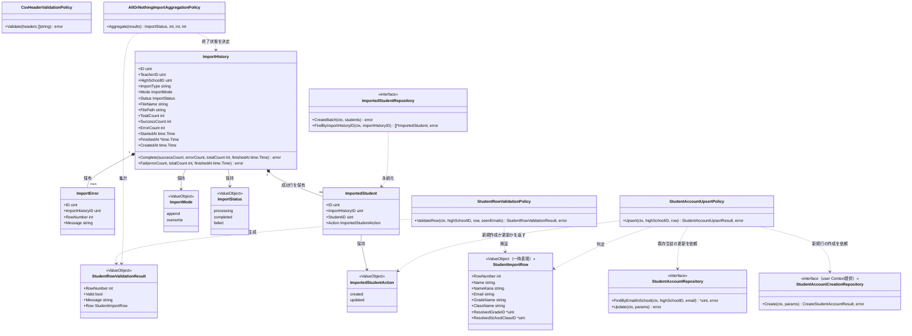
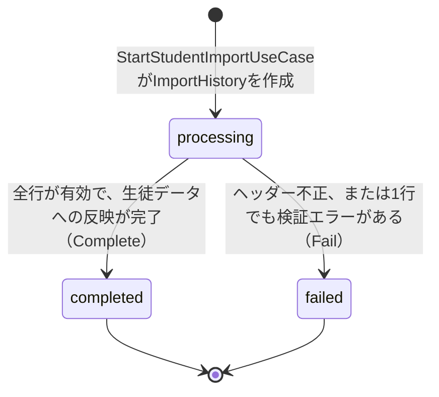

# 生徒CSVインポート機能 Go実装仕様書（1. Domain）

---

# 1. 機能概要

## 機能概要

教師がCSVファイルを使って、同校の生徒アカウントをまとめて登録・更新できる機能である。実際のインポート前に内容を検証する事前検証（dry run、同期・DB書き込みなし）と、インポート履歴（ImportHistory）を作成した上で非同期にCSVを処理するインポート実行（202 Accepted）の2操作を提供する。行単位のエラーはImportErrorとして記録され、全行が有効でインポートが成功した場合は、インポートされた各生徒（新規作成か既存生徒の更新か）が成功行（ImportedStudent）として記録される。「1行でも不正な行があれば全体を失敗とし、有効な行についても一切反映しない」という全件成功・全件失敗（all-or-nothing）の業務ルールを持つ。新規作成された生徒アカウントには仮パスワード発行と招待メール送信が行われる。新規行の生徒アカウント作成は`user` Contextの`CreateStudentAccount`を呼んで行い、既存生徒の更新は本Contextが行う（`user`は更新を持たない。②「3. Bounded Context」）。

## 採用設計パターンとその理由（②からの要約）

②「4. 設計パターン」により、本機能は **Domain Model** を採用する。

- ImportHistoryは「processing→completed/failed」という進行状態を持ち、管理者問題インポート機能とは異なり「一部失敗」という中間的な終了状態を持たない全件成功・全件失敗の集計ルールを伴う
- 行ごとに「メールアドレスが同校の既存生徒と一致すれば更新、一致しなければ新規作成」という業務的な判定ロジックが発生する
- 事前検証（dry run）はインポート実行時と同一の検証ロジックを再利用しつつDB書き込みを行わない、検証ロジックと実行ロジックの分離を要求する
- 将来的に他リソースのCSVインポートが増えることを想定すると、進行状態管理ロジックを汎用的なドメイン概念として独立させておく方が拡張しやすい

Transaction Script・Active Record・Event Sourcingは②「4. 設計パターン」「24. 採用しなかった設計」のとおり不採用である。本書はこの判断を変更しない。

## 本書が対象とする実装範囲

- Bounded Context: `student-import`
- 対象UseCase: `DryRunStudentImportUseCase` / `StartStudentImportUseCase` / `ExecuteStudentImportUseCase`
- 既存生徒の更新と同校内のメールアドレス一致確認（`StudentAccountRepository`）、および新規行の生徒アカウント作成を`user` Contextへ依頼する処理（`StudentAccountCreationRepository`）を含む
- 規約「3. 設計パターンごとの構造適用方針」のDomain Model構造で実装する。非同期実行はアーキテクチャ規約「13. 非同期ジョブ実行パターン（JobQueue）」の「確実に実行したい処理」（`jobs`テーブル＋ポーリングワーカー）で実装する
- 成功行（`ImportedStudent`）のEntity・Repositoryは本書が「正」として定義し、教師インポート履歴管理機能_Go実装仕様書（同一Context `student-import` の参照専用UseCase群）が再利用する
- ①Rails実装の詳細は本タスクでは提供されておらず、参照が必要な箇所は「①未提供のため参照不可」と明記する

---

---

# 2. ディレクトリ構成

## 対象Bounded Context名

- Context名（②）: `student-import`
- ディレクトリ名: `internal/student_import`（②からの補足：アーキテクチャ規約「8. 命名規約」に従いkebab-caseをスネークケースへ変換した。推測）

## ②で採用した設計パターン

Domain Model

## 文書の担当

本機能の実装は47ファイルで、1文書あたり30〜35ファイル（テスト込み）に収めるため3文書に分割する。本機能のHandlerは`student_import_handler.go`の1つのみでエンドポイント単位では割れないため、レイヤーで割っている（③自動生成プロンプト「2. ディレクトリ構成」の「Handlerが1つしかない機能」）。

|文書|担当|実装|テスト込みの目安|
|-|-|-|-|
|`生徒CSVインポート機能_Go実装仕様書_1_Domain.md`（本書）|Domain層、および機能全体の実装方針|20|約34|
|`生徒CSVインポート機能_Go実装仕様書_2_Infrastructure.md`|Infrastructure層・GORM / DBクエリ設計|13|約22|
|`生徒CSVインポート機能_Go実装仕様書_3_Application・Presentation.md`|Application層・Presentation層・API仕様|14|約24|

1_Domain → 2_Infrastructure → 3_Application・Presentation の順に実装すれば、各PRは単体でコンパイルが通る。Infrastructure層はDomain層のRepository Interfaceを実装し、Application層・Presentation層はその両方に依存するためである。

Transaction・Validation・Authorization・Errorの実装方針は機能全体で共通であるため本書に置く。2つ目以降では繰り返さず、本書を参照する。


## 作成するファイル一覧（機能全体）

### 1_Domain（本書）の担当

```
internal/student_import/domain/entity/import_error.go
internal/student_import/domain/entity/import_history.go
internal/student_import/domain/entity/imported_student.go
internal/student_import/domain/errors/errors.go
internal/student_import/domain/event/events.go
internal/student_import/domain/repository/grade_class_resolution_repository.go
internal/student_import/domain/repository/import_error_repository.go
internal/student_import/domain/repository/import_history_repository.go
internal/student_import/domain/repository/imported_student_repository.go
internal/student_import/domain/repository/student_account_creation_repository.go
internal/student_import/domain/repository/student_account_repository.go
internal/student_import/domain/service/all_or_nothing_import_aggregation_policy.go
internal/student_import/domain/service/csv_header_validation_policy.go
internal/student_import/domain/service/student_account_upsert_policy.go
internal/student_import/domain/service/student_row_validation_policy.go
internal/student_import/domain/valueobject/import_mode.go
internal/student_import/domain/valueobject/import_status.go
internal/student_import/domain/valueobject/imported_student_action.go
internal/student_import/domain/valueobject/student_import_row.go
internal/student_import/domain/valueobject/student_row_validation_result.go
```

### 2_Infrastructure の担当

```
internal/student_import/infrastructure/persistence/gorm/import_error_model.go
internal/student_import/infrastructure/persistence/gorm/import_history_model.go
internal/student_import/infrastructure/persistence/gorm/imported_student_model.go
internal/student_import/infrastructure/queue/job_publisher.go
internal/student_import/infrastructure/queue/worker_handler.go
internal/student_import/infrastructure/repository/grade_class_resolution_repository.go
internal/student_import/infrastructure/repository/import_error_repository.go
internal/student_import/infrastructure/repository/import_history_repository.go
internal/student_import/infrastructure/repository/imported_student_repository.go
internal/student_import/infrastructure/repository/student_account_creation_repository.go
internal/student_import/infrastructure/repository/student_account_repository.go
internal/student_import/infrastructure/repository/transaction_manager.go
internal/student_import/infrastructure/storage/csv_file_storage.go
```

### 3_Application・Presentation の担当

```
internal/student_import/application/dto/dry_run_dto.go
internal/student_import/application/dto/execute_import_dto.go
internal/student_import/application/dto/start_import_dto.go
internal/student_import/application/usecase/dry_run_student_import_usecase.go
internal/student_import/application/usecase/errors.go
internal/student_import/application/usecase/execute_student_import_usecase.go
internal/student_import/application/usecase/file_storage.go
internal/student_import/application/usecase/job_publisher.go
internal/student_import/application/usecase/start_student_import_usecase.go
internal/student_import/application/usecase/transaction_manager.go
internal/student_import/presentation/handler/student_import_handler.go
internal/student_import/presentation/request/student_import_request.go
internal/student_import/presentation/response/student_import_response.go
internal/student_import/presentation/routes.go
```

`application/usecase/file_storage.go`・`job_publisher.go`・`transaction_manager.go`はインターフェースの定義であり、その実装（`infrastructure/storage/`・`infrastructure/queue/`・`infrastructure/repository/transaction_manager.go`）は2_Infrastructureの担当である。インターフェースと実装が別の文書に分かれるため、2_Infrastructureを実装する時点で3_Application・Presentationのインターフェース定義が必要になる。インターフェースの定義のみを先に置くか、3つ目を先に実装するかは、実装時に選んでよい。


---

# 3. Domain層設計

## Entity

### ImportHistory（`domain/entity/import_history.go`、Aggregate Root）

- struct名: `ImportHistory`
- フィールド:

|フィールド|型|意味|
|-|-|-|
|`ID`|`uint`|インポート履歴ID|
|`TeacherID`|`uint`|実行した教師のユーザーID（`user_id`）|
|`HighSchoolID`|`uint`|実行した教師の所属校ID（対象・作成対象のスコープ。②「16. Authorization設計」）|
|`ImportType`|`string`|固定値`"student"`（`import_histories`テーブルを管理者問題インポート機能と共有するため。②20章）|
|`Mode`|`valueobject.ImportMode`|append/overwrite|
|`Status`|`valueobject.ImportStatus`|processing/completed/failed|
|`FileName`|`string`|アップロードされたCSVの元のファイル名（`file_name`。②「6. Entity設計」の「file情報」に対応。一覧・詳細での表示に用いる）|
|`FilePath`|`string`|CSVファイルの保存先を表す情報（②20章のSchema変更対象。詳細は8章・15章参照）|
|`TotalCount`|`int`|総行数|
|`SuccessCount`|`int`|成功行数|
|`ErrorCount`|`int`|失敗行数|
|`StartedAt`|`time.Time`|開始日時|
|`FinishedAt`|`*time.Time`|終了日時（processing中は`nil`）|
|`CreatedAt`|`time.Time`|履歴の作成日時（`created_at`。永続化時に確定し、一覧の並び替え・期間絞り込みの基準となる。教師インポート履歴管理機能が参照する）|

- 公開メソッド一覧:

|メソッド|引数|戻り値|責務|
|-|-|-|-|
|`NewImportHistory`|`(teacherID uint, highSchoolID uint, mode valueobject.ImportMode, fileName string, filePath string, startedAt time.Time) (*ImportHistory, error)`|`(*ImportHistory, error)`|`processing`状態のImportHistoryを生成するファクトリ|
|`Complete`|`(successCount, errorCount, totalCount int, finishedAt time.Time) error`|`error`|全行が有効であった場合に`completed`へ遷移させる。`processing`以外からの遷移は`ErrInvalidStatusTransition`を返す|
|`Fail`|`(errorCount, totalCount int, finishedAt time.Time) error`|`error`|1行でも不正な行があった場合、またはヘッダーが不正であった場合に`failed`へ遷移させる。`processing`以外からの遷移は`ErrInvalidStatusTransition`を返す|
|`IsProcessing`|`()`|`bool`|`processing`状態かどうかを判定する|

- 不変条件（ファクトリで保証する内容）: 生成直後の`Status`は常に`processing`。`SuccessCount`/`ErrorCount`/`TotalCount`はいずれも0

### ImportError（`domain/entity/import_error.go`）

- struct名: `ImportError`
- フィールド: `ID uint` / `ImportHistoryID uint` / `RowNumber int` / `Message string`
- 公開メソッド一覧: `NewImportError(importHistoryID uint, rowNumber int, message string) (*ImportError, error)`
- 不変条件: `RowNumber`は1以上であること

### ImportedStudent（`domain/entity/imported_student.go`、ImportHistory Aggregate内Entity）

- struct名: `ImportedStudent`
- フィールド:

|フィールド|型|意味|
|-|-|-|
|`ID`|`uint`|成功行の記録ID|
|`ImportHistoryID`|`uint`|所属するインポート履歴ID|
|`StudentID`|`uint`|インポートされた生徒のユーザーID（`imported_students.user_id`）。氏名等の生徒情報は保持しない（②「6. Entity設計」）|
|`Action`|`valueobject.ImportedStudentAction`|新規作成（created）か既存生徒の更新（updated）か|

- 公開メソッド一覧: `NewImportedStudent(importHistoryID uint, studentID uint, action valueobject.ImportedStudentAction) (*ImportedStudent, error)`（ファクトリ）
- 不変条件: `ImportHistoryID`・`StudentID`はいずれも0でないこと。違反時は`ErrInvalidImportedStudent`を返す。同じ履歴に同じ生徒を重複して記録しないこと（永続化時に`import_history_id`と`user_id`の組の一意制約でも保証される。CSV内のメールアドレス重複は行検証で拒否されるため、通常は発生しない）

## Value Object

### StudentImportRow（`domain/valueobject/student_import_row.go`、一時表現）

- struct名: `StudentImportRow`
- フィールド: `RowNumber int` / `Name string` / `NameKana string` / `Email string` / `GradeName string` / `ClassName string` / `ResolvedGradeID *uint` / `ResolvedSchoolClassID *uint`
- 生成時に検証するルール: なし（CSVパース結果をそのまま保持する。妥当性検証は`StudentRowValidationPolicy`が担う）
- 公開メソッド一覧: `NewStudentImportRow(rowNumber int, name, nameKana, email, gradeName, className string) StudentImportRow`

### ImportMode（`domain/valueobject/import_mode.go`）

- struct名: `ImportMode`（`append` / `overwrite`の2値を持つenum型）
- 生成時に検証するルール: `append`/`overwrite`以外の値は`append`として正規化する（②7章）
- 公開メソッド一覧: `NewImportMode(raw string) ImportMode`（不正値でもエラーを返さずappendへ正規化する。②7章「独自ルール」） / `(m ImportMode) String() string`

### ImportStatus（`domain/valueobject/import_status.go`）

- struct名: `ImportStatus`（`processing` / `completed` / `failed`の3値を持つenum型）
- 生成時に検証するルール: 3値のいずれかであること
- 公開メソッド一覧: `(s ImportStatus) CanTransitionTo(target ImportStatus) bool`（`processing`からのみ遷移可能） / `(s ImportStatus) String() string`

### ImportedStudentAction（`domain/valueobject/imported_student_action.go`）

- struct名: `ImportedStudentAction`（`created` / `updated`の2値を持つenum型）
- 生成時に検証するルール: 2値のいずれかであること。これ以外の値は許容しない（②「7. Value Object設計」。`ImportMode`と異なり、不正値のデフォルト解決は行わない）
- 公開メソッド一覧:
  - `NewImportedStudentActionFromDB(raw int) (ImportedStudentAction, error)`（不正値は`ErrInvalidImportedStudentAction`を返す。永続化された値からの復元に使う）
  - `(a ImportedStudentAction) DBValue() int`（`created`=0 / `updated`=1）
  - `(a ImportedStudentAction) String() string`（`"created"` / `"updated"`。教師向けレスポンスの`action`の値に対応する）
  - 定数として`ImportedStudentActionCreated` / `ImportedStudentActionUpdated`を持つ
- **永続化の表現**: `imported_students.action`は**整数列**である（Rails現行の`enum :action, { created: 0, updated: 1 }`。`rails/db/schema.rb`も`t.integer "action", null: false`）。文字列として保存しない。DBとの変換は`DBValue()`と`NewImportedStudentActionFromDB()`に閉じ込め、APIレスポンスでは`String()`の文字列表現を返す

### StudentRowValidationResult（`domain/valueobject/student_row_validation_result.go`）

- struct名: `StudentRowValidationResult`
- フィールド: `RowNumber int` / `Valid bool` / `Message string`（失敗時のみ設定） / `Row StudentImportRow`（成功時、解決済みの学年・クラスIDを含む行データ）
- 生成時に検証するルール: なし（`StudentRowValidationPolicy`の出力として生成される）
- 公開メソッド一覧: なし（データ保持のみ）

## Value Objectを採用しないもの

- ファイル名・ファイルサイズ等: 単純な属性値であり、独自の業務ルールを持たないため（②7章）

## Repository Interface

### ImportHistoryRepository（`domain/repository/import_history_repository.go`）

|メソッド|引数|戻り値|責務|
|-|-|-|-|
|`Create`|`(ctx context.Context, h *entity.ImportHistory)`|`error`|ImportHistoryを新規作成する|
|`Update`|`(ctx context.Context, h *entity.ImportHistory)`|`error`|状態・カウントを更新する|
|`FindByID`|`(ctx context.Context, id uint)`|`(*entity.ImportHistory, error)`|IDによる取得。存在しない場合は`nil, nil`を返す|

### ImportErrorRepository（`domain/repository/import_error_repository.go`）

|メソッド|引数|戻り値|責務|
|-|-|-|-|
|`CreateBatch`|`(ctx context.Context, errs []*entity.ImportError)`|`error`|行単位エラーを一括作成する|
|`FindByImportHistoryID`|`(ctx context.Context, importHistoryID uint)`|`([]*entity.ImportError, error)`|ImportHistory IDによるエラー一覧取得|

### ImportedStudentRepository（`domain/repository/imported_student_repository.go`）

|メソッド|引数|戻り値|責務|
|-|-|-|-|
|`CreateBatch`|`(ctx context.Context, students []*entity.ImportedStudent)`|`error`|成功行を一括作成する。全行有効な場合の生徒データへの反映と同一トランザクション内で呼び出す|
|`FindByImportHistoryID`|`(ctx context.Context, importHistoryID uint)`|`([]*entity.ImportedStudent, error)`|ImportHistory IDによる成功行一覧を、記録された順（ID昇順）で取得する。生徒の表示情報（氏名等）は含まない。表示情報を付与した参照用の取得は、教師インポート履歴管理機能_Go実装仕様書が本interfaceへ追加するメソッドが担う|

- 保持しない責務: 新規作成か更新かの判定（`StudentAccountUpsertPolicy`の責務）、生徒アカウントの作成・更新、CSV出力形式への変換（②「11. Repository設計」）

### GradeClassResolutionRepository（`domain/repository/grade_class_resolution_repository.go`、`master-data` Context提供・参照専用）

|メソッド|引数|戻り値|責務|
|-|-|-|-|
|`ResolveGrade`|`(ctx context.Context, highSchoolID uint, gradeName string)`|`(*uint, error)`|学年名から`grade_id`を解決する。存在しない場合は`nil, nil`|
|`ResolveClass`|`(ctx context.Context, gradeID uint, className string)`|`(*uint, error)`|指定学年に属する学級名から`school_class_id`を解決する。存在しない場合は`nil, nil`|

### StudentAccountRepository（`domain/repository/student_account_repository.go`、本Context提供）

|メソッド|引数|戻り値|責務|
|-|-|-|-|
|`FindByEmailInSchool`|`(ctx context.Context, highSchoolID uint, email string)`|`(*uint, error)`|同校内でのメールアドレス一致確認。一致する生徒IDまたは`nil`を返す|
|`Update`|`(ctx context.Context, params UpdateStudentAccountParams)`|`error`|既存生徒アカウントを更新する（氏名・氏名カナ・メールアドレス・学年・クラスの上書き。招待メールは送らず、`password_reset_required`にも触れない）|

`UpdateStudentAccountParams`のフィールド: `StudentID uint` / `Name string` / `NameKana string` / `Email string` / `GradeID uint` / `SchoolClassID uint`

- 保持しない責務: 新規生徒アカウントの作成（`StudentAccountCreationRepository`が`user`へ依頼する）、CSV解析、行単位の検証（`StudentRowValidationPolicy`の責務）（②11章）

### StudentAccountCreationRepository（`domain/repository/student_account_creation_repository.go`、`user` Context提供・作成依頼専用）

|メソッド|引数|戻り値|責務|
|-|-|-|-|
|`Create`|`(ctx context.Context, params CreateStudentAccountParams)`|`(CreateStudentAccountResult, error)`|新規行の生徒アカウントの作成を、`user` Contextの`CreateStudentAccount`へ依頼する。仮パスワードの発行・生徒番号の発行・招待待ちの設定・招待メール送信の依頼は`user`が行い、本Contextは指定しない（②11章）|

`CreateStudentAccountParams`のフィールド: `Name string` / `NameKana string` / `Email string` / `HighSchoolID uint` / `GradeID uint` / `SchoolClassID uint`（`user`の`CreateStudentAccount`の入力と同じ項目。CSVの学級は必須のため、クラスは常に設定する）
`CreateStudentAccountResult`のフィールド: `StudentID uint` / `Name string` / `Email string`（`user`が返す生徒の基本属性のうち、本Contextが使う項目）

- 保持しない責務: 更新、既存アカウントの確認、CSV解析、行単位の検証

## Domain Service

### CsvHeaderValidationPolicy（`domain/service/csv_header_validation_policy.go`）

- struct名: `CsvHeaderValidationPolicy`（状態を持たない）
- 公開メソッド: `(p *CsvHeaderValidationPolicy) Validate(headers []string) error`
- 責務: CSVのヘッダーが氏名・氏名カナ・メール・学年・学級の5列を含んでいるかを判定する。不足がある場合は`domainerrors.ErrInvalidCsvHeader`を返す（②8章）

### StudentRowValidationPolicy（`domain/service/student_row_validation_policy.go`）

- struct名: `StudentRowValidationPolicy`
- コンストラクタ: `NewStudentRowValidationPolicy(gradeClassRepo repository.GradeClassResolutionRepository, accountRepo repository.StudentAccountRepository) *StudentRowValidationPolicy`
- 公開メソッド: `(p *StudentRowValidationPolicy) ValidateRow(ctx context.Context, highSchoolID uint, row valueobject.StudentImportRow, seenEmails map[string]struct{}) (valueobject.StudentRowValidationResult, error)`
- 責務: 氏名・氏名カナ・メールアドレスの形式、学年名・学級名の自校内存在確認（`GradeClassResolutionRepository`経由）、メールアドレスの他校/他ロールでの使用有無（`StudentAccountRepository`経由）、CSV内でのメールアドレス重複の有無（呼び出し元が管理する`seenEmails`との突合）を判定し、`StudentRowValidationResult`を返す（②8章）

### AllOrNothingImportAggregationPolicy（`domain/service/all_or_nothing_import_aggregation_policy.go`）

- struct名: `AllOrNothingImportAggregationPolicy`（状態を持たない）
- 公開メソッド: `(p *AllOrNothingImportAggregationPolicy) Aggregate(results []valueobject.StudentRowValidationResult) (status valueobject.ImportStatus, successCount int, errorCount int, totalCount int)`
- 責務: 全行の検証結果から、1件でも失敗があれば全体を`failed`、全行が有効であれば`completed`とする（②8章。管理者問題インポート機能の「一部失敗」許容ルールとは判定基準が異なる点に注意）

### StudentAccountUpsertPolicy（`domain/service/student_account_upsert_policy.go`）

- struct名: `StudentAccountUpsertPolicy`
- コンストラクタ: `NewStudentAccountUpsertPolicy(accountRepo repository.StudentAccountRepository, creator repository.StudentAccountCreationRepository) *StudentAccountUpsertPolicy`
- 公開メソッド: `(p *StudentAccountUpsertPolicy) Upsert(ctx context.Context, highSchoolID uint, row valueobject.StudentImportRow) (StudentAccountUpsertResult, error)`
- 戻り値`StudentAccountUpsertResult`（同ファイルに定義する結果型）: `StudentID uint`（反映した生徒のユーザーID。更新の場合は`FindByEmailInSchool`が返したID、新規作成の場合は`CreateStudentAccountResult.StudentID`） / `Action valueobject.ImportedStudentAction`（更新なら`updated`、新規作成なら`created`）
- 責務: `StudentAccountRepository.FindByEmailInSchool`で同校の既存生徒と一致するかを確認し、一致すれば`StudentAccountRepository.Update`（本Contextの更新）、一致しなければ`StudentAccountCreationRepository.Create`（`user`の`CreateStudentAccount`）を呼び出す。反映した生徒と新規作成か更新かの区別を返す。返却値からのImportedStudentの記録は、呼び出し元のUseCaseが行う（②8章）

## Domain Event

②「18. Domain Event」により採用する。

### StudentImportRequested（`domain/event/events.go`）

- イベントstruct名: `StudentImportRequested`
- 保持するフィールド: `ImportHistoryID uint` / `HighSchoolID uint` / `TeacherID uint` / `OccurredAt time.Time`
- 発火元: `StartStudentImportUseCase`（ImportHistoryがprocessing状態で作成された直後）

## Domain Error（`domain/errors/errors.go`）

|変数名|発生条件|
|-|-|
|`ErrInvalidCsvHeader`|CSVヘッダーが想定される5列を満たさない|
|`ErrInvalidStatusTransition`|`processing`以外の状態からの`Complete`/`Fail`呼び出し|
|`ErrInvalidImportedStudent`|`NewImportedStudent`に0の`ImportHistoryID` / `StudentID`が渡された|
|`ErrInvalidImportedStudentAction`|`NewImportedStudentActionFromDB`に0 / 1以外の値が渡された|

---

---

# 4. クラス図



---

---

# 5. 状態遷移図



禁止される遷移: `processing`以外からの遷移はすべて`ErrInvalidStatusTransition`を返す。管理者問題インポート機能に存在する「一部失敗」に相当する状態は本機能には存在しない。

---

---

# 6. Transaction実装方針

## Transaction開始箇所

アーキテクチャ規約「11. Transaction実装パターン（TransactionManager）」に従い`TransactionManager`（`application/usecase/transaction_manager.go`）を定義する。

- `DryRunStudentImportUseCase`: 使用しない
- `StartStudentImportUseCase`: UseCase開始時（ファイル保存後、ImportHistory生成後）に開始する
- `ExecuteStudentImportUseCase`: UseCase開始時（ImportHistory取得直後）に開始する

## Transaction終了箇所

- `StartStudentImportUseCase`: `ImportHistoryRepository.Create`と`JobPublisher.Publish`（Transactional Outbox、同一トランザクション内でジョブレコードをINSERT）が完了した時点でコミットする
- `ExecuteStudentImportUseCase`: ヘッダー検証・全行検証・（全行有効な場合の）生徒データへの反映と成功行（`ImportedStudent`）の記録・ImportHistoryの終了状態更新までを1つのトランザクションとしてコミットする

## 複数Repositoryにまたがる場合の扱い

`ExecuteStudentImportUseCase`は基本方針どおりUseCase単位でのトランザクション管理とし、管理者問題インポート機能のような行/バッチ単位への分割は行わない。「1行でも不正な行があれば、有効な行についても生徒データへの反映を一切行わない」という全件成功・全件失敗の業務要件そのものが、UseCase全体を1つのトランザクションとすることと合致するためである（②14章）。新規行の作成を依頼する`user`の`CreateStudentAccount`は、このトランザクションに参加する（`ctx`を介して引き継ぐ。アーキテクチャ規約「11. Transaction実装パターン（TransactionManager）」の「呼び出し側トランザクションの引き継ぎ」）ため、1行でも失敗した場合は、作成済みのアカウントと招待メールの送信依頼、および記録した成功行（`ImportedStudent`）もロールバックされる。

---

---

# 7. Validation実装方針

## Presentation

|フィールド|struct名|バリデーションタグ|エラーメッセージ|
|-|-|-|-|
|`file`|`StartStudentImportRequest` / `DryRunStudentImportRequest`|必須・CSV形式（`text/csv`、拡張子`.csv`）・5MB以内（Ginのマルチパートフォームバインド＋カスタムバリデーション）|`errors`（ファイル不正）|
|`mode`|`StartStudentImportRequest`|任意。append/overwrite以外は後続でappendへ正規化（形式エラーとしない）|なし|

## 業務ルール検証

- `CsvHeaderValidationPolicy.Validate`: CSVヘッダーの構造的妥当性
- `StudentRowValidationPolicy.ValidateRow`: 行内容の業務的妥当性（氏名・氏名カナ・メール形式、学年・学級の自校内存在確認、メールアドレスの他校/他ロール未使用・CSV内重複なし）
- `AllOrNothingImportAggregationPolicy.Aggregate`: 全行の検証結果に基づく終了状態の決定
- `StudentAccountUpsertPolicy.Upsert`: 新規作成/更新の判定

---

---

# 8. Authorization実装方針

## Middleware

- 認証済みユーザーを特定し、`teacher`ロールであることを確認する

## Handler

- APIエントリポイントで認証失敗時のレスポンスを整える。業務権限の判定は持たせない（本機能は「他職員操作権限」のような追加の業務権限を要求しない。②16章）

## UseCase

- `current teacher`の所属高校を起点に、インポート対象・作成対象の生徒アカウントを常に実行した教師の所属高校に限定する（`StartStudentImportCommand.CurrentTeacherHighSchoolID`・`ImportHistory.HighSchoolID`として保持し、`ExecuteStudentImportUseCase`はこの値をスコープとして各Policy・Repositoryへ渡す）
- リクエストで所属校を明示的に指定するパラメータが送られても無視する（②16章、Rails現行仕様どおり）

## Domain

- `StudentRowValidationPolicy`が、学年・学級の自校内存在確認を行う

---

---

# 9. Error実装方針

## Domain Error → Application Errorへの変換方針

`ExecuteStudentImportUseCase`は、`domain/errors`のセンチネルエラーを`errors.Is`で判定し、Application Error相当（`AppError`実装型）へ変換する。ヘッダー不正（`ErrInvalidCsvHeader`）は非同期実行中に判明するため、HTTPレスポンスへ直接変換せず、`ImportHistory.Fail`を経由してImportHistoryの状態へ反映する。

## Application Error → HTTPレスポンスへの変換方針

アーキテクチャ規約「12. Error変換パターン（AppError）」に従い、Gin規約「8. エラーハンドリングミドルウェア」の集中エラーハンドリングミドルウェアで変換する。

|業務シナリオ|Error変数名／型|発生層|HTTP Status|
|-|-|-|-|
|ファイルが存在しない、CSV形式でない、5MB超過|Presentation Validationエラー|Presentation|422|
|CSVヘッダーが不正（dry_run）|`ErrInvalidCsvHeader`|Domain|422|
|CSVヘッダーが不正・行内容が不正（create、非同期判明）|`ErrInvalidCsvHeader`等|Domain|202受付後、ImportHistoryがfailedに更新される（HTTPステータスへの直接変換は発生しない）|
|`ImportHistory`が見つからない（ワーカー内部）|`ErrImportHistoryNotFound`|Application|該当なし（ワーカー内部エラーとしてログ出力）|
|未認証|-|Middleware|401|
|教師以外のアクセス|-|Middleware|403|

## Infrastructure Errorのハンドリング方針

ファイルストレージへの保存失敗、非同期ジョブのディスパッチ失敗、DB接続失敗はInfrastructure Errorとして扱い、`fmt.Errorf`でラップして上位層へ伝播させる。`StartStudentImportUseCase`実行中のファイル保存失敗は同期応答として422（または500、原因に応じて）へ変換する。ワーカー内で発生したInfrastructure Errorは、コーディング規約「21. 並行プログラミング」の`recover`方針に従い、当該ジョブの失敗としてログ記録し、アーキテクチャ規約13章のリトライ機構（`attempts`インクリメント）に委ねる。

---

---

# 10. テストケース設計（本書の担当分）

## Domain Test

|対象|テストケース|
|-|-|
|`valueobject.NewImportMode`|`append`/`overwrite`はそのまま採用される／それ以外の値は`append`へ正規化される|
|`entity.ImportHistory.Complete`/`Fail`|`processing`からの遷移が成功する／`processing`以外からの遷移で`ErrInvalidStatusTransition`を返す|
|`CsvHeaderValidationPolicy.Validate`|想定5列すべてを含む場合に成功する／いずれか欠けている場合に`ErrInvalidCsvHeader`を返す|
|`StudentRowValidationPolicy.ValidateRow`|氏名・氏名カナ・メール形式が不正な場合に失敗する／学年・学級が自校に存在しない場合に失敗する／メールアドレスが他校・他ロールで使用済みの場合に失敗する／CSV内でメールアドレスが重複する場合に失敗する／すべて妥当な場合に成功する|
|`AllOrNothingImportAggregationPolicy.Aggregate`|全行有効な場合に`completed`となる／1行でも無効な場合に`failed`となる|
|`entity.NewImportedStudent`|正常な値で生成できる／`ImportHistoryID`または`StudentID`が0の場合に`ErrInvalidImportedStudent`を返す|
|`valueobject.NewImportedStudentActionFromDB`|0は`created`、1は`updated`として復元される／それ以外の整数は`ErrInvalidImportedStudentAction`を返す|
|`StudentAccountUpsertPolicy.Upsert`|メールアドレスが同校の既存生徒と一致する場合に`StudentAccountRepository.Update`が呼ばれ、結果が`updated`と既存生徒のIDになる／一致しない場合に`StudentAccountCreationRepository.Create`が呼ばれ、結果が`created`と作成された生徒のIDになる|

2_Infrastructure・3_Application・Presentationが担当するテストは、各文書に記載する。

---

# 11. ②からの補足事項

|判断した内容|判断理由|推測かどうか|
|-|-|-|
|ディレクトリ名を`internal/student_import`とした|アーキテクチャ規約「4. Bounded Context構成」の「ディレクトリ構成」の命名規則（Context名のkebab-caseを`_`区切りに置き換え、短縮しない）による。Context名から機械的に決まるため、②文書での対応付けは不要|規約適用による決定（推測ではない）|
|`GradeClassResolutionRepository`・`StudentAccountRepository`実装が参照する他ContextのGORMモデルを本Contextで新規定義せず、既存テーブルを直接参照する構成とした|`master-data` Context自体の②文書が未整備であり、`user` Contextの②（`ユーザー基盤機能_Go移行・設計仕様書.md`）が定める公開操作の③Go実装仕様書も未作成であるため|推測|
|`ImportHistory`に`FileName`・`CreatedAt`フィールドを追加した|②「6. Entity設計」はImportHistoryが「file情報」を保持すると定めており、その一部である元のファイル名を`FileName`とした。`CreatedAt`は、教師インポート履歴管理機能②の一覧・詳細レスポンス（`created_at`）と、並び替え・期間絞り込みの基準として必要と判断した|推測（②の業務ルール自体は変更していない）|
|`ImportHistory`に`HighSchoolID`フィールドを追加した|②の`entity.ImportHistory`クラス図には`highSchoolId`相当のフィールド記載がないが、②「16. Authorization設計」の「インポート対象・作成対象の生徒アカウントは、常に実行した教師の所属高校に限定される」という業務要件を実装するために必要と判断した|推測（②の業務ルール自体は変更していない）|
|新規行の作成を、本Context側で定義する`StudentAccountCreationRepository`を介して`user`の`CreateStudentAccount`へ委譲する構成とした|②11章は、新規行の作成を`user`の`CreateStudentAccount`へ依頼すると定めているが、Domain Model採用機能からの呼び出し方式は②に明記がない。他Contextの公開手段のみを呼ぶ（規約5）・利用側でinterfaceを定義する（コーディング規約7）に従った|推測|
|`import_histories.file_path`カラムの型・名称を`string`と仮定した|②「20. DB設計方針」は「ファイルの保存パス、またはオブジェクトストレージ上のキーに相当する情報」とのみ記載し、具体的なカラム名・型を確定していない（②自身が「Go実装仕様書で検討する」としている）|推測|
|CSVファイルの保存先（ローカルディスク／オブジェクトストレージ）を確定しなかった|②に選定基準の記載がなく、管理者問題インポート機能と共通の変更であるため、両機能の③文書間で整合させる必要がある|推測|
|`ImportedStudentRepository`に一括作成の`CreateBatch`を採用し、全行の`Upsert`完了後に1回で記録する構成とした（行ごとの`Create`ではない）|②は成功行を「生徒データへの反映と同一トランザクションで記録する」と定めるのみで、記録の粒度を明記していない。全行有効な場合のみ記録するため、1回の一括INSERTでクエリ数を抑えられる。1件でも失敗すればトランザクション全体がロールバックされるため、記録タイミングによる整合性の差はない|推測|
|`imported_students.action`の永続化表現を、Rails現行の整数列挙値（created=0, updated=1）のまま維持し、Go側のモデル変換で`ImportedStudentAction`と相互変換する|②は既存Rails DBを継続利用すると定めており、列型の変更は②で提案されていない|②の記載どおり（既存DB継続利用）。整数値の対応はRails現行スキーマに基づく|
|既存生徒の更新時に`student_number`が空であれば、`user`が公開する`IssueStudentNumber`を呼んで発行する|`user`②「論点と決定」6の決定に従う。発行規則を本Contextに複製せず、`user`に集約する。シグネチャは`user`③「3. 公開操作の定義」のとおり|②（`user`②）の決定を適用|

上記以外の設計判断はすべて②の記載をそのまま踏襲しており、変更・追加した業務ルールはない。
