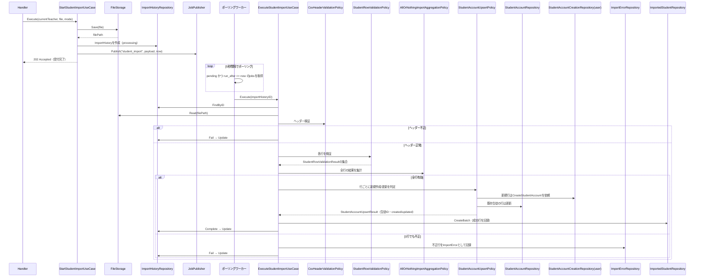
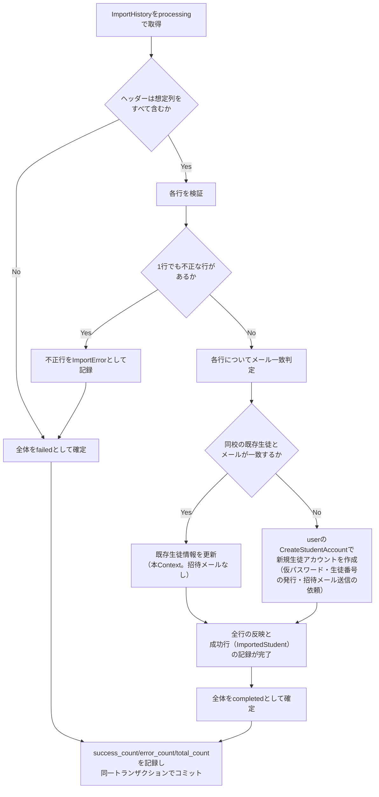

# 生徒CSVインポート機能 Go実装仕様書（3. Application・Presentation）

---

# 1. 本書の範囲

本書はApplication層・Presentation層（14ファイル、テスト込みで約24）を扱う。

## 担当するエンドポイント

|Method|Path|Handler|Request|Response|Status Code|
|-|-|-|-|-|-|
|POST|/api/v1/teacher/import_students|StudentImportHandler.Start|file（CSV必須）, mode（任意）|MessageResponse|202 / 422|
|POST|/api/v1/teacher/import_students/dry_run|StudentImportHandler.DryRun|file（CSV必須）|DryRunStudentImportResponse|200 / 422|

## 本書が前提とする文書

- `生徒CSVインポート機能_Go実装仕様書_1_Domain.md`: Domain層、およびTransaction・Validation・Authorization・Errorの実装方針
- `生徒CSVインポート機能_Go実装仕様書_2_Infrastructure.md`: Repository実装・外部連携実装・GORMモデル

本書では、1_Domainに記載した実装方針を繰り返さない。担当ファイルの一覧は1_Domain「2. ディレクトリ構成」の「3_Application・Presentation の担当」を参照する。

---

# 2. Application層設計

## DTO（Command / Query）

|struct名|フィールドと型|区分|
|-|-|-|
|`DryRunStudentImportCommand`|`CurrentTeacherHighSchoolID uint`, `File io.Reader`|Command|
|`DryRunRowResult`|`RowNumber int`, `Severity string`, `Message string`, `Data map[string]string`|出力|
|`DryRunStudentImportResult`|`TotalCount int`, `ValidCount int`, `Rows []DryRunRowResult`（最大100件、②19章）|出力|
|`StartStudentImportCommand`|`CurrentTeacherID uint`, `CurrentTeacherHighSchoolID uint`, `File io.Reader`, `FileName string`, `RawMode string`|Command|
|`StartStudentImportResult`|`ImportHistoryID uint`|出力|
|`ExecuteStudentImportCommand`|`ImportHistoryID uint`|Command|
|`ExecuteStudentImportResult`|`ImportHistoryID uint`, `Status string`, `SuccessCount int`, `ErrorCount int`, `TotalCount int`|出力|

## UseCase

### DryRunStudentImportUseCase（`application/usecase/dry_run_student_import_usecase.go`）

- struct名: `DryRunStudentImportUseCase`
- コンストラクタが受け取る依存: `*service.CsvHeaderValidationPolicy`, `*service.StudentRowValidationPolicy`
- 公開メソッド: `(u *DryRunStudentImportUseCase) Execute(ctx context.Context, cmd dto.DryRunStudentImportCommand) (dto.DryRunStudentImportResult, error)`
- 処理ステップ:
  1. `cmd.File`をCSVとしてパースし、ヘッダー行と各データ行を取得する
  2. `CsvHeaderValidationPolicy.Validate`でヘッダーを検証する。不正な場合は`ErrInvalidCsvHeader`を返す（②19章：dry runの場合422）
  3. 各行を`valueobject.NewStudentImportRow`で`StudentImportRow`へ変換する
  4. 各行について`StudentRowValidationPolicy.ValidateRow`を呼び出す（`seenEmails`で行を跨いだメール重複を検出する）
  5. 検証結果から`TotalCount`・`ValidCount`を集計し、無効な行を`Rows`（最大100件）へ格納する
  6. `DryRunStudentImportResult`を返す
- トランザクション境界: 使用しない（DB書き込みを一切行わない。②14章）
- 発生しうるApplication Error: `ErrInvalidCsvHeader`

### StartStudentImportUseCase（`application/usecase/start_student_import_usecase.go`）

- struct名: `StartStudentImportUseCase`
- コンストラクタが受け取る依存: `ImportHistoryRepository`, `TransactionManager`, `JobPublisher`, `FileStorage`
- 公開メソッド: `(u *StartStudentImportUseCase) Execute(ctx context.Context, cmd dto.StartStudentImportCommand) (dto.StartStudentImportResult, error)`
- 処理ステップ:
  1. `valueobject.NewImportMode(cmd.RawMode)`でモードを正規化する
  2. `FileStorage.Save(ctx, cmd.File, cmd.FileName)`でファイルを保存し、`FilePath`を取得する
  3. `entity.NewImportHistory(cmd.CurrentTeacherID, cmd.CurrentTeacherHighSchoolID, mode, cmd.FileName, filePath, now)`で`processing`状態のEntityを生成する
  4. `TransactionManager.WithinTransaction`内で、`ImportHistoryRepository.Create`と`JobPublisher.Publish(ctx, "student_import", payload{ImportHistoryID}, now)`を実行する（アーキテクチャ規約13章のTransactional Outboxパターン。業務データ保存とジョブ登録の不整合を防ぐ）
  5. `dto.StartStudentImportResult`に変換して返す
- トランザクション境界: ImportHistoryの作成とジョブ登録を1トランザクションとする（②14章）
- 発生しうるApplication Error: `ErrFileStorageFailed`（ファイル保存失敗。Infrastructure Errorとして扱う場合との違いは14章参照）

### ExecuteStudentImportUseCase（`application/usecase/execute_student_import_usecase.go`）

- struct名: `ExecuteStudentImportUseCase`
- コンストラクタが受け取る依存: `ImportHistoryRepository`, `ImportErrorRepository`, `ImportedStudentRepository`, `*service.CsvHeaderValidationPolicy`, `*service.StudentRowValidationPolicy`, `*service.AllOrNothingImportAggregationPolicy`, `*service.StudentAccountUpsertPolicy`, `TransactionManager`, `FileStorage`
- 公開メソッド: `(u *ExecuteStudentImportUseCase) Execute(ctx context.Context, cmd dto.ExecuteStudentImportCommand) (dto.ExecuteStudentImportResult, error)`
- 処理ステップ（`TransactionManager.WithinTransaction`内で3〜8を実行する。②14章：ヘッダー検証・全行検証・生徒データへの反映・ImportHistoryの終了状態更新までを1トランザクションとする）:
  1. `ImportHistoryRepository.FindByID`でImportHistoryを取得する。取得できない場合は`ErrImportHistoryNotFound`を返す
  2. `FileStorage.Read(ctx, importHistory.FilePath)`でCSVを再読み込みし、ヘッダー・全行を取得する
  3. `CsvHeaderValidationPolicy.Validate`でヘッダーを検証する
  4. ヘッダーが不正な場合、`importHistory.Fail(0, 0, now)`を呼び出し、手順8へ進む
  5. ヘッダーが正常な場合、各行について`StudentRowValidationPolicy.ValidateRow`を呼び出し、`StudentRowValidationResult`の集合を得る
  6. `AllOrNothingImportAggregationPolicy.Aggregate`で終了状態とカウントを決定する
  7. 全行有効（`completed`）の場合、各行について`StudentAccountUpsertPolicy.Upsert`を呼び出し生徒データへ反映する（新規行は`user`の`CreateStudentAccount`、既存生徒の行は`StudentAccountRepository.Update`。いずれかがエラーを返した場合は、トランザクション全体をロールバックしてエラーを伝播させる）。各`Upsert`が返す`StudentAccountUpsertResult`から`entity.NewImportedStudent(importHistory.ID, result.StudentID, result.Action)`で成功行を生成し、全行分を`ImportedStudentRepository.CreateBatch`で一括記録したうえで、`importHistory.Complete(...)`を呼び出す。1行でも不正（`failed`）の場合、不正行を`entity.NewImportError`で生成し`ImportErrorRepository.CreateBatch`で一括保存したうえで`importHistory.Fail(...)`を呼び出す
  8. `ImportHistoryRepository.Update`で最終状態を永続化する
  9. `dto.ExecuteStudentImportResult`に変換して返す
- トランザクション境界: UseCase全体を1トランザクションとする（成功行の記録も同一トランザクションに含まれるため、ロールバック時は成功行も残らない）。管理者問題インポート機能が行/バッチ単位に分割するのとは異なり、本機能は全件成功・全件失敗の業務要件そのものがUseCase全体を1トランザクションとすることと合致するため分割しない（②14章）
- 発生しうるApplication Error: `ErrImportHistoryNotFound`
- 発生しうるDomain Error: `ErrInvalidCsvHeader`, `ErrInvalidStatusTransition`, `ErrInvalidImportedStudent`

---

---

# 3. シーケンス図・処理フロー図

## シーケンス図

### StartStudentImportUseCase → ExecuteStudentImportUseCase

## 処理フロー図

### ExecuteStudentImportUseCase

---

---

# 4. Presentation層設計

## Handler

### StudentImportHandler（`presentation/handler/student_import_handler.go`）

- struct名: `StudentImportHandler`
- 対応する呼び出し先: `*usecase.DryRunStudentImportUseCase`, `*usecase.StartStudentImportUseCase`
- メソッド一覧:

|メソッド|HTTPメソッド|パス|
|-|-|-|
|`DryRun`|POST|`/api/v1/teacher/import_students/dry_run`|
|`Start`|POST|`/api/v1/teacher/import_students`|

- `DryRun`処理順序: current teacher情報取得 → `request.DryRunStudentImportRequest`へのマルチパートフォームバインド（ファイル必須・CSV形式・5MB以内。②15章「フォーマットチェック」）→ `DryRunStudentImportUseCase.Execute`呼び出し → `response.DryRunStudentImportResponse`へ変換し200を返す。ヘッダー不正時は422（`ErrInvalidCsvHeader`）
- `Start`処理順序: current teacher情報取得 → `request.StartStudentImportRequest`へのバインド（ファイル必須・CSV形式・5MB以内、mode任意）→ `StartStudentImportUseCase.Execute`呼び出し → `response.MessageResponse`へ変換し202を返す。ファイル不正時は422（この場合ImportHistoryは作成されない。②19章）

## Context間連携（`user` Contextの`CreateStudentAccount`の呼び出し）

- 本Contextは、新規行の生徒アカウント作成を、`user` Contextが公開する`CreateStudentAccount`の呼び出しで依頼する。呼び出しは`domain/repository`の`StudentAccountCreationRepository`（本Context側で定義するinterface）を介し、実装は`infrastructure/repository/student_account_creation_repository.go`が`user`の公開関数へ委譲する（アーキテクチャ規約「5. Context間連携ルール」：相手Contextが公開する手段のみを呼び出す。コーディング規約「7. インターフェース」：利用側で定義する）
- DI配線: アーキテクチャ規約「14. 依存関係の組み立て（DI配線）」に従い、`internal/student_import`の組み立て関数（`NewContext`）が`NewStudentAccountCreationRepository`を生成し、`StudentAccountUpsertPolicy`へ渡す。他Contextの組み立て結果を受け取る配線は行わない
- 教師生徒参照機能（`student-directory`）も、`user`の`CreateStudentAccount`を直接呼ぶ。本Contextと`student-directory`の間に作成処理の共有や依存関係はない
- 呼び出す関数のシグネチャ・入出力の型は`user`③「3. 公開操作の定義」のとおり

---

---

# 5. API仕様

## Errorケース

|条件|Status Code|Error内容|
|-|-|-|
|ファイルが存在しない、CSV形式でない、5MB超過（create/dry_run共通）|422|Presentation Validationエラー|
|CSVヘッダーが不正（dry_run）|422|`ErrInvalidCsvHeader`|
|CSVヘッダーが不正（create、非同期判明）|202受付後、履歴がfailedに更新される|-（同期応答はエラーとしない）|
|行内容が不正（dry_run）|200（rowsに含めて返却）|-|
|行内容が不正（create、非同期判明）|202受付後、履歴がfailedに更新される|-|
|未認証|401|-|
|教師以外のアクセス|403|-|

---

---

# 6. テストケース設計（本書の担当分）

## UseCase Test

|対象|テストケース|
|-|-|
|`DryRunStudentImportUseCase`|DB書き込みを行わずに検証結果（total_count/valid_count/rows）を算出できること／ヘッダー不正時に`ErrInvalidCsvHeader`を返すこと|
|`StartStudentImportUseCase`|ImportHistoryがprocessing状態で作成され、ジョブが同一トランザクションで登録されること|
|`ExecuteStudentImportUseCase`|全行有効な場合に生徒データへ反映されcompletedとなること（新規作成・更新の両パターン）／1行でも不正な場合に生徒データへ一切反映されずfailedとなること（②の重点検証項目）／ヘッダー不正時に即failedとなること／全行有効な場合に、新規作成・更新の区別つきで成功行が記録されること／1行でも不正な場合、または反映中にエラーとなった場合に成功行が一切残らないこと|

## Handler Test

|対象|テストケース|
|-|-|
|`StudentImportHandler.DryRun`|正常なCSVで200とdry run結果が返ること／ファイル不正で422が返ること|
|`StudentImportHandler.Start`|正常なCSVで202が返ること／ファイル不正で422が返ること（ImportHistoryが作成されないこと）|

## Integration Test

|対象|テストケース|
|-|-|
|dry run|検証結果算出が一貫して動作すること|
|アップロード受付〜非同期処理完了|エンドポイント経由でのアップロード受付から、ワーカーによる非同期処理完了後のImportHistory状態・ImportError記録・生徒アカウント反映・成功行（ImportedStudent）の記録までを一貫して確認すること（②の重点検証項目：全件成功・全件失敗。失敗時に成功行が残らないことを含む）|
|`user`との連携|新規行が`user`の`CreateStudentAccount`で作成され（生徒番号・招待待ち・招待メール送信依頼を含む）、1行でも失敗した場合に、作成済みのアカウントと招待メール送信依頼が残らないこと。既存生徒の行は更新のみで招待メール送信依頼が登録されないこと|

---
