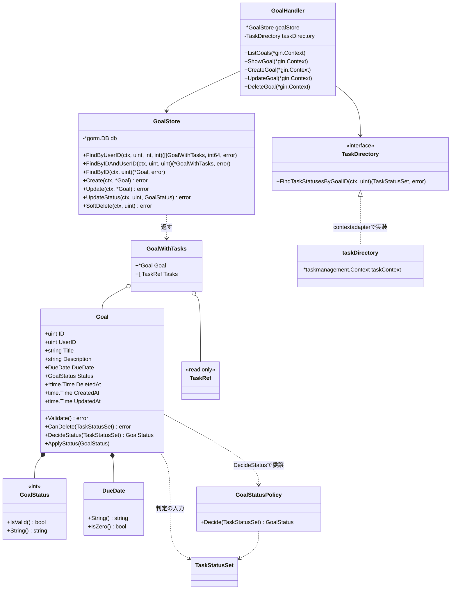
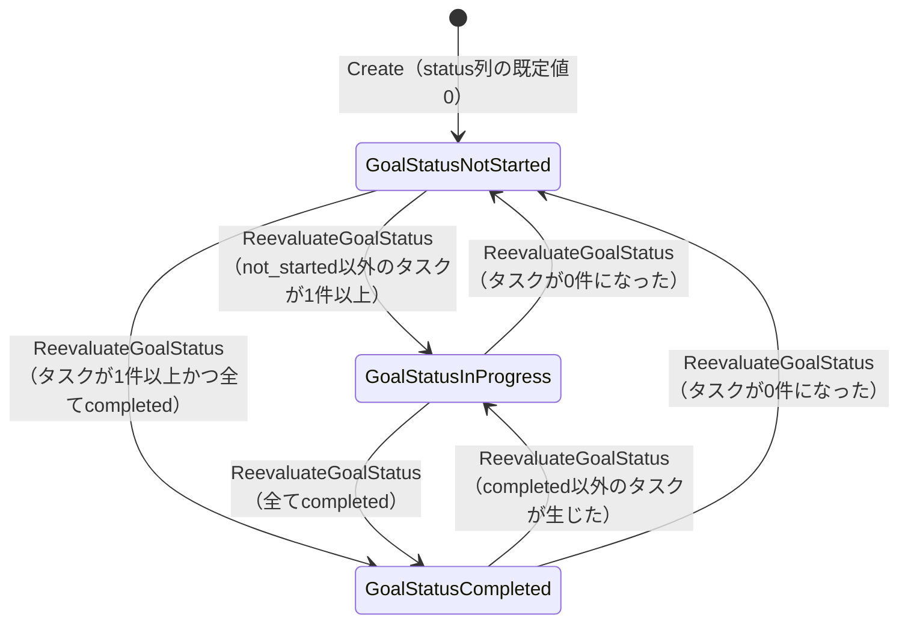
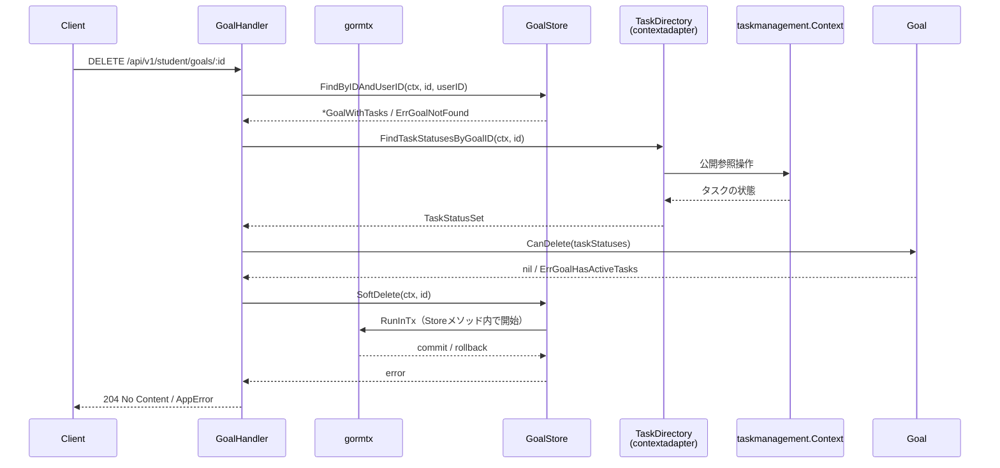
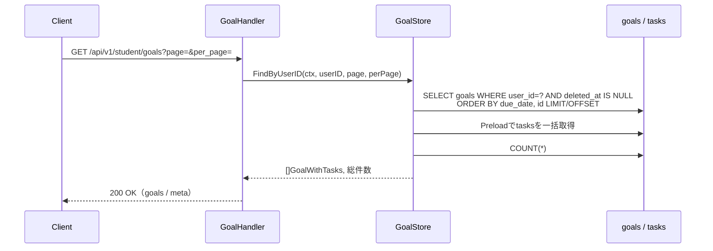
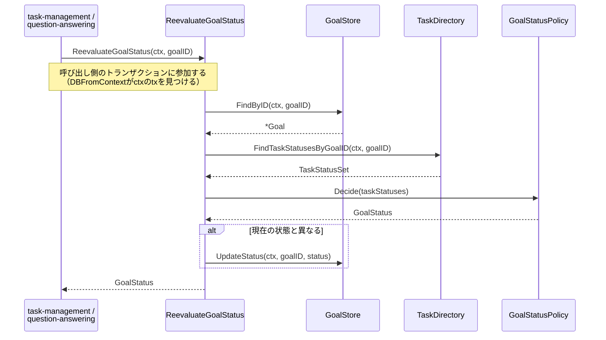
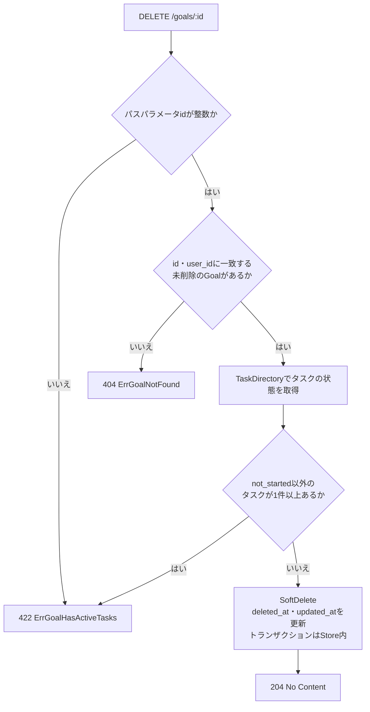
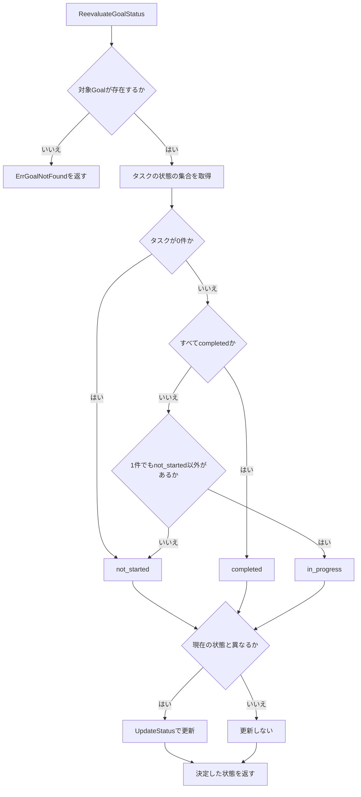

# 目標管理機能 Go実装仕様書

---

# 1. 機能概要

## 機能概要

生徒が自分の学習目標（Goal）を登録・参照・更新・削除する機能である。提供するAPIは一覧・詳細（紐づくタスク一覧を含む）・作成・更新・削除（論理削除）の5つ。削除は、`not_started`以外のタスクが紐づいていない場合にのみ行える（①「5. API / 処理詳細」`#destroy`）。

Goalは`status`（`not_started` / `in_progress` / `completed`）を保持するが、本機能のAPIの入力では`status`を受け取らない。状態はタスクの状況から再評価して決まり、その再評価は他Contextの操作（タスクの着手・問題の提出）を契機に、本Contextが公開する`ReevaluateGoalStatus`を通じて行われる（①「7. 状態管理」、②「12. UseCase設計」）。遷移そのものの妥当性（どの状態からどの状態へ行けるか）は検証しない。

## 採用設計パターンとその理由（②からの要約）

- 採用パターン: **Active Record**（②「4. 設計パターン」）
- 判断根拠: 目標データの主要操作は一覧・詳細・作成・更新というCRUD中心の業務であり、`status`属性を持つものの現行仕様に遷移ルールが存在しないため、Domain Model採用基準（状態遷移ルールが存在する場合に採用）を満たさない。所有権チェックや期限（DueDate）の妥当性検証をEntity相当のstructに寄せることで保守性を確保する方が、手続き型のTransaction Scriptより適切と判断されている
- 採用しなかったパターン: Transaction Script（バリデーション以上のルールが将来増えると手続きが肥大化しやすいため）、Domain Model（遷移ルールがなく過剰設計になるため）、Event Sourcing（状態遷移イベントの再構築要件がないため）

## 本書が対象とする実装範囲

②が設計した`goal-management` Bounded ContextのActive Record実装である。Model（Entity相当のstruct定義）、Store（永続化処理）、`GoalStatusPolicy`（状態の判定）、他Contextへの参照（`TaskDirectory`）、他Contextから呼ばれる公開操作（`ReevaluateGoalStatus`）、Presentation層（Handler / Request / Response / Routing）を対象とする。

②「3. Bounded Context」の他Contextとの依存関係には、`task-management`に加えて`draft-task`（下書きタスク）への参照依存が記載されている（目標に下書きタスクが紐づき得るため。①「6. データモデル」の`has_many :draft_tasks`）。ただし②「12. UseCase設計」のShowGoalの出力は目標とタスク一覧のみであり、下書きタスクを含む入出力仕様は定義されていない。本書もこの範囲に従い、下書きタスクの参照実装は対象に含めない（詳細は「8. Infrastructure層設計」「17. ②からの補足事項」参照）。

---

# 2. ディレクトリ構成

## 対象Bounded Context名

- `goal-management`（②「3. Bounded Context」）

## ②で採用した設計パターン

- Active Record（②「4. 設計パターン」）

## ディレクトリ・パッケージ名

アーキテクチャ規約「4. Bounded Context構成」の「Contextディレクトリの命名」に従い、Context名`goal-management`から`-`を取り除いて連結した全小文字の名前とし、短縮・省略はしない。したがってディレクトリ名は`internal/goalmanagement/`、package名は同じ`goalmanagement`となる。同規約は`internal/goal_management/`のようにアンダースコアで区切ることも、短縮することも禁じている（短縮するとContextごとに衝突の判断が必要になるため）。

Context名とディレクトリ名は規約から機械的に決まるため、②に明記がなくても推測にはならない。

## 作成するディレクトリ一覧

アーキテクチャ規約「3. 設計パターンごとの構造適用方針」のActive Record構造に従う。domain/infrastructureのレイヤー分離・usecase層は設けない。

```
internal/goalmanagement/
├── context.go
├── dependency.go
├── infrastructure/
│   └── contextadapter/
└── presentation/
    ├── handler/
    ├── request/
    ├── response/
    └── (routes.go はディレクトリ直下)
```

`context.go`（`NewContext`）と`dependency.go`（他Contextへの依存を宣言するインターフェース）は、アーキテクチャ規約「4. Bounded Context構成」の「ディレクトリ構成」がContextディレクトリ直下に置くと定めている。Active Record採用Contextも`context.go`の位置づけは共通である（同規約）。

`dependency.go`で宣言する`task-management` Contextの参照手段の実装は、GORMに依存せず相手Contextの公開操作へ委譲するアダプタであるため`infrastructure/contextadapter/`に置く（同規約）。

## 作成するファイル一覧

```
internal/goalmanagement/context.go           # NewContext（依存関係の組み立て）
internal/goalmanagement/dependency.go        # TaskDirectory（task-management Contextの参照用インターフェース）・TaskRef・TaskStatusSet
internal/goalmanagement/goal.go              # Goal struct（Model）+ Validate() + CanDelete() + DecideStatus()
internal/goalmanagement/goal_status.go       # GoalStatus型（整数の列挙型）
internal/goalmanagement/goal_status_policy.go # GoalStatusPolicy（タスクの状態の集合から状態を判定する）
internal/goalmanagement/due_date.go          # DueDate型（未設定を許容。保存値/表示フォーマットの一元化）
internal/goalmanagement/errors.go            # struct/Storeが返すエラー定義
internal/goalmanagement/goal_store.go        # GoalStore（永続化・検索・論理削除・状態更新）
internal/goalmanagement/reevaluate_status.go # ReevaluateGoalStatus（他Contextから呼ばれる公開操作）
internal/goalmanagement/infrastructure/contextadapter/task_directory.go  # TaskDirectoryの実装
internal/goalmanagement/presentation/handler/goal_handler.go
internal/goalmanagement/presentation/request/goal_request.go
internal/goalmanagement/presentation/response/goal_response.go
internal/goalmanagement/presentation/routes.go
```

## 文書の分割

本書は分割しない。実装ファイルは上記の14であり、テストが付くもの（Goal・GoalStatus・DueDate・GoalStatusPolicy・GoalStore・ReevaluateGoalStatus・TaskDirectoryの実装・GoalHandlerの8）を加えると22となるため、1文書あたり30〜35という範囲に収まる。

**②からの補足**: 規約の構造適用方針の例示は`model.go`/`store.go`という単一ファイルの雛形だが、本機能はGoal（Model）・状態の判定（Policy）・他Contextの参照という複数の責務を扱うため、責務ごとにファイルを分割している。これはActive Record構造（domain/infrastructureレイヤーを分離しない、同一package内に置く）という②の設計方針自体は変更せず、同一package内でのファイル分割という実装レベルの整理にとどまる。

---

# 3. Domain層設計

**実装上の位置づけ**: 本機能はActive Record採用のため、domain層・infrastructure層のレイヤー分離を行わない。以下は「Entity」の代わりに「Model（Entity相当）」として、`goalmanagement`パッケージ直下のstructとして扱う（アーキテクチャ規約「3. 設計パターンごとの構造適用方針」Active Record節）。

## Model（Entity相当）

### Goal（`goal.go`）

②「6. Entity設計」「7. Value Object設計」に基づくGoalのGoフィールド定義。

|フィールド名|型|意味|
|-|-|-|
|ID|uint|Goalの識別子|
|UserID|uint|所有者（生徒）のユーザーID。②「16. Authorization設計」の所有権チェックの材料|
|Title|string|目標タイトル。必須項目（②「15. Validation設計」）|
|Description|string|目標詳細|
|DueDate|DueDate|期限。②「7. Value Object設計」のDueDateを型として保持|
|Status|GoalStatus|状態値。②「7. Value Object設計」のGoalStatusを型として保持。APIの入力では変更せず、紐づくタスクの状況から再評価して決まる（②「3. Bounded Context」）|
|DeletedAt|`gorm.DeletedAt`|論理削除日時。Gorm規約「0. 本プロジェクトでの採用方針」の論理削除のとおりGORM標準の型を用いる。これにより`Find`系が`deleted_at IS NULL`を自動付与し、①「6. データモデル」の`default_scope`と同じ絞り込みになる|
|CreatedAt|time.Time|作成日時|
|UpdatedAt|time.Time|更新日時|

公開メソッド:

|メソッド|引数|戻り値|責務|
|-|-|-|-|
|`(g *Goal) Validate() error`|なし|`error`|Title必須チェック、DueDateの妥当性、Statusの許容値チェックを行う（②「15. Validation設計」）。ロジックの実装内容は本書では規定しない|
|`(g Goal) CanDelete(taskStatuses TaskStatusSet) error`|`taskStatuses TaskStatusSet`|`error`|論理削除してよいかを判定する。`not_started`以外のタスクが1件でもあれば`ErrGoalHasActiveTasks`を返す（②「6. Entity設計」、①「5. API / 処理詳細」`#destroy`）|
|`(g Goal) DecideStatus(taskStatuses TaskStatusSet) GoalStatus`|`taskStatuses TaskStatusSet`|`GoalStatus`|与えられたタスクの状態の集合から、あるべき状態を返す。判定は`GoalStatusPolicy`に委ねる（②「8. Domain Service」）|
|`(g *Goal) ApplyStatus(s GoalStatus)`|`s GoalStatus`|なし|再評価の結果を反映する|

不変条件: Titleが空でないこと、DueDateが妥当な値であること、Statusが許容値（GoalStatus）の範囲内であること。

`Status`はAPIの作成・更新リクエストの入力には含めない。作成時は`not_started`（①「6. データモデル」のとおりカラムの既定値が`0`）とし、以後は`ReevaluateGoalStatus`（②「12. UseCase設計」）でのみ変化する。①「5. API / 処理詳細」`#create`・`#update`のRequestが`title`・`description`・`due_date`のみを受け取ることに合わせている。

### GoalStatus（`goal_status.go`）

②「7. Value Object設計」のGoalStatusに対応する型。Active Record方針上、独立したValue Object層は設けず、Goalの構成要素としてpackage内の付随型として扱う。

|項目|内容|
|-|-|
|型定義|`type GoalStatus int`|
|許容値|`GoalStatusNotStarted`（0）/ `GoalStatusInProgress`（1）/ `GoalStatusCompleted`（2）を`iota`で宣言する（コーディング規約「3. 命名規則」の「定数のグループ化と`iota`」）|
|公開メソッド|`IsValid() bool`（宣言済みの値かを判定する）、`String() string`（`not_started` / `in_progress` / `completed`を返す。`stringer`で生成する。同規約「enumの`String()`実装」）、`ParseGoalStatus(raw string) (GoalStatus, error)`（文字列からの変換）|

`goals.status`はRailsの`enum`として**整数**で保持される（`not_started`=0 / `in_progress`=1 / `completed`=2。①「6. データモデル」）。そのため型を`int`とし、整数カラムへそのまま対応させる。APIの出力は文字列であるため、Response DTOへ入れる際に`String()`で変換する（コーディング規約「3. 命名規則」の「enumをJSONで送受信する場合は、DTO側は`string`型で受け取り、Domain層への変換時にenumへ変換する」）。

### DueDate（`due_date.go`）

②「7. Value Object設計」のDueDateに対応する型。同様に独立層は設けず、Goalの構成要素として扱う。

|項目|内容|
|-|-|
|保持するフィールド|内部に`*time.Time`相当の値を1つ保持する（保存値。未設定を`nil`で表す）|
|生成方法|文字列から生成するコンストラクタ相当の関数（引数・戻り値のみ規定し、パース処理の実装内容は本書では規定しない）|
|公開メソッド|`String() string`（`YYYY/MM/DD`形式の表示用文字列を返す。未設定なら空文字列。②「7. Value Object設計」）、`IsZero() bool`（未設定かを判定する）、比較用メソッド（Before/After等、期限の前後比較を提供する）|

入力はRailsと同じく**文字列**で受け取り、日付として解釈できるかを検証する。Rails現行は`DueDateValidatable`が`Date.parse`で検証しており、特定のフォーマットに限定していない（①「10. Rails実装対応表」）。したがって本書でも単一のフォーマットに固定せず、日付として解釈できることを条件とする。解釈できない場合は`ErrInvalidDueDate`を返し、メッセージは`Due date は正しい日付を入力してください`を踏襲する（①「6. データモデル」の「エラーレスポンスの本文」）。

型としては未設定（`nil`）を許容する。`goals.due_date`がNULL可で既存データに未設定の目標が存在しうるためである。一方、作成・更新のRequest DTOでは必須とする（①のFormが`presence: true`であるため。②「15. Validation設計」）。

## Value Object

対象外（Active Record採用のため独立したValue Object層は設けない）。②が設計したGoalStatus・DueDateは、上記のとおりGoalと同一package内の付随型として扱う。

## Repository Interface

対象外（Active Record採用のため、domain層にRepository Interfaceを定義しない。永続化・検索はEntity相当のstructと同一package内のStoreとして「8. Infrastructure層設計」に記載する）。

## Domain Service

### GoalStatusPolicy（`goal_status_policy.go`）

②「8. Domain Service」の`GoalStatusPolicy`に対応する。目標に紐づくタスクの状態の集合から、目標のあるべき状態を決める判定を担う。

|項目|内容|
|-|-|
|struct名|`GoalStatusPolicy`|
|保持するフィールド|なし（状態を持たない）|
|コンストラクタ|`NewGoalStatusPolicy() *GoalStatusPolicy`|

|メソッド|引数|戻り値|責務|
|-|-|-|-|
|`Decide`|`taskStatuses TaskStatusSet`|`GoalStatus`|タスクが1件もなければ`GoalStatusNotStarted`、すべてが`completed`なら`GoalStatusCompleted`、1件でも`not_started`以外があれば`GoalStatusInProgress`、それ以外は`GoalStatusNotStarted`を返す（①「7. 状態管理」の`Student::GoalCompletionService`の判定と同じ）|

DBにも他Contextの呼び出しにも依存せず、与えられた状態の集合のみから判定する。目標そのものの状態ではなく「目標とタスクの関係」に対する判定であるため、`Goal`のメソッドではなく独立したstructに置く（②「8. Domain Service」）。`Goal.DecideStatus`は本structへ委ねるための入口である。

## Domain Event

対象外。②「18. Domain Event」のとおり、非同期の副作用が現行仕様に存在しないため採用しない。

## Domain Error（struct/Storeが返すエラー）

②「17. Error設計」Domain Errorに対応する内容を、`errors.go`内のセンチネルエラー（`error`型の変数）として定義する方針とする。

|エラー|発生条件|メッセージ|
|-|-|-|
|`ErrTitleRequired`|`Validate()`時にTitleが空の場合|`Title を入力してください`（①「5. API / 処理詳細」の`validates :title, presence: true`に対応）|
|`ErrInvalidDueDate`|DueDateの生成・`Validate()`時に、日付として解釈できない値が渡された場合|`Due date は正しい日付を入力してください`|
|`ErrDueDateRequired`|`Validate()`時にDueDateが未設定の場合|`Due date を入力してください`|
|`ErrInvalidGoalStatus`|`Validate()`・`ParseGoalStatus`時に、GoalStatusが許容値外の場合|—（内部エラー。APIの入力でStatusを受け取らないため、通常は発生しない）|
|`ErrGoalNotFound`|`GoalStore`が指定ID・所有者に一致するGoalを取得できなかった場合（他ユーザーの目標を指定した場合を含む）|—（「14. Error実装方針」で404へ変換する）|
|`ErrGoalHasActiveTasks`|`CanDelete`時に、`not_started`以外のタスクが1件以上紐づいていた場合|`進行中または完了のタスクがあるため削除できません`（①「5. API / 処理詳細」`#destroy`。例外のメッセージであり項目名は付かない）|

メッセージの文言は①のとおり項目名が英語のまま出る形を維持する。フロントエンドを変更しない方針のためである（②「17. Error設計」の「エラーレスポンスの本文」）。

---

# 4. クラス図



Active Record採用のため、Repository Interfaceは存在せず、`GoalStore`が`Goal`と同一package内で永続化を担う。`TaskDirectory`のみ、他Contextへの依存を切り離すためのインターフェースとして本Contextに置く（コーディング規約「7. インターフェース」）。

---

# 5. 状態遷移図



状態を変えるのは`ReevaluateGoalStatus`（他Contextから呼ばれる公開操作）のみである。`CreateGoal` / `UpdateGoal`は`status`を受け取らず変更しない（①「7. 状態管理」）。遷移は「現在の状態からどこへ行けるか」ではなく「タスクの状態の集合から再計算した結果」で決まるため、`GoalStatusPolicy.Decide`の出力をそのまま反映する。遷移の妥当性は検証しない（②「10. 状態遷移図」）。

論理削除（`deleted_at`）は`status`とは独立した軸であり、上図には含めない。削除済みの目標は検索の対象外となる。

---

# 6. Application層設計

対象外（Active Record採用のため、usecase層を設けない。②「12. UseCase設計」に記載されたListGoals / ShowGoal / CreateGoal / UpdateGoal / DeleteGoalの業務操作（および他Contextから呼ばれる`ReevaluateGoalStatus`）は、HandlerがGoalStore・TaskDirectoryを直接呼び出す処理として実装する。処理順序は「9. Presentation層設計」のHandler処理順序に統合して記載する）。

---

# 7. シーケンス図・処理フロー図

## シーケンス図

### DeleteGoal（他Contextの参照と判定を含むため代表例とする）



### ListGoals



### ReevaluateGoalStatus（他Contextから呼ばれる公開操作）



## 処理フロー図

### DeleteGoal



### ReevaluateGoalStatus



一覧・詳細・作成・更新は分岐が所有権チェックとバリデーションのみであるため、処理フロー図は省略する。処理順序は「9. Presentation層設計」のHandler処理順序に記載したとおりである。

---

# 8. Infrastructure層設計

**実装上の位置づけ**: 本機能はActive Record採用のため、Repository Interfaceの実装という形は取らない。②「11. Repository設計」で定義された責務を、Model（Goal / TaskRef）と同一package内のStoreとして実装する。

## Store実装

### GoalStore（`goal_store.go`）

|項目|内容|
|-|-|
|struct名|`GoalStore`|
|対応するGORMモデル|`Goal`struct自体をGORMモデルとして扱う（Modelと同一structをGORMタグ付きで扱う方針。詳細は「15. GORM / DBクエリ設計」参照）|
|保持するフィールド|`db *gorm.DB`|
|コンストラクタ|`NewGoalStore(db *gorm.DB) *GoalStore`|

メソッド一覧:

|メソッド|引数|戻り値|発行するクエリ内容|
|-|-|-|-|
|`FindByUserID`|`ctx context.Context, userID uint, page, perPage int`|`([]GoalWithTasks, int64, error)`|user_idによる絞り込み、due_date昇順（同値はid昇順）ソート、ページネーション（LIMIT/OFFSET相当）、総件数取得。紐づくタスクを`Preload`で一括取得する（②「11. Repository設計」「21. DB操作仕様」）。`deleted_at IS NULL`は`gorm.DeletedAt`によりGORMが自動付与する|
|`FindByIDAndUserID`|`ctx context.Context, id, userID uint`|`(*GoalWithTasks, error)`|id・user_idの両方に一致する1件取得（`deleted_at IS NULL`はGORMが自動付与する）。紐づくタスクも一括取得する。一致しない場合はGoal不存在エラー（他ユーザーの目標を含む404相当。②「16. Authorization設計」の所有権チェックをクエリ条件として実現する）|
|`FindByID`|`ctx context.Context, id uint`|`(*Goal, error)`|所有者を条件に含めず1件取得する。`ReevaluateGoalStatus`（他Contextから呼ばれる公開操作）が用いる。同操作は認可を行わないため所有者でスコープしない（②「16. Authorization設計」）|
|`Create`|`ctx context.Context, goal *Goal`|`error`|Goalレコードの新規作成。`status`は`GoalStatusNotStarted`（0）で作成する|
|`Update`|`ctx context.Context, goal *Goal`|`error`|id（および所有権確認済みのuser_id）に一致するGoalレコードの`title`・`description`・`due_date`列を更新する|
|`UpdateStatus`|`ctx context.Context, id uint, status GoalStatus`|`error`|対象レコードの`status`列のみを更新する（`ReevaluateGoalStatus`が用いる）|
|`SoftDelete`|`ctx context.Context, id uint`|`error`|対象レコードの`deleted_at`・`updated_at`の2列を更新する。物理削除は行わず、紐づくタスクの行も削除しない（①「5. API / 処理詳細」`#destroy`。「15. GORM / DBクエリ設計」）|

各メソッドは`gormtx.DBFromContext(ctx, s.db)`で接続を取得する。トランザクション中であればその接続を、そうでなければ通常の接続を使う（「11. Transaction実装方針」）。

`GoalWithTasks`（`goal.go`で定義する）は、目標とその紐づくタスクを一括取得した結果を表す型である。目標ごとにタスクを個別に問い合わせるN+1を避けるために設ける（Gorm規約「0. 本プロジェクトでの採用方針」の「リレーションの取得とN+1対策」、②「21. DB操作仕様」）。フィールドは`Goal *Goal`と`Tasks []TaskRef`である。

②「11. Repository設計」に明記のとおり、業務ルール判定・認可判定はStoreに持たせない。所有権チェックは「id・user_idが一致するレコードを取得できるか」というクエリ条件として表現し、判定ロジック自体はHandler側の処理順序で扱う。

### TaskDirectoryの実装（`infrastructure/contextadapter/task_directory.go`）

`dependency.go`で宣言した`TaskDirectory`の実装である。`task-management` Contextが公開する参照手段へ委譲し、本Contextから`tasks`テーブルへクエリを発行しない（アーキテクチャ規約「5. Context間連携ルール」、②「11. Repository設計」「21. DB操作仕様」）。

|項目|内容|
|-|-|
|struct名|非公開struct（例: `taskDirectory`）＋コンストラクタ`NewTaskDirectory(taskContext *taskmanagement.Context) goalmanagement.TaskDirectory`|
|配置|GORMに依存せず相手Contextの公開操作を呼ぶアダプタであるため`infrastructure/contextadapter/`に置く（規約「4. Bounded Context構成」）|

メソッド一覧（`dependency.go`の`TaskDirectory`インターフェース）:

|メソッド|引数|戻り値|責務|
|-|-|-|-|
|`FindTaskStatusesByGoalID`|`ctx context.Context, goalID uint`|`(TaskStatusSet, error)`|指定目標に紐づくタスクの状態の集合を返す。論理削除の可否判定（`Goal.CanDelete`）と状態の再評価（`GoalStatusPolicy`）が入力として用いる（②「11. Repository設計」の「他Contextの参照手段」）|

`TaskStatusSet`（`dependency.go`で定義する）は、タスクの状態の集合を表す型である。保持するのは状態の値のみで、タスクの識別子や内容は持たない。判定に必要な事実だけを受け取る形にすることで、`Goal`と`GoalStatusPolicy`がDBや他Contextの呼び出しに依存せずテストできる（②「8. Domain Service」）。

一覧・詳細の表示に用いるタスクの情報（`TaskRef`）は、画面向けの一覧であるため`GoalStore`が`goals`との結合で取得する。一方、業務ルールの判定に用いる状態の集合は、判断の前提となる事実であるため`TaskDirectory`経由で`task-management` Contextに委ねる（②「21. DB操作仕様」）。

**②からの補足**: `task-management` Contextが公開する参照手段の具体的なシグネチャは、同機能の③で確定する。本書では消費者側のインターフェース（`TaskDirectory`）をコーディング規約「7. インターフェース」の方針に従って本Contextに置き、実装をアダプタに閉じ込める。バッチ3には`task-management`が含まれるため、同機能の③の追随時にシグネチャを合わせる。

### ReevaluateGoalStatus（`reevaluate_status.go`）

他Contextから呼ばれる公開操作である（②「12. UseCase設計」）。

|項目|内容|
|-|-|
|関数|`ReevaluateGoalStatus(ctx context.Context, goalID uint) (GoalStatus, error)`|
|受け取る依存|`*GoalStore`、`TaskDirectory`、`*GoalStatusPolicy`（コンストラクタで注入する`struct`のメソッドとして実装してよい）|

処理ステップ:

1. `GoalStore.FindByID`で対象目標を取得する（所有者でスコープしない。②「16. Authorization設計」）
2. `TaskDirectory.FindTaskStatusesByGoalID`でタスクの状態の集合を取得する
3. `Goal.DecideStatus`（内部で`GoalStatusPolicy`に委ねる）であるべき状態を決める
4. 現在の状態と異なる場合、`GoalStore.UpdateStatus`で更新する
5. 再評価後の状態を返す

呼び出し側（`task-management`のタスクの着手、`question-answering`の問題の提出）が既にトランザクションを開始している場合はそれに参加する。`gormtx.DBFromContext`が`ctx`のトランザクションを見つけるため、本操作側で新しいトランザクションを開始しない（「11. Transaction実装方針」）。

### draft-task Context（下書きタスク）参照について

②「3. Bounded Context」の他Contextとの依存関係には、`task-management`に加えて`draft-task` Contextへの参照依存（目標に下書きタスクが紐づき得るため）が記載されている。しかし②「11. Repository設計」「12. UseCase設計」のいずれにも、下書きタスクを取得する手段・呼び出し手順の具体的な記載はない（`TaskDirectory`に相当する下書きタスクの参照手段は②に定義されていない）。そのため本書では、下書きタスクの参照実装（参照手段・Response DTOへの下書きタスク一覧の追加等）を本機能の実装対象に含めない。将来②側でShowGoalの出力に下書きタスク一覧が明記された場合、`TaskDirectory`と同様の参照用インターフェース（例: `DraftTaskDirectory`）を`draft-task` Context側の公開参照手段に基づき追加することを想定する（**②からの補足**。詳細は「17. ②からの補足事項」参照）。

## 外部連携実装

対象外。②にMail・Cache・Queue等の外部連携は記載されていない。

---

# 9. Presentation層設計

## Handler

|項目|内容|
|-|-|
|struct名|`GoalHandler`|
|対応する呼び出し先|`GoalStore`、`TaskDirectory`（Active Record採用のためUseCaseを経由せず直接呼び出す）|
|保持するフィールド|`goalStore *GoalStore`, `taskDirectory TaskDirectory`|
|コンストラクタ|`NewGoalHandler(goalStore *GoalStore, taskDirectory TaskDirectory) *GoalHandler`|

メソッド一覧（HTTPメソッド・パス対応）:

|メソッド|HTTPメソッド|パス|
|-|-|-|
|`ListGoals`|GET|/api/v1/student/goals|
|`ShowGoal`|GET|/api/v1/student/goals/:id|
|`CreateGoal`|POST|/api/v1/student/goals|
|`UpdateGoal`|PATCH|/api/v1/student/goals/:id|
|`DeleteGoal`|DELETE|/api/v1/student/goals/:id|

処理順序（UseCase層を経由しない分、本来UseCaseが担う手順をここに明記する）:

### ListGoals

1. `c.Request.Context()`からcurrent user（認証Middlewareが格納したstudentユーザー）を取得する（②「16. Authorization設計」）
2. クエリパラメータ`page` / `per_page`を読み取る。未指定・不正な形式のときは既定値に置き換え、`per_page`が上限を超える場合は上限値にする（既定値5・上限100。①「5. API / 処理詳細」`#index`）
3. `goalStore.FindByUserID`をcurrent userのIDとページ指定で呼び出し、`[]GoalWithTasks`と総件数を受け取る（②「12. UseCase設計」ListGoals）
4. 取得結果を`GoalListResponse`へ変換する。`meta`は総件数・`per_page`から算出する
5. 200 OKで返す

### ShowGoal

1. current userを取得する
2. パスパラメータ`id`を読み取る
3. `goalStore.FindByIDAndUserID`をid・current userのIDで呼び出す。紐づくタスクも同時に受け取る（②「16. Authorization設計」の所有権チェックをクエリ条件として実現する。一致しなければ`ErrGoalNotFound`）
4. `ErrGoalNotFound`を404のAppErrorへ変換して`c.Error(err)`で返す（「14. Error実装方針」）
5. 取得結果を`GoalResponse`へ変換する
6. 200 OKで返す

### CreateGoal

1. current userを取得する
2. `CreateGoalRequest`へバインドする（`goal`キーでネストした本文。②「15. Validation設計」Presentation節）
3. Request DTOからGoalを組み立てる。`UserID`はcurrent userのID、`Status`は`GoalStatusNotStarted`とする（`status`は入力に含めない。①「6. データモデル」のカラム既定値`0`に合わせる）
4. `goal.Validate()`で業務ルール検証を行う。エラーは422のAppErrorへ変換する
5. `goalStore.Create`を呼び出す（②「14. Transaction設計」のとおり1トランザクション）
6. 作成された目標の識別子を201 Createdで返す（①「5. API / 処理詳細」`#create`）

### UpdateGoal

1. current userを取得する
2. パスパラメータ`id`と`UpdateGoalRequest`へバインドする
3. `goalStore.FindByIDAndUserID`で対象Goalを取得する（所有権チェック。一致しなければ`ErrGoalNotFound`→404）
4. 取得したGoalに`title`・`description`・`due_date`を反映する。`status`は変更しない
5. `goal.Validate()`で業務ルール検証を行う。エラーは422のAppErrorへ変換する
6. `goalStore.Update`を呼び出す（②「14. Transaction設計」のとおり1トランザクション）
7. 更新された目標の識別子を200 OKで返す（①「5. API / 処理詳細」`#update`）

### DeleteGoal

1. current userを取得する
2. パスパラメータ`id`を読み取る
3. `goalStore.FindByIDAndUserID`で対象Goalを取得する（所有権チェック。一致しなければ`ErrGoalNotFound`→404）
4. `taskDirectory.FindTaskStatusesByGoalID`で紐づくタスクの状態の集合を取得する
5. `goal.CanDelete(taskStatuses)`で削除の可否を判定する。`ErrGoalHasActiveTasks`なら422のAppErrorへ変換して返す（①「5. API / 処理詳細」`#destroy`、②「17. Error設計」）
6. `goalStore.SoftDelete`で`deleted_at`・`updated_at`を更新する。タスクの行は削除しない
7. 204 No Contentで返す（本文なし）

3〜5は読み取りと判定であり、トランザクションは`goalStore.SoftDelete`の内側で開始・終了する（②「14. Transaction設計」）。Rails現行の`Goal#soft_delete!`も判定と`update_columns`をトランザクションで囲んでいない（①「5. API / 処理詳細」`#destroy`）。判定と削除の間に別のタスクが着手された場合の扱いについては「17. ②からの補足事項」に要確認として記載する。

## Request / Response DTO

### Request（`presentation/request/goal_request.go`）

|struct名|フィールド|型|バリデーションタグ／チェック内容|
|-|-|-|-|
|`CreateGoalRequest`|Goal|`CreateGoalBody`|`binding:"required"`。リクエストボディは`goal`キーでネストする（①「5. API / 処理詳細」`#create`の`params.require(:goal)`）|
|`CreateGoalBody`|Title|string|`json:"title" binding:"required"`（①の`validates :title, presence: true`）|
||Description|string|`json:"description"`。必須ではない|
||DueDate|string|`json:"due_date" binding:"required"`。日付として解釈できることを検証する。特定のフォーマットには固定しない（①「10. Rails実装対応表」の`DueDateValidatable`が`Date.parse`で検証している）|
|`UpdateGoalRequest`|Goal|`UpdateGoalBody`|`binding:"required"`。同じく`goal`キーでネストする|
|`UpdateGoalBody`|Title|string|`json:"title" binding:"required"`|
||Description|string|`json:"description"`|
||DueDate|string|`json:"due_date" binding:"required"`。作成時と同じ検証|

作成と更新で必須項目が同一であるのは、①「5. API / 処理詳細」`#create`・`#update`のRequestがいずれも`title`・`due_date`を必須としているためである。`status`はいずれの入力にも含めない（②「12. UseCase設計」）。

パスパラメータ`id`（詳細・更新・削除）は必須・整数として検証する。

クエリパラメータ`page` / `per_page`は整数として受け取り、不正な形式をエラーとせずHandlerが既定値に置き換える。`per_page`の既定値は5、上限は100であり、0以下・数値以外は既定値、上限超過は上限値として扱う。`page`は0以下・数値以外のとき1ページ目として扱う（①「5. API / 処理詳細」`#index`、②「15. Validation設計」、アーキテクチャ規約「15. API規約（レスポンス形式・ページネーション・URL・クエリパラメータ）」の「ページネーション」）。

### Response（`presentation/response/goal_response.go`）

|struct名|フィールド|型|JSONキー|
|-|-|-|-|
|`GoalResponse`|ID|`uint`|`id`|
||Title|`string`|`title`|
||Description|`string`|`description`|
||Status|`string`|`status`|
||DueDate|`*string`|`due_date`（`YYYY/MM/DD`形式。未設定なら`null`）|
||Tasks|`[]TaskRefResponse`|`tasks`|
|`TaskRefResponse`|ID|`uint`|`id`|
||UserID|`uint`|`user_id`|
||GoalID|`*uint`|`goal_id`|
||Title|`string`|`title`|
||Content|`string`|`content`|
||DueDate|`*string`|`due_date`（`YYYY/MM/DD`）|
||Priority|`string`|`priority`|
||Status|`string`|`status`|
||CompletedAt|`*string`|`completed_at`（`YYYY/MM/DD`）|
||Units|`[]UnitRefResponse`|`units`|
|`GoalListResponse`|Goals|`[]GoalResponse`|`goals`|
||Meta|`MetaResponse`|`meta`|
|`MetaResponse`|CurrentPage|`int`|`current_page`|
||TotalPages|`int`|`total_pages`|
||TotalCount|`int`|`total_count`|
||PerPage|`int`|`per_page`（実際に適用された件数。①「5. API / 処理詳細」`#index`の`limit_value`）|

- **一覧**: 最上位は`goals`と`meta`の2キーである（①「5. API / 処理詳細」`#index`）
- **詳細**: 最上位をラップせず`GoalResponse`をそのまま返す。項目は一覧の各要素と同じであり、専用のstructを設けない（①「5. API / 処理詳細」`#show`。Rails現行の`GoalSerializer`と`GoalDetailSerializer`は同じ項目を返す）
- **作成・更新**: 作成された（更新された）目標の識別子のみを返す。`render json: form.goal.id`に対応するため、ラップしたstructを設けず識別子をそのまま返す（①「5. API / 処理詳細」`#create`・`#update`）
- **削除**: 本文を返さない（204 No Content）
- `GoalResponse.Status`は`own`ではなく`not_started` / `in_progress` / `completed`の文字列を入れる。Modelの`GoalStatus`は整数の列挙型であるため、`String()`で変換してから設定する（「3. Domain層設計」）
- `TaskRefResponse`の項目は①「5. API / 処理詳細」`#index`のとおり、Rails現行の`TaskSerializer`に合わせる
- エラーレスポンスは専用structを本書で定義しない。形式は422等が`{"errors": [...]}`、404のみ`{"message": ...}`であり、いずれも集中エラーハンドリングミドルウェアが組み立てる（「14. Error実装方針」、Gin規約「8. エラーハンドリングミドルウェア」）

**②からの補足**: `UnitRefResponse`（タスクに紐づく単元）の項目は、`curriculum` Context（コース参照機能・単元参照機能が共有する）が扱う単元の表現であり、本機能では`task-management` Contextから受け取った値をそのまま入れる。項目の確定は単元参照機能の③に委ねる（バッチ3の対象外）。

## Routing（`presentation/routes.go`）

|Method|Path|Handler|
|-|-|-|
|GET|/api/v1/student/goals|GoalHandler.ListGoals|
|GET|/api/v1/student/goals/:id|GoalHandler.ShowGoal|
|POST|/api/v1/student/goals|GoalHandler.CreateGoal|
|PATCH|/api/v1/student/goals/:id|GoalHandler.UpdateGoal|
|DELETE|/api/v1/student/goals/:id|GoalHandler.DeleteGoal|

いずれのルートも認証Middleware・`student`ロール確認Middlewareを経由する（②「16. Authorization設計」）。`POST` / `PATCH` / `DELETE`はCookieで認可される状態変更であるため、CSRF検証Middlewareの対象にも含める（Gin規約「5. CSRF対策」の「適用範囲」）。一覧・詳細はGETのため対象外である。

ルートは`/api/v1/student`グループ配下に登録し、認証・student役割チェックのMiddleware（②「16. Authorization設計」Middleware節）をグループ単位で適用する。

---

# 10. API仕様

|Method|Path|Handler|Request|Response|Status Code|
|-|-|-|-|-|-|
|GET|/api/v1/student/goals|ListGoals|クエリ: `page` / `per_page`|`GoalListResponse`|200|
|GET|/api/v1/student/goals/:id|ShowGoal|パス: `id`|`GoalResponse`|200|
|POST|/api/v1/student/goals|CreateGoal|`CreateGoalRequest`|作成した目標の識別子|201|
|PATCH|/api/v1/student/goals/:id|UpdateGoal|パス: `id`、Body: `UpdateGoalRequest`|更新した目標の識別子|200|
|DELETE|/api/v1/student/goals/:id|DeleteGoal|パス: `id`|本文なし|204|

作成が201、更新が200であるのは、①「5. API / 処理詳細」のとおり`#create`が`status: :created`、`#update`が`status: :ok`を返しているためである。削除が204であるのは同`#destroy`のとおりである。

エラーレスポンスの本文は422等が`{"errors": ["メッセージ", ...]}`、404のみ`{"message": "目標が見つかりません"}`である（「14. Error実装方針」）。

各Endpointのエラーケース:

### 全Endpoint共通

|条件|Status Code|Error内容|
|-|-|-|
|未認証|401|認証Middlewareが返す（②「16. Authorization設計」、認証機能③）|
|`student`ロールでない|403|ロール確認Middlewareが返す（②「16. Authorization設計」）|
|`POST` / `PATCH` / `DELETE`でCSRFトークンが不正|403|CSRF検証Middlewareが返す（Gin規約「5. CSRF対策」）|

認証・認可・CSRFのステータスコードは本機能で定めるものではなく、該当Middlewareの仕様に従う。

### GET /api/v1/student/goals

|条件|Status Code|Error内容|
|-|-|-|
|固有のエラーケースなし|—|目標が0件の場合も`goals`を空配列として200を返す（①「5. API / 処理詳細」`#index`のErrorケース「特定なし」）|

### GET /api/v1/student/goals/:id

|条件|Status Code|Error内容|
|-|-|-|
|対象Goalが存在しない、または他ユーザーのGoalである|404|`ErrGoalNotFound`（①「5. API / 処理詳細」`#show`）|

### POST /api/v1/student/goals

|条件|Status Code|Error内容|
|-|-|-|
|`title`未入力|422|バリデーションエラー（①`validates :title, presence: true`）|
|`due_date`未入力|422|バリデーションエラー（①のFormが`presence: true`）|
|`due_date`が日付として解釈できない|422|バリデーションエラー（①`DueDateValidatable`）|

### PATCH /api/v1/student/goals/:id

|条件|Status Code|Error内容|
|-|-|-|
|対象Goalが存在しない、または他ユーザーのGoalである|404|`ErrGoalNotFound`|
|`title` / `due_date`未入力、`due_date`が日付として解釈できない|422|バリデーションエラー|

### DELETE /api/v1/student/goals/:id

|条件|Status Code|Error内容|
|-|-|-|
|対象Goalが存在しない、または他ユーザーのGoalである|404|`ErrGoalNotFound`（①「5. API / 処理詳細」`#destroy`）|
|`not_started`以外のタスクが紐づいている|422|`ErrGoalHasActiveTasks`。メッセージは`進行中または完了のタスクがあるため削除できません`（①「5. API / 処理詳細」`#destroy`、②「17. Error設計」）|

---

# 11. Transaction実装方針

## Transaction開始位置

②「14. Transaction設計」のとおり、Handlerの処理単位に対応するStoreメソッド内でトランザクションを開始する。Active Record採用のため、`gormtx.RunInTx(ctx, db, func(ctx context.Context, tx *gorm.DB) error { ... })`を用いる。`db.WithContext(ctx).Transaction(...)`を直接呼ばない。呼び出し側が既に開始したトランザクションに参加せず、独立した2つ目を開始してしまうためである（アーキテクチャ規約「11. Transaction実装パターン（TransactionManager）」）。

対象は`GoalStore.Create`・`GoalStore.Update`・`GoalStore.SoftDelete`・`GoalStore.UpdateStatus`である。

## Transaction終了位置

- `GoalStore.Create`: Goalの保存が完了した時点でコミットする。保存に失敗した場合はロールバックする
- `GoalStore.Update`: Goalの更新が完了した時点でコミットする
- `GoalStore.SoftDelete`: 削除日時の設定が完了した時点でコミットする
- `GoalStore.UpdateStatus`: 状態の更新が完了した時点でコミットする
- 参照系（`FindByUserID` / `FindByIDAndUserID` / `FindByID`）: 読み取りのみのためトランザクションを使用しない（②「14. Transaction設計」）

## 呼び出し側トランザクションの引き継ぎ

`ReevaluateGoalStatus`は`task-management`（タスクの着手）・`question-answering`（問題の提出）から呼ばれる。呼び出し側が既にトランザクションを開始している場合はそれに参加し、なければ`GoalStore.UpdateStatus`内の`RunInTx`が開始する。開始するか参加するかの判定は`gormtx.RunInTx`の1箇所に集約されており、本Context側で判定を持たない（アーキテクチャ規約「11. Transaction実装パターン（TransactionManager）」の「呼び出し側トランザクションの引き継ぎ」、②「14. Transaction設計」）。

トランザクションは`context.Context`で引き継ぐ。`*gorm.DB`を引数で渡し回さない。各Storeメソッドは`gormtx.DBFromContext(ctx, s.db)`で接続を取得する。

## 複数Storeにまたがる場合の扱い

Goal単体の作成・更新・削除であり、複数テーブルにまたがる整合性維持は不要なため、1つのトランザクションに複数Storeをまとめる処理は行わない。論理削除の可否判定に用いる`TaskDirectory`の参照、および一覧・詳細のタスク取得はいずれも読み取りであり、トランザクションの外で行う（②「14. Transaction設計」）。

---

# 12. Validation実装方針

## Presentation

- `CreateGoalRequest` / `UpdateGoalRequest`のバインド時に、Ginのbindingタグで型チェック・必須チェックを行う（`title`・`due_date`の`required`。②「15. Validation設計」Presentation節）
- `due_date`は文字列で受け取り、日付として解釈できるかはDomain側（`DueDate`の生成）で検証する。Presentation層ではフォーマットを固定しない。Rails現行が`Date.parse`で解釈可能かのみを見ており、特定のフォーマットに限定していないためである（①「10. Rails実装対応表」の`DueDateValidatable`）
- パスパラメータ`id`は整数として読み取り、解釈できない場合は422とする
- クエリパラメータ`page` / `per_page`は不正な形式をエラーとせず、既定値（`per_page`は5）に置き換える。`per_page`が上限100を超える場合は上限値にする（②「15. Validation設計」、アーキテクチャ規約「15. API規約（レスポンス形式・ページネーション・URL・クエリパラメータ）」）

## 業務ルール検証

Active Record採用のため、Goal（Model）の`Validate()`メソッドで検証する。

- Titleが空でないこと
- DueDateが設定済みであり、かつ日付として妥当な値であること（②「7. Value Object設計」DueDateの独自ルールに対応。①のFormが`presence: true`）
- Statusが許容値（`GoalStatus.IsValid()`）の範囲内であること。②「15. Validation設計」に明記のとおり、遷移の妥当性は検証しない
- 削除の可否（`not_started`以外のタスクが紐づいていないこと）は`Validate()`ではなく`CanDelete`で判定する。判定にはタスクの状態の集合という外部の事実が必要であり、Goal単体の不変条件ではないためである（②「6. Entity設計」）
- 所有権チェック（他ユーザーのGoalへのアクセス・更新禁止）は、Validate()ではなくStoreの検索条件（`FindByIDAndUserID`）として実現する（②「15. Validation設計」Domain節の「業務ルール: 他ユーザーの目標へのアクセス・更新を禁止する」に対応。②「11. Repository設計」で「業務ルール判定はStoreに持たせない」とされているため、判定そのものはHandler側の処理順序に含め、Storeはその判定に必要なクエリ条件のみを提供する）

---

# 13. Authorization実装方針

- Middlewareで行う処理: JWT等による認証済みユーザーの特定とcontextへの格納、役割（student）であることの確認（②「16. Authorization設計」Middleware節）
- Handlerで行う処理: contextからcurrent userを取り出し、Store呼び出し時のuser_idとして使用する。具体的な業務権限判定はHandler自体には持たせず、Store呼び出しの条件として委譲する（②「16. Authorization設計」Handler節）
- Store／Modelで行う処理（Active Record採用時）: `GoalStore.FindByIDAndUserID`がid・user_idの両方一致を検索条件とすることで所有権チェックを実現する。Goal（Model）自体はUserIDフィールドを保持し、所有権確認の材料を提供するのみで、判定ロジックは持たない（②「16. Authorization設計」Domain節「Goal Entityが所有者（user_id）を保持し、Handler側からの所有権確認の材料を提供する」に対応）
- CSRF: `POST` / `PATCH` / `DELETE`はCookieで認可される状態変更であるため、CSRF検証Middlewareの対象に含める（Gin規約「5. CSRF対策」の「適用範囲」）。GETの一覧・詳細は対象外である
- `ReevaluateGoalStatus`は他Contextから直接呼ばれる公開操作であり、HTTPリクエストを経由しない。認可は呼び出し側Context（タスクの着手・問題の提出）が行い、本操作では所有者でスコープしない（②「16. Authorization設計」）

---

# 14. Error実装方針

## Domain Error → Application Errorへの変換方針

Active Record採用のためDomain Errorに相当する層がなく、`errors.go`のセンチネルエラー（Goal不存在・不正なDueDate・不正なStatus・進行中タスクあり）をそのままApplication Error相当として扱う（アーキテクチャ規約「12. Error変換パターン（AppError）」の「Transaction Script / Active Record採用時の変換」）。センチネルエラーから`internal/shared/apperror`の`AppError`を実装した型への変換は、Storeまたは呼び出し元のHandlerで`errors.Is`により判別して行う。

## Application Error → HTTPレスポンスへの変換方針

Gin規約「8. エラーハンドリングミドルウェア」の集中エラーハンドリングミドルウェアに変換を集約する。Handlerは`c.Error(err)`でエラーを登録するのみとし、個々のHandlerでステータスコードを判定しない。ミドルウェアが`errors.As`で`AppError`を1回だけ判定し、`StatusCode()`でステータス、`LogLevel()`でログレベルを決める。

レスポンスのボディは、②「17. Error設計」の「エラーレスポンスの本文」のとおりRails現行の形を維持する。

|条件|HTTP Status|ボディ|
|-|-|-|
|入力・業務検証の失敗|422|`{"errors": ["メッセージ", ...]}`。エラーが1件でも配列で返す（アーキテクチャ規約「15. API規約（レスポンス形式・ページネーション・URL・クエリパラメータ）」の「エラーレスポンス」）|
|`ErrGoalNotFound`|404|`{"message": "目標が見つかりません"}`。`message`の単一文字列であり、`errors`の配列ではない|
|その他の未分類のエラー|500|`{"errors": [...]}`|
|認証・認可・CSRF|401 / 403|`{"errors": [...]}`。該当Middlewareが組み立てる|

404のみ本文の形が異なるため、ミドルウェアは`AppError`から得たステータスが404の場合に`message`キーの本文を組み立てる。この分岐は`internal/shared/middleware`のエラーハンドラに1箇所だけ置き、Handler側に持たせない（Gin規約「8. エラーハンドリングミドルウェア」）。

**②からの補足**: 404の本文の形はRails現行の`ApplicationController#not_found`が決めており、全機能に共通する。ミドルウェア側の分岐も全機能で共通になるため、実装時は本機能に固有の処理として書かない。

## Infrastructure Errorのハンドリング方針

DB接続失敗・永続化失敗（GORMが返すその他のエラー）は、`fmt.Errorf`でラップして返す（コーディング規約「18. エラーハンドリング」）。`AppError`へ変換されずにミドルウェアへ到達した場合も、未分類のエラーとして500で扱う。

|Error種別|発生層|HTTP Status|
|-|-|-|
|Goal不存在（他ユーザーのGoalを含む）|Store → Application（変換）|404|
|バリデーションエラー（Presentation: 型・必須・フォーマット）|Presentation（Request DTOバインド）|422|
|`ErrTitleRequired` / `ErrDueDateRequired`（必須項目の未入力）|Model|422|
|`ErrInvalidDueDate`（日付として解釈できない）|Model|422|
|`ErrInvalidGoalStatus`（宣言済みでない状態値）|Model|422|
|`ErrGoalHasActiveTasks`（進行中または完了のタスクが紐づく目標の削除）|Model（判定）→ Application（変換）|**422**|
|認証エラー|Middleware|401|
|認可エラー（役割不一致）|Middleware|403|
|CSRFトークン不正（`POST` / `PATCH` / `DELETE`）|Middleware|403|
|DB接続失敗・永続化失敗|Store（Infrastructure相当）|500|

`ErrGoalHasActiveTasks`を422とするのは、Rails現行が`Goal::HasActiveTasksError`を`Api::V1::Student::BaseController`の`rescue_from`で捕まえ、422で返しているためである（①「5. API / 処理詳細」`#destroy`のErrorケース、②「17. Error設計」）。業務ルール違反に対するステータスとしても422が自然である。

---

# 15. GORM / DBクエリ設計

②「20. DB設計方針」のとおり、既存Rails DBを継続利用し、スキーマ変更は行わない。既存の`goals`テーブルを利用する。

## 利用するGORMモデルとテーブルの対応

- `Goal`struct自体をGORMモデルとして扱う（Active Record方針上、Entity相当のstructとGORMモデルを分離しない）。Gorm規約の命名規約に従い、struct名`Goal`は既定でテーブル名`goals`に対応する（`TableName()`のオーバーライドは不要）
- カラム対応はGorm規約の既定命名規則（フィールド名のsnake_case）に従う。`ID`→`id`、`UserID`→`user_id`、`Title`→`title`、`Description`→`description`、`DueDate`→`due_date`、`Status`→`status`、`CreatedAt`→`created_at`、`UpdatedAt`→`updated_at`
- `DeletedAt`は`gorm.DeletedAt`型でマッピングする（Gorm規約「0. 本プロジェクトでの採用方針」の論理削除）。`Find`系が`deleted_at IS NULL`を自動付与するため、Storeの各検索メソッドでこの条件を明示しない。Railsの`default_scope`と同じ絞り込みになる（①「6. データモデル」）
- 論理削除は`Delete`ではなく`deleted_at`・`updated_at`の2列を更新する形で行う。GORMの`Delete`は`deleted_at`のみを設定し`updated_at`を更新しないが、Rails現行は`update_columns`で両列を更新しているためである（①「5. API / 処理詳細」`#destroy`）。物理削除（`Unscoped`）は用いない
- `TaskRef`structは、参照先の`tasks`テーブル（`task-management` Contextが所有するスキーマ）に対応する読み取り専用モデルとして扱う。書き込みは行わない。`GoalWithTasks`の`Preload`先として用いる

`DueDate`・`GoalStatus`は独立したValue Object層を持たず、Goalのフィールド型として存在するため、GORMがカラムとして読み書きできる必要がある。

- `GoalStatus`は`int`を基底型とする型であるため、GORMは追加実装なしに整数カラム`status`として扱える（①「6. データモデル」のとおり`goals.status`は整数）
- `DueDate`は内部に`*time.Time`を保持する独自structであるため、`database/sql`の`Scanner`／`driver.Valuer`を実装して`date`カラムに対応させる。`Scan`はカラムの値（NULLを含む）を受け取って内部値に設定し、`Value`は内部値（または`nil`）を返す

**②からの補足**: Value Objectを独自の型のままGORMで永続化する方式について、②にもGorm規約にも定めがない。本書では`Scanner`／`driver.Valuer`の実装を採る。`GoalStore`の各メソッドに`time.Time`⇔`DueDate`の変換を書く方式では、列を読み書きするすべての箇所に同じ変換が散るためである。この方式はValue Objectを持つ他機能にも共通して必要になるため、規約側に定めるべき事項と考えられる（「17. ②からの補足事項」参照）

## 主要クエリの条件・ソート・ページネーション方針

- `GoalStore.FindByUserID`: `user_id`で絞り込み（`deleted_at IS NULL`はGORMが自動付与する）、`due_date`昇順（同値は`id`昇順）でソートし、`page`・`per_page`に基づくページネーションを行う。総件数は同じ絞り込み条件で`COUNT`を発行する。順序を決定的にするため第2ソートキーに`id`を置く（①「5. API / 処理詳細」`#index`の業務ルール、②「21. DB操作仕様」）
- `GoalStore.FindByIDAndUserID`: `id`・`user_id`に一致する1件を取得する
- 紐づくタスクは`Preload`で一括取得する。目標ごとにタスクを問い合わせるN+1を避けるためである（Railsは`GoalsQuery.includes_tasks`で同じことを行っている。①「5. API / 処理詳細」`#index`）
- `GoalStore.SoftDelete`: `deleted_at`・`updated_at`のみを更新する。`tasks`には触らない
- `GoalStore.UpdateStatus`: `status`列のみを更新する
- タスクの状態の集合（判定用）は`tasks`への直接クエリではなく`TaskDirectory`経由で取得する（②「21. DB操作仕様」）

## 既存Schemaへの変更

②「20. DB設計方針」のとおり、スキーマ変更は提案されていない。本書でも既存`goals`テーブルをそのまま利用する前提とする。

---

# 16. テストケース設計

②「22. テスト戦略」を、Active Record採用に合わせて読み替える（アーキテクチャ規約「3. 設計パターンごとの構造適用方針」の読み替えルールに従い、Domain Test→Model Test、UseCase Test→対象外、Repository Test→Store Test）。

## Model Test

|対象|テストケース|
|-|-|
|`GoalStatus.IsValid`|宣言済みの値（0 / 1 / 2）でtrueを返すこと|
|`GoalStatus.IsValid`|範囲外の整数でfalseを返すこと|
|`GoalStatus.String`|各値が`not_started` / `in_progress` / `completed`を返すこと|
|`ParseGoalStatus`|上記3つの文字列から対応する値へ変換できること|
|`ParseGoalStatus`|未知の文字列で`ErrInvalidGoalStatus`を返すこと|
|DueDateの生成|日付として解釈できる入力から生成できること|
|DueDateの生成|日付として解釈できない入力で`ErrInvalidDueDate`を返すこと|
|`DueDate.String`|`YYYY/MM/DD`形式の文字列を返すこと|
|`DueDate.String`|未設定のとき空文字列を返すこと|
|`DueDate.IsZero`|未設定のときtrueを返すこと|
|`Goal.Validate`|Titleが空の場合に`ErrTitleRequired`を返すこと|
|`Goal.Validate`|DueDateが未設定の場合に`ErrDueDateRequired`を返すこと|
|`Goal.Validate`|すべての項目が妥当な場合にエラーにならないこと|
|`Goal.CanDelete`|タスクが0件のとき削除できること|
|`Goal.CanDelete`|すべて`not_started`のとき削除できること|
|`Goal.CanDelete`|`in_progress`のタスクが1件あるとき`ErrGoalHasActiveTasks`を返すこと|
|`Goal.CanDelete`|`completed`のタスクが1件あるとき`ErrGoalHasActiveTasks`を返すこと（完了済みでも削除できない。①「5. API / 処理詳細」`#destroy`）|
|`Goal.DecideStatus`|`GoalStatusPolicy`の判定結果を返すこと|
|`Goal.ApplyStatus`|与えた状態がStatusに反映されること|
|`GoalStatusPolicy.Decide`|タスクが0件のとき`GoalStatusNotStarted`を返すこと|
|`GoalStatusPolicy.Decide`|すべて`completed`のとき`GoalStatusCompleted`を返すこと|
|`GoalStatusPolicy.Decide`|`in_progress`が1件以上あるとき`GoalStatusInProgress`を返すこと|
|`GoalStatusPolicy.Decide`|`completed`と`not_started`が混在するとき`GoalStatusInProgress`を返すこと|
|`GoalStatusPolicy.Decide`|すべて`not_started`のとき`GoalStatusNotStarted`を返すこと|

## UseCase Test

対象外（Active Record採用のため、usecase層を設けない）。他Contextから呼ばれる公開操作`ReevaluateGoalStatus`は、`GoalStore`と`TaskDirectory`を差し替えたテストで検証する（下記「Store Test」に含める）。

## Store Test

|対象|テストケース|
|-|-|
|`GoalStore.FindByUserID`|指定`user_id`のGoalのみ取得できること|
|`GoalStore.FindByUserID`|`due_date`昇順、同値は`id`昇順でソートされること|
|`GoalStore.FindByUserID`|論理削除済みのGoalが含まれないこと|
|`GoalStore.FindByUserID`|ページネーションが正しく機能すること（件数・ページ境界）と、総件数が絞り込み後の件数であること|
|`GoalStore.FindByUserID`|紐づくタスクが一括取得されること（目標が複数件でもタスクのクエリが1回であること）|
|`GoalStore.FindByIDAndUserID`|所有者本人のGoalが紐づくタスクとともに取得できること|
|`GoalStore.FindByIDAndUserID`|他ユーザーのGoalを指定した場合に`ErrGoalNotFound`が返ること|
|`GoalStore.FindByIDAndUserID`|論理削除済みのGoalを指定した場合に`ErrGoalNotFound`が返ること|
|`GoalStore.FindByID`|所有者を問わず取得できること|
|`GoalStore.Create`|Goalが作成され、IDが採番され、`status`が0で保存されること|
|`GoalStore.Create`|DueDateが未設定の場合に`due_date`がNULLで保存されること|
|`GoalStore.Update`|`title`・`description`・`due_date`が更新され、`status`が変わらないこと|
|`GoalStore.UpdateStatus`|`status`列のみが更新されること|
|`GoalStore.SoftDelete`|`deleted_at`・`updated_at`が更新され、行が物理削除されないこと|
|`GoalStore.SoftDelete`|紐づく`tasks`の行が削除されないこと|
|`ReevaluateGoalStatus`|判定結果が現在の状態と異なる場合に`status`が更新されること|
|`ReevaluateGoalStatus`|判定結果が現在の状態と同じ場合に更新クエリが発行されないこと|
|`ReevaluateGoalStatus`|呼び出し側が開始したトランザクションに参加すること（ロールバックで更新が巻き戻ること）|

## Handler Test

|対象|テストケース|
|-|-|
|`GoalHandler.ListGoals`|正常系: `goals`と`meta`の2キーで200が返ること|
|`GoalHandler.ListGoals`|正常系: `per_page`未指定時に1ページ5件で返ること|
|`GoalHandler.ListGoals`|正常系: `per_page`に100を超える値を指定したとき100件を上限とすること|
|`GoalHandler.ListGoals`|正常系: `page`に0以下・数値以外を指定したとき1ページ目が返ること|
|`GoalHandler.ListGoals`|正常系: 目標が0件のとき`goals`が空配列で200が返ること|
|`GoalHandler.ListGoals`|正常系: 各要素の`status`が`not_started`等の文字列で返ること|
|`GoalHandler.ShowGoal`|正常系: 目標とタスク一覧が200で返ること|
|`GoalHandler.ShowGoal`|異常系: 存在しない・他ユーザーのGoalを指定した場合に404と`{"message": "目標が見つかりません"}`が返ること|
|`GoalHandler.CreateGoal`|正常系: 目標が作成され識別子が201で返ること|
|`GoalHandler.CreateGoal`|正常系: 作成された目標の`status`が`not_started`であること|
|`GoalHandler.CreateGoal`|異常系: `title` / `due_date`未入力時に422と`{"errors": [...]}`が返ること|
|エラーハンドラ|404のみ`message`キー、それ以外は`errors`キーの本文になること|
|`GoalHandler.CreateGoal`|異常系: `due_date`が日付として解釈できない場合に422が返ること|
|`GoalHandler.UpdateGoal`|正常系: 目標が更新され識別子が200で返ること|
|`GoalHandler.UpdateGoal`|正常系: `status`が変更されないこと|
|`GoalHandler.UpdateGoal`|異常系: 存在しない・他ユーザーのGoalを指定した場合に404が返ること|
|`GoalHandler.UpdateGoal`|異常系: `title` / `due_date`未入力時に422が返ること|
|`GoalHandler.DeleteGoal`|正常系: タスクが0件の目標を削除し204が返ること|
|`GoalHandler.DeleteGoal`|正常系: すべて`not_started`のタスクが紐づく目標を削除できること|
|`GoalHandler.DeleteGoal`|異常系: `not_started`以外のタスクが紐づく場合に422が返り、`deleted_at`が更新されないこと|
|`GoalHandler.DeleteGoal`|異常系: 存在しない・他ユーザーのGoalを指定した場合に404が返ること|

## Integration Test

|対象|テストケース|
|-|-|
|作成〜一覧〜詳細〜更新〜削除の一連の流れ|エンドポイント経由で一連の操作が正常に動作すること（②「22. テスト戦略」Integration Test）|
|認可|未認証・`student`ロール以外のユーザーがアクセスした場合に拒否されること|
|認可|他の生徒の目標の詳細・更新・削除が404になること|
|CSRF|`POST` / `PATCH` / `DELETE`でCSRFトークンが不正な場合に拒否されること（Gin規約「5. CSRF対策」）|
|状態の再評価|`ReevaluateGoalStatus`の呼び出しによって`status`が変化し、一覧・詳細のレスポンスに反映されること|

---

# 17. ②からの補足事項

②に明記がなく、実装のために追加で判断した内容は以下のとおりである。

|判断した内容|判断理由|推測かどうか|
|-|-|-|
|Active Record構造を`goal.go` / `goal_status.go` / `due_date.go` / `goal_status_policy.go` / `errors.go` / `goal_store.go`等に分割した|②が扱う対象（Goal本体・状態・期限・判定・参照専用のTask）が複数あり、責務ごとにファイルを分けた方が可読性が高いと判断したため。Active Record構造（レイヤー分離をしない、同一package内に置く）という設計方針自体は変更していない|実装レベルの整理（②の設計判断と矛盾しない）|
|`TaskStatusSet`（タスクの状態の集合）という型を本Contextに定義した|`Goal.CanDelete`・`GoalStatusPolicy.Decide`が判定に必要とするのはタスクの状態だけであり、タスクの識別子や内容を受け取る必要がないため。判定をDBや他Contextの呼び出しから切り離してテストできる形にした|補足（②「8. Domain Service」の責務分担を型として表したもの）|
|`TaskDirectory`インターフェースの具体的なシグネチャ|②「11. Repository設計」は他Contextの参照手段の存在を示すのみで、`task-management`側が公開する操作の形は同機能の③で確定する|要確認（`task-management`機能の③の追随時にシグネチャを合わせる）|
|Value Object（`DueDate`）のGORM永続化方式として`Scanner`／`driver.Valuer`の実装を採った|②にもGorm規約にもValue Objectの永続化方式の定めがないため。Store側に変換を書く方式では列を読み書きする全箇所に同じ変換が散る。Value Objectを持つ他機能にも共通して必要になる事項であり、規約側に定めるべきと考えられる|補足（規約未定。規約への反映はユーザー確認が必要）|
|論理削除を`Delete`ではなく`deleted_at`・`updated_at`の2列更新として行う|Gorm規約の論理削除は`gorm.DeletedAt`型の使用を定めているが、GORMの`Delete`は`updated_at`を更新しない。Rails現行は`update_columns`で両列を更新している（①「5. API / 処理詳細」`#destroy`）ため、現行の挙動に合わせた|補足（①の実体に基づく）|
|`DeleteGoal`の削除可否判定をトランザクションの外に置いた（②「14. Transaction設計」のとおりトランザクションは`SoftDelete`の内側のみ）|②が`DeleteGoal`も「Handlerの処理単位に対応するStoreメソッド内で開始する」としており、Rails現行の`Goal#soft_delete!`も判定と`update_columns`を囲んでいないため、現行の挙動に合わせた。ただし判定と削除の間に別のタスクが着手されると、`not_started`以外のタスクが紐づいた目標が削除され得る（Rails現行にも同じ競合がある）|要確認（現行踏襲とするか、判定を含めて囲むかは②側で決める事項。囲む場合は②「14. Transaction設計」の変更が必要）|
|②「3. Bounded Context」の`draft-task` Context（下書きタスク）への参照依存を、具体的な参照手段・Response DTOとしては実装対象に含めなかった|②は参照依存を概念レベルで記載しているが、②「12. UseCase設計」ShowGoalの出力定義（目標とタスク一覧）に下書きタスクが含まれておらず、`TaskDirectory`に相当する参照手段も②「11. Repository設計」に存在しない。②に記載のない出力項目を本書側で新設しないため見送った|補足（②の記載範囲を超えて実装対象を拡張しないための判断）|
|404の本文をRails現行のまま`{"message": ...}`で維持し、エラーハンドラに404だけの分岐を置いた|フロントエンドを変更しない方針のため。②「17. Error設計」で明記済み。アーキテクチャ規約「15. API規約（レスポンス形式・ページネーション・URL・クエリパラメータ）」は`errors`形式を定めており、本件はその例外にあたる|補足（規約側に本文の形の例外を明記すべきかは規約で決める事項）|
|`TaskRefResponse`に含める`units`（`UnitRefResponse`）の項目を確定しなかった|単元の表現は`curriculum` Context（コース参照機能・単元参照機能が共有する）が所有する。本機能は`task-management`から受け取った値をそのまま返すため、項目の確定は単元参照機能の③に委ねる|要確認（単元参照機能の③で確定する。バッチ3の対象外）|

上記以外の項目（Bounded Context・Aggregate・Entity/Model構成・Repository（Store）責務・Handler処理の内容・Transaction境界・Validation方針・Authorization方針・Error設計・API互換方針・DB方針・テスト戦略の大枠）は②の記載内容をそのまま実装レベルに落とし込んだものであり、追加の判断は行っていない。

ディレクトリ名・package名（`internal/goalmanagement/`）、レスポンスの形状（`goals`＋`meta`、`{"errors": [...]}`）、HTTPステータス、`due_date`の入力の扱い、`goals.status`の整数での保持は、いずれも規約または①に根拠があるため推測ではない。根拠はそれぞれ該当節に記載した。
