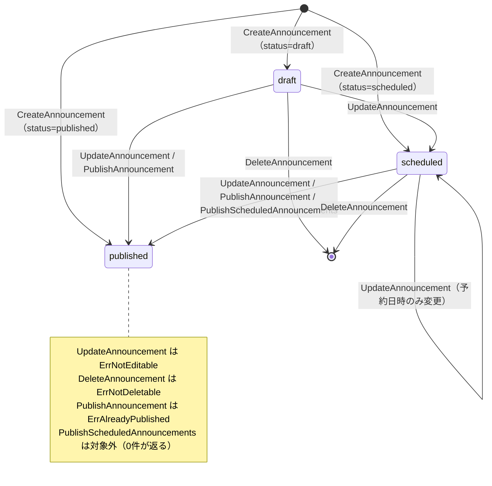
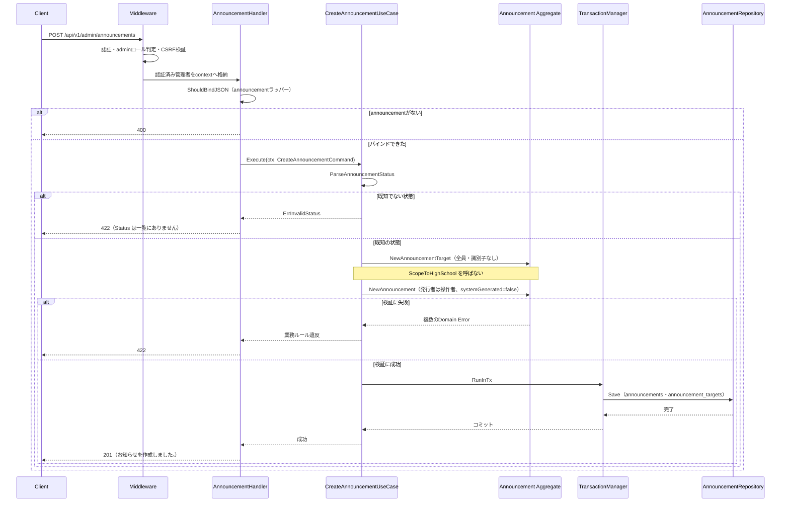
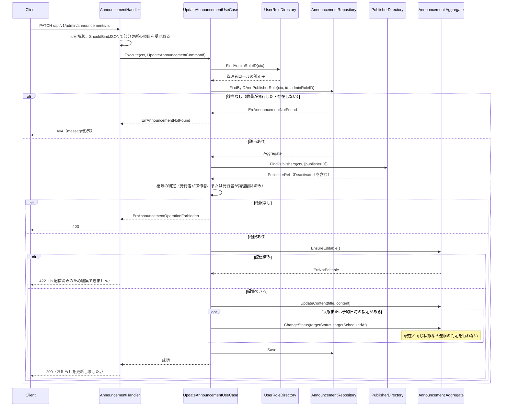
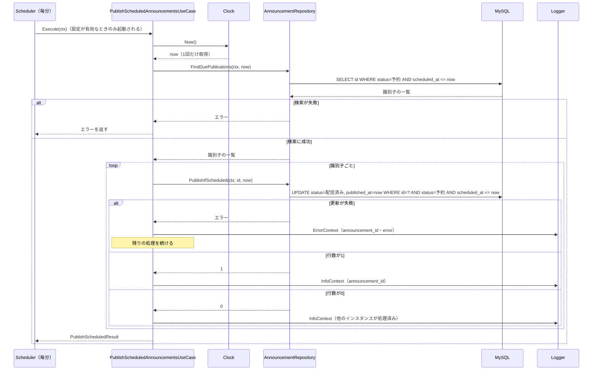
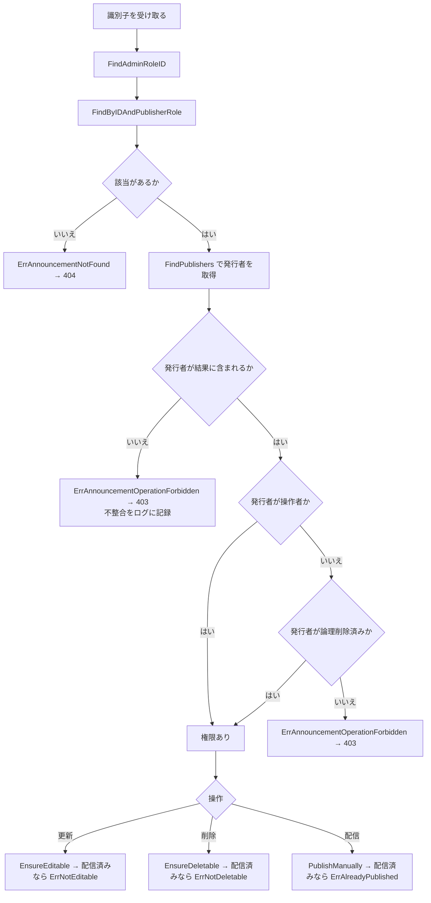
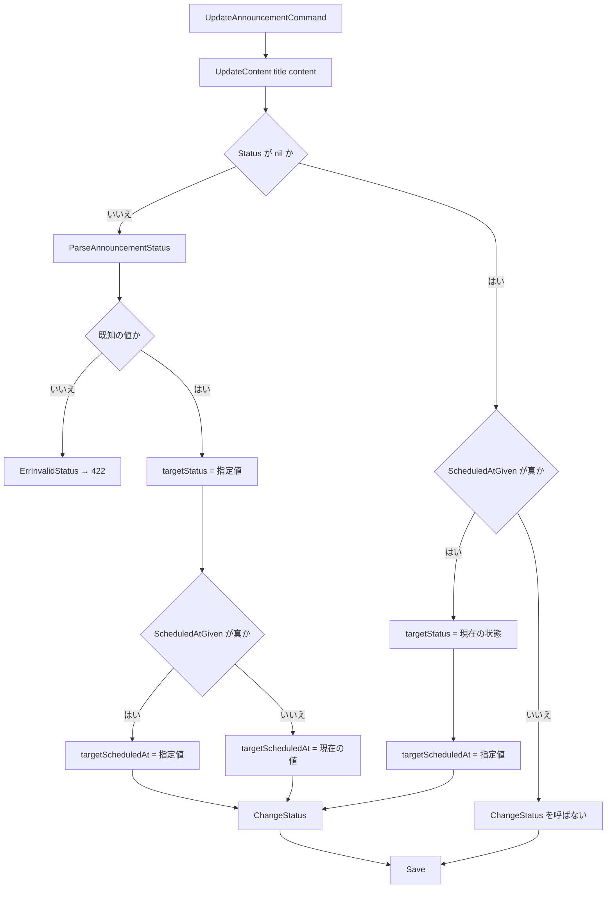
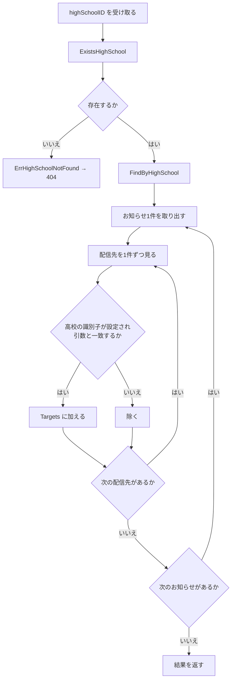

# 管理者お知らせ管理機能 Go実装仕様書

---

# 1. 機能概要

## 機能概要

管理者が、全利用者に向けたお知らせを作成・更新・削除・配信できるようにする機能である。あわせて高校ごとのお知らせを参照できるようにする（②「1. 機能概要」）。エンドポイントは7つで、**予約配信の自動切替**（定期実行）も本機能が担う。

|エンドポイント|概要|
|-|-|
|`GET /api/v1/admin/announcements`|お知らせ一覧（件名の検索・状態の絞り込み。**本文を含まない**）|
|`GET /api/v1/admin/announcements/:id`|お知らせ詳細|
|`POST /api/v1/admin/announcements`|お知らせ作成（配信先は「全員」で固定）|
|`PATCH` / `PUT /api/v1/admin/announcements/:id`|お知らせ更新（**部分更新**）|
|`DELETE /api/v1/admin/announcements/:id`|お知らせ削除（物理削除）|
|`POST /api/v1/admin/announcements/:id/publish`|お知らせ配信（手動）|
|`GET /api/v1/admin/high_schools/:high_school_id/announcements`|高校別お知らせ一覧|

加えてHTTPを経由しない定期実行を1つ持つ。

|処理|概要|
|-|-|
|`PublishScheduledAnnouncements`|予約日時を過ぎた予約状態のお知らせを配信済みへ切り替える（毎分）|

## 採用設計パターンとその理由（②からの要約）

**Domain Model**（②「4. 設計パターン」）

判断根拠は教師お知らせ機能②「4. 設計パターン」に集約されている。本機能に固有の根拠として、作成・更新・手動配信・自動切替の4経路から配信済みへ遷移するため、遷移の規則をEntityに集めないと4か所に同じ判定が重複する点がある（②「4. 設計パターン」）。削除の可否も状態に依存する。

## 本書が対象とする実装範囲

- application層（`application/admin/`配下のUseCase 8つとDTO 7つ）
- Presentation層（`presentation/admin/`配下のHandler 2つ・Request DTO 2つ・Response DTO 4つ）

Domain層・Infrastructure層・`context.go`・`dependency.go`・Transaction / Validation / Authorization / Errorの実装方針は、**`教師お知らせ機能_Go実装仕様書_1_Domain・Infrastructure.md`（以下「基盤編」）に記載する。** 本書では繰り返さず参照する。

`presentation/routes.go`は教師お知らせ機能③_2が作成する。本書は自身の7ルートを同ファイルへ追加する。

定期実行の起動（周期の管理・設定値による有効化）は`cmd/server/main.go`で行う。周期実行の共通基盤そのものは規約「13. 非同期ジョブ実行パターン（JobQueue）」の「定期実行」が定めており、本書はUseCaseとその呼び出し方を定める（「17. ②からの補足事項」参照）。

---

# 2. ディレクトリ構成

## 対象Bounded Context名

- `announcement`（②「3. Bounded Context」）。ディレクトリは`internal/announcement/`、package名は`announcement`

Context全体のファイル一覧と担当文書の対応は基盤編「2. ディレクトリ構成」に記載する。

## ②で採用した設計パターン

Domain Model（②「4. 設計パターン」）。Context全体の構成もDomain Modelである。

## 本書が担当するファイル一覧

```
internal/announcement/application/admin/usecase/list_announcements.go
internal/announcement/application/admin/usecase/show_announcement.go
internal/announcement/application/admin/usecase/create_announcement.go
internal/announcement/application/admin/usecase/update_announcement.go
internal/announcement/application/admin/usecase/delete_announcement.go
internal/announcement/application/admin/usecase/publish_announcement.go
internal/announcement/application/admin/usecase/list_high_school_announcements.go
internal/announcement/application/admin/usecase/publish_scheduled_announcements.go
internal/announcement/application/admin/dto/list_announcements_query.go
internal/announcement/application/admin/dto/announcement_list_item.go
internal/announcement/application/admin/dto/announcement_detail.go
internal/announcement/application/admin/dto/create_announcement_command.go
internal/announcement/application/admin/dto/update_announcement_command.go
internal/announcement/application/admin/dto/high_school_announcement_item.go
internal/announcement/application/admin/dto/publish_command.go
internal/announcement/presentation/admin/handler/announcement_handler.go
internal/announcement/presentation/admin/handler/high_school_announcement_handler.go
internal/announcement/presentation/admin/request/announcement_request.go
internal/announcement/presentation/admin/request/list_announcements_request.go
internal/announcement/presentation/admin/response/announcement_list_response.go
internal/announcement/presentation/admin/response/announcement_detail_response.go
internal/announcement/presentation/admin/response/high_school_announcement_response.go
internal/announcement/presentation/admin/response/announcement_target_response.go
```

実装23ファイル、テストが付くもの（UseCase 8・Handler 2の10）を加えて33である。1文書あたり30〜35という範囲の上限に近いが収まるため分割しない（③自動生成プロンプト「文書の分割（1文書あたり30〜35ファイル）」）。

**`application/admin/`・`presentation/admin/`に置く。** 3機能がいずれも`AnnouncementHandler`を持ち名前が衝突するため、ロール別のサブディレクトリに分ける（基盤編「2. ディレクトリ構成」、規約「4. Bounded Context構成」の末尾）。

**Handlerを2つに分ける。** `/announcements`配下の6エンドポイントと`/high_schools/:high_school_id/announcements`は、URLの階層・対象の定義・レスポンスの項目がいずれも異なる。Rails現行も`Api::V1::Admin::AnnouncementsController`と`Api::V1::Admin::HighSchools::AnnouncementsController`に分かれている（①「4. API一覧」）。

## 定期実行のUseCaseの置き場所

`PublishScheduledAnnouncements`は操作者を持たず、利用者ロールに紐づかない。それでも`application/admin/usecase/`に置く。理由は「17. ②からの補足事項」1に記載する。

---

# 3. Domain層設計

対象外。基盤編「3. Domain層設計」に記載する。

本機能が使うDomain層の範囲を示す。

|対象|本機能での使い方|
|-|-|
|`entity.Announcement`|作成・更新・削除・手動配信。`NewAnnouncement`・`UpdateContent`・`ChangeStatus`・`PublishManually`・`EnsureEditable`・`EnsureDeletable`を使う|
|`entity.AnnouncementTarget`|作成時に「全員」1件を組み立てる。高校別一覧で配信先の項目を読む|
|`valueobject.AnnouncementStatus`|作成・更新の指定、一覧の絞り込み条件|
|`valueobject.ScheduledAt`|作成・更新の指定|
|`valueobject.DeliveryTargetType`|作成時に「全員」を指定するためにのみ使う|
|`service.TargetDeliverabilityPolicy`|**使わない。** 配信先を指定する手段がないため、判定の対象になる入力が存在しない（②「8. Domain Service」）|
|`entity.AnnouncementTarget.ScopeToHighSchool`|**呼ばない。** 管理者は所属校を持たない（②「6. Entity設計」）|
|`entity.Announcement.ReplaceTargets`|**呼ばない。** 本機能に配信先を入れ替える操作がない（②「5. Aggregate設計」）|
|`entity.Announcement.PublishByScheduler`|**呼ばない。** 自動切替は`PublishIfScheduled`が更新条件付きの更新で行うため、Entityを経由しない（基盤編「3. Domain層設計」）|
|`repository.AnnouncementRepository`|`Save`・`FindByIDAndPublisherRole`・`FindByPublisherRole`・`FindByHighSchool`・`FindDuePublications`・`PublishIfScheduled`・`Delete`の7メソッド|
|`domain/errors.go`|作成・更新・削除・配信で返るすべてのセンチネルエラーのうち、配信先に関するもの（`ErrGradeNotFound`等）を除いたもの|

本書で定義するセンチネルエラーはない。`ErrHighSchoolNotFound`・`ErrAnnouncementOperationForbidden`も基盤編の`domain/errors.go`に定義する（「14. Error実装方針」）。

---

# 4. クラス図

Domain層のクラス図は基盤編「4. クラス図」に記載する。本書ではUseCaseとDTOの関係を示す。

```mermaid
classDiagram
    class ListAnnouncementsUseCase {
        -AnnouncementRepository repo
        -UserRoleDirectory roles
        +Execute(ctx, ListAnnouncementsQuery) (ListAnnouncementsResult, error)
    }
    class ShowAnnouncementUseCase {
        -AnnouncementRepository repo
        -UserRoleDirectory roles
        +Execute(ctx, id) (*AnnouncementDetail, error)
    }
    class CreateAnnouncementUseCase {
        -AnnouncementRepository repo
        -TransactionManager tx
        -Clock clock
        +Execute(ctx, CreateAnnouncementCommand) error
    }
    class UpdateAnnouncementUseCase {
        -AnnouncementRepository repo
        -UserRoleDirectory roles
        -PublisherDirectory publishers
        +Execute(ctx, UpdateAnnouncementCommand) error
    }
    class DeleteAnnouncementUseCase {
        -AnnouncementRepository repo
        -UserRoleDirectory roles
        -PublisherDirectory publishers
        -TransactionManager tx
        +Execute(ctx, operatorID, id) error
    }
    class PublishAnnouncementUseCase {
        -AnnouncementRepository repo
        -UserRoleDirectory roles
        -PublisherDirectory publishers
        +Execute(ctx, PublishCommand) error
    }
    class ListHighSchoolAnnouncementsUseCase {
        -AnnouncementRepository repo
        -GradeOptionDirectory schools
        +Execute(ctx, highSchoolID, page, perPage) (HighSchoolAnnouncementsResult, error)
    }
    class PublishScheduledAnnouncementsUseCase {
        -AnnouncementRepository repo
        -Clock clock
        -Logger logger
        +Execute(ctx) error
    }

    class ListAnnouncementsQuery {
        +string Keyword
        +*AnnouncementStatus Status
        +int Page
        +int PerPage
    }
    class AnnouncementListItem {
        +uint ID
        +string Title
        +string Status
        +*string TargetType
        +*time.Time PublishedAt
        +*time.Time ScheduledAt
        +time.Time CreatedAt
        +PublisherRef Publisher
    }
    class AnnouncementDetail {
        +AnnouncementListItem
        +string Content
    }
    class CreateAnnouncementCommand {
        +uint OperatorID
        +string Title
        +string Content
        +string Status
        +*time.Time ScheduledAt
    }
    class UpdateAnnouncementCommand {
        +uint OperatorID
        +uint AnnouncementID
        +*string Title
        +*string Content
        +*string Status
        +*time.Time ScheduledAt
        +bool ScheduledAtGiven
    }
    class HighSchoolAnnouncementItem {
        +uint ID
        +string Title
        +string Content
        +string Status
        +*time.Time PublishedAt
        +*time.Time ScheduledAt
        +time.Time CreatedAt
        +[]TargetItem Targets
        +PublisherRef Publisher
    }
    class PublishCommand {
        +uint OperatorID
        +uint AnnouncementID
    }

    ListAnnouncementsUseCase ..> ListAnnouncementsQuery
    ListAnnouncementsUseCase ..> AnnouncementListItem
    ShowAnnouncementUseCase ..> AnnouncementDetail
    AnnouncementDetail --|> AnnouncementListItem
    CreateAnnouncementUseCase ..> CreateAnnouncementCommand
    UpdateAnnouncementUseCase ..> UpdateAnnouncementCommand
    PublishAnnouncementUseCase ..> PublishCommand
    ListHighSchoolAnnouncementsUseCase ..> HighSchoolAnnouncementItem
```



`AnnouncementDetail`が`AnnouncementListItem`を埋め込むのは、詳細が一覧の各要素に本文を加えたものであるためである（①「5. API / 処理詳細」`#show`）。項目の定義を1か所に保つ。

`UpdateAnnouncementCommand`の件名・本文・状態を`*string`にするのは、部分更新で「渡されなかった」ことを表すためである（②「12. UseCase設計」）。予約日時は`*time.Time`で`nil`も有効な値（予約日時を消す指定）になりうるため、**`ScheduledAtGiven bool`を別に持つ**（「17. ②からの補足事項」参照）。

`DeleteAnnouncementUseCase`がCommand DTOを取らないのは、入力が操作者とお知らせの識別子の2つだけであり、`PublishCommand`と同じ形になるためである。`PublishCommand`を削除に流用すると型の名前が実際の用途と合わなくなるため、引数で受け取る。

---

# 5. 状態遷移図

状態遷移そのものは基盤編「5. 状態遷移図」に記載する。本書では本機能の各操作がどの遷移を起こすかを示す。



|操作|呼ぶEntityの操作|予約日時|配信日時|
|-|-|-|-|
|`CreateAnnouncement`|`NewAnnouncement`|予約状態なら必須かつ未来日時|配信済みで作成するとき設定|
|`UpdateAnnouncement`|`UpdateContent`・`ChangeStatus`|指定があれば変更|配信済みへの遷移で設定|
|`PublishAnnouncement`|`PublishManually`|**消す**|設定|
|`DeleteAnnouncement`|`EnsureDeletable`|-|-|
|`PublishScheduledAnnouncements`|**呼ばない**（`PublishIfScheduled`が更新条件付きの更新で行う）|**消さない**|更新と同時に設定|

**予約のまま予約日時だけを変更する経路がある。** `ChangeStatus`に現在と同じ状態が渡された場合は遷移の判定を行わず、予約日時のみを変更する（基盤編「3. Domain層設計」）。

**配信済みのお知らせに予約日時が残っているかどうかで、どちらの経路で配信されたかが分かる。** 手動配信は消し、自動切替は残す（①「7. 状態管理」）。

---

# 6. Application層設計

## DTO（Command / Query）

|struct名|ファイル|フィールド|区分|
|-|-|-|-|
|`ListAnnouncementsQuery`|`list_announcements_query.go`|`Keyword string`・`Status *valueobject.AnnouncementStatus`・`Page int`・`PerPage int`|Query|
|`ListAnnouncementsResult`|同|`Items []AnnouncementListItem`・`TotalCount int64`・`CurrentPage int`・`PerPage int`|出力|
|`AnnouncementListItem`|`announcement_list_item.go`|`ID uint`・`Title string`・`Status string`・`TargetType *string`・`PublishedAt *time.Time`・`ScheduledAt *time.Time`・`CreatedAt time.Time`・`Publisher PublisherRef`|出力|
|`AnnouncementDetail`|`announcement_detail.go`|`AnnouncementListItem`（埋め込み）・`Content string`|出力|
|`CreateAnnouncementCommand`|`create_announcement_command.go`|`OperatorID uint`・`Title string`・`Content string`・`Status string`・`ScheduledAt *time.Time`|Command|
|`UpdateAnnouncementCommand`|`update_announcement_command.go`|`OperatorID uint`・`AnnouncementID uint`・`Title *string`・`Content *string`・`Status *string`・`ScheduledAt *time.Time`・`ScheduledAtGiven bool`|Command|
|`HighSchoolAnnouncementItem`|`high_school_announcement_item.go`|`ID uint`・`Title string`・`Content string`・`Status string`・`PublishedAt *time.Time`・`ScheduledAt *time.Time`・`CreatedAt time.Time`・`Targets []TargetItem`・`Publisher PublisherRef`|出力|
|`TargetItem`|同|`ID uint`・`TargetType string`・`HighSchoolID *uint`・`GradeID *uint`・`UserRoleID *uint`・`UserID *uint`|出力|
|`HighSchoolAnnouncementsResult`|同|`Items []HighSchoolAnnouncementItem`・`TotalCount int64`・`CurrentPage int`・`PerPage int`|出力|
|`PublishCommand`|`publish_command.go`|`OperatorID uint`・`AnnouncementID uint`|Command|
|`PublishScheduledResult`|同|`PublishedIDs []uint`・`SkippedIDs []uint`・`FailedIDs []uint`|出力|

`Status`を文字列で受け取り、`valueobject.AnnouncementStatus`への変換をUseCaseで行う。Presentation層がDomain層のValue Objectを組み立てない形にするためである（アーキテクチャ規約「6. データフロー」）。一覧の`Status`のみ例外で、**Presentation層で変換済みの値を受け取る。** 既知でない値を「絞り込まない」として扱う判断がHTTPの関心であるためである（②「7. Value Object設計」）。

`AnnouncementListItem.Status`を文字列にするのは、レスポンスの`status`が`draft` / `scheduled` / `published`の文字列であるためである（①「5. API / 処理詳細」`#index`）。`AnnouncementStatus.String`で変換する。

`TargetType`を`*string`にするのは、**配信先が0件のお知らせでは`null`になる**ためである（同）。管理者が作成したお知らせは常に「全員」1件を持つが、Rails現行の実装が1件目を取り出す形であり、配信先が0件のデータに対しては`null`になる。

`PublisherRef`は`dependency.go`に定義された型である（基盤編「8. Infrastructure層設計」）。

`PublishScheduledResult`を定義するのは、定期実行の結果をログに残し、テストで検証できるようにするためである（「16. テストケース設計」）。HTTPを経由しないため、レスポンスにはならない。

## UseCase

### ListAnnouncementsUseCase（`application/admin/usecase/list_announcements.go`）

|項目|内容|
|-|-|
|struct名|`ListAnnouncementsUseCase`|
|コンストラクタが受け取る依存|`repository.AnnouncementRepository`、`announcement.UserRoleDirectory`|
|公開メソッド|`Execute(ctx context.Context, q dto.ListAnnouncementsQuery) (dto.ListAnnouncementsResult, error)`|

処理ステップ:

1. `roles.FindAdminRoleID(ctx)`で管理者ロールの識別子を取得する
2. `repository.AdminSearchCondition{PublisherRoleID: adminRoleID, Keyword: q.Keyword, Status: q.Status}`を組み立てる
3. `repo.FindByPublisherRole(ctx, cond, q.Page, q.PerPage)`を呼ぶ
4. `AnnouncementListItem`へ変換する。`TargetType`は配信先の1件目の種類。配信先が0件なら`nil`
5. 総件数・ページ情報を添えて返す

**権限の判定を行わない。** 管理者が発行したお知らせであれば、他の管理者のものも一覧に現れる（①「8. 権限制御」）。

**本文を返さない。** `AnnouncementListItem`に`Content`を持たせない（①「5. API / 処理詳細」`#index`）。

`Items`が`nil`にならないようにする。空スライスを入れる。

`FindAdminRoleID`の失敗を吸収しない。対象の定義そのものが決まらないためである。

発生しうるApplication Error: なし。

### ShowAnnouncementUseCase（`application/admin/usecase/show_announcement.go`）

|項目|内容|
|-|-|
|struct名|`ShowAnnouncementUseCase`|
|コンストラクタが受け取る依存|`repository.AnnouncementRepository`、`announcement.UserRoleDirectory`|
|公開メソッド|`Execute(ctx context.Context, id uint) (*dto.AnnouncementDetail, error)`|

処理ステップ:

1. `roles.FindAdminRoleID(ctx)`
2. `repo.FindByIDAndPublisherRole(ctx, id, adminRoleID)`を呼ぶ。該当しなければ`ErrAnnouncementNotFound`
3. `AnnouncementDetail`へ変換して返す

**操作者の識別子を受け取らない。** 権限の判定を行わないためである（①「5. API / 処理詳細」`#show`）。他の管理者が発行したお知らせの詳細も取得できる。

**教員が発行したお知らせは`404`となる。** 絞り込みの段階で除かれる（②「16. Authorization設計」）。

ただし`FindByIDAndPublisherRole`は発行者の氏名を含む`DeliveredAnnouncement`を返さない（基盤編「3. Domain層設計」）。発行者の氏名は`PublisherDirectory.FindPublishers`で取得する。詳細1件のためN+1にならない。

発生しうるApplication Error: `ErrAnnouncementNotFound`（404）。

### CreateAnnouncementUseCase（`application/admin/usecase/create_announcement.go`）

|項目|内容|
|-|-|
|struct名|`CreateAnnouncementUseCase`|
|コンストラクタが受け取る依存|`repository.AnnouncementRepository`、`announcement.TransactionManager`、`announcement.Clock`|
|公開メソッド|`Execute(ctx context.Context, cmd dto.CreateAnnouncementCommand) error`|

処理ステップ:

1. `valueobject.ParseAnnouncementStatus(cmd.Status)`。既知でない値は`ErrInvalidStatus`
2. 配信先として`entity.NewAnnouncementTarget(DeliveryTargetTypeAllUsers, nil, nil, nil, nil)`を1件組み立てる。**`ScopeToHighSchool`を呼ばない**
3. `entity.NewAnnouncement(cmd.Title, cmd.Content, status, scheduledAt, cmd.OperatorID, false, targets)`を呼ぶ。検証に失敗したエラーをそのまま返す
4. トランザクション内で`repo.Save(ctx, a)`を呼ぶ
5. 識別子を返さない

**配信先に所属校を付与しない。** 管理者は所属校を持たず、付与しても意味がない（①「5. API / 処理詳細」`#create`）。全員向けの配信先の高校が未設定であることが、全利用者へ届く条件である（基盤編「8. Infrastructure層設計」の配信範囲の突き合わせ）。

`systemGenerated`に`false`を渡す。管理者の操作によるお知らせであり、システムが自動生成したものではない（同）。

**トランザクションで囲む。** お知らせと配信先の作成が2テーブルへの書き込みになる（②「14. Transaction設計」）。

**作成したお知らせの識別子を返さない。** 教師お知らせ機能の作成が返すのとは異なる（①「5. API / 処理詳細」`#create`）。

状態は必須である。`cmd.Status`が空文字なら`ErrInvalidStatus`となる。教師お知らせ機能が未指定を下書きとして扱うのとは異なる（同）。

発生しうるApplication Error: なし（Domain Errorのみ）。

### UpdateAnnouncementUseCase（`application/admin/usecase/update_announcement.go`）

|項目|内容|
|-|-|
|struct名|`UpdateAnnouncementUseCase`|
|コンストラクタが受け取る依存|`repository.AnnouncementRepository`、`announcement.UserRoleDirectory`、`announcement.PublisherDirectory`|
|公開メソッド|`Execute(ctx context.Context, cmd dto.UpdateAnnouncementCommand) error`|

処理ステップ:

1. `roles.FindAdminRoleID(ctx)`
2. `repo.FindByIDAndPublisherRole(ctx, cmd.AnnouncementID, adminRoleID)`。該当しなければ`ErrAnnouncementNotFound`
3. `publishers.FindPublishers(ctx, []uint{a.PublisherID()})`で発行者の在籍状態を取得する
4. 権限を判定する。`a.PublisherID() == cmd.OperatorID`、または発行者が論理削除済みであれば通過。そうでなければ`ErrAnnouncementOperationForbidden`
5. `a.EnsureEditable()`を呼ぶ。配信済みなら`ErrNotEditable`
6. `a.UpdateContent(cmd.Title, cmd.Content)`を呼ぶ。`nil`の項目は変更されない
7. 状態または予約日時の指定があれば`a.ChangeStatus(targetStatus, targetScheduledAt)`を呼ぶ
8. `repo.Save(ctx, a)`を呼ぶ

手順7の`targetStatus`・`targetScheduledAt`の決め方:

|入力|`targetStatus`|`targetScheduledAt`|
|-|-|-|
|状態のみ指定|指定値を変換したもの|現在の値|
|予約日時のみ指定（`ScheduledAtGiven`が真）|現在の状態|指定値（`nil`なら未設定）|
|両方指定|指定値を変換したもの|指定値|
|どちらも未指定|`ChangeStatus`を呼ばない|-|

**現在と同じ状態が渡された場合、`ChangeStatus`は遷移の判定を行わず予約日時のみを変更する**（基盤編「3. Domain層設計」）。予約のお知らせの予約日時だけを変更する操作が正当であるためである。

**状態が指定され、既知でない値（空文字を含む）の場合は`ErrInvalidStatus`を返す。** ①「5. API / 処理詳細」`#update`が「状態の値の検証（既知の3つのいずれか）は更新時も行う」と定めている。教師お知らせ機能③_2が空の状態を「変更しない」として扱うのとは判断が異なる（「17. ②からの補足事項」3参照）。

**トランザクションで囲まない。** `announcements`1テーブルへの更新のみである（②「12. UseCase設計」）。Repositoryの`Save`が1回の更新で完結する。

**配信先を更新しない。** `ReplaceTargets`を呼ばない（②「5. Aggregate設計」）。

発生しうるApplication Error: `ErrAnnouncementNotFound`（404）、`ErrAnnouncementOperationForbidden`（403）。

### DeleteAnnouncementUseCase（`application/admin/usecase/delete_announcement.go`）

|項目|内容|
|-|-|
|struct名|`DeleteAnnouncementUseCase`|
|コンストラクタが受け取る依存|`repository.AnnouncementRepository`、`announcement.UserRoleDirectory`、`announcement.PublisherDirectory`、`announcement.TransactionManager`|
|公開メソッド|`Execute(ctx context.Context, operatorID, id uint) error`|

処理ステップ:

1. `roles.FindAdminRoleID(ctx)`
2. `repo.FindByIDAndPublisherRole(ctx, id, adminRoleID)`。該当しなければ`ErrAnnouncementNotFound`
3. 権限を判定する（更新と同じ）
4. `a.EnsureDeletable()`を呼ぶ。配信済みなら`ErrNotDeletable`
5. トランザクション内で`repo.Delete(ctx, a)`を呼ぶ

**`EnsureDeletable`を呼ぶ。** `EnsureEditable`ではない。Rails現行のメッセージが「配信済みのため削除できません」であり、編集時の文言と異なる（①「5. API / 処理詳細」`#destroy`）。

**トランザクションで囲む。** 配信先とお知らせの2テーブルから削除する（②「14. Transaction設計」）。

**物理削除である。** 論理削除の列がない（①「5. API / 処理詳細」`#destroy`）。

発生しうるApplication Error: `ErrAnnouncementNotFound`（404）、`ErrAnnouncementOperationForbidden`（403）。

### PublishAnnouncementUseCase（`application/admin/usecase/publish_announcement.go`）

|項目|内容|
|-|-|
|struct名|`PublishAnnouncementUseCase`|
|コンストラクタが受け取る依存|`repository.AnnouncementRepository`、`announcement.UserRoleDirectory`、`announcement.PublisherDirectory`|
|公開メソッド|`Execute(ctx context.Context, cmd dto.PublishCommand) error`|

処理ステップ:

1. `roles.FindAdminRoleID(ctx)`
2. `repo.FindByIDAndPublisherRole(ctx, cmd.AnnouncementID, adminRoleID)`。該当しなければ`ErrAnnouncementNotFound`
3. 権限を判定する（更新と同じ）
4. `a.PublishManually()`を呼ぶ。既に配信済みなら`ErrAlreadyPublished`
5. `repo.Save(ctx, a)`を呼ぶ

**`EnsureEditable`を呼ばない。** 配信済みかどうかの判定は`PublishManually`が行い、返るエラーが`ErrAlreadyPublished`である（①「5. API / 処理詳細」`#publish`）。`EnsureEditable`を先に呼ぶと`ErrNotEditable`になり、メッセージが変わってしまう。

**下書き・予約のいずれからも配信できる。** `PublishManually`が遷移の判定を`CanTransitionTo`に委ねず、配信済みかどうかのみを見る（基盤編「3. Domain層設計」）。

**予約日時を消す。** 自動切替との違いである（①「7. 状態管理」）。

**トランザクションで囲まない。** `announcements`1テーブルへの更新のみである。

発生しうるApplication Error: `ErrAnnouncementNotFound`（404）、`ErrAnnouncementOperationForbidden`（403）。

### ListHighSchoolAnnouncementsUseCase（`application/admin/usecase/list_high_school_announcements.go`）

|項目|内容|
|-|-|
|struct名|`ListHighSchoolAnnouncementsUseCase`|
|コンストラクタが受け取る依存|`repository.AnnouncementRepository`、`announcement.GradeOptionDirectory`|
|公開メソッド|`Execute(ctx context.Context, highSchoolID uint, page, perPage int) (dto.HighSchoolAnnouncementsResult, error)`|

処理ステップ:

1. `schools.ExistsHighSchool(ctx, highSchoolID)`で高校の実在を確認する。存在しなければ`ErrHighSchoolNotFound`
2. `repo.FindByHighSchool(ctx, highSchoolID, page, perPage)`を呼ぶ
3. お知らせごとに、**配信先のうち高校の識別子が引数と一致するものだけを抜き出す**
4. `HighSchoolAnnouncementItem`へ変換して返す

手順3の絞り込み条件は「配信先の高校の識別子が設定されており、かつ引数と一致する」である。他校向け・全校向け（高校が未設定）の配信先は除かれる（①「5. API / 処理詳細」）。

**この絞り込みをUseCaseで行う。** Repositoryは配信先の全件を含むAggregateを返し、表示に出す範囲をUseCaseが決める（②「12. UseCase設計」）。Aggregateの読み込みを表示の都合で変えない。

**本文を返す。** 管理者向けのお知らせ一覧が本文を返さないのとは異なる（①「5. API / 処理詳細」）。

**発行者のロールを問わない。** 教員が自校向けに作成したお知らせが主な対象になる（同）。

**状態による絞り込みを行わない。** 下書き・予約も含まれる（同）。

`GradeOptionDirectory`から`ExistsHighSchool`を使う。高校の実在確認が学年の選択肢の取得と同じインターフェースにあるのは、どちらも`master-data`への問い合わせであり、本Contextが使うメソッド数が少ないためである（基盤編「8. Infrastructure層設計」）。

発生しうるApplication Error: `ErrHighSchoolNotFound`（404）。

### PublishScheduledAnnouncementsUseCase（`application/admin/usecase/publish_scheduled_announcements.go`）

|項目|内容|
|-|-|
|struct名|`PublishScheduledAnnouncementsUseCase`|
|コンストラクタが受け取る依存|`repository.AnnouncementRepository`、`announcement.Clock`、`*slog.Logger`|
|公開メソッド|`Execute(ctx context.Context) (dto.PublishScheduledResult, error)`|

処理ステップ:

1. `now := clock.Now()`で基準時刻を1回だけ取得する
2. `repo.FindDuePublications(ctx, now)`で対象の識別子を取得する。失敗した場合はエラーを返す
3. 識別子ごとに`repo.PublishIfScheduled(ctx, id, now)`を呼ぶ
4. 更新された行数が1なら`PublishedIDs`へ加え、配信した識別子をログに記録する
5. 更新された行数が0なら`SkippedIDs`へ加え、他のインスタンスが処理済みとしてログに記録する
6. 失敗した場合は`FailedIDs`へ加え、識別子と失敗の内容をログに記録して**次の対象へ進む**
7. すべての対象を処理したら結果を返す

**全体をトランザクションで囲まない**（規約「13. 非同期ジョブ実行パターン（JobQueue）」の「定期実行」）。1件の失敗で周期全体が巻き戻ると、先頭の1件が恒久的に失敗する状態になったときに以降のすべての配信が止まる。

**1件ごとの更新もトランザクションで囲まない。** `PublishIfScheduled`が1回の`UPDATE`で状態と配信日時をまとめて変える（基盤編「8. Infrastructure層設計」）。

**基準時刻を1回だけ取得し、検索と更新の両方に同じ値を渡す。** 検索時点では条件を満たしていた対象が、更新時には現在時刻が進んだために条件から外れる、という取りこぼしを防ぐ。更新条件の`scheduled_at <= ?`に渡す値が検索時と同じであれば、検索で得た対象は必ず条件を満たす。

**手順2の失敗ではエラーを返す。** 対象が1件も特定できていない段階であり、周期の処理が成立しない。手順3以降の失敗は呼び出し元へ伝えない（②「17. Error設計」）。

**`Announcement` Entityを経由しない。** 更新条件に遷移前の状態を含めた更新を1回で発行するためである（基盤編「3. Domain層設計」）。Entityを取得してから更新すると、取得と更新の間に他のインスタンスが処理する余地が生まれる。`PublishByScheduler`は呼ばない。

**予約日時を消さない**（①「9. 非同期処理」）。`PublishIfScheduled`が`scheduled_at`を更新しない（基盤編「8. Infrastructure層設計」）。

**発行者のロールを問わない。** 管理者が作成した予約も教員が作成した予約も対象になる（①「9. 非同期処理」）。`FindDuePublications`に発行者の条件を渡さない。

ログは構造化ログとして出力する（コーディング規約「22. ロギング」の「構造化ロギング」）。`announcement_id`をkey-valueのペアで渡し、文字列連結で組み立てない。

発生しうるApplication Error: なし。`FindDuePublications`の失敗のみを返す。

---

# 7. シーケンス図・処理フロー図

## シーケンス図

### CreateAnnouncement



### UpdateAnnouncement



### PublishScheduledAnnouncements（定期実行）



## 処理フロー図

### 更新・削除・配信の対象の絞り込みと権限の判定



**対象の絞り込みと権限の判定が別の段階である。** 教員が発行したお知らせは絞り込みで除かれて`404`、他の管理者が発行したお知らせは絞り込みを通過してから権限の判定で`403`になる（②「16. Authorization設計」）。

### 部分更新で状態と予約日時をどう扱うか



### 高校別一覧の配信先の絞り込み



---

# 8. Infrastructure層設計

対象外。基盤編「8. Infrastructure層設計」に記載する。

本機能が使うInfrastructure層の範囲を示す。

|対象|本機能での使い方|
|-|-|
|`announcementRepository.Save`|作成・更新・手動配信|
|`announcementRepository.FindByIDAndPublisherRole`|詳細・更新・削除・手動配信|
|`announcementRepository.FindByPublisherRole`|一覧|
|`announcementRepository.FindByHighSchool`|高校別一覧|
|`announcementRepository.FindDuePublications`|定期実行|
|`announcementRepository.PublishIfScheduled`|定期実行|
|`announcementRepository.Delete`|削除|
|`userDirectory`（`UserRoleDirectory`として）|`FindAdminRoleID`。対象の絞り込み|
|`userDirectory`（`PublisherDirectory`として）|`FindPublishers`。権限の判定と発行者の氏名|
|`gradeDirectory`（`GradeOptionDirectory`として）|`ExistsHighSchool`。高校の実在確認|
|`teacherPermissionDirectory`・`studentDirectory`|**使わない**|
|`announcementRepository.FindDeliveredTo` / `FindDeliveredToByID` / `FindByIDAndPublisher` / `FindByID` / `FindAuthoredBy`|**使わない**|

本書が担当するInfrastructure層の実装はない。

`UserRoleDirectory.ExistsAllUserRoles`・`FindAssignableUserRoles`も使わない。配信先を指定する手段がないためである。基盤編「8. Infrastructure層設計」が`UserRoleDirectory`を「教師お知らせ機能・管理者お知らせ管理機能」で使うとしているのは、本機能が`FindAdminRoleID`を使うという意味である。

## 定期実行の起動

`cmd/server/main.go`で行う。規約「13. 非同期ジョブ実行パターン（JobQueue）」の「定期実行」の起動イメージに従う。

|項目|内容|
|-|-|
|周期|1分|
|有効・無効|設定値（環境変数）で切り替える。Railsの`ENABLE_SIDEKIQ_CRON`に対応する（①「9. 非同期処理」）|
|呼び出す対象|`announcement.Context`が公開する`PublishScheduledAnnouncementsUseCase`|
|`context.Context`|プロセスの終了で取り消されるものを渡す|

周期実行の共通基盤（`scheduler`パッケージ）そのものの実装は本書の範囲外である（「17. ②からの補足事項」2参照）。

---

# 9. Presentation層設計

## Handler

### AnnouncementHandler（`presentation/admin/handler/announcement_handler.go`）

|項目|内容|
|-|-|
|struct名|`AnnouncementHandler`|
|保持するフィールド|`listUC`・`showUC`・`createUC`・`updateUC`・`deleteUC`・`publishUC`|
|コンストラクタ|`NewAnnouncementHandler(listUC *usecase.ListAnnouncementsUseCase, showUC *usecase.ShowAnnouncementUseCase, createUC *usecase.CreateAnnouncementUseCase, updateUC *usecase.UpdateAnnouncementUseCase, deleteUC *usecase.DeleteAnnouncementUseCase, publishUC *usecase.PublishAnnouncementUseCase) *AnnouncementHandler`|

|メソッド|対応するエンドポイント|
|-|-|
|`Index`|GET `/api/v1/admin/announcements`|
|`Show`|GET `/api/v1/admin/announcements/:id`|
|`Create`|POST `/api/v1/admin/announcements`|
|`Update`|PATCH / PUT `/api/v1/admin/announcements/:id`|
|`Destroy`|DELETE `/api/v1/admin/announcements/:id`|
|`Publish`|POST `/api/v1/admin/announcements/:id/publish`|

全メソッドに共通する手順:

1. パスパラメータ・クエリパラメータ・ボディを解釈する。解釈できない場合は`c.Error`に積んで戻る
2. 操作者の識別子を`context.Context`から取り出す（コーディング規約「20. `context.Context`」）。リクエストから受け取らない
3. UseCaseを呼ぶ
4. エラーの場合は`c.Error(err)`を呼んで戻る。ステータスとレスポンス本文への変換は`ErrorHandler`が行う（Gin規約「8. エラーハンドリングミドルウェア」）
5. 成功時のレスポンスを返す

`c.Error`は1回だけ呼ぶ（Gin規約「8. エラーハンドリングミドルウェア」の「`c.Errors`に複数のエラーが蓄積される場合」）。

メソッドごとの固有の処理:

|メソッド|固有の処理|成功時|
|-|-|-|
|`Index`|`ListAnnouncementsRequest`へバインドし、ページ指定を正規化する。**`status`を`ParseAnnouncementStatus`で変換し、失敗したら絞り込まない**|200・`AnnouncementListResponse`|
|`Show`|`id`を符号なし整数として解釈する|200・`AnnouncementDetailResponse`（`announcement`キーで包む）|
|`Create`|`AnnouncementRequest`へバインドする。`announcement`がなければ400|201・`{"message": "お知らせを作成しました。"}`|
|`Update`|`id`を解釈し、`UpdateAnnouncementRequest`へバインドする。**どの項目が渡されたかを保つ**|200・`{"message": "お知らせを更新しました。"}`|
|`Destroy`|`id`を解釈する|**204・本文なし**|
|`Publish`|`id`を解釈する|200・`{"message": "お知らせを配信しました。"}`|

`Index`で`status`の変換に失敗した場合にエラーを返さないのは、Rails現行が既知でない値を未指定として扱うためである（①「5. API / 処理詳細」`#index`）。この判断をHandlerに置くのは、「既知でない値を無視する」ことがHTTPの入力の扱いであり、業務ルールではないためである（②「7. Value Object設計」）。

`Destroy`は`c.Status(http.StatusNoContent)`で返す。**本文を書かない**（①「5. API / 処理詳細」`#destroy`）。

### HighSchoolAnnouncementHandler（`presentation/admin/handler/high_school_announcement_handler.go`）

|項目|内容|
|-|-|
|struct名|`HighSchoolAnnouncementHandler`|
|保持するフィールド|`listUC`|
|コンストラクタ|`NewHighSchoolAnnouncementHandler(listUC *usecase.ListHighSchoolAnnouncementsUseCase) *HighSchoolAnnouncementHandler`|
|メソッド|`Index(c *gin.Context)`（GET `/api/v1/admin/high_schools/:high_school_id/announcements`）|

処理順序:

1. パスパラメータ`high_school_id`を符号なし整数として解釈する。解釈できない場合は`c.Error`に積んで戻る
2. `page`・`per_page`を解釈し、正規化する（既定20・上限100）
3. `listUC.Execute`を呼ぶ
4. エラーの場合は`c.Error(err)`を呼んで戻る
5. `HighSchoolAnnouncementListResponse`へ変換して200で返す

**操作者の識別子を使わない。** 全高校のお知らせを参照できる（②「16. Authorization設計」）。

## Request DTO

### AnnouncementRequest（`presentation/admin/request/announcement_request.go`）

作成用と更新用を1ファイルに定める。どちらも`announcement`キーで包まれたボディを受け取る。

|struct名|フィールド|JSONキー|binding|
|-|-|-|-|
|`CreateAnnouncementRequest`|`Announcement`|`announcement`|`required`|
|`createAnnouncementParams`|`Title`|`title`|-|
||`Content`|`content`|-|
||`Status`|`status`|-|
||`ScheduledAt *time.Time`|`scheduled_at`|-|
|`UpdateAnnouncementRequest`|`Announcement`|`announcement`|`required`|
|`updateAnnouncementParams`|`Title *string`|`title`|-|
||`Content *string`|`content`|-|
||`Status *string`|`status`|-|
||`ScheduledAt *time.Time`|`scheduled_at`|-|

**`announcement`に`required`を付ける。** キーが存在しない場合に`400`を返す（①「5. API / 処理詳細」`#create`）。Gin規約「6. Model BindingとValidation」のタグによる検証を使う。

**作成用の件名・本文・状態に`binding:"required"`を付けない。** 必須の検証はDomain層で行い、Rails現行のメッセージ（`Title を入力してください`）を維持する（②「15. Validation設計」）。Ginのタグによる検証では文言を再現できない。

**更新用はすべて`*`型にする。** `nil`が「渡されなかった」を表す（②「12. UseCase設計」）。

`ScheduledAt`を`*time.Time`にして`json`タグで受け取るのは、日時として解釈できない値をバインドの段階で弾くためである。`422`を返す（②「15. Validation設計」）。

**予約日時が渡されたかどうかを`UpdateAnnouncementCommand.ScheduledAtGiven`で表す。** `*time.Time`の`nil`は「渡されなかった」と「`null`を渡して予約日時を消す」の両方を表しうる。Handlerはボディを`map[string]any`へ二重にバインドせず、`json.RawMessage`で`announcement`を受け取ってキーの有無を確認する（「17. ②からの補足事項」4参照）。

### ListAnnouncementsRequest（`presentation/admin/request/list_announcements_request.go`）

|struct名|フィールド|クエリキー|
|-|-|-|
|`ListAnnouncementsRequest`|`Keyword string`|`q`|
||`Status string`|`status`|
||`Page int`|`page`|
||`PerPage int`|`per_page`|

`ShouldBindQuery`でバインドする。`Page`・`PerPage`が整数として解釈できない場合は`422`を返す。

**`Status`を文字列で受け取る。** `binding`による値域の検証を付けない。既知でない値を`422`にせず、絞り込まない値として扱う（①「5. API / 処理詳細」`#index`）。

高校別一覧は`page`・`per_page`のみであり、Request DTOを設けない。Handlerで直接解釈する（お知らせ機能③「9. Presentation層設計」と同じ扱い）。

## Response DTO

### AnnouncementListResponse（`presentation/admin/response/announcement_list_response.go`）

|struct名|フィールド|JSONキー|型|
|-|-|-|-|
|`AnnouncementListResponse`|`Announcements`|`announcements`|`[]AnnouncementSummaryResponse`|
||`Meta`|`meta`|`PaginationMetaResponse`|
|`AnnouncementSummaryResponse`|`ID`|`id`|`uint`|
||`Title`|`title`|`string`|
||`Status`|`status`|`string`|
||`TargetType`|`target_type`|`*string`|
||`PublishedAt`|`published_at`|`*time.Time`|
||`ScheduledAt`|`scheduled_at`|`*time.Time`|
||`CreatedAt`|`created_at`|`time.Time`|
||`Publisher`|`publisher`|`PublisherResponse`|
|`PublisherResponse`|`ID` / `Name` / `NameKana`|`id` / `name` / `name_kana`|`uint` / `string` / `string`|

**`content`を含めない**（①「5. API / 処理詳細」`#index`）。

`TargetType`を`*string`にして`omitempty`を付けない。配信先が0件のとき`null`を返す（同）。

`PublisherResponse`に`deactivated`を含めない。権限の判定に使う情報であり、レスポンスには出さない（同）。

### AnnouncementDetailResponse（`presentation/admin/response/announcement_detail_response.go`）

|struct名|フィールド|JSONキー|型|
|-|-|-|-|
|`AnnouncementDetailResponse`|`Announcement`|`announcement`|`announcementDetailBody`|
|`announcementDetailBody`|`AnnouncementSummaryResponse`（埋め込み）|-|-|
||`Content`|`content`|`string`|

**`announcement`キーで包む。** 一覧が`announcements`で包むのと対応する（①「5. API / 処理詳細」`#show`）。

`AnnouncementSummaryResponse`を埋め込むことで、一覧と詳細の共通項目を1か所に保つ。

### HighSchoolAnnouncementResponse（`presentation/admin/response/high_school_announcement_response.go`）

|struct名|フィールド|JSONキー|型|
|-|-|-|-|
|`HighSchoolAnnouncementListResponse`|`Announcements`|`announcements`|`[]HighSchoolAnnouncementResponse`|
||`Meta`|`meta`|`PaginationMetaResponse`|
|`HighSchoolAnnouncementResponse`|`ID`|`id`|`uint`|
||`Title`|`title`|`string`|
||`Content`|`content`|`string`|
||`Status`|`status`|`string`|
||`PublishedAt`|`published_at`|`*time.Time`|
||`ScheduledAt`|`scheduled_at`|`*time.Time`|
||`CreatedAt`|`created_at`|`time.Time`|
||`Targets`|`targets`|`[]AnnouncementTargetResponse`|
||`Publisher`|`publisher`|`PublisherResponse`|

**`content`を含める。** 管理者向けのお知らせ一覧と異なる（①「5. API / 処理詳細」）。

**`target_type`を持たない。** 配信先を`targets`として全件返すため、1件目だけを取り出す項目が不要である（同）。

**配信先のキーは`targets`である。** 教師お知らせ機能の編集フォームの`announcement_targets`とは異なる（同）。

`Targets`が`nil`にならないようにする。空スライスを入れる。

### AnnouncementTargetResponse（`presentation/admin/response/announcement_target_response.go`）

|struct名|フィールド|JSONキー|型|
|-|-|-|-|
|`AnnouncementTargetResponse`|`ID`|`id`|`uint`|
||`TargetType`|`target_type`|`string`|
||`HighSchoolID`|`high_school_id`|`*uint`|
||`GradeID`|`grade_id`|`*uint`|
||`UserRoleID`|`user_role_id`|`*uint`|
||`UserID`|`user_id`|`*uint`|

別ファイルに切り出すのは、高校別一覧のレスポンスの入れ子が深く、1ファイルに4つのstructが入ると見通しが悪くなるためである（コーディング規約「5. ファイル設計」）。

`PaginationMetaResponse`の項目名と構成は規約「15. API規約（レスポンス形式・ページネーション・URL・クエリパラメータ）」の定めに従う。置き場所（本Contextに定義するか共通部品とするか）は全Contextに共通する事項であり本書では定めない（お知らせ機能③「9. Presentation層設計」と同じ扱い）。

## Routing

`presentation/routes.go`へ**追加する。** 同ファイルは教師お知らせ機能③_2が作成する（基盤編「2. ディレクトリ構成」）。

|グループ|Middleware|Method|Path|Handler|
|-|-|-|-|-|
|`/api/v1/admin`|認証・`admin`ロール|GET|`/announcements`|`admin/handler.AnnouncementHandler.Index`|
|同|同|GET|`/announcements/:id`|`admin/handler.AnnouncementHandler.Show`|
|同|同＋CSRF|POST|`/announcements`|`admin/handler.AnnouncementHandler.Create`|
|同|同＋CSRF|PATCH・PUT|`/announcements/:id`|`admin/handler.AnnouncementHandler.Update`|
|同|同＋CSRF|DELETE|`/announcements/:id`|`admin/handler.AnnouncementHandler.Destroy`|
|同|同＋CSRF|POST|`/announcements/:id/publish`|`admin/handler.AnnouncementHandler.Publish`|
|同|認証・`admin`ロール|GET|`/high_schools/:high_school_id/announcements`|`admin/handler.HighSchoolAnnouncementHandler.Index`|

`PATCH`と`PUT`の両方を登録する。Rails現行の`resources`が両方を生成している（①「4. API一覧」）。

**CSRF対策を`POST`・`PATCH`・`PUT`・`DELETE`に適用する**（Gin規約「5. CSRF対策」）。`GET`には適用しない。

`/announcements/:id/publish`は`/announcements/:id`と競合しない。パスの階層が異なる。

`/high_schools/:high_school_id/announcements`は`/api/v1/admin`グループの下に置く。高校マスタ自体を扱うルート（`admin-account-management`等）とは別のContextのルートであり、本Contextの`routes.go`が登録する。

---

# 10. API仕様

|Method|Path|Handler|Request|Response|Status Code|
|-|-|-|-|-|-|
|GET|`/api/v1/admin/announcements`|`Index`|`q`・`status`・`page`・`per_page`（いずれも任意。`per_page`は既定20・上限100）|`AnnouncementListResponse`|200 / 422 / 401 / 403 / 500|
|GET|`/api/v1/admin/announcements/:id`|`Show`|パスパラメータ`id`|`AnnouncementDetailResponse`|200 / 404 / 422 / 401 / 403 / 500|
|POST|`/api/v1/admin/announcements`|`Create`|ボディ`announcement`（`title`・`content`・`status`・`scheduled_at`）|`{"message": "お知らせを作成しました。"}`|201 / 422 / 400 / 401 / 403 / 500|
|PATCH / PUT|`/api/v1/admin/announcements/:id`|`Update`|パスパラメータ`id`、ボディ`announcement`（渡された項目のみ）|`{"message": "お知らせを更新しました。"}`|200 / 422 / 403 / 404 / 400 / 401 / 500|
|DELETE|`/api/v1/admin/announcements/:id`|`Destroy`|パスパラメータ`id`|**本文なし**|204 / 422 / 403 / 404 / 401 / 500|
|POST|`/api/v1/admin/announcements/:id/publish`|`Publish`|パスパラメータ`id`|`{"message": "お知らせを配信しました。"}`|200 / 422 / 403 / 404 / 401 / 500|
|GET|`/api/v1/admin/high_schools/:high_school_id/announcements`|`Index`|パスパラメータ`high_school_id`、`page`・`per_page`|`HighSchoolAnnouncementListResponse`|200 / 404 / 422 / 401 / 403 / 500|

## Errorケース

|条件|Status Code|Error内容|
|-|-|-|
|`announcement`キーがない（作成・更新）|400|`{"errors": ["お知らせの内容を指定してください"]}`|
|`id`・`high_school_id`が符号なし整数として解釈できない|422|`{"errors": ["お知らせの指定が不正です"]}` / `{"errors": ["高校の指定が不正です"]}`|
|`page`・`per_page`が整数として解釈できない|422|`{"errors": ["ページの指定が不正です"]}`|
|`scheduled_at`が日時として解釈できない|422|`{"errors": ["配信日時の指定が不正です"]}`|
|件名が未入力（作成）|422|`{"errors": ["Title を入力してください"]}`|
|件名が256文字以上|422|`{"errors": ["Title は255文字以内で入力してください"]}`|
|本文が未入力（作成）|422|`{"errors": ["Content を入力してください"]}`|
|本文が10,001文字以上|422|`{"errors": ["Content は10000文字以内で入力してください"]}`|
|状態が未入力（作成）|422|`{"errors": ["Status を入力してください"]}`|
|状態が既知でない|422|`{"errors": ["Status は一覧にありません"]}`|
|予約状態で予約日時が未設定|422|`{"errors": ["配信日時 を指定してください"]}`|
|予約日時が未来でない|422|`{"errors": ["配信日時 は未来日時を指定してください"]}`|
|状態遷移が許されない|422|`{"errors": ["status は {遷移元} から {遷移先} へは変更できません"]}`|
|配信済みのため編集できない|422|`{"errors": ["is 配信済みのため編集できません"]}`|
|配信済みのため削除できない|422|`{"errors": ["is 配信済みのため削除できません"]}`|
|既に配信済み（手動配信）|422|`{"errors": ["status はすでに配信済みです"]}`|
|操作する権限がない|403|`{"errors": ["この操作を行う権限がありません"]}`|
|教員が発行した、存在しない|404|`{"message": "Announcementが見つかりません"}`|
|高校が存在しない|404|`{"message": "High schoolが見つかりません"}`|
|`status`が既知でない（一覧）|200|絞り込みを行わない。エラーにしない|
|`page`・`per_page`が0以下（一覧）|200|既定値を使う|
|該当する行が0件（一覧）|200|空の配列とページ情報を返す|
|DBアクセス・他Contextの呼び出しの失敗|500|`{"errors": ["internal server error"]}`|
|未認証|401|認証ミドルウェアの応答|
|`admin`ロール以外|403|`{"errors": ["この操作を行う権限がありません"]}`|

`422`・`403`・`400`の本文は規約「15. API規約（レスポンス形式・ページネーション・URL・クエリパラメータ）」に従い`{"errors": [...]}`とする。

`404`の本文が`message`キーであるのは、Rails現行の形を維持するためである（②「17. Error設計」）。モデル名が英語表記（`Announcement`・`High school`）になる点も維持する。

**作成時に複数の検証に失敗した場合、Rails現行は複数のメッセージを`errors`に含める**（①「5. API / 処理詳細」`#create`）。Gin規約「8. エラーハンドリングミドルウェア」の`ErrorHandler`は`appErr.Error()`の1要素のみを`errors`に入れるため、現状の規約のままでは複数のメッセージを返せない。この点は規約側で扱う事項であり、本書では新しいルールを設けない（「17. ②からの補足事項」5参照）。

---

# 11. Transaction実装方針

方針は基盤編「11. Transaction実装方針」に記載する。本書では本機能の各UseCaseの扱いを示す。

|UseCase|トランザクション|理由|
|-|-|-|
|`ListAnnouncements`|使用しない|読み取りのみ|
|`ShowAnnouncement`|使用しない|同|
|`CreateAnnouncement`|**使用する**|`announcements`・`announcement_targets`の2テーブルへ書き込む|
|`UpdateAnnouncement`|使用しない|`announcements`1テーブルへの更新のみ|
|`DeleteAnnouncement`|**使用する**|`announcement_targets`・`announcements`の2テーブルから削除する|
|`PublishAnnouncement`|使用しない|`announcements`1テーブルへの更新のみ|
|`ListHighSchoolAnnouncements`|使用しない|読み取りのみ|
|`PublishScheduledAnnouncements`|**使用しない**|規約「13. 非同期ジョブ実行パターン（JobQueue）」の「定期実行」に従う|

- **Transaction開始箇所**: `CreateAnnouncement`・`DeleteAnnouncement`のUseCase
- **Transaction終了箇所**: 同UseCaseの`RunInTx`から戻る時点

`gormtx.RunInTx`を使う。`db.WithContext(ctx).Transaction(...)`を直接呼ばない（基盤編「11. Transaction実装方針」）。Repository実装は`gormtx.DBFromContext`で接続を取得するため、トランザクション内では同じ接続が使われる。

`UpdateAnnouncement`・`PublishAnnouncement`でトランザクションを使わないのは、`Save`が1回の`UPDATE`で完結するためである。**取得と更新の間に他の更新が割り込む余地はあるが、本機能では排他ロックを取らない。** 理由は②「24. 採用しなかった設計」の「二重実行を排他ロックで防ぐ」に記載のとおりである。管理者が同じお知らせを同時に更新する場面が想定されず、後の更新が勝つ形で業務上の不整合が生じない。

**`PublishScheduledAnnouncements`は全体も1件ごともトランザクションで囲まない。** 全体を囲むと1件の失敗で周期全体が巻き戻り、先頭の1件が恒久的に失敗する状態になったときに以降のすべての配信が止まる（規約同節）。1件ごとに囲んでも、`PublishIfScheduled`が1回の`UPDATE`で完結するため意味がない。二重実行は更新条件に遷移前の状態を含めることで防ぐ。

---

# 12. Validation実装方針

方針は基盤編「12. Validation実装方針」に記載する。本書では本書が担当する検証内容を示す。

## Presentation

|フィールド|置き場所|ルール|エラーメッセージ|Status|
|-|-|-|-|-|
|`announcement`|`binding:"required"`|キーが存在すること|お知らせの内容を指定してください|400|
|`id`|Handler|符号なし整数として解釈できること|お知らせの指定が不正です|422|
|`high_school_id`|Handler|同|高校の指定が不正です|422|
|`scheduled_at`|`ShouldBindJSON`|日時として解釈できること|配信日時の指定が不正です|422|
|`page`|Handler|整数として解釈できること。0以下・未指定は既定値|ページの指定が不正です|422|
|`per_page`|Handler|同。0以下・未指定は既定値20、101以上は100に丸める|同|422|
|`status`（一覧）|Handler|**検証しない。** 既知でない値は絞り込まない値として扱う|-|-|

ページ指定の正規化:

|入力|正規化後|
|-|-|
|`page`が未指定・0以下|`1`|
|`per_page`が未指定・0以下|`20`|
|`per_page`が101以上|`100`|

**既定値が20件である。** 生徒向けのお知らせ一覧が5件であるのとは異なる（お知らせ機能③「12. Validation実装方針」）。

**作成の件名・本文・状態に`binding:"required"`を付けない。** 必須の検証をDomain層に置き、Rails現行のメッセージを維持する（②「15. Validation設計」）。

## 業務ルール検証

Domain層で行う（基盤編「12. Validation実装方針」）。本機能が通る検証を示す。

|検証|呼ぶ操作|エラー|
|-|-|-|
|件名が空でない・255文字以内|`NewAnnouncement`・`UpdateContent`|`ErrTitleRequired` / `ErrTitleTooLong`|
|本文が空でない・10,000文字以内|同|`ErrContentRequired` / `ErrContentTooLong`|
|状態が既知の3値|`ParseAnnouncementStatus`|`ErrInvalidStatus`|
|予約状態で予約日時が設定され未来日時|`NewAnnouncement`・`ChangeStatus`|`ErrScheduledAtRequired` / `ErrScheduledAtNotFuture`|
|状態遷移が許される|`ChangeStatus`|`ErrInvalidStatusTransition`|
|配信済みでない（更新）|`EnsureEditable`|`ErrNotEditable`|
|配信済みでない（削除）|`EnsureDeletable`|`ErrNotDeletable`|
|既に配信済みでない（手動配信）|`PublishManually`|`ErrAlreadyPublished`|
|配信先が1件以上|`NewAnnouncement`|`ErrTargetsRequired`|

**更新時に件名・本文・状態の必須検証を行わない。** 作成時のみ必須である（①「5. API / 処理詳細」`#update`）。`UpdateContent`が`nil`の項目を変更しないため、渡されなかった項目は検証の対象にならない。**ただし空文字を渡した場合は`ErrTitleRequired`・`ErrContentRequired`で拒否される**（同）。

**状態は更新時も値域を検証する。** 渡された値が既知の3値でなければ`ErrInvalidStatus`を返す（同）。

**配信先に関する検証を通らない。** 配信先が「全員」1件で固定され、種類ごとに必要な項目を持たないためである（②「15. Validation設計」）。`TargetDeliverabilityPolicy`も呼ばない。

## 検証しないもの

|項目|理由|
|-|-|
|`q`（件名の検索語）|長さ・文字種の制約がない。ワイルドカード文字はRepositoryでエスケープする（基盤編「8. Infrastructure層設計」）|
|`status`（一覧の絞り込み）|既知でない値を絞り込まない値として扱う（①「5. API / 処理詳細」`#index`）|
|作成時の配信先|指定する手段がない|

---

# 13. Authorization実装方針

方針は基盤編「13. Authorization実装方針」に記載する。

本機能の扱いを示す。

|層|処理|
|-|-|
|Middleware|認証と`admin`ロールの判定。`/api/v1/admin`グループに適用する|
|Handler|操作者の識別子を`context.Context`から取り出し、UseCaseへ渡す。リクエストから受け取らない|
|UseCase|**対象の絞り込み**を`FindByIDAndPublisherRole`・`FindByPublisherRole`の検索条件として行う。**権限の判定**を`PublisherDirectory.FindPublishers`の結果によるガード節として行う|
|Domain|状態による操作の可否を判定する（`EnsureEditable`・`EnsureDeletable`・`PublishManually`）|

## 対象の絞り込みと権限の判定

**別の段階である。** 結果として返るステータスが異なる（②「16. Authorization設計」）。

|状況|段階|ステータス|
|-|-|-|
|教員が発行したお知らせ|絞り込みで除かれる|404|
|他の管理者が発行したお知らせ（発行者が在籍中）|絞り込みを通過し、権限の判定で拒否|403|
|他の管理者が発行したお知らせ（発行者が論理削除済み）|絞り込みを通過し、権限の判定を通過|操作できる|
|自分が発行したお知らせ|両方を通過|操作できる|

権限の判定の条件: `a.PublisherID() == operatorID` **または** 発行者が論理削除済み。

**発行者が論理削除済みの場合に他の管理者へ操作を許すのは、退職した管理者のお知らせが編集も削除もできなくなることを防ぐためである**（①「8. 権限制御」）。

**発行者が`FindPublishers`の結果に含まれない場合は`403`を返す。** `announcements.publisher_id`は未設定を許さず、論理削除済みの利用者も結果に含まれるため、含まれないのはデータの不整合である。権限ありと判定しない形にし、不整合を構造化ログに記録する（「17. ②からの補足事項」6参照）。

## 権限の判定を行わない操作

|操作|理由|
|-|-|
|`ListAnnouncements`|管理者が発行したお知らせであれば他の管理者のものも一覧に現れる（①「8. 権限制御」）|
|`ShowAnnouncement`|同。操作者の識別子を引数に取らない|
|`ListHighSchoolAnnouncements`|全高校のお知らせを参照できる。管理者は所属校を持たない（②「16. Authorization設計」）|
|`PublishScheduledAnnouncements`|操作者を持たない。認証・認可の対象外|

**参照と変更で扱いが異なる。** 参照は管理者であれば誰でもでき、変更は発行者（または発行者が退職済み）に限られる。

---

# 14. Error実装方針

方針は基盤編「14. Error実装方針」に記載する。

本書で新たに定義するセンチネルエラーはない。本機能が使う`ErrHighSchoolNotFound`・`ErrAnnouncementOperationForbidden`も基盤編の`domain/errors.go`に定義する。

**②「17. Error設計」がこの2つをApplication Errorに分類しているが、宣言の置き場所は`domain/errors.go`に揃える。** Context内でセンチネルエラーの定義を1ファイルに集めることで、同じ条件に対して層ごとに別のエラーが生まれることを避ける（基盤編「3. Domain層設計」）。分類と置き場所は別の事柄であり、分類は本節の表で示す。

本機能が返すエラーとHTTPステータスへの対応:

|業務シナリオ|Error変数名|分類|発生層|HTTP Status|
|-|-|-|-|-|
|`announcement`キーがない|Handlerが組み立てる|Validation|Presentation|400|
|`id`・`high_school_id`・`page`・`per_page`・`scheduled_at`が解釈できない|同|Validation|Presentation|422|
|件名・本文の必須・長さ|`ErrTitleRequired`・`ErrTitleTooLong`・`ErrContentRequired`・`ErrContentTooLong`|BusinessRule|Domain|422|
|状態が既知でない|`ErrInvalidStatus`|BusinessRule|Domain|422|
|状態遷移が許されない|`ErrInvalidStatusTransition`|BusinessRule|Domain|422|
|予約日時の必須・未来日時|`ErrScheduledAtRequired`・`ErrScheduledAtNotFuture`|BusinessRule|Domain|422|
|配信済みのため編集できない|`ErrNotEditable`|BusinessRule|Domain|422|
|配信済みのため削除できない|`ErrNotDeletable`|BusinessRule|Domain|422|
|既に配信済み（手動配信）|`ErrAlreadyPublished`|BusinessRule|Domain|422|
|配信先が1件以上ない|`ErrTargetsRequired`|BusinessRule|Domain|422|
|お知らせが存在しない・教員が発行した|`ErrAnnouncementNotFound`|NotFound|Application|404|
|高校が存在しない|`ErrHighSchoolNotFound`|NotFound|Application|404|
|操作する権限がない|`ErrAnnouncementOperationForbidden`|Forbidden|Application|403|
|DBアクセス・他Contextの呼び出しの失敗|包まずそのまま返す|Internal|Infrastructure|500|
|未認証|認証ミドルウェアが返す|-|Middleware|401|
|`admin`ロール以外|認可ミドルウェアが返す|-|Middleware|403|

## 定期実行での扱い

|段階|失敗時の扱い|
|-|-|
|`FindDuePublications`|エラーを返す。対象が特定できず周期の処理が成立しない|
|`PublishIfScheduled`|**エラーを返さない。** 識別子と失敗の内容を構造化ログに記録し、次の対象へ進む|
|更新された行数が0|エラーではない。他のインスタンスが処理済みとしてログに記録する|

**1件の失敗を上位へ伝えないのは、1件の失敗で周期全体が止まることを避けるためである**（規約「13. 非同期ジョブ実行パターン（JobQueue）」の「定期実行」）。失敗した識別子は`PublishScheduledResult.FailedIDs`に残り、次の周期で再度対象になる。`scheduled_at`が未来に戻ることはないため、再試行は自然に行われる。

## 複数のエラーをまとめて返す場面

作成時に件名・本文・状態・予約日時の検証が同時に失敗しうる。Rails現行は複数のメッセージを`errors`に含める（①「5. API / 処理詳細」`#create`）。`NewAnnouncement`は複数のDomain Errorをまとめて返す（基盤編「3. Domain層設計」）。

**Presentation層でこれを`errors`の複数要素として出す手段が規約に定まっていない。** Gin規約「8. エラーハンドリングミドルウェア」の`ErrorHandler`は`appErr.Error()`の1要素のみを入れる。本書では独自のルールを設けず、規約側で扱う事項として残す（「17. ②からの補足事項」5参照）。

---

# 15. GORM / DBクエリ設計

対象外。基盤編「15. GORM / DBクエリ設計」に記載する。

本機能が使うクエリの要点を再掲する。

|メソッド|条件|結合|ソート|
|-|-|-|-|
|`FindByPublisherRole`|発行者の`user_role_id`が管理者、`title`の部分一致（指定時）、`status`（指定時）|`users`（内部結合）、配信先を一括取得|`created_at`降順・`id`降順、`LIMIT`/`OFFSET`|
|`FindByIDAndPublisherRole`|`id`、発行者の`user_role_id`が管理者|同|不要|
|`FindByHighSchool`|`announcement_targets.high_school_id`が一致、重複を除く|同|`created_at`降順・`id`降順、`LIMIT`/`OFFSET`|
|`FindDuePublications`|`status`が予約、`scheduled_at <= ?`|なし|不要。`id`のみ取得|
|`PublishIfScheduled`|`id`、`status`が予約、`scheduled_at <= ?`|なし|`status`・`published_at`を更新。**`scheduled_at`を更新しない**。更新行数を返す|
|`Save`|新規は作成、既存は更新|-|-|
|`Delete`|`announcement_targets`を`announcement_id`で全件削除し、`announcements`を`id`で削除|-|-|

- **並び順が`created_at`降順である。** 生徒向け・教員向けの一覧が`published_at`降順であるのとは異なる（①「5. API / 処理詳細」`#index`）。下書き・予約を含むため配信日時では並べられない
- **件名の部分一致でワイルドカード文字（`%`・`_`）をエスケープする。** Rails現行も`sanitize_sql_like`でエスケープしている（同）
- **`FindByHighSchool`で配信先の全件を読み込む。** 絞り込みはUseCaseで行う（「6. Application層設計」）
- **`PublishIfScheduled`が`scheduled_at`を更新しない**（①「9. 非同期処理」）
- 予約日時の比較がずれないよう、接続のタイムゾーンを固定する（Gorm規約「4. タイムスタンプのトラッキング」の「接続のタイムゾーン」）

本書が担当するGORMモデル・クエリの実装はない。

---

# 16. テストケース設計

## Domain Test

基盤編「16. テストケース設計」に記載する。本機能に固有のDomain Testはない。

本機能にとって重要な観点が同節に含まれていることを確認する。

- `EnsureDeletable`が配信済みで`ErrNotDeletable`を返すこと
- `PublishManually`で予約日時が空になること、既に配信済みで`ErrAlreadyPublished`を返すこと
- `ChangeStatus`に現在と同じ状態を渡したとき遷移の判定が行われないこと
- `NewAnnouncement`で複数の検証に失敗したときすべてのエラーが返ること

## UseCase Test

Repositoryと他Contextの参照手段をテストダブルに差し替えて検証する。

|対象|テストケース|
|-|-|
|`ListAnnouncements`|`FindAdminRoleID`の結果が`AdminSearchCondition.PublisherRoleID`へ渡ること|
||検索語・状態・ページ指定がそのまま渡ること|
||状態が`nil`のとき条件に含まれないこと|
||`TargetType`が配信先の1件目の種類になること|
||**配信先が0件のとき`TargetType`が`nil`になること**|
||`Content`を持たないこと|
||0件のとき`Items`が空スライス（`nil`ではない）になること|
||`FindAdminRoleID`が失敗したときエラーを返すこと|
|`ShowAnnouncement`|`FindByIDAndPublisherRole`に管理者ロールの識別子が渡ること|
||`ErrAnnouncementNotFound`をそのまま返すこと|
||本文が含まれること|
||**操作者の識別子を引数に取らないこと**（権限の判定を行わない）|
|`CreateAnnouncement`|配信先が「全員」1件で組み立てられること|
||**`ScopeToHighSchool`が呼ばれないこと**（配信先の高校が未設定であること）|
||発行者が操作者になること、`systemGenerated`が偽になること|
||状態が既知でないとき`ErrInvalidStatus`を返すこと|
||状態が空文字のとき`ErrInvalidStatus`を返すこと|
||予約状態で予約日時が未設定のとき`ErrScheduledAtRequired`を返すこと|
||トランザクション内で`Save`が呼ばれること|
||識別子を返さないこと|
|`UpdateAnnouncement`|`nil`の項目が変更されないこと|
||**状態のみ指定したとき予約日時が現在の値のまま`ChangeStatus`へ渡ること**|
||**予約日時のみ指定したとき現在の状態が`ChangeStatus`へ渡ること**|
||どちらも未指定のとき`ChangeStatus`が呼ばれないこと|
||状態が既知でないとき`ErrInvalidStatus`を返すこと|
||`ScheduledAtGiven`が真で値が`nil`のとき予約日時が消えること|
||発行者が操作者のとき通過すること|
||発行者が他の管理者で在籍中のとき`ErrAnnouncementOperationForbidden`を返すこと|
||発行者が他の管理者で論理削除済みのとき通過すること|
||**発行者が`FindPublishers`の結果に含まれないとき`ErrAnnouncementOperationForbidden`を返すこと**|
||配信済みのとき`ErrNotEditable`を返すこと|
||**`ReplaceTargets`が呼ばれないこと**|
|`DeleteAnnouncement`|**`EnsureDeletable`が呼ばれ、`ErrNotDeletable`が返ること**|
||権限の判定が更新と同じであること|
||トランザクション内で`Delete`が呼ばれること|
|`PublishAnnouncement`|下書きから配信できること|
||予約から配信できること|
||**予約日時が消えること**|
||既に配信済みのとき`ErrAlreadyPublished`を返すこと|
||**`EnsureEditable`が呼ばれないこと**（`ErrNotEditable`にならないこと）|
||権限の判定が更新と同じであること|
|`ListHighSchoolAnnouncements`|`ExistsHighSchool`が偽のとき`ErrHighSchoolNotFound`を返すこと|
||**配信先のうち高校の識別子が引数と一致するものだけが残ること**|
||**高校が未設定の配信先（全員向け）が除かれること**|
||他校向けの配信先が除かれること|
||本文が含まれること|
||`Targets`が0件のとき空スライスになること|
|`PublishScheduledAnnouncements`|`Clock.Now`の結果が検索と更新の両方へ同じ値で渡ること|
||`FindDuePublications`が失敗したときエラーを返すこと|
||行数1のとき`PublishedIDs`へ加わること|
||**行数0のとき`SkippedIDs`へ加わり、エラーにならないこと**|
||**1件が失敗しても残りの対象が処理されること**|
||失敗した識別子が`FailedIDs`へ加わること|
||`PublishByScheduler`が呼ばれないこと|
||対象が0件のとき何も起きないこと|

## Repository Test

基盤編「16. テストケース設計」の`Repository Test`に記載する。

本機能の観点として同節に含まれるもの:

- `FindByPublisherRole`: 発行者のロールが一致するお知らせが返ること、件名の部分一致、ワイルドカード文字のエスケープ、状態の絞り込み、`created_at`降順・`id`降順、ページネーション
- `FindByIDAndPublisherRole`: 発行者のロールが異なるお知らせが`ErrAnnouncementNotFound`になること
- `FindByHighSchool`: 配信先の高校が一致するお知らせが返ること、複数の配信先が同じ高校を指しても1件として返ること
- `FindDuePublications`: `scheduled_at`がちょうど引数の時刻の行が含まれること、下書き・配信済みが含まれないこと
- `PublishIfScheduled`: 予約のお知らせが配信済みになり行数1が返ること、既に配信済みなら行数0が返ること、**`scheduled_at`が残ること**
- `Delete`: お知らせと配信先の両方が削除されること

## アダプタ Test

基盤編「16. テストケース設計」の`アダプタ Test`に記載する。本機能が使うのは`userDirectory.FindAdminRoleID`・`userDirectory.FindPublishers`・`gradeDirectory.ExistsHighSchool`である。

## Handler Test

|対象|テストケース|
|-|-|
|`AnnouncementHandler.Index`|`per_page`の既定値が20になること、101以上が100に丸められること|
||`status`が既知でないとき絞り込まれず`200`が返ること|
||`page`・`per_page`が整数として解釈できないとき`422`が返ること|
||各要素に`content`が含まれないこと|
||`target_type`が`null`で返りうること|
||`publisher`に`deactivated`が含まれないこと|
||0件のとき`[]`で返ること|
|`AnnouncementHandler.Show`|**`announcement`キーで包まれること**|
||`content`が含まれること|
||`ErrAnnouncementNotFound`のとき`404`と`{"message": "Announcementが見つかりません"}`が返ること|
|`AnnouncementHandler.Create`|**`announcement`キーがないとき`400`が返ること**|
||`201`と`{"message": "お知らせを作成しました。"}`が返ること|
||**レスポンスに識別子が含まれないこと**|
||`scheduled_at`が日時として解釈できないとき`422`が返ること|
||操作者を`context.Context`から取り出し、リクエストから受け取らないこと|
|`AnnouncementHandler.Update`|**渡されなかった項目が`nil`でUseCaseへ渡ること**|
||**`scheduled_at`に`null`を渡したとき`ScheduledAtGiven`が真で値が`nil`になること**|
||`scheduled_at`を渡さなかったとき`ScheduledAtGiven`が偽になること|
||`announcement`キーがないとき`400`が返ること|
||`200`と`{"message": "お知らせを更新しました。"}`が返ること|
|`AnnouncementHandler.Destroy`|**`204`で本文が空であること**|
||`ErrNotDeletable`のとき`422`と`is 配信済みのため削除できません`が返ること|
|`AnnouncementHandler.Publish`|`200`と`{"message": "お知らせを配信しました。"}`が返ること|
||`ErrAlreadyPublished`のとき`422`と`status はすでに配信済みです`が返ること|
|共通|application層のエラーを`c.Error`へ渡し、自身で`c.JSON`しないこと|
||`c.Error`を1回だけ呼ぶこと|
|`HighSchoolAnnouncementHandler.Index`|`high_school_id`が符号なし整数として解釈できないとき`422`が返ること|
||`ErrHighSchoolNotFound`のとき`404`と`{"message": "High schoolが見つかりません"}`が返ること|
||各要素に`content`が含まれること|
||**配信先のキーが`targets`であること**|
||`target_type`という単独の項目を持たないこと|
||`targets`が0件のとき`[]`で返ること|

## Integration Test

|対象|テストケース|
|-|-|
|認可|未認証で`401`|
|認可|`student`・`teacher`ロールで`403`|
|対象の絞り込み|**教員が発行したお知らせの詳細・更新・削除・配信がいずれも`404`になること**|
|対象の絞り込み|教員が発行したお知らせが一覧に現れないこと|
|権限|他の管理者が発行したお知らせの**詳細は取得でき**、更新・削除・配信が`403`になること|
|権限|発行者が論理削除済みのとき、他の管理者が更新・削除・配信できること|
|作成|配信先が「全員」1件で高校が未設定になること|
|作成|**作成したお知らせが生徒・教員のお知らせ一覧に現れること**（お知らせ機能③「16. テストケース設計」の配信範囲と対応する）|
|作成|複数の検証に失敗したとき`422`が返ること|
|更新|件名のみを渡して本文が変わらないこと|
|更新|配信済みのお知らせの更新が`422`になること|
|更新|予約のまま予約日時だけを変更できること|
|削除|配信先も削除されること|
|削除|配信済みのお知らせの削除が`422`になること|
|手動配信|予約日時が`null`になること、配信日時が設定されること|
|手動配信|**配信後に生徒・教員のお知らせ一覧に現れること**|
|定期実行|予約日時を過ぎた予約が配信済みになること|
|定期実行|**予約日時が残ること**（手動配信との違い）|
|定期実行|予約日時が未来の予約が対象にならないこと|
|定期実行|**教員が作成した予約も対象になること**|
|定期実行|**同じ対象に対して2回実行しても2回目は行数0で何も変わらないこと**|
|定期実行|1件が失敗しても残りが配信されること|
|定期実行|設定値が無効のとき起動されないこと|
|高校別一覧|教員が自校向けに作成したお知らせが現れること|
|高校別一覧|管理者が作成したお知らせが現れないこと|
|高校別一覧|下書き・予約も現れること|
|高校別一覧|他校向けの配信先がレスポンスから除かれること|
|高校別一覧|存在しない高校の識別子で`404`になること|
|CSRF|`POST`・`PATCH`・`DELETE`でCSRFトークンなしのとき拒否されること|
|CSRF|`GET`はCSRFトークンなしでも成功すること|

**定期実行の二重実行防止がこの機能の中心である。** 複数インスタンスで同時に動いても二重に配信しないことを、同じ対象に対する2回の実行で確認する（②「22. テスト戦略」）。

---

# 17. ②からの補足事項

基盤編「17. ②からの補足事項」に記載した内容に加え、本書で判断した内容を示す。

## 1. 定期実行のUseCaseを`application/admin/usecase/`に置く

- 判断した内容: `PublishScheduledAnnouncements`を他の管理者向けUseCaseと同じディレクトリに置く
- 判断理由: 本処理は操作者を持たず、利用者ロールに紐づかない。しかし**①②が本機能（管理者お知らせ管理機能）の責務として定めている**（②「12. UseCase設計」）。ロール別ディレクトリの外（`application/usecase/`）に置くと、`CreateSystemAnnouncement`（基盤編が担当）と同じ場所に並び、どちらがどの文書の担当か分からなくなる。手動配信（`PublishAnnouncement`）と自動切替が同じディレクトリにあることで、予約日時の扱いの違いが読み比べられる利点もある
- 推測かどうか: **②からの補足**。②はUseCaseの一覧に含めているが、ディレクトリ上の置き場所を定めていない

## 2. 周期実行の共通基盤の実装を本書の範囲外とする

- 判断した内容: `scheduler`パッケージ（周期の管理・複数タスクの登録・プロセス終了時の停止）の実装を本書で定めない。本書はUseCaseと、`cmd/server/main.go`での呼び出し方を定める
- 判断理由: 規約「13. 非同期ジョブ実行パターン（JobQueue）」の「定期実行」が`scheduler.Run(ctx, time.Minute, scheduler.TaskMap{...})`という起動イメージを示しているが、このパッケージは複数のContextが共有する共通基盤である。特定の機能の③で設計すると、他の機能が定期実行を追加するときに置き場所が決まらない。**規約に書くべき内容だと判断したため、本書では新しいルールを設けない**
- 推測かどうか: **②からの補足**。②「18. Domain Event」の「定期実行としての設計」も基盤を「ワーカーのプロセス内で一定間隔（毎分）対象を検索して処理する」とだけ述べ、パッケージ構成を定めていない。残タスクとして記録する

## 3. 更新時に状態が既知でない値のとき`422`を返す

- 判断した内容: `status`が渡され、既知の3値でない（空文字を含む）場合は`ErrInvalidStatus`を返す
- 判断理由: ①「5. API / 処理詳細」`#update`が「状態の値の検証（既知の3つのいずれか）は更新時も行う」と明記している。Rails現行も`enum validate: true`により空文字を`422`にする
- 推測かどうか: 推測ではない。①に従う
- **教師お知らせ機能③_2との判断の違い**: 同書「17. ②からの補足事項」2は、教師の更新で空の状態を「変更しない」として扱うことにしている。**本機能では①の記述が明示的であるため従う。** 同じContext内で更新の扱いが分かれるが、入力の受け取り方（教師は全項目を渡す形、管理者は部分更新）が異なるため、Entityの操作は共通のまま成立する。この不一致はRails現行の実装の差に由来する。②③で揃えるべきかはフロントエンドの挙動に関わるため、残タスクとして記録する

## 4. 予約日時が渡されたかどうかを別のフィールドで表す

- 判断した内容: `UpdateAnnouncementCommand`に`ScheduledAtGiven bool`を持たせる。Handlerは`announcement`を`json.RawMessage`で受け取り、キーの有無を確認してから`ScheduledAt`をバインドする
- 判断理由: 件名・本文・状態は`*string`の`nil`で「渡されなかった」を表せる。空文字は検証で拒否されるため、`nil`と値ありの2状態で足りる。一方`scheduled_at`は**`null`を渡して予約日時を消すことが正当な操作**であり、`*time.Time`の`nil`が「渡されなかった」と「`null`を渡した」の両方を表してしまう。Rails現行は`params.key?(:scheduled_at)`相当の区別ができるため、同じ区別を保つ
- 推測かどうか: **②からの補足**。②「12. UseCase設計」は「渡された項目の集合を入力に含める」と述べるが、実現方法を定めていない。②「15. Validation設計」の「渡された項目の記録」も同じ点を指している
- 代替案: ボディ全体を`map[string]any`へバインドしてキーの有無を見る方法もあるが、型の検証を自前で書くことになり、`scheduled_at`が日時として解釈できない場合の`422`を`ShouldBindJSON`に任せられなくなる

## 5. 複数のエラーメッセージを`errors`に並べる手段を本書で定めない

- 判断した内容: 作成時に複数の検証に失敗した場合、Rails現行は複数のメッセージを`errors`に含めるが、それを実現する仕組みを本書で設計しない
- 判断理由: 規約「12. Error変換パターン（AppError）」の`AppError`と、Gin規約「8. エラーハンドリングミドルウェア」の`ErrorHandler`が、`errors`に`appErr.Error()`の1要素のみを入れる形を定めている。複数要素を返すには`ErrorHandler`側の変更が必要であり、**全Contextに影響する。規約に書くべき内容だと判断したため、仕様書側で独自のルールを新設しない**
- 推測かどうか: **②からの補足**。②「17. Error設計」は`422`の本文を`{"errors": [...]}`とするだけで、複数要素の扱いを定めていない。①「5. API / 処理詳細」`#create`は「複数同時に含まれうる」と記録している。残タスクとして記録する。他の機能（教師お知らせ機能③_2）も同じ点を抱えている

## 6. 発行者が参照手段の結果に含まれない場合に`403`を返す

- 判断した内容: `PublisherDirectory.FindPublishers`の結果に発行者が含まれない場合、権限ありと判定せず`ErrAnnouncementOperationForbidden`を返す。あわせて構造化ログに記録する
- 判断理由: `announcements.publisher_id`は未設定を許さず、論理削除済みの利用者も結果に含まれる（基盤編「8. Infrastructure層設計」）。したがって含まれないのはデータの不整合である。`500`にすると管理者が何もできなくなり、権限ありとすると在籍中の他の管理者が操作できることになる。**拒否する側に倒す。** Rails現行は`record.publisher.deleted_at?`で発行者が存在しない場合に例外になるため、どちらにしても`200`は返らない
- 推測かどうか: **②からの補足**。②「16. Authorization設計」は判定の条件を定めるが、発行者が取得できない場合を定めていない。実データでは起こらない想定である

## 7. 詳細の発行者の氏名を`FindPublishers`で取得する

- 判断した内容: `ShowAnnouncement`が`FindByIDAndPublisherRole`（`*entity.Announcement`を返す）の後に`PublisherDirectory.FindPublishers`を呼んで氏名を補う
- 判断理由: 一覧（`FindByPublisherRole`）は`DeliveredAnnouncement`として発行者の氏名を含むが、`FindByIDAndPublisherRole`はEntityのみを返す（基盤編「3. Domain層設計」）。詳細も発行者を返すため、氏名を別途取得する必要がある。1件のためN+1にならない
- 推測かどうか: **②からの補足**。②「12. UseCase設計」は`ShowAdminAnnouncement`の呼び出す参照手段を「管理者のロールの参照」のみとしているが、出力に発行者を含めるため`PublisherDirectory`も必要になる

## 8. `PublishScheduledAnnouncements`が基準時刻を1回だけ取得する

- 判断した内容: `Clock.Now()`を周期の先頭で1回呼び、`FindDuePublications`と`PublishIfScheduled`の両方へ同じ値を渡す
- 判断理由: 検索と更新で別の時刻を使うと、検索時点では`scheduled_at <= now1`を満たしていた対象が、更新時の`scheduled_at <= now2`（`now2 > now1`）でも満たすため取りこぼしは起きない。しかし逆に、検索で得た対象が更新条件を満たすことを時刻に依存せず保証できる形のほうが、挙動を読み取りやすくテストでも固定しやすい。規約「13. 非同期ジョブ実行パターン（JobQueue）」の「定期実行」の例は`time.Now()`を都度呼んでいるが、**`Clock`を注入する方針（基盤編「8. Infrastructure層設計」）に合わせる**
- 推測かどうか: **②からの補足**。②「12. UseCase設計」は「現在時刻を基準とする」と述べるが、取得回数を定めていない

## 9. `PublishScheduledResult`を返す

- 判断した内容: 定期実行のUseCaseが配信した・飛ばした・失敗した識別子を返す
- 判断理由: ②「12. UseCase設計」は出力を「なし」としているが、**1件の失敗を上位へ伝えない設計のため、戻り値がないと周期の処理が何をしたかをテストで検証できない。** ログの出力内容をテストで確認する形もあるが、ログの形式に依存する脆いテストになる
- 推測かどうか: **②からの補足**。呼び出し元（`cmd/server/main.go`）は結果を使わずログに任せる。レスポンスにはならない
