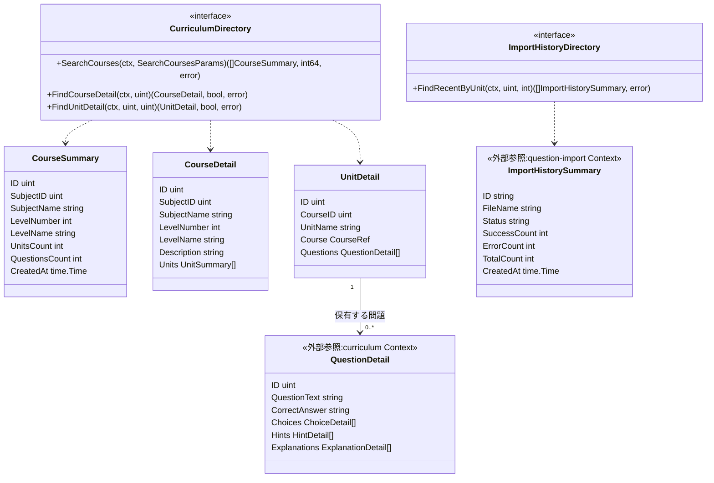
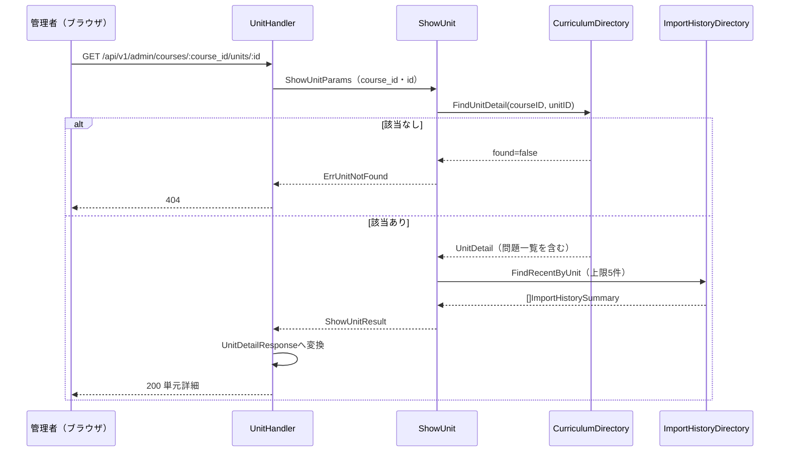
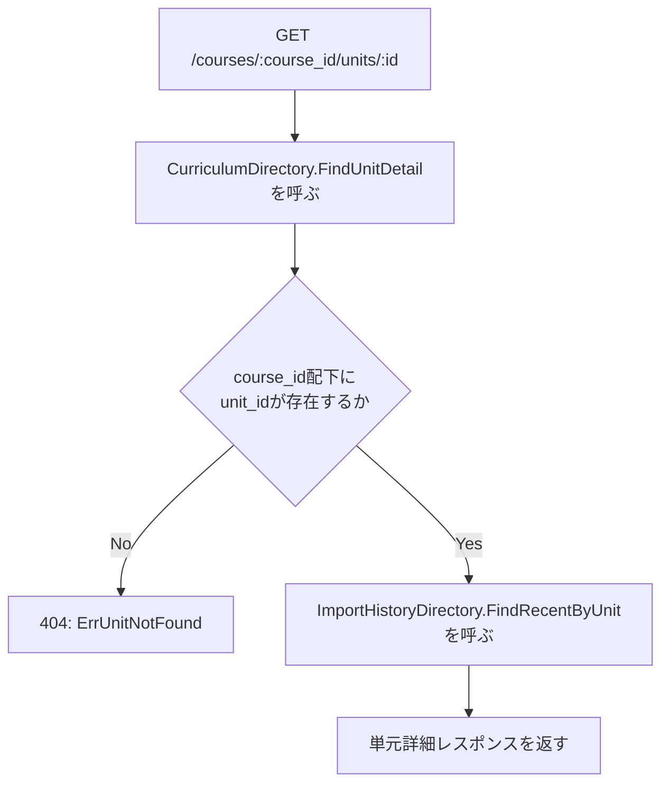

# 管理者コース・単元参照機能 Go実装仕様書

---

# 1. 機能概要

管理者が学習コースおよび単元の内容を参照し、問題データの登録状況を確認できるようにする機能である。コース一覧（検索・科目絞り込み・並び替え・ページング付き、単元数・問題数の集計を含む）、コース詳細（単元ごとの問題数集計を含む）、単元詳細（登録済み問題を選択肢・ヒント・解説とともに取得し、あわせて直近の問題インポート履歴を取得）の3操作を提供する参照専用機能であり、作成・更新・削除は現時点で実装されていない（②「1. 機能概要」の要約）。

|項目|内容|
|-|-|
|対象Context|`course-catalog`（②「3. Bounded Context」）|
|採用パターン|Transaction Script（②「4. 設計パターン」）|
|本Contextが所有するテーブル|なし（②「20. DB設計方針」）|
|他Contextへの依存|`curriculum`によるコース・単元・問題（選択肢・ヒント・解説を含む）の参照、`question-import`による直近のインポート履歴の参照|
|書き込み|なし。参照のみ|

## 採用設計パターンの理由（②からの要約）

- 業務ルールは「論理削除済みを除外する」「検索・並び替え条件の許可値以外は既定値にフォールバックする」「単元がroute上のコースに属するか確認する」という単純な条件判定にとどまる
- コース・単元・問題のいずれも、本機能の文脈では状態を変更しない（参照専用）
- 単元数・問題数の集計は「対象コース・単元に属する有効なレコードをカウントする」という手続きであり、Entityに振る舞いを持たせる意義が薄い

Aggregate・Value Object・Domain Serviceはいずれも②で「不要」と判断されており（②5〜8章）、本書もこれを変更しない。作成・更新・削除は現行Rails実装でも未実装であるため、②同様、本書でも設計対象に含めない。

## 本書が対象とする実装範囲

- `internal/coursecatalog`配下の全ファイル
- `curriculum`・`question-import`が公開する操作そのものの実装は対象外である。本書は、それらを呼ぶインターフェースとアダプタまでを定める

①「5. API / 処理詳細」「6. データモデル」を、Rails現行の挙動の根拠として参照する。②に記載のない具体値は①から補う。

---

# 2. ディレクトリ構成

## 対象Bounded Context名

- `course-catalog`（②「3. Bounded Context」）

## ディレクトリ・パッケージ名

アーキテクチャ規約「4. Bounded Context構成」の「Contextディレクトリの命名」に従い、Context名から`-`を取り除いて連結した全小文字の名前とする。ディレクトリ名は`internal/coursecatalog/`、package名は同じ`coursecatalog`となる。短縮・省略はしない。

ロール別のサブディレクトリは設けない。本Contextは管理者のみが利用する（②「1. 機能概要」）。

## ②で採用した設計パターン

Transaction Script（②「4. 設計パターン」）。アーキテクチャ規約「3. 設計パターンごとの構造適用方針」の「Transaction Script」構造をそのまま適用する。domain層・usecase層（struct/interface）・Repository Interfaceは設けない。

## 作成するディレクトリ一覧

```
internal/coursecatalog/
internal/coursecatalog/application/
internal/coursecatalog/infrastructure/contextadapter/
internal/coursecatalog/presentation/handler/
internal/coursecatalog/presentation/response/
```

`domain/`を作成しない。②「6. Entity設計」のとおり独自のEntityを定義せず、②「7. Value Object設計」「8. Domain Service」のとおりValue Object・Domain Serviceも持たない（アーキテクチャ規約「3. 設計パターンごとの構造適用方針」Transaction Script節）。

`infrastructure/gormrepo/`を作成しない。**本Contextが所有するテーブルがなく、GORMでDBを読み書きする実装を持たない**ためである。`courses`・`units`・`questions`・`question_choices`・`question_hints`・`question_explanations`は`curriculum`が、`import_histories`は`question-import`が所有する（②「21. DB操作仕様」）。`infrastructure/`配下は`contextadapter/`のみとなる。

`presentation/request/`を作成しない。クエリ/パスパラメータ用structはHandlerと同一package（`presentation/handler`）内に定義する。本機能はクエリパラメータ・パスパラメータの検証のみで独自の入力DTO構造体をリクエストごとに複数持つほどの複雑さがないため（管理者高校学年参照機能③「2. ディレクトリ構成」と同じ判断）。

規約「4. Bounded Context構成」の「機能で不要なディレクトリは作成しない」に従う。

## 作成するファイル一覧

```
internal/coursecatalog/context.go                             # NewContext（依存関係の組み立て）
internal/coursecatalog/dependency.go                           # 他Contextへの依存を宣言するインターフェースと受け渡し用の型

internal/coursecatalog/application/dto.go                      # 3つの関数が共有する入出力構造体
internal/coursecatalog/application/errors.go                   # Application Error（11章参照）
internal/coursecatalog/application/list_courses.go             # ListCourses
internal/coursecatalog/application/show_course.go              # ShowCourse
internal/coursecatalog/application/show_unit.go                # ShowUnit

internal/coursecatalog/infrastructure/contextadapter/curriculum_directory.go       # CurriculumDirectoryの実装
internal/coursecatalog/infrastructure/contextadapter/import_history_directory.go   # ImportHistoryDirectoryの実装

internal/coursecatalog/presentation/handler/course_handler.go
internal/coursecatalog/presentation/handler/unit_handler.go
internal/coursecatalog/presentation/response/course_response.go
internal/coursecatalog/presentation/response/unit_response.go
internal/coursecatalog/presentation/routes.go
```

## 文書の分割

本書は分割しない。実装ファイルは上記の14であり、テストが付くもの（3つの関数・2つのアダプタ・2つのHandlerの7）を加えても21であるため、1文書あたり30〜35という範囲に収まる（③自動生成プロンプト「文書の分割（1文書あたり30〜35ファイル）」）。

---

# 3. Domain層設計

**対象外。** 本機能はTransaction Script採用のため、domain層を作成しない（アーキテクチャ規約「3. 設計パターンごとの構造適用方針」Transaction Script節）。

|②の節|本書での扱い|
|-|-|
|②「5. Aggregate設計」（不要）|Aggregateを定義しない|
|②「6. Entity設計」（独自Entityなし）|Entityを定義しない。`CourseSummary`・`UnitDetail`等は`dependency.go`の受け渡し用の型、またはapplication層のDTOとして表す|
|②「7. Value Object設計」（不要）|Value Objectを定義しない|
|②「8. Domain Service」（不要）|Domain Serviceを定義しない|
|②「18. Domain Event」（不要）|Domain Eventを定義しない|
|②「17. Error設計」のDomain Error（定義しない）|センチネルエラーを定義せず、`errors.go`には`application`層のApplication Errorのみを置く|

②「11. Repository設計」の`CourseRepository`・`UnitRepository`・`ImportHistoryRepository`は、いずれも他Contextが公開する参照手段であり、domain層のRepository Interfaceとしては定義しない。`dependency.go`のインターフェースとして表す。

## 他Contextへの依存（`dependency.go`）

他Contextの公開操作を呼ぶためのインターフェースは、Contextディレクトリ直下の`dependency.go`に置く（アーキテクチャ規約「4. Bounded Context構成」）。実装は`infrastructure/contextadapter/`に置く（「8. Infrastructure層設計」）。

```go
type CurriculumDirectory interface {
    // SearchCourses は検索・絞り込み・並び替え・ページングを適用したコース一覧と総件数を返す。
    // コースごとの単元数・問題数の集計を含む。
    SearchCourses(ctx context.Context, params SearchCoursesParams) ([]CourseSummary, int64, error)

    // FindCourseDetail は指定したコースの詳細を返す。単元ごとの問題数集計を含む。
    // 存在しない場合は found が false になる。
    FindCourseDetail(ctx context.Context, courseID uint) (detail CourseDetail, found bool, err error)

    // FindUnitDetail は指定したコース配下の指定単元の詳細を返す。
    // 問題・選択肢・ヒント・解説の全件を含む。存在しない、または別のコースに属する場合は found が false になる。
    FindUnitDetail(ctx context.Context, courseID, unitID uint) (detail UnitDetail, found bool, err error)
}

type ImportHistoryDirectory interface {
    // FindRecentByUnit は指定単元に対する直近limit件のインポート履歴を、作成日時の降順で返す。
    FindRecentByUnit(ctx context.Context, unitID uint, limit int) ([]ImportHistorySummary, error)
}

// SearchCoursesParams はコース一覧検索の条件である。
type SearchCoursesParams struct {
    SubjectID *uint
    Keyword   string
    Sort      string // 許可値: level_name / created_at / id
    Order     string // 許可値: asc / desc
    Page      int
    PerPage   int
}

type CourseSummary struct {
    ID             uint
    SubjectID      uint
    SubjectName    string
    LevelNumber    int
    LevelName      string
    UnitsCount     int
    QuestionsCount int
    CreatedAt      time.Time
}

type CourseDetail struct {
    ID          uint
    SubjectID   uint
    SubjectName string
    LevelNumber int
    LevelName   string
    Description string
    Units       []UnitSummary
}

type UnitSummary struct {
    ID             uint
    UnitName       string
    QuestionsCount int
}

type UnitDetail struct {
    ID        uint
    CourseID  uint
    UnitName  string
    Course    CourseRef
    Questions []QuestionDetail
}

type CourseRef struct {
    ID          uint
    SubjectID   uint
    SubjectName string
    LevelName   string
    LevelNumber int
}

type QuestionDetail struct {
    ID            uint
    QuestionText  string
    CorrectAnswer string
    Choices       []ChoiceDetail
    Hints         []HintDetail
    Explanations  []ExplanationDetail
}

type ChoiceDetail struct {
    ID           uint
    ChoiceNumber int
    Text         string
}

type HintDetail struct {
    ID         uint
    StepNumber int
    Text       string
}

type ExplanationDetail struct {
    ID   uint
    Text string
}

type ImportHistorySummary struct {
    ID           string
    FileName     string
    Status       string
    TotalCount   int
    SuccessCount int
    ErrorCount   int
    CreatedAt    time.Time
}
```

|インターフェース|委譲先|所有Context側の定義|
|-|-|-|
|`CurriculumDirectory`|`curriculum`の管理者向け参照操作|コース参照機能③で確定する**（要確認）**|
|`ImportHistoryDirectory`|`question-import`の直近インポート履歴参照|管理者インポート履歴管理機能③「4. Application層設計」|

**②からの補足**: `CurriculumDirectory`の3つのメソッドは、②「11. Repository設計」の`CourseRepository`・`UnitRepository`の設計意図を実装レベルの関数として具体化したものである。②本文はこれらを「`curriculum` Context提供、外部依存として利用」と明記するが、具体的な関数名・シグネチャまでは規定していない（②「11. Repository設計」）。**既存のコース参照機能③「6. Application層設計」が公開する操作（`ExistsAllUnits`・`FindUnitsByIDs`・`FindUnitQuestions`・`FindQuestionForAnswer`・`CountQuestions`・`FindCourseSubjects`）は、いずれも生徒向けの存在確認・解答判定向けであり、検索・ページング・集計・問題の全件取得（選択肢・ヒント・解説を含む）を行う本機能の要件を満たさない。コース参照機能の追随時に、管理者向けの検索・集計・全件参照操作を`curriculum`へ追加する必要がある（要確認。推測）。**

`ImportHistoryDirectory`は、既存の管理者インポート履歴管理機能③が定める参照操作（`SearchImportHistoriesUseCase`相当）への委譲として実装する（「8. Infrastructure層設計」）。

本Contextは他Contextへ操作を公開しない。管理者向けの参照に特化した集約専用Contextであり、他Contextが必要とする事実を所有しない（②「3. Bounded Context」）。

---

# 4. クラス図

②「9. クラス図」の簡略図を、実際に定義する型で具体化する。



`CurriculumDirectory`・`ImportHistoryDirectory`は本Contextが所有するEntityを扱わず、他Contextの公開操作を呼ぶためのインターフェースである。`dependency.go`に置く（「3. Domain層設計」）。

---

# 5. 状態遷移図

省略する。

理由: ②「10. 状態遷移図」のとおり、コース・単元・問題のいずれも本機能内で状態を変更する操作を持たない参照専用データである。論理削除の有無という属性は持つが、検索時の除外条件として扱うのみであり、状態遷移図として示すべき遷移を持たない。

---

# 6. Application層設計

Transaction Script採用のため、UseCase struct/interfaceは設けない。②「12. UseCase設計」で定義された3つの業務操作（ListCourses / ShowCourse / ShowUnit）を、`application/`直下の関数としてそれぞれ実装する。

## DTO（`application/dto.go`）

②「12. UseCase設計」の入出力を、Goのstructとして定義する。本機能はすべて読み取り専用のため、②の区分に倣い全DTOを「Query」に属するものとして扱う。

### 入力DTO（Query）

|struct名|フィールドと型|説明|
|-|-|-|
|`ListCoursesParams`|`SubjectID *uint`, `Q string`, `Sort string`, `Order string`, `Page int`, `PerPage int`|検索・科目絞り込み・並び替え・ページング。②「19. API仕様」の入力（subject_id, q, sort, order, page, per_page）に対応|
|`ShowCourseParams`|`CourseID uint`|対象コースID|
|`ShowUnitParams`|`CourseID uint`, `UnitID uint`|対象コースID・単元ID（route由来。IDORスコープ検証に用いる）|

`current admin`（②のUseCase入力に記載）は、認可判定に用いる情報のみでUseCase内での業務分岐に使われないため（②「16. Authorization設計」の「UseCase: 単元詳細取得時、route由来のcourse_id配下にunit_idが実在することを検証する」のとおり、判定材料はroute値のみ）、application関数の引数には含めない。

### 出力DTO（Query）

|struct名|フィールドと型|説明|
|-|-|-|
|`PaginationMeta`|`CurrentPage int`, `TotalPages int`, `TotalCount int`, `PerPage int`|②「19. API仕様」のmeta構造に対応|
|`ListCoursesResult`|`Courses []CourseSummary`, `Meta PaginationMeta`|`ListCourses`関数の戻り値。`CourseSummary`は`dependency.go`の型をそのまま使う|
|`ShowCourseResult`|`CourseDetail`|`ShowCourse`関数の戻り値。`dependency.go`の型をそのまま使う|
|`ShowUnitResult`|`UnitDetail`・`RecentImportHistories []ImportHistorySummary`|`ShowUnit`関数の戻り値。`UnitDetail`は`curriculum`から、`RecentImportHistories`は`question-import`から取得した値を組み合わせる|

出力の型をPresentation層のResponse DTOと分けるのは、application層の型がJSONのキー名を持たないためである（アーキテクチャ規約「6. データフロー」）。

## Application関数

### ListCourses（`application/list_courses.go`）

|項目|内容|
|-|-|
|関数|`ListCourses(ctx context.Context, curriculum CurriculumDirectory, params ListCoursesParams) (ListCoursesResult, error)`|

処理ステップ（②「12. UseCase設計」の「一覧取得後にまとめて集計を行う」）:

1. `params.Sort`/`params.Order`を許可値判定する（`sort`は`level_name`/`created_at`/`id`のいずれか、それ以外は`created_at`。`order`は`asc`/`desc`のいずれか、それ以外は`desc`。②「15. Validation設計」のDomain節に対応するガード節）
2. `CurriculumDirectory.SearchCourses`に、絞り込み・並び替え・ページングの条件（単元数・問題数の集計を含む）を渡して呼び出す
3. 総件数からページ情報（`PaginationMeta`）を算出する
4. `ListCoursesResult`として返す

**単元数・問題数の集計を`curriculum`側に委ねる。** 本Contextがコース一覧を取得した後に集計クエリを発行する構成にしないのは、`courses`・`units`・`questions`のいずれも本Contextが所有せず、直接クエリを発行できないためである（②「3. Bounded Context」）。

### ShowCourse（`application/show_course.go`）

|項目|内容|
|-|-|
|関数|`ShowCourse(ctx context.Context, curriculum CurriculumDirectory, params ShowCourseParams) (ShowCourseResult, error)`|

処理ステップ（②「12. UseCase設計」の「コースの存在確認を前提に、所属単元と単元ごとの問題数をまとめて取得する」）:

1. `CurriculumDirectory.FindCourseDetail`を呼び出す
2. `found`が偽の場合、`ErrCourseNotFound`を返す（②「17. Error設計」「対象コース未存在」）
3. `ShowCourseResult`として返す

### ShowUnit（`application/show_unit.go`）

|項目|内容|
|-|-|
|関数|`ShowUnit(ctx context.Context, curriculum CurriculumDirectory, importHistory ImportHistoryDirectory, params ShowUnitParams) (ShowUnitResult, error)`|

処理ステップ（②「12. UseCase設計」の「単元がroute上のコースに属することを確認したうえで問題内容とインポート履歴を取得する」）:

1. `CurriculumDirectory.FindUnitDetail(ctx, params.CourseID, params.UnitID)`を呼び出す。IDORスコープ検証（route由来の`course_id`配下に`unit_id`が実在するかの確認）を兼ねる（②「16. Authorization設計」）
2. `found`が偽の場合、`ErrUnitNotFound`を返す（②「17. Error設計」「対象単元が存在しない、またはroute上のコースに属さない」。異なるコースの単元IDを指定した場合もこのエラーとして扱い、404で応答する。存在の有無とスコープ不一致を区別しない）
3. `ImportHistoryDirectory.FindRecentByUnit(ctx, params.UnitID, MaxRecentImportHistories)`を呼び出し、直近のインポート履歴を取得する
4. `ShowUnitResult`として返す

定数`MaxRecentImportHistories = 5`を`application`パッケージに置く。②「21. DB操作仕様」の「作成日時の降順で並び替えたうえで上位5件のみを取得する」に明記された業務ルールである。

**いずれかの参照が失敗した場合はエラーを返す。** 部分的な結果を返さない（②「17. Error設計」）。

## Application Error（`application/errors.go`）

- `ErrCourseNotFound`: 対象コースが存在しない場合に、`ShowCourse`から返される
- `ErrUnitNotFound`: 対象単元が存在しない、またはroute上のコースに属さない場合に、`ShowUnit`から返される

---

# 7. シーケンス図・処理フロー図

## シーケンス図（単元詳細取得）

②「13. シーケンス図・処理フロー図」を、実際に定義する型・関数名で具体化する。



本Contextから`courses`・`units`・`questions`等へ直接SQLを発行しない。`curriculum`・`question-import`が公開する参照手段へ委譲する（「6. Application層設計」）。

## 処理フロー図

単元詳細取得はコース・単元の存在確認という条件分岐を伴うため、フローチャートとして整理する。一覧・コース詳細は単純な条件付きクエリの組み合わせであるため省略する（②「13. シーケンス図・処理フロー図」）。



---

# 8. Infrastructure層設計

## Infrastructure関数（Transaction Script採用時）

**対象外。** 本Contextが所有するテーブルがなく、DBへクエリを発行する関数を持たない。`infrastructure/`配下に置くのは、`dependency.go`のインターフェースの実装（`contextadapter/`）のみである。

## contextadapter（`dependency.go`のインターフェースの実装）

`dependency.go`で宣言した2つのインターフェースの実装を`infrastructure/contextadapter/`に置く（アーキテクチャ規約「4. Bounded Context構成」。`gormrepo/`には置かない）。相手Contextの公開操作へ委譲するだけであり、本Contextから相手のテーブルへクエリを発行しない（同「5. Context間連携ルール」）。

### CurriculumDirectory実装（`contextadapter/curriculum_directory.go`）

- 実装struct名: 非公開struct + コンストラクタ`NewCurriculumDirectory`
- 委譲先: `curriculum`が公開する管理者向けの検索・詳細・単元詳細参照操作（コース参照機能③で確定する**要確認**）
- 委譲内容: 絞り込み・並び替え・ページングの条件をそのまま渡し、返った値を`CourseSummary`・`CourseDetail`・`UnitDetail`へ移す
- 本アダプタはGORMに依存せず、`courses`・`units`・`questions`等へクエリを発行しない

**②からの補足**: `curriculum`が公開する操作の具体的な関数名・シグネチャ・戻り値の型は、コース参照機能③で確定する事項である。本書は依存の存在と責務のみを示し、変換内容は`curriculum`③の確定後に合わせる（管理者問題インポート機能③「8. Infrastructure層設計」の`CurriculumDirectory`実装と同じ扱い）。

### ImportHistoryDirectory実装（`contextadapter/import_history_directory.go`）

- 実装struct名: 非公開struct + コンストラクタ`NewImportHistoryDirectory`
- 委譲先: `question-import`が公開する直近インポート履歴の参照操作（管理者インポート履歴管理機能③「4. Application層設計」の`SearchImportHistoriesUseCase`相当）
- 委譲内容: 対象単元の識別子と件数の上限（5）を渡し、`UnitID`による絞り込み・`created_at`降順・`Page=1`・`PerPage=limit`として呼び出す。戻り値の一覧項目を`ImportHistorySummary`へ移す
- 本アダプタはGORMに依存せず、`import_histories`へクエリを発行しない

直近5件が`created_at`降順で取得されること・対象単元以外の履歴が含まれないことのクエリ自体の正確性は、`question-import`側（管理者インポート履歴管理機能）のテストで検証済みの前提とする（「16. テストケース設計」）。

## 外部連携実装

対象外。②にMail・Cache・Queue等の外部連携は記載されていない。

## 依存関係の組み立て（`context.go`）

規約「14. 依存関係の組み立て（DI配線）」の「Context単位の組み立て関数」に従い、`NewContext`を`context.go`に置く。

|項目|内容|
|-|-|
|関数|`NewContext(curriculumContext *curriculum.Context, questionImportContext *questionimport.Context) *Context`|
|組み立てる内容|2つのアダプタ → 3つのapplication関数（またはそれを束ねるstruct） → `CourseHandler`・`UnitHandler`|
|公開するもの|ルーティング登録に必要な2つのHandler|

**`*gorm.DB`を受け取らない。** 本Contextが所有するテーブルを持たず、GORMを使う実装がないためである（**②からの補足**。管理者ダッシュボード機能③・カレンダー機能③・教師ダッシュボード機能③が同じ理由で取らない形としている）。

---

# 9. Presentation層設計

## Handler

②「23. Railsとの責務対応」で言及される`Admin::CoursesController`・`Admin::UnitsController`という2つのController単位に対応させ、Handlerも2つに分ける（管理者高校学年参照機能③文書と同じ判断）。

### CourseHandler（`presentation/handler/course_handler.go`）

|項目|内容|
|-|-|
|struct名|`CourseHandler`|
|対応する呼び出し先|`application.ListCourses`, `application.ShowCourse`|
|コンストラクタ|`NewCourseHandler(curriculum coursecatalog.CurriculumDirectory) *CourseHandler`。`NewContext`がアダプタを注入する|

メソッド一覧:

|メソッド|HTTPメソッド|パス|
|-|-|-|
|`List(c *gin.Context)`|GET|`/api/v1/admin/courses`|
|`Show(c *gin.Context)`|GET|`/api/v1/admin/courses/:id`|

処理順序:

- `List`: クエリパラメータ（`subject_id`, `q`, `sort`, `order`, `page`, `per_page`）を`listCoursesQuery`へバインド → 型・フォーマットの検証（「12. Validation実装方針」） → `application.ListCourses`を呼び出す → 結果を`CourseListResponse`へ変換 → 200で返す
- `Show`: パスパラメータ`id`をバインド・検証 → `application.ShowCourse`を呼び出す → `ErrCourseNotFound`の場合は404に変換 → 成功時は`CourseDetailResponse`へ変換し200で返す

### UnitHandler（`presentation/handler/unit_handler.go`）

|項目|内容|
|-|-|
|struct名|`UnitHandler`|
|対応する呼び出し先|`application.ShowUnit`|
|コンストラクタ|`NewUnitHandler(curriculum coursecatalog.CurriculumDirectory, importHistory coursecatalog.ImportHistoryDirectory) *UnitHandler`|

メソッド一覧:

|メソッド|HTTPメソッド|パス|
|-|-|-|
|`Show(c *gin.Context)`|GET|`/api/v1/admin/courses/:course_id/units/:id`|

処理順序: パスパラメータ`course_id`/`id`をバインド・必須チェック → `application.ShowUnit`を呼び出す → `ErrUnitNotFound`の場合は404に変換 → 成功時は`UnitDetailResponse`へ変換し200で返す

## Request / Response DTO

### Requestパラメータ（Handler内structとして定義。`presentation/request`は設けない）

|struct名|フィールドと型|バリデーションタグ／チェック内容|
|-|-|-|
|`listCoursesQuery`|`SubjectID *uint `form:"subject_id"``, `Q string `form:"q"``, `Sort string `form:"sort"``, `Order string `form:"order"``, `Page int `form:"page"``, `PerPage int `form:"per_page"``|`subject_id`は型（整数）チェックのみで必須ではない。`page`/`per_page`は正の整数であることを検証する。`sort`/`order`は文字列であることのみを検証し、許可値判定は`application.ListCourses`のガード節で行う。バインド失敗時は400|
|パスパラメータ`id` / `course_id`|`uint`（`uri`タグでバインド）|整数であることを検証する。単元詳細では両方を必須パラメータとして扱う|

### Response（`presentation/response/`）

|struct名|フィールドと型|備考|
|-|-|-|
|`SubjectResponse`|`ID uint`, `Name string`|②「19. API仕様」の`subject`に対応|
|`CourseResponse`|`ID uint`, `Subject SubjectResponse`, `LevelNumber int`, `LevelName string`, `UnitsCount int`, `QuestionsCount int`, `CreatedAt time.Time`|コース一覧項目に対応|
|`MetaResponse`|`CurrentPage int`, `TotalPages int`, `TotalCount int`, `PerPage int`|`meta`に対応|
|`CourseListResponse`|`Courses []CourseResponse`, `Meta MetaResponse`|一覧APIのレスポンス全体|
|`UnitSummaryResponse`|`ID uint`, `UnitName string`, `QuestionsCount int`|コース詳細の`units`に対応|
|`CourseDetailResponse`|`ID uint`, `Subject SubjectResponse`, `LevelNumber int`, `LevelName string`, `Description string`, `Units []UnitSummaryResponse`|コース詳細APIのレスポンス全体|
|`ChoiceResponse`|`ID uint`, `ChoiceNumber int`, `Text string`||
|`HintResponse`|`ID uint`, `StepNumber int`, `Text string`||
|`ExplanationResponse`|`ID uint`, `Text string`||
|`QuestionResponse`|`ID uint`, `QuestionText string`, `CorrectAnswer string`, `Choices []ChoiceResponse`, `Hints []HintResponse`, `Explanations []ExplanationResponse`|`questions`に対応|
|`CourseRefResponse`|`ID uint`, `Subject SubjectResponse`, `LevelName string`, `LevelNumber int`|単元詳細の`course`に対応|
|`ImportHistorySummaryResponse`|`ID string`, `FileName string`, `Status string`, `SuccessCount int`, `ErrorCount int`, `TotalCount int`, `CreatedAt time.Time`|`recent_import_histories`に対応|
|`UnitDetailResponse`|`ID uint`, `CourseID uint`, `UnitName string`, `Course CourseRefResponse`, `Questions []QuestionResponse`, `RecentImportHistories []ImportHistorySummaryResponse`|単元詳細APIのレスポンス全体|

`RecentImportHistories`を`nil`にしない。`nil`スライスはJSONで`null`になり、Rails現行の`[]`と異なる（**②からの補足**。管理者高校学年参照機能③「6. Application層設計」が同じ扱いをしている）。

## Routing（`presentation/routes.go`）

|Method|Path|Handler|
|-|-|-|
|GET|`/api/v1/admin/courses`|`CourseHandler.List`|
|GET|`/api/v1/admin/courses/:id`|`CourseHandler.Show`|
|GET|`/api/v1/admin/courses/:course_id/units/:id`|`UnitHandler.Show`|

いずれも、認証Middleware・admin役割確認Middleware配下のルートグループに登録する（②「16. Authorization設計」）。

---

# 10. API仕様

②「19. API仕様」のAPI仕様に基づくEndpoint一覧。

|Method|Path|Handler|Request|Response|Status Code|
|-|-|-|-|-|-|
|GET|`/api/v1/admin/courses`|`CourseHandler.List`|`subject_id`（任意, int）, `q`（任意, string）, `sort`（任意, string）, `order`（任意, string）, `page`（任意, int）, `per_page`（任意, int）|`CourseListResponse`|200|
|GET|`/api/v1/admin/courses/:id`|`CourseHandler.Show`|パスパラメータ`id`（int）|`CourseDetailResponse`|200|
|GET|`/api/v1/admin/courses/:course_id/units/:id`|`UnitHandler.Show`|パスパラメータ`course_id`（int）, `id`（int）|`UnitDetailResponse`|200|

## Errorケース

|条件|Status Code|Error内容|
|-|-|-|
|未認証|401|認証Middlewareが返す|
|adminロールでない|403|認可Middlewareが返す|
|`page`, `per_page`, `subject_id`, `id`, `course_id`が数値でない|400|入力形式エラー|
|指定`id`の対象コースが存在しない|404|`ErrCourseNotFound`|
|指定`course_id`/`id`の対象単元が存在しない、またはroute上のコースに属さない|404|`ErrUnitNotFound`|
|`curriculum`・`question-import`への問い合わせ失敗|500|Infrastructure Error|

---

# 11. Transaction実装方針

## Transaction開始箇所

なし。②「14. Transaction設計」のとおり、本機能はすべて読み取り専用処理であり、明示的なトランザクションを使用しない。`transaction.Manager`を注入しない。

## Transaction終了箇所

該当なし。

## 複数の参照にまたがる場合の扱い

`ListCourses`・`ShowCourse`・`ShowUnit`はそれぞれ`CurriculumDirectory`・`ImportHistoryDirectory`への参照を呼び出すが、読み取りのみのため、トランザクション制御は行わず、各呼び出しは独立したクエリとして順次実行する（②「14. Transaction設計」「保護すべき整合性が存在せず、不要な複雑さを増やすだけ」）。

---

# 12. Validation実装方針

## Presentation

②「15. Validation設計」のPresentation節を実装レベルに落とし込む。

- 型チェック: `subject_id`, `course_id`, `id`, `page`, `per_page`をGinのクエリ/パスバインド時に整数として検証する（バインド失敗時は400）
- 必須チェック: コース詳細の`id`・単元詳細の`course_id`/`id`はパスパラメータとして必須。ルーティング定義上、値が欠落するとGinのルーティング自体が一致しないため、バインド後の型検証で担保する
- フォーマットチェック: `page`/`per_page`が正の整数であることをHandler内のガード節で検証する。`per_page`の上限（100件）は`application.ListCourses`が呼び出す`CurriculumDirectory.SearchCourses`側で丸め込む。`sort`/`order`は文字列であることのみを検証し、許可値かどうかの判定は`application.ListCourses`のガード節で行う

## 業務ルール検証

Transaction Script採用時のため、application関数内のガード節で検証する内容を記載する。

- `ListCourses`は`sort`/`order`の許可値判定・既定値フォールバック（②「15. Validation設計」「Domain: 業務ルール」）を行う
- `ShowCourse`は、`CurriculumDirectory.FindCourseDetail`の`found`が偽の場合、`ErrCourseNotFound`を返すガード節を持つ
- `ShowUnit`は、`CurriculumDirectory.FindUnitDetail`の`found`が偽の場合（route上のコースに属さない場合を含む）、`ErrUnitNotFound`を返すガード節を持つ（②「15. Validation設計」「整合性チェック: 単元がroute上のcourse_idに属しているか」）

---

# 13. Authorization実装方針

②「16. Authorization設計」を実装レベルに落とし込む。

- Middleware: 認証済みユーザーを特定しコンテキストに保持する。役割が`admin`であることを確認し、`admin`でない場合は403で処理を打ち切る
- Handler: パスパラメータ（`id`, `course_id`）をapplication関数に受け渡すのみで、権限判定は行わない
- application関数: `ShowUnit`は、route由来の`course_id`配下に`unit_id`が実在することを`CurriculumDirectory.FindUnitDetail`経由で検証する（IDOR対策。②「16. Authorization設計」「リクエストボディ・クエリの値は信用せず、routeの値のみを正とする」）。`ListCourses`・`ShowCourse`は追加のスコープ制限を行わない（管理者は全コース・全単元を参照可能）
- Domain: 該当なし（Domain層を設けないため）

---

# 14. Error実装方針

## Domain Error → Application Errorへの変換方針

Domain Errorは定義しない（②「17. Error設計」、「3. Domain層設計」）。Application Errorは`application/errors.go`にsentinel errorとして定義する。

## Application Error → HTTPレスポンスへの変換方針

Handler側で`errors.Is(err, application.ErrCourseNotFound)` / `errors.Is(err, application.ErrUnitNotFound)`により判定し、該当する場合は404、それ以外のエラー（`curriculum`・`question-import`への問い合わせ失敗等）は500に変換する。

|Error種別|発生層|HTTP Status|
|-|-|-|
|`ErrCourseNotFound`|Application（application関数のガード節）|404|
|`ErrUnitNotFound`|Application（application関数のガード節）|404|
|クエリバインド・型検証エラー|Presentation（Handler）|400|
|認証エラー|Middleware|401|
|認可エラー（adminでない）|Middleware|403|
|`curriculum`・`question-import`への問い合わせ失敗|Infrastructure|500|

## Infrastructure Errorのハンドリング方針

アダプタ内で相手Contextの公開操作が返したエラーは、コーディング規約「6. エラーハンドリング」に従い`fmt.Errorf`と`%w`でラップして返す。application関数はさらにラップせずにそのまま呼び出し元へ伝播させ、Handlerで`ErrCourseNotFound`/`ErrUnitNotFound`以外のエラーとして一律500に変換する（②「17. Error設計」「技術的な障害を業務エラーと切り分ける」）。

---

# 15. GORM / DBクエリ設計

**対象外。** 本Contextが所有するテーブルがなく、GORMモデルも、DBへ発行するクエリも持たない（②「20. DB設計方針」「21. DB操作仕様」）。

|②「21. DB操作仕様」の参照手段|発行するContext|本Contextが渡す条件|
|-|-|-|
|コース一覧の検索|`curriculum`|科目ID（任意）・キーワード（任意）・並び替え・ページング|
|コース詳細の取得|`curriculum`|コースID|
|単元詳細のスコープ確認と問題一覧の取得|`curriculum`|コースID・単元ID|
|直近のインポート履歴の参照|`question-import`|単元ID・件数の上限（5）|

## Schemaに対する変更

なし（②「20. DB設計方針」）。マイグレーションを作成しない。

`courses`・`units`・`questions`・`question_choices`・`question_hints`・`question_explanations`・`import_histories`へ本Contextからクエリを発行しない。Gorm規約の適用対象となる実装を持たないため、同規約の個別の項目は本Contextに現れない。

---

# 16. テストケース設計

②「22. テスト戦略」を、Transaction Script採用時の区分の読み替えに従って具体化する。

## Domain Test

対象外。domain層を持たない。

## Application関数 Test（②の「UseCase Test」に相当）

|対象|テストケース|
|-|-|
|`ListCourses`|`sort`/`order`が許可値でない場合に既定値へフォールバックすること／`CurriculumDirectory.SearchCourses`へ絞り込み・並び替え・ページングの条件が正しく渡ること／ページ情報（`PaginationMeta`）が総件数から正しく算出されること|
|`ShowCourse`|存在する`course_id`で詳細が返ること／`found`が偽のとき`ErrCourseNotFound`が返ること|
|`ShowUnit`|存在する`course_id`/`unit_id`の組み合わせで問題一覧と直近インポート履歴が返ること／`found`が偽のとき`ErrUnitNotFound`が返ること（存在しない場合・異なるコースに属する場合のいずれも。IDOR対策の重点検証項目）／直近インポート履歴の上限件数（`MaxRecentImportHistories`）が正しく渡ること|

4つの依存（2つの`Directory`インターフェース）はいずれもテストダブルを差し替えて検証する（コーディング規約「7. インターフェース」）。

## Repository Test

対象外。Repository Interfaceを定義しない。

## contextadapter Test

②「22. テスト戦略」のRepository Testが挙げた検証観点のうち、委譲の仕方に関わるものをアダプタのテストとして持つ。

|対象|テストケース|
|-|-|
|`CurriculumDirectory`|`SearchCourses`・`FindCourseDetail`・`FindUnitDetail`への引数が正しく渡ること／戻り値が本Contextの型へ正しく移されること|
|`ImportHistoryDirectory`|`FindRecentByUnit`への呼び出しパラメータ（`UnitID`、件数の上限）が正しいこと／戻り値が`ImportHistorySummary`へ正しく移されること／インポート履歴が0件の場合、空スライスが返ること|

検索・集計・問題の取得自体の正確性（論理削除除外、`course_id`/`unit_id`の組み合わせ一致、選択肢・ヒント・解説の並び順等）は、`curriculum`側（コース参照機能）のテストで検証済みの前提とする。直近5件が`created_at`降順で取得されることは`question-import`側（管理者インポート履歴管理機能）のテストで検証済みの前提とする。本Contextでは上記のとおりアダプタの呼び出しパラメータ・変換ロジックの検証に限定する。

## Handler Test

|対象|テストケース|
|-|-|
|`CourseHandler.List`|クエリパラメータの解釈（`subject_id`, `q`, `sort`, `order`, `page`, `per_page`）が正しいこと／不正な`page`/`per_page`で400が返ること／正常系で200と期待するレスポンス構造が返ること|
|`CourseHandler.Show`|存在しない`id`で404が返ること／不正な`id`（数値以外）で400が返ること／正常系で200が返ること|
|`UnitHandler.Show`|存在しない`course_id`/`id`の組み合わせで404が返ること／正常系で200が返ること|

## Integration Test

|対象|テストケース|
|-|-|
|`GET /api/v1/admin/courses`|エンドポイント経由で一覧が正しいレスポンス構造（`courses`, `meta`）で返却されること|
|`GET /api/v1/admin/courses/:id`|エンドポイント経由で詳細が正しく返却されること／存在しないIDで404が返ること|
|`GET /api/v1/admin/courses/:course_id/units/:id`|エンドポイント経由で単元詳細が正しく返却されること／IDOR対策（route上のコースに属さない単元へのアクセスが404になること）が機能すること|
|認可|admin以外のロールでアクセスした場合に403が返ること／未認証の場合に401が返ること|

---

# 17. ②からの補足事項

②に明記がなく、実装のために本書で補った内容である。いずれも②の設計判断（Context・採用パターン・責務の分担・Authorization方針・Error方針）を変えるものではない。

|補った内容|理由|推測か|
|-|-|-|
|ディレクトリ名を`internal/coursecatalog`とした|アーキテクチャ規約「4. Bounded Context構成」の「Contextディレクトリの命名」が、Context名から`-`を取り除いた連結形と定めている。規約は短縮・省略を禁じており、②に明記がなくても機械的に決まる|推測ではない（規約から機械的に決まる）|
|`CurriculumDirectory`・`ImportHistoryDirectory`を`dependency.go`に置き、本Contextからは`courses`・`units`・`questions`・`import_histories`へ一切クエリを発行しない構成とした|②「3. Bounded Context」は本Contextがこれらを所有しないと明記しており、アーキテクチャ規約「5. Context間連携ルール」の「相手Contextの内部Entity・Infrastructure実装に直接依存しない」に従った。管理者問題インポート機能③の`CurriculumDirectory`と同じ扱いである|推測ではない（規約・既存③の扱いに合わせた）|
|`CurriculumDirectory`の3つのメソッド名・シグネチャ・戻り値の型|②「11. Repository設計」は`curriculum`への依存を明記するが、具体的な関数名・シグネチャは規定していない。既存のコース参照機能③が公開する操作（生徒向け）は本機能の検索・集計・全件取得の要件を満たさないため、管理者向けの新しい参照操作が`curriculum`側に必要になる|推測（要確認。コース参照機能の追随時に`curriculum`側の公開操作を確定する必要がある）|
|`presentation/request/`ディレクトリを設けず、クエリ/パスパラメータ用structをHandlerと同一package内に定義する|指示書のTransaction Script構造例に`request/`が含まれておらず、本機能の入力構造が単純なため|推測|
|`application/dto.go`・`application/errors.go`という補助ファイルへの分割|②・指示書ともにファイル粒度までは規定していないため、責務ごとに集約する分割を採用した|推測|
|application関数に`current admin`を引数として渡さない|②「16. Authorization設計」の「Handler: パスパラメータを受け渡すのみ」「UseCase: 追加のスコープ制限は行わない（単元詳細のみroute値によるスコープ検証）」という判断に基づき、認可情報はMiddleware/Handlerで完結させ、application関数の入力から除外した|②の判断に基づく具体化（推測ではない）|
|Handlerを`CourseHandler`・`UnitHandler`の2つに分割する|②「23. Railsとの責務対応」で`Admin::CoursesController`・`Admin::UnitsController`という2つのController単位が言及されていることを踏まえた|推測|
|`ShowUnit`において、単元が存在しない場合とroute上のコースに属さない場合を区別せず、いずれも`ErrUnitNotFound`（404）として扱う|②「17. Error設計」は両者を1つの業務シナリオ（「対象単元が存在しない、またはroute上のコースに属さない」）としてまとめて記載しており、区別する記載がないため、②の記述をそのまま実装に反映した|②の記載どおり（推測ではない）|
|「contextadapter Test」という区分を設け、②「22. テスト戦略」のRepository Testの観点を割り当てた|Repository Interfaceを定義しないため、②の検証意図を置く先が他にない|推測ではない（②の検証意図の保持）|
|`NewContext`が`*gorm.DB`を受け取らない|本Contextが所有するテーブルを持たない（②「21. DB操作仕様」）。管理者ダッシュボード機能③・カレンダー機能③・教師ダッシュボード機能③が同じ判断をしている|推測ではない（②と既存③に基づく）|

上記以外に、②の設計判断を変更した箇所はない。
