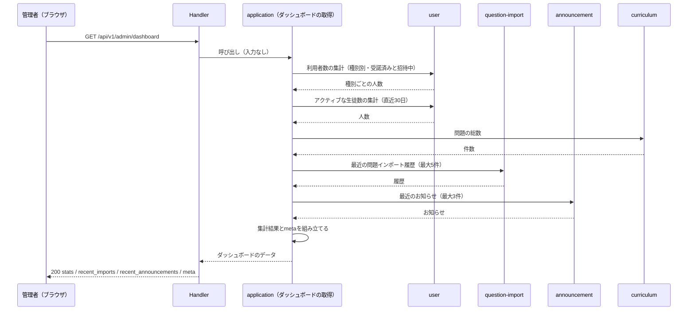

# 管理者ダッシュボード機能 Go実装仕様書

---

# 1. 機能概要

## 機能概要

管理者がシステム全体の概況（ユーザー種別ごとの人数・総問題数・直近のCSVインポート履歴）を把握できるようにする、読み取り専用の集計表示機能である。単一の表示操作（GET）のみを提供し、状態変更を伴わない。

## 採用設計パターンとその理由（②からの要約）

- 採用パターン: **Transaction Script**
- 理由（②「4. 設計パターン」より）:
  - 状態を持つEntityが存在せず、業務ルールは「複数Contextの集計を実行し、まとめて返す」だけの手続き的処理で表現できる
  - 集計項目が増えても、application層の関数内の手続きに処理を追加するだけで対応できる
  - 各集計処理を個別に検証すれば十分であり、Entityに複雑な振る舞いを持たせる必要がない
- 採用しなかったパターン（②「4. 設計パターン」より）: Active Record（作成・更新対象のEntityが存在しないため不適合）、Domain Model（状態やライフサイクルを持つEntityが存在しないため意義がない）、Event Sourcing（状態変化の記録・再構築要件がなく過剰設計）

## 本書が対象とする実装範囲

- 対象Bounded Context: `admin-dashboard`（②「3. Bounded Context」）
- 対象エンドポイント: `GET /api/v1/admin/dashboard`
- Transaction Script構造（アーキテクチャ規約「3. 設計パターンごとの構造適用方針」）に基づく、application層の関数、infrastructure層のクエリ関数、presentation層のHandler/Response/Routingの実装単位までを具体化する
- `user` Context（ユーザー種別ごとの人数）・Question Context（総問題数）・Import Context（直近インポート履歴）自体が管理するデータの作成・更新・状態遷移の実装仕様は対象外。本書はこれらのContextが保持するデータを読み取り専用で参照し、集約して返す側の実装のみを扱う
- ①Rails実装（Controller/Serializer等の詳細実装）は本タスクでは未提供のため、実装仕様の根拠として参照していない（「①未提供のため参照不可」として扱う）

---

# 2. ディレクトリ構成

- 対象Bounded Context名: `admin-dashboard`
- ディレクトリ名・package名: アーキテクチャ規約「4. Bounded Context構成」の「Contextディレクトリの命名」に従い、Context名から`-`を取り除いて連結した全小文字の名前とし、短縮・省略はしない。したがって`internal/admindashboard/`、package名は同じ`admindashboard`となる
- ②で採用した設計パターン: **Transaction Script**
- 採用パターンに対応する構造: アーキテクチャ規約「3. 設計パターンごとの構造適用方針」の Transaction Script構成をそのまま適用する（domain層・usecase層・Repository Interfaceは設けない）。Contextディレクトリ直下には`context.go`と`dependency.go`のみを置き、`dependency.go`のインターフェースの実装は`infrastructure/contextadapter/`に置く（同規約「4. Bounded Context構成」）

## 作成するディレクトリ一覧

```
internal/admindashboard/
├── application/
├── infrastructure/
│   └── contextadapter/
└── presentation/
    ├── handler/
    ├── response/
    └── （routes.go はpresentation直下）
```

`infrastructure/gormrepo/`は作成しない。**本Contextが所有するテーブルがなく、GORMでDBを読み書きする実装を持たない**ためである（②「11. Repository設計」）。`infrastructure/`配下は`contextadapter/`のみとなる。

## 作成するファイル一覧

```
internal/admindashboard/context.go                      # NewContext（依存関係の組み立て）
internal/admindashboard/dependency.go                   # 他Contextへの依存を宣言するインターフェースと受け渡し用の型

internal/admindashboard/application/get_dashboard_summary.go

internal/admindashboard/infrastructure/contextadapter/user_count_directory.go        # UserCountDirectoryの実装
internal/admindashboard/infrastructure/contextadapter/active_user_directory.go       # ActiveUserDirectoryの実装（study-log・question-answering）
internal/admindashboard/infrastructure/contextadapter/question_count_directory.go    # QuestionCountDirectoryの実装
internal/admindashboard/infrastructure/contextadapter/import_history_directory.go    # ImportHistoryDirectoryの実装
internal/admindashboard/infrastructure/contextadapter/announcement_directory.go      # AnnouncementDirectoryの実装

internal/admindashboard/presentation/handler/admin_dashboard_handler.go
internal/admindashboard/presentation/response/admin_dashboard_response.go
internal/admindashboard/presentation/routes.go
```

`domain/`・`presentation/request/`は作成しない。リクエストパラメータが存在しないため、Request DTOも設けない（②「15. Validation設計」）。

**本Contextからクエリを発行しない。** 5つのアダプタはいずれも相手Contextの公開操作へ委譲するだけである（②「11. Repository設計」、規約「5. Context間連携ルール」）。インターフェースは利用側である本Contextの`dependency.go`に置く（コーディング規約「7. インターフェース」の「インターフェースは利用するパッケージ側で定義する」）。

**②からの補足**: アダプタをインターフェースごとに5ファイルへ分けたのは、委譲先のContextが異なり、1ファイルに混在させると相手Contextの追加・変更時の影響範囲が読み取れなくなるためである。②「11. Repository設計」は参照責務を5つに分けており、それをファイルの単位にそのまま対応させた。`ActiveUserDirectory`だけは`study-log`と`question-answering`の2つを束ねる（下記「8. Infrastructure層設計」）。

---

# 3. Domain層設計

**対象外（Transaction Script採用のため、Domain層を設けない）**。

理由: ②「6. Entity設計」「7. Value Object設計」「8. Domain Service」「9. Repository設計」のいずれも、本機能では独自のEntity・Value Object・Domain Service・Repository Interfaceを持たないと判断されている（②「6. Entity設計」の`DashboardSummary`は「業務的な意味を持つEntityというよりも出力データ構造に近い性質」と明記されている）。業務ルールの検証・処理ステップは「6. Application層設計」に記載する。

## 他Contextへの依存（`dependency.go`）

他Contextの公開操作を呼ぶためのインターフェースと、受け渡し用の型をContextディレクトリ直下の`dependency.go`に置く（アーキテクチャ規約「4. Bounded Context構成」）。実装は`infrastructure/contextadapter/`に置く（「8. Infrastructure層設計」）。

```go
type UserCountDirectory interface {
    // CountByRole は役割ごとの人数を返す。invitationCompleted で受諾済み／招待中を切り替える。
    // いずれも有効な利用者（無効化されていない）のみを数える。
    CountByRole(ctx context.Context, invitationCompleted bool) (RoleCounts, error)
    // CountActiveStudents は識別子の集合に含まれる在籍中の生徒の人数を返す。
    CountActiveStudents(ctx context.Context, userIDs []uint) (int64, error)
}

type ActiveUserDirectory interface {
    // FindUserIDsWithRecordsSince は指定時刻以降に学習ログまたは解答の記録がある
    // 利用者の識別子を、重複なく返す。
    FindUserIDsWithRecordsSince(ctx context.Context, since time.Time) ([]uint, error)
}

type QuestionCountDirectory interface {
    // CountQuestions は論理削除されていない問題の総数を返す。
    CountQuestions(ctx context.Context) (int64, error)
}

type ImportHistoryDirectory interface {
    FindRecent(ctx context.Context, limit int) ([]ImportHistorySummary, error)
}

type AnnouncementDirectory interface {
    FindRecent(ctx context.Context, limit int) ([]AnnouncementSummary, error)
}

type RoleCounts struct {
    Student int64
    Teacher int64
    Admin   int64
}

type ImportHistorySummary struct {
    ID           uint
    FileName     string
    Status       string
    TotalCount   int
    SuccessCount int
    ErrorCount   int
    CreatedAt    time.Time
}

type AnnouncementSummary struct {
    ID          uint
    Title       string
    Status      string
    PublishedAt *time.Time
    ScheduledAt *time.Time
    CreatedAt   time.Time
}
```

|インターフェース|委譲先|所有Context側の定義|
|-|-|-|
|`UserCountDirectory`|`user`の`CountUsers`|ユーザー基盤②「12. UseCase設計」。既存の操作で満たせる|
|`ActiveUserDirectory`|`study-log`の`FindActiveUserIDsSince`と`question-answering`の「指定時刻以降に解答がある利用者の参照」|学習ログ②「12. UseCase設計」・問題解答②「11. Repository設計」|
|`QuestionCountDirectory`|`curriculum`の「問題の総数の集計」|コース参照②「11. Repository設計」|
|`ImportHistoryDirectory`|`question-import`の「直近の問題インポート履歴の参照」|管理者問題インポート②「3. Bounded Context」|
|`AnnouncementDirectory`|`announcement`の「最近のお知らせの参照」|教師お知らせ②「11. Repository設計」|

**②からの補足**: メソッド名・シグネチャと受け渡し用の型は②に明記がないため、コーディング規約「7. インターフェース」（利用側で定義する）・アーキテクチャ規約「5. Context間連携ルール」に従って実装のために補った。他Contextの参照には`Directory`を用いる既存③文書（ダッシュボード・分析・管理者高校学年参照・カレンダー）の形に合わせている。

`ActiveUserDirectory`を1つのインターフェースにまとめたのは、呼び出し側が必要とするのが「学習の記録がある利用者」という1つの事実であり、それが2つのContextにまたがって存在するためである。2つの参照を呼んで識別子を重複なく合わせる処理はアダプタに閉じ込め、application層は1回の呼び出しで結果を受け取る（**②からの補足**。②「11. Repository設計」は2つの参照を別に挙げているが、呼び出し側での束ね方は定めていない）。

`RoleCounts`が`guardian`を持たないのは、①「5. API / 処理詳細」`#show`が返す`stats`に保護者の人数が含まれないためである。`user`の集計は役割別に全件返すため、アダプタが必要な3つだけを取り出す。

---

# 4. クラス図

省略する。

理由: ②「9. クラス図」が省略しており、本Contextが管理するEntityを持たないため、可視化すべきEntity関係が存在しない（「3. Domain層設計」）。参照する利用者・問題・インポート履歴・お知らせの構造は各所有Contextの②に属する。

---

# 5. 状態遷移図

省略する。

理由: ②「10. 状態遷移図」のとおり、本Contextは状態を持たず、状態を変更しない。返すインポート履歴の進行状況・お知らせの公開状況は、いずれも所有Contextが管理する状態をそのまま載せたものである（①「7. 状態管理」）。

---

# 6. Application層設計

**実装単位の読み替え**: 本機能はTransaction Script採用のため、UseCase（struct）は設けない。②「12. UseCase設計」の`GetDashboardSummary`（業務操作としての設計意図）は、`application/`直下に置く関数`GetDashboardSummary`として実装する。

**②からの補足**: 関数名は②本文に記載された業務操作名`GetDashboardSummary`をそのまま採用した。アーキテクチャ規約「8. 命名規約（アーキテクチャレベル）」の「Transaction Scriptの関数は`動詞+対象`の形式にする」にも合致するため、名称変更は行っていない。

## DTO（Command / Query）

|struct名|フィールドと型|Command / Query|
|-|-|-|
|`DashboardSummary`|`Stats DashboardStats`・`RecentImports []ImportHistorySummary`・`RecentAnnouncements []AnnouncementSummary`・`ActiveStudentPeriodDays int`・`GeneratedAt time.Time`|Query（出力）|
|`DashboardStats`|`StudentCount int64`・`ActiveStudentCount int64`・`TeacherCount int64`・`AdminCount int64`・`TotalQuestions int64`・`PendingStudentCount int64`・`PendingTeacherCount int64`|Query（出力の内包型）|
|`ImportHistorySummary`|`dependency.go`で定義（「3. Domain層設計」）。本層では再定義せず、そのまま内包する|Query（出力の内包型）|
|`AnnouncementSummary`|同じく`dependency.go`で定義|Query（出力の内包型）|

- `GetDashboardSummary`関数への入力は無い（current admin userの識別は認可のみに用いられ、集計条件には使われない。②「12. UseCase設計」「16. Authorization設計」）
- 人数を`int64`とするのは、`user`の公開操作が返す件数の型に合わせるためである（ユーザー基盤③「3. 公開操作の定義」の`CountResult.Count`）
- `ActiveStudentPeriodDays`・`GeneratedAt`は、レスポンスの`meta`に対応する（①「5. API / 処理詳細」`#show`）

**②からの補足**: DTOのフィールド構成は①「5. API / 処理詳細」`#show`のResponse定義（`stats`の7項目、`recent_imports`、`recent_announcements`、`meta`の2項目）から導出した。②はフィールドの型までは定めていないため、実装のために補った。

## UseCase（Transaction Script関数として記載）

### `GetDashboardSummary`

|項目|内容|
|-|-|
|関数|`GetDashboardSummary(ctx context.Context) (DashboardSummary, error)`|
|受け取る依存|`UserCountDirectory`・`ActiveUserDirectory`・`QuestionCountDirectory`・`ImportHistoryDirectory`・`AnnouncementDirectory`（いずれも`dependency.go`。コンストラクタで注入する`struct`のメソッドとして実装してよい）|

処理ステップ（呼び出し順序。ロジックそのものは書かない）:

1. 集計の起点となる時刻を1つ決める（`GeneratedAt`）。アクティブ判定の対象期間の開始時刻は、この値から`ActiveStudentPeriodDays`日を引いて求める。以降の判定にはこの2つの値を使い回す（②「12. UseCase設計」）
2. `UserCountDirectory.CountByRole`を招待完了状態=完了で呼び、受諾済みの人数を役割ごとに取得する
3. 同じメソッドを招待完了状態=未完了で呼び、招待中の人数を取得する
4. `ActiveUserDirectory.FindUserIDsWithRecordsSince`を手順1の開始時刻で呼び、学習ログまたは解答の記録がある利用者の識別子を取得する
5. 手順4が1件以上返った場合のみ、`UserCountDirectory.CountActiveStudents`を識別子の集合で呼び、アクティブな生徒数を取得する。0件の場合は問い合わせず`0`とする
6. `QuestionCountDirectory.CountQuestions`で問題の総数を取得する
7. `ImportHistoryDirectory.FindRecent(ctx, MaxRecentImports)`で直近の問題インポート履歴を取得する
8. `AnnouncementDirectory.FindRecent(ctx, MaxRecentAnnouncements)`で直近のお知らせを取得する
9. 取得した結果と`meta`の2項目を`DashboardSummary`へ組み立てる
10. いずれかの呼び出しが失敗した場合はエラーを返す。部分的な結果を返さない

- トランザクション境界: 不要（読み取りのみ。②「14. Transaction設計」、「11. Transaction実装方針」）
- 定数: `ActiveStudentPeriodDays = 30`・`MaxRecentImports = 5`・`MaxRecentAnnouncements = 3`を`application`パッケージに置く。いずれも表示のための上限であり、本Contextが持つ（②「12. UseCase設計」）
- 発生しうるエラー: 各参照手段の失敗をラップしたもの（「14. Error実装方針」）。どの参照で失敗したかをラップしたメッセージに含める

**手順5で空の集合を渡さない理由**: 条件が空になって全ユーザーを数える結果になることを防ぐためである（②「12. UseCase設計」。分析機能③基盤編「17. ②からの補足事項」5と同じ扱い）。

**②からの補足**: 手順2・3で同じメソッドを2回呼ぶのは、`user`の公開操作が招待完了状態を絞り込み条件として受け取る形であり（ユーザー基盤③「3. 公開操作の定義」の`SearchCondition.InvitationCompleted`）、1回の集計で受諾済みと招待中を同時に返す操作を持たないためである。相手Contextに新しい操作を足さず、既存の操作を2回呼ぶ形を選んだ。

---

# 7. シーケンス図・処理フロー図

## シーケンス図



## 処理フロー図

省略する。

理由: ②「13. シーケンス図・処理フロー図」が省略しており、業務ルールによる条件分岐を持たない。各参照手段を順に呼び、結果を組み立てるだけである。

---

# 8. Infrastructure層設計

## Infrastructure関数（Transaction Script採用時）

**対象外。** 本Contextが所有するテーブルがなく、DBへクエリを発行する関数を持たない（②「11. Repository設計」）。`infrastructure/`配下に置くのは、`dependency.go`のインターフェースの実装（`contextadapter/`）のみである。

## contextadapter（`dependency.go`のインターフェースの実装）

相手Contextの公開操作へ委譲するだけであり、本Contextから相手のテーブルへクエリを発行しない（アーキテクチャ規約「4. Bounded Context構成」「5. Context間連携ルール」）。いずれもGORMに依存しない。

### UserCountDirectory実装（`contextadapter/user_count_directory.go`）

- 実装struct名: 非公開struct + コンストラクタ`NewUserCountDirectory`
- 委譲先: `user`の`CountUsers`（ユーザー基盤③「3. 公開操作の定義」）
- 委譲内容:

|メソッド|`CountUsers`へ渡す条件|
|-|-|
|`CountByRole(ctx, invitationCompleted)`|`InvitationCompleted`に指定された真偽値、`Deactivated`に「有効のみ」、集計の単位に「役割別」。返った`[]CountResult`から`student`・`teacher`・`admin`の3つを取り出して`RoleCounts`へ移す|
|`CountActiveStudents(ctx, userIDs)`|`IDs`に識別子の集合、`Roles`に生徒、`InvitationCompleted`に`true`、`Deactivated`に「有効のみ」、集計の単位に「なし」。返った1件の人数をそのまま返す|

`CountResult.Key`は集計単位に応じた識別子であり、役割別では役割の識別子が入る（ユーザー基盤③「3. 公開操作の定義」）。役割の名前との対応は`user`の公開する属性（`Role`）で解決する。

**②からの補足**: 人数が0の役割は集計結果に含まれない（同書の`CountUsers`の定義）。該当しない役割は`0`として扱う。

### ActiveUserDirectory実装（`contextadapter/active_user_directory.go`）

- 実装struct名: 非公開struct + コンストラクタ`NewActiveUserDirectory`
- 委譲先: `study-log`の`FindActiveUserIDsSince`（学習ログ③「8. Infrastructure層設計」）と、`question-answering`の「指定時刻以降に解答がある利用者の参照」（問題解答②「11. Repository設計」）
- 委譲内容: 2つを順に呼び、返った識別子を重複なく合わせて返す。いずれかが失敗した場合はエラーを返す（部分的な結果を返さない）
- 2つの参照には同じ時刻を渡す。判定の基準をずらさないためである（②「11. Repository設計」）

### QuestionCountDirectory実装（`contextadapter/question_count_directory.go`）

- 実装struct名: 非公開struct + コンストラクタ`NewQuestionCountDirectory`
- 委譲先: `curriculum`の「問題の総数の集計」（コース参照②「11. Repository設計」の「他Contextへ公開する参照手段」）
- 委譲内容: 絞り込み条件を渡さずに呼び、返った件数をそのまま返す。論理削除済みの除外は所有Context側が行う

### ImportHistoryDirectory実装（`contextadapter/import_history_directory.go`）

- 実装struct名: 非公開struct + コンストラクタ`NewImportHistoryDirectory`
- 委譲先: `question-import`の「直近の問題インポート履歴の参照」（管理者問題インポート②「3. Bounded Context」の「本Contextが他Contextへ公開する操作」）
- 委譲内容: 件数の上限のみを渡し、返った履歴を`ImportHistorySummary`へ移す。**種別（問題インポート）と論理削除の絞り込み、並び順は所有Context側が行う**。本Contextから`import_histories`へクエリを発行しない

**②からの補足**: 本アダプタは相手Contextの`Context`structのメソッドを呼ぶ。相手のUseCase structやRepositoryを直接受け取らない。相手Contextの内部実装への依存を避けるためである（規約「5. Context間連携ルール」）。

### AnnouncementDirectory実装（`contextadapter/announcement_directory.go`）

- 実装struct名: 非公開struct + コンストラクタ`NewAnnouncementDirectory`
- 委譲先: `announcement`の「最近のお知らせの参照」（教師お知らせ②「11. Repository設計」の「本Contextが他Contextへ公開する操作」）
- 委譲内容: 件数の上限のみを渡し、返ったお知らせを`AnnouncementSummary`へ移す。並び順と公開状況の扱いは所有Context側が決める

## GORMモデル

**対象外。** 本Contextが所有するテーブルがないため、GORMモデルを定義しない（②「20. DB設計方針」）。

## 依存関係の組み立て（`context.go`）

規約「14. 依存関係の組み立て（DI配線）」に従い、`NewContext`を`context.go`に置く。

- 受け取る共通依存: ロガー、および5つの相手Contextの公開操作を呼ぶための値
- 組み立ての順序: 5つのアダプタ → application層の関数（またはそれを束ねるstruct） → `AdminDashboardHandler`
- `*gorm.DB`を受け取らない。本Contextが所有するテーブルを持たず、GORMを使う実装がないためである（**②からの補足**。ダッシュボード機能③「8. Infrastructure層設計」・カレンダー機能③「8. Infrastructure層設計」が同じ理由で同じ形としている）

## 外部連携実装

対象外。本Contextから外部サービス・キャッシュ・キューへ直接アクセスしない。集計結果のキャッシュも設けない（②「20. DB設計方針」）。

---

# 9. Presentation層設計

## Handler

- struct名: `AdminDashboardHandler`
- 対応する呼び出し先: `application.GetDashboardSummary`関数
- コンストラクタ: `func NewAdminDashboardHandler(getDashboardSummary *application.DashboardService) *AdminDashboardHandler`。application層の関数（またはそれを束ねるstruct）を注入する。5つのアダプタは`NewContext`が組み立ててapplication層へ渡すため、Handlerは受け取らない（アーキテクチャ規約「14. 依存関係の組み立て（DI配線）」、「8. Infrastructure層設計」）。`*gorm.DB`も受け取らない

### メソッド一覧

|メソッド|HTTPメソッド|パス|
|-|-|-|
|`GetDashboard`|GET|`/api/v1/admin/dashboard`|

### 処理順序

1. Middlewareが認証済みユーザーを特定し、adminロールであることを確認済みであることを前提とする（②「16. Authorization設計」のMiddleware節）
2. リクエストパラメータの入力バインド・Validationは行わない（②「15. Validation設計」の通りパラメータが存在しないため）
3. `GetDashboardSummary(ctx)`を呼び出す
4. 取得した`application.DashboardSummary`を`DashboardResponse`へ変換する
5. エラー発生時は「14. Error実装方針」の対応表に従いHTTPレスポンスへ変換する
6. 正常時は200 OKで`DashboardResponse`をJSONとして返す

**②からの補足**: Transaction Script採用のためUseCase層を経由しない。②「16. Authorization設計」の「UseCase」節（「特別なスコープ限定は行わない」）に相当する手順は、Handlerが`application.GetDashboardSummary`を追加の絞り込み条件なしで呼び出す、という処理順序の中で表現した。

## Request / Response DTO

- Request DTO: 対象外（②「15. Validation設計」の通り、リクエストパラメータが存在しないため作成しない）

### Response DTO

|struct名|フィールドと型|JSONキー|
|-|-|-|
|`DashboardResponse`|`Stats StatsResponse`・`RecentImports []RecentImportResponse`・`RecentAnnouncements []RecentAnnouncementResponse`・`Meta MetaResponse`|`stats` / `recent_imports` / `recent_announcements` / `meta`|
|`StatsResponse`|`StudentCount int64`・`ActiveStudentCount int64`・`TeacherCount int64`・`AdminCount int64`・`TotalQuestions int64`・`PendingStudentCount int64`・`PendingTeacherCount int64`|`student_count` / `active_student_count` / `teacher_count` / `admin_count` / `total_questions` / `pending_student_count` / `pending_teacher_count`|
|`RecentImportResponse`|`ID uint`・`FileName string`・`Status string`・`SuccessCount int`・`ErrorCount int`・`TotalCount int`・`CreatedAt time.Time`|`id` / `file_name` / `status` / `success_count` / `error_count` / `total_count` / `created_at`|
|`RecentAnnouncementResponse`|`ID uint`・`Title string`・`Status string`・`PublishedAt *time.Time`・`ScheduledAt *time.Time`・`CreatedAt time.Time`|`id` / `title` / `status` / `published_at` / `scheduled_at` / `created_at`|
|`MetaResponse`|`ActiveStudentPeriodDays int`・`GeneratedAt time.Time`|`active_student_period_days` / `generated_at`|

バリデーションタグ: Response DTOであるため入力バリデーションタグは付与しない。JSONキーは①「5. API / 処理詳細」`#show`のResponseに合わせる。

`RecentImports`・`RecentAnnouncements`を`nil`にしない。`nil`スライスはJSONで`null`になり、Rails現行の`[]`と異なるためである（**②からの補足**。管理者高校学年参照機能③「6. Application層設計」が同じ扱いをしている）。

## Routing

|Method|Path|Handler|
|-|-|-|
|GET|`/api/v1/admin/dashboard`|`AdminDashboardHandler.GetDashboard`|

`presentation/routes.go`に`RegisterRoutes(rg *gin.RouterGroup, h *AdminDashboardHandler)`のようなルート登録関数を置く方針とする（②からの補足: ルーティング登録関数の具体的な形は②に記載がないため、Ginを前提とした一般的な構成として補った）。認証・adminロールチェックのMiddlewareは、authenticationを扱う別Bounded Context側の実装であり本書の対象外とする。

---

# 10. API仕様

|Method|Path|Handler|Request|Response|Status Code|
|-|-|-|-|-|-|
|GET|`/api/v1/admin/dashboard`|`AdminDashboardHandler.GetDashboard`|なし|`DashboardResponse`（`stats` 7項目・`recent_imports` 最大5件・`recent_announcements` 最大3件・`meta`）|200 / 401 / 403 / 500|

## Errorケース

|条件|Status Code|Error内容|
|-|-|-|
|未認証（トークン不備等）|401|認証エラー（Middleware側で処理。本機能のHandler到達前に弾かれる）|
|adminロールでない|403|認可エラー（Middleware側で処理）|
|5つの参照手段のいずれかの呼び出しが失敗|500|所有Contextの公開操作の失敗をラップしたエラー。部分的な結果を返さない（②「17. Error設計」、「6. Application層設計」）|

**②からの補足**: 401/403はauthenticationを扱う別Contextの責務であり、②「16. Authorization設計」のMiddleware節に記載された「adminロールであることを確認する」を実現する具体的なStatus Codeは②に明記がないため、一般的なHTTP認可エラーの慣例として補った。

---

# 11. Transaction実装方針

②「14. Transaction設計」の通り、Transaction開始位置・終了位置ともに「使用しない」「該当なし」である。

- Transaction開始箇所: 対象外（状態変更を伴わない読み取り専用処理のため）
- Transaction終了箇所: 対象外
- 複数関数にまたがる場合の扱い: `GetDashboardSummary`は`CountUsersByRole` / `CountTotalQuestions` / `FindRecentImportHistories`の3つのinfrastructure関数を呼び出すが、いずれも独立した参照系クエリであり、更新を伴わないため整合性確保のためのトランザクション調整は不要である。3つの呼び出し結果が同一時点のスナップショットであることまでは保証しない（②に厳密な整合性要件の記載がないため、読み取り専用集計として許容する）

---

# 12. Validation実装方針

## Presentation

- ②「15. Validation設計」の通り、リクエストパラメータが存在しないため型チェック・必須チェック・フォーマットチェックのいずれも対象外

## 業務ルール検証

Transaction Script採用時のため、`application/get_dashboard_summary.go`内のガード節で検証する内容を記載する。

- ②「15. Validation設計」の通り、業務ルール（Domain）は「該当なし」
- 本機能では入力検証の対象がなく、認可（adminロール確認）のみが主な制御対象となる（②「15. Validation設計」の「責務分離」に対応）

---

# 13. Authorization実装方針

## Middleware

- 認証済みユーザーを特定し、contextへ保持する
- adminロールであることを確認する

（②「16. Authorization設計」のMiddleware節をそのまま踏襲。具体的な実装はauthenticationを扱う別Bounded Context側の責務であり、本機能側では利用するのみとする）

## Handler

- 具体的な業務権限判定は持たせない（②の通り）
- ルーティング層でAPIの入口を担当し、認証失敗時のHTTP応答を整える

## application関数（Transaction Script採用時）

- `GetDashboardSummary`は、②「16. Authorization設計」のUseCase節（「特別なスコープ限定は行わない（管理者はシステム全体を集計対象とする）」）の通り、絞り込み条件を持たずシステム全体を対象に集計する

## 判断理由（②より）

管理者はシステム全体を対象とするため、生徒・教師向け機能のような所有者スコープの絞り込みが不要であり、ロール確認のみで十分である（②「16. Authorization設計」の判断理由をそのまま踏襲）。

---

# 14. Error実装方針

## Domain Error → Application Errorへの変換方針

②「17. Error設計」の通り、本機能は読み取り専用であるためDomain Errorは実質的に発生しない。Application Errorのみを中心としたシンプルな構成とする。

- `application`パッケージ内に、infrastructure呼び出し単位で以下のsentinel errorを定義し、infrastructure層のエラーを`fmt.Errorf("...: %w", err)`でラップする方針とする（コーディング規約「18. エラーハンドリング」の`%w`ラップ方針に準拠）
  - `ErrCountUsersByRoleFailed`
  - `ErrCountTotalQuestionsFailed`
  - `ErrFetchRecentImportHistoriesFailed`

## Application Error → HTTPレスポンスへの変換方針

- Handler側で`GetDashboardSummary`のエラーを判定し、500 Internal Server Errorとして既存API互換のエラーレスポンス形式で返す

## Infrastructure Errorのハンドリング方針

- DB接続失敗等のGORMエラーは、infrastructure層の各関数（`CountUsersByRole` / `CountTotalQuestions` / `FindRecentImportHistories`）内で`%w`によりラップし、application層へ伝播させる

|Error種別|発生層|HTTP Status|
|-|-|-|
|Application Error（`ErrCountUsersByRoleFailed`等）|Application（`GetDashboardSummary`）|500|
|Infrastructure Error（DB接続失敗等）|Infrastructure（各クエリ関数）|500（Application Errorにラップされた上で変換）|

**②からの補足**: sentinel errorの具体的な変数名・エラーメッセージ文言、および3つに分割する粒度は②に記載がないため実装のために補った。Domain Errorに相当する層はTransaction Script構造のため設けない（アーキテクチャ規約「7. 横断的関心事の置き場所」のError変換方針に基づく）。

---

# 15. GORM / DBクエリ設計

②「20. DB設計方針」の通り、既存Rails DBを継続利用し、Schema変更は行わない。

## 利用するGORMモデルとテーブルの対応

|GORMモデル/構造体|テーブル|備考|
|-|-|-|
|`UserRoleCounts`|`users` / `user_roles`|ロール別件数の集計結果を保持する非永続構造体|
|（総問題数集計）|`questions`（②に明記なく推測。詳細は「8. Infrastructure層設計」の補足参照）|専用モデルは設けず、件数のみを返す|

`import_histories`に対応するGORMモデルは本Contextでは定義しない。直近インポート履歴は`ImportHistoryReader`経由でquestion-import Contextの`SearchImportHistoriesUseCase`から取得する（「8. Infrastructure層設計」参照）。

## 主要クエリの条件・ソート・ページネーション方針

- ロール別ユーザー数集計: 絞り込み条件なし（全ユーザー対象。`deleted_at`による絞り込みも行わず、無効化済みのユーザーも含める）、ロールごとにグルーピングして件数を算出
- 総問題数集計: 絞り込み条件なし（全問題対象）、全件数のカウント
- 直近インポート履歴: `ImportHistoryReader.FindRecent`経由でquestion-import Context側の`SearchImportHistoriesUseCase`を呼び出す（絞り込み条件なし、`created_at`降順、上位5件）。SQL・ソート・LIMIT自体の発行はquestion-import Context側の実装に従う

SQL文そのものはここに記載しない。GORMのメソッドチェーンで組み立てる。

## 既存Schemaへの変更

- ②の通り変更なし。`users` / `user_roles` / `questions`（推測）のいずれについても構造変更提案は行わない。`import_histories`はquestion-import Contextが所有するため、本Contextからの変更提案は対象外

---

# 16. テストケース設計

②「22. テスト戦略」を、Transaction Script読み替えルール（「Domain Test」「Repository Test」は対象外、「UseCase Test」→「Application関数 Test」）に従って具体化する。

## Domain Test

対象外（Transaction Script採用のため、Domain層を設けない）。

## Application関数 Test（②の「UseCase Test」を読み替え）

|対象|テストケース|
|-|-|
|`GetDashboardSummary`|`CountUsersByRole`の結果（student/teacher/admin件数）が`DashboardSummary`の各カウントフィールドへ正しく組み立てられること|
|`GetDashboardSummary`|`CountTotalQuestions`の結果が`DashboardSummary.TotalQuestions`へ正しく設定されること|
|`GetDashboardSummary`|`ImportHistoryReader.FindRecent`の結果が`DashboardSummary.RecentImports`へ正しく組み立てられること|
|`GetDashboardSummary`|`ImportHistoryReader.FindRecent`の呼び出し時に上限件数として5が渡されること|
|`GetDashboardSummary`|`CountUsersByRole` / `CountTotalQuestions` / `ImportHistoryReader.FindRecent`のいずれかがエラーを返した場合、対応するApplication Errorにラップされて返ること|
|`CountUsersByRole`|ロール（student/teacher/admin）ごとの件数集計が正確であること|
|`CountUsersByRole`|無効化済み（`deleted_at`あり）のユーザーが、各ロールの件数に含まれること（②「15. Validation設計」の業務ルール）|
|`CountTotalQuestions`|総問題数の集計が正確であること|
|`ImportHistoryReader.FindRecent`（`infrastructure/import_history_reader.go`、テストダブルとした`SearchImportHistoriesUseCase`を用いる）|`SearchImportHistoriesUseCase.Execute`への呼び出しパラメータ（`Sort=created_at`, `Order=desc`, `Page=1`, `PerPage=limit`）が正しいこと／`ImportHistoryListItem`から`ImportHistorySummary`への変換が正しいこと／インポート履歴が0件の場合、空スライスが返ること（エラーにならないこと）|

直近5件が`created_at`降順で取得されること・6件以上存在する場合に5件へ絞り込まれることのクエリ自体の正確性は、question-import Context側（管理者インポート履歴管理機能）の`ImportHistoryRepository.Search`のテストで検証済みの前提とし、本Contextでは上記のとおりアダプタの呼び出しパラメータ・変換ロジックの検証に限定する。

## Repository Test

対象外（Transaction Script採用のため、Repository層を設けない）。②「22. テスト戦略」記載の「ロール別集計、総問題数集計の正確性」の検証観点は、上記「Application関数 Test」の`CountUsersByRole` / `CountTotalQuestions`の行に統合して検証する。「直近インポート履歴取得の正確性」の検証観点は、上記の`ImportHistoryReader.FindRecent`の行、およびquestion-import Context側のRepository Testに委ねる。

## Handler Test

|対象|テストケース|
|-|-|
|`AdminDashboardHandler.GetDashboard`|認証済みadminユーザーに対して200 OKと`DashboardResponse`のJSONが返ること|
|`AdminDashboardHandler.GetDashboard`|`application.GetDashboardSummary`がエラーを返した場合、500が返ること|
|`AdminDashboardHandler.GetDashboard`|レスポンスのJSONキーが②「19. API仕様」のフィールド名（stats/student_count等、recent_imports/id等）と一致すること|

## Integration Test

|対象|テストケース|
|-|-|
|`GET /api/v1/admin/dashboard`|エンドポイント経由でstats（student_count/teacher_count/admin_count/total_questions）とrecent_imports（最大5件、created_at降順）が正しく取得できること|
|`GET /api/v1/admin/dashboard`|未認証・非adminロールでアクセスした場合に401/403が返ること|

---

# 17. ②からの補足事項

②に明記がなく、実装のために追加で判断した内容を以下に記載する。

|判断した内容|判断理由|推測かどうか|
|-|-|-|
|`internal/`配下のディレクトリ名を`internal/admindashboard`とした|②のContext名`admin-dashboard`とディレクトリ名の対応関係が②に明記がないため、アーキテクチャ規約「8. 命名規約（アーキテクチャレベル）」の変換ルール（kebab-case→スネークケース）に基づき判断した|規約適用による決定（推測ではない）|
|infrastructure層を`user_query.go` / `question_query.go`（本Context内でSQLを発行）と`import_history_reader.go`（question-import Context呼び出しのアダプタ）に分割した|②「11. Repository設計」（UserRepository / QuestionRepository / ImportHistoryRepository）および②「12. UseCase設計」の「呼び出す関数」の記載に直接対応する構成である。ImportHistoryRepository相当分は、質問インポート機能側③文書の確定に伴いquestion-import Context呼び出しへ置き換えたため、他の2つとファイルの性質（本Context所有のクエリか、他Context呼び出しのアダプタか）が異なる|②記載事項からの導出（推測ではない）|
|`DashboardSummary` / `ImportHistorySummary`（application DTO）、`UserRoleCounts`（infrastructure構造体）のフィールド構成|②「19. API仕様」のResponse項目（stats/recent_importsの各フィールド）から導出した。`ImportHistorySummary.ID`はquestion-import Context側のImportHistory Entity識別子型（`string`）に合わせた|規約・②記載事項からの導出（推測ではない）|
|総問題数の集計対象テーブルを`questions`と推測した|②「20. DB設計方針」は`users` / `user_roles` / `import_histories`のみを列挙しており、②「3. Bounded Context」で言及されているQuestion Context側のテーブル名が明記されていないため、アーキテクチャ規約「4. Bounded Context構成」の上位ドメイン`Learning`を参照し一般的な命名として補った|推測。Learning Context側の②/③文書で正式なテーブル名の確認が必要|
|`users` / `user_roles`の具体的な結合方法（ロールが別テーブルか1カラムか、1ユーザーが複数ロールを持てるか）|②「20. DB設計方針」はテーブル名のみを列挙しており、集計を実現する具体的な結合・グルーピング方法までは明記がないため、実装時にスキーマを確認する前提の暫定方針として補った|推測|
|User Context（ユーザー種別ごとの人数）・Question Context（総問題数）の公開参照関数を経由せず、admin_dashboard機能のinfrastructure層で対象テーブルへ直接クエリする構成とした|両Context自体の③実装仕様書は本タスクでは作成されておらず（User Contextは②（`ユーザー基盤機能_Go移行・設計仕様書.md`）が公開参照操作を定めているが、その③は未作成）、公開インターフェースの詳細が確認できないため、アーキテクチャ規約「5. Context間連携ルール」を踏まえた暫定的な実装方針として`CountUsersByRole` / `CountTotalQuestions`を維持した。一方、Import Context（question-import）については、本タスクで並行して確定した管理者問題インポート機能_Go実装仕様書・管理者インポート履歴管理機能_Go実装仕様書が`SearchImportHistoriesUseCase`を公開しているため、`ImportHistoryReader` Interface（本Contextで定義）+ DI配線によるアダプタ経由の呼び出しに置き換え、対象テーブルへの直接クエリを解消した|User/Question部分は推測。各Context側の実装仕様確認後に見直しの余地あり。Import部分は②が既に想定している依存を具体的な関数呼び出しへ落とし込んだものであり、推測ではない|
|直近インポート履歴の上限件数5件を`application`パッケージ内の定数（例：`MaxRecentImports`）として定義する方針|②「11. Repository設計」に明記された上限件数「5」を、実装上は定数化することで業務ルール変更時の影響範囲を限定する（②「2. 設計方針」の保守性方針）ために補った|推測（定数化そのものは②の数値に基づく実装判断）|
|`ImportHistoryReader` Interfaceを本Context（admin_dashboard）側で定義し、question-import Context側の`SearchImportHistoriesUseCase`実装をDI配線で注入する構成とした|コーディング規約「7. インターフェース」の「インターフェースは利用するパッケージ側で定義する」、およびアーキテクチャ規約「5. Context間連携ルール」の「相手Contextが公開する参照手段を呼び出す」方針に従った|②からの補足（③間の整合を取るための具体化であり、新しい業務ルールの追加ではない）|
|Application Errorのsentinel error名（`ErrCountUsersByRoleFailed`等3種）・エラーメッセージ文言|②「17. Error設計」はApplication Errorの責務のみを定義しており、具体的な変数名・文言、3分割の粒度は記載がないため、コーディング規約「18. エラーハンドリング」に沿って補った|推測|
|Handler構成（`AdminDashboardHandler`が`*gorm.DB`を保持し、application関数へ渡す）・ルート登録関数の形|②にPresentation層の実装レベルの構成記載がないため、Ginを前提とした一般的な構成として補った|推測|
|401/403のHTTP Status Code対応|②「16. Authorization設計」のMiddleware節（認証確認・adminロール確認）に対応する具体的なStatus Codeの明記がないため、一般的なHTTP認可エラーの慣例として補った|推測|
