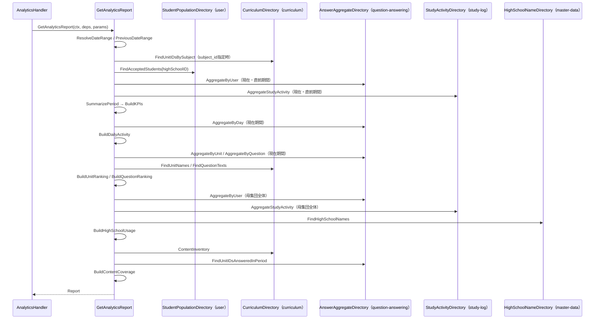
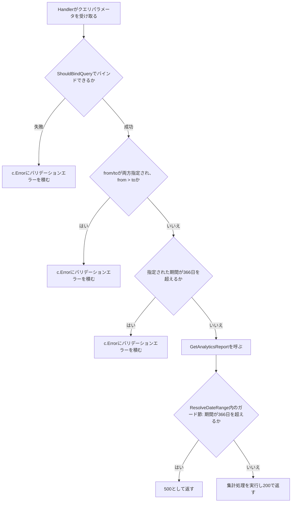

# 管理者分析機能 Go実装仕様書

---

# 1. 機能概要

管理者が、全生徒の学習状況をKPI・日別推移・正答率ワーストランキング・高校別利用状況・コンテンツ網羅率の観点で把握するための機能である。期間・高校・教科で絞り込みができる。本機能はデータを所有せず、他Contextが管理するデータを読み取り専用で集約して返す（②「1. 機能概要」）。

**採用設計パターン（②からの要約）**: Transaction Script（②「4. 設計パターン」）。業務ルールが「指定条件で集計して返す」のみであり、書き込み・状態遷移が存在しないため。domain層・usecase層・Repository Interfaceを設けない（アーキテクチャ規約「3. 設計パターンごとの構造適用方針」）。

**本書が対象とする実装範囲**: `admin-analytics` Contextの全体。1エンドポイント（`GET /api/v1/admin/analytics`）のみであり、文書分割は行わない（「2. ディレクトリ構成」の「文書の分割」で判断根拠を示す）。

---

# 2. ディレクトリ構成

## 対象Bounded Context名

- `admin-analytics`（②「3. Bounded Context」）

## ディレクトリ・パッケージ名

アーキテクチャ規約「4. Bounded Context構成」の「Contextディレクトリの命名」に従い、Context名`admin-analytics`から`-`を取り除いて連結した全小文字の名前とする。ディレクトリ名は`internal/adminanalytics/`、package名は同じ`adminanalytics`となる。

Context名とディレクトリ名は規約から機械的に決まるため、②に明記がなくても推測にはならない。

## ②で採用した設計パターン

Transaction Script（②「4. 設計パターン」）

## 作成するディレクトリ一覧

```
internal/adminanalytics/
internal/adminanalytics/application/
internal/adminanalytics/infrastructure/contextadapter/
internal/adminanalytics/presentation/handler/
internal/adminanalytics/presentation/request/
internal/adminanalytics/presentation/response/
```

`domain/`は作成しない。②「6. Entity設計」「7. Value Object設計」「8. Domain Service」のとおりEntity・Value Object・Domain Serviceをいずれも定義せず、業務ルールを持たないためである（アーキテクチャ規約「3. 設計パターンごとの構造適用方針」Transaction Script節）。

`infrastructure/gormrepo/`も作成しない。本Contextが所有するテーブルがなく、GORMでDBを読み書きする実装を持たないためである（②「20. DB設計方針」「21. DB操作仕様」）。`infrastructure/`配下は`contextadapter/`のみとなる。

規約「4. Bounded Context構成」の「機能で不要なディレクトリは作成しない」に従う。

## 作成するファイル一覧

```
internal/adminanalytics/context.go
internal/adminanalytics/dependency.go
internal/adminanalytics/application/period.go
internal/adminanalytics/application/rate.go
internal/adminanalytics/application/period_stats.go
internal/adminanalytics/application/kpi.go
internal/adminanalytics/application/daily_activity.go
internal/adminanalytics/application/ranking.go
internal/adminanalytics/application/high_school_usage.go
internal/adminanalytics/application/content_coverage.go
internal/adminanalytics/application/get_analytics_report.go
internal/adminanalytics/infrastructure/contextadapter/student_population_directory.go
internal/adminanalytics/infrastructure/contextadapter/answer_aggregate_directory.go
internal/adminanalytics/infrastructure/contextadapter/study_activity_directory.go
internal/adminanalytics/infrastructure/contextadapter/curriculum_directory.go
internal/adminanalytics/infrastructure/contextadapter/high_school_name_directory.go
internal/adminanalytics/presentation/handler/analytics_handler.go
internal/adminanalytics/presentation/request/analytics_request.go
internal/adminanalytics/presentation/response/analytics_response.go
internal/adminanalytics/presentation/routes.go
```

## 文書の分割

実装ファイルは19である。テストが付くもの（application層のTransaction Script関数8・アダプタ5・Handler1の合計14）を加えると、テスト込みで概算33前後となる。③自動生成プロンプト「2. ディレクトリ構成」の「ファイル数の見積り」が示す「実装ファイルが19以下なら分割しない（テスト込みで33前後）」の範囲に収まるため、**分割しない**。

Handlerは1つ（`AnalyticsHandler`）のみであり、エンドポイントも1つである。

---

# 3. Domain層設計

対象外（Transaction Script採用のため、Domain層を設けない）。

②「6. Entity設計」「7. Value Object設計」「8. Domain Service」「18. Domain Event」のとおり、Entity・Value Object・Domain Service・Domain Eventをいずれも定義しない。`domain/`ディレクトリを作成しない。

関数の入出力・処理ステップは「6. Application層設計」に記載する。

他Contextから受け取る値は、本Contextが必要とする項目だけを持つ受け渡し用の型として`dependency.go`に定義する。相手Contextの内部Entityをそのまま持ち込まない（アーキテクチャ規約「5. Context間連携ルール」）。

## Domain Error

対象外。②「17. Error設計」のとおり、本Contextに業務ルール違反を表すエラーが存在しない。期間の検証はPresentation層のRequest DTOで行う（「12. Validation実装方針」）。

---

# 4. クラス図

Entityもstructの階層も持たないため、クラス図としての図示は省略する。

本Contextが持つのは、他Contextの参照手段を宣言するインターフェース（`dependency.go`）と、それを呼んで指標を組み立てる関数群（`application/`）のみである。呼び出し関係は「7. シーケンス図・処理フロー図」のシーケンス図で示す。

---

# 5. 状態遷移図

省略する。理由: 本機能に状態を持つデータが存在しない（②「10. 状態遷移図」）。

---

# 6. Application層設計

本機能はTransaction Script採用のため、UseCase structを設けない（アーキテクチャ規約「3. 設計パターンごとの構造適用方針」）。`application/`直下に置く関数として記載する。

## DTO（Command / Query）

本Contextが定義するDTOはない。`dependency.go`に置く受け渡し用の型は「8. Infrastructure層設計」に記載する。Request/Response DTOは「9. Presentation層設計」で定義する。

## 共通の算出関数

### 集計期間の確定・直前期間の導出（`application/period.go`）

|関数|引数|戻り値|責務|
|-|-|-|-|
|`ResolveDateRange`|`from, to *time.Time`|`(DateRange, error)`|省略された端を既定値で補って集計期間を確定する。`to`が`nil`なら今日、`from`が`nil`なら確定後の`To`から`DefaultRangeDays - 1`日前とする。確定した期間の日数が`MaxRangeDays`を超える場合はエラーを返す（ガード節。「12. Validation実装方針」）|
|`PreviousDateRange`|`r DateRange`|`DateRange`|直前の同じ長さの期間を導出する。`To`は`r.From`の前日、`From`は`r.From`から`PeriodDays(r)`日前とする（②「7. Value Object設計」の例: 8/13〜9/11の30日間 → 7/14〜8/12）|
|`PeriodDays`|`r DateRange`|`int`|期間の日数（両端を含む）を返す|
|`EachDate`|`r DateRange`|`[]time.Time`|期間内の各日を日本時間の暦日として昇順で返す（日別推移の0埋めに用いる）|

定数: `DefaultRangeDays = 30`・`MaxRangeDays = 366`（①「5. API / 処理詳細」の業務ルール、②「7. Value Object設計」）。

処理上の注意:

- 「今日」は日本時間で判定する。分析機能③基盤編「6. Application層設計」の集計期間の確定と同じ方針（日本時間のロケーションをプロセス起動時に一度解決して共有する）を本Contextでも個別に採る。Context間でロケーション解決のコードを共有する部品は規約「4. Bounded Context構成」に定めがないため、各Contextが個別に持つ（分析機能③基盤編と同じ判断。「17. ②からの補足事項」参照）
- `MaxRangeDays`の判定はPresentation層でも行うが（②「15. Validation設計」）、`ResolveDateRange`内でも二重にガードする。既定値補完後の期間がPresentation層の検証を経ていない呼び出し（テスト等）で上限を超えないようにするためである
- 日付は「日本時間の暦日」を表す値として扱う。`time.Time`のロケーションを`time.UTC`、時刻を0時0分0秒に揃え、年月日に日本時間での暦日を入れる（分析機能③基盤編と同じ正規化方針。コーディング規約「17. `time.Time` とタイムゾーン」）

### 率の算出（`application/rate.go`）

|関数|引数|戻り値|責務|
|-|-|-|-|
|`Percentage`|`numerator, denominator int`|`float64`|`numerator / denominator * 100`を小数第1位で丸めて返す。`denominator`が0のときは`0`を返す|

正答率・アクティブ率のすべてがこの1つの関数を通る（②「7. Value Object設計」）。分析機能（`learning-analytics`）と同じ算出式だが、共有部品化は見送る（②「24. 採用しなかった設計」）。

## 母集団ごとの素の集計（`application/period_stats.go`）

|関数|引数|戻り値|責務|
|-|-|-|-|
|`SummarizePeriod`|`userAggs []UserAnswerAggregate, studyActivity StudyActivitySummary`|`PeriodStats`|指定した母集団・期間の解答数・正答数の合計と、アクティブな生徒数（解答または学習記録のいずれかがある生徒の重複排除数）、学習時間の合計を1つにまとめる|

`PeriodStats`はKPI算出の入力となる中間値であり、`dependency.go`ではなく本ファイルに定義する（他Contextから受け取る値ではなく、本Context内で組み立てる値であるため）。

|型|フィールド|
|-|-|
|`PeriodStats`|`ActiveStudentCount int`・`AnswerCount int`・`CorrectCount int`・`StudyMinutes int`|

処理上の注意: `ActiveStudentCount`は、`userAggs`のうち`Total > 0`のユーザーIDの集合と、`studyActivity.ActiveUserIDs`の集合の和集合の要素数とする（①「5. API / 処理詳細」の業務ルール「期間内に解答または学習記録がある生徒の重複排除数」）。

## KPIの組み立て（`application/kpi.go`）

|関数|引数|戻り値|責務|
|-|-|-|-|
|`BuildKPIs`|`current, previous PeriodStats`|`KPIs`|現在期間・直前期間の`PeriodStats`から、4項目（`active_student_count`・`answer_count`・`accuracy_rate`・`study_minutes`）それぞれの`current`/`previous`の組を組み立てる|

`KPIs`は本ファイル（`application/kpi.go`）で定義する。

|型|フィールド|
|-|-|
|`KPIs`|`ActiveStudentCount MetricPairInt`・`AnswerCount MetricPairInt`・`AccuracyRate MetricPairFloat`・`StudyMinutes MetricPairInt`|
|`MetricPairInt`|`Current int`・`Previous int`|
|`MetricPairFloat`|`Current float64`・`Previous float64`|

`KPIs`・`Report`（後述）はapplication層の戻り値であり、Presentation層のResponse DTO（`KPIsResponse`等）とは別の型である。application層がPresentation層の型をimportしないよう、変換は「9. Presentation層設計」のResponse DTO側（`toResponse`相当の変換関数）が担う（アーキテクチャ規約「2. レイヤー責務と依存方向」の依存方向）。

## 日別推移の組み立て（`application/daily_activity.go`）

|関数|引数|戻り値|責務|
|-|-|-|-|
|`BuildDailyActivity`|`r DateRange, aggs []DailyAnswerAggregate`|`[]DailyActivityPoint`|`r`の全日分について、`aggs`に該当する日があれば値を使い、なければ0件で埋める。日付の昇順|

|型|フィールド|
|-|-|
|`DailyActivityPoint`|`Date time.Time`・`ActiveStudentCount int`・`AnswerCount int`・`AccuracyRate float64`|

`aggs`は`question-answering`から受け取る日別集計であり、学習ログは含まない（①「5. API / 処理詳細」の業務ルール。Rails現行の`daily_activity`は解答履歴のみを集計する）。

## ランキングの組み立て（`application/ranking.go`）

|関数|引数|戻り値|責務|
|-|-|-|-|
|`BuildUnitRanking`|`aggs []UnitAnswerAggregate, names map[uint]UnitNameRef`|`[]UnitRankingItem`|`aggs`のうち`Total >= MinAnswerCount`のものだけを対象に、正答率の低い順に並べ、上位`RankingLimit`件を返す。同率は`UnitID`の昇順。`names`から単元名・コース名・教科名を補う|
|`BuildQuestionRanking`|`aggs []QuestionAnswerAggregate, refs map[uint]QuestionRef`|`[]QuestionRankingItem`|同様。`question_text`は`refs`から取得し、`QuestionTextTruncateLength`文字で切り詰める|

定数: `MinAnswerCount = 20`・`RankingLimit = 10`・`QuestionTextTruncateLength = 80`（①「5. API / 処理詳細」の業務ルール）。

`names`・`refs`が該当する単元・設問を持たない場合（`curriculum`側で論理削除済み等）、その要素は結果から除く（②「17. Error設計」の「参照先が0件を返すことはエラーとして扱わない」と同じ考え方）。

## 高校別利用状況の組み立て（`application/high_school_usage.go`）

|関数|引数|戻り値|責務|
|-|-|-|-|
|`BuildHighSchoolUsage`|`students []StudentRef, userAggs []UserAnswerAggregate, studyActiveUserIDs []uint, schoolNames map[uint]string`|`[]HighSchoolUsageItem`|`students`を`HighSchoolID`でグルーピングし、各高校の在籍生徒数・アクティブな生徒数・解答数・正答数・アクティブ率・正答率を算出する。生徒が1人もいない高校は結果から除く。アクティブ率の低い順に並べ、同率は`HighSchoolID`の昇順|

処理上の注意:

- 在籍生徒数は`students`を`HighSchoolID`でグルーピングした件数とする。②「11. Repository設計」は「高校ごとの在籍生徒数」を`user`の別の公開操作（`CountUsers`の所属校別集計）から得る想定だったが、本Contextは母集団のユーザーごとの所属校（`StudentRef`）を別途必要とするため、同じ`FindAcceptedStudents`の結果をグルーピングして件数を導出する（1回の呼び出しで両方を満たす。**②からの補足**。「17. ②からの補足事項」参照）
- アクティブな生徒数は、その高校に属する`students`のうち、`userAggs`で`Total > 0`のユーザー、または`studyActiveUserIDs`に含まれるユーザーの重複排除数とする（「母集団ごとの素の集計」の`ActiveStudentCount`と同じ考え方を高校単位に適用する）

## コンテンツ網羅率の組み立て（`application/content_coverage.go`）

|関数|引数|戻り値|責務|
|-|-|-|-|
|`BuildContentCoverage`|`inventory ContentInventory, answeredUnitIDs []uint`|`ContentCoverage`|`total_units`は`inventory.TotalActiveUnits`。`units_without_questions`は`inventory.TotalActiveUnits - len(inventory.UnitIDsWithQuestions)`。`units_without_answers`は`inventory.UnitIDsWithQuestions`のうち`answeredUnitIDs`に含まれないものの件数|

|型|フィールド|
|-|-|
|`ContentCoverage`|`TotalUnits int`・`UnitsWithoutQuestions int`・`UnitsWithoutAnswers int`|

`answeredUnitIDs`は高校・教科による絞り込みを受けない取得（「8. Infrastructure層設計」の`FindUnitIDsAnsweredInPeriod`）であり、`inventory`も同様に絞り込みを受けない（②「3. Bounded Context」「11. Repository設計」）。

## 業務操作の組み立て（`application/get_analytics_report.go`）

### GetAnalyticsReport

|項目|内容|
|-|-|
|関数シグネチャ|`GetAnalyticsReport(ctx context.Context, deps *Dependencies, params ReportParams) (*Report, error)`|
|引数|`deps`: `dependency.go`で宣言した各インターフェースをまとめた構造体（下記）。`params`: `ReportParams{From, To *time.Time, HighSchoolID, SubjectID *uint}`|
|戻り値|`Report`（KPI・日別推移・単元ランキング・設問ランキング・高校別利用状況・コンテンツ網羅率・meta）|
|トランザクション範囲|なし（読み取りのみ。「11. Transaction実装方針」）|

処理ステップ:

1. `ResolveDateRange(params.From, params.To)`で集計期間を確定する。エラーならそのまま返す
2. `PreviousDateRange`で直前期間を導出する
3. `params.SubjectID`が指定されている場合、`deps.Curriculum.FindUnitIDsBySubject(ctx, *params.SubjectID)`で単元IDの集合を取得し、以降の集計の絞り込みに使う（`AggregationScope.UnitIDs`）。未指定の場合は絞り込まない（`nil`）
4. `deps.Population.FindAcceptedStudents(ctx, params.HighSchoolID)`で母集団（`[]StudentRef`）を取得する
5. 母集団のユーザーID集合を`AggregationScope{UserIDs: ..., UnitIDs: ...}`として組み立てる
6. 現在期間・直前期間のそれぞれについて、`deps.AnswerAggregate.AggregateByUser(ctx, scope, r)`と`deps.StudyActivity.AggregateStudyActivity(ctx, scope.UserIDs, r)`を呼び、`SummarizePeriod`で`PeriodStats`を得る
7. `BuildKPIs`でKPIを組み立てる
8. `deps.AnswerAggregate.AggregateByDay(ctx, scope, 現在期間)`を呼び、`BuildDailyActivity`で日別推移を組み立てる
9. `deps.AnswerAggregate.AggregateByUnit` / `AggregateByQuestion`（現在期間・`scope`）を呼び、該当する単元ID・設問IDについて`deps.Curriculum.FindUnitNames` / `FindQuestionTexts`で名称を取得し、`BuildUnitRanking` / `BuildQuestionRanking`で組み立てる
10. 母集団全体（`AggregationScope{UserIDs: 全母集団, UnitIDs: 同上}`）で`AggregateByUser`・`AggregateStudyActivity`を呼び、`deps.MasterData.FindHighSchoolNames`で高校名を取得し、`BuildHighSchoolUsage`で組み立てる
11. `deps.Curriculum.ContentInventory(ctx)`と`deps.AnswerAggregate.FindUnitIDsAnsweredInPeriod(ctx, 現在期間)`を呼び、`BuildContentCoverage`で組み立てる
12. `meta`（期間・直前期間・閾値定数・生成時刻）を組み立てて`Report`を返す

手順6は現在期間・直前期間の2回、`AggregateByUser`・`AggregateStudyActivity`を呼ぶ（Rails現行の`period_stats(from, to)`が現在・直前の2回呼ばれるのと同じ構成。①「10. Rails実装対応表」）。

手順10は高校による絞り込み（`params.HighSchoolID`）を受けた母集団に対して行う。`params.HighSchoolID`が指定されている場合、`high_school_usage`は指定した1校のみを含む結果になる（①「5. API / 処理詳細」の業務ルール、②「11. Repository設計」のテスト観点）。

発生しうるApplication Error: なし（「14. Error実装方針」のとおり、本Contextに意味を持つApplication Errorは存在しない）。

---

# 7. シーケンス図・処理フロー図

## シーケンス図



## 処理フロー図

期間の検証はPresentation層（Handler）で行う分岐が複数あるため、フローチャートで示す。②「13. シーケンス図・処理フロー図」のフローチャートを、実際の関数名で具体化する。



ランキングの閾値判定・上位抽出や、高校別のグルーピングは条件分岐ではなく機械的な並べ替え・絞り込みであるため、フローチャートでは示さない（②「13. シーケンス図・処理フロー図」と同じ扱い）。

---

# 8. Infrastructure層設計

**実装上の位置づけ**: 本Contextが所有するテーブルは存在しない。Repository実装・Store実装・Infrastructure関数のいずれも持たない（②「20. DB設計方針」「21. DB操作仕様」）。`infrastructure/`配下に置くのは、他Contextの公開参照手段へ委譲するアダプタのみである。

## Repository実装（Domain Model / Event Sourcing採用時）

対象外（Transaction Script採用のため、かつ所有するテーブルがないため）。

## Store実装（Active Record採用時）

対象外（同上）。

## Infrastructure関数（Transaction Script採用時）

対象外。本Contextには対象がない（GORMを用いる実装を一切持たないため、`*gorm.DB`を受け取る構造も存在しない。`context.go`の`NewContext`も`*gorm.DB`を引数に取らない）。

## `dependency.go`に定義する受け渡し用の型

|型|フィールド|備考|
|-|-|-|
|`DateRange`|`From time.Time`・`To time.Time`|両端を含む日本時間の暦日の範囲。ロケーションは`time.UTC`、時刻は0時0分0秒に揃え、年月日に日本時間での暦日を入れる（分析機能③基盤編と同じ正規化方針）|
|`AggregationScope`|`UserIDs []uint`・`UnitIDs []uint`|集計対象の母集団（ユーザーID）と、教科による絞り込みで得た単元ID。`UnitIDs`が`nil`なら絞り込まない|
|`StudentRef`|`UserID uint`・`HighSchoolID uint`|母集団に属する生徒の識別子と所属校|
|`UnitAnswerAggregate`|`UnitID uint`・`Total int`・`Correct int`|単元ごとの解答数・正答数|
|`QuestionAnswerAggregate`|`QuestionID uint`・`UnitID uint`・`Total int`・`Correct int`|設問ごとの解答数・正答数|
|`UserAnswerAggregate`|`UserID uint`・`Total int`・`Correct int`|ユーザーごとの解答数・正答数|
|`DailyAnswerAggregate`|`Date time.Time`・`ActiveUserCount int`・`Total int`・`Correct int`|日本時間の日付ごとの、解答した生徒の重複排除数・解答数・正答数|
|`StudyActivitySummary`|`ActiveUserIDs []uint`・`TotalMinutes int`|学習記録のあるユーザーIDの集合と、合計学習時間（分）|
|`UnitNameRef`|`UnitID uint`・`UnitName string`・`CourseID uint`・`CourseName string`・`SubjectName string`|単元の表示に必要な名称一式|
|`QuestionRef`|`QuestionID uint`・`QuestionText string`・`UnitID uint`・`UnitName string`・`CourseID uint`|設問の表示に必要な名称一式|
|`ContentInventory`|`TotalActiveUnits int`・`UnitIDsWithQuestions []uint`|有効な単元の総数と、問題を1件以上持つ単元の識別子|

率・百分率を含めず件数で受け取るのは、分析機能と同じ考え方である（②「3. Bounded Context」）。

## 他Contextへの依存を宣言するインターフェース

`dependency.go`に置く。実装は`infrastructure/contextadapter/`のアダプタが担う（コーディング規約「7. インターフェース」の「インターフェースは利用側に置く」）。

### `user`への参照

|インターフェース|メソッド|責務|
|-|-|-|
|`StudentPopulationDirectory`|`FindAcceptedStudents(ctx context.Context, highSchoolID *uint) ([]StudentRef, error)`|招待受諾済みかつ有効な生徒の識別子と所属校を返す。`highSchoolID`が指定された場合はその高校のみに絞り込む（②「11. Repository設計」の`SearchUsers`を利用）|

### `question-answering`への参照

|インターフェース|メソッド|責務|
|-|-|-|
|`AnswerAggregateDirectory`|`AggregateByUser(ctx context.Context, scope AggregationScope, r DateRange) ([]UserAnswerAggregate, error)`|`scope`の範囲で、ユーザーごとの解答数・正答数を返す|
||`AggregateByUnit(ctx context.Context, scope AggregationScope, r DateRange) ([]UnitAnswerAggregate, error)`|同、単元ごと|
||`AggregateByQuestion(ctx context.Context, scope AggregationScope, r DateRange) ([]QuestionAnswerAggregate, error)`|同、設問ごと|
||`AggregateByDay(ctx context.Context, scope AggregationScope, r DateRange) ([]DailyAnswerAggregate, error)`|同、日本時間の日付ごと|
||`FindUnitIDsAnsweredInPeriod(ctx context.Context, r DateRange) ([]uint, error)`|母集団・教科による絞り込みを受けずに、指定期間内に1件以上の解答がある単元の識別子を返す（コンテンツ網羅率専用）|

いずれも②「11. Repository設計」が「新規」と整理した公開操作であり、`question-answering`②「11. Repository設計」への追加が別途必要である（②「11. Repository設計」の「他Context側への追加が必要な公開操作」）。`FindUnitIDsAnsweredInPeriod`は、本書で初めて必要性が判明した5つ目の操作であり、②の整理時点では他の4つ（単元別・設問別・ユーザー別・日別）とまとめて記載していた（**②からの補足**。「17. ②からの補足事項」参照）。

### `study-log`への参照

|インターフェース|メソッド|責務|
|-|-|-|
|`StudyActivityDirectory`|`AggregateStudyActivity(ctx context.Context, userIDs []uint, r DateRange) (StudyActivitySummary, error)`|指定したユーザーID集合・期間について、学習記録のあるユーザーIDの集合と合計学習時間を返す|

②「11. Repository設計」が「新規」と整理した公開操作であり、`study-log`②「11. Repository設計」への追加が別途必要である。

### `curriculum`への参照

|インターフェース|メソッド|責務|
|-|-|-|
|`CurriculumDirectory`|`FindUnitIDsBySubject(ctx context.Context, subjectID uint) ([]uint, error)`|指定教科に属するコースの単元IDを返す|
||`FindUnitNames(ctx context.Context, unitIDs []uint) ([]UnitNameRef, error)`|単元IDから単元名・コース名・教科名を返す|
||`FindQuestionTexts(ctx context.Context, questionIDs []uint) ([]QuestionRef, error)`|設問IDから設問テキスト・単元ID・単元名・コースIDを返す|
||`ContentInventory(ctx context.Context) (ContentInventory, error)`|有効な単元の総数と、問題を1件以上持つ単元の識別子を返す|

いずれも②「11. Repository設計」が「新規」と整理した公開操作であり、`curriculum`②「11. Repository設計」への追加が別途必要である。

渡したIDに対応する行が存在しない場合（論理削除済みの単元・設問等）は、その要素を戻り値に含めない。エラーにしない（分析機能③基盤編の`CurriculumDirectory`と同じ扱い）。

### `master-data`への参照

|インターフェース|メソッド|責務|
|-|-|-|
|`HighSchoolNameDirectory`|`FindHighSchoolNames(ctx context.Context, highSchoolIDs []uint) ([]HighSchoolRef, error)`|高校IDから高校名を返す|

`HighSchoolRef{ID uint, Name string}`は`dependency.go`に追加する。

既存の`master-data`の公開操作（共通マスタ参照機能③_1「3. 公開操作の定義」の`FindHighSchools`）で足りると判断する（②「11. Repository設計」）。`FindHighSchools`が高校の属性一式（学校コードを含む）を返すため、本Contextのアダプタは高校名以外の属性を使わずに変換する。

## 他Contextの参照手段の実装（アダプタ）

`dependency.go`で宣言したインターフェースの実装である。相手Contextが公開する参照手段へ委譲し、本Contextから相手のテーブルへクエリを発行しない（アーキテクチャ規約「5. Context間連携ルール」）。

|ファイル|struct / コンストラクタ|満たすインターフェース|
|-|-|-|
|`student_population_directory.go`|非公開struct（例: `studentPopulationDirectory`）＋`NewStudentPopulationDirectory(userContext *user.Context) adminanalytics.StudentPopulationDirectory`|`StudentPopulationDirectory`|
|`answer_aggregate_directory.go`|`answerAggregateDirectory`＋`NewAnswerAggregateDirectory(qaContext *questionanswering.Context) adminanalytics.AnswerAggregateDirectory`|`AnswerAggregateDirectory`|
|`study_activity_directory.go`|`studyActivityDirectory`＋`NewStudyActivityDirectory(studyLogContext *studylog.Context) adminanalytics.StudyActivityDirectory`|`StudyActivityDirectory`|
|`curriculum_directory.go`|`curriculumDirectory`＋`NewCurriculumDirectory(curriculumContext *curriculum.Context) adminanalytics.CurriculumDirectory`|`CurriculumDirectory`|
|`high_school_name_directory.go`|`highSchoolNameDirectory`＋`NewHighSchoolNameDirectory(masterDataContext *masterdata.Context) adminanalytics.HighSchoolNameDirectory`|`HighSchoolNameDirectory`|

`highSchoolNameDirectory.FindHighSchoolNames`は、`master-data`の`FindHighSchools`を呼び、返った属性から`ID`・`Name`のみを取り出して`HighSchoolRef`へ変換する。

アダプタの責務は委譲と型変換のみである。集計・並べ替え・グルーピングをアダプタで行わない（分析機能③基盤編と同じ方針）。

コンパイル時のインターフェース充足チェック（コーディング規約「7. インターフェース」）をそれぞれのアダプタファイルに置く。

```go
var _ adminanalytics.StudentPopulationDirectory = (*studentPopulationDirectory)(nil)
```

**②からの補足**: 相手Contextが公開する参照手段の具体的なシグネチャは、各機能の③で確定する。本書が宣言するインターフェースのメソッド名・引数は、所有Context側（`question-answering`・`study-log`・`curriculum`）の②へ公開操作を追加する際の起点として使う（「17. ②からの補足事項」参照）。

## 外部連携実装

対象外。本Contextから外部サービス・キャッシュ・キューへ直接アクセスしない。集計結果のキャッシュも設けない（②「20. DB設計方針」）。

## 依存関係の組み立て（`context.go`）

アーキテクチャ規約「14. 依存関係の組み立て（DI配線）」の「Context単位の組み立て関数」に従う。

|項目|内容|
|-|-|
|関数|`NewContext(userContext *user.Context, qaContext *questionanswering.Context, studyLogContext *studylog.Context, curriculumContext *curriculum.Context, masterDataContext *masterdata.Context) *Context`|
|組み立てる内容|5つのアダプタを生成し、`Dependencies`構造体にまとめて`AnalyticsHandler`へ注入する|
|公開するもの|ルーティング登録に必要な`Handler`のみ|

`*gorm.DB`を引数に取らない（本Contextが所有するテーブルを持たないため）。

---

# 9. Presentation層設計

## Handler

### AnalyticsHandler（`presentation/handler/analytics_handler.go`）

|項目|内容|
|-|-|
|struct名|`AnalyticsHandler`|
|対応する呼び出し先|`application.GetAnalyticsReport`（Transaction Script採用のためUseCaseを経由しない）|
|保持するフィールド|`deps *application.Dependencies`|
|コンストラクタ|`NewAnalyticsHandler(deps *application.Dependencies) *AnalyticsHandler`|
|メソッド|`Show(c *gin.Context)`（GET `/api/v1/admin/analytics`）|

`Show`の処理順序:

1. `AnalyticsRequest`へ`ShouldBindQuery`でバインドする。失敗した場合は`c.Error`にバリデーションエラーを積んで戻る（Gin規約「6. Model BindingとValidation」）
2. `from`・`to`が両方指定されている場合、`from`が`to`より後であればバリデーションエラーを`c.Error`に積んで戻る（422）
3. 両方指定されている場合、期間の日数（両端を含む）が`366`を超えればバリデーションエラーを積んで戻る（422）。手順2・3は複数フィールドにまたがる判定のため`binding`タグでは表せず、Handler側で行う（分析機能③_2の`SummaryHandler.Show`と同じ構成）
4. `AnalyticsRequest`から`ReportParams`を組み立てる（`From`・`To`は`YYYY-MM-DD`形式の文字列を`time.Time`へ変換する。`HighSchoolID`・`SubjectID`は変換できない場合`nil`として扱う。「12. Validation実装方針」参照）
5. `application.GetAnalyticsReport(c.Request.Context(), h.deps, params)`を呼ぶ
6. エラーの場合は`c.Error(err)`を呼んで戻る。ステータスとレスポンス本文への変換は`ErrorHandler`が行う（Gin規約「8. エラーハンドリングミドルウェア」）
7. `Report`を`AnalyticsResponse`へ変換する
8. `200`で返す

本機能は操作者自身のデータを扱わないため、`context.Context`からユーザーIDを取り出す手順はない（②「16. Authorization設計」）。

## Request / Response DTO

### AnalyticsRequest（`presentation/request/analytics_request.go`）

|フィールド|型|タグ|チェック内容|
|-|-|-|-|
|`From`|`string`|`form:"from" binding:"omitempty,datetime=2006-01-02"`|指定された場合は`YYYY-MM-DD`形式かつ実在する日付|
|`To`|`string`|`form:"to" binding:"omitempty,datetime=2006-01-02"`|同|
|`HighSchoolID`|`*uint`|`form:"high_school_id"`|指定された場合は符号なし整数として解釈できること。解釈できない場合はエラーにせず`nil`として扱う（①「5. API / 処理詳細」の業務ルール）|
|`SubjectID`|`*uint`|`form:"subject_id"`|同|

`From`・`To`を`string`で受け取るのは、分析機能③_2の`ShowRequest`と同じ理由（不正な日付に対するエラーメッセージの制御）による。

`HighSchoolID`・`SubjectID`を「解釈できない場合はエラーにしない」とする実装は、Ginの`ShouldBindQuery`が`*uint`への変換失敗時にバインドエラーを返す標準動作と異なる。Ginの標準動作のままではRails現行（無視する）と一致しないため、Handler側で変換失敗を検知した場合は`nil`として扱う処理を個別に行う（`binding`タグでは表現できない。**②からの補足**。「17. ②からの補足事項」参照）。

### AnalyticsResponse（`presentation/response/analytics_response.go`）

envelopeを持たず、JSONオブジェクトをそのまま返す（アーキテクチャ規約「15. API規約」の「単体」、②「19. API仕様」）。

|struct名|フィールド|JSONキー|型|
|-|-|-|-|
|`AnalyticsResponse`|`KPIs`|`kpis`|`KPIsResponse`|
||`DailyActivity`|`daily_activity`|`[]DailyActivityResponse`|
||`LowAccuracyUnits`|`low_accuracy_units`|`[]UnitRankingResponse`|
||`LowAccuracyQuestions`|`low_accuracy_questions`|`[]QuestionRankingResponse`|
||`HighSchoolUsage`|`high_school_usage`|`[]HighSchoolUsageResponse`|
||`ContentCoverage`|`content_coverage`|`ContentCoverageResponse`|
||`Meta`|`meta`|`MetaResponse`|
|`KPIsResponse`|`ActiveStudentCount`|`active_student_count`|`CurrentPreviousIntResponse`|
||`AnswerCount`|`answer_count`|`CurrentPreviousIntResponse`|
||`AccuracyRate`|`accuracy_rate`|`CurrentPreviousFloatResponse`|
||`StudyMinutes`|`study_minutes`|`CurrentPreviousIntResponse`|
|`CurrentPreviousIntResponse`|`Current`|`current`|`int`|
||`Previous`|`previous`|`int`|
|`CurrentPreviousFloatResponse`|`Current`|`current`|`float64`|
||`Previous`|`previous`|`float64`|
|`DailyActivityResponse`|`Date`|`date`|`string`（`YYYY-MM-DD`）|
||`ActiveStudentCount`|`active_student_count`|`int`|
||`AnswerCount`|`answer_count`|`int`|
||`AccuracyRate`|`accuracy_rate`|`float64`|
|`UnitRankingResponse`|`UnitID`|`unit_id`|`uint`|
||`UnitName`|`unit_name`|`string`|
||`CourseID`|`course_id`|`uint`|
||`CourseName`|`course_name`|`string`|
||`SubjectName`|`subject_name`|`string`|
||`AnswerCount`|`answer_count`|`int`|
||`AccuracyRate`|`accuracy_rate`|`float64`|
|`QuestionRankingResponse`|`QuestionID`|`question_id`|`uint`|
||`QuestionText`|`question_text`|`string`|
||`UnitID`|`unit_id`|`uint`|
||`UnitName`|`unit_name`|`string`|
||`CourseID`|`course_id`|`uint`|
||`AnswerCount`|`answer_count`|`int`|
||`AccuracyRate`|`accuracy_rate`|`float64`|
|`HighSchoolUsageResponse`|`HighSchoolID`|`high_school_id`|`uint`|
||`HighSchoolName`|`high_school_name`|`string`|
||`StudentCount`|`student_count`|`int`|
||`ActiveStudentCount`|`active_student_count`|`int`|
||`ActiveRate`|`active_rate`|`float64`|
||`AnswerCount`|`answer_count`|`int`|
||`AccuracyRate`|`accuracy_rate`|`float64`|
|`ContentCoverageResponse`|`TotalUnits`|`total_units`|`int`|
||`UnitsWithoutQuestions`|`units_without_questions`|`int`|
||`UnitsWithoutAnswers`|`units_without_answers`|`int`|
|`MetaResponse`|`From`|`from`|`string`（`YYYY-MM-DD`）|
||`To`|`to`|`string`|
||`PreviousFrom`|`previous_from`|`string`|
||`PreviousTo`|`previous_to`|`string`|
||`MinAnswerCount`|`min_answer_count`|`int`|
||`RankingLimit`|`ranking_limit`|`int`|
||`MaxRangeDays`|`max_range_days`|`int`|
||`GeneratedAt`|`generated_at`|`string`（RFC3339）|

`low_accuracy_units`・`low_accuracy_questions`・`high_school_usage`・`daily_activity`は、要素が0件でも空配列`[]`で返す（`nil`のままJSON化すると`null`になるため、変換時に空スライスを入れる。分析機能③_2と同じ扱い）。

## Routing

|Method|Path|Handler|
|-|-|-|
|GET|`/api/v1/admin/analytics`|`AnalyticsHandler.Show`|

`presentation/routes.go`:

```go
func RegisterRoutes(rg *gin.RouterGroup, h *AnalyticsHandler) {
    admin := rg.Group("/admin")
    admin.GET("/analytics", h.Show)
}
```

このグループは、`admin`ロールの認証・認可ミドルウェアが適用された`main.go`側のルートグループに登録される（Gin規約「2. ルートグルーピング」）。本Context単独では認証・認可ミドルウェアを`Use`しない。

---

# 10. API仕様

|Method|Path|Handler|Request|Response|Status Code|
|-|-|-|-|-|-|
|GET|`/api/v1/admin/analytics`|`AnalyticsHandler.Show`|`from`・`to`・`high_school_id`・`subject_id`（いずれも任意）|`AnalyticsResponse`|200 / 422 / 401 / 403 / 500|

## `GET /api/v1/admin/analytics` のErrorケース

|条件|Status Code|Error内容|
|-|-|-|
|`from`・`to`が`YYYY-MM-DD`形式でない、または実在しない日付|422|`{"errors": ["は正しい日付形式(YYYY-MM-DD)で指定してください"], "fields": [...]}`|
|開始日が終了日より後|422|`{"errors": ["開始日は終了日より前の日付を指定してください"]}`|
|指定した期間が366日を超える|422|`{"errors": ["指定できる期間は366日以内です"]}`|
|`high_school_id`・`subject_id`が整数として解釈できない|（エラーにしない）|絞り込みを適用せず`nil`として扱う|
|他Contextの参照手段の呼び出しに失敗|500|`{"errors": ["internal server error"]}`|
|未認証|401|認証ミドルウェアの応答|
|`admin`ロール以外|403|認可ミドルウェアの応答|

メッセージの文言は①「5. API / 処理詳細」のRails現行の文言を維持する（②「17. Error設計」）。

---

# 11. Transaction実装方針

トランザクションを使用しない。

- **Transaction開始箇所**: なし
- **Transaction終了箇所**: なし

②「14. Transaction設計」のとおり、本機能は1件のデータも作成・更新・削除せず、原子性を保証する対象が存在しない。アーキテクチャ規約「11. Transaction実装パターン（TransactionManager）」の`TransactionManager`を注入しない。`gormtx.RunInTx`も呼ばない。

複数の参照手段にまたがる読み取りを1つのトランザクションで束ねることもしない（分析機能③基盤編と同じ方針）。

---

# 12. Validation実装方針

## Presentation

|フィールド|struct名|バリデーションタグ|エラーメッセージ|
|-|-|-|-|
|`From`|`AnalyticsRequest`|`form:"from" binding:"omitempty,datetime=2006-01-02"`|「は正しい日付形式(YYYY-MM-DD)で指定してください」|
|`To`|`AnalyticsRequest`|`form:"to" binding:"omitempty,datetime=2006-01-02"`|同|
|`HighSchoolID`|`AnalyticsRequest`|`form:"high_school_id"`（`binding`タグなし）|バインド失敗時もエラーにせず`nil`として扱う（Handlerで個別に処理。「9. Presentation層設計」）|
|`SubjectID`|`AnalyticsRequest`|`form:"subject_id"`（同上）|同|

`From`・`To`の前後関係・366日の上限はHandlerで判定する（「9. Presentation層設計」の手順2・3）。複数フィールドにまたがる判定であり`binding`タグで表せないためである（分析機能③_2の`ShowRequest`と同じ構成）。

## 業務ルール検証

Transaction Script採用のため、application関数内のガード節で検証する（アーキテクチャ規約「3. 設計パターンごとの構造適用方針」）。

|関数|ガード節|
|-|-|
|`ResolveDateRange`|確定した期間の日数が`MaxRangeDays`（366）を超える場合はエラーを返す|
|`Percentage`|分母が0の場合は除算せず`0`を返す（エラーにしない）|

---

# 13. Authorization実装方針

②「16. Authorization設計」を実装に落とし込む。

|層|処理|
|-|-|
|Middleware|認証（ログイン済みであること）と`admin`ロールの判定。Casbin RBACで行う（Gin規約「4. 認可（Casbin RBAC）」）|
|Handler|判定しない。クエリパラメータをそのまま`application.GetAnalyticsReport`へ渡す|
|application関数|判定しない。所有権の判定が成立する対象（他人のデータへのアクセス要求）が存在しない|
|Domain|存在しない（Domain層を設けない）|

本機能は操作者自身のデータではなく全体の集計を扱うため、`context.Context`から操作者のユーザーIDを取り出す手順を持たない（②「16. Authorization設計」）。

---

# 14. Error実装方針

## Domain Error → Application Errorへの変換方針

対象外。②「17. Error設計」のとおり、Domain Error・Application Errorのいずれも存在しない。意味を持つエラーはPresentation層の入力検証のみである。

## Application Error → HTTPレスポンスへの変換方針

アーキテクチャ規約「12. Error変換パターン（AppError）」に従う。Presentation層のバリデーションエラーを`apperror.ValidationError`（`FieldErrorer`実装、Gin規約「6. Model BindingとValidation」）として扱い、Handlerは`c.Error(err)`を呼ぶだけとする。HTTPステータスとレスポンス本文への変換は、Gin規約「8. エラーハンドリングミドルウェア」の集約ハンドラが行う。

|業務シナリオ|Error変数名／型|発生層|HTTP Status|
|-|-|-|-|
|`from`・`to`の形式が不正|Request DTOのバリデーションエラー（`datetime`タグ）|Presentation|422|
|開始日が終了日より後|Handlerが積む`apperror.ValidationError`|Presentation|422|
|指定した期間が366日を超える|同上|Presentation|422|
|他Contextの参照手段の呼び出しに失敗|包まずそのまま返す|Infrastructure|500|
|未認証|認証ミドルウェアが返す|Middleware|401|
|`admin`ロール以外|認可ミドルウェアが返す|Middleware|403|

本文の形式はいずれも`{"errors": [...]}`とする（アーキテクチャ規約「15. API規約」）。

## Infrastructure Errorのハンドリング方針

アダプタは所有Contextが返したエラーを包み直さず、そのまま返す。本Contextで意味づけし直す余地がないためである（②「17. Error設計」）。

参照手段が0件を返すことはエラーとして扱わない。該当するデータが無い高校・期間では、集計結果が0件・空配列で返るのが正常な応答である（②「17. Error設計」）。

---

# 15. GORM / DBクエリ設計

該当なし。本Contextは所有するテーブルを持たず、GORMモデル・クエリを持たない（②「20. DB設計方針」「21. DB操作仕様」）。実際のDBアクセスは、各所有Context（`question-answering`・`study-log`・`curriculum`・`user`・`master-data`）側の実装で行われる。

---

# 16. テストケース設計

区分は②が採用した設計パターンに応じて読み替える。

## Domain Test

対象外（Transaction Script採用のため）。

## Application関数 Test

他Contextへの依存（`dependency.go`のインターフェース）をテストダブルに差し替えて検証する。

|対象|テストケース|
|-|-|
|`ResolveDateRange`|未指定時の既定値補完（29日前〜当日）になること|
||両端を含むこと|
||確定した期間が366日を超えるときエラーを返すこと|
|`PreviousDateRange`|直前期間が「同じ日数だけ遡った、開始日の前日までの期間」になること（8/13〜9/11の例で7/14〜8/12になること）|
|`Percentage`|分母0のとき0になること、小数第1位で丸められること|
|`SummarizePeriod`|解答のみ・学習記録のみ・両方・いずれもない生徒がそれぞれアクティブ数に正しく反映されること（重複排除されること）|
|`BuildKPIs`|4項目それぞれの`current`/`previous`が正しく組まれること|
|`BuildDailyActivity`|記録の無い日が0件で埋まること、期間内の全日分が生成されること|
|`BuildUnitRanking`|解答件数が20件未満の単元が対象から外れること、正答率の低い順に最大10件になること、同率のとき単元IDの昇順になること、名称が引けない単元が結果から除かれること|
|`BuildQuestionRanking`|設問テキストが80文字で切り詰められること。その他は`BuildUnitRanking`と同じ観点|
|`BuildHighSchoolUsage`|在籍生徒が0人の高校が対象から外れること、アクティブ率の低い順になること、同率のとき高校IDの昇順になること、高校IDによるグルーピングが正しく行われること|
|`BuildContentCoverage`|`units_without_questions`・`units_without_answers`が正しく算出されること、`answeredUnitIDs`に含まれる単元が`units_without_answers`から除かれること|
|`GetAnalyticsReport`|`high_school_id`を指定したとき`FindAcceptedStudents`にその値が渡り、`high_school_usage`が1校のみになること|
||`subject_id`を指定したとき`FindUnitIDsBySubject`の結果が`AggregationScope.UnitIDs`に渡ること|
||`subject_id`を指定しないとき`FindUnitIDsBySubject`を呼ばないこと|
||`content_coverage`が`high_school_id`・`subject_id`の指定に影響されないこと|
||他Contextの参照手段がエラーを返した場合、そのまま返すこと（吸収しないこと）|

## Repository Test

対象外（本Contextが所有するテーブルがないため）。

## アダプタ Test

|対象|テストケース|
|-|-|
|`studentPopulationDirectory.FindAcceptedStudents`|`user`の`SearchUsers`へ、役割=生徒・在籍中のみ・所属校の指定を渡すこと（相手Contextのテストダブルで検証）|
|`answerAggregateDirectory`の各メソッド|`question-answering`側の対応する参照手段へ委譲するだけで、集計・並べ替えを行わないこと|
|`curriculumDirectory`の各メソッド|同様に委譲のみであること|
|`highSchoolNameDirectory.FindHighSchoolNames`|`master-data`の`FindHighSchools`の結果から`ID`・`Name`のみを取り出すこと|

## Handler Test

|対象|テストケース|
|-|-|
|`AnalyticsHandler.Show`|`from`・`to`・`high_school_id`・`subject_id`をクエリから受け取り、`ReportParams`へ渡すこと|
||`from`が`2026-09-99`のとき422と「は正しい日付形式(YYYY-MM-DD)で指定してください」を返すこと|
||`from`が`to`より後のとき422と「開始日は終了日より前の日付を指定してください」を返すこと|
||期間が367日のとき422と「指定できる期間は366日以内です」を返すこと|
||`high_school_id`が整数として解釈できないとき422にならず、`nil`として`application.GetAnalyticsReport`が呼ばれること|
||`low_accuracy_units`・`low_accuracy_questions`・`high_school_usage`・`daily_activity`が0件のとき`[]`で返ること（`null`にしない）|
||application層のエラーを`c.Error`へ渡し、自身で`c.JSON`しないこと|

## Integration Test

|対象|テストケース|
|-|-|
|`GET /api/v1/admin/analytics`|未認証のとき401|
||`student`・`teacher`ロールのとき403|
||既定の期間（直近30日）で正しい構造のレスポンスが返ること|
||`high_school_id`を指定したとき`high_school_usage`が1校のみになること|
||日本時間の0時台・23時台に解答した履歴が、期待どおりの日に集計されること|
||論理削除済みの単元・問題・コースがランキング・コンテンツ網羅率から除かれること|
||招待中（パスワード未設定）の生徒が母集団・高校別利用状況から除かれること|
||存在しない`high_school_id`・`subject_id`を指定してもエラーにならず、0件・空配列が返ること|

日本時間の境界を結合テストで必ず確認するのは、UTC保存された日時と日本時間の日付の突き合わせが所有Context側（`question-answering`）の実装に委ねられており、テストダブルを使う単体テストでは検出できないためである（分析機能③_2と同じ理由）。

---

# 17. ②からの補足事項

②に明記がなく、実装のために追加で判断した内容を示す。

## 1. 高校ごとの在籍生徒数を`FindAcceptedStudents`の結果から導出する

- 判断した内容: ②「11. Repository設計」は「高校ごとの在籍生徒数」を`user`の別の公開操作（`CountUsers`の所属校別集計）から得る想定を示していたが、本書では母集団のユーザーごとの所属校（`StudentRef`）を返す`FindAcceptedStudents`の結果をグルーピングして件数を導出する形にした
- 判断理由: 本Contextは高校別グルーピングのために母集団全体の所属校一覧を別途必要とするため、同じ呼び出しで両方を満たせる。呼び出し回数を減らせ、`CountUsers`を追加で呼ぶ必要がない
- 推測かどうか: **②からの補足**。②は2つの参照手段として整理していたが、実装時に1つに統合した。`user`側に追加が必要な公開操作の内容自体は変わらない（`SearchUsers`の既存機能で足りる）

## 2. `question-answering`に5つ目の操作（`FindUnitIDsAnsweredInPeriod`）が必要

- 判断した内容: コンテンツ網羅率の`units_without_answers`判定に、母集団・教科による絞り込みを受けない「期間内に解答がある単元ID」の取得が必要であり、`AggregateByUnit`等とは別の操作として`FindUnitIDsAnsweredInPeriod`を追加した
- 判断理由: ①の調査（Rails`AnalyticsContentCoverable#answered_exists_sql`）で、コンテンツ網羅率の判定が`question_histories`を母集団で絞らずに参照していることを確認した。`AggregateByUnit`は母集団で絞り込む設計のため、同じ操作を流用できない
- 推測かどうか: **②からの補足**。②「11. Repository設計」は`question-answering`への新規操作を「単元別／設問別／ユーザー別／日別の解答数・正答数集計」とまとめて記載していたが、コンテンツ網羅率専用の母集団を問わない参照は区別されていなかった

## 3. `high_school_id`・`subject_id`のバインド失敗を`binding`タグではなくHandlerで吸収する

- 判断した内容: `AnalyticsRequest.HighSchoolID`・`SubjectID`を`*uint`とし、クエリ値が整数として解釈できない場合はGinの標準的なバインドエラーとせず、Handler側で検知して`nil`として扱う
- 判断理由: Rails現行（`Admin::AnalyticsFilterForm`の`attribute :high_school_id, :integer`）は変換失敗時に値を無視する（エラーにしない）。Ginの`ShouldBindQuery`は`*uint`への変換に失敗すると標準でバインドエラーを返すため、個別の吸収処理が必要になる
- 推測かどうか: **②からの補足**。②「15. Validation設計」はこの挙動を業務ルールとして記載しているが、Ginでの実現方法（`binding`タグで表現できないため、Handler内で変換エラーを検知して無視する）は③で判断した

## 4. 日本時間ロケーションの解決を本Context内に個別に持つ

- 判断した内容: 「今日」の判定・暦日の正規化に使う日本時間のロケーション解決を、分析機能（`learning-analytics`）と同様にプロセス起動時に一度解決する方式を本Context内で個別に実装する
- 判断理由: 規約「4. Bounded Context構成」の共通部品の置き場所に、日本時間ロケーション解決の共有部品が定められていない。分析機能③基盤編も同じ理由で個別実装としている
- 推測かどうか: **②からの補足**。将来3機能目以降が同じ実装を必要とする場合、共有部品化を規約側で判断する（②「24. 採用しなかった設計」と同じ考え方）

補足事項は以上の4件である。
