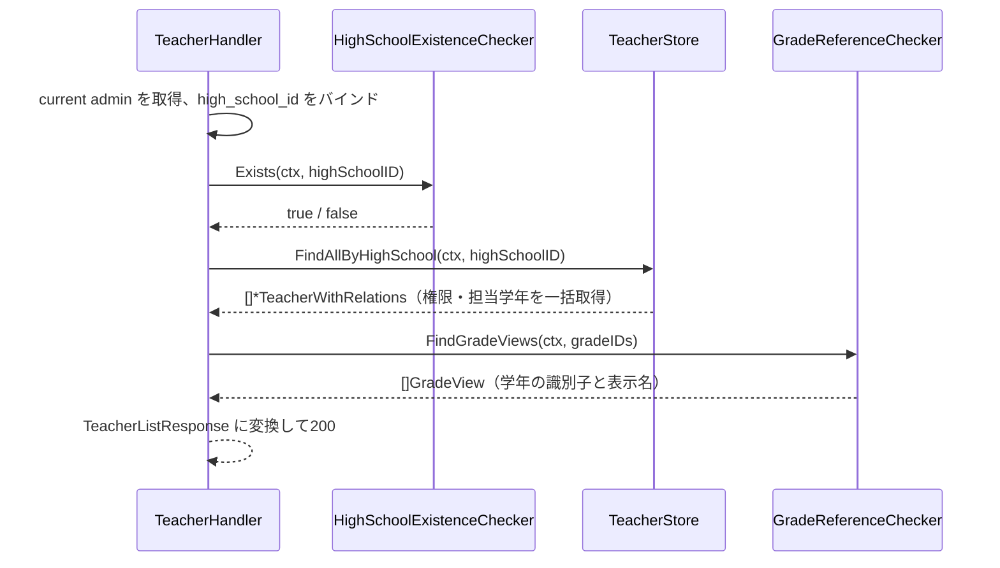
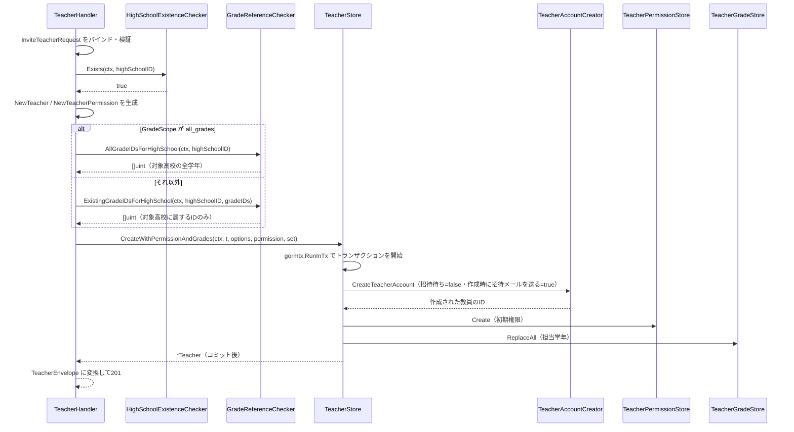
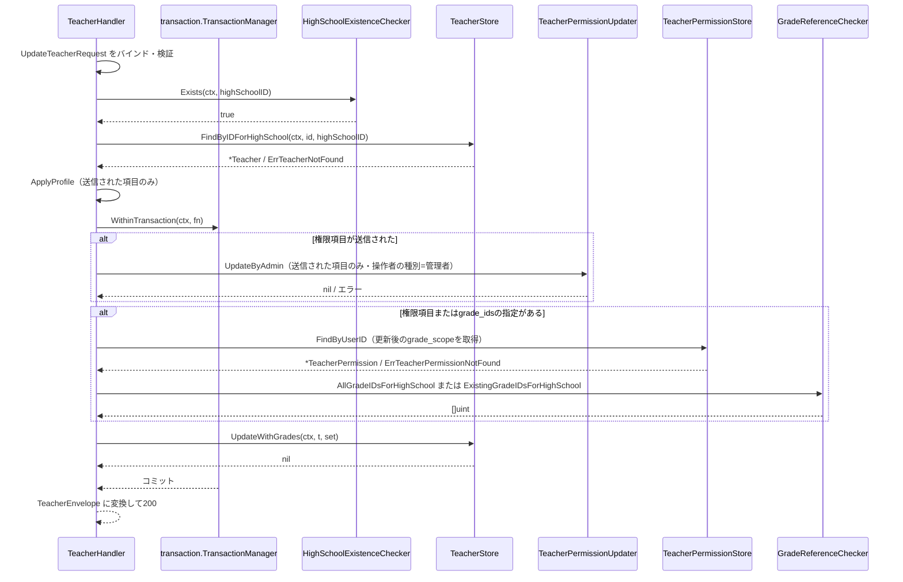
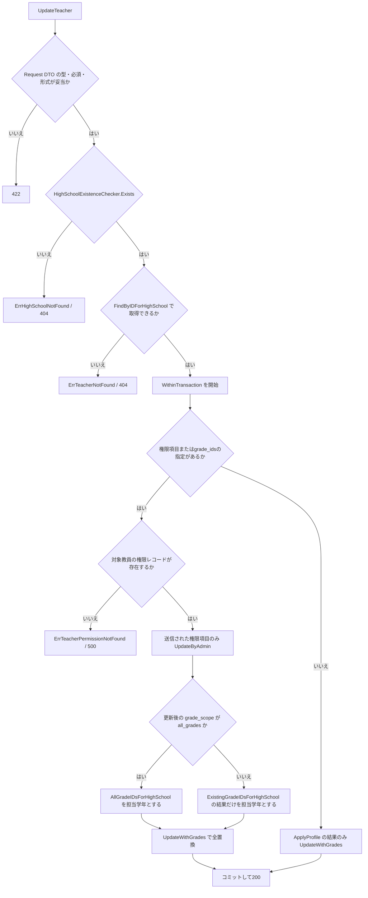

# 管理者教員管理機能 Go実装仕様書

---

# 1. 機能概要

## 機能概要

管理者が自校（選択中の高校）に所属する教員アカウントを一覧参照し、新規教員の招待（作成）、既存教員のプロフィール・権限・担当学年の更新を行う機能である。新規教員の招待は、氏名・メールアドレス・権限・担当学年を指定して教員を作成し、作成時に招待メールが送信される（教員アカウント本体の作成と招待メールの送信依頼は`user` Contextの`CreateTeacherAccount`に任せ、本Contextは権限・担当学年の作成を担う）。教員の権限情報（`teacher_permissions`）と担当学年情報（`teacher_grades`）を教員本体と合わせて一貫管理する（②「1. 機能概要」）。

**本書の特別な位置づけ**: 本機能（管理者教員管理機能）と教師教員管理機能は、同一のBounded Context（`teacher-management`）・同一のAggregate（Teacher）を扱う一体の業務領域である。同じ3テーブル（`users`の教員レコード / `teacher_permissions` / `teacher_grades`）に対するEntity・Repository（Store）は、実際のGoコードでは同じpackage（`internal/teachermanagement`）に1セットのみ存在し、管理者向けHandler（本書）と教師向けHandler（教師教員管理機能_Go実装仕様書）がこれを共有する。そのため本書は、Model（`Teacher` / `TeacherPermission` / `TeacherGradeAssignment`）とStore（`TeacherStore` / `TeacherPermissionStore` / `TeacherGradeStore`）を、管理者視点・教師視点の両方の操作を包含する形で**正の文書として完全に定義する**。教員の新規作成（管理者視点の招待・教師視点の新規作成）は、いずれも`users`の1行の作成を`user` Contextの`CreateTeacherAccount`に任せ、`TeacherStore`は権限・担当学年の作成とトランザクションの管理を担う（経路ごとの指定値は「3. Domain層設計」`TeacherAccountOptions`）。教師教員管理機能_Go実装仕様書は、本書で定義したModel・Storeをそのまま再利用し、教師視点固有の処理（同校スコープの参照、他職員操作権限の確認、招待通知状況の付与）とpresentation層のみを追加で定義する。

## 採用設計パターンとその理由（②からの要約）

②「4. 設計パターン」により **Active Record** を採用する。

- 主要操作が一覧・作成・更新というCRUDに限定される
- 権限情報（`teacher_permissions`）は教員に対して1:1で従属する属性群であり、独立した振る舞いを持たない
- 担当学年（`teacher_grades`）は「更新時に全置換する」という単純な同期ルールであり、複雑な状態遷移を伴わない
- Handlerが直接Storeを呼び出し、認可・入力検証をHandler／Store側で行うことで、教員データの保存・関連付けの振る舞いを一元化しやすい

Transaction Scriptは権限・担当学年同期ロジックがUseCaseに偏り再利用性が下がることを理由に、Domain Modelは複雑な状態遷移が存在しないことを理由に、Event Sourcingは非同期通知・監査要件が現行仕様に明記されていないことを理由に、②でいずれも不採用と判断されている。本書はこれらの判断を変更しない。

本書は、`規約/アーキテクチャ規約.md`「3. 設計パターンごとの構造適用方針」の **Active Record** 節の構造（Entity相当のstruct定義＋Store、usecase層なし、Repository Interfaceの分離なし）に従って実装レベルへ落とし込む。

## 本書が対象とする実装範囲

- `GET /api/v1/admin/high_schools/:high_school_id/teachers`（教員一覧取得）
- `POST /api/v1/admin/high_schools/:high_school_id/teachers`（教員招待＝作成）
- `PATCH /api/v1/admin/high_schools/:high_school_id/teachers/:id`（教員更新）

の3エンドポイントの実装に必要な、struct・Store・Handler・Routing・Request/Response構造体の実装単位を規定する。

- 対象外: 教師視点のエンドポイント（`GET /api/v1/teacher/colleagues`・`GET /api/v1/teacher/colleagues/:id`・`POST /api/v1/teacher/colleagues`）のpresentation層は教師教員管理機能_Go実装仕様書の責務とする
- 対象外: HighSchool・Grade・教員アカウント（`users`の1行）そのものの生成能力は他Contextの責務であり（②「3. Bounded Context」他Contextとの依存関係。教員アカウントの作成は`user` Contextの`CreateTeacherAccount`）、本書はteacher-management Contextが利用する参照手段・作成操作のインターフェースまでを扱う
- ①Rails現行仕様書（管理者教員管理機能_Rails現行仕様書）の記載は、一覧・招待・更新の入力項目・処理内容・業務ルール・Errorケース・データモデルについて本書の根拠とする。①に記載のない事項は、②の記載と「17. ②からの補足事項」の判断を根拠とする

---

# 2. ディレクトリ構成

## 対象Bounded Context名

- `teacher-management`（②「3. Bounded Context」）

## ②で採用した設計パターン

- Active Record（②「4. 設計パターン」）

## 採用パターンに対応する構造

`規約/アーキテクチャ規約.md`「3. 設計パターンごとの構造適用方針」Active Record節に従い、domain/infrastructureのレイヤー分離およびusecase層を設けない。Entity相当のstructと永続化操作（Store）を同一package（`internal/teachermanagement`）に置く。Model・Storeは管理者視点・教師視点で共有するため分割しない。

**②からの補足（本書固有の構造判断）**: 本機能は、同一Aggregate（Teacher）を管理者視点（本書）・教師視点（教師教員管理機能）という2つのHandler群が操作する構成を持つ。presentation層をどちらか一方のpackageにまとめると、Go言語のstruct名・ファイル名の重複（例：管理者視点・教師視点いずれも`TeacherHandler` / `TeacherResponse` / `TeacherListResponse`という名前が自然）が生じる。これを避けるため、presentation層を`admin`/`teacher`のサブパッケージへ分割する（詳細は「17. ②からの補足事項」参照）。

## 作成するディレクトリ一覧

```
internal/teachermanagement/
├── context.go
└── presentation/
    └── admin/
        ├── handler/
        ├── request/
        ├── response/
        └── routes.go
```

`context.go`は、規約「14. 依存関係の組み立て（DI配線）」のとおり、Contextディレクトリ直下に`NewContext`を置くためのファイルである。Active Record採用Contextも対象であり（規約「4. Bounded Context構成」の「Contextディレクトリの命名」）、本Contextでは`TeacherStore`・`TeacherPermissionStore`・`TeacherGradeStore`と管理者視点のHandlerを組み立てる。教師視点のHandlerの組み立ては、教師教員管理機能_Go実装仕様書が同じ`NewContext`へ追加する。

`presentation/teacher/`は教師教員管理機能_Go実装仕様書が作成する（本書では作成しない）。教師視点固有のファイルも、教師教員管理機能_Go実装仕様書が同一package（`internal/teachermanagement`）へ追加する。

アーキテクチャ規約「4. Bounded Context構成」の「Contextディレクトリの命名」（Context名から`-`を取り除いて連結した全小文字の名前とし、短縮・省略はしない）により、Context名`teacher-management`に対応するディレクトリ名は`internal/teachermanagement/`、package名は同じ`teachermanagement`となる。

## 作成するファイル一覧

```
internal/teachermanagement/context.go                        # NewContext（依存関係の組み立て）
internal/teachermanagement/teacher.go                        # Teacher struct・Validate()・TeacherWithRelations・TeacherAccountOptions・PageInfo
internal/teachermanagement/teacher_permission.go              # TeacherPermission struct（VO相当）・GradeScope（列挙型）
internal/teachermanagement/teacher_grade_assignment.go        # TeacherGradeAssignment struct・GradeAssignmentSet
internal/teachermanagement/teacher_grade_assignment_policy.go # 学年所属妥当性判定（②「8. Domain Service」相当）
internal/teachermanagement/dependency.go                      # 他Context参照用インターフェース・入出力型の定義（HighSchoolExistenceChecker / GradeReferenceChecker・GradeView / TeacherAccountCreator・TeacherAccountInput / TeacherPermissionUpdater・TeacherPermissionUpdateInput）
internal/teachermanagement/errors.go                          # struct/Storeが返すエラー変数定義
internal/teachermanagement/teacher_store.go                   # TeacherStore
internal/teachermanagement/user_role.go                       # user_rolesを参照専用で読むモデル（教員判定の結合に用いる）
internal/teachermanagement/teacher_permission_store.go        # TeacherPermissionStore
internal/teachermanagement/teacher_grade_store.go              # TeacherGradeStore
internal/teachermanagement/presentation/admin/handler/teacher_handler.go
internal/teachermanagement/presentation/admin/request/teacher_request.go
internal/teachermanagement/presentation/admin/response/teacher_response.go
internal/teachermanagement/presentation/admin/routes.go
```

`domain/` `application/` `infrastructure/` の各ディレクトリはActive Record採用のため作成しない（規約4章）。

---

# 3. Domain層設計

**実装上の位置づけ**: 本機能はActive Record採用のため、domain層のディレクトリ分離は行わない。以下は②「6〜8・11章」の設計意図を、Active Record構造（Model＝struct＋メソッド、Store＝永続化）に落とし込んだものである（規約4章 Active Record節「『Value Object』『Repository Interface』『Domain Service』は原則『対象外』とし、検証ルールはModelのメソッドとして記載する」に従う）。

## Model（Entity相当）

### Teacher（`internal/teachermanagement/teacher.go`）

②「6. Entity設計」Teacherの責務を反映する。教員としての`User`を表す。教師教員管理機能②「6. Entity設計」のTeacherと同一のEntityであり、教師視点の機能もこのstructを共有する。

フィールド:

|フィールド|型|意味|
|-|-|-|
|ID|uint|教員ID（`users`テーブルの主キー）|
|HighSchoolID|uint|所属高校ID（`users.high_school_id`。②「1. 機能概要」対象は自校所属教員に限定される、の根拠フィールド）|
|Name|string|教員氏名|
|NameKana|string|氏名カナ（`users.name_kana`。100文字以内。教師視点の一覧表示・新規作成で使用する。管理者視点の招待では、`NewTeacher`が氏名と同じ値を設定する（Rails現行の`Admin::CreateTeacherService`と同じ。`user`②の`CreateTeacherAccount`が氏名カナを必須とするため）。教師教員管理機能②「6. Entity設計」Teacher）|
|Email|string|メールアドレス（②「15. Validation設計」フォーマットチェック対象）|
|UserRoleID|uint|ロールを示す識別子（`users.user_role_id`。`user_roles`テーブルへの外部キー。Gorm規約「外部キー列は`{関連モデル名}ID`のまま明示的に保持する」に従い、認証機能_Go実装仕様書のAccountと同じ命名・型とする）。`users`テーブルにロール名そのものを保持する列はなく、教員であることの判定は`user_roles`との結合（`user_roles.name`が教員を表す値であること）で行う。`NewTeacher`は`UserRoleID`を設定しない。教員の作成時のロールの解決は`user` Contextの`CreateTeacherAccount`が行うため、本Contextは`UserRoleID`を書き込まない（取得結果の値としてのみ保持する）|
|CreatedAt|time.Time|作成日時（GORM自動設定。Gorm規約「タイムスタンプのトラッキング」）|
|UpdatedAt|time.Time|更新日時（GORM自動設定）|
|DeletedAt|gorm.DeletedAt|論理削除日時（`users.deleted_at`。GORMのソフトデリート対象とし、論理削除された教員は取得対象から除外する。教師教員管理機能②「9. Repository設計」`teacher`ロール・論理削除を除外する検索条件の根拠フィールド）|

`users`テーブルにはteacher-management以外のContext（認証等）が管理するカラム（`encrypted_password` / `jti` / `reset_password_token`等）が存在するため、本structは教員管理（管理者視点・教師視点の双方）に必要な最小限のフィールドのみを保持する（詳細は「17. ②からの補足事項」参照）。

公開method一覧（シグネチャのみ。実装ロジックは記載しない）:

|メソッド|引数|戻り値|責務|
|-|-|-|-|
|`NewTeacher`|`(highSchoolID uint, name, email string) (*Teacher, error)`|`(*Teacher, error)`|新規Teacher生成時の不変条件（必須項目）を保証するファクトリ。管理者視点の招待で使用し、`NameKana`に`name`と同じ値を設定する|
|`(t *Teacher) Validate() error`|なし|`error`|name・email等必須項目の妥当性を検証する（②「15. Validation設計」Domainの一部）|
|`(t *Teacher) ApplyProfile(name, email string) error`|`name, email string`|`error`|更新時のプロフィール項目差し替えと検証をあわせて行う|
|`(t Teacher) BelongsToHighSchool(highSchoolID uint) bool`|`highSchoolID uint`|`bool`|対象教員が指定高校に所属するかの判定（②「15. Validation設計」整合性チェック：更新対象の教員が対象高校に所属しているかどうか）|

不変条件（`NewTeacher`で保証する内容）:

- HighSchoolID・Name・Emailは空値（ゼロ値）を許容しない（`UserRoleID`は`NewTeacher`の引数に含めない。`NameKana`は`Name`と同じ値とする。教師視点の新規作成における氏名カナの必須・形式検証は教師教員管理機能_Go実装仕様書「3. Domain層設計」が定める）

### TeacherWithRelations（`internal/teachermanagement/teacher.go`）

一覧・1件取得で、教員とその権限・担当学年を一括取得した結果を表す型である。教員ごとに権限・担当学年を問い合わせるN+1を避けるために設ける（Gorm規約「0. 本プロジェクトでの採用方針」の「リレーションの取得とN+1対策」、②「21. DB操作仕様」）。

|フィールド|型|意味|
|-|-|-|
|Teacher|`*Teacher`|教員本体|
|Permission|`*TeacherPermission`|権限。権限レコードが存在しない教員では`nil`（レスポンスの権限項目を`null`とする根拠。①「5. API / 処理詳細」`#index`）|
|GradeIDs|`[]uint`|担当学年の識別子|

> **②からの補足**: ②「11. Repository設計」「21. DB操作仕様」は「一覧・1件取得で権限と担当学年をあわせて取得する」と定めているが、戻り値の型は定めていない。一括取得の結果を表す型として本書で定義した（実装判断。業務ルールの追加ではない）。

### TeacherAccountOptions（`internal/teachermanagement/teacher.go`）

教員の作成時に、`user` Contextの`CreateTeacherAccount`へ渡す、経路ごとに異なる指定値を表す型である。`Teacher`が持つ氏名・氏名カナ・メールアドレス・所属校ID以外の入力を保持する。

|フィールド|型|意味|
|-|-|-|
|GradeID|uint|`users.grade_id`に設定する学年ID（0は未設定）。教師視点の新規作成は指定した学年ID、管理者視点の招待は未設定（0）|
|InvitationPending|bool|招待待ち状態（`password_reset_required`）で作成するか。教師視点は`true`、管理者視点は`false`|
|SendInvitation|bool|作成時に招待メールを送信するか。教師視点は`false`（招待メールは教員招待通知機能が後から送る）、管理者視点は`true`|

経路ごとの指定値は、`user`②「12. UseCase設計」の経路ごとの指定値と同じである（管理者による教員作成＝招待待ち`false`・送信`true`、教師による教員作成＝招待待ち`true`・送信`false`）。

### TeacherPermission（`internal/teachermanagement/teacher_permission.go`）

②「7. Value Object設計」TeacherPermissionの採用理由・独自ルールを反映する。`teacher_permissions`テーブルに対応する、教員に1:1で従属する属性群として実装する。教師教員管理機能②「6. Entity設計」の（着任時の初期権限としての）TeacherPermissionと同一の概念であり、教師視点の機能もこのstructを共有する。

フィールド:

|フィールド|型|意味|
|-|-|-|
|ID|uint|権限レコードID（主キー）|
|UserID|uint|教員（Teacher.ID）への参照|
|GradeScope|`GradeScope`|閲覧権限スコープ。`type GradeScope int`として定義し、`GradeScopeOwnGrade`（0）・`GradeScopeAllGrades`（1）を`iota`で宣言する（コーディング規約「3. 命名規則」の「定数のグループ化と`iota`」）。`teacher_permissions.grade_scope`はRailsの`enum`として整数で保持されるため（①「6. データモデル」）、整数値をRailsの対応（`own_grade`=0 / `all_grades`=1）に合わせる|
|ManageOtherTeachers|bool|他教員管理権限の有無。カラムはNULL可だがRailsのモデルが`true` / `false`のいずれかであることを検証しており（①「6. データモデル」）、有効なレコードはNULLを取らないため`bool`とする|
|CreatedAt|time.Time|作成日時（GORM自動設定）|
|UpdatedAt|time.Time|更新日時（GORM自動設定）|

公開method一覧:

|メソッド|引数|戻り値|責務|
|-|-|-|-|
|`NewTeacherPermission`|`(userID uint, gradeScope string, manageOtherTeachers bool) (*TeacherPermission, error)`|`(*TeacherPermission, error)`|`grade_scope`の文字列（`own_grade` / `all_grades`）を`GradeScope`へ変換し、許容範囲内であることを検証して生成するファクトリ（②「7. Value Object設計」独自ルール）|
|`(p *TeacherPermission) Validate() error`|なし|`error`|`GradeScope`が宣言済みの値のいずれかであることを検証する|
|`(p *TeacherPermission) Apply(gradeScope string, manageOtherTeachers bool) error`|`gradeScope string, manageOtherTeachers bool`|`error`|更新時の値差し替えと検証をあわせて行う|
|`ParseGradeScope`|`(raw string) (GradeScope, error)`|`(GradeScope, error)`|APIの入力文字列を`GradeScope`へ変換する。許容外は`ErrInvalidGradeScope`|
|`(g GradeScope) String() string`|なし|`string`|`own_grade` / `all_grades`を返す。`stringer`で生成する（コーディング規約「3. 命名規則」の「enumの`String()`実装」）|

APIの入出力は文字列、永続化は整数である。Request/Response DTOは`string`で受け渡し、`GradeScope`への変換は上記`ParseGradeScope`・`String()`で行う（コーディング規約「3. 命名規則」の「enumをJSONで送受信する場合は、DTO側は`string`型で受け取り、Domain層への変換時にenumへ変換する」）。

②「7. Value Object設計」ではTeacherPermissionはEntity属性ではなくValue Objectとして採用されている（「将来的に権限の組み合わせに対するバリデーションや組み合わせ制約が追加された場合に、Teacherエンティティを肥大化させずに拡張できるため」）。Active Record構造では、この設計意図を独立structとして維持しつつ、永続化は独立したStore（後述TeacherPermissionStore）で扱う。

### TeacherGradeAssignment / GradeAssignmentSet（`internal/teachermanagement/teacher_grade_assignment.go`）

②「6. Entity設計」TeacherGradeAssignmentの責務、②「7. Value Object設計」GradeAssignmentSetの採用理由・独自ルールを反映する。教師教員管理機能②「6. Entity設計」のTeacherGradeAssignmentと同一のEntityであり、教師視点の機能もこのstructを共有する（教師視点の新規作成では、単一の`grade_id`を要素とする`GradeAssignmentSet`として扱う）。

`TeacherGradeAssignment`（`teacher_grades`テーブルの1行に対応）フィールド:

|フィールド|型|意味|
|-|-|-|
|ID|uint|紐付けID（主キー）|
|UserID|uint|教員（Teacher.ID）への参照|
|GradeID|uint|学年ID|
|CreatedAt|time.Time|作成日時（GORM自動設定）|
|UpdatedAt|time.Time|更新日時（GORM自動設定。`teacher_grades.updated_at`はNOT NULLであるため保持する。①「6. データモデル」）|

公開method一覧:

|メソッド|引数|戻り値|責務|
|-|-|-|-|
|`NewTeacherGradeAssignment`|`(userID, gradeID uint) (*TeacherGradeAssignment, error)`|`(*TeacherGradeAssignment, error)`|userID・gradeIDが0でないことを保証するファクトリ|

`GradeAssignmentSet`（担当学年の全置換操作を表す型。②「7. Value Object設計」の「単なる配列以上の意味を持つ」という採用理由を反映）:

|メソッド|引数|戻り値|責務|
|-|-|-|-|
|`NewGradeAssignmentSet`|`(gradeIDs []uint) GradeAssignmentSet`|`GradeAssignmentSet`|重複IDを排除して生成する（②「7. Value Object設計」独自ルール：重複IDは排除する）。空配列は担当学年なしとして許容する（同：空配列の場合は担当学年なしとして扱う）|
|`(s GradeAssignmentSet) IDs() []uint`|なし|`[]uint`|重複排除後の学年ID一覧を返す|
|`(s GradeAssignmentSet) IsEmpty() bool`|なし|`bool`|担当学年なしかどうかを判定する|

## Value Object

規約4章「Active Record」節により、Value Objectを独立した層としては設けない（原則「対象外」）。②「7. Value Object設計」で定義されたTeacherPermission・GradeAssignmentSetの独自ルールは、上記「Model」節のとおりstruct・メソッドとしてすべて実現している。②「Value Objectを採用しないもの」（名前・メールアドレス）は、上記Teacherの単純な`string`フィールドとして扱う。

## Repository Interface

規約4章「Active Record」節により、domain層にRepository Interfaceを定義しない（原則「対象外」）。②「11. Repository設計」のTeacherStore・TeacherPermissionStore・TeacherGradeStoreの責務は「8. Infrastructure層設計」節のStoreとして実装する。

なお、②「11. Repository設計」のHighSchoolStore・GradeStoreは、高校・学年の実在確認や所属確認という、`master-data` Context（②「3. Bounded Context」他Contextとの依存関係）が公開する参照手段であり、teacher-managementがこれらのデータを所有・実装するものではない（`規約/アーキテクチャ規約.md`「5. Context間連携ルール」）。teacher-management側では、コーディング規約「7. インターフェース」（利用側でインターフェースを定義する）に従い、`internal/teachermanagement/dependency.go`に以下の参照用interfaceを定義する。

```go
// HighSchoolExistenceChecker は master-data Context が公開する
// 「指定 high_school_id が存在するか」の参照手段を表す。
// （②「11. Repository設計」HighSchoolStoreの責務に対応）
type HighSchoolExistenceChecker interface {
    Exists(ctx context.Context, highSchoolID uint) (bool, error)
}

// GradeReferenceChecker は master-data Context が公開する学年の参照手段を表す。
// （②「11. Repository設計」GradeStoreの責務に対応）
type GradeReferenceChecker interface {
    // ExistingGradeIDsForHighSchool は、指定 grade_ids のうち対象高校に属するものを返す。
    ExistingGradeIDsForHighSchool(ctx context.Context, highSchoolID uint, gradeIDs []uint) ([]uint, error)
    // AllGradeIDsForHighSchool は、指定高校の全学年のIDを返す
    // （管理者視点の招待で、grade_scopeが全学年の場合に用いる）。
    AllGradeIDsForHighSchool(ctx context.Context, highSchoolID uint) ([]uint, error)
    // FindGradeViews は、指定 grade_ids の識別子と表示名を返す。
    // レスポンスの担当学年は識別子と表示名の組であるため（①「5. API / 処理詳細」）、
    // 表示名の決定規則を本Contextに持たせず master-data Context から受け取る。
    FindGradeViews(ctx context.Context, gradeIDs []uint) ([]GradeView, error)
}

// GradeView は、レスポンスに出す学年の表示用情報である。
type GradeView struct {
    ID   uint
    Name string
}
```

これらのinterfaceの実装（`master-data` Context側の公開参照）は本書の対象外である（**②からの補足**。詳細は「17. ②からの補足事項」参照）。

教員権限の更新は、`teacher-permission` Contextが公開する更新操作（`teacher-permission`②「12. UseCase設計」`UpdateTeacherPermissionUseCase`）を、同じく利用側で定義するinterfaceを介して呼び出す。本Contextは`teacher_permissions`の既存レコードを自分で書き換えない。

```go
// TeacherPermissionUpdater は teacher-permission Context が公開する
// 教員権限の更新操作を表す。操作者の種別を管理者として渡すため、
// 自己更新禁止・最後の有効教員保護・他教員管理権限の判定は適用されない
// （teacher-permission②「8. Domain Service」）。
type TeacherPermissionUpdater interface {
    UpdateByAdmin(ctx context.Context, in TeacherPermissionUpdateInput) error
}

// TeacherPermissionUpdateInput は、更新する教員と、更新する権限項目を表す。
// 送信されなかった項目は nil とし、更新対象から外す
// （Rails現行の Admin::UpdateTeacherService が slice(...).compact で nil を除くことに合わせる）。
type TeacherPermissionUpdateInput struct {
    TeacherID           uint
    GradeScope          *string
    ManageOtherTeachers *bool
}
```

教員アカウント本体の作成は、`user` Contextが公開する`CreateTeacherAccount`（`user`②「12. UseCase設計」）を、同じく利用側で定義するinterface`TeacherAccountCreator`を介して呼び出す。`TeacherAccountCreator`の実装は`user` Context側の公開関数であり、本書の対象外である。

|型|内容|
|-|-|
|`TeacherAccountCreator`|メソッド`CreateTeacherAccount(ctx context.Context, input TeacherAccountInput) (uint, error)`を持つ。作成された教員のID（`user`②の出力である基本属性の`id`）を返す。`ctx`は、呼び出し側（`TeacherStore`）が開始したトランザクションを`user` Contextの作成操作へ引き継ぐために用いる（`user`②「14. Transaction設計」。引き継ぎの具体的な方式は`user`②の未解決の論点9で、規約11の`context.Context`を介した引き継ぎを前提とする）。招待メール送信依頼の登録（`user` Context側の`jobs`への登録）も、このトランザクションに含まれる|
|`TeacherAccountInput`|`user`②の`CreateTeacherAccount`の入力に対応する。フィールドは、氏名（`Name`）・氏名カナ（`NameKana`）・メールアドレス（`Email`）・所属校ID（`HighSchoolID`）・学年ID（`GradeID`。0は未設定）・招待待ち状態で作成するか（`InvitationPending`）・作成時に招待メールを送信するか（`SendInvitation`）|

`user` Contextが返すValidationエラー（メールアドレスの形式不正・重複、氏名・氏名カナの必須・文字数）は、本Contextで別のエラーへ変換せず、`user` Contextのエラー種別のまま呼び出し元（Handler）へ返し、422として扱う（「14. Error実装方針」）。

## Domain Service

②「8. Domain Service」TeacherGradeAssignmentPolicyを（教師教員管理機能②「8. Domain Service」の同名Policyと共通のものとして）、独立したstruct/interfaceではなく、`internal/teachermanagement/teacher_grade_assignment_policy.go`内のpackageレベル関数として実装する（規約4章 Active Record節に従いDomain Serviceは原則「対象外」とするための構造上の読み替え）。

|関数|引数|戻り値|責務|
|-|-|-|-|
|`SelectAssignableGradeIDs`|`(requestedGradeIDs []uint, allowedGradeIDsForHighSchool []uint)`|`[]uint`|要求された学年ID集合のうち、対象高校に属するものだけを返す（対象高校に属さないIDは除外する。②「8. Domain Service」TeacherGradeAssignmentPolicy）。管理者視点の招待・更新で用いる|
|`ValidateGradeAssignment`|`(requestedGradeIDs []uint, allowedGradeIDsForHighSchool []uint) (invalidGradeIDs []uint, ok bool)`|`([]uint, bool)`|要求された学年ID集合のうち、対象高校に属さないものを判定する。教師視点の新規作成で用いる（Rails現行の`Teacher::CreateTeacherForm#grade_id_must_be_in_high_school`は、所属校に属さない`grade_id`を検証エラーとして拒否する）|

いずれも`allowedGradeIDsForHighSchool`には、`GradeReferenceChecker.ExistingGradeIDsForHighSchool`の結果をHandler側で取得して渡す。管理者視点は除外、教師視点は拒否という違いは、Rails現行の挙動の違い（`Admin::CreateTeacherService` / `Admin::UpdateTeacherService`は無視、`Teacher::CreateTeacherForm`は422）をそのまま維持したものである。

②「8. Domain Service」の「追加で必要としないService」（権限属性の更新自体は単純な値の置き換え）の判断は変更しない。

## Domain Event

②「18. Domain Event」により、本機能ではDomain Eventを採用しない。「対象外」とする。招待メールは`user` Contextの`CreateTeacherAccount`が送信依頼として登録するため、本Contextにメール送信のためのイベント・購読者は持たない。監査ログ記録は②の時点で要件化されておらず、本書でも追加しない。

## Domain Error

規約4章「Active Record」節に従い、「struct/Storeが返すエラー」として`internal/teachermanagement/errors.go`に`sentinel error`を定義する。

|変数名|発生条件|対応する②の記載|
|-|-|-|
|`ErrHighSchoolNotFound`|指定`high_school_id`が存在しない|②「17. Error設計」Application Error：高校未存在|
|`ErrTeacherNotFound`|指定教員が存在しない、または対象高校に所属しない|②「17. Error設計」Application Error：教員未存在・対象教員が指定高校に所属しない|
|`ErrGradeNotInHighSchool`|教師視点の新規作成で指定された`grade_id`が操作者の所属校に属さない、または存在しない。**管理者視点の招待・更新では発生しない**（指定`grade_ids`のうち対象高校に属さないIDは、担当学年の対象から除外するだけでエラーにしない。Rails現行の`Admin::CreateTeacherService` / `Admin::UpdateTeacherService`と同じ）|教師教員管理機能②「14. Error設計」Domain Error：指定学年が同校でない。Rails現行の`Teacher::CreateTeacherForm#grade_id_must_be_in_high_school`|
|`ErrInvalidGradeScope`|`grade_scope`が許容範囲外の値である|②「7. Value Object設計」TeacherPermission独自ルール（grade_scopeは許容される範囲値のみを受け付ける）。教師教員管理機能②「14. Error設計」のgrade_scope許容値違反も同一のエラーで表す|
|`ErrInvalidNameKana`|氏名カナが空、またはカタカナ・長音・中黒・空白以外を含む（教師視点の新規作成で発生。発生元は教師教員管理機能_Go実装仕様書「3. Domain層設計」）|教師教員管理機能②「7. Value Object設計」NameKana|
|`ErrInvalidEmail`|メールアドレスが一般的な形式でない（教師視点の新規作成で発生。発生元は教師教員管理機能_Go実装仕様書「3. Domain層設計」）|教師教員管理機能②「7. Value Object設計」Email|
|`ErrTeacherPermissionNotFound`|`TeacherPermissionStore.FindByUserID`が、指定`user_id`の権限レコードを取得できない（権限レコードが存在しない教員）。呼び出し元ごとに次のとおり扱う。一覧・詳細では権限項目を値なし（`null`）として返す（エラーにしない）。教師視点の新規作成での操作者の権限確認では、権限なしとして403に変換する（Rails現行の`RequireManageOtherTeachers` concernが安全参照で判定するため。`教師権限管理機能_Rails現行仕様書.md`「7. 権限制御」）。管理者視点の更新での権限項目・担当学年の更新では、想定外の状態として500に変換する|Rails現行の`Admin::UpdateTeacherService`（対象教員の権限レコードが存在しない場合に例外となり500）。②「17. Error設計」Infrastructure Errorに対応。教師視点の403は教師教員管理機能①「5. API / 処理詳細」|
|`ErrManageOtherTeachersRequired`|操作者（current user）が他職員操作権限（`manage_other_teachers`）を保持しない状態で教員の新規作成を試みた（教師視点。発生箇所は教師教員管理機能_Go実装仕様書「9. Presentation層設計」）|教師教員管理機能②「14. Error設計」Forbidden（Application Error）|

---

# 4. クラス図

Active Record採用のため、Model（Entity相当のstruct）とStoreの関係を示す（3章・8章）。`master-data` Context・`user` Context・`teacher-permission` Contextへの参照は`dependency.go`のインターフェースとして表す。

```mermaid
classDiagram
    class Teacher {
        +ID uint
        +HighSchoolID uint
        +Name string
        +NameKana string
        +Email string
        +UserRoleID uint
        +CreatedAt time.Time
        +UpdatedAt time.Time
        +DeletedAt gorm.DeletedAt
        +Validate() error
        +ApplyProfile(name, email string) error
        +BelongsToHighSchool(highSchoolID uint) bool
    }
    class TeacherAccountOptions {
        +GradeID uint
        +InvitationPending bool
        +SendInvitation bool
    }
    class TeacherPermission {
        +ID uint
        +UserID uint
        +GradeScope string
        +ManageOtherTeachers bool
        +Validate() error
        +Apply(gradeScope string, manageOtherTeachers bool) error
    }
    class TeacherWithRelations {
        +Teacher *Teacher
        +Permission *TeacherPermission
        +GradeIDs []uint
    }
    class TeacherGradeAssignment {
        +ID uint
        +UserID uint
        +GradeID uint
        +CreatedAt time.Time
    }
    class GradeAssignmentSet {
        +IDs() []uint
        +IsEmpty() bool
    }
    class TeacherStore {
        +FindAllByHighSchool(ctx, highSchoolID uint) []*TeacherWithRelations, error
        +FindPageByHighSchool(ctx, highSchoolID uint, page, perPage int) []*Teacher, PageInfo, error
        +FindByIDForHighSchool(ctx, id, highSchoolID uint) *TeacherWithRelations, error
        +CreateWithPermissionAndGrades(ctx, t *Teacher, options TeacherAccountOptions, permission *TeacherPermission, set *GradeAssignmentSet) *Teacher, error
        +UpdateWithGrades(ctx, t *Teacher, updateProfile bool, set *GradeAssignmentSet) error
    }
    class TeacherPermissionStore {
        +FindByUserID(ctx, userID uint) *TeacherPermission, error
        +Create(ctx, p *TeacherPermission) error
    }
    class TeacherGradeStore {
        +FindGradeIDsByUserID(ctx, userID uint) []uint, error
        +ReplaceAll(ctx, userID uint, gradeIDs []uint) error
    }
    class HighSchoolExistenceChecker {
        <<interface>>
        +Exists(ctx, highSchoolID uint) bool, error
    }
    class GradeReferenceChecker {
        <<interface>>
        +ExistingGradeIDsForHighSchool(ctx, highSchoolID uint, gradeIDs []uint) []uint, error
        +AllGradeIDsForHighSchool(ctx, highSchoolID uint) []uint, error
        +FindGradeViews(ctx, gradeIDs []uint) []GradeView, error
    }
    class TeacherAccountCreator {
        <<interface>>
        +CreateTeacherAccount(ctx, input TeacherAccountInput) uint, error
    }
    class TeacherPermissionUpdater {
        <<interface>>
        +UpdateByAdmin(ctx, in TeacherPermissionUpdateInput) error
    }

    TeacherStore ..> Teacher : 永続化する
    TeacherStore ..> TeacherWithRelations : 一覧・1件取得で返す
    TeacherWithRelations o-- Teacher
    TeacherWithRelations o-- TeacherPermission
    TeacherStore ..> TeacherAccountOptions : 作成時の指定値として受け取る
    TeacherStore ..> TeacherAccountCreator : users の作成を委譲する
    TeacherStore ..> TeacherPermissionStore : 同一トランザクションで呼ぶ
    TeacherStore ..> TeacherGradeStore : 同一トランザクションで呼ぶ
    TeacherPermissionStore ..> TeacherPermission : 永続化・取得する
    TeacherGradeStore ..> TeacherGradeAssignment : 永続化・取得する
    TeacherGradeStore ..> GradeAssignmentSet : 全置換の内容として受け取る

    note for Teacher "users テーブルの教員レコード。管理者視点・教師視点で共有する"
    note for TeacherPermissionUpdater "権限の書き換えは teacher-permission Context に一本化する（3章）"
```



`SelectAssignableGradeIDs` / `ValidateGradeAssignment`はpackageレベル関数であり、structに属さないため図に含めない（3章「Domain Service」）。

---

# 5. 状態遷移図

本書では状態遷移図を作成しない。

理由: ②「10. 状態遷移図」のとおり、`Teacher`には有効／無効・招待中といった状態フィールドが存在せず、本書のstructにも状態を表すフィールドを持たせていない（3章）。`DeletedAt`は論理削除の記録であり業務上の状態遷移ではない。担当学年（`TeacherGradeAssignment`）も`ReplaceAll`による全置換のみで、名前付きの状態を持たない。

---

# 6. Application層設計

**実装上の位置づけ**: 本機能はActive Record採用のためusecase層を設けない。「対象外（Active Record採用のため、usecase層を設けない）」とする。②「12. UseCase設計」に記載された3つの業務操作（ListTeachers／InviteTeacher／UpdateTeacher）は、Handlerが`internal/teachermanagement`のStore・Modelを直接呼び出す処理として実装する。処理順序は「9. Presentation層設計」のHandler処理順序に統合して記載する。

## DTO（Command / Query）

DTOはPresentation層のRequest/Response DTOとして「9. Presentation層設計」にまとめて記載する（Active Record採用のため、Application層独自のCommand/Query DTOは設けない）。

---

# 7. シーケンス図・処理フロー図

## シーケンス図

Active Record採用のためUseCase層を経由せず、HandlerがStoreを直接呼び出す（6章・9章）。

### 一覧取得（`ListTeachers`）



権限・担当学年は`FindAllByHighSchool`の1回の呼び出しで一括取得し、教員ごとに問い合わせない（Gorm規約「0. 本プロジェクトでの採用方針」の「リレーションの取得とN+1対策」）。`TeacherWithRelations.Permission`が`nil`の教員は、権限項目を`nil`（JSONの`null`）として扱い、エラーにしない（9章）。

### 招待（`InviteTeacher`）



### 更新（`UpdateTeacher`）



更新では、権限の更新（`teacher-permission` Context）と`UpdateWithGrades`を同一トランザクションに入れる必要があるため、トランザクションはHandler側で`transaction.TransactionManager`を用いて開始し、`ctx`で引き継ぐ（11章）。

## 処理フロー図

更新操作は、権限の更新順序と担当学年の決定に分岐があるため、流れを次のとおり示す。



対象高校に属さない学年IDは除外するだけでエラーにしない（9章の処理順序8）。一覧取得は分岐を持たないため処理フロー図を設けない。

---

# 8. Infrastructure層設計

**実装上の位置づけ**: 本機能はActive Record採用のためinfrastructure層のディレクトリ分離は行わない。「3. Domain層設計」で定義したModelと同一package（`internal/teachermanagement`）にStoreを置く。

## Store実装

### TeacherStore（`internal/teachermanagement/teacher_store.go`）

- struct名: `TeacherStore`
- 対応するGORMモデル: `Teacher`（`users`テーブル。同一structをGORMタグ付きで扱う。「15. GORM / DBクエリ設計」参照）

コンストラクタ:

```go
func NewTeacherStore(db *gorm.DB, accountCreator TeacherAccountCreator) *TeacherStore
```

`accountCreator`は、教員アカウント本体の作成（`user` Contextの`CreateTeacherAccount`）を呼び出すための依存である（「3. Domain層設計」`TeacherAccountCreator`）。`TeacherStore`は`users`の行を直接作成しない。

メソッド一覧:

|メソッド|引数|戻り値|発行するクエリ内容|
|-|-|-|-|
|`FindAllByHighSchool`|`(ctx context.Context, highSchoolID uint)`|`([]*TeacherWithRelations, error)`|`high_school_id`一致かつ`users`と`user_roles`を結合し`user_roles.name`が教員を表す値であること（`users.user_role_id = user_roles.id`による結合）を条件に、論理削除されていない教員一覧を、ページングなしで全件、`id`昇順で取得する（②「11. Repository設計」`high_school_id`による絞り込み。Rails現行の管理者視点の一覧はページングせず、並び順を指定しないため、順序が不定にならないよう`id`昇順とする。②からの補足）。管理者視点の一覧取得で利用する|
|`FindPageByHighSchool`|`(ctx context.Context, highSchoolID uint, page, perPage int)`|`([]*Teacher, PageInfo, error)`|`high_school_id`一致かつ`users`と`user_roles`を結合し`user_roles.name`が教員を表す値であること（`users.user_role_id = user_roles.id`による結合）を条件に、論理削除されていない教員を対象として、`name_kana`昇順でソートし、ページ番号（`page`）と1ページあたり件数（`perPage`）に応じたオフセット・件数制限を適用して取得する（`page` / `perPage`は、呼び出し側のHandlerが、既定値・上限を適用して正規化した値を渡す。教師教員管理機能_Go実装仕様書「9. Presentation層設計」）。教師視点の一覧取得（教師教員管理機能②「9. Repository設計」TeacherStore：氏名カナ順・ページネーション）で利用する。`PageInfo`は`Page` / `PerPage` / `TotalPages` / `TotalCount`（いずれも`int`）を持つ本packageの型である|
|`FindByIDForHighSchool`|`(ctx context.Context, id, highSchoolID uint)`|`(*TeacherWithRelations, error)`|`id`と`high_school_id`の一致かつ`users`と`user_roles`を結合し`user_roles.name`が教員を表す値であること（`users.user_role_id = user_roles.id`による結合）の条件で1件取得する所属高校スコープ検索（②「11. Repository設計」`id`による単一取得（所属高校スコープ付き））。該当なしは`ErrTeacherNotFound`を返す。管理者視点の更新対象取得・教師視点の詳細取得の双方で利用する|
|`CreateWithPermissionAndGrades`|`(ctx context.Context, t *Teacher, options TeacherAccountOptions, permission *TeacherPermission, gradeAssignmentSet *GradeAssignmentSet)`|`(*Teacher, error)`|1トランザクションで、次を順に実行する。(1) `TeacherAccountCreator.CreateTeacherAccount`を、`t`（氏名・氏名カナ・メールアドレス・所属校ID）と`options`（学年ID・招待待ち状態で作成するか・作成時に招待メールを送信するか）から組み立てた`TeacherAccountInput`で呼び出し、`users`の1行の作成（教員ロールの解決を含む）と、指定に応じた招待メール送信依頼の登録を`user` Contextに任せる。トランザクション用の`*gorm.DB`を保持する`ctx`を渡し、`user` Contextの作成操作を同一トランザクションに参加させる。(2) 返された教員のIDを`permission.UserID`に設定し、初期TeacherPermissionを作成する。(3) `gradeAssignmentSet`の担当学年を作成する。(4) 作成した教員を、同一トランザクション内で`users`から取得して返す（`user`②の作成結果には作成日時・更新日時が含まれないため）。管理者視点の招待（②「12. UseCase設計」InviteTeacher）・教師視点の新規作成（教師教員管理機能②「10. UseCase設計」CreateTeacher）の双方で利用する。「11. Transaction実装方針」参照|
|`UpdateWithGrades`|`(ctx context.Context, t *Teacher, updateProfile bool, gradeAssignmentSet *GradeAssignmentSet)`|`error`|（`updateProfile`が真の場合のみ）Teacherのプロフィール更新と、（`gradeAssignmentSet`が非nilの場合のみ）担当学年の全置換を1トランザクションで実行する。`name` / `email`のいずれも送信されない更新では教員本体を更新しない（①「5. API / 処理詳細」`#update`の業務ルール）（②「12. UseCase設計」UpdateTeacherのトランザクション範囲。「11. Transaction実装方針」参照）。権限の更新は含まない（`teacher-permission` Contextの更新操作の責務）|

保持しない責務（②「11. Repository設計」保持しない責務を踏襲）: 権限の妥当性判定・学年の所属確認はStoreに持たせない。

教員ロールの解決・`users`の行の作成・仮パスワードの発行・招待メール送信依頼の登録は、`user` Contextの`CreateTeacherAccount`が行う。`TeacherStore`は`user_roles`を読み取らない（教員判定の検索条件で`user_roles`と結合する場合を除く）。`user` Contextの内部エラー（ロールマスタ不在・`jobs`登録の失敗等）は、Infrastructure Error（500）として扱い、トランザクションはロールバックされる。

### TeacherPermissionStore（`internal/teachermanagement/teacher_permission_store.go`）

- struct名: `TeacherPermissionStore`
- 対応するGORMモデル: `TeacherPermission`（`teacher_permissions`テーブル）

コンストラクタ:

```go
func NewTeacherPermissionStore(db *gorm.DB) *TeacherPermissionStore
```

メソッド一覧:

|メソッド|引数|戻り値|発行するクエリ内容|
|-|-|-|-|
|`FindByUserID`|`(ctx context.Context, userID uint)`|`(*TeacherPermission, error)`|`user_id`一致で1件取得する（②「11. Repository設計」`user_id`による取得）。該当なしは`ErrTeacherPermissionNotFound`を返す（権限レコードが存在しない場合の扱いは、上記Domain Errorの`ErrTeacherPermissionNotFound`を参照）|
|`Create`|`(ctx context.Context, p *TeacherPermission)`|`error`|新規レコードを作成する（`TeacherStore.CreateWithPermissionAndGrades`内から、`user` Contextが作成した教員の`user_id`に対して同一トランザクションで呼び出される）|

保持しない責務（②「11. Repository設計」保持しない責務を踏襲）: 権限値の妥当性判定はStoreに持たせない。既存レコードの更新メソッドも持たせない。教員権限の書き換えは`teacher-permission` Contextの更新操作に一本化されており、本Storeは着任時の作成と参照のみを担う（②「11. Repository設計」TeacherPermissionStore「保持しない責務」）。

### TeacherGradeStore（`internal/teachermanagement/teacher_grade_store.go`）

- struct名: `TeacherGradeStore`
- 対応するGORMモデル: `TeacherGradeAssignment`（`teacher_grades`テーブル。「15. GORM / DBクエリ設計」参照）

コンストラクタ:

```go
func NewTeacherGradeStore(db *gorm.DB) *TeacherGradeStore
```

メソッド一覧:

|メソッド|引数|戻り値|発行するクエリ内容|
|-|-|-|-|
|`FindGradeIDsByUserID`|`(ctx context.Context, userID uint)`|`([]uint, error)`|`user_id`一致で紐づく`grade_id`一覧を取得する（②「11. Repository設計」`user_id`による担当学年取得）|
|`ReplaceAll`|`(ctx context.Context, userID uint, gradeIDs []uint)`|`error`|`user_id`一致の既存紐付けを削除し、`gradeIDs`分のレコードを再作成する（②「11. Repository設計」担当学年の全置換（既存削除＋新規作成）、②「5. Aggregate設計」整合性を保証する単位）|

保持しない責務（②「11. Repository設計」保持しない責務を踏襲）: 学年が対象高校に属するかの判定はStoreに持たせない。

`TeacherStore.CreateWithPermissionAndGrades`／`UpdateWithGrades`は、`RunInTx`が渡す`ctx`を各Storeのメソッドへ引き渡し、同一トランザクション内で実行する（11章）。Entity ⇔ GORMモデルの変換は不要で、同一structをそのまま永続化する。

Entity ⇔ GORMモデルの変換方針: Active Record採用のため、`Teacher`・`TeacherPermission`・`TeacherGradeAssignment`のstructそのものをGORMの操作対象として扱う。変換処理は設けない。

## 外部連携実装

本Contextは、Mail・Cache・Queue等の外部連携を実装しない。招待メールの送信は、`user` Contextの`CreateTeacherAccount`が、アカウントの作成と同一トランザクションで招待メール送信依頼（`jobs`）として登録する（管理者視点の招待は「作成時に招待メールを送る=する」を指定する）。メール送信基盤・`jobs`は`user` Contextが使うものであり、本Contextは直接呼ばない。「対象外」とする。

---

# 9. Presentation層設計

本書のpresentation層は管理者視点として`internal/teachermanagement/presentation/admin/`配下に置く。教師視点のpresentation層は`internal/teachermanagement/presentation/teacher/`（教師教員管理機能_Go実装仕様書）に分割されており、同名のstruct（`TeacherHandler`・`TeacherResponse`等）はそれぞれ別packageに属するため衝突しない。

## Handler

### TeacherHandler（`internal/teachermanagement/presentation/admin/handler/teacher_handler.go`）

- struct名: `TeacherHandler`（package: `internal/teachermanagement/presentation/admin/handler`）
- 依存: `*teachermanagement.TeacherStore`、`*teachermanagement.TeacherPermissionStore`、`*teachermanagement.TeacherGradeStore`、`teachermanagement.HighSchoolExistenceChecker`、`teachermanagement.GradeReferenceChecker`、`teachermanagement.TeacherPermissionUpdater`（コンストラクタで注入する）

```go
func NewTeacherHandler(
    teacherStore *teachermanagement.TeacherStore,
    permissionStore *teachermanagement.TeacherPermissionStore,
    permissionUpdater teachermanagement.TeacherPermissionUpdater,
    gradeStore *teachermanagement.TeacherGradeStore,
    highSchoolChecker teachermanagement.HighSchoolExistenceChecker,
    gradeChecker teachermanagement.GradeReferenceChecker,
) *TeacherHandler
```

メソッド一覧（HTTPメソッド・パスとの対応は「10. API仕様」参照）:

|メソッド|対応API|
|-|-|
|`(h *TeacherHandler) ListTeachers(c *gin.Context)`|GET /api/v1/admin/high_schools/:high_school_id/teachers|
|`(h *TeacherHandler) InviteTeacher(c *gin.Context)`|POST /api/v1/admin/high_schools/:high_school_id/teachers|
|`(h *TeacherHandler) UpdateTeacher(c *gin.Context)`|PATCH /api/v1/admin/high_schools/:high_school_id/teachers/:id|

Active Record採用のためUseCase層を経由しない。以下、②「12. UseCase設計」で「Handler処理」として記載された業務操作の呼び出し順序を、権限チェック・呼び出し順序を含めてHandlerの処理順序として記載する（規約7章 横断的関心事の置き場所に基づき、認可（所有権・業務権限）は該当Storeまたは本Handlerで行う）。

#### ListTeachers 処理順序

1. Middlewareで設定済みのcurrent user（admin）をcontextから取得する
2. パスパラメータ`high_school_id`をバインドする
3. 操作する管理者と`high_school_id`の対応は確認しない（②「16. Authorization設計」Middleware。Rails現行がこの確認を行っていないため、本設計でも追加しない）。対象範囲は`high_school_id`によって決まる
4. `HighSchoolExistenceChecker.Exists`で対象高校の存在を確認する。存在しない場合は`ErrHighSchoolNotFound`（②「12. UseCase設計」ListTeachers 呼び出すStore：HighSchoolStore）
5. `TeacherStore.FindAllByHighSchool`を呼び出す。権限・担当学年は教員ごとに問い合わせず、この1回の呼び出しで一括取得する（②「12. UseCase設計」ListTeachers 呼び出すStore：TeacherStore、②「21. DB操作仕様」）。権限レコードが存在しない教員では権限が未取得となり、その教員の`grade_scope` / `manage_other_teachers`を値なし（`null`）として扱い、エラーにしない（Rails現行の`Admin::TeacherSerializer`が権限レコードなしを`null`で返すことに合わせる）
6. `GradeReferenceChecker.FindGradeViews`で、取得した担当学年の識別子に対応する表示名を一括取得する（レスポンスの担当学年は識別子と表示名の組であるため。①「5. API / 処理詳細」`#index`）
7. 取得結果を`TeacherListResponse`へ変換し、200で返す

#### InviteTeacher 処理順序

1. current user（admin）を取得する
2. Request DTOへバインドし、型・必須（`name` / `email` / `grade_scope` / `manage_other_teachers`）・フォーマットを検証する（②「15. Validation設計」Presentation）
3. 操作する管理者と`high_school_id`の対応は確認しない（②「16. Authorization設計」Middleware）
4. `HighSchoolExistenceChecker.Exists`で対象高校の存在を確認する。存在しない場合は`ErrHighSchoolNotFound`
5. `teachermanagement.NewTeacher`でTeacherを生成し（氏名カナには氏名と同じ値が設定される）、`Teacher.Validate()`で必須項目を検証する（②「15. Validation設計」Domain）
6. `teachermanagement.NewTeacherPermission`で初期TeacherPermissionを生成する。`grade_scope`が許容範囲外の場合は`ErrInvalidGradeScope`（`UserID`は作成後に`TeacherStore.CreateWithPermissionAndGrades`が設定するため、生成時は未設定とする）
7. 担当学年の集合を決める。`grade_scope`が全学年（`all_grades`）の場合は、`GradeReferenceChecker.AllGradeIDsForHighSchool`で取得した対象高校の全学年（指定された`grade_ids`は使わない）とする。それ以外の場合は、指定された`grade_ids`を`teachermanagement.NewGradeAssignmentSet`で重複排除し、`GradeReferenceChecker.ExistingGradeIDsForHighSchool`が返した「対象高校に属するID」だけを担当学年とする。対象高校に属さないIDは除外するだけで、エラーにしない（UpdateTeacherの手順8と同じ扱い。Rails現行の`Admin::CreateTeacherService#grade_ids_for`と同じ）
8. `TeacherStore.CreateWithPermissionAndGrades`を、Teacher・`TeacherAccountOptions`（学年ID=未設定（0）・招待待ち=`false`・作成時に招待メールを送信=`true`）・初期TeacherPermission・GradeAssignmentSetで呼び出す（②「12. UseCase設計」InviteTeacher。`users`の行の作成と招待メール送信依頼の登録は、Store内で`user` Contextの`CreateTeacherAccount`に任せる）。`user` Contextが返すValidationエラー（メールアドレスの形式不正・重複、氏名の必須・文字数）はそのまま422とする
9. 作成結果を`TeacherEnvelope`へ変換し、201で返す

仮パスワードの発行・招待メールの内容とトークンの発行・送信は、`user` Contextの責務であり（`user`②「12. UseCase設計」RequestInvitationEmail）、本書では実装しない。招待メール送信依頼は、Store内のトランザクションのコミット後にのみ実行される。

#### UpdateTeacher 処理順序

1. current user（admin）を取得する
2. パスパラメータ（`high_school_id`・`id`）とRequest DTOをバインドし、型・必須・フォーマットを検証する
3. 操作する管理者と`high_school_id`の対応は確認しない（②「16. Authorization設計」Middleware）
4. `HighSchoolExistenceChecker.Exists`で対象高校の存在を確認する。存在しない場合は`ErrHighSchoolNotFound`
5. `TeacherStore.FindByIDForHighSchool`で対象教員を取得する。存在しない、または対象高校に所属しない場合は`ErrTeacherNotFound`（②「15. Validation設計」整合性チェック：更新対象の教員が対象高校に所属しているかどうか）
6. プロフィール項目（name・email）のいずれかが指定されている場合、`Teacher.ApplyProfile`で差し替え・検証する。いずれも指定されていない場合は教員本体の更新を行わない（①「5. API / 処理詳細」`#update`の業務ルール、②「15. Validation設計」）
7. 権限項目（grade_scope・manage_other_teachers）が指定されている場合、`TeacherPermissionUpdater.UpdateByAdmin`（`dependency.go`）に、対象教員IDと送信された項目のみを渡して更新を依頼する。`grade_scope`の許容値の検証は`teacher-permission` Context側で行われ、許容範囲外の場合は`ErrInvalidGradeScope`相当のエラーが返る。権限レコードが存在しない対象教員の場合は、権限レコードを新規作成せず、想定外の状態として500に変換する（Rails現行の`Admin::UpdateTeacherService`が、権限レコードが存在しない対象教員の権限項目・担当学年（`grade_ids`）の更新で例外となり500になることに合わせる）。権限項目も`grade_ids`も指定されない更新（氏名・メールアドレスのみ）では、権限レコードを参照しない
8. `grade_ids`が指定されている場合、`teachermanagement.NewGradeAssignmentSet`で重複排除した集合を作成し、`GradeReferenceChecker.ExistingGradeIDsForHighSchool`が返した「対象高校に属するID」だけを担当学年とする。対象高校に属さないIDは除外するだけで、エラーにしない（②「8. Domain Service」TeacherGradeAssignmentPolicy、②「15. Validation設計」業務ルール：指定学年が対象高校に属するかどうか）
9. `grade_scope`が全学年（`all_grades`）の場合は、指定された`grade_ids`に関わらず対象高校の全学年を担当学年とする。判定には**7.の更新後の`grade_scope`**を用いる（`TeacherPermissionStore.FindByUserID`で更新後の値を取得する。Rails現行の`Admin::UpdateTeacherService`が`update_permission_attributes`の後に`update_teacher_grades`を呼び、`valid_grade_ids`が更新後の`all_grades?`を参照することに合わせる）
10. `TeacherStore.UpdateWithGrades`をTeacher・（`name` / `email`のいずれかが指定された場合のみ真とする）`updateProfile`・（`grade_ids`指定時のみ）GradeAssignmentSetで呼び出す（②「12. UseCase設計」UpdateTeacher 呼び出すStore・Context：HighSchoolStore→TeacherStore→`teacher-permission`→TeacherPermissionStore→TeacherGradeStore→GradeStoreの順に対応）
11. 更新結果を`TeacherEnvelope`へ変換し、200で返す

7.〜10.は1つのトランザクションで実行する。`TeacherPermissionUpdater.UpdateByAdmin`には、トランザクションを保持する`ctx`を渡し、同じトランザクションに参加させる（規約「11. Transaction実装パターン（TransactionManager）」）。

## Request / Response DTO

### Request（`internal/teachermanagement/presentation/admin/request/teacher_request.go`）

|struct名|フィールドと型|バリデーションタグ／チェック内容|
|-|-|-|
|`InviteTeacherRequest`|`Name string`、`Email string`、`GradeScope *string`、`ManageOtherTeachers *bool`、`GradeIDs []uint`|`Name`・`Email`・`GradeScope`・`ManageOtherTeachers`は`binding:"required"`（Rails現行は、`grade_scope` / `manage_other_teachers`の未指定を422とする。`ManageOtherTeachers`は`false`を有効な値として区別するためポインタ型）。`Email`は`binding:"email"`（②「15. Validation設計」必須チェック：作成時のname・email、フォーマットチェック：メールアドレス形式）。`GradeIDs`は任意（省略時は担当学年なし。`GradeScope`が全学年の場合は使わない）|
|`UpdateTeacherRequest`|`Name *string`、`Email *string`、`GradeScope *string`、`ManageOtherTeachers *bool`、`GradeIDs *[]uint`|部分更新のためポインタ型で「未指定」を表現する。`Email`指定時は`binding:"omitempty,email"`。`GradeIDs`は配列形式チェック（②「15. Validation設計」フォーマットチェック：grade_idsの配列形式）|

### Response（`internal/teachermanagement/presentation/admin/response/teacher_response.go`）

|struct名|フィールド|型|JSONキー|
|-|-|-|-|
|`TeacherEnvelope`|`Teacher`|`TeacherResponse`|`teacher`|
|`TeacherListResponse`|`Teachers`|`[]TeacherResponse`|`teachers`|
|`TeacherResponse`|`ID`|`uint`|`id`|
||`Name`|`string`|`name`|
||`Email`|`string`|`email`|
||`GradeScope`|`*string`|`grade_scope`|
||`ManageOtherTeachers`|`*bool`|`manage_other_teachers`|
||`Grades`|`[]GradeResponse`|`grades`|
|`GradeResponse`|`ID`|`uint`|`id`|
||`Name`|`string`|`name`|

- 単体（招待・更新）は`TeacherEnvelope`で返す。一覧は`TeacherListResponse`で返す（①「5. API / 処理詳細」の各アクションのResponse、②「19. API仕様」）
- `TeacherResponse`が返すのは上記6項目のみとする。所属校・作成日時・更新日時は返さない（①の`Admin::TeacherSerializer`が返さないため）
- `GradeScope` / `ManageOtherTeachers`は、権限レコードが存在しない教員では`nil`（JSONの`null`）とする
- `GradeScope`は`own_grade` / `all_grades`の文字列を入れる。Modelの`GradeScope`は整数の列挙型であるため、`String()`で文字列へ変換してから設定する（3章）
- `Grades`の`Name`は学年の表示名であり、`GradeReferenceChecker.FindGradeViews`から受け取った値をそのまま入れる。表示名の決定規則は本Contextに持たせない（3章）

EntityであるTeacher／TeacherPermission／TeacherGradeAssignmentをそのまま返さず、必ずResponse DTOへ変換する（規約「6. データフロー」）。

## Routing

`internal/teachermanagement/presentation/admin/routes.go`

|Method|Path|Handler|
|-|-|-|
|GET|/api/v1/admin/high_schools/:high_school_id/teachers|TeacherHandler.ListTeachers|
|POST|/api/v1/admin/high_schools/:high_school_id/teachers|TeacherHandler.InviteTeacher|
|PATCH|/api/v1/admin/high_schools/:high_school_id/teachers/:id|TeacherHandler.UpdateTeacher|

いずれのルートも認証Middleware（本人確認）・認可Middleware（admin roleチェック）を経由する。`POST` / `PATCH`はCSRF検証Middlewareの対象にも含める（Gin規約「7. CSRF対策」の「適用範囲」）。（②「16. Authorization設計」Middleware、「13. Authorization実装方針」参照）

---

# 10. API仕様

②「19. API仕様」に基づき、Rails現行仕様と同一のエンドポイントを維持する。

|Method|Path|Handler|Request|Response|Status Code|
|-|-|-|-|-|-|
|GET|/api/v1/admin/high_schools/:high_school_id/teachers|ListTeachers|パスパラメータ`high_school_id`|`TeacherListResponse`（`teachers`キーでラップした配列）|200|
|POST|/api/v1/admin/high_schools/:high_school_id/teachers|InviteTeacher|パスパラメータ`high_school_id` + `InviteTeacherRequest`|`TeacherEnvelope`（`teacher`キーでラップ）|201（Rails現行は201を返す。①Rails現行仕様書「5. API / 処理詳細」create）|
|PATCH|/api/v1/admin/high_schools/:high_school_id/teachers/:id|UpdateTeacher|パスパラメータ`high_school_id`・`id` + `UpdateTeacherRequest`|`TeacherEnvelope`（`teacher`キーでラップ）|200|

## Errorケース

|条件|Status Code|Error内容|
|-|-|-|
|未認証|401|認証エラー（Middleware）|
|admin以外のロール|403|認可エラー（Middleware）|
|Request DTOの型・必須・フォーマット不正|422|Presentation Validationエラー（②「19. API仕様」422: 入力・業務ルール違反）|
|`user` Contextが返すValidationエラー（招待時のメールアドレス重複・形式不正、氏名の必須・文字数）|422|`user`②「17. Error設計」のValidationエラー（メールアドレスの使用状況を含めないメッセージ）を`errors`形式で返す|
|`grade_scope`が許容範囲外（`ErrInvalidGradeScope`）|422|業務ルール違反|
|指定`grade_ids`に対象高校に属さない学年が含まれる|—|エラーとせず、該当のIDを担当学年の対象から除外して処理を続ける（Rails現行の`Admin::CreateTeacherService` / `Admin::UpdateTeacherService`と同じ）|
|指定`high_school_id`が存在しない（`ErrHighSchoolNotFound`）|404|②「19. API仕様」404: 対象高校不存在|
|対象教員不存在／所属高校不一致（`ErrTeacherNotFound`）|404|②「19. API仕様」404: 対象教員不存在|
|更新時、対象教員の権限レコードが存在しない状態で、権限項目または`grade_ids`の更新を行った（`ErrTeacherPermissionNotFound`）|500|想定外の状態（Rails現行は例外となり500）|
|DB接続失敗等のInfrastructure Error|500|内部エラー|

---

# 11. Transaction実装方針

②「14. Transaction設計」を実装単位に落とし込む。

## Transaction開始箇所

- Active Record採用のため、`TeacherStore.CreateWithPermissionAndGrades`・`TeacherStore.UpdateWithGrades`メソッド内で`gormtx.RunInTx(ctx, db, func(ctx context.Context, tx *gorm.DB) error { ... })`を用いてトランザクションを開始する（②「14. Transaction設計」Handlerの処理単位に対応するStoreメソッド内でトランザクションを開始する）。`db.WithContext(ctx).Transaction(...)`を直接呼ばない。呼び出し側が既に開始したトランザクションに参加せず、独立した2つ目を開始してしまうためである（規約「11. Transaction実装パターン（TransactionManager）」）
- 管理者視点の更新では、権限の更新（`TeacherPermissionUpdater.UpdateByAdmin`）と`TeacherStore.UpdateWithGrades`が同一トランザクションに入る必要がある。トランザクションはHandler側で`internal/shared/transaction`の`TransactionManager.WithinTransaction`を用いて開始し、`ctx`で引き継ぐ。`RunInTx`が`ctx`のトランザクションを見つけて参加するため、`UpdateWithGrades`は新しいトランザクションを開始しない（規約「11. Transaction実装パターン（TransactionManager）」の「呼び出し側トランザクションの引き継ぎ」）
- `ListTeachers`はトランザクションを使用しない（②「14. Transaction設計」ListTeachersの処理ではトランザクションを使用しない）

## Transaction終了箇所（Commit / Rollback条件）

- `CreateWithPermissionAndGrades`（管理者視点の招待・教師視点の新規作成の双方で利用）: `user` Contextの`CreateTeacherAccount`（`users`の作成と、指定に応じた招待メール送信依頼の登録）・初期TeacherPermission作成・担当学年の作成が全て成功した時点でコミットする（②「14. Transaction設計」InviteTeacher、教師教員管理機能②「11. Transaction設計」）。いずれかが失敗した場合は、`users`の作成と招待メール送信依頼の登録も含めてロールバックする。招待メールは、コミットされた場合にのみ`user` Contextのワーカーが送信する
- 管理者視点の更新: プロフィール更新・権限更新（`teacher-permission`）・（指定時のみ）担当学年の全置換がすべて成功した時点でコミットする（②「14. Transaction設計」UpdateTeacherの処理では、プロフィール・権限・担当学年の同期が完了した時点でコミットする）。いずれかが失敗した場合はロールバックする

## 複数Storeにまたがる場合の扱い

`TeacherStore.CreateWithPermissionAndGrades`／`UpdateWithGrades`は、`RunInTx`が渡す`ctx`をそのまま`TeacherPermissionStore`・`TeacherGradeStore`のメソッドへ引き渡す。各Storeは`gormtx.DBFromContext(ctx, s.db)`で接続を取得するため、同一トランザクション内で実行される（規約「11. Transaction実装パターン（TransactionManager）」）。`*gorm.DB`を引数で渡し回さない。`user` Contextの`CreateTeacherAccount`は、`tx`を保持する`ctx`を渡して呼び出し、同じトランザクションに参加させる（`user`②「14. Transaction設計」。引き継ぎ方式は`user`②の未解決の論点9のとおり、`user`③で確定するまで、規約11の`context.Context`を介した引き継ぎを前提とする）。`HighSchoolExistenceChecker`・`GradeReferenceChecker`による確認は、トランザクション開始前（Handler側）で完了させ、トランザクション内では行わない（②「11. Repository設計」HighSchoolStore/GradeStoreは「担当学年として妥当かどうかの最終判断」を保持しないとされている点と整合）。

---

# 12. Validation実装方針

②「15. Validation設計」を実装レベルに落とし込む。

## Presentation

- 型チェック: HTTP入力の型を検証する
- 必須チェック: `InviteTeacherRequest`の`Name`・`Email`・`GradeScope`・`ManageOtherTeachers`に`binding:"required"`（②「15. Validation設計」必須チェック：作成時のname・email・grade_scope・manage_other_teachers、高校IDの必須性）
- フォーマットチェック: `Email`は`binding:"email"`、`GradeIDs`は配列形式チェック（②「15. Validation設計」フォーマットチェック：メールアドレス形式、grade_idsの配列形式）

## 業務ルール検証（Active Record採用時: Modelのメソッドで検証する内容）

- `Teacher.Validate()` / `Teacher.ApplyProfile()`: name・email等必須項目の妥当性（招待時のメールアドレスの形式・重複と氏名の文字数は、`user` Contextの作成操作が検証する）
- `TeacherPermission.Validate()` / `TeacherPermission.Apply()`: grade_scopeの許容範囲チェック
- `GradeAssignmentSet`: 重複ID排除

## 業務ルール検証（Model単体では完結しないため、Handlerで実行する内容）

指定学年が対象高校に属するかどうかの確認（`GradeReferenceChecker` + `ValidateGradeAssignment`）、更新対象の教員が対象高校に所属しているかの確認（`TeacherStore.FindByIDForHighSchool`）は、他Contextのデータ参照または横断的なスコープ判定であり、Teacher Model単体では検証できないため、Handlerが呼び出し元となって検証する（②「15. Validation設計」業務ルール・整合性チェックの実装先を、Active Record構造に合わせて具体化したもの。**②からの補足**。詳細は「17. ②からの補足事項」参照）。

②「15. Validation設計」の「状態チェック: 現行仕様には教員の状態遷移がないため、更新可能かどうかの状態チェックは行わない」の判断は変更しない。本機能では状態遷移に関するValidationを実装しない。

## 責務分離

②の方針どおり、Presentationは「入力が正しいか」を、Domain（Model）／Handlerは「業務的に妥当か（自校の学年か、自校の教員か）」を担当する。

---

# 13. Authorization実装方針

②「16. Authorization設計」を実装レベルに落とし込む。

## Middleware

- JWT等の検証を行い、current userをcontextに格納する（規約「7. 横断的関心事の置き場所」認証）
- ロールがadminであることを確認する（②「16. Authorization設計」Middleware）
- `POST` / `PATCH`はCookieで認可される状態変更であるため、CSRF検証の対象に含める（Gin規約「7. CSRF対策」の「適用範囲」）。一覧取得はGETのため対象外である

## Handler

- ルーティング層でAPIの入口を担当し、パスパラメータ（`high_school_id`等）を受け渡す。個別の業務権限判定はMiddlewareが担うシステムレベルの認可には持たせない（②「16. Authorization設計」Handler）
- ただし、Active Record採用によりUseCase層がないため、②「16. Authorization設計」UseCaseの記載（対象教員が指定高校に所属するかどうかの判断、学年が対象高校に属するかの確認の呼び出し）はHandlerが担う
- 操作する管理者と対象`high_school_id`の対応は確認しない（②「16. Authorization設計」Middleware）。対象教員がその高校に所属することの確認（`TeacherStore.FindByIDForHighSchool`）で、Rails現行と同じ範囲に限定される

## Store／Model

- `TeacherStore`の検索・更新メソッドは、渡された`high_school_id`によるスコープを常に条件へ含める（②「16. Authorization設計」Domain：教員・権限・担当学年の整合性ルールを保持する、を実装レベルで反映）
- Model（`Teacher`）は`BelongsToHighSchool`メソッドを提供するのみで、認可の主体としては扱わない

## 判断理由

②の判断（システムレベルの認可＝ロール確認と、業務レベルの認可＝自校スコープ確認を分離する）を変更しない。

---

# 14. Error実装方針

②「17. Error設計」を実装レベルに落とし込む。

## Domain Error → Application Errorへの変換方針

Active Record採用のためDomain Error層は独立させず、「3. Domain層設計」の`errors.go`で定義したsentinel error（`ErrTeacherNotFound`等）をそのままApplication Error相当として扱う（規約7章 横断的関心事の置き場所「Transaction Script/Active Record採用時はDomain Errorに相当する層がないため、関数・struct側で発生したエラーをApplication Error相当として扱う」）。

## Application Error → HTTPレスポンスへの変換方針

Gin規約「8. エラーハンドリングミドルウェア」の集中エラーハンドリングミドルウェアに変換を集約する。Handlerは`c.Error(err)`でエラーを登録するのみとし、個々のHandlerでステータスコードを判定しない。ミドルウェアが`errors.As`で`AppError`を1回だけ判定し、`StatusCode()`でステータス、`LogLevel()`でログレベルを決める。

レスポンスのボディは`{"errors": ["メッセージ", ...]}`とする。エラーが1件でも配列で返す（規約「15. API規約（レスポンス形式・ページネーション・URL・クエリパラメータ）」の「エラーレスポンス」、Gin規約「8. エラーハンドリングミドルウェア」）。Rails現行も`errors`の配列を返しており（①「5. API / 処理詳細」の各アクションのErrorケース）、外部仕様は変わらない。

sentinel errorからの変換は、Storeまたは呼び出し元のHandlerで`errors.Is`により判別し、`internal/shared/apperror`の`AppError`を実装した型を返す形で行う（規約「12. Error変換パターン（AppError）」の「Transaction Script / Active Record採用時の変換」。Active Record採用のためStore側が`AppError`を直接返してもよい）。

|Error種別|発生層|HTTP Status|
|-|-|-|
|`ErrHighSchoolNotFound`|Handler（HighSchoolExistenceChecker経由）|404|
|`ErrTeacherNotFound`|Store（TeacherStore）|404|
|`ErrGradeNotInHighSchool`|Handler（ValidateGradeAssignment経由。教師視点の新規作成のみ）|422|
|`ErrTeacherPermissionNotFound`（管理者視点の更新で、権限項目または`grade_ids`を更新する対象教員の権限レコードが存在しない場合）|Store（TeacherPermissionStore）／Handler|500（一覧・詳細の権限項目の参照では、エラーにせず`null`として扱う。教師視点の新規作成で操作者の権限レコードが存在しない場合は403。教師教員管理機能_Go実装仕様書「14. Error実装方針」）|
|`user` ContextのValidationエラー（招待時のメールアドレス重複・形式不正、氏名の必須・文字数）|`user` Context（`TeacherAccountCreator`経由）|422|
|`user` Contextの内部エラー（ロールマスタ不在・`jobs`登録の失敗等）|`user` Context（`TeacherAccountCreator`経由）|500（トランザクションはロールバックされ、権限・担当学年も作成されない）|
|`ErrInvalidGradeScope`|Model（TeacherPermission.Validate / Apply）|422|
|Request DTOバインド／バリデーションエラー|Presentation|422|
|未認証|Middleware|401|
|ロール不一致|Middleware|403|
|上記以外（DB接続失敗等）|Store／Infrastructure|500|

## Infrastructure Errorのハンドリング方針

GORMが返すDB接続エラー等は、sentinel errorとして特別扱いせず、`fmt.Errorf`でラップして呼び出し元へ返す（コーディング規約「18. エラーハンドリング」）。`AppError`へ変換されずにエラーハンドリングミドルウェアへ到達した場合も、同ミドルウェアが未分類のエラーとして500で扱う（②「17. Error設計」Infrastructure Error：DB接続失敗・永続化失敗を表現する）。

---

# 15. GORM / DBクエリ設計

②「20. DB設計方針」により、既存Rails DBをそのまま継続利用し、Schema変更は行わない。

## 利用するGORMモデルとテーブルの対応

|Goモデル|テーブル名|備考|
|-|-|-|
|`Teacher`|`users`|struct名のデフォルト複数形は`teachers`だが、②「20. DB設計方針」の記載どおり実際は`users`テーブルの教員としてのレコードであるため、`Tabler`インターフェース（`func (Teacher) TableName() string { return "users" }`）による明示的な上書きが必要（Gorm規約「テーブル名」。**②からの補足**：②はテーブル名を明記しているのみで、GoモデルとGORM命名規則の不一致には触れていないため、③側で気づいて反映した）|
|`UserRole`|`user_roles`|`internal/teachermanagement/user_role.go`に置く、`user_roles`テーブルを参照専用で読み取るための最小限のモデル（`ID` / `Name`のみ）。テーブルの所有はauthentication Contextであり、本Contextは教員判定の検索条件（`users`との結合）にのみ利用する。教員の作成時のロールの解決は`user` Contextが行う（管理者管理者ユーザー機能_Go実装仕様書「15. GORM / DBクエリ設計」の`UserRoleModel`と同じ扱い）。struct名のデフォルト複数形が実テーブル名と一致するため`TableName()`のオーバーライドは不要。`Name`はRailsの`enum name:`に対応し、DB上は整数（`admin: 0` / `student: 1` / `teacher: 2` / `guardian: 3`）である|
|`TeacherPermission`|`teacher_permissions`|GORMのデフォルト命名規則（struct名の複数形snake_case）で一致するため、`TableName()`のオーバーライドは不要（Gorm規約「複数形のテーブル名」）。`GradeScope`は`type GradeScope int`であり、整数カラム`grade_scope`へそのまま対応する（①「6. データモデル」。Railsの`enum`で`own_grade`=0 / `all_grades`=1）|
|`TeacherGradeAssignment`|`teacher_grades`|struct名のデフォルト複数形は`teacher_grade_assignments`だが、②「1. 機能概要」「17. DB設計方針」の記載どおり実際のテーブル名は`teacher_grades`であるため、`Tabler`インターフェース（`func (TeacherGradeAssignment) TableName() string { return "teacher_grades" }`）による明示的な上書きが必要（Gorm規約「テーブル名」。**②からの補足**）|

## 主要クエリの条件・ソート・ページネーション方針

- 教員判定の共通条件（`TeacherStore`の検索3メソッド共通）: `users`と`user_roles`を明示的な`Joins`（`users.user_role_id = user_roles.id`）で結合し、`user_roles.name`が教員を表す値（`teacher`=2）であること（①「6. データモデル」の教員の抽出）。`Teacher`に`user_roles`のアソシエーションフィールドは持たせない（Gorm規約「関連データの取得は`Preload`または明示的な`Joins`を用いる」）。論理削除は`users.deleted_at`が未設定であること（`gorm.DeletedAt`によるソフトデリートの既定の除外条件）
- `TeacherStore.FindAllByHighSchool`: `high_school_id`一致必須、教員判定の共通条件、論理削除されていないこと（②「11. Repository設計」保持する検索機能）。ページネーションなし（全件）、`id`昇順（Rails現行の管理者視点の一覧はページングせず並び順を指定しない。順序が不定にならないよう`id`昇順とする。②からの補足）。権限（`teacher_permissions`）と担当学年（`teacher_grades`）は`Preload`で一括取得し、教員ごとにクエリを発行しない（Gorm規約「0. 本プロジェクトでの採用方針」の「リレーションの取得とN+1対策」）。権限レコードが存在しない教員も一覧に残るよう、権限側の有無で教員を絞り込まない
- `TeacherStore.FindPageByHighSchool`（教師視点）: `high_school_id`一致必須、教員判定の共通条件、論理削除されていないこと。`name_kana`昇順、`page` / `perPage`に基づくオフセット・件数制限（1ページあたり件数の既定値は20件・上限は100件。教師教員管理機能②「10. UseCase設計」ListTeachers、`教師教員管理機能_Rails現行仕様書.md`「5. API / 処理詳細」の`per_page`）
- `TeacherStore.FindByIDForHighSchool`: `id`かつ`high_school_id`一致、教員判定の共通条件
- `TeacherPermissionStore.FindByUserID`: `user_id`一致（該当なしは`ErrTeacherPermissionNotFound`）。`user_id`に一意制約があるため取得は0件または1件である（①「6. データモデル」）
- `TeacherGradeStore.FindGradeIDsByUserID`: `user_id`一致
- `TeacherGradeStore.ReplaceAll`: `user_id`一致条件での削除、続けて指定`grade_ids`分の一括作成。`(user_id, grade_id)`に一意制約があるため、削除を先に実行し、作成する`grade_ids`は`GradeAssignmentSet`で重複排除済みのものを用いる（①「6. データモデル」）（`TeacherStore.CreateWithPermissionAndGrades`内では、`user` Contextが作成した教員に対する担当学年の作成としても利用する）

SQL文そのものは本書に記載しない。

## 既存Schemaに対する変更

②「20. DB設計方針」により変更なし。`users` / `teacher_permissions` / `teacher_grades`の既存カラム構成をそのまま利用する。追加スキーマは不要。

---

# 16. テストケース設計

②「22. テスト戦略」を、Active Record採用時の区分（規約4章／指示書「Active Record採用時: 『Domain Test』→『Model Test』、『UseCase Test』は『対象外』、『Repository Test』→『Store Test』」）に読み替えて具体化する。

## Model Test（②「Domain Test」からの読み替え）

|対象|テストケース|
|-|-|
|`Teacher.Validate` / `NewTeacher`|name・email等必須項目の欠落を検出すること|
|`TeacherPermission.Validate` / `NewTeacherPermission`|`grade_scope`が許容範囲外の場合にエラーとなること|
|`ParseGradeScope` / `GradeScope.String`|`own_grade` / `all_grades`が整数0 / 1と相互に変換されること（①「6. データモデル」のRailsの`enum`と一致すること）|
|`GradeAssignmentSet`（`NewGradeAssignmentSet`）|重複する`grade_id`が排除されること、空配列で担当学年なしとして扱われること|
|`SelectAssignableGradeIDs`|対象高校に属さない学年IDが除外され、属するIDだけが返ること（②「22. テスト戦略」Domain Test：TeacherGradeAssignmentPolicyによる学年所属判定、GradeAssignmentSetの重複排除ルールを検証する）|
|`ValidateGradeAssignment`|要求学年がすべて対象高校に属する場合に`ok=true`となること、属さない学年が含まれる場合に該当IDが`invalidGradeIDs`として返ること（教師視点の新規作成で用いる）|

## UseCase Test

対象外（Active Record採用のため、usecase層を設けない）。

## Store Test（②「Repository Test」からの読み替え）

|対象|テストケース|
|-|-|
|`TeacherStore.FindAllByHighSchool`|`high_school_id`一致の教員のみが、ページングなしで全件、`id`昇順で取得されること|
|`TeacherStore.FindAllByHighSchool`|権限・担当学年が教員ごとの追加クエリなしで一括取得されること（発行クエリ数が教員数に比例しないこと）|
|`TeacherStore.FindAllByHighSchool`|権限レコードが存在しない教員も結果に含まれ、その`Permission`が`nil`となること|
|`TeacherStore.FindByIDForHighSchool`|所属高校が異なる教員は取得できず`ErrTeacherNotFound`となること|
|`TeacherStore.CreateWithPermissionAndGrades`|`user` Contextの`CreateTeacherAccount`（テスト用のスタブ）を、管理者視点の指定（招待待ち=`false`・作成時に招待メールを送信=`true`・学年ID=未設定・氏名カナ=氏名）で呼び出すこと。返された教員IDでTeacherPermissionと担当学年が作成されること|
|`TeacherStore.CreateWithPermissionAndGrades`|TeacherPermission作成または担当学年の作成が失敗した場合に、`user` Contextが作成した`users`の行と招待メール送信依頼の登録もロールバックされること／`user` Contextがエラー（メールアドレス重複等）を返した場合に、権限・担当学年が作成されないこと|
|`TeacherStore.FindAllByHighSchool` / `FindPageByHighSchool` / `FindByIDForHighSchool`|`user_roles`結合の結果、教員以外（`student` / `admin` / `guardian`）のレコード・論理削除されたレコードが取得されないこと|
|`TeacherStore.FindPageByHighSchool`|他校の教員が混入しないこと／`name_kana`昇順でソートされること／`page` / `perPage`の指定に応じた件数・オフセットで取得され、`PageInfo`に`Page` / `PerPage` / `TotalPages` / `TotalCount`が返ること|
|`TeacherPermissionStore.FindByUserID`|権限レコードが存在する教員で取得できること／存在しない教員で`ErrTeacherPermissionNotFound`が返ること|
|`TeacherStore.CreateWithPermissionAndGrades`（教師視点の指定）|招待待ち=`true`・作成時に招待メールを送信=`false`・学年ID=指定した学年で`CreateTeacherAccount`を呼び出し、Teacher・TeacherPermission・担当学年の3レコードが同一トランザクションで全て作成されること|
|`TeacherStore.UpdateWithGrades`|`grade_ids`指定時に既存担当学年が全置換されること|
|`TeacherStore.UpdateWithGrades`|`grade_ids`未指定時に既存担当学年が変更されないこと|
|`TeacherStore.UpdateWithGrades`|`updateProfile`が偽の場合に`users`が更新されないこと（`updated_at`が変化しないこと）|
|`TeacherGradeStore.ReplaceAll`|既存紐付けの削除と新規紐付けの作成が一貫して行われること|

## Handler Test

|対象|テストケース|
|-|-|
|`ListTeachers`|存在しない`high_school_id`で404が返ること|
|`ListTeachers`|レスポンスが`teachers`キーでラップされ、各要素が`id` / `name` / `email` / `grade_scope` / `manage_other_teachers` / `grades`の6項目のみであること（所属校・作成日時・更新日時を含まないこと）|
|`ListTeachers`|`grades`の各要素が`id`と`name`（学年の表示名）を持つこと|
|`ListTeachers`|権限レコードが存在しない教員の`grade_scope` / `manage_other_teachers`が`null`で返ること|
|`InviteTeacher`|`email`欠落・不正フォーマットで422が返ること|
|`InviteTeacher`|`grade_scope`が許容範囲外の場合に422が返ること／`name`・`grade_scope`・`manage_other_teachers`の欠落で422が返ること／`grade_ids`に他校の学年が含まれる場合も422とせず、該当IDを除外した残りの学年で担当学年が作成されること／`user` ContextがメールアドレスのValidationエラーを返した場合に422が返ること／`grade_scope`が全学年の場合に対象高校の全学年が担当学年として作成されること|
|`UpdateTeacher`|存在しない教員idで404が返ること|
|`UpdateTeacher`|レスポンスが`teacher`キーでラップされていること（招待も同様）|
|`UpdateTeacher`|`name` / `email`のいずれも送信されない場合に、教員本体が更新されないこと|
|`UpdateTeacher`|`grade_ids`に他校の学年が含まれる場合も422とせず、該当IDを除外した残りの学年で担当学年が全置換されること|
|全Handler|未認証・非admin roleでのアクセスが401/403となること|
|全Handler|エラーレスポンスが`{"errors": ["メッセージ", ...]}`の形式であること（規約「15. API規約」の「エラーレスポンス」）|

## Integration Test

|対象|テストケース|
|-|-|
|教員招待〜一覧取得〜更新|一連のエンドポイント呼び出しが正常に完了し、権限・担当学年の反映結果が一覧・更新レスポンスに一貫して反映されること（②「22. テスト戦略」Integration Test）|
|教員招待と`user` Contextの連携|招待で作成された教員が招待待ちにならないこと（教員招待通知機能の招待未完了一覧に現れない）／招待メール送信依頼が`jobs`に登録され、権限・担当学年の作成に失敗した場合は`users`の行と依頼が残らないこと（`user`②「22. テスト戦略」Integration Test 教員管理）|
|他校の学年指定|`grade_ids`に他校の学年を指定した更新が拒否されず、該当IDが無視されて残りの学年で担当学年が作られること（②「22. テスト戦略」Integration Test、①「5. API / 処理詳細」`#update`の業務ルール）|

---

# 17. ②からの補足事項

②に明記がなく、実装のために追加で判断した内容を以下に記載する。

|判断した内容|判断理由|推測か否か|
|-|-|-|
|Bounded Context `teacher-management`（教師教員管理機能と共通）の内部ディレクトリ名・package名を`teachermanagement`とした|`規約/アーキテクチャ規約.md`「4. Bounded Context構成」の「Contextディレクトリの命名」（Context名から`-`を取り除いた連結形。短縮・省略はしない）による|規約に基づく（推測ではない）|
|②「11. Repository設計」HighSchoolStore・GradeStoreをteacher-management内で実装せず、teachermanagement package側に参照用interface（`HighSchoolExistenceChecker`／`GradeReferenceChecker`）を定義し、実装は`master-data` Context側に委ねる構成とした|②「11. Repository設計」はHighSchoolStore・GradeStoreをteacher-managementの節内で記載しているが、`規約/アーキテクチャ規約.md`「5. Context間連携ルール」により他Contextの内部実装に直接依存できないため、コーディング規約「7. インターフェース」（利用側での定義）に従って整理した。②の「責務」「保持しない責務」の記載内容自体は変更していない|補足（規約の適用による構造上の具体化であり、推測ではなく規約遵守のための判断）|
|教員権限の更新を`TeacherPermissionStore.Update`ではなく`teacher-permission` Contextの更新操作（`TeacherPermissionUpdater.UpdateByAdmin`）に委ね、`TeacherPermissionStore`から更新メソッドを外した|②「3. Bounded Context」「9. Repository設計」「10. UseCase設計」に従う。操作者の種別を管理者として渡すため、教師経路にのみ存在する保護ルールは適用されず、Rails現行の挙動は変わらない|②に基づく（推測ではない）|
|指定`grade_ids`のうち対象高校に属さないIDを、管理者視点では除外し（`SelectAssignableGradeIDs`）、教師視点では拒否する（`ValidateGradeAssignment`）という2つの関数に分けた|Rails現行の挙動が視点によって異なる（`Admin::CreateTeacherService` / `Admin::UpdateTeacherService`は無視、`Teacher::CreateTeacherForm#grade_id_must_be_in_high_school`は422）ため、同一packageに用途の異なる2関数を置いた|①・②に基づく（推測ではない）|
|管理者視点の更新で、担当学年の決定に更新後の`grade_scope`を用いる構成とした|Rails現行の`Admin::UpdateTeacherService`が`update_permission_attributes`の後に`update_teacher_grades`を呼び、`valid_grade_ids`が更新後の`all_grades?`を参照するため（①「5. API / 処理詳細」）|①に基づく（推測ではない）|
|②「8. Domain Service」TeacherGradeAssignmentPolicyを、独立したstruct/interfaceではなく`internal/teachermanagement`パッケージ内のpackageレベル関数`ValidateGradeAssignment`として実装した|`規約/アーキテクチャ規約.md`「3. 設計パターンごとの構造適用方針」Active Record節により、Domain Serviceに相当する独立層は原則「対象外」とされているため。判定内容そのものは②の記載を変更していない|補足（規約適用）|
|②「7. Value Object設計」TeacherPermission・GradeAssignmentSetを、独立層としてではなくstruct・メソッドとして`internal/teachermanagement`パッケージ内に実装した|同上、規約4章Active Record節により、Value Objectは原則「対象外」とされているため|補足（規約適用）|
|`Teacher`のGORMテーブル名を`users`として`TableName()`で明示的に上書きする必要がある点、および`TeacherGradeAssignment`のGORMテーブル名を`teacher_grades`として同様に上書きする必要がある点|②「20. DB設計方針」はテーブル名`users`・`teacher_grades`を利用する旨のみ記載しており、Go構造体名のデフォルト複数形との不一致には触れていない。Gorm規約「テーブル名」に基づき③側で明示した|補足（Gorm規約の適用によりテーブル不一致を検出したもの）|
|`Teacher`structが`users`テーブルの一部カラム（管理者視点・教師視点の教員管理に必要な最小限のフィールド）のみを保持し、パスワードハッシュ等他Contextが管理するカラムを含めていない点|①「6. データモデル」の`users`は、`encrypted_password` / `jti` / `reset_password_token` / `address_id` / `activated_at` / `school_class_id` / `student_number`等、教員管理の対象外であるカラムを持つ（同節の「本機能の対象外のカラム」）。教員管理の業務範囲（②「6. Entity設計」Teacher、教師教員管理機能②「6. Entity設計」Teacher）に必要な範囲（`id` / `high_school_id` / `name` / `name_kana` / `email` / `user_role_id` / `deleted_at` / `created_at` / `updated_at`）のみをフィールド化した。`name` / `name_kana`は100文字以内でNULL許容、`high_school_id` / `user_role_id`もNULL許容である（①「6. データモデル」）|①に基づく（推測ではない）|
|`grade_scope`を`type GradeScope int`の列挙型とし、許容値を`own_grade`（0）/ `all_grades`（1）とした|②「7. Value Object設計」は「許容される範囲値のみを受け付ける」とのみ記載し、具体的な値集合を明記していない。①「6. データモデル」が、カラムが整数であることとRailsの`enum`の対応（`own_grade`=0 / `all_grades`=1）を定めている。APIの入出力は文字列であるため、DTOは`string`で受け取りモデルで列挙型へ変換する（コーディング規約「3. 命名規則」）|①・規約に基づく（推測ではない）|
|`InviteTeacherRequest`の`GradeScope`・`ManageOtherTeachers`を必須とし、デフォルト値を持たせない|①Rails現行仕様書「5. API / 処理詳細」createのとおり、Rails現行は`grade_scope` / `manage_other_teachers`の未指定を422とする（権限レコードの作成で必須検証に失敗する）|補足（①に基づく）|
|作成時（InviteTeacher）のHTTP Status Codeを201とした|②「19. API仕様」Status Codeの記載は「201」であり、Rails現行も201を返す（①Rails現行仕様書 createのResponse）|補足（①に基づく）|
|`TeacherStore.CreateWithPermissionAndGrades`／`UpdateWithGrades`というメソッド名・トランザクションの起点をStoreの単一メソッドに集約する具体的な設計|②「14. Transaction設計」は「Handlerの処理単位に対応するStoreメソッド内でトランザクションを開始する」という方針のみを記載しており、具体的なメソッド名・分割単位は指定していない|補足（②の方針を実装可能な粒度に具体化したもの）|
|`TeacherStore.FindAllByHighSchool`を、ページングなし・`id`昇順とした|Rails現行の管理者視点の一覧は、ページングを行わず並び順を指定しない（①「5. API / 処理詳細」`Api::V1::Admin::TeachersController#index`）。ページングなしはRails現行のとおり、`id`昇順は、順序が不定にならないための実装上の判断（②「11. Repository設計」）|ページングなしはRails現行の反映（推測ではない）。`id`昇順は②からの補足（業務ルールの追加ではない）|
|presentation層を`admin`/`teacher`サブパッケージへ分割した（`internal/teachermanagement/presentation/admin/`が本書、`internal/teachermanagement/presentation/teacher/`が教師教員管理機能_Go実装仕様書）|本機能は同一Aggregateを管理者視点（本書）・教師視点（教師教員管理機能）という2つのHandler群が操作する構成を持ち、同名のstruct・ファイル（`TeacherHandler`・`teacher_handler.go`・`TeacherResponse`・`TeacherListResponse`・`routes.go`）が衝突する。面談機能_Go実装仕様書・教師面談機能_Go実装仕様書の`student`/`teacher`サブパッケージ分割と同じ方針で解消した|補足（規約に反しない範囲での構造上の判断であり、②の設計方針自体は変更していない）|
|`Teacher`が`NameKana` / `UserRoleID` / `DeletedAt`を保持し、`TeacherStore`の検索メソッドが`user_roles`との結合による教員ロール条件・論理削除されていないこと、という条件を含む構成とした|教師教員管理機能②「9. Repository設計」が`teacher`ロールでの絞り込み・氏名カナ順ソートを、同②「6. Entity設計」が氏名カナを、それぞれTeacherの属性・検索条件として定めており、同一の`users`テーブルを扱うTeacherを両視点で共有するにはこれらを備える必要がある。①「6. データモデル」のとおり、`users`にロール名を持つ列はなく、`user_role_id`（`user_roles`への外部キー）で役割を参照する。`user_roles.name`は`admin`=0 / `student`=1 / `teacher`=2 / `guardian`=3に対応する整数列であり、Railsの教員抽出（`User.teachers`スコープ）も`user_roles`との結合で判定している（同節）。Go側も同様に`user_roles`との結合で判定する。教員ロール条件は管理者視点の検索にも適用する（②「11. Repository設計」はTeacherを「教員としてのUser」と定義しているため）。`name_kana`・`deleted_at`も`users`に実在する（①「6. データモデル」）|①・教師教員管理機能②に基づく（推測ではない）|
|教員作成時の`users`の行の作成（教員ロールのIDの解決・仮パスワードの発行・招待メール送信依頼の登録を含む）を`user` Contextの`CreateTeacherAccount`に任せ、`TeacherStore`は`TeacherAccountCreator`を介して呼び出したうえで、権限・担当学年を同一トランザクションで作成する構成とした。`TeacherAccountOptions`（学年ID・招待待ち・作成時メール）で管理者視点・教師視点の指定値の差を表す|`user`②「12. UseCase設計」「設計差分管理」の影響範囲が、教員管理②のActive Recordの`TeacherStore`による`users`の直接作成を`user`の作成操作の呼び出しへ置き換えると定めているため。トランザクションの引き継ぎ方式は`user`②の未解決の論点9であり、規約11の`context.Context`を介した引き継ぎを前提とした|推測（引き継ぎ方式・`TeacherAccountCreator`の型は`user`③で確定するまで暫定）|
|`TeacherStore`が教師視点用の`FindPageByHighSchool`を持ち、新規作成の`CreateWithPermissionAndGrades`を管理者視点・教師視点で共有する構成とした|教師視点の一覧取得（氏名カナ順・ページネーション）は、管理者視点の`FindAllByHighSchool`（ページネーションなし）では満たせない。新規作成は、管理者視点（招待）も、Rails現行で権限と担当学年を作成するため、どちらの視点でも`users`（`user` Context）・権限・担当学年の3つの作成となり、指定値（`TeacherAccountOptions`）のみが異なる。Storeを二重に定義しないため、共有するStoreに最小限のメソッドとして持たせた|補足（教師教員管理機能②の設計意図・①Rails現行仕様書をStoreメソッドとして具体化したもの）|
|`TeacherHandler`のコンストラクタ・依存を管理者視点のHandlerに限定し、`TeacherNotificationStatusProvider`（招待通知状況の参照）等の教師視点固有の依存を含めていない|招待通知状況の付与は教師視点のみの処理であり、共有するStoreに`teacher-notification` Contextへの依存を持ち込まないため、教師教員管理機能_Go実装仕様書のHandler側で扱う|補足|

---
