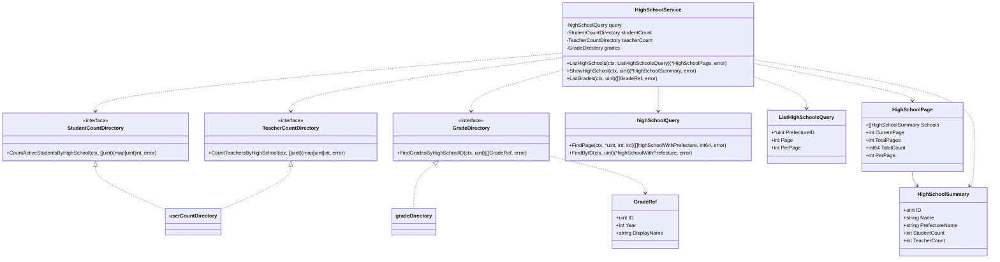
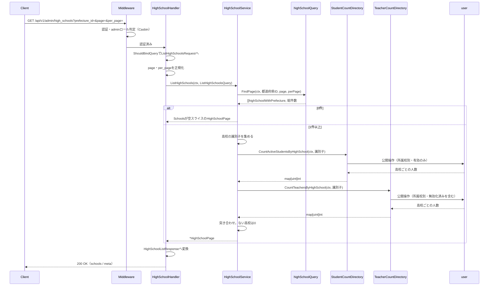
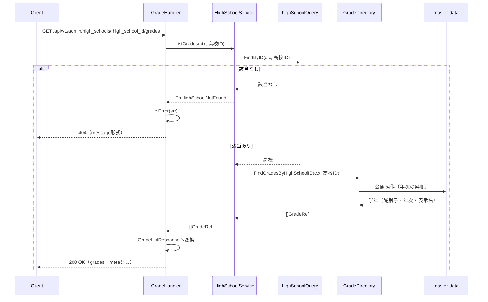
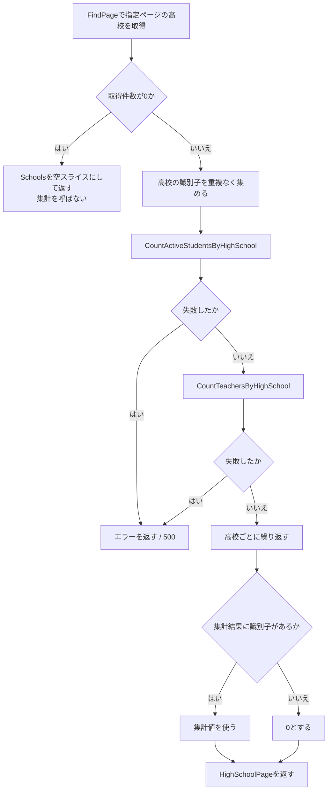
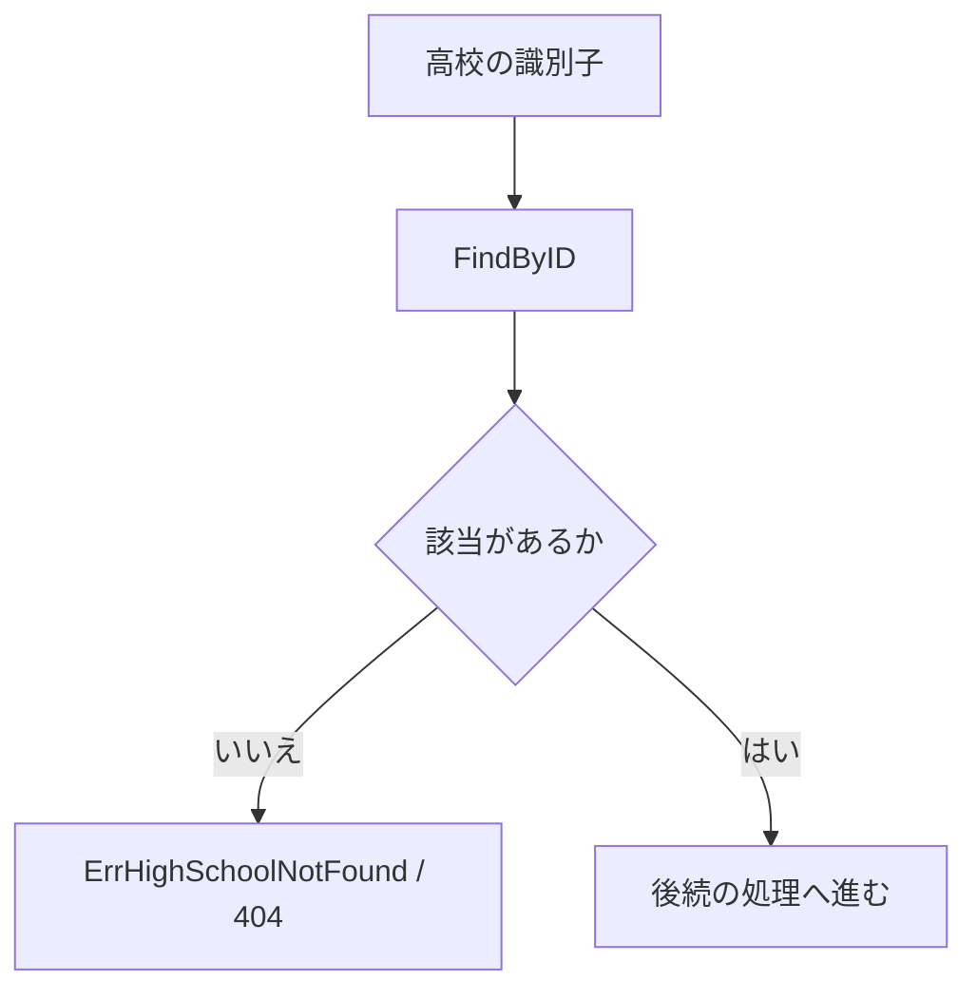

# 管理者高校学年参照機能 Go実装仕様書

---

# 1. 機能概要

## 機能概要

管理者が高校の一覧・詳細と、高校ごとの在籍生徒数・在籍教員数を参照できるようにする機能である。あわせて高校に属する学年を参照できる（②「1. 機能概要」）。エンドポイントは3つで、いずれも参照のみである。

## 採用設計パターンとその理由（②からの要約）

**Transaction Script**（②「4. 設計パターン」）

アーキテクチャ規約「3. 設計パターンごとの構造適用方針」のTransaction Script節が対象とする「単純な一覧参照・集計」に該当する。状態・書き込み・業務ルールを持たないため、domain層・usecase層・Repository Interfaceを設けない。

## 本書が対象とする実装範囲

`school-directory` Bounded Contextの実装すべてを対象とする。

- `context.go`（依存関係の組み立て）・`dependency.go`（他Contextへの依存を宣言するインターフェースと受け渡し用の型）
- application層の3つの業務操作（高校一覧・高校詳細・学年一覧）
- infrastructure層の高校の参照（自前の参照モデル）と、`master-data`・`user`への2つのアダプタ
- Presentation層（Handler / Request / Response / Routing）

対象外は、高校・学年そのものの管理（`master-data`の責務）と、人数の集計条件の定義（`user`の責務）である（②「3. Bounded Context」）。本Contextは相手Contextの公開操作を呼ぶだけで、学年の表示名を変換したり人数の集計条件を組み立てたりしない。

---

# 2. ディレクトリ構成

## 対象Bounded Context名

- `school-directory`（②「3. Bounded Context」）

## ディレクトリ・パッケージ名

アーキテクチャ規約「4. Bounded Context構成」の「Contextディレクトリの命名」に従い、Context名`school-directory`から`-`を取り除いて連結した全小文字の名前とする。ディレクトリ名は`internal/schooldirectory/`、package名は同じ`schooldirectory`となる。

Context名とディレクトリ名は規約から機械的に決まるため、②に明記がなくても推測にはならない。

本Contextのディレクトリに`admin/`のようなロール別のサブディレクトリを設けない。本Contextは管理者向けの切り口そのものであり、同一Contextを複数のロールが共有する構図ではない。

## ②で採用した設計パターン

Transaction Script（②「4. 設計パターン」）

## 作成するディレクトリ一覧

```
internal/schooldirectory/
internal/schooldirectory/application/
internal/schooldirectory/infrastructure/gormquery/
internal/schooldirectory/infrastructure/contextadapter/
internal/schooldirectory/presentation/handler/
internal/schooldirectory/presentation/request/
internal/schooldirectory/presentation/response/
```

`domain/`は作成しない。②「6. Entity設計」「7. Value Object設計」「8. Domain Service」のとおりEntity・Value Object・Domain Serviceをいずれも定義しないためである（アーキテクチャ規約「3. 設計パターンごとの構造適用方針」Transaction Script節）。

`infrastructure/gormrepo/`は作成しない。Repository Interfaceを持たないため、その実装を置くディレクトリも不要である。GORMを使うDBアクセスは`infrastructure/gormquery/`に置く。コース参照機能③「2. ディレクトリ構成」が同じ判断をしており、それに揃える。

`infrastructure/contextadapter/`は作成する。`master-data`・`user`の公開操作へ委譲するアダプタを置く（アーキテクチャ規約「4. Bounded Context構成」）。

規約「4. Bounded Context構成」の「機能で不要なディレクトリは作成しない。『層として必要だから』という理由で空のディレクトリを置かない」に従う。

## 作成するファイル一覧

```
internal/schooldirectory/context.go                                            # NewContext（依存関係の組み立て）
internal/schooldirectory/dependency.go                                         # 他Contextへの依存を宣言するインターフェースと受け渡し用の型
internal/schooldirectory/application/list_high_schools.go                      # ListHighSchools
internal/schooldirectory/application/show_high_school.go                       # ShowHighSchool
internal/schooldirectory/application/list_grades.go                            # ListGrades
internal/schooldirectory/application/errors.go                                 # application層のセンチネルエラー
internal/schooldirectory/infrastructure/gormquery/high_school_query.go         # 高校の参照（一覧・1件）
internal/schooldirectory/infrastructure/gormquery/high_school_model.go         # high_schools・prefecturesのGORMモデル
internal/schooldirectory/infrastructure/contextadapter/grade_directory.go      # GradeDirectoryの実装（master-data）
internal/schooldirectory/infrastructure/contextadapter/user_count_directory.go # StudentCountDirectory・TeacherCountDirectoryの実装（user）
internal/schooldirectory/presentation/handler/high_school_handler.go           # 一覧・詳細
internal/schooldirectory/presentation/handler/grade_handler.go                 # 学年一覧
internal/schooldirectory/presentation/request/high_school_request.go           # 一覧のクエリパラメータ
internal/schooldirectory/presentation/response/high_school_response.go         # 一覧・詳細のResponse DTO
internal/schooldirectory/presentation/response/grade_response.go               # 学年一覧のResponse DTO
internal/schooldirectory/presentation/routes.go
```

## 文書の分割

本書は分割しない。実装ファイルは上記の16であり、テストが付くもの（application層の関数3・検索関数1・アダプタ2・Handler2の8）を加えると24となるため、1文書あたり30〜35という範囲に収まる（③自動生成プロンプト「ファイル数の見積り」）。

Handlerを2つに分けるのは、`high_schools`と`grades`でRails現行のControllerが分かれており（①「10. Rails実装対応表」）、URLの階層も異なるためである。1つにまとめても収まるが、ルートの対応を追いやすくするために分ける。

---

# 3. Domain層設計

対象外（Transaction Script採用のため、Domain層を設けない）。

②「6. Entity設計」「7. Value Object設計」「8. Domain Service」「18. Domain Event」のとおり、Entity・Value Object・Domain Service・Domain Eventをいずれも定義しない。`domain/`ディレクトリを作成しない。

関数の入出力・処理ステップは「6. Application層設計」に記載する。

他Contextから受け取る値は、本Contextが必要とする項目だけを持つ受け渡し用の型として`dependency.go`に定義する。相手Contextの内部Entityをそのまま持ち込まない（アーキテクチャ規約「5. Context間連携ルール」）。

## Domain Error

対象外。②「17. Error設計」のとおり、本Contextに業務ルール違反を表すエラーが存在しない。

意味を持つエラーは「指定された高校が存在しない」の1つであり、application層のセンチネルエラーとして`application/errors.go`に置く（「14. Error実装方針」）。`domain/errors`は作成しない。

---

# 4. クラス図

Entityもstructの階層も持たないため、Domain Model相当のクラス図は存在しない。本Contextが持つのは、高校を読む参照関数、他Contextの参照手段を宣言するインターフェース、およびそれらを呼んで結果をまとめる関数である。その関係を示す。



`HighSchoolService`は、依存をコンストラクタで受け取るための入れ物である。業務ルールを持つstructではなく、Transaction Scriptの関数をメソッドとして束ねたものである。ダッシュボード機能③・分析機能③基盤編と同じ扱いとする（**②からの補足**。「17. ②からの補足事項」参照）。

生徒数と教員数のインターフェースを分けているのは、**在籍状態の扱いが異なる**ためである（②「11. Repository設計」）。1つのインターフェースに2つのメソッドを置いても規約上の問題はないが、分けることで呼び出し箇所から扱いの違いが見える。また実装は1つのアダプタが両方を満たす。

---

# 5. 状態遷移図

省略する。

理由: ②「10. 状態遷移図」のとおり、本機能が参照する高校・学年に状態が存在しない。集計で参照するユーザーの在籍状態は集計条件として使うのみで、本機能が変更しない。

---

# 6. Application層設計

本機能はTransaction Script採用のため、UseCase structを設けない（アーキテクチャ規約「3. 設計パターンごとの構造適用方針」）。②「12. UseCase設計」の3つの業務操作を、依存を保持するstructのメソッドとして実装する。

## DTO（Command / Query）

|struct名|フィールド|区分|備考|
|-|-|-|-|
|`ListHighSchoolsQuery`|`PrefectureID *uint`・`Page int`・`PerPage int`|Query|`PrefectureID`は未指定を`nil`で表す。`Page`・`PerPage`はPresentation層で正規化済みの値を受け取る|
|`HighSchoolSummary`|`ID uint`・`Name string`・`PrefectureName string`・`StudentCount int`・`TeacherCount int`|出力|一覧の要素と詳細で共用する。返す項目が同じであるため（①「5. API / 処理詳細」）|
|`HighSchoolPage`|`Schools []HighSchoolSummary`・`CurrentPage int`・`TotalPages int`・`TotalCount int64`・`PerPage int`|出力|ページ情報を含む|
|`GradeRef`|`ID uint`・`Year int`・`DisplayName string`|出力（`dependency.go`で定義）|`master-data`から受け取る型をそのまま出力に使う。本Contextで項目を足さないため|

出力の型をPresentation層のResponse DTOと分けるのは、application層の型がJSONのキー名や最上位の構造といったHTTPの関心を持たないためである（アーキテクチャ規約「6. データフロー」）。一覧と詳細は同じ`HighSchoolSummary`を返し、最上位の構造の違い（`schools`キーで包むか包まないか）はResponse DTOで表す。

## 関数

### ListHighSchools（`application/list_high_schools.go`）

|項目|内容|
|-|-|
|メソッド|`(s *HighSchoolService) ListHighSchools(ctx context.Context, q ListHighSchoolsQuery) (*HighSchoolPage, error)`|
|受け取る依存|高校の参照関数、`StudentCountDirectory`、`TeacherCountDirectory`|

処理ステップ:

1. 高校の参照関数で、都道府県の絞り込み・識別子の昇順・指定ページの取得を行う。総件数もあわせて受け取る
2. 取得件数が0の場合、`Schools`が空スライス（`nil`ではない）の`HighSchoolPage`を返す。手順3以降を行わない（②「12. UseCase設計」）
3. 取得した高校の識別子を重複なく集める
4. `StudentCountDirectory.CountActiveStudentsByHighSchool`で高校ごとの在籍生徒数を取得する
5. `TeacherCountDirectory.CountTeachersByHighSchool`で高校ごとの教員数を取得する
6. 高校ごとに人数を突き合わせる。集計結果にその高校の識別子がない場合は`0`とする
7. ページ情報を添えて`HighSchoolPage`を返す

手順2で人数の集計を呼ばないのは、空の識別子の集合で問い合わせると、相手Contextの実装によって「条件なし＝全件」として解釈される危険があるためである（分析機能③基盤編「17. ②からの補足事項」5と同じ扱い）。

手順4・5のいずれかが失敗した場合はエラーを返す。`0`として吸収しない（②「17. Error設計」）。

`Schools`を`nil`にしないのは、`nil`スライスがJSONで`null`になり、Rails現行の`[]`と異なるためである。

トランザクションは使用しない（②「14. Transaction設計」、「11. Transaction実装方針」）。

### ShowHighSchool（`application/show_high_school.go`）

|項目|内容|
|-|-|
|メソッド|`(s *HighSchoolService) ShowHighSchool(ctx context.Context, id uint) (*HighSchoolSummary, error)`|
|受け取る依存|高校の参照関数、`StudentCountDirectory`、`TeacherCountDirectory`|

処理ステップ:

1. 高校の参照関数で1件取得する。該当しない場合は`ErrHighSchoolNotFound`を返す（ガード節）
2. `StudentCountDirectory.CountActiveStudentsByHighSchool`を、その高校の識別子のみを含む集合で呼ぶ
3. `TeacherCountDirectory.CountTeachersByHighSchool`を同じ集合で呼ぶ
4. 集計結果にその高校の識別子がない場合は`0`とする
5. `HighSchoolSummary`を組み立てて返す

1件に対しても集合を渡す参照手段を使う。1件用の参照手段を別に設けないのは、`user`側に同じ意味の操作を2つ持たせないためである。

### ListGrades（`application/list_grades.go`）

|項目|内容|
|-|-|
|メソッド|`(s *HighSchoolService) ListGrades(ctx context.Context, highSchoolID uint) ([]GradeRef, error)`|
|受け取る依存|高校の参照関数、`GradeDirectory`|

処理ステップ:

1. 高校の参照関数で1件取得する。該当しない場合は`ErrHighSchoolNotFound`を返す（ガード節）
2. `GradeDirectory.FindGradesByHighSchoolID`でその高校に属する学年を取得する
3. 取得した一覧をそのまま返す。`nil`の場合は空スライスにする

**高校の実在確認を本Contextの参照で行う。** `master-data`の「高校配下の学年一覧の取得」は存在しない高校に対して空の一覧を返す仕様であり（共通マスタ参照機能②「11. Repository設計」）、空の一覧と`404`を区別できない（②「12. UseCase設計」）。

手順1で取得した高校の属性は使わない。実在確認のためだけに呼ぶ。

学年の`DisplayName`を本Contextで組み立てない。`master-data`が返した文字列をそのまま返す（②「7. Value Object設計」）。

---

# 7. シーケンス図・処理フロー図

## シーケンス図

### ListHighSchools



### ListGrades



## 処理フロー図

### 人数の突き合わせ



### 高校の実在確認



`ShowHighSchool`と`ListGrades`で共通の流れである。`ListHighSchools`には実在確認がない。

---

# 8. Infrastructure層設計

## Repository実装（Domain Model / Event Sourcing採用時）

対象外（Transaction Script採用のため）。

## Store実装（Active Record採用時）

対象外（同上）。

## Infrastructure関数（Transaction Script採用時）

### high_school_query.go（`infrastructure/gormquery/high_school_query.go`）

②「11. Repository設計」の「高校の参照」の実装である。

|項目|内容|
|-|-|
|struct名|非公開struct（例: `highSchoolQuery`）|
|コンストラクタ|`NewHighSchoolQuery(db *gorm.DB) *highSchoolQuery`|
|保持するフィールド|`db *gorm.DB`|

|関数|引数|戻り値|発行するクエリ内容|
|-|-|-|-|
|`FindPage`|`ctx context.Context, prefectureID *uint, page, perPage int`|`([]highSchoolWithPrefecture, int64, error)`|`prefectures`と結合して都道府県名を取得する。`prefectureID`が`nil`でなければ`prefecture_id`で絞り込む。`id`昇順、`LIMIT`/`OFFSET`でページを取得し、総件数も取得する|
|`FindByID`|`ctx context.Context, id uint`|`(*highSchoolWithPrefecture, error)`|`id`で1件取得し、`prefectures`と結合する。該当しない場合は該当なしを表す結果を返す|

`prefectureID`が`nil`のときは絞り込みの条件を組み立てない。`master-data`の高校検索が未指定でも条件として適用するのとは扱いが異なる（②「11. Repository設計」の「高校の参照」）。Rails現行がそれぞれ別の実装であるため、両方の振る舞いを維持する。

総件数は`COUNT`で取得する。ページの取得とは別のクエリになる。ページネーションの実装方針はGorm規約に従う。

`deleted_at`を条件に含めない。`high_schools`・`prefectures`はいずれも論理削除の列を持たない（①「6. データモデル」）。

`users`・`grades`へクエリを発行しない。人数の集計は`user`、学年の取得は`master-data`に委ねる（②「21. DB操作仕様」）。

各関数は`gormtx.DBFromContext(ctx, q.db)`で接続を取得する。本Contextはトランザクションを開始しないが、仕組みを揃えておく（「11. Transaction実装方針」）。

### GORMモデル（`infrastructure/gormquery/high_school_model.go`）

|モデル|テーブル|備考|
|-|-|-|
|`highSchoolModel`|`high_schools`|Gorm規約「2. 複数形のテーブル名」の既定命名規則で一致するため、`TableName()`のオーバーライドは不要|
|`prefectureModel`|`prefectures`|同。結合にのみ用いる|

`highSchoolWithPrefecture`は結合結果を受け取る型である。テーブルに対応しないため`TableName()`を持たない。フィールドは`ID`・`Name`・`PrefectureName`とする。

`high_schools`の`school_code`・`csv_managed`はモデルに含めない。本機能のレスポンスに含めず、集計にも使わないためである（①「5. API / 処理詳細」）。含めない項目を読まないことで、公開範囲が意図せず広がることを防ぐ。

いずれのモデルも`DeletedAt`を持たない。対象テーブルに列が存在しない。

## 他Contextの参照手段の実装

`dependency.go`で宣言したインターフェースの実装である。相手Contextが公開する操作へ委譲し、本Contextから相手のテーブルへクエリを発行しない（アーキテクチャ規約「5. Context間連携ルール」、②「11. Repository設計」）。GORMに依存せず相手Contextの公開操作を呼ぶアダプタであるため`infrastructure/contextadapter/`に置く（同「4. Bounded Context構成」）。

|ファイル|struct / コンストラクタ|満たすインターフェース|
|-|-|-|
|`grade_directory.go`|`gradeDirectory`＋`NewGradeDirectory(masterDataContext *masterdata.Context) schooldirectory.GradeDirectory`|`GradeDirectory`|
|`user_count_directory.go`|`userCountDirectory`＋`NewUserCountDirectory(userContext *user.Context) *userCountDirectory`|`StudentCountDirectory`・`TeacherCountDirectory`|

`userCountDirectory`は2つのインターフェースを満たすため、コンストラクタの戻り値をインターフェースにできない。具象型を返す（コーディング規約「7. インターフェース」の「実装側は可能な限り具象型を返す」）。インターフェースを満たすことはブランク識別子への代入でコンパイル時に検証する（同「コンパイル時のインターフェース充足チェック」）。

```
var _ schooldirectory.StudentCountDirectory = (*userCountDirectory)(nil)
var _ schooldirectory.TeacherCountDirectory = (*userCountDirectory)(nil)
```

## `dependency.go`に定義するインターフェースと型

|インターフェース|相手Context|メソッド|責務|
|-|-|-|-|
|`GradeDirectory`|`master-data`|`FindGradesByHighSchoolID(ctx context.Context, highSchoolID uint) ([]GradeRef, error)`|指定された高校に属する学年を年次の昇順で返す。表示名を含む（共通マスタ参照機能②「11. Repository設計」の「高校配下の学年一覧の取得」）|
|`StudentCountDirectory`|`user`|`CountActiveStudentsByHighSchool(ctx context.Context, highSchoolIDs []uint) (map[uint]int, error)`|指定された高校ごとの在籍中の生徒の人数を返す。**論理削除済みのユーザーを除外する**（①「5. API / 処理詳細」`#index`）|
|`TeacherCountDirectory`|`user`|`CountTeachersByHighSchool(ctx context.Context, highSchoolIDs []uint) (map[uint]int, error)`|指定された高校ごとの教員の人数を返す。**論理削除済みのユーザーを含む**（同）|

|型|フィールド|備考|
|-|-|-|
|`GradeRef`|`ID uint`・`Year int`・`DisplayName string`|`master-data`から受け取る学年の情報。所属高校の識別子は含めない（レスポンスに出さないため）|

人数を`map[uint]int`で受け取るのは、人数が0の高校が集計結果に含まれないというRails現行の振る舞いを素直に表せるためである（①「5. API / 処理詳細」`#index`の業務ルール）。スライスで受け取ると、含まれない高校を表す方法が別に必要になる。

**在籍状態の扱いを引数で切り替えない。** 2つのメソッドに分け、それぞれが扱いを固定する。引数で切り替える形にすると、呼び出し箇所を読んだだけでは生徒と教員で扱いが違うことが分からない（②「11. Repository設計」）。

**②からの補足**: 相手Contextが公開する操作の具体的なシグネチャは、各機能の③で確定する。本書では消費者側のインターフェースをコーディング規約「7. インターフェース」の方針に従って本Contextに置き、実装をアダプタに閉じ込める。

`user`が公開する集計操作は、絞り込み条件と無効化の扱い・集計の単位を受け取る形である（ユーザー基盤機能③「3. 公開操作の定義」の`CountUsers`・`SearchCondition`・`AggregateUnit`）。アダプタは次のように変換する。

|本Contextのメソッド|`user`への引数|
|-|-|
|`CountActiveStudentsByHighSchool`|`Roles`に生徒、`HighSchoolIDs`に相当する絞り込み、`Deactivated`に「有効のみ」、集計の単位に「所属校別」|
|`CountTeachersByHighSchool`|`Roles`に教員、同じ絞り込み、`Deactivated`に「無効化済みを含む」、集計の単位に「所属校別」|

**ユーザー基盤機能③の`SearchCondition`は所属校の絞り込みを`HighSchoolID *uint`（単一指定）としている。** 本Contextは高校の識別子の集合で絞り込む必要があるため、同Contextの③で複数指定を受け取れる形にする必要がある（「17. ②からの補足事項」参照）。

## 外部連携実装

対象外。本Contextから外部サービス・キャッシュ・キューへ直接アクセスしない。集計結果のキャッシュも設けない（②「20. DB設計方針」）。

## 依存関係の組み立て（`context.go`）

アーキテクチャ規約「14. 依存関係の組み立て（DI配線）」の「Context単位の組み立て関数」に従う。

|項目|内容|
|-|-|
|関数|`NewContext(db *gorm.DB, masterDataContext *masterdata.Context, userContext *user.Context) *Context`|
|組み立てる内容|高校の参照関数、2つのアダプタを生成し、`HighSchoolService`へ注入する。2つのHandlerへ同Serviceを注入する|
|公開するもの|ルーティング登録に必要な2つのHandlerのみ|

`*gorm.DB`を受け取る。`high_schools`・`prefectures`を自前の参照モデルで読むためである（②「3. Bounded Context」）。所有するテーブルを持たないContext（ダッシュボード・分析）が`*gorm.DB`を取らないのとは異なる。

本Contextから他Contextへの参照依存のみであり、他Contextから本Contextへの依存は存在しない（②「3. Bounded Context」）。そのため`main.go`での組み立て順は、`master-data`・`user`より後になる。

---

# 9. Presentation層設計

## Handler

### HighSchoolHandler（`presentation/handler/high_school_handler.go`）

|項目|内容|
|-|-|
|struct名|`HighSchoolHandler`|
|対応する呼び出し先|`*application.HighSchoolService`（Transaction Script採用のためUseCaseを経由しない）|
|保持するフィールド|`highSchoolService *application.HighSchoolService`|
|コンストラクタ|`NewHighSchoolHandler(highSchoolService *application.HighSchoolService) *HighSchoolHandler`|
|メソッド|`Index(c *gin.Context)`（GET `/api/v1/admin/high_schools`）、`Show(c *gin.Context)`（GET `/api/v1/admin/high_schools/:id`）|

`Index`の処理順序:

1. `ListHighSchoolsRequest`へ`ShouldBindQuery`でバインドする。失敗した場合は`c.Error`にバリデーションエラーを積んで戻る（Gin規約「6. Model BindingとValidation」）
2. `page`・`per_page`を正規化する。0以下・数値以外は既定値、上限を超える値は上限に丸める（②「15. Validation設計」）
3. 操作者を取得しない。結果が操作者によって変わらないため（②「16. Authorization設計」）
4. `ListHighSchoolsQuery`を組み立て、`highSchoolService.ListHighSchools`を呼ぶ
5. エラーの場合は`c.Error(err)`を呼んで戻る。ステータスとレスポンス本文への変換は`ErrorHandler`が行う（Gin規約「8. エラーハンドリングミドルウェア」）
6. `HighSchoolListResponse`へ変換する。`schools`が`nil`なら空スライスを入れる
7. `200`で返す

`Show`の処理順序:

1. パスパラメータ`id`を符号なし整数として解釈する。失敗した場合は`c.Error`にバリデーションエラーを積んで戻る
2. `highSchoolService.ShowHighSchool`を呼ぶ
3. エラーの場合は`c.Error(err)`を呼んで戻る。`ErrHighSchoolNotFound`は`404`に変換される（「14. Error実装方針」）
4. `HighSchoolDetailResponse`へ変換する。**最上位を単体のオブジェクトとし、キーで包まない**（①「5. API / 処理詳細」`#show`）
5. `200`で返す

### GradeHandler（`presentation/handler/grade_handler.go`）

|項目|内容|
|-|-|
|struct名|`GradeHandler`|
|対応する呼び出し先|`*application.HighSchoolService`|
|保持するフィールド|`highSchoolService *application.HighSchoolService`|
|コンストラクタ|`NewGradeHandler(highSchoolService *application.HighSchoolService) *GradeHandler`|
|メソッド|`Index(c *gin.Context)`（GET `/api/v1/admin/high_schools/:high_school_id/grades`）|

`Index`の処理順序:

1. パスパラメータ`high_school_id`を符号なし整数として解釈する。失敗した場合は`c.Error`にバリデーションエラーを積んで戻る
2. `highSchoolService.ListGrades`を呼ぶ
3. エラーの場合は`c.Error(err)`を呼んで戻る
4. `GradeListResponse`へ変換する。`grades`が`nil`なら空スライスを入れる。**`meta`を含めない**（①「5. API / 処理詳細」`Api::V1::Admin::GradesController#index`）
5. `200`で返す

2つのHandlerが同じ`HighSchoolService`を参照する。学年一覧が高校の実在確認を必要とし、その参照が同Serviceにあるためである（「6. Application層設計」）。

## Request / Response DTO

### ListHighSchoolsRequest（`presentation/request/high_school_request.go`）

|フィールド|型|タグ|チェック内容|
|-|-|-|-|
|`PrefectureID`|`*uint`|`form:"prefecture_id"`|指定された場合は符号なし整数として解釈できること。未指定・空文字は`nil`|
|`Page`|`*int`|`form:"page"`|指定された場合は整数として解釈できること。正規化はHandlerで行う|
|`PerPage`|`*int`|`form:"per_page"`|同|

`Page`・`PerPage`を`*int`にして`form`タグの既定値（`form:"page,default=1"`）を使わないのは、Rails現行が0以下・数値以外を既定値として扱うためである（①「5. API / 処理詳細」`#index`）。`binding`タグで`min=1`を課すと、`page=0`が`422`になりRails現行と振る舞いが変わる。

パスパラメータ（`id`・`high_school_id`）はRequest DTOにせず、Handlerで直接解釈する。1つの値のみであり、structにする利点がない。

### HighSchoolListResponse / HighSchoolDetailResponse（`presentation/response/high_school_response.go`）

|struct名|フィールド|JSONキー|型|
|-|-|-|-|
|`HighSchoolListResponse`|`Schools`|`schools`|`[]HighSchoolResponse`|
||`Meta`|`meta`|`PaginationMetaResponse`|
|`HighSchoolResponse`|`ID`|`id`|`uint`|
||`Name`|`name`|`string`|
||`PrefectureName`|`prefecture_name`|`string`|
||`StudentCount`|`student_count`|`int`|
||`TeacherCount`|`teacher_count`|`int`|
|`PaginationMetaResponse`|`CurrentPage`|`current_page`|`int`|
||`TotalPages`|`total_pages`|`int`|
||`TotalCount`|`total_count`|`int64`|
||`PerPage`|`per_page`|`int`|
|`HighSchoolDetailResponse`|`HighSchoolResponse`と同じ5項目|同|同|

`HighSchoolDetailResponse`を別のstructにせず`HighSchoolResponse`をそのまま返す形でもよい。項目が同一であるためである。本書では`HighSchoolResponse`を詳細でもそのまま使い、`HighSchoolDetailResponse`という別名を設けない。

`meta`の項目名と構成は規約「15. API規約（レスポンス形式・ページネーション・URL・クエリパラメータ）」の定めに従う。`PaginationMetaResponse`を本Contextに定義するか共通部品とするかは、全Contextに共通する事項であり本書では定めない（「17. ②からの補足事項」参照）。

### GradeListResponse（`presentation/response/grade_response.go`）

|struct名|フィールド|JSONキー|型|
|-|-|-|-|
|`GradeListResponse`|`Grades`|`grades`|`[]GradeResponse`|
|`GradeResponse`|`ID`|`id`|`uint`|
||`Year`|`year`|`int`|
||`DisplayName`|`display_name`|`string`|

`meta`のフィールドを持たない。ページネーションを行わないためである（①「5. API / 処理詳細」`Api::V1::Admin::GradesController#index`）。

## Routing

`presentation/routes.go`に登録する。Gin規約「1. ルーティング」「2. ルートグルーピング」に従う。

|Method|Path|Handler|
|-|-|-|
|GET|`/api/v1/admin/high_schools`|`HighSchoolHandler.Index`|
|GET|`/api/v1/admin/high_schools/:id`|`HighSchoolHandler.Show`|
|GET|`/api/v1/admin/high_schools/:high_school_id/grades`|`GradeHandler.Index`|

`/api/v1/admin`グループに登録する。同グループには認証ミドルウェアと`admin`ロールの認可ミドルウェアが適用される（Gin規約「3. ミドルウェア」「4. 認可（Casbin RBAC）」）。

**パスパラメータの名前が`:id`と`:high_school_id`で異なる点に注意する。** Ginは同じ位置のパスパラメータに異なる名前を割り当てられないため、`/admin/high_schools/:id`と`/admin/high_schools/:high_school_id/grades`を同時に登録すると衝突する。**本Contextでは両方を`:id`として登録し、学年一覧のHandlerも`:id`から読む**（**②からの補足**。「17. ②からの補足事項」参照）。URLの文字列は変わらないため、フロントエンドから見た差分は生じない。

`/api/v1/admin/high_schools/:id`配下には、他Contextが登録するルートも存在する（教員管理の`/teachers`、お知らせの`/announcements`。①「1. 機能概要」）。それらは各Contextの`routes.go`が登録する。本Contextは`high_schools`自身と`grades`のみを登録する。

本機能にCSRF対策の適用は不要である。いずれもGETであり、Gin規約「5. CSRF対策」の適用範囲（状態を変更するメソッド）に含まれない。

---

# 10. API仕様

|Method|Path|Handler|Request|Response|Status Code|
|-|-|-|-|-|-|
|GET|`/api/v1/admin/high_schools`|`HighSchoolHandler.Index`|`prefecture_id`・`page`・`per_page`（いずれも任意）|`HighSchoolListResponse`|200 / 422 / 401 / 403 / 500|
|GET|`/api/v1/admin/high_schools/:id`|`HighSchoolHandler.Show`|パスパラメータ`id`|`HighSchoolResponse`（単体）|200 / 404 / 422 / 401 / 403 / 500|
|GET|`/api/v1/admin/high_schools/:id/grades`|`GradeHandler.Index`|パスパラメータ`id`|`GradeListResponse`|200 / 404 / 422 / 401 / 403 / 500|

## Errorケース

|条件|Status Code|Error内容|
|-|-|-|
|`prefecture_id`が符号なし整数として解釈できない|422|`{"errors": ["都道府県の指定が不正です"]}`|
|`page`・`per_page`が整数として解釈できない|422|`{"errors": ["ページの指定が不正です"]}`|
|`page`・`per_page`が0以下|200|エラーにしない。既定値を使う（①「5. API / 処理詳細」`#index`）|
|パスパラメータが符号なし整数として解釈できない|422|`{"errors": ["高校の指定が不正です"]}`|
|指定された高校が存在しない|404|`{"message": "High schoolが見つかりません"}`|
|`master-data`・`user`の参照手段の呼び出しに失敗|500|`{"errors": ["internal server error"]}`|
|本Contextの参照の失敗|500|同|
|未認証|401|認証ミドルウェアの応答|
|`admin`ロール以外|403|`{"errors": ["この操作を行う権限がありません"]}`|

`404`の本文が`message`キーであるのは、Rails現行の形を維持するためである（②「17. Error設計」）。モデル名が英語表記（`High school`）になる点も維持する。

---

# 11. Transaction実装方針

トランザクションを使用しない。

- **Transaction開始箇所**: なし
- **Transaction終了箇所**: なし

②「14. Transaction設計」のとおり、本機能は1件のデータも作成・更新・削除せず、原子性を保証する対象が存在しない。アーキテクチャ規約「11. Transaction実装パターン（TransactionManager）」の`TransactionManager`を注入しない。`gormtx.RunInTx`も呼ばない。

高校の取得と人数の集計を1つのトランザクションで束ねることもしない。理由は②「14. Transaction設計」に記載のとおりである。

参照関数は`gormtx.DBFromContext(ctx, db)`で接続を取得する。本Contextはトランザクションを開始しないが、`db.WithContext(ctx)`を直接使わずこの形に揃える。アーキテクチャ規約「11. Transaction実装パターン（TransactionManager）」が`db.WithContext(ctx).Transaction(...)`の直接呼び出しを禁じており、接続の取得方法を機能ごとに変えないためである。

---

# 12. Validation実装方針

## Presentation

②「15. Validation設計」の「バリデーション仕様」を実装レベルに落とし込む。

|フィールド|struct名|バリデーションタグ|エラーメッセージ|
|-|-|-|-|
|`PrefectureID`|`ListHighSchoolsRequest`|なし（`*uint`へのバインド失敗で検出）|都道府県の指定が不正です|
|`Page`|`ListHighSchoolsRequest`|なし（`*int`へのバインド失敗で検出）|ページの指定が不正です|
|`PerPage`|`ListHighSchoolsRequest`|なし（同）|ページの指定が不正です|
|`id`（パスパラメータ）|-|Handlerで符号なし整数として解釈|高校の指定が不正です|

`binding`タグを使わず型へのバインド失敗で検出するのは、`page=0`のような値をエラーにせず既定値として扱う必要があるためである（「9. Presentation層設計」）。

ページ指定の正規化はHandlerで行う。

|入力|正規化後|
|-|-|
|`page`が未指定・0以下|`1`|
|`per_page`が未指定・0以下|`20`|
|`per_page`が101以上|`100`|

既定値と上限は全APIで共通の値であり、規約「15. API規約（レスポンス形式・ページネーション・URL・クエリパラメータ）」に従う。本Contextに固有の値を定めない。

検証の失敗はHandlerで`c.Error`に積み、Gin規約「8. エラーハンドリングミドルウェア」の集約ハンドラがHTTPレスポンスへ変換する。Handlerが直接`c.JSON`でエラーを返さない。`c.Error`は1回だけ呼ぶ。

## 業務ルール検証

Transaction Script採用のため、application関数内のガード節で検証する（アーキテクチャ規約「3. 設計パターンごとの構造適用方針」）。

|関数|ガード節|
|-|-|
|`ListHighSchools`|取得件数が0の場合、人数の集計を呼ばずに空の一覧を返す|
|`ShowHighSchool`|高校が取得できない場合、`ErrHighSchoolNotFound`を返す|
|`ListGrades`|同上|

いずれも業務ルールの検証ではなく、後続の処理を行えるかの確認である。本Contextに業務ルールによる検証は存在しない（②「15. Validation設計」）。

---

# 13. Authorization実装方針

②「16. Authorization設計」を実装に落とし込む。

|層|処理|
|-|-|
|Middleware|認証（ログイン済みであること）と`admin`ロールの判定。Casbin RBACで行う（Gin規約「4. 認可（Casbin RBAC）」）。`/api/v1/admin`グループに適用する|
|Handler|操作者を取得しない。`context.Context`からcurrent userを読まない|
|application関数|判定しない。参照対象が操作者に依存しない|
|Domain|存在しない（Domain層を設けない）|

管理者は全高校を参照できるため、所有権の判定が必要にならない。操作者の識別子をapplication層へ渡さない設計にすることで、判定を書く必要自体をなくす。

人数の集計では他のユーザーのデータを扱うが、Response DTOへは人数としてのみ出す。`user`から受け取る`map[uint]int`に個々のユーザーを特定できる情報は含まれない（②「16. Authorization設計」）。

---

# 14. Error実装方針

## Domain Error → Application Errorへの変換方針

対象外。②「17. Error設計」のとおり、Domain Errorが存在しない。

## Application Error → HTTPレスポンスへの変換方針

アーキテクチャ規約「12. Error変換パターン（AppError）」に従う。application層のセンチネルエラーを`apperror.AppError`へ包み、Handlerは`c.Error(err)`を呼ぶだけとする。HTTPステータスとレスポンス本文への変換は、Gin規約「8. エラーハンドリングミドルウェア」の集約ハンドラが行う。

|業務シナリオ|Error変数名／型|発生層|HTTP Status|
|-|-|-|-|
|指定された高校が存在しない|`ErrHighSchoolNotFound`（`application/errors.go`）|Application|404|
|クエリ・パスパラメータが整数として解釈できない|Request DTOのバインド失敗をバリデーションエラーへ変換したもの|Presentation|422|
|`master-data`・`user`の参照手段の呼び出しに失敗|包まずそのまま返す|Infrastructure|500|
|本Contextの参照の失敗|同|Infrastructure|500|
|未認証|認証ミドルウェアが返す|Middleware|401|
|`admin`ロール以外|認可ミドルウェアが返す|Middleware|403|

`ErrHighSchoolNotFound`の`StatusCode`は404、`LogLevel`は情報レベルとする。存在しない識別子の指定は利用者の操作によって起こりうるものであり、障害ではない。

**`404`の本文は`{"message": "High schoolが見つかりません"}`とする。** 規約「15. API規約（レスポンス形式・ページネーション・URL・クエリパラメータ）」はエラー本文を`{"errors": [...]}`と定めているが、Rails現行の`404`は`message`キーであり、フロントエンドを変更しない方針のため維持する（②「17. Error設計」）。

`AppError`に本文の形と名称を持たせ、ミドルウェアがそれに従って本文を組み立てる。機能ごとの名称表をミドルウェアに持たせないためである。問題解答機能③基盤編「14. Error実装方針」が同じ仕組みを採っており、それに揃える。名称は`High school`とする。日本語訳が定義されていないRails現行の出力に合わせる（①「5. API / 処理詳細」`#show`）。

## Infrastructure Errorのハンドリング方針

アダプタは相手Contextが返したエラーを包み直さず、そのまま返す。本Contextで意味づけし直す余地がないためである（②「17. Error設計」）。

application関数も同様に、参照手段のエラーをそのまま呼び出し元へ返す。**人数の集計の失敗を`0`として吸収しない。** Rails現行に吸収の仕組みがなく、人数が欠けたまま`200`で返ると誤った数値が表示される（②「17. Error設計」）。

参照手段が0件を返すことはエラーとして扱わない。生徒・教員が0人の高校も一覧に現れ、件数は`0`となるのが正常な応答である。

---

# 15. GORM / DBクエリ設計

②「20. DB設計方針」のとおり、既存Rails DBを継続利用し、スキーマ変更は行わない。

## 利用するGORMモデルとテーブルの対応

|Goモデル|テーブル名|備考|
|-|-|-|
|`highSchoolModel`|`high_schools`|Gorm規約「2. 複数形のテーブル名」の既定命名規則で一致するため、`TableName()`のオーバーライドは不要|
|`prefectureModel`|`prefectures`|同。結合にのみ用いる|

カラム対応はGorm規約の既定命名規則（フィールド名のsnake_case）に従う。`PrefectureID`→`prefecture_id`、`Name`→`name`等。

**いずれのモデルも`DeletedAt`を持たない。** `high_schools`・`prefectures`に論理削除の列が存在しないためである（①「6. データモデル」）。他機能③が`*time.Time`と`gorm.DeletedAt`のどちらを使うかを判断しているのとは異なり、本Contextでは判断の対象自体がない。

`school_code`・`csv_managed`をモデルに含めない（「8. Infrastructure層設計」のGORMモデル）。

`grades`・`users`・`user_roles`に対応するモデルを本Contextに持たない。所有Contextの参照手段を呼ぶ（②「21. DB操作仕様」）。

## 主要クエリの条件・ソート・ページネーション方針

|関数|対象テーブル|条件|結合|
|-|-|-|-|
|`FindPage`|`high_schools`|`prefecture_id`（`nil`でない場合のみ）|`prefectures`（`prefecture_id`で内部結合。都道府県名を取得）|
|`FindPage`（件数）|`high_schools`|同|不要（件数のみのため結合しない）|
|`FindByID`|`high_schools`|`id`|`prefectures`（同）|

- ソートは`id`昇順。第2のキーは不要である（主キーであり一意のため）
- ページネーションは`LIMIT`/`OFFSET`で行う。総件数は別のクエリで`COUNT`する
- 総件数のクエリで`prefectures`と結合しない。`high_schools.prefecture_id`が未設定を許さないカラムであるため、結合の有無で件数が変わらない（①「6. データモデル」）
- 内部結合を使う。`prefecture_id`が未設定を許さないため、結合によって行が落ちることがない
- `deleted_at`を条件に含めない（上記）

## 既存Schemaへの変更

②「20. DB設計方針」のとおり、変更なし。

---

# 16. テストケース設計

区分は②が採用した設計パターンに応じて読み替える（③自動生成プロンプト「16. テストケース設計」）。

## Domain Test

対象外（Transaction Script採用のため）。

## Application関数 Test

他Contextへの依存と参照関数をテストダブルに差し替えて検証する。本機能のテストの中心はここに置く。

|対象|テストケース|
|-|-|
|`ListHighSchools`|高校ごとに正しい人数が対応すること|
||集計結果に識別子がない高校の人数が`0`になること|
||取得件数が0のとき、人数の集計を呼ばずに空の一覧とページ情報を返すこと|
||`Schools`が`nil`にならないこと|
||生徒数と教員数で別のインターフェースを呼ぶこと|
||生徒数の集計が失敗した場合にエラーを返すこと（`0`として吸収しないこと）|
||教員数の集計が失敗した場合にエラーを返すこと|
||高校の参照が失敗した場合にエラーを返し、人数の集計を呼ばないこと|
||`PrefectureID`が`nil`のまま参照関数へ渡ること|
||ページ情報（現在のページ・総ページ数・総件数・1ページあたりの件数）がそのまま返ること|
||重複する識別子を集計へ渡さないこと|
|`ShowHighSchool`|高校の情報と人数が返ること|
||高校が取得できないとき`ErrHighSchoolNotFound`を返し、人数の集計を呼ばないこと|
||`errors.Is`で`ErrHighSchoolNotFound`と判定できること|
||集計結果にその高校の識別子がないとき人数が`0`になること|
||1件に対しても集合を渡す参照手段を呼ぶこと|
|`ListGrades`|学年の一覧がそのまま返ること|
||高校の実在確認を学年の取得より先に行うこと|
||高校が取得できないとき`ErrHighSchoolNotFound`を返し、学年の取得を呼ばないこと|
||学年が0件のとき空スライス（`nil`ではない）を返すこと|
||`DisplayName`を本Contextで組み立てず、受け取った文字列をそのまま返すこと|

## Repository Test

参照関数のテストである。本Contextが参照するテーブルへのクエリを検証する。

|対象|テストケース|
|-|-|
|`FindPage`|都道府県の絞り込みが、指定時に効くこと|
|`FindPage`|**`prefectureID`が`nil`のとき絞り込まず全件が対象になること**|
|`FindPage`|`id`昇順で返ること|
|`FindPage`|ページをまたいで重複・欠落がないこと|
|`FindPage`|総件数が絞り込み後の件数になること|
|`FindPage`|都道府県名が取得できること|
|`FindPage`|該当が0件のとき空のスライスと総件数0が返ること|
|`FindPage`|`school_code`・`csv_managed`を取得しないこと|
|`FindByID`|1件取得できること、都道府県名が取得できること|
|`FindByID`|存在しない識別子で該当なしが返ること|
|両関数|`users`・`grades`へクエリを発行しないこと|
|両関数|`gormtx.DBFromContext`で接続を取得すること|

## アダプタ Test

`dependency.go`のインターフェースの実装を対象とする。相手Contextの公開操作をテストダブルに差し替え、委譲と型変換のみを検証する。

|対象|テストケース|
|-|-|
|`gradeDirectory`|`master-data`の公開操作を呼び、`GradeRef`へ変換して返すこと|
||学年が0件のとき空のスライスを返すこと|
||相手Contextがエラーを返した場合、包み直さずそのまま返すこと|
|`userCountDirectory`|`CountActiveStudentsByHighSchool`が、生徒ロール・所属校別・**有効のみ**を指定して`user`を呼ぶこと|
||`CountTeachersByHighSchool`が、教員ロール・所属校別・**無効化済みを含む**を指定して`user`を呼ぶこと|
||`user`の集計結果を`map[uint]int`へ変換すること|
||人数が0の高校が集計結果に含まれない場合、`map`にもキーが存在しないこと|
||空の識別子の集合を渡した場合、`user`を呼ばずに空の`map`を返すこと|
||2つのインターフェースをすべて満たすこと|

## Handler Test

|対象|テストケース|
|-|-|
|`HighSchoolHandler.Index`|`schools`キーと`meta`を持つこと|
||`meta`が`current_page`・`total_pages`・`total_count`・`per_page`を持つこと|
||`page`が未指定・0以下のとき`1`として扱うこと|
||`per_page`が未指定・0以下のとき`20`、101以上のとき`100`として扱うこと|
||`prefecture_id`が未指定・空文字のとき`nil`を渡すこと|
||`prefecture_id`が符号なし整数でないとき`422`を返すこと|
||`schools`が0件のとき`[]`で返ること（`null`にしないこと）|
||レスポンスに都道府県の識別子・学校コード・`csv_managed`を含めないこと|
||操作者を取得しないこと（current userが取得できない状態でも動作すること）|
||application層のエラーを`c.Error`へ渡し、自身で`c.JSON`しないこと|
|`HighSchoolHandler.Show`|**最上位が単体のオブジェクトで返ること**（`schools`等のキーで包まないこと）|
||`ErrHighSchoolNotFound`のとき`404`と`{"message": "High schoolが見つかりません"}`が返ること|
||パスパラメータが符号なし整数でないとき`422`を返すこと|
|`GradeHandler.Index`|`grades`キーを持つこと|
||**`meta`を含めないこと**|
||`grades`が0件のとき`[]`で返ること|
||`ErrHighSchoolNotFound`のとき`404`が返ること|
||パスパラメータを`:id`から読むこと|

## Integration Test

|対象|テストケース|
|-|-|
|認可|未認証のとき`401`|
|認可|生徒・教員のロールのとき`403`|
|一覧|高校と人数が取得でき、`schools`・`meta`の構造になること|
|一覧|**生徒数が論理削除済みの生徒を除外すること**|
|一覧|**教員数が論理削除済みの教員を含むこと**|
|一覧|生徒・教員が0人の高校で人数が`0`になること|
|一覧|都道府県で絞り込めること|
|一覧|ページをまたいで重複・欠落がないこと|
|詳細|単体のオブジェクトで返ること、人数が正しいこと|
|詳細|存在しない識別子で`404`になること|
|学年一覧|年次の昇順で返ること|
|学年一覧|表示名が`master-data`の規則どおりであること（年次0〜7とそれ以外）|
|学年一覧|存在しない高校の識別子で`404`になること|
|学年一覧|学年が0件の高校で空の配列が返ること|
|ルート|3つのエンドポイントが登録されていること、`/high_schools/:id`と`/high_schools/:id/grades`が衝突せずに解決されること|

生徒数と教員数で在籍状態の扱いが異なる点は、テストダブルを使う単体テストでは実データでの確認ができないため、Integration Testで必ず確認する。

パスパラメータ名を`:id`に揃えた影響も、ルートの解決としてIntegration Testで確認する。

---

# 17. ②からの補足事項

## 1. `HighSchoolService`というstructで依存を受け取る

- 判断した内容: Transaction Scriptの関数を、依存を保持するstructのメソッドとして実装する
- 判断理由: アーキテクチャ規約「3. 設計パターンごとの構造適用方針」は「1つの業務操作を1つの関数として`application/`直下に置く」と定めるが、依存の受け渡し方法は定めていない。パッケージレベルの可変変数で依存を保持することはコーディング規約「4. パッケージ設計」の「パッケージレベルの可変変数（グローバル変数）を避ける」に反する。ダッシュボード機能③・分析機能③基盤編も同じ扱いとしている
- 推測かどうか: 推測ではない。規約に定めのない範囲での実装手段の選択である

## 2. パスパラメータ名を`:id`に揃える

- 判断した内容: `/admin/high_schools/:id`と`/admin/high_schools/:id/grades`として登録し、学年一覧のHandlerも`:id`から読む
- 判断理由: Ginは同じ位置のパスパラメータに異なる名前を割り当てられず、`:id`と`:high_school_id`を同時に登録すると衝突する。Rails現行は`:id`（詳細）と`:high_school_id`（ネスト）で名前が分かれているが、これはRailsのルーティングの都合であり、URLの文字列には現れない
- 推測かどうか: **②からの補足**。②「19. API仕様」はURLを変更しないとしているが、パスパラメータの内部的な名前までは定めていない。URLの文字列は変わらないため、フロントエンドから見た差分は生じない。同じ`/admin/high_schools/:id`配下にルートを登録する他Context（教員管理・お知らせ）も同じ名前に揃える必要がある

## 3. `user`の所属校の絞り込みを複数指定にする必要がある

- 判断した内容: 本Contextは高校の識別子の集合で人数を集計する必要があり、`user`の`SearchCondition`に所属校の複数指定が必要である
- 判断理由: ユーザー基盤機能③「3. 公開操作の定義」の`SearchCondition`は所属校の絞り込みを`HighSchoolID *uint`（単一指定）としている。1ページあたり最大100件の高校について人数を集計するため、単一指定では100回の問い合わせが必要になる。Rails現行は`by_high_school(school_ids)`として識別子の集合で1回のクエリにまとめている（①「5. API / 処理詳細」`#index`）
- 推測かどうか: 推測ではない。①の実体と`user`の公開操作の形から導かれる帰結である。**`user`側の③に反映が必要である。** 同Contextでは学年の絞り込みが分析機能の要求で`GradeIDs []uint`へ変更されており（ユーザー基盤機能③「7. ②からの補足事項」）、所属校も同じ形へ揃えることになる

## 4. ページ情報のResponse DTOの置き場所を確定しない

- 判断した内容: `PaginationMetaResponse`を本Contextに定義するか、全Contextで共通の部品とするかを本書では定めない
- 判断理由: ページ情報の項目と構成は規約「15. API規約（レスポンス形式・ページネーション・URL・クエリパラメータ）」が全APIに共通のものとして定めており、本Contextに固有の事項ではない。規約「4. Bounded Context構成」の「ディレクトリ構成」も、`internal/shared/`配下にページ情報のための置き場所を定めていない
- 推測かどうか: **②からの補足**。置き場所の確定は先送りする。本Contextの設計は、どちらであっても成立する。ページネーションを持つ他機能（教師生徒参照・管理者お知らせ管理等）と共通の判断が必要であり、規約側に定めるべき事項と考えられる

## 5. 生徒数と教員数を2つのインターフェースに分ける

- 判断した内容: 在籍状態の扱いを引数で切り替えず、`StudentCountDirectory`・`TeacherCountDirectory`という2つのインターフェースに分ける
- 判断理由: ②「11. Repository設計」が「別の呼び出しとして分けることでどちらの扱いかを呼び出し箇所で明示できる」としている。これを実装レベルでは、引数での切り替えではなくインターフェースの分割として表す。引数で切り替える形にすると、呼び出し箇所を読んだだけでは生徒と教員で扱いが違うことが分からない
- 推測かどうか: 推測ではない。②の方針を実装手段に落としたものである

## 6. 人数を`map[uint]int`で受け取る

- 判断した内容: 高校ごとの人数を`map[uint]int`で受け取り、キーが存在しない高校を`0`とする
- 判断理由: 人数が0の高校が集計結果に含まれないというRails現行の振る舞い（①「5. API / 処理詳細」`#index`）を素直に表せる。スライスで受け取ると、含まれない高校を表す方法が別に必要になる
- 推測かどうか: **②からの補足**。②は受け取る粒度を「高校の識別子ごとの人数」としているが、型までは定めていない

## 7. 詳細の専用Response DTOを設けない

- 判断した内容: 詳細取得でも`HighSchoolResponse`をそのまま返し、`HighSchoolDetailResponse`という別のstructを設けない
- 判断理由: 一覧の要素と詳細で返す項目が同一である（①「5. API / 処理詳細」`#show`）。同じ項目を持つstructを2つ定義すると、項目の追加時に片方だけ変更される
- 推測かどうか: 推測ではない。①の実体に基づく実装上の整理である

ディレクトリ名・package名（`internal/schooldirectory/`）、レスポンスの形状（一覧は`schools`＋`meta`、詳細は単体のオブジェクト、学年一覧は`grades`のみ）、HTTPステータス（200・404・422・401・403）、ページネーションの既定値と上限、生徒数・教員数の在籍状態の扱いは、いずれも規約・①・②に根拠があるため推測ではない。根拠はそれぞれ該当節に記載した。
